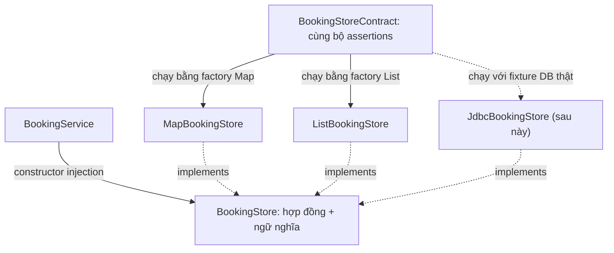
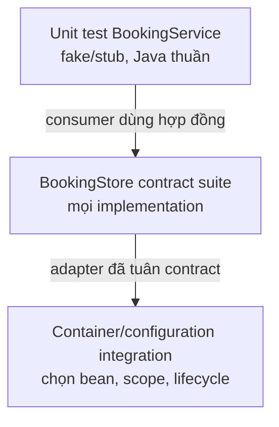

# Kiểm thử hợp đồng để xác minh khả năng thay thế triển khai

## 1. Vấn đề: cùng interface chưa chắc thay thế được cho nhau

Một lợi ích quan trọng của **Dependency Injection (DI)** là lớp nghiệp vụ nhận một cộng tác viên qua **hợp đồng** thay vì tự tạo implementation cụ thể:

```java
BookingStore store = new InMemoryBookingStore();
BookingService service = new BookingService(store);
```

Sau đó, tại **composition root**, ta có thể thay `InMemoryBookingStore` bằng `JdbcBookingStore`, `FileBookingStore` hoặc một implementation giả để kiểm thử. Nhưng việc cả hai class cùng `implements BookingStore` mới chỉ chứng minh rằng chúng có **chữ ký phương thức tương thích với trình biên dịch**. Nó **không** chứng minh kết quả, trạng thái hay cách báo lỗi của hai implementation giống nhau theo những điều consumer cần.

Ví dụ, cùng có phương thức `confirm(String bookingId)` nhưng:

- Adapter A trả `false` khi đặt chỗ đã xác nhận từ trước;
- Adapter B luôn trả `true` dù không có thay đổi;
- Adapter C âm thầm tạo đặt chỗ nếu ID không tồn tại;
- Adapter D ném exception nếu gọi xác nhận lặp lại.

Nếu `BookingService` dựa vào kết quả `true` để gửi thông báo **chỉ khi trạng thái thực sự đổi**, chỉ một vài cách cài đặt bên trên phù hợp. Gắn cùng interface chưa đủ để gọi chúng là **có thể thay thế**.

**Kiểm thử hợp đồng** (*contract testing*) giải quyết vấn đề này bằng cách chạy **cùng một bộ kiểm tra hành vi** trên các implementation khác nhau của một port/interface. Bài này thuộc chương **Kiểm thử** trong module **DEPENDENCY_INJECTION**, nối tiếp mục tiêu học **Dependency Injection** và **Inversion of Control (IoC)**: tách việc sử dụng phụ thuộc khỏi tạo/lắp ghép đối tượng, thực hành constructor injection, composition root, quản lý scope/vòng đời và kiểm thử bằng Java thuần trước khi mở rộng sang DI container.

> **Ý tưởng chính:** Một implementation có thể thay thế implementation khác tại vị trí consumer chỉ khi nó giữ được **những bảo đảm có thể quan sát được mà hợp đồng đã hứa**, chứ không đơn thuần nhờ cùng kiểu Java.

## 2. “Hợp đồng” bao gồm những điều gì?

Một interface diễn đạt **cấu trúc**, nhưng hợp đồng dùng để thay thế còn cần **ngữ nghĩa**.

Giả sử ứng dụng có:

```java
interface BookingStore {
    void saveNew(String bookingId);
    boolean confirm(String bookingId);
    Optional<BookingStatus> find(String bookingId);
}
```

Chữ ký chỉ cho biết tên method, tham số và kiểu trả về. Để dùng đúng, consumer còn cần biết:

| Phần của hợp đồng | Ví dụ cần quy định rõ |
| --- | --- |
| **Điều kiện đầu vào** (*preconditions*) | `bookingId` không được `null` hoặc chuỗi trắng. |
| **Điều kiện sau thực thi** (*postconditions*) | Sau `saveNew("B-1")` thành công, `find("B-1")` trả trạng thái `NEW`. |
| **Ngữ nghĩa kết quả** | `confirm(id)` trả `true` **chỉ** nếu trạng thái chuyển từ `NEW` sang `CONFIRMED`; gọi lặp trả `false`. |
| **Ngữ nghĩa lỗi** | Thêm trùng ID ném `IllegalStateException`; xác nhận ID không tồn tại ném `NoSuchElementException`. |
| **Bất biến** | Không có bản ghi trùng khóa; các lần đọc không tự thay đổi trạng thái. |
| **Nhất quán và hiển thị** | Trong ví dụ đơn luồng, sau khi thao tác trả về thành công, các lượt đọc tiếp theo từ cùng store thấy trạng thái mới. |
| **Phạm vi dữ liệu** | Hai test độc lập cần dữ liệu tách biệt; không mặc định hai instance của adapter thực tế sẽ truy cập hai database khác nhau. |
| **Yêu cầu phi chức năng nếu có** | Thread safety, transaction, timeout hoặc bảo đảm bền vững cần được mô tả riêng nếu thực sự thuộc hợp đồng. |

Các hợp đồng tốt **đủ cụ thể** để consumer dựa vào và **đủ trung lập về công nghệ** để các adapter dùng những cơ chế khác nhau. Không nên đưa `ResultSet`, `SQLException`, tên bảng SQL, endpoint HTTP hay cơ chế retry của một nhà cung cấp vào port nếu consumer chỉ cần thao tác đặt chỗ.

### Liên hệ với Liskov Substitution Principle (LSP)

Nguyên lý thay thế Liskov có thể hiểu ở mức thực hành: khi thay một đối tượng bằng một đối tượng khác tuân theo cùng abstraction, tính đúng đắn của code đang sử dụng abstraction không bị phá vỡ.

Một implementation không nên:

- **Siết điều kiện đầu vào** vượt hợp đồng mà không có cơ chế đã được quy định: ví dụ interface cho phép mọi ID không rỗng nhưng adapter chỉ nhận ID bắt đầu bằng `VIP-`.
- **Làm yếu kết quả bảo đảm**: ví dụ nói đã xác nhận nhưng `find` vẫn trả `NEW` trong điều kiện mà hợp đồng đòi hỏi đọc được ngay.
- **Thay ngữ nghĩa lỗi** theo cách consumer không thể dự đoán: ví dụ xác nhận ID không tồn tại thì tự thêm thay vì báo lỗi đã được quy định.
- **Phá bất biến** mà mọi consumer dựa vào: ví dụ gọi xác nhận lặp làm phát sinh hai thông báo vì `confirm` trả `true` hai lần.

Kiểm thử hợp đồng **không thể chứng minh đầy đủ LSP trong mọi trường hợp có thể xảy ra**, nhưng nó cụ thể hóa những quy tắc quan trọng thành các ví dụ có thể chạy lặp lại, giúp phát hiện sai lệch giữa adapter.

## 3. Kiểm thử hợp đồng khác những kiểu kiểm thử nào?

Từ *contract test* đôi khi còn dùng cho **consumer-driven contract test** giữa các dịch vụ HTTP. Bài này tập trung vào **hợp đồng của một port Java và các implementation được inject**. Ý tưởng cùng hướng đến thỏa thuận có thể kiểm chứng, nhưng công cụ, phạm vi và trường hợp lỗi không hoàn toàn giống nhau.

| Loại kiểm thử | Đơn vị được kiểm tra | Câu hỏi chính |
| --- | --- | --- |
| **Unit test của consumer** | `BookingService` + fake/stub | Service có điều phối đúng khi dependency trả các kết quả cụ thể? |
| **Contract test của port** | **Mỗi implementation** của `BookingStore` | Tất cả adapter có tuân theo cùng ngữ nghĩa đầu vào, trạng thái, kết quả, lỗi? |
| **Integration test của adapter** | Adapter + database/file/API thật | Chuyển đổi SQL, mapping, kết nối, giao dịch và dữ liệu thực có hoạt động? |
| **Wiring/configuration test** | Composition root hoặc DI container | Môi trường đang inject đúng implementation, scope và cấu hình? |
| **End-to-end test** | Nhiều tầng chạy cùng nhau | Một luồng nghiệp vụ hoàn chỉnh có hoạt động trong hệ thống đã lắp ghép? |
| **HTTP consumer-driven contract test** | Consumer và provider của API phân tán | Provider có đáp ứng các tương tác/API mà consumer đã thỏa thuận? |

Nếu chỉ dùng mock trong unit test, ta có thể đã **lập trình mock theo hành vi mình mong**, chứ không phải hành vi adapter thật cung cấp. Bộ contract test được dùng lại trên adapter thật là cầu nối giúp giảm khoảng cách này.

Ngược lại, contract test chạy qua `HashMap` không thể chứng minh `JdbcBookingStore` hoạt động với một cơ sở dữ liệu thật. Để có bằng chứng cho JDBC adapter, phải chạy chính **cùng hợp đồng** trên một fixture có database phù hợp, đồng thời có thể thêm integration test cho những đặc điểm riêng của JDBC.

## 4. Quy trình thiết kế một bộ kiểm thử có thể tái sử dụng

Thay vì viết mỗi implementation một bộ test riêng có những kỳ vọng khác nhau, hãy:

1. **Định nghĩa một port duy nhất** mà use case phụ thuộc.
2. **Viết rõ hành vi quan sát được** cho đầu vào hợp lệ, đầu vào sai, trạng thái sau thao tác và lỗi.
3. **Viết một bộ scenario dùng kiểu interface**, không cast về class triển khai.
4. **Truyền factory/fixture cho từng implementation**, để mỗi scenario có dữ liệu độc lập.
5. **Chạy toàn bộ scenario với mọi implementation** đang cam kết port đó.
6. **Kiểm tra consumer riêng bằng fake**, không nhân đôi mọi test của adapter ở tầng consumer.
7. **Bổ sung integration test đặc thù** cho các yếu tố không thuộc port hoặc cần tài nguyên thật.
8. **Khi thêm implementation mới**, đăng ký thêm nó vào bộ contract test trước khi cho phép composition root cấp nó cho production.

Sơ đồ:



**Chính bộ test phải độc lập với implementation**, không phải mọi implementation buộc dùng cùng thư viện, bộ nhớ hay cách cấu trúc dữ liệu.

## 5. Đặt hợp đồng đủ rõ để viết assertions

Ví dụ trong bài dùng một ca sử dụng nhỏ: **đăng ký đặt chỗ mới, xác nhận, và tra cứu trạng thái**.

Hợp đồng dự kiến:

| Lời gọi | Trạng thái trước | Kết quả/lỗi | Trạng thái sau |
| --- | --- | --- | --- |
| `find("B-1")` | Chưa có ID | `Optional.empty()` | Không đổi |
| `saveNew("B-1")` | Chưa có ID | Trả về bình thường | `B-1` tồn tại ở `NEW` |
| `saveNew("B-1")` | Đã có ID | `IllegalStateException` | Giữ nguyên bản ghi cũ |
| `confirm("B-1")` | `NEW` | `true` | `CONFIRMED` |
| `confirm("B-1")` | `CONFIRMED` | `false` | Vẫn `CONFIRMED` |
| `confirm("B-404")` | Không tồn tại | `NoSuchElementException` | Không tự tạo bản ghi |
| Bất kỳ method nào với ID `null`/trắng | Bất kỳ | `IllegalArgumentException` | Không thay đổi dữ liệu |

Bảng là **quyết định cho ví dụ học tập**; trong ứng dụng thật, nhóm thiết kế có thể chọn kiểu lỗi/kết quả khác, nhưng mọi implementation trong cùng hợp đồng phải giữ những quyết định đó.

### Hợp đồng không nên quá cụ thể

Bộ contract test **không nên** yêu cầu:

- `MapBookingStore` dùng `HashMap`, hoặc `ListBookingStore` dùng `ArrayList`;
- Thông báo exception phải đúng từng ký tự, trừ khi câu chữ là một phần API đã cam kết;
- SQL có số câu truy vấn cố định, thứ tự nội bộ cố định, hoặc class phải có tên cố định;
- Hai instance repository khác nhau nhất thiết phải lưu dữ liệu tách biệt; với database, hai instance có thể trỏ cùng backend;
- Mọi adapter đều có cùng độ trễ hoặc thông số mạng, nếu những yêu cầu đó không thuộc contract.

Thay vào đó, kiểm tra **hành vi nhìn thấy qua interface**. Các chi tiết công nghệ cần được kiểm tra ở tầng integration/adapter nếu quan trọng.

## 6. Ví dụ đầy đủ bằng Java thuần: chạy cùng bộ contract test cho hai implementation

Ví dụ này có hai adapter dùng cơ chế lưu khác nhau:

- `MapBookingStore` lưu trạng thái trong `HashMap`.
- `ListBookingStore` lưu các mục trong `ArrayList` rồi tìm theo ID.

Hai adapter **không chứa logic nghiệp vụ ở consumer**; chúng chỉ đáp ứng hợp đồng lưu trữ. `BookingService` được constructor injection cấp `BookingStore` và `BookingNotifier`. Khi xác nhận thành công lần đầu, service gửi thông báo; khi xác nhận lặp, không gửi lại.

Để có thể tự chạy, lưu toàn bộ mã sau thành **`Main.java`**. Yêu cầu **JDK 11 trở lên**, không cần JUnit, Mockito hay DI container.

```java
import java.util.ArrayList;
import java.util.HashMap;
import java.util.List;
import java.util.Map;
import java.util.NoSuchElementException;
import java.util.Objects;
import java.util.Optional;
import java.util.function.Consumer;
import java.util.function.Supplier;

public class Main {
    enum BookingStatus {
        NEW, CONFIRMED
    }

    // PORT: ngữ nghĩa được diễn giải trong bài và kiểm thử chung bên dưới.
    interface BookingStore {
        void saveNew(String bookingId);
        boolean confirm(String bookingId);
        Optional<BookingStatus> find(String bookingId);
    }

    interface BookingNotifier {
        void confirmed(String bookingId);
    }

    // Ví dụ chỉ chấp nhận ID khác null và không chỉ gồm khoảng trắng.
    private static String validId(String id) {
        if (id == null || id.isBlank()) {
            throw new IllegalArgumentException("bookingId không hợp lệ");
        }
        return id;
    }

    // ADAPTER A: lưu dữ liệu trong Map.
    static final class MapBookingStore implements BookingStore {
        private final Map<String, BookingStatus> data = new HashMap<>();

        @Override
        public void saveNew(String bookingId) {
            String id = validId(bookingId);
            if (data.putIfAbsent(id, BookingStatus.NEW) != null) {
                throw new IllegalStateException("Đã tồn tại: " + id);
            }
        }

        @Override
        public boolean confirm(String bookingId) {
            String id = validId(bookingId);
            BookingStatus current = data.get(id);

            if (current == null) {
                throw new NoSuchElementException("Không tìm thấy: " + id);
            }
            if (current == BookingStatus.CONFIRMED) {
                return false;
            }

            data.put(id, BookingStatus.CONFIRMED);
            return true;
        }

        @Override
        public Optional<BookingStatus> find(String bookingId) {
            return Optional.ofNullable(data.get(validId(bookingId)));
        }
    }

    // ADAPTER B: cố ý dùng List để thay đổi chi tiết lưu trữ.
    static final class ListBookingStore implements BookingStore {
        private static final class Entry {
            final String id;
            BookingStatus status;

            Entry(String id) {
                this.id = id;
                this.status = BookingStatus.NEW;
            }
        }

        private final List<Entry> entries = new ArrayList<>();

        private Entry locate(String id) {
            for (Entry entry : entries) {
                if (entry.id.equals(id)) {
                    return entry;
                }
            }
            return null;
        }

        @Override
        public void saveNew(String bookingId) {
            String id = validId(bookingId);
            if (locate(id) != null) {
                throw new IllegalStateException("Đã tồn tại: " + id);
            }
            entries.add(new Entry(id));
        }

        @Override
        public boolean confirm(String bookingId) {
            String id = validId(bookingId);
            Entry found = locate(id);

            if (found == null) {
                throw new NoSuchElementException("Không tìm thấy: " + id);
            }
            if (found.status == BookingStatus.CONFIRMED) {
                return false;
            }

            found.status = BookingStatus.CONFIRMED;
            return true;
        }

        @Override
        public Optional<BookingStatus> find(String bookingId) {
            Entry found = locate(validId(bookingId));
            return found == null
                    ? Optional.empty()
                    : Optional.of(found.status);
        }
    }

    // CONSUMER: không cần biết dữ liệu nằm trong Map hay List.
    static final class BookingService {
        private final BookingStore store;
        private final BookingNotifier notifier;

        BookingService(BookingStore store, BookingNotifier notifier) {
            this.store = Objects.requireNonNull(store, "store");
            this.notifier = Objects.requireNonNull(notifier, "notifier");
        }

        void register(String bookingId) {
            store.saveNew(bookingId);
        }

        // Ngữ nghĩa confirm() của port quyết định gửi thông báo đúng một lần.
        boolean confirmAndNotify(String bookingId) {
            boolean changed = store.confirm(bookingId);
            if (changed) {
                notifier.confirmed(bookingId);
            }
            return changed;
        }
    }

    static final class RecordingNotifier implements BookingNotifier {
        final List<String> sentIds = new ArrayList<>();

        @Override
        public void confirmed(String bookingId) {
            sentIds.add(bookingId);
        }
    }

    // Một suite, nhận FACTORY của implementation thay vì class cụ thể.
    static final class BookingStoreContract {
        static void check(boolean condition, String message) {
            if (!condition) {
                throw new AssertionError(message);
            }
        }

        static void expectThrows(
                Class<? extends RuntimeException> expected,
                Runnable operation) {
            try {
                operation.run();
            } catch (RuntimeException actual) {
                if (expected.isInstance(actual)) {
                    return;
                }
                throw new AssertionError(
                        "Sai loại exception; cần " + expected.getSimpleName(),
                        actual);
            }
            throw new AssertionError(
                    "Đáng lẽ phải ném " + expected.getSimpleName());
        }

        // Factory phải cấp dữ liệu sạch cho MỖI scenario.
        static void scenario(
                Supplier<? extends BookingStore> factory,
                Consumer<BookingStore> assertions) {
            BookingStore store = Objects.requireNonNull(
                    factory.get(), "factory trả về null");
            assertions.accept(store);
        }

        static void run(String implementation,
                        Supplier<? extends BookingStore> factory) {
            scenario(factory, store -> {
                check(store.find("B-404").isEmpty(),
                        "find không tồn tại phải trả empty");
            });

            scenario(factory, store -> {
                store.saveNew("B-101");
                check(store.find("B-101").orElseThrow()
                                == BookingStatus.NEW,
                        "saveNew phải tạo trạng thái NEW");
                check(store.find("B-101").orElseThrow()
                                == BookingStatus.NEW,
                        "find không được tự sửa trạng thái");
            });

            scenario(factory, store -> {
                store.saveNew("B-102");
                expectThrows(IllegalStateException.class,
                        () -> store.saveNew("B-102"));
                check(store.find("B-102").orElseThrow()
                                == BookingStatus.NEW,
                        "saveNew trùng phải giữ dữ liệu cũ");
            });

            scenario(factory, store -> {
                store.saveNew("B-103");
                check(store.confirm("B-103"),
                        "Lần xác nhận đầu phải trả true");
                check(!store.confirm("B-103"),
                        "Xác nhận lặp phải trả false");
                check(store.find("B-103").orElseThrow()
                                == BookingStatus.CONFIRMED,
                        "Trạng thái cuối phải là CONFIRMED");
            });

            scenario(factory, store -> {
                expectThrows(NoSuchElementException.class,
                        () -> store.confirm("B-404"));
                check(store.find("B-404").isEmpty(),
                        "confirm ID thiếu không được tự tạo bản ghi");
            });

            scenario(factory, store -> {
                expectThrows(IllegalArgumentException.class,
                        () -> store.saveNew(null));
                expectThrows(IllegalArgumentException.class,
                        () -> store.saveNew("   "));
                expectThrows(IllegalArgumentException.class,
                        () -> store.confirm(null));
                expectThrows(IllegalArgumentException.class,
                        () -> store.find("\t"));
                check(store.find("B-404").isEmpty(),
                        "Đầu vào sai không được ghi dữ liệu");
            });

            System.out.println("PASS contract: " + implementation);
        }
    }

    // Kiểm tra service vẫn hoạt động khi composition root đổi adapter.
    static void verifyConsumer(
            String implementation, Supplier<? extends BookingStore> factory) {
        BookingStore store = factory.get();
        RecordingNotifier notifier = new RecordingNotifier();
        BookingService service = new BookingService(store, notifier);

        service.register("B-201");
        BookingStoreContract.check(service.confirmAndNotify("B-201"),
                "Xác nhận đầu phải tạo thay đổi");
        BookingStoreContract.check(!service.confirmAndNotify("B-201"),
                "Xác nhận lặp không được tạo thay đổi");

        BookingStoreContract.check(notifier.sentIds.equals(List.of("B-201")),
                "Consumer phải gửi thông báo đúng một lần");
        BookingStoreContract.check(
                store.find("B-201").orElseThrow()
                        == BookingStatus.CONFIRMED,
                "Repository phải giữ trạng thái CONFIRMED");

        System.out.println("PASS consumer: " + implementation);
    }

    public static void main(String[] args) {
        // COMPOSITION ROOT: thay triển khai nhưng không sửa BookingService.
        BookingStoreContract.run("MapBookingStore", MapBookingStore::new);
        BookingStoreContract.run("ListBookingStore", ListBookingStore::new);

        verifyConsumer("MapBookingStore", MapBookingStore::new);
        verifyConsumer("ListBookingStore", ListBookingStore::new);
    }
}
```

Biên dịch và chạy:

```bash
javac -encoding UTF-8 Main.java
java Main
```

Kết quả dự kiến:

```text
PASS contract: MapBookingStore
PASS contract: ListBookingStore
PASS consumer: MapBookingStore
PASS consumer: ListBookingStore
```

Đây là **kết quả kỳ vọng** từ code minh họa, không phải kết quả thực thi đã được xác nhận trong tài liệu này.

### Vì sao dùng `Supplier<? extends BookingStore>`?

`BookingStoreContract.run(...)` không gọi `new MapBookingStore()` bên trong test. Thay vào đó, nó nhận một **factory**:

```java
BookingStoreContract.run("MapBookingStore", MapBookingStore::new);
BookingStoreContract.run("ListBookingStore", ListBookingStore::new);
```

Mỗi scenario gọi `factory.get()` để có một **store khởi đầu sạch**. Đối với hai class in-memory trong ví dụ, mỗi lần `new` tạo bộ nhớ độc lập. Với adapter database thật, việc tạo instance mới **không nhất thiết tạo database sạch**: fixture phải tự cấp schema, transaction, namespace hoặc cơ chế reset dữ liệu đúng hợp đồng.

Điểm quan trọng là **test tập trung vào hành vi của `BookingStore`** và không dùng `instanceof MapBookingStore`, cast về `ListBookingStore` hay đọc field nội bộ. Nhờ đó, cùng bộ test có thể áp dụng cho nhiều cách lưu trữ.

### Vì sao test cả consumer với hai store?

Suite hợp đồng chứng minh mỗi adapter đáp ứng ngữ nghĩa đã thỏa thuận trong các scenario. `verifyConsumer(...)` kiểm tra rằng `BookingService` dùng kết quả đó theo ý định: chỉ gửi thông báo khi `confirm` trả `true`.

Đó là **hai kiểu chứng cứ bổ sung cho nhau**. Nếu chỉ chạy service test với một fake tự viết, test có thể bỏ sót việc adapter thật trả `true` sai khi xác nhận lặp. Nếu chỉ test adapter, ta chưa kiểm tra service có thực sự dùng cờ `changed` để tránh thông báo trùng hay không.

## 7. Bộ contract test phát hiện sai lệch như thế nào?

Giả sử một implementation mới có lỗi:

```java
// Chỉ là phản ví dụ, không ghép vào Main.java ở mục 6.
@Override
public boolean confirm(String bookingId) {
    updateConfirmationInDatabase(bookingId);
    return true;  // Sai nếu ID đã ở trạng thái CONFIRMED.
}
```

Nếu adapter luôn trả `true` khi gọi lặp, scenario:

```java
check(!store.confirm("B-103"),
        "Xác nhận lặp phải trả false");
```

sẽ thất bại. Nếu đưa adapter sai này vào `BookingService`, notifier có thể gửi **hai lần** — một lỗi nghiệp vụ mà chỉ nhìn chữ ký `boolean confirm(String)` không phát hiện được.

Các sai lệch khác có thể bị bắt:

| Sai lệch của adapter | Scenario phát hiện |
| --- | --- |
| `find` trả `NEW` cho ID không tồn tại | `find("B-404").isEmpty()` |
| `saveNew` cho phép ghi trùng | Kiểm tra exception khi gọi `saveNew` lần hai |
| Xác nhận không cập nhật trạng thái | Kiểm tra `find(...).orElseThrow() == CONFIRMED` |
| Xác nhận lặp vẫn báo có thay đổi | Kiểm tra `!store.confirm(...)` ở lần hai |
| Xác nhận ID chưa tồn tại tự thêm bản ghi | Kiểm tra `NoSuchElementException` và `find` sau lỗi |
| Chấp nhận ID `null`/trắng khác hợp đồng | Các scenario đầu vào sai |
| Lệnh đọc vô tình thay đổi trạng thái | Hai lần `find` liên tiếp sau khi tạo |

Không cần **so sánh trực tiếp dữ liệu nội bộ** giữa hai adapter. Mỗi adapter độc lập đối chiếu với **một bộ kỳ vọng chung**. Cách này tránh biến Map thành “chuẩn” để List phải bắt chước cả những lỗi tình cờ của Map.

## 8. Thiết kế fixture và dọn dẹp cho adapter thật

Trong ví dụ in-memory, factory tạo store mới không mở socket, file hay kết nối ngoài. Adapter thật có thể cần:

- Tạo database/schema riêng cho mỗi scenario;
- Mở một connection hoặc client có vòng đời xác định;
- Chạy migration/seed dữ liệu đầu vào;
- Dọn bảng, transaction, file hoặc tài nguyên sau khi assertion hoàn tất;
- Đảm bảo các test chạy đồng thời không đụng cùng một namespace dữ liệu.

Khi đó có thể mô hình hóa **fixture sở hữu tài nguyên**:

```java
// Mã minh họa thiết kế test fixture, KHÔNG thuộc Main.java ở mục 6.
interface StoreFixture extends AutoCloseable {
    BookingStore store();

    @Override
    void close() throws Exception;
}

interface StoreFixtureFactory {
    StoreFixture open() throws Exception;
}

void executeScenario(StoreFixtureFactory factory) throws Exception {
    try (StoreFixture fixture = factory.open()) {
        BookingStore store = fixture.store();
        // Chạy cùng các assertion hợp đồng trên store.
    }
    // Fixture tự giải phóng tài nguyên và dữ liệu riêng của scenario.
}
```

Các kiểu ở đoạn này được viết theo cách minh họa **trong cùng một module/package có quyền tham chiếu `BookingStore`**. Khi áp dụng vào dự án thật, cần đặt chúng trong class hoặc các file Java hợp lệ, không dán trực tiếp vào tệp `Main.java` của mục 6.

**Quy tắc ownership:** fixture nhận quyền sở hữu tài nguyên nó tạo và phải dọn chúng khi test kết thúc, kể cả khi assertion ném `AssertionError` hoặc adapter ném exception. `try-with-resources` bảo đảm gọi `close()` khi thoát phạm vi. Nếu factory thất bại **sau khi đã mở một phần tài nguyên nhưng chưa trả fixture**, factory cần tự dọn phần chưa bàn giao.

### Một factory không đồng nghĩa với một kho dữ liệu độc lập

Hai instance `JdbcBookingStore` có thể truy cập cùng một database. Test này:

```java
BookingStore first = new JdbcBookingStore(sharedDataSource);
BookingStore second = new JdbcBookingStore(sharedDataSource);
```

không nói rằng `first` và `second` cô lập dữ liệu. Nếu cùng bảng và schema, trạng thái có thể chia sẻ. Tạo object mới giải quyết **instance identity**, không tự giải quyết **data isolation**.

Với cơ sở dữ liệu, nên dùng fixture có rollback khi phù hợp, schema riêng, database tạm hoặc dọn dữ liệu bằng khóa test độc nhất. Nếu adapter có behavior bất đồng bộ hoặc eventual consistency, phải xem lại **hợp đồng nhất quán** trước khi tái sử dụng nguyên xi scenario đọc ngay sau ghi; không nên cố thêm `Thread.sleep(...)` một cách tùy tiện để che sai lệch thiết kế.

## 9. Test double: fake phải thực hiện đúng phần hợp đồng được dựa vào

Có nhiều kiểu test double:

| Loại | Vai trò | Ví dụ |
| --- | --- | --- |
| **Stub** | Trả kết quả được định trước để kiểm tra một nhánh ở consumer. | `confirm(id)` trả `false` để xác nhận service không gửi thông báo. |
| **Spy** | Ghi nhận các lời gọi/tham số để kiểm tra tương tác. | `RecordingNotifier` lưu ID đã nhận. |
| **Fake** | Cài đặt đơn giản nhưng có hành vi thật trong bộ nhớ. | `MapBookingStore` trong ví dụ. |
| **Mock** | Được cấu hình expectation về lời gọi, thường qua framework mocking. | Mock xác nhận `notifier.confirmed("B-1")` được gọi đúng một lần. |
| **Real adapter** | Cài đặt thực tế cần hạ tầng ngoài. | `JdbcBookingStore` dùng database có quản lý giao dịch. |

Một fake không nên được xem là “chuẩn” chỉ vì nó dễ viết. Nếu fake được sử dụng như **thay thế đầy đủ cho port** trong nhiều test, hãy cân nhắc cho fake chạy **cùng bộ contract test**. Nếu fake chỉ hỗ trợ một tình huống hẹp, tài liệu test phải nói rõ giới hạn; đừng để những phương thức chưa hỗ trợ âm thầm trả giá trị mặc định khiến consumer test đánh lừa người đọc.

Ví dụ:

```java
// Minh họa một stub có chủ đích cho riêng nhánh confirm lặp.
BookingStore stub = new BookingStore() {
    @Override
    public void saveNew(String id) {
        throw new UnsupportedOperationException(
                "Stub này chỉ dùng test nhánh confirm");
    }

    @Override
    public boolean confirm(String id) {
        return false;
    }

    @Override
    public Optional<BookingStatus> find(String id) {
        throw new UnsupportedOperationException(
                "Stub này không dùng cho find");
    }
};
```

Stub như vậy **không phải implementation hợp lệ của toàn bộ `BookingStore`** để đăng ký production hoặc đem chạy suite hợp đồng. Nó chỉ kiểm tra một nhánh hẹp của consumer và phải được dùng có chủ đích. Với mã minh họa trên, khi đặt ngoài `Main` cần tham chiếu các kiểu lồng như `Main.BookingStore`, `Main.BookingStatus`; đây là đoạn diễn giải ý tưởng, không thuộc tệp chạy hoàn chỉnh.

Cách tốt để tránh kết luận sai là luôn phân biệt **test xác nhận tương tác giữa service và stub** với **test xác nhận một adapter thực thi đầy đủ port**.

## 10. Kiểm thử lỗi, trạng thái và tính nhất quán

Contract test mạnh hơn kiểm tra đường đi thành công. Những chỗ thường khác nhau giữa adapter là **lỗi** và **ranh giới nhất quán**.

### 10.1. Kiểm tra lỗi theo loại và hậu điều kiện

Ví dụ khi `saveNew` trùng:

```java
expectThrows(IllegalStateException.class,
        () -> store.saveNew("B-102"));

check(store.find("B-102").orElseThrow() == BookingStatus.NEW,
        "Ghi trùng phải giữ nguyên trạng thái");
```

Không chỉ kiểm tra có exception; còn xác nhận **dữ liệu không bị biến đổi sai**. Khi có nhiều tác dụng phụ (database + event), việc kiểm tra hậu điều kiện càng quan trọng.

### 10.2. Idempotency phải được xác định rõ

Trong ví dụ, `confirm` được thiết kế **idempotent về trạng thái**: gọi lần hai không tạo thay đổi, trả `false`. Nếu adapter có gửi event bên trong, việc gửi event lặp vẫn có thể là side effect không mong muốn. Một contract test tốt phải chỉ ra **tác dụng phụ nào được phép và tác dụng phụ nào không**.

**Không suy rằng idempotency của một API tự kéo theo email/HTTP request hoặc hệ thống bên ngoài chỉ xử lý đúng một lần.** Khi vượt qua ranh giới mạng, có thể cần idempotency key, outbox hoặc cơ chế khử trùng lặp theo yêu cầu nghiệp vụ.

### 10.3. Thời gian và eventual consistency

Nếu `find` ngay sau `confirm` có thể trả dữ liệu cũ do hệ thống eventual consistent, đó là **hợp đồng khác** với ví dụ yêu cầu đọc thấy ngay trong cùng store. Có hai hướng minh bạch:

1. **Giữ hợp đồng mạnh:** adapter phải cung cấp cách đọc/ghi đáp ứng tính nhất quán mà consumer cần.
2. **Đổi hợp đồng có chủ đích:** xác định trạng thái đang chờ, cơ chế polling/event, timeout và độ trễ tối đa có thể chấp nhận; viết contract test mới theo semantics ấy.

Không sửa test bằng cách “ngủ 3 giây” chỉ để nó tình cờ qua trên một máy. Điều đó biến test thành không ổn định và che đi việc hợp đồng chưa được định nghĩa.

### 10.4. Concurrency không tự được chứng minh

`MapBookingStore` và `ListBookingStore` trong ví dụ dùng collection có thể thay đổi và **không đảm bảo thread safety**. Bộ test được chạy tuần tự; vì vậy kết quả PASS **không** chứng minh phù hợp khi cùng instance bị truy cập đồng thời.

Nếu hợp đồng của production yêu cầu atomic confirm, linearizability hoặc khả năng chạy nhiều luồng, cần thêm test đồng thời và bảo đảm ở tầng adapter/storage. Đừng chỉ chạy cùng unit suite tuần tự rồi gọi đó là đủ.

## 11. Thử thay implementation tại composition root

Mục tiêu của DI không phải cấm dùng `new`. **Composition root** là nơi hợp lý để tạo và chọn implementation:

```java
// Hai cách lắp ghép tương đương về hợp đồng.
BookingService withMap = new BookingService(
        new MapBookingStore(), new RecordingNotifier());

BookingService withList = new BookingService(
        new ListBookingStore(), new RecordingNotifier());
```

Ở đây **constructor của `BookingService` không thay đổi** và logic gửi thông báo cũng không thay đổi. Nếu adapter JDBC được bổ sung về sau, composition root có thể truyền `JdbcBookingStore`; test contract phải chạy với adapter JDBC dưới fixture tương ứng.

### Việc thay implementation có thể làm lộ lỗi không thuộc contract

Một adapter ghi file có thể chậm hơn; một adapter database có thể ném lỗi mạng; một adapter in-memory không bền vững sau khi restart. **Khả năng thay thế trong một hợp đồng không có nghĩa mọi thuộc tính vận hành của các adapter giống hệt nhau**.

Nếu consumer cần bảo đảm về bền vững, transaction, SLA, ordering hoặc khả năng chịu lỗi, phải nâng những điều quan trọng đó thành **phần của hợp đồng** hoặc thành **điều kiện kiến trúc rõ ràng**, rồi kiểm thử chúng ở mức phù hợp. Nếu không, câu “có thể thay thế” chỉ đúng trong phạm vi các hành vi đã cam kết.

## 12. Khi DI container xuất hiện: suite hợp đồng vẫn còn giá trị

Trong DI thủ công:

```java
BookingStore store = new MapBookingStore();
BookingService service = new BookingService(store, notifier);
```

Trong DI container, container có thể giải quyết `BookingStore` từ bean registration, profile hoặc qualifier và inject vào `BookingService`. Sự khác nhau nằm ở **cơ chế tạo/chọn instance**, không nằm ở điều kiện hợp đồng mà consumer mong đợi.

Có thể tổ chức kiểm thử thành ba lớp:



Contract test **không chứng minh** container thực sự chọn đúng bean trong production; cần wiring/configuration test. Ngược lại, container khởi động thành công **không chứng minh** adapter được chọn có đúng ngữ nghĩa `confirm` khi gọi lặp.

Một số container có thể inject **proxy** (lazy, request-scoped, AOP) thay vì target trực tiếp. Nếu consumer cần hành vi do proxy cung cấp như transaction hoặc authorization, hãy test đường đi qua proxy thật ở tầng integration; suite Java thuần chỉ kiểm tra phần hợp đồng mà nó có thể quan sát.

**Scope và vòng đời cũng có tác động tới fixture:** adapter có kết nối, resource hoặc đối tượng theo request phải được mở/đóng đúng cấp. Không để contract suite chia sẻ trạng thái giữa test một cách tình cờ rồi kết luận adapter sai, và cũng không để test kết thúc mà không đóng tài nguyên đã mở.

## 13. Những sai lầm thường gặp

| Sai lầm | Vì sao nguy hiểm? | Hướng khắc phục |
| --- | --- | --- |
| “Cùng interface là đủ thay thế.” | Trình biên dịch chỉ kiểm tra kiểu, không kiểm tra ngữ nghĩa. | Diễn đạt contract bằng quy tắc và test chung. |
| Viết hai bộ test khác nhau cho hai adapter. | Có thể vô tình cho phép chúng có hành vi khác. | Tái sử dụng cùng assertions qua factory/fixture. |
| Chỉ kiểm tra lưu thành công. | Bỏ sót lỗi trùng, ID thiếu, xác nhận lặp, hậu điều kiện. | Bao phủ cả lỗi và chuyển trạng thái. |
| Lấy adapter đầu tiên làm chuẩn bằng cách sao chép chi tiết của nó. | Một lỗi của adapter đầu tiên có thể trở thành kỳ vọng chung. | Xác định contract từ nhu cầu consumer và domain. |
| Dựa vào thông báo exception chính xác từng ký tự. | Dễ hỏng khi thay wording nhưng không đổi ngữ nghĩa. | Kiểm tra loại lỗi/mã lỗi theo hợp đồng. |
| Tạo object repository mới rồi giả định dữ liệu DB sạch. | Hai instance có thể chia sẻ cùng database/schema. | Fixture quản lý namespace, rollback hoặc cleanup riêng. |
| Chỉ dùng mock để khẳng định adapter production đúng. | Mock trả giá trị do test thiết lập. | Chạy contract suite với adapter thực dưới fixture kiểm soát. |
| Fake chỉ cài đặt một method nhưng được xem là thay thế hoàn toàn. | Test có thể bỏ qua method chưa hỗ trợ hoặc trả sai ngữ nghĩa. | Chỉ rõ giới hạn stub; contract-test fake dùng như adapter đầy đủ. |
| Bỏ qua side effect sau exception. | Dữ liệu có thể đã thay đổi dù báo lỗi. | Kiểm tra hậu điều kiện và chính sách transaction. |
| Dùng `Thread.sleep` để qua eventual consistency một cách may rủi. | Test không ổn định; hợp đồng thời gian mơ hồ. | Định nghĩa semantics và chờ theo điều kiện có giới hạn nếu phù hợp. |
| Coi PASS tuần tự là an toàn đa luồng. | Map/List trong ví dụ không thread-safe. | Thêm contract/concurrency test khi yêu cầu thật sự có. |
| Chỉ test contract mà không test wiring. | Container vẫn có thể inject nhầm adapter. | Thêm configuration/integration test. |
| Không đóng resource sau test lỗi. | Rò rỉ connection, file, thread. | Fixture sở hữu tài nguyên, dùng `try-with-resources`. |

## 14. Bài tập thực hành

### Bài 1 — Tạo một implementation sai và xem test bắt lỗi

Viết `BrokenBookingStore` sao cho `confirm(id)` luôn trả `true` nếu ID tồn tại, kể cả đã xác nhận. Cho `BookingStoreContract.run("Broken", BrokenBookingStore::new)` chạy với implementation này.

Hãy chỉ ra scenario nào thất bại và giải thích hậu quả khi `BookingService.confirmAndNotify(...)` được dùng với adapter đó.

### Bài 2 — Chuyển hợp đồng về lỗi có kiểu riêng

Thay `NoSuchElementException` bằng exception `BookingNotFoundException` do application/domain định nghĩa. Cần thay đổi những gì trong port documentation, hai adapter và contract suite? Có nên buộc application import `SQLException` thay thế không?

### Bài 3 — Bổ sung thao tác hủy đặt chỗ

Giả sử hợp đồng cần `cancel(id)`, chỉ cho phép chuyển `NEW -> CANCELLED` và cấm xác nhận một bản ghi đã hủy. Hãy đề xuất một bảng chuyển trạng thái đầy đủ trước khi viết code, rồi thêm những scenario nào vào suite để mọi adapter có ngữ nghĩa giống nhau?

### Bài 4 — Thiết kế fixture cho JDBC

Một `JdbcBookingStore` dùng `DataSource` đã cấu hình và bảng `bookings`. Hãy phác thảo `StoreFixtureFactory` có khả năng tạo dữ liệu sạch cho mỗi scenario, đảm bảo rollback/dọn dữ liệu và đóng connection. Tại sao chỉ dùng `new JdbcBookingStore(sharedDataSource)` nhiều lần là chưa đủ cô lập?

### Bài 5 — Phân biệt unit, contract, integration và wiring test

Phân loại các câu hỏi:

- Service chỉ gửi thông báo nếu `confirm` trả `true`?
- `ListBookingStore` trả `false` khi xác nhận lặp?
- Repository JDBC thật có ánh xạ đúng exception duplicate key?
- Container production có chọn `JdbcBookingStore` chứ không chọn fake?
- Hai request đồng thời xác nhận cùng ID có tạo hai thay đổi hay không?
- Đóng connection pool khi application context shutdown có đúng thời điểm không?

### Bài 6 — Giới hạn thay thế

Adapter file và adapter database cùng đạt các scenario tuần tự, nhưng adapter file không có transaction nhiều thao tác và chỉ ghi được một tiến trình. Có thể kết luận chúng **hoàn toàn** thay thế nhau trong server production không? Cần bổ sung những điều kiện hoặc test nào?

### Gợi ý tự đối chiếu

- **Bài 1:** case xác nhận lặp trong `BookingStoreContract` thất bại; service nhận `true` sai nên có thể gửi thông báo hai lần.
- **Bài 2:** hợp đồng có thể dùng một exception nghiệp vụ cụ thể; adapter chuyển đổi lỗi kỹ thuật sang semantics đó. `SQLException` không nên lộ qua port chỉ vì một adapter dùng JDBC.
- **Bài 3:** trước hết định nghĩa trạng thái `NEW`, `CONFIRMED`, `CANCELLED`; test chuyển trạng thái hợp lệ, trạng thái bị cấm, lời gọi lặp và hậu điều kiện khi lỗi.
- **Bài 4:** fixture sở hữu namespace/transaction và có cleanup, không chỉ sở hữu instance repository. Backend chung vẫn có dữ liệu chung nếu không cách ly.
- **Bài 5:** hai câu đầu tương ứng unit consumer và contract; câu JDBC là integration/contract trên adapter thật; câu chọn bean là wiring; đồng thời là concurrency test theo contract vận hành; đóng pool là lifecycle integration test.
- **Bài 6:** chưa thể kết luận hoàn toàn. Phải nêu rõ yêu cầu về transaction, đồng thời, bền vững, lỗi và vận hành; thiết kế test cho các cam kết đó.

**Ghi nhớ:** DI giúp thay implementation trong **composition root**, nhưng **kiểm thử hợp đồng** mới cung cấp bằng chứng thực nghiệm rằng các implementation giữ đúng những hành vi mà consumer dựa vào. Hãy định nghĩa semantics của port, chạy **một suite chung trên mọi adapter**, kiểm thử service với fake và bổ sung integration/wiring/lifecycle test ở đúng ranh giới. Cách này giữ lời hứa của constructor injection và Dependency Inversion Principle có ý nghĩa cả khi dùng Java thuần lẫn khi chuyển sang DI container.
