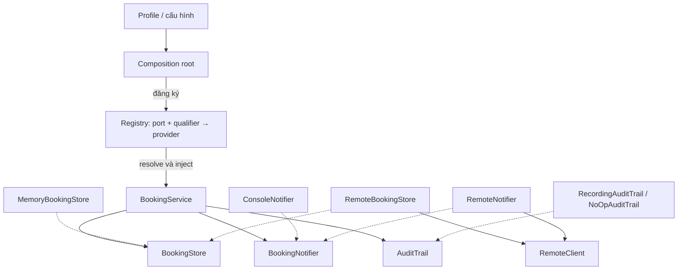
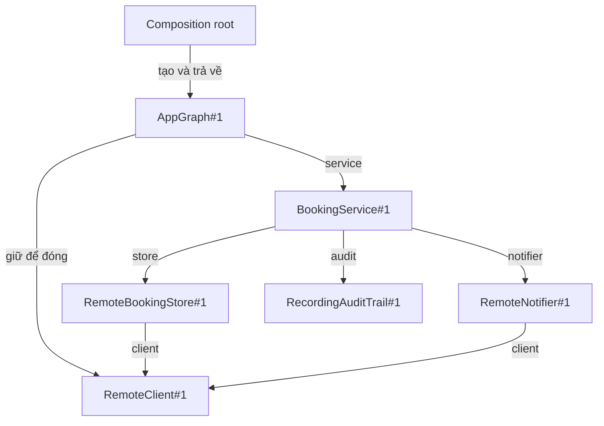

# Kiểm thử lắp ghép để phát hiện đăng ký thiếu hoặc sai lựa chọn

Trong **Dependency Injection (DI)**, một lớp nghiệp vụ nhận các cộng tác viên qua constructor nhưng không tự chọn hay khởi tạo chúng. Quyết định **đăng ký implementation nào cho interface nào**, **dùng chung bao nhiêu instance**, và **đóng tài nguyên khi nào** được chuyển tới **composition root** hoặc DI container. Đây là một biểu hiện thực tế của **Inversion of Control (IoC)**.

Tách trách nhiệm như vậy giúp kiểm thử service bằng fake rất dễ, nhưng đồng thời đặt ra một câu hỏi khác: **làm thế nào để biết chính ứng dụng đã lắp ghép đúng các dependency trong cấu hình sẽ chạy?**

Ví dụ, `BookingService` yêu cầu một `BookingStore` và một `BookingNotifier`. Unit test truyền fake cho cả hai nên chạy thành công. Nhưng ở môi trường production, composition root lại:

- Quên đăng ký `BookingNotifier`;
- Đăng ký tên `backup` trong khi consumer yêu cầu `primary`;
- Đăng ký `MemoryBookingStore` thay vì adapter hạ tầng;
- Tạo hai client độc lập trong khi thiết kế yêu cầu một client được chia sẻ;
- Đóng client trong lúc service vẫn còn sử dụng.

Các lỗi này **không thể được loại trừ chỉ bằng unit test của `BookingService`**. Ta cần một lớp kiểm thử riêng: **kiểm thử lắp ghép** (*wiring test* hoặc *composition test*).

Bài thuộc chương **Kiểm thử** trong module **DEPENDENCY_INJECTION**. Nội dung thực hành bằng **Java thuần**, gồm constructor injection, một registry DI tối giản, composition root, kiểm chứng cấu hình thành công và thất bại, cùng các quy tắc scope/vòng đời trước khi chuyển sang DI container thực thụ.

## 1. Kiểm thử lắp ghép trả lời câu hỏi gì?

Một phép thử lắp ghép dựng **đồ thị đối tượng bằng cách cấu hình thực tế của ứng dụng**, sau đó kiểm chứng những bất biến quan trọng:

1. **Đủ dependency:** mọi port bắt buộc đều có binding phù hợp.
2. **Đúng lựa chọn:** binding cuối cùng trả adapter được phép dùng ở profile tương ứng.
3. **Không mơ hồ:** các trường hợp thiếu, trùng key hoặc sai qualifier được phát hiện rõ ràng.
4. **Đúng graph:** instance được truyền cho consumer nào, dùng chung hay tách riêng theo yêu cầu.
5. **Đúng hành vi ở ranh giới:** service gọi dependency đã chọn với dữ liệu và thứ tự mong đợi.
6. **Đúng vòng đời:** tài nguyên được tạo, sử dụng và đóng trong scope hợp lệ.

Không phải phép thử nào cũng cần kiểm tra tất cả sáu nhóm. Hãy chọn những bất biến thực sự thuộc hợp đồng của ứng dụng. Một hệ thống không yêu cầu hai consumer chia sẻ cùng một instance thì không nên viết `==` như một quy tắc cứng.

### 1.1. Phân biệt các cấp kiểm thử

| Loại kiểm thử | Đối tượng được kiểm tra | Lỗi có thể phát hiện |
| --- | --- | --- |
| **Unit test nghiệp vụ** | `BookingService` cùng các fake được cấp trực tiếp | Thứ tự gọi sai, tham số sai, quy tắc nghiệp vụ sai |
| **Wiring/composition test** | Root/registry và graph được dựng theo profile | Thiếu binding, sai qualifier, chọn nhầm adapter, sai sharing |
| **Contract test** | Từng implementation của port | Adapter không giữ đúng ngữ nghĩa của hợp đồng |
| **Integration test** | Adapter thực và hạ tầng như database/HTTP | Sai kết nối, cấu hình TLS, transaction, timeout, quyền truy cập |
| **End-to-end test** | Luồng từ đầu vào ứng dụng tới kết quả bên ngoài | Sai tích hợp tổng thể qua nhiều tầng |

Ví dụ, unit test có thể chứng minh rằng “sau khi lưu thành công, service gửi thông báo”. Wiring test kiểm chứng “production có thực sự được cấp repository remote và notifier remote hay không”. Integration test kiểm chứng “repository remote có thật sự lưu vào hệ thống cần dùng hay không”.

**Một wiring test pass không chứng minh toàn bộ ứng dụng hoạt động production.** Nó chỉ cung cấp bằng chứng cho những phần cấu hình, tham chiếu, scope và tương tác mà test đã kiểm tra.

## 2. Có class triển khai chưa chắc đã có binding đúng

Một interface có thể có nhiều implementation hợp lệ về kiểu Java:

```java
interface BookingStore {
    void save(String bookingId);
}

final class MemoryBookingStore implements BookingStore {
    // Dành cho local hoặc test.
}

final class RemoteBookingStore implements BookingStore {
    // Dành cho production.
}
```

*Đoạn mã trên chỉ minh họa quan hệ kiểu; ví dụ hoàn chỉnh ở mục 4 có thân phương thức thật.*

Trình biên dịch cho phép cả hai implementation đứng vào vị trí tham số `BookingStore`. Nhưng **đúng kiểu không đồng nghĩa đúng lựa chọn hạ tầng**.

Có ba lớp thông tin cần tách biệt:

- **Kiểu yêu cầu:** `BookingStore`.
- **Binding đã đăng ký:** `BookingStore / main → nhà cung cấp một adapter cụ thể`.
- **Instance thực tế đã inject:** ví dụ `remoteStore#1` đang giữ `remoteClient#1`.

Trong ví dụ của bài, key đăng ký gồm **kiểu port và qualifier**:

```text
BookingStore    / main    → RemoteBookingStore
BookingNotifier / primary → RemoteNotifier
AuditTrail      / audit   → RecordingAuditTrail
```

Một container có thể dùng type, qualifier, tên, điều kiện, profile, ưu tiên hoặc quy tắc khác để tìm binding. Quan trọng là xác định **quy tắc thực sự của công cụ đang dùng**, chứ không giả định hai implementation sẽ tự được chọn đúng.

### 2.1. Những lỗi có thể có cùng biểu hiện “không tạo được service”

| Tình huống | Ví dụ | Cách phát hiện |
| --- | --- | --- |
| **Thiếu đăng ký** | Chưa bind `BookingNotifier / primary` | Resolve thất bại ở bootstrap |
| **Sai qualifier** | Bind `backup`, nhưng root yêu cầu `primary` | Resolve không có ứng viên phù hợp |
| **Trùng binding** | Hai nhà cung cấp cùng đăng ký `BookingStore / main` | Từ chối trùng hoặc kiểm tra quy tắc ưu tiên rõ ràng |
| **Sai implementation** | `MemoryBookingStore` cho profile production | Kiểm tra lựa chọn cuối và hành vi |
| **Sai instance/scope** | Hai adapter cần client chung nhưng lại mỗi bên một client | So sánh tham chiếu `==` |
| **Sai vòng đời** | Root đóng client trước lời gọi của service | Thử hành vi trước/sau khi đóng và theo dõi `close()` |

**Thiếu hoặc trùng binding** có thể được phát hiện ngay khi dựng graph. **Sai implementation cùng interface** thường không tạo lỗi kiểu: cần kiểm tra thêm chính sách của profile hoặc hành vi quan sát được.

## 3. Thiết kế một đồ thị có thể kiểm chứng

Ta dùng ứng dụng đặt chỗ với ba port:

- `BookingStore.save(id)` để lưu đặt chỗ.
- `BookingNotifier.bookingCreated(id)` để thông báo.
- `AuditTrail.record(event)` để ghi audit.

`BookingService` chỉ biết ba port này. Hai profile được hỗ trợ:

| Profile | Store | Notifier | Audit | Client |
| --- | --- | --- | --- | --- |
| `LOCAL` | `MemoryBookingStore` | `ConsoleNotifier` | `NoOpAuditTrail` | Không có |
| `PRODUCTION` | `RemoteBookingStore` | `RemoteNotifier` | `RecordingAuditTrail` | Một `RemoteClient` chung |

Trong bài, “remote” chỉ là **adapter mô phỏng ghi trace**, không tạo kết nối mạng. Nhờ vậy, test deterministic và chạy được bằng Java thuần; khi áp dụng thật phải bổ sung kiểm thử hạ tầng.



Sơ đồ này là **mô hình theo loại thành phần**, chưa chứng minh instance thực tế dùng chung. Để khẳng định hai adapter production giữ đúng một client, wiring test cần so sánh các tham chiếu được tạo sau bootstrap.

## 4. Ví dụ Java thuần: registry và composition root kiểm tra được

Tạo file `WiringVerificationDemo.java`. Tất cả các kiểu được đặt trong một file để dễ học. Registry tối giản này **không tự quét annotation**, **không tự chọn constructor** và **không quản lý scope**: nó chỉ lưu `Supplier` theo key, từ chối đăng ký trùng và báo lỗi khi thiếu key. Những hành vi hạn chế ấy được chọn có chủ đích để dễ thấy lỗi lắp ghép.

```java
import java.util.ArrayList;
import java.util.HashMap;
import java.util.List;
import java.util.Map;
import java.util.Objects;
import java.util.function.Supplier;

public class WiringVerificationDemo {

    enum Profile {
        LOCAL, PRODUCTION
    }

    interface BookingStore {
        void save(String bookingId);
    }

    interface BookingNotifier {
        void bookingCreated(String bookingId);
    }

    interface AuditTrail {
        void record(String event);
    }

    // Consumer chỉ sử dụng hợp đồng, không biết profile/registry.
    static final class BookingService {
        private final BookingStore store;
        private final BookingNotifier notifier;
        private final AuditTrail audit;

        BookingService(
                BookingStore store,
                BookingNotifier notifier,
                AuditTrail audit) {
            this.store = Objects.requireNonNull(store, "store");
            this.notifier = Objects.requireNonNull(notifier, "notifier");
            this.audit = Objects.requireNonNull(audit, "audit");
        }

        void book(String id) {
            if (id == null || id.isBlank()) {
                throw new IllegalArgumentException("Invalid booking ID");
            }

            store.save(id);
            audit.record("created:" + id);
            notifier.bookingCreated(id);
        }
    }

    // Local adapters.
    static final class MemoryBookingStore implements BookingStore {
        private final List<String> trace;

        MemoryBookingStore(List<String> trace) {
            this.trace = trace;
        }

        @Override
        public void save(String bookingId) {
            trace.add("memory-save:" + bookingId);
        }
    }

    static final class ConsoleNotifier implements BookingNotifier {
        private final List<String> trace;

        ConsoleNotifier(List<String> trace) {
            this.trace = trace;
        }

        @Override
        public void bookingCreated(String bookingId) {
            trace.add("console-notify:" + bookingId);
        }
    }

    static final class NoOpAuditTrail implements AuditTrail {
        @Override
        public void record(String event) {
            // LOCAL cố ý không ghi audit.
        }
    }

    static final class RecordingAuditTrail implements AuditTrail {
        private final List<String> trace;

        RecordingAuditTrail(List<String> trace) {
            this.trace = trace;
        }

        @Override
        public void record(String event) {
            trace.add("audit:" + event);
        }
    }

    // Resource remote chỉ mô phỏng, không có network thật.
    static final class RemoteClient implements AutoCloseable {
        private final List<String> trace;
        boolean closed;
        int closeCalls;

        RemoteClient(List<String> trace) {
            this.trace = trace;
        }

        void perform(String operation, String id) {
            if (closed) {
                throw new IllegalStateException("Remote client is closed");
            }
            trace.add(operation + ":" + id);
        }

        @Override
        public void close() {
            if (!closed) {
                closed = true;
                closeCalls++;
                trace.add("client-close");
            }
        }
    }

    static final class RemoteBookingStore implements BookingStore {
        final RemoteClient client;

        RemoteBookingStore(RemoteClient client) {
            this.client = Objects.requireNonNull(client);
        }

        @Override
        public void save(String bookingId) {
            client.perform("remote-save", bookingId);
        }
    }

    static final class RemoteNotifier implements BookingNotifier {
        final RemoteClient client;

        RemoteNotifier(RemoteClient client) {
            this.client = Objects.requireNonNull(client);
        }

        @Override
        public void bookingCreated(String bookingId) {
            client.perform("remote-notify", bookingId);
        }
    }

    // Key phân biệt kiểu port và qualifier, không chỉ tên interface.
    static final class Key {
        final Class<?> port;
        final String qualifier;

        Key(Class<?> port, String qualifier) {
            this.port = Objects.requireNonNull(port);
            this.qualifier = Objects.requireNonNull(qualifier);
        }

        @Override
        public boolean equals(Object other) {
            if (!(other instanceof Key)) {
                return false;
            }
            Key that = (Key) other;
            return port.equals(that.port)
                    && qualifier.equals(that.qualifier);
        }

        @Override
        public int hashCode() {
            return Objects.hash(port, qualifier);
        }
    }

    static final class Registry {
        private final Map<Key, Supplier<?>> bindings = new HashMap<>();

        <T> void bind(
                Class<T> port, String qualifier,
                Supplier<? extends T> supplier) {

            Objects.requireNonNull(supplier, "supplier");
            Key key = new Key(port, qualifier);
            if (bindings.putIfAbsent(key, supplier) != null) {
                throw new IllegalStateException(
                        "Duplicate binding: "
                                + port.getSimpleName() + "/" + qualifier);
            }
        }

        <T> T require(Class<T> port, String qualifier) {
            Supplier<?> supplier = bindings.get(new Key(port, qualifier));
            if (supplier == null) {
                throw new IllegalStateException(
                        "Missing binding: "
                                + port.getSimpleName() + "/" + qualifier);
            }

            Object instance = Objects.requireNonNull(
                    supplier.get(), "Provider returned null");
            return port.cast(instance);
        }
    }

    // Handle sở hữu graph và resource cần đóng.
    static final class AppGraph implements AutoCloseable {
        final BookingService service;
        final BookingStore store;
        final BookingNotifier notifier;
        final AuditTrail audit;
        final RemoteClient client; // null ở LOCAL
        final List<String> trace;
        private boolean closed;

        AppGraph(
                BookingStore store, BookingNotifier notifier,
                AuditTrail audit, RemoteClient client, List<String> trace) {
            this.store = store;
            this.notifier = notifier;
            this.audit = audit;
            this.client = client;
            this.trace = trace;
            this.service = new BookingService(store, notifier, audit);
        }

        @Override
        public void close() {
            if (closed) {
                return;
            }
            closed = true;
            if (client != null) {
                client.close();
            }
        }
    }

    // Nhận registry đã được cấu hình; resolve tất cả port bắt buộc.
    static AppGraph wire(
            Registry registry, RemoteClient client, List<String> trace) {
        BookingStore store = registry.require(
                BookingStore.class, "main");
        BookingNotifier notifier = registry.require(
                BookingNotifier.class, "primary");
        AuditTrail audit = registry.require(
                AuditTrail.class, "audit");

        return new AppGraph(store, notifier, audit, client, trace);
    }

    // COMPOSITION ROOT: chọn các binding có chủ đích theo môi trường.
    static AppGraph compose(Profile profile) {
        Objects.requireNonNull(profile, "profile");
        List<String> trace = new ArrayList<>();
        Registry registry = new Registry();
        RemoteClient client = null;

        if (profile == Profile.LOCAL) {
            registry.bind(BookingStore.class, "main",
                    () -> new MemoryBookingStore(trace));
            registry.bind(BookingNotifier.class, "primary",
                    () -> new ConsoleNotifier(trace));
            registry.bind(AuditTrail.class, "audit",
                    NoOpAuditTrail::new);
        } else if (profile == Profile.PRODUCTION) {
            client = new RemoteClient(trace);
            RemoteClient shared = client;

            registry.bind(BookingStore.class, "main",
                    () -> new RemoteBookingStore(shared));
            registry.bind(BookingNotifier.class, "primary",
                    () -> new RemoteNotifier(shared));
            registry.bind(AuditTrail.class, "audit",
                    () -> new RecordingAuditTrail(trace));
        } else {
            throw new IllegalArgumentException(
                    "Unsupported profile: " + profile);
        }

        // Nếu resolve/khởi tạo thất bại, không bỏ quên tài nguyên.
        try {
            return wire(registry, client, trace);
        } catch (RuntimeException | Error failure) {
            if (client != null) {
                client.close();
            }
            throw failure;
        }
    }

    public static void main(String[] args) {
        try (AppGraph local = compose(Profile.LOCAL)) {
            local.service.book("L-1");
            System.out.println("LOCAL: " + local.trace);
        }

        AppGraph production = compose(Profile.PRODUCTION);
        try (AppGraph scope = production) {
            scope.service.book("P-1");
        }
        System.out.println("PRODUCTION: " + production.trace);
    }
}
```

Biên dịch và chạy bằng **JDK 11 trở lên**:

```bash
javac WiringVerificationDemo.java
java WiringVerificationDemo
```

Kết quả mong đợi:

```text
LOCAL: [memory-save:L-1, console-notify:L-1]
PRODUCTION: [remote-save:P-1, audit:created:P-1, remote-notify:P-1, client-close]
```

### 4.1. Điều gì là tường minh trong ví dụ?

- `BookingService` không tham chiếu `Registry`, `Profile`, `MemoryBookingStore` hoặc `RemoteClient`.
- `compose` quyết định binding và tạo một `RemoteClient` chung cho hai adapter production.
- `wire` yêu cầu ba port bắt buộc bằng key đã xác định; một binding thiếu không được silently bỏ qua.
- `Registry.bind` từ chối hai đăng ký có cùng key, thay vì âm thầm ghi đè.
- `AppGraph` giữ resource và đóng khi kết thúc scope; service chỉ sử dụng các port.
- Các adapter mô phỏng ghi `trace` nên ta có thể kiểm thử lựa chọn và thứ tự tương tác mà không dùng dịch vụ ngoài.

**Hạn chế có chủ đích:** `Registry.require` gọi `supplier.get()` mỗi lần. Nó không tự cache, không hỗ trợ scope bằng annotation và không tự dựng graph qua reflection. Cách dùng trong `wire` hiện chỉ gọi mỗi binding một lần; sharing của `RemoteClient` đến từ việc root tạo một instance rồi truyền cho cả hai supplier. Một container thực sẽ có chính sách scope và vòng đời riêng cần kiểm chứng.

### 4.2. Sơ đồ đối tượng production sau khi root lắp ghép



Các nút `#1` là nhãn minh họa cho instance, không phải ID có sẵn trong JVM. **Kiểm thử `==` trên tham chiếu thực** sẽ xác nhận hai adapter dùng chung client, thay vì dựa riêng vào sơ đồ.

## 5. Bài kiểm thử lắp ghép hoàn chỉnh

Tạo file `WiringVerificationTest.java` trong cùng thư mục. Bài test sẽ:

1. Dựng graph cho từng profile được hỗ trợ và xác minh adapter được chọn.
2. Xác minh identity của client dùng chung tại production.
3. Thử hành vi để kiểm tra các cạnh dependency thật sự được sử dụng.
4. Cố ý tạo registry lỗi để chứng minh thiếu, trùng và sai qualifier bị phát hiện.
5. Cố ý dựng graph **đúng kiểu nhưng sai adapter** để chứng minh test phát hiện.
6. Kiểm tra resource được đóng đúng một lần và không thể sử dụng sau khi đóng.

```java
import java.util.ArrayList;
import java.util.List;

public class WiringVerificationTest {

    static void check(boolean condition, String message) {
        if (!condition) {
            throw new AssertionError(message);
        }
    }

    static void expectRegistrationError(Runnable action) {
        boolean rejected = false;
        try {
            action.run();
        } catch (IllegalStateException expected) {
            rejected = true;
        }
        check(rejected, "Expected registration/resolve failure");
    }

    static void expectAssertion(Runnable action) {
        boolean detected = false;
        try {
            action.run();
        } catch (AssertionError expected) {
            detected = true;
        }
        check(detected, "Wrong wiring was not detected");
    }

    static void assertProductionGraph(
            WiringVerificationDemo.AppGraph graph) {

        check(graph.store instanceof
                WiringVerificationDemo.RemoteBookingStore,
                "Production must use remote store");
        check(graph.notifier instanceof
                WiringVerificationDemo.RemoteNotifier,
                "Production must use remote notifier");
        check(graph.audit instanceof
                WiringVerificationDemo.RecordingAuditTrail,
                "Production must record audit");
        check(graph.client != null,
                "Production must own a remote client");

        var store = (WiringVerificationDemo.RemoteBookingStore)
                graph.store;
        var notifier = (WiringVerificationDemo.RemoteNotifier)
                graph.notifier;

        check(store.client == graph.client
                        && notifier.client == graph.client,
                "Production adapters must share exactly this client");
    }

    static void testLocalGraph() {
        try (var graph = WiringVerificationDemo.compose(
                WiringVerificationDemo.Profile.LOCAL)) {

            check(graph.store instanceof
                    WiringVerificationDemo.MemoryBookingStore,
                    "LOCAL store is wrong");
            check(graph.notifier instanceof
                    WiringVerificationDemo.ConsoleNotifier,
                    "LOCAL notifier is wrong");
            check(graph.audit instanceof
                    WiringVerificationDemo.NoOpAuditTrail,
                    "LOCAL audit is wrong");
            check(graph.client == null,
                    "LOCAL must not create remote client");

            graph.service.book("L-10");
            check(graph.trace.equals(List.of(
                    "memory-save:L-10",
                    "console-notify:L-10")),
                    "LOCAL behavior is wrong");
        }
    }

    static void testProductionGraphAndLifecycle() {
        var graph = WiringVerificationDemo.compose(
                WiringVerificationDemo.Profile.PRODUCTION);

        try (WiringVerificationDemo.AppGraph scope = graph) {
            assertProductionGraph(scope);
            scope.service.book("P-10");

            check(scope.trace.equals(List.of(
                    "remote-save:P-10",
                    "audit:created:P-10",
                    "remote-notify:P-10")),
                    "Production behavior is wrong");
            check(scope.client.closeCalls == 0,
                    "Client closed while service was still using it");
        }

        check(graph.client.closed && graph.client.closeCalls == 1,
                "Client must be closed once at scope end");

        graph.close(); // Idempotent theo hợp đồng AppGraph.
        check(graph.client.closeCalls == 1,
                "Repeated graph close must not close client twice");

        check(graph.trace.equals(List.of(
                "remote-save:P-10",
                "audit:created:P-10",
                "remote-notify:P-10",
                "client-close")),
                "Incorrect lifecycle event order");

        expectRegistrationError(
                () -> graph.service.book("P-after-close"));
    }

    static void testMissingBinding() {
        List<String> trace = new ArrayList<>();
        var registry = new WiringVerificationDemo.Registry();

        registry.bind(
                WiringVerificationDemo.BookingStore.class,
                "main",
                () -> new WiringVerificationDemo.MemoryBookingStore(trace));
        registry.bind(
                WiringVerificationDemo.AuditTrail.class,
                "audit",
                WiringVerificationDemo.NoOpAuditTrail::new);

        // Không đăng ký BookingNotifier/primary:
        expectRegistrationError(
                () -> WiringVerificationDemo.wire(
                        registry, null, trace));
    }

    static void testWrongQualifier() {
        List<String> trace = new ArrayList<>();
        var registry = new WiringVerificationDemo.Registry();

        registry.bind(
                WiringVerificationDemo.BookingStore.class,
                "main",
                () -> new WiringVerificationDemo.MemoryBookingStore(trace));
        registry.bind(
                WiringVerificationDemo.BookingNotifier.class,
                "backup",
                () -> new WiringVerificationDemo.ConsoleNotifier(trace));
        registry.bind(
                WiringVerificationDemo.AuditTrail.class,
                "audit",
                WiringVerificationDemo.NoOpAuditTrail::new);

        // Consumer yêu cầu primary, còn registry chỉ có backup.
        expectRegistrationError(
                () -> WiringVerificationDemo.wire(
                        registry, null, trace));
    }

    static void testDuplicateBinding() {
        List<String> trace = new ArrayList<>();
        var registry = new WiringVerificationDemo.Registry();

        registry.bind(
                WiringVerificationDemo.BookingStore.class,
                "main",
                () -> new WiringVerificationDemo.MemoryBookingStore(trace));

        expectRegistrationError(() -> registry.bind(
                WiringVerificationDemo.BookingStore.class,
                "main",
                () -> new WiringVerificationDemo.MemoryBookingStore(trace)));
    }

    static void testWrongImplementationIsDetected() {
        List<String> trace = new ArrayList<>();
        var registry = new WiringVerificationDemo.Registry();

        // Đủ binding và đúng kiểu, nhưng sai lựa chọn cho PRODUCTION.
        registry.bind(
                WiringVerificationDemo.BookingStore.class,
                "main",
                () -> new WiringVerificationDemo.MemoryBookingStore(trace));
        registry.bind(
                WiringVerificationDemo.BookingNotifier.class,
                "primary",
                () -> new WiringVerificationDemo.ConsoleNotifier(trace));
        registry.bind(
                WiringVerificationDemo.AuditTrail.class,
                "audit",
                () -> new WiringVerificationDemo.RecordingAuditTrail(trace));

        try (var wrong = WiringVerificationDemo.wire(
                registry, null, trace)) {
            // Resolve và constructor injection đều thành công.
            // Chỉ assertion theo profile mới phát hiện chọn sai.
            expectAssertion(() -> assertProductionGraph(wrong));
        }
    }

    public static void main(String[] args) {
        testLocalGraph();
        testProductionGraphAndLifecycle();
        testMissingBinding();
        testWrongQualifier();
        testDuplicateBinding();
        testWrongImplementationIsDetected();
        System.out.println("PASS: wiring, selection and lifecycle");
    }
}
```

Chạy:

```bash
javac WiringVerificationDemo.java WiringVerificationTest.java
java WiringVerificationTest
```

Kết quả mong đợi:

```text
PASS: wiring, selection and lifecycle
```

**Lưu ý về phép thử cố ý sai:** `testWrongImplementationIsDetected` không kỳ vọng ứng dụng hoạt động đúng với memory store ở production. Nó cố ý dựng graph sai, sau đó yêu cầu `assertProductionGraph` **ném `AssertionError`**. Bài test thành công khi khả năng phát hiện lỗi hoạt động, không phải khi cấu hình sai được coi là hợp lệ.

### 5.1. Ba kiểu thất bại khác nhau

- **Thiếu binding:** `Registry.require(BookingNotifier.class, "primary")` ném `IllegalStateException` trước khi trả graph.
- **Sai qualifier:** có Notifier ở key `backup`, nhưng `primary` không tồn tại; kết quả vẫn là **không có binding phù hợp**.
- **Sai lựa chọn nhưng hợp lệ về kiểu:** tất cả lời gọi `require` thành công, `BookingService` được tạo. Chỉ khi kiểm tra điều kiện của profile production mới biết đây không phải graph được hỗ trợ.

Từ đó, không thể thay phép thử “đúng implementation” bằng một kiểm tra đơn thuần như `graph.store != null`. Kiểm tra đó chỉ xác nhận có một tham chiếu, không xác nhận tham chiếu ấy là adapter phù hợp.

### 5.2. Kiểm thử danh tính và thứ tự đóng

Trong `assertProductionGraph`:

```java
check(store.client == graph.client
                && notifier.client == graph.client,
        "Production adapters must share exactly this client");
```

`==` xác minh **cùng instance**; `equals` không đủ vì các đối tượng khác nhau có thể bằng nhau theo giá trị.

Đồng thời, trace cho biết:

```text
remote-save:P-10
audit:created:P-10
remote-notify:P-10
client-close
```

Sự kiện `client-close` phải xảy ra **sau** mọi lời gọi nghiệp vụ trong scope, chứ không phải ngay sau khi repository lưu xong. Test còn kiểm tra `closeCalls == 1` khi đóng graph lặp, và client không phục vụ thao tác mới sau khi đã đóng.

Một resource thật có thể dùng thread, pool hoặc các thao tác đang chạy song song; khi đó cần hợp đồng shutdown rõ hơn. Ví dụ này kiểm tra logic vòng đời **tuần tự** bằng resource mô phỏng.

## 6. “Đăng ký thành công” chưa chắc “đã resolve đầy đủ”

Một số DI container tạo tất cả bean khi khởi động; một số tạo lazy theo lần dùng. Khi tạo lazy, một binding sai hoặc dependency lồng nhau chưa có có thể **chỉ lộ ra khi đường chạy đó được kích hoạt**.

Hãy phân biệt:

| Thời điểm | Điều kiểm tra được |
| --- | --- |
| **Đăng ký** | Có key và provider, không trùng theo chính sách registry |
| **Resolve/dựng graph** | Provider tạo được instance, dependency bắt buộc có đầy đủ, kiểu kết quả hợp lệ |
| **Gọi phương thức nghiệp vụ** | Adapter thực sự được sử dụng, đúng trình tự và kết quả |
| **Kết thúc scope** | Resource được đóng và không còn consumer sử dụng |
| **Integration test** | Adapter thật kết nối và hành xử đúng với hệ thống bên ngoài |

Trong `WiringVerificationDemo`, `wire` resolve cả ba dependency nên phát hiện thiếu key ngay. Nhưng nếu một supplier chỉ được gọi sau khi request đầu tiên đến, một test chỉ chạy bootstrap có thể không tạo nó và không phát hiện lỗi.

Cách tăng độ tin cậy là **dựng từng graph quan trọng và kích hoạt các đường đi cần thiết** trong môi trường test. Với container hỗ trợ kiểm tra graph lúc bootstrap, hãy bật kiểm tra phù hợp; với lazy dependency, test phải làm cho dependency đó được resolve theo cách có kiểm soát.

### 6.1. Vòng phụ thuộc và constructor không dựng được

Bên cạnh thiếu key, composition root/container có thể gặp chu trình như:

```text
ServiceA cần ServiceB trong constructor
ServiceB lại cần ServiceA trong constructor
```

Nếu container cố dựng cả hai trực tiếp bằng constructor, không có thứ tự khởi tạo hữu hạn thỏa yêu cầu. Một số framework có cơ chế provider/lazy/proxy cho các trường hợp cụ thể, nhưng đừng coi việc che vòng phụ thuộc là chứng cứ thiết kế tốt.

Wiring test nên phát hiện lỗi dựng graph ngay khi cấu hình tương ứng được kích hoạt, thay vì chờ người dùng cuối gặp lỗi. Đồng thời cần xem lại trách nhiệm của hai service: chu trình đôi khi cho thấy ranh giới chưa hợp lý.

## 7. Kiểm thử nhiều profile mà không nhân đôi logic nghiệp vụ

Trong ví dụ, **hai profile được hỗ trợ** có bảng lựa chọn khác nhau. Một profile test nên công khai kỳ vọng của chính profile đó:

| Bất biến | LOCAL | PRODUCTION |
| --- | --- | --- |
| Store | Memory | Remote |
| Notifier | Console | Remote |
| Audit | No-op | Recording |
| RemoteClient | Không có | Một instance chung |
| Vòng đời | Không có client remote để đóng | Đóng client khi scope kết thúc |
| Hành vi mẫu | Memory save → console notify | Remote save → audit → remote notify |

Cách viết kiểm thử hợp lý là:

1. **Test dương tính cho mỗi profile được hỗ trợ** với root thật của profile đó.
2. **Test âm tính cho quy tắc có ý nghĩa:** thiếu binding, sai qualifier, xung đột key, config không hợp lệ.
3. **Test riêng các bất biến chia sẻ resource** nếu đúng scope là yêu cầu thiết kế.
4. **Contract/integration test** cho các adapter production, không suy từ fake mà kết luận adapter thật hoạt động đúng.

Với nhiều trục cấu hình độc lập, số tổ hợp có thể tăng rất nhanh. Hãy công bố tập biến thể được hỗ trợ, ràng buộc những tổ hợp không hợp lệ và kiểm thử những kết hợp rủi ro cao. Kiểm thử từng profile được hỗ trợ và một số trường hợp âm tính có chủ đích thường hiệu quả hơn việc cố chạy toàn bộ tổ hợp cờ mà sản phẩm không cam kết.

## 8. Đảm bảo test không phụ thuộc vào môi trường thật

Một wiring test có ích cần có khả năng chạy lặp lại mà không:

- Gửi email cho khách hàng thật;
- Ghi vào database production;
- Phụ thuộc vào thời điểm mạng đang hoạt động;
- Đòi secret hoặc quyền tài khoản thật để kiểm tra một sai sót về binding.

Vì vậy, ví dụ dùng `RemoteClient` mô phỏng; wiring test xác minh **graph đã chọn đúng adapter mô phỏng của profile** và đúng trace. Trong dự án thật, có thể:

- Dùng cấu hình test chỉ trỏ tới stub server hoặc database tạm;
- Thay boundary ngoài bằng fake nhưng giữ **cùng bootstrap/binding logic** cần kiểm tra;
- Dùng contract test riêng cho adapter thật;
- Kiểm tra cấu hình production trong một quy trình triển khai an toàn, tránh gọi các thao tác gây side effect ngoài ý muốn.

Có một cái bẫy: nếu bài test **tự đăng ký fake khác hẳn logic lắp ghép production**, nó có thể chỉ chứng minh “cấu hình của test đúng”, không chứng minh “cấu hình production đúng”. Nên kiểm thử root production hoặc cấu hình production ở mức phù hợp, thay thế có kiểm soát **chính các ranh giới hạ tầng cần cách ly**.

### 8.1. Tại sao không test trực tiếp bằng registry trong service?

Cách làm sau che giấu dependency:

```java
final class BookingService {
    void book(String id) {
        BookingStore store = GlobalContainer.get(BookingStore.class);
        store.save(id);
    }
}
```

Ở đây chữ ký constructor không thể hiện `BookingStore` là phụ thuộc bắt buộc. Service phải biết cơ chế truy cập container, dễ trở thành **service locator**. Test phải cấu hình trạng thái toàn cục, có nguy cơ ảnh hưởng lẫn nhau.

Cách tốt hơn là giữ:

```java
final class BookingService {
    private final BookingStore store;

    BookingService(BookingStore store) {
        this.store = java.util.Objects.requireNonNull(store);
    }

    void book(String id) {
        store.save(id);
    }
}
```

*Hai đoạn này minh họa việc chuyển từ service locator sang constructor injection, không thuộc file chạy độc lập ở mục 4.* Cơ chế đăng ký và resolve nên nằm trong composition root/container, không rải vào logic nghiệp vụ.

## 9. Khám phá tự động cũng cần test lựa chọn cuối cùng

Với container hỗ trợ component scanning, code có thể có:

```text
@Component
class ConsoleNotifier implements BookingNotifier

@Component
class RemoteNotifier implements BookingNotifier
```

Đây là biểu diễn **ý tưởng**; annotation và cú pháp dùng thực tế tùy framework. Khi cả hai được phát hiện, phải có quy tắc chọn nếu consumer chỉ cần một `BookingNotifier`.

Các trường hợp nên kiểm tra:

- Lớp cần dùng không nằm trong phạm vi scan hoặc chỉ mục metadata.
- Có hai ứng viên cùng qualifier/nhiều ứng viên cho một port mà chưa có quy tắc chọn.
- Một bean chỉ kích hoạt ở profile khác nên production không được cấp.
- Binding được ghi đè ngoài ý muốn khi thứ tự nạp cấu hình thay đổi.
- Proxy hoặc factory tạo target theo scope không như kỳ vọng.

Không thể nhìn vào annotation trên lớp rồi khẳng định consumer nhận đúng implementation. Cần truy vấn **cấu hình hiệu lực**, dựng graph theo profile và xác minh lựa chọn cuối cùng. Một số container có API liệt kê binding; những API này giúp quan sát, nhưng không thay thế kiểm tra hành vi quan trọng.

Nếu container hỗ trợ binding collection/multibinding có chủ đích, nhiều implementation có thể là hợp lệ. Trong trường hợp đó, test phải dựa vào hợp đồng thật: số phần tử, thứ tự (nếu được đảm bảo) và danh tính của mỗi thành phần; không áp đặt “chỉ có một binding” một cách mù quáng.

## 10. Giới hạn và lưu ý về scope/vòng đời

### 10.1. Kiểm tra identity theo đúng scope

Một dependency dùng chung trong phạm vi ứng dụng có thể cần:

```java
check(store.client == notifier.client,
        "Expected shared client");
```

Nhưng nếu thiết kế chỉ yêu cầu hai consumer có thể dùng client độc lập, kiểm tra `==` sẽ là ràng buộc quá mức. Ngược lại, với dependency theo request, cần kiểm tra **cùng request dùng chung đúng object** và **khác request không vô tình chia sẻ mutable state**, nếu đó là hợp đồng.

Đối với DI container có proxy, `==` trên proxy không nhất thiết đo identity của target thật theo request. Cần hiểu đang so **đối tượng được inject** hay **đối tượng đích** do proxy cung cấp, và chọn phương pháp quan sát phù hợp.

### 10.2. Truyền tham chiếu không chuyển ownership

Một service được inject `RemoteClient` hoặc một port sử dụng client **không mặc nhiên có quyền đóng client**. Trong ví dụ, root sở hữu resource qua `AppGraph` và đóng khi các consumer không còn sử dụng.

Nếu factory mở một stream mới cho từng thao tác và hợp đồng nói bên gọi sở hữu stream, consumer có thể dùng `try-with-resources` trong phạm vi thao tác. Nhưng nếu container sở hữu connection pool dùng chung, consumer không được tùy tiện đóng pool sau mỗi lời gọi.

Wiring test cần kiểm tra **owner thực sự**, không chỉ số lần gọi `close()`. Hai service cùng đóng một resource có thể khiến bộ đếm khác mong đợi; nghiêm trọng hơn, một resource bị đóng một lần **nhưng quá sớm** cũng là lỗi.

### 10.3. Mọi lỗi startup phải để lại tài nguyên ở trạng thái hợp lệ

Nếu composition root đã mở resource A, sau đó resolve resource B thất bại, root cần dọn A. Ví dụ chính bắt `RuntimeException | Error` khi `wire` thất bại để đóng client mô phỏng. Trong hệ thống có nhiều tài nguyên, hãy dùng `try-with-resources` hoặc cơ chế quản lý vòng đời có thứ tự của container.

Test trường hợp **lỗi giữa bootstrap** bằng fake resource ghi sự kiện mở/đóng sẽ phát hiện rò rỉ mà các test “đường đi thành công” không thể phát hiện.

## 11. Checklist cho một bài wiring test có giá trị

| Câu hỏi | Bằng chứng nên thu thập |
| --- | --- |
| Port bắt buộc có binding không? | Resolve thực tế thành công hoặc lỗi thiếu key rõ ràng |
| Có qualifier đúng không? | Request key chính xác của consumer |
| Binding trùng được xử lý ra sao? | Lỗi hoặc quy tắc override đã được kiểm tra |
| Production có đúng adapter không? | Kiểu/định danh implementation và hành vi ở ranh giới |
| Scope có đúng không? | So identity theo phạm vi được quy định |
| Service thực sự sử dụng những adapter đó không? | Fake/spy/trace qua đường gọi ứng dụng |
| Resource do ai sở hữu? | Event tạo–dùng–đóng theo đúng thứ tự |
| Lỗi khi bootstrap có cleanup không? | Fake ném lỗi và ghi nhận việc đóng resource đã mở |
| Khác môi trường có sai khác ngoài ý muốn không? | Bảng profile và test mỗi biến thể được hỗ trợ |
| Test có vô tình dùng cấu hình khác production không? | So đường dựng graph và các điểm thay thế hạ tầng |
| Adapter thật có giữ hợp đồng không? | Contract/integration test bổ sung |
| Có side effect không phù hợp khi test không? | Stub/fake/test environment cô lập |

**Đừng biến wiring test thành kiểm tra mọi dòng triển khai nội bộ của service.** Ưu tiên các cam kết có ý nghĩa với ứng dụng: đủ dependency, đúng lựa chọn, đúng scope và đúng hành vi. Thay đổi thứ tự gọi factory không làm thay đổi hợp đồng thì test không cần thất bại, trừ khi thứ tự đó ảnh hưởng vòng đời hoặc side effect.

## 12. Bài tập thực hành

**Bài 1 — Thiếu đăng ký.** Trong `compose(Profile.PRODUCTION)`, tạm bỏ dòng đăng ký `AuditTrail / audit`. Dự đoán thời điểm và loại lỗi khi `wire` được gọi. Tại sao lỗi này nên được phát hiện trước khi ứng dụng nhận request?

**Bài 2 — Sai qualifier.** Đổi qualifier của `RemoteNotifier` thành `secondary` nhưng giữ `wire` yêu cầu `primary`. Hãy phân biệt “có một adapter notifier trong source code” và “có binding phù hợp với yêu cầu”.

**Bài 3 — Đúng interface, sai môi trường.** Đăng ký `MemoryBookingStore` tại profile production. Chạy lại test và chỉ rõ vì sao chương trình vẫn biên dịch, nhưng `assertProductionGraph` thất bại.

**Bài 4 — Trùng key.** Đăng ký hai supplier khác nhau cho `BookingStore / main`. Quan sát lỗi từ `Registry.bind`. Nếu framework dùng chính sách override, bạn sẽ viết test như thế nào để không âm thầm chọn nhầm implementation?

**Bài 5 — Tách client không chủ đích.** Sửa nhánh production để hai adapter nhận hai `RemoteClient` khác nhau. Kiểm tra nào của test nhận ra? Nếu thực sự muốn dùng hai client, hãy điều chỉnh ownership trong `AppGraph` để đóng cả hai và sửa hợp đồng/test phù hợp.

**Bài 6 — Lỗi giữa bootstrap.** Tạo một supplier cho `AuditTrail / audit` luôn ném `IllegalStateException`. Với một client đã được mở trước khi resolve, kiểm tra root đã gọi `close()` trên client khi việc dựng graph thất bại.

**Bài 7 — Unit test và wiring test.** Tự viết một fake `BookingStore` lưu ID vào danh sách và một fake notifier ghi nhận lời gọi. Kiểm thử riêng `BookingService.book`. So sánh phạm vi test đó với `WiringVerificationTest`: lỗi nào được phát hiện bởi test này nhưng không được phát hiện bởi test kia?

## 13. Ghi nhớ

**Kiểm thử lắp ghép kiểm chứng cấu hình và đồ thị đối tượng mà ứng dụng thực sự dựng lên**, không chỉ logic của từng service riêng lẻ. Lỗi có thể xuất hiện dưới dạng thiếu đăng ký, sai qualifier, trùng binding, chọn nhầm implementation dù đúng kiểu, dùng chung sai instance hoặc đóng tài nguyên không đúng vòng đời.

Giữ **constructor injection** trong mã nghiệp vụ và tập trung lựa chọn adapter tại **composition root** giúp viết wiring test có mục tiêu rõ ràng. Trong Java thuần, một registry nhỏ, các fake ghi nhận sự kiện, phép so sánh `==` và các phép kiểm tra profile đã đủ để học cách phát hiện lỗi. Khi chuyển sang DI container, hãy giữ những bất biến ấy trong test của cấu hình thực và bổ sung contract/integration test cho hạ tầng bên ngoài.
