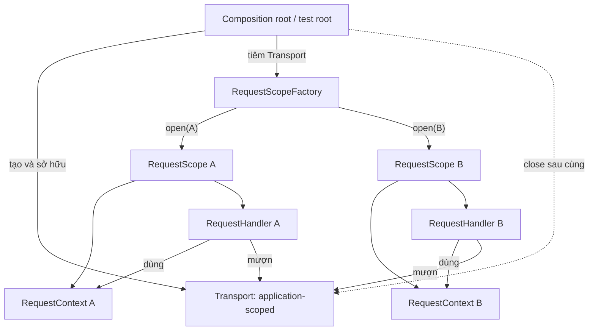

# Kiểm thử scope, danh tính và giải phóng tài nguyên

> **Chương:** Kiểm thử  
> **Ngữ cảnh:** Trong Dependency Injection (DI) và Inversion of Control (IoC), composition root tạo và lắp ghép các dependency; service nhận đối tượng qua constructor. Ngoài kiểm tra hành vi nghiệp vụ, ta cần kiểm chứng **instance nào được dùng chung, instance nào được tạo riêng và ai chịu trách nhiệm đóng tài nguyên**. Bài học sử dụng Java thuần trước khi bàn đến DI container.

## 1. Mục tiêu học tập

Sau bài này, bạn có thể:

1. Phân biệt ba câu hỏi kiểm thử: **scope**, **danh tính instance (identity)** và **vòng đời/giải phóng tài nguyên**.
2. Thiết kế các phép kiểm `==`/`!=` đúng mục đích, không nhầm với `equals()` hoặc so sánh nội dung.
3. Viết phép kiểm chứng một dependency dùng chung trong phạm vi ứng dụng và dependency mới cho từng request giả lập.
4. Chứng minh resource **không đóng quá sớm**, **đóng đúng một lần** tại owner và **không còn dùng được sau khi đóng** nếu hợp đồng yêu cầu.
5. Kiểm tra đường lỗi bằng `try-with-resources` để tránh rò rỉ tài nguyên khi thao tác ném exception.
6. Phân biệt test Java thuần về hợp đồng wiring với kiểm thử tích hợp thực tế của scope và lifecycle trong DI container.
7. Nhận diện giới hạn về concurrency, async, connection pool và callback hủy khi viết các bài kiểm thử.

## 2. Scope, identity và lifetime không phải cùng một khái niệm

**Scope** nói về phạm vi một dependency có hiệu lực và chính sách tạo/chia sẻ của nó. **Identity** nói về việc hai tham chiếu có trỏ đến **chính cùng một object** hay không. **Lifetime** nói về khoảng thời gian từ lúc một instance được tạo đến khi nó không còn được sử dụng hoặc tài nguyên do nó đại diện được đóng.

| Câu hỏi | Ví dụ | Cách quan sát trong test |
| --- | --- | --- |
| **Scope** | Mỗi request có `RequestContext` riêng không? | Tạo hai request scope độc lập và so sánh object nhận được. |
| **Identity** | Trong cùng request, các consumer có đang dùng cùng một context không? | Dùng `==` để so sánh tham chiếu. |
| **Số lần tạo** | Factory có tạo object mới mỗi lần `open()` không? | Đếm các lần khởi tạo hoặc kiểm tra các instance riêng biệt. |
| **Thời điểm đóng** | Context đóng khi request kết thúc hay khi một service gọi xong? | Fake/spy ghi nhận trạng thái và số lần `close()`. |
| **Quyền sở hữu** | Service có được đóng HTTP client dùng chung không? | Xác minh resource vẫn mở sau một request và chỉ owner đóng sau cùng. |
| **An toàn sau khi đóng** | Handler giữ context cũ có thể tiếp tục hoạt động không? | Gọi lại sau `close()` và kiểm tra hành vi được contract quy định. |

Ba trục này liên quan nhưng **không suy ra nhau**. Hai object khác nhau có thể có giá trị giống hệt, hai tham chiếu tới cùng một object có thể xuất hiện ở nhiều nơi, và một object được container tạo không nhất thiết được container tự động đóng trong mọi scope.

### 2.1. So sánh danh tính chính xác

Trong Java:

```java
Object a = new Object();
Object b = new Object();
Object alias = a;

System.out.println(a == alias); // true: cùng object
System.out.println(a == b);     // false: hai object khác
```

Trong kiểm thử scope, `a == b` trả lời câu hỏi **hai tham chiếu trỏ đến cùng instance?**. `a.equals(b)` có thể được lớp tùy biến để so sánh **giá trị**; nó không bảo đảm kiểm tra identity.

`System.identityHashCode(a)` cũng không phải bằng chứng duy nhất về identity: các object khác nhau **có thể trùng hash code**. Khi có sẵn hai tham chiếu cần so sánh, dùng thẳng `==`/`!=`.

### 2.2. Tên scope không phải bảo đảm từ ngôn ngữ Java

Các khái niệm thường gặp:

- **Application/singleton scope:** một instance được tái sử dụng trong một miền quản lý, ví dụ một application context. Không có nghĩa mặc định là “duy nhất trong cả JVM”.
- **Request scope:** một instance được chia sẻ trong cùng một request, nhưng request khác nhận instance khác; phải định nghĩa rõ ranh giới request.
- **Prototype/transient:** một lần yêu cầu tạo/cấp dependency có thể nhận một instance mới theo contract. Không có nghĩa một prototype inject vào singleton sẽ tự được tạo lại sau **mỗi lần gọi phương thức nghiệp vụ**.
- **Operation/job scope:** tài nguyên chỉ hợp lệ trong một đơn vị công việc cụ thể.

Java thuần không có scope container mặc định. Chúng ta **tự mô hình hóa** chính sách tạo và đóng bằng factory cùng các khối `try-with-resources` để hiểu và kiểm thử những cam kết này.

## 3. Từ thiết kế DI đến ma trận kiểm thử

Giả sử ứng dụng xử lý sự kiện của nhiều request:

- Một `Transport` dùng chung ở mức ứng dụng để gửi sự kiện (trong ví dụ chỉ in console).
- Mỗi request có một `RequestContext` riêng, chứa định danh request và trạng thái còn hiệu lực.
- Mỗi request có một `RequestHandler` riêng, nhận `Transport` dùng chung và `RequestContext` của request đó bằng constructor injection.
- `RequestScopeFactory` tạo object graph cho từng request, nhưng **không sở hữu `Transport`**.
- Composition root sở hữu `Transport` và đóng sau khi **mọi request sử dụng nó đã hoàn tất**.



Các bất biến dự kiến:

| Quy tắc cần kiểm | Phép kiểm mong muốn |
| --- | --- |
| Hai request riêng dùng context riêng | `contextA != contextB` |
| Trong cùng request, lấy handler hai lần là cùng một instance | `scopeA.handler() == scopeA.handler()` |
| Handler hai request là hai instance khác nhau | `handlerA != handlerB` |
| Hai request sử dụng cùng transport do root cấp | Các lời gửi của hai request đi qua **cùng fake transport** đã được inject vào factory |
| Đóng request A không đóng transport dùng chung | `transport.closeCalls() == 0` sau khi A đóng |
| Scope A kết thúc thì context A hết hiệu lực | `contextA.isClosed()`; gọi handler đã thoát scope bị từ chối |
| Đóng scope B không khiến B bị đóng hai lần | `contextB.closeCalls() == 1` |
| Root kết thúc thì transport mới được đóng | `transport.closeCalls() == 1` sau khi block owner kết thúc |
| Thân request ném exception vẫn dọn context | `closeCalls() == 1` trên đường lỗi |

Lưu ý **quy tắc về đóng đúng một lần** là yêu cầu của mô hình đang thử; không phải tất cả triển khai `AutoCloseable` của Java đều bắt buộc phải idempotent hoặc ném lỗi khi đóng lặp.

## 4. Java thuần: object graph có hai cấp vòng đời

Tạo file `Main.java` với **toàn bộ** nội dung sau. Các lớp dùng chung file để ví dụ dễ biên dịch bằng JDK mà không cần container.

```java
import java.util.Objects;

// Hợp đồng tối thiểu mà handler cần; không trao quyền close().
interface Transport {
    void deliver(String requestId, String event);
}

// Resource ở application scope; owner được quyền close().
final class ConsoleTransport implements Transport, AutoCloseable {
    private boolean closed;
    private int deliveries;
    private int closeCalls;

    @Override
    public void deliver(String requestId, String event) {
        if (closed) {
            throw new IllegalStateException("Transport is closed");
        }
        deliveries++;
        System.out.println("SEND " + requestId + ": " + event);
    }

    int deliveries() {
        return deliveries;
    }

    int closeCalls() {
        return closeCalls;
    }

    boolean isClosed() {
        return closed;
    }

    @Override
    public void close() {
        if (closed) {
            throw new IllegalStateException("Transport closed twice");
        }
        closed = true;
        closeCalls++;
        System.out.println("CLOSE transport");
    }
}

// Một context riêng cho từng request giả lập.
final class RequestContext implements AutoCloseable {
    private final String requestId;
    private boolean closed;
    private int closeCalls;

    RequestContext(String requestId) {
        if (requestId == null || requestId.trim().isEmpty()) {
            throw new IllegalArgumentException("requestId is required");
        }
        this.requestId = requestId;
    }

    String requestId() {
        requireOpen();
        return requestId;
    }

    void requireOpen() {
        if (closed) {
            throw new IllegalStateException(
                    "RequestContext is already closed");
        }
    }

    boolean isClosed() {
        return closed;
    }

    int closeCalls() {
        return closeCalls;
    }

    @Override
    public void close() {
        if (closed) {
            throw new IllegalStateException("Context closed twice");
        }
        closed = true;
        closeCalls++;
    }
}

// Consumer nhận cả shared và request-scoped dependency qua constructor.
final class RequestHandler {
    private final Transport transport;
    private final RequestContext context;

    RequestHandler(Transport transport, RequestContext context) {
        this.transport = Objects.requireNonNull(
                transport, "transport");
        this.context = Objects.requireNonNull(
                context, "context");
    }

    void handle(String event) {
        context.requireOpen();
        if (event == null || event.trim().isEmpty()) {
            throw new IllegalArgumentException("event is required");
        }
        transport.deliver(context.requestId(), event);
    }
}

// Owner của request context; KHÔNG sở hữu transport dùng chung.
final class RequestScope implements AutoCloseable {
    private final RequestContext context;
    private final RequestHandler handler;
    private boolean closed;

    RequestScope(String requestId, Transport transport) {
        this.context = new RequestContext(requestId);
        this.handler = new RequestHandler(transport, context);
    }

    RequestContext context() {
        requireOpen();
        return context;
    }

    RequestHandler handler() {
        requireOpen();
        return handler;
    }

    private void requireOpen() {
        if (closed) {
            throw new IllegalStateException("RequestScope is closed");
        }
    }

    @Override
    public void close() {
        if (closed) {
            throw new IllegalStateException("Scope closed twice");
        }
        closed = true;
        context.close();
    }
}

// Factory giữ dependency dùng chung, mở graph mới cho từng request.
final class RequestScopeFactory {
    private final Transport transport;

    RequestScopeFactory(Transport transport) {
        this.transport = Objects.requireNonNull(
                transport, "transport");
    }

    RequestScope open(String requestId) {
        return new RequestScope(requestId, transport);
    }
}

public class Main {
    public static void main(String[] args) {
        // Composition root là owner của transport dùng chung.
        try (ConsoleTransport transport = new ConsoleTransport()) {
            RequestScopeFactory scopes = new RequestScopeFactory(transport);

            // Mỗi request scope sở hữu context riêng.
            try (RequestScope request = scopes.open("REQ-101")) {
                request.handler().handle("created");
            }
            try (RequestScope request = scopes.open("REQ-102")) {
                request.handler().handle("updated");
            }

            // Cả hai request đã đóng, transport vẫn còn mở ở đây.
            System.out.println(
                    "deliveries=" + transport.deliveries());
        } // Chỉ bây giờ owner mới đóng transport.
    }
}
```

Biên dịch và chạy:

```bash
javac -encoding UTF-8 Main.java
java Main
```

Kết quả mong đợi:

```text
SEND REQ-101: created
SEND REQ-102: updated
deliveries=2
CLOSE transport
```

### 4.1. Vì sao ví dụ chọn cấu trúc này?

**`Transport` chỉ công bố `deliver(...)`**, không có `close()`. `RequestHandler` mượn transport được inject nhưng không có lý do để đóng nó. `ConsoleTransport` triển khai thêm `AutoCloseable` để **composition root** có thể đóng instance do mình tạo.

**`RequestScopeFactory` giữ transport chung**. Mỗi lần `open(requestId)` tạo một `RequestScope`, trong đó có một context và một handler mới. Những instance ấy sống với request giả lập; chúng không được lưu lại để dùng cho request tiếp theo.

**`RequestScope` sở hữu `RequestContext`**. `try-with-resources` gọi `RequestScope.close()` khi khối kết thúc, kể cả nếu code xử lý ném exception. Scope chỉ đóng context, không đóng transport.

**Hai cấp ownership độc lập:** root chịu trách nhiệm transport; request scope chịu trách nhiệm context. Việc một service giữ tham chiếu đến cả hai không làm service trở thành owner của chúng.

### 4.2. Bài học không phụ thuộc framework

Constructor injection, factory và `try-with-resources` trong ví dụ đều là Java thuần. Một DI container có thể hỗ trợ tạo/resolve object graph và scope tương tự, nhưng **chính cấu hình và contract** quyết định cái gì dùng chung, cái gì tạo mới và ai dọn dẹp. Đừng giả định tự động có một request scope chỉ vì tên class chứa từ `Request`.

## 5. Kiểm thử scope, identity và close bằng một fake

Ta giữ nguyên `Main.java`, nhưng thay adapter console bằng `RecordingTransport` để đo tác dụng phụ mà không phụ thuộc stdout, mạng hoặc database.

Tạo thêm file `ScopeIdentityResourceTest.java` **cùng thư mục**:

```java
// Fake chỉ ghi số lần sử dụng và số lần được đóng.
final class RecordingTransport implements Transport, AutoCloseable {
    private int deliveries;
    private int closeCalls;
    private boolean closed;
    private String lastRequestId;

    @Override
    public void deliver(String requestId, String event) {
        if (closed) {
            throw new IllegalStateException("Transport is closed");
        }
        deliveries++;
        lastRequestId = requestId;
    }

    int deliveries() {
        return deliveries;
    }

    int closeCalls() {
        return closeCalls;
    }

    boolean isClosed() {
        return closed;
    }

    String lastRequestId() {
        return lastRequestId;
    }

    @Override
    public void close() {
        if (closed) {
            throw new IllegalStateException("Transport closed twice");
        }
        closed = true;
        closeCalls++;
    }
}

public class ScopeIdentityResourceTest {
    public static void main(String[] args) {
        RecordingTransport shared = new RecordingTransport();
        RequestScopeFactory factory = new RequestScopeFactory(shared);

        RequestContext contextA = null;
        RequestContext contextB = null;
        RequestHandler escapedHandler = null;

        // Test đóng vai owner của dependency application-scoped.
        try (RecordingTransport owned = shared) {
            try (RequestScope a = factory.open("REQ-A");
                 RequestScope b = factory.open("REQ-B")) {

                // Khác scope => khác instance.
                check(a != b, "Each request needs its own scope");
                contextA = a.context();
                contextB = b.context();
                check(contextA != contextB, "Contexts must differ");
                check(a.handler() != b.handler(), "Handlers must differ");

                // Trong cùng scope, lấy lại handler vẫn cùng instance.
                check(a.handler() == a.handler(),
                        "Same scope must reuse its handler");

                a.handler().handle("created");
                b.handler().handle("updated");

                // Cả hai request dùng cùng fake đã inject vào factory.
                check(shared.deliveries() == 2,
                        "Both requests must use the shared transport");
                check("REQ-B".equals(shared.lastRequestId()),
                        "Wrong last request ID");
                check(shared.closeCalls() == 0,
                        "Request must not close application transport");

                // Cố ý giữ lại reference để kiểm thử sau khi scope đóng.
                escapedHandler = a.handler();
            }

            // try-with-resources đã đóng các request scope.
            check(contextA != null && contextA.isClosed(),
                    "Context A must be closed");
            check(contextB != null && contextB.isClosed(),
                    "Context B must be closed");
            check(contextA.closeCalls() == 1,
                    "Context A must close exactly once");
            check(contextB.closeCalls() == 1,
                    "Context B must close exactly once");

            boolean rejectedExpiredContext = false;
            try {
                escapedHandler.handle("late");
            } catch (IllegalStateException expected) {
                rejectedExpiredContext = true;
            }
            check(rejectedExpiredContext,
                    "Handler must reject use after request close");
            check(shared.closeCalls() == 0,
                    "Shared transport must still be open");

            // Tạo request thứ ba sau khi hai request trước đã đóng.
            try (RequestScope c = factory.open("REQ-C")) {
                c.handler().handle("new-request");
            }
            check(shared.deliveries() == 3,
                    "Shared transport must be reusable");

            // Dù nghiệp vụ ném exception, request scope vẫn phải đóng.
            RequestContext failedContext = null;
            boolean businessFailureSeen = false;
            try (RequestScope failing = factory.open("REQ-FAIL")) {
                failedContext = failing.context();
                throw new IllegalArgumentException(
                        "simulated business failure");
            } catch (IllegalArgumentException expected) {
                businessFailureSeen = true;
            }

            check(businessFailureSeen,
                    "Expected business failure must propagate");
            check(failedContext != null && failedContext.isClosed(),
                    "Failed request must still close its context");
            check(failedContext.closeCalls() == 1,
                    "Failed request context closes once");
            check(shared.closeCalls() == 0,
                    "Failure of request must not close shared transport");
        }

        check(shared.isClosed(),
                "Application resource must close after owner scope");
        check(shared.closeCalls() == 1,
                "Application resource must close exactly once");

        System.out.println("PASS");
    }

    private static void check(boolean condition, String message) {
        if (!condition) {
            throw new AssertionError(message);
        }
    }
}
```

Biên dịch và chạy bằng JDK:

```bash
javac -encoding UTF-8 Main.java ScopeIdentityResourceTest.java
java ScopeIdentityResourceTest
```

Kết quả mong đợi:

```text
PASS
```

Test này cố tình sử dụng `try (RecordingTransport owned = shared)` thay vì đóng transport sau mỗi request. Khai báo resource trong `try` tương thích với các phiên bản Java hỗ trợ `try-with-resources`. Các biến reference dùng để quan sát sau khi scope kết thúc là cục bộ của test, **không phải mô hình lưu request context vào singleton** của ứng dụng.

## 6. Phân tích các assertion quan trọng

### 6.1. Khác scope phải khác instance

```java
check(a != b, "Different request scope instances");
check(a.context() != b.context(), "Different request contexts");
```

Hai request nhận hai scope và context khác nhau. Phép kiểm thứ hai phát hiện lỗi factory vô tình **cache một `RequestContext`** rồi cấp cho mọi request.

Đừng thay nó bằng `!contextA.equals(contextB)`: một `RequestContext` có thể được định nghĩa bằng record/value object và `equals` so sánh dữ liệu, không phản ánh việc có bao nhiêu instance đã được tạo.

### 6.2. Cùng scope phải dùng cùng instance

```java
check(a.handler() == a.handler(), "Handler reused inside one scope");
```

Nó phát hiện lỗi `handler()` vô tình gọi `new RequestHandler(...)` mỗi lần lấy. Nếu hợp đồng nói handler là **một instance dùng chung trong scope**, chính reference identity phải ổn định trong suốt scope đó.

Không phải mọi service đều phải request-scoped: nếu handler **stateless** và được thiết kế dùng chung giữa request, có thể giữ một handler application-scoped. Bài kiểm thử phải phản ánh **contract đã chọn**, không áp một quy tắc identity cho mọi kiểu object.

### 6.3. Đóng request không đóng dependency application-scoped

```java
check(shared.closeCalls() == 0,
        "Borrowed application resource must not close per request");
```

Test này bảo vệ **quyền sở hữu**. Nếu `RequestScope.close()` cố ý hay vô ý gọi `transport.close()`, test sẽ thất bại. Một request kết thúc không có quyền hủy tài nguyên vẫn đang phục vụ request khác.

Nếu resource thực tế là một **connection mượn từ pool**, quy tắc khác: caller có thể phải gọi `Connection.close()` để trả lease về pool khi công việc kết thúc; owner của pool vẫn chịu trách nhiệm shutdown pool. Đừng đánh đồng “đóng lease” với “đóng client/pool dùng chung”.

### 6.4. Context hết hạn phải làm lộ lỗi dùng sai scope

```java
RequestHandler escaped = a.handler();
// Sau khi RequestScope a đóng:
// escaped.handle("late") ném IllegalStateException trong ví dụ.
```

Trong mã mẫu, `RequestContext.requireOpen()` chủ động từ chối sử dụng khi đã đóng. Đây là **hợp đồng của test fixture**, không phải hành vi mà mọi framework tự áp dụng cho tất cả request bean. Một object ngoài thực tế có thể âm thầm giữ dữ liệu request cũ hoặc ném loại exception khác; test phải phản ánh hợp đồng đúng của API đó.

### 6.5. Đường exception vẫn giải phóng tài nguyên

```java
RequestContext failedContext = null;
try (RequestScope scope = factory.open("REQ-FAIL")) {
    failedContext = scope.context();
    throw new IllegalArgumentException("business failure");
} catch (IllegalArgumentException expected) {
    // Lỗi nghiệp vụ được quan sát.
}
check(failedContext != null && failedContext.isClosed(),
        "Scope closes even on failure");
```

Phép kiểm này phát hiện các đường xử lý bị quên gọi `close()` khi code thoát bất thường. `try-with-resources` hỗ trợ bảo đảm đóng khi rời block; riêng logic đóng của resource vẫn cần triển khai đúng.

## 7. Kiểm thử giải phóng tài nguyên cần xét những đường nào?

Chỉ gọi một method, sau đó xác minh `close()` một lần là chưa đủ. Với tài nguyên thực, nên bao phủ các trạng thái:

| Kịch bản | Điều cần kiểm | Loại test |
| --- | --- | --- |
| Xử lý thành công | Owner đóng đúng lúc, không đóng sớm. | Unit test bằng fake/spy. |
| Thao tác nghiệp vụ ném exception | Vẫn cleanup, exception được truyền/ghi nhận theo contract. | Unit test đường lỗi. |
| Khởi tạo nhiều resource, resource thứ hai mở thất bại | Resource đã mở trước đó vẫn được đóng. | Unit/integration test bootstrap. |
| Lỗi ngay trong `close()` | Exception được ghi nhận, cleanup còn lại vẫn được cân nhắc. | Test lifecycle/error handling. |
| Nhiều consumer mượn cùng resource | Một consumer kết thúc không đóng resource dùng chung. | Test identity và ownership. |
| Resource bị sử dụng sau shutdown | Hành vi phát hiện lỗi phù hợp contract, không dùng một kết nối hết hiệu lực. | Unit/integration test. |
| Async task còn chạy khi owner đóng | Không đóng trước khi task kết thúc/hủy an toàn. | Concurrency/integration test. |
| Application context bị shutdown | Các callback hủy cần thiết chạy đúng scope và thứ tự. | Test container với cấu hình thực. |

### 7.1. Đóng theo thứ tự ngược khi có nhiều tài nguyên

Ví dụ khái niệm:

```java
// ResourceA, ResourceB là kiểu AutoCloseable minh họa.
try (ResourceA first = openFirst();
     ResourceB second = openSecond(first)) {
    runWork(first, second);
}
```

Trong `try-with-resources`, các resource được khởi tạo từ trái sang phải và **đóng theo thứ tự ngược**. Nếu việc mở `second` thất bại sau khi `first` mở thành công, `first` vẫn được đóng. Điều này đặc biệt quan trọng khi xây object graph tại composition root.

Nếu thân `try` đã ném exception, còn `close()` cũng ném exception, ngoại lệ của `close()` thường được gắn làm **suppressed exception**. Có thể kiểm tra `Throwable.getSuppressed()` khi viết test cho đường đóng lỗi. Đừng vô tình nuốt lỗi chính do một ngoại lệ cleanup.

### 7.2. “Đóng đúng một lần” khác “đóng idempotent”

Trong `ConsoleTransport` và `RequestContext` của ví dụ, việc đóng lần hai **cố ý ném `IllegalStateException`** để lộ bug ownership. Đây là quyết định phục vụ bài học.

Trong ứng dụng thật, một số resource cho phép gọi `close()` lặp lại an toàn; số khác không. Hai yêu cầu khác nhau:

- **Ownership đúng:** logic của ứng dụng chỉ có một bên chịu trách nhiệm đóng trong vòng đời tương ứng.
- **Idempotency:** implementation chịu được các lời gọi đóng lặp nếu contract quy định.

Một unit test đếm `closeCalls` giúp phát hiện việc hai tầng cùng nghĩ mình là owner, ngay cả khi implementation thật tình cờ chấp nhận đóng lặp.

## 8. Kiểm thử khi dùng DI container

Sau khi hiểu Java thuần, ta có thể áp dụng cùng tư duy cho DI container như Spring hoặc Guice. Phải phân biệt:

- **Unit test hợp đồng và nghiệp vụ:** tự lắp object graph bằng constructor, fake và factory. Không cần bật container.
- **Wiring/scope integration test:** thật sự khởi tạo container, lấy các bean trong các scope và so sánh identity theo contract của framework.
- **Lifecycle integration test:** đóng context hoặc kết thúc request scope thực tế, quan sát callback hủy và tài nguyên ngoài.

### 8.1. Bảng phép thử theo scope

| Chính sách scope đã cấu hình | Phép thử identity phù hợp | Lưu ý |
| --- | --- | --- |
| Spring singleton trong cùng một context | Lấy hai lần từ **cùng context**, so sánh tham chiếu. | Singleton là theo context/container, không mặc định duy nhất toàn JVM. |
| Prototype khi resolve từ context | Yêu cầu bean hai lần độc lập, kiểm tra có hai instance theo contract. | Một prototype inject **một lần vào singleton** không tự tạo lại mỗi method call. |
| Request scope trong web context | Trong cùng request lấy cùng đối tượng đích; qua request khác lấy đối tượng đích khác. | Proxy có thể giữ cùng **proxy reference** dù target thay đổi theo request. |
| Factory `open()` tạo object mới | Gọi hai lần, so sánh object trả về; kiểm tra cleanup từng object. | Container quản lý factory không đồng nghĩa quản lý mỗi sản phẩm do factory tự `new`. |

**Cảnh báo khi dùng proxy:** Nếu một dependency request-scoped được inject qua scoped proxy vào singleton, biến tham chiếu trong singleton có thể trỏ đến **cùng proxy** qua nhiều request. So sánh `proxyA == proxyB` không chứng minh underlying target là cùng một request object. Cần test đúng **đối tượng đích hoặc hành vi được scope bảo đảm**, dựa trên cơ chế framework, thay vì chỉ nhìn wrapper.

### 8.2. Callback hủy không giống nhau ở mọi scope

Một framework có thể quản lý tốt lifecycle của singleton khi đóng context, nhưng chưa chắc tự gọi callback hủy cho từng sản phẩm prototype sau khi cấp ra ngoài. Trong Spring, prototype bean được container khởi tạo và inject, song caller thường phải tự quản lý cleanup của instance đã được cấp.

Vì vậy, test nên kiểm chứng **quy tắc destruction thực sự áp dụng cho scope đang dùng**; không coi `@PreDestroy` hoặc `AutoCloseable` trên một class là đủ để bảo đảm instance sẽ được đóng.

### 8.3. Phân biệt “được inject” với “được sở hữu”

Một task do scheduler tạo có thể nhận một HTTP client container-managed bằng constructor. Task dùng dependency đúng, nhưng không có quyền đóng client nếu client thuộc application scope. Ngược lại, nếu factory mở một `ReportSession` mới và chuyển quyền sở hữu cho caller, caller phải đóng nó theo contract dù factory là bean.

DI container hỗ trợ việc **cấp dependency**; ownership, scope phù hợp và thời điểm cleanup vẫn là bài toán thiết kế phải kiểm chứng.

## 9. Rủi ro concurrency và async khi kiểm thử scope

Code Java thuần ở trên chạy **tuần tự**, không chứng minh thread safety. Trong ứng dụng thực tế, nhiều request có thể tồn tại đồng thời. Cần kiểm thêm:

1. **Không lẫn trạng thái request:** request A không được dùng context/transaction ID của request B.
2. **Shared dependency an toàn:** application-scoped client/repository phải phù hợp khi nhiều luồng sử dụng; một field `final` chỉ cố định tham chiếu, không tự làm collaborator thread-safe.
3. **Shutdown đúng thời điểm:** sau khi ngừng nhận request, chờ/cancel tác vụ nền theo chính sách trước khi đóng transport hoặc executor dùng chung.
4. **Request scope không kéo dài tùy tiện:** không giữ đối tượng request-scoped trong singleton hoặc truyền reference hết hạn sang background job mà không có cơ chế scope hợp lệ.
5. **Kiểm thử đồng thời đúng kỹ thuật:** dùng cơ chế đồng bộ như `CountDownLatch`/`CyclicBarrier` để điều phối, giới hạn thời gian chờ, dọn executor trong `finally` hoặc scope phù hợp; tránh dựa vào `Thread.sleep(...)` để “hy vọng” các luồng gặp nhau.

Với HTTP client, pool hoặc database thật, bài test chỉ đo `closeCalls` của fake là **chưa đủ** để chứng minh không rò rỉ connection, không deadlock hoặc không làm mất dữ liệu khi shutdown. Cần integration test với công cụ/tài nguyên phù hợp và quan sát số lease, connection, thread hoặc trạng thái thực tế.

## 10. Những lỗi thiết kế/test thường gặp

### 10.1. Dùng `equals()` để kết luận về scope

Hai context có cùng `requestId` có thể được thiết kế bằng hai instance riêng; nếu `equals()` so sánh ID, kết quả vẫn `true`. Khi cần xác minh identity, hãy dùng `==`.

### 10.2. Chỉ kiểm có thể gọi method, không kiểm số lần tạo

Một factory bị lỗi có thể tạo mới object ở mọi lần gọi `handler()` mà business vẫn tạm chạy. Nếu scope yêu cầu chia sẻ trong một request, cần test identity ổn định trong scope.

### 10.3. Đóng dependency dùng chung trong từng consumer

Nếu `RequestHandler.handle(...)` gọi `transport.close()` sau một request, request kế tiếp không còn dùng được. Test phải xác nhận `transport.closeCalls() == 0` khi request scope đóng và chỉ root được đóng ở cuối.

### 10.4. Kiểm thử cleanup chỉ trên đường thành công

Code có thể đúng khi return bình thường nhưng rò rỉ ở đường ném exception. Dùng `try-with-resources` và test ít nhất một lỗi giữa thao tác.

### 10.5. Tin container đóng mọi object do factory tạo

Một factory là bean nhưng trả `new Session(...)` chưa chắc khiến session trở thành managed bean có destruction callback. Test ownership của sản phẩm theo **contract factory**, không suy từ việc factory đã được inject.

### 10.6. Hiểu nhầm singleton là thread-safe

Singleton xác định số instance trong scope của nó, **không đảm bảo** field mutable được truy cập an toàn từ nhiều thread. Identity test đạt vẫn có thể có race condition.

### 10.7. So sánh proxy thay vì instance đích

Một proxy dùng chung có thể đại diện cho target thay đổi theo request. Chỉ so sánh `==` trên proxy không phản ánh chính xác identity của đối tượng đích.

### 10.8. Lộ test hook vào API nghiệp vụ không cần thiết

Không nên thêm `getInternalTransportForTesting()` vào mọi service chỉ để test so sánh reference. Có thể inject một fake được test giữ tham chiếu, đo lời gọi qua fake, hoặc kiểm tra identity tại một **ranh giới factory/scope công bố hợp lệ**.

### 10.9. Dựa vào garbage collector để xác minh resource đã đóng

Garbage collection không quyết định chính xác lúc file descriptor, connection hoặc executor phải được release. Với resource cần đóng chủ động, test **callback đóng hoặc hiệu ứng giải phóng theo API**, không dùng việc object có thể bị GC làm tiêu chí.

## 11. Checklist thiết kế test DI

Khi thêm một dependency vào object graph, lần lượt trả lời:

1. **Scope nào được cam kết?** Application, request, prototype/transient hay một unit of work?
2. **Ai tạo instance?** Composition root, factory, DI container, một SDK ngoài hoặc caller của request?
3. **Khi nào hai lần lấy dependency phải cùng object?** Kiểm bằng `==` trong cùng scope nếu đó là yêu cầu.
4. **Khi nào bắt buộc khác object?** Kiểm `!=` ở hai scope khác nhau hoặc hai lần create nếu contract nói tạo mới.
5. **Ai sở hữu tài nguyên?** Owner là một nơi rõ ràng, consumer không tự đóng dependency chỉ đang mượn.
6. **Khi nào được đóng?** Sau request, sau job hay sau khi application ngừng phục vụ?
7. **Exception/cancel/timeout có dọn đúng không?** Test các đường lỗi quan trọng.
8. **Có thể dùng sau khi đóng không?** Kiểm hành vi được contract quy định.
9. **Có provider/proxy/pool không?** Đừng kiểm sai đối tượng hoặc nhầm lease với pool.
10. **Có concurrency/async không?** Unit test tuần tự là chưa đủ; cần test nhiều luồng và shutdown thật nếu có yêu cầu.

## 12. Bài tập tự luyện

**Bài 1 — Danh tính:** Một factory được yêu cầu tạo `RequestContext` mới cho mỗi lần `open()`, nhưng hai lời gọi `open("A")` và `open("B")` lại trả cùng context. Viết một assertion Java phát hiện lỗi và giải thích vì sao `equals()` có thể không phù hợp.

**Bài 2 — Chia sẻ:** Hai `RequestHandler` độc lập cùng nhận một client ứng dụng qua constructor. Sau khi scope đầu tiên đóng, client vẫn phải hoạt động cho scope thứ hai. Hãy chọn thời điểm hợp lý để owner gọi `close()`.

**Bài 3 — Đường lỗi:** Dùng `try-with-resources` tạo một `RequestScope`; giữa block ném `IllegalArgumentException`. Làm thế nào kiểm tra context đã được đóng và lỗi nghiệp vụ vẫn được quan sát?

**Bài 4 — Prototype:** Một Spring singleton được inject một bean prototype vào constructor. Mỗi lần gọi method của singleton có tự sinh một prototype mới không? Nếu cần session mới cho từng thao tác, nên thiết kế factory/provider và ownership như thế nào?

**Bài 5 — Proxy:** Singleton giữ một tham chiếu proxy của dependency request-scoped. Test hai request so sánh cùng proxy và nhận `true` từ `==`. Có thể kết luận hai request dùng cùng target instance không? Vì sao?

**Bài 6 — Async:** Root đóng transport trong khi worker vẫn đang dùng. Test `closeCalls == 1` có đủ để chứng minh đúng lifecycle không? Hãy nêu thêm hai điều cần kiểm.

**Gợi ý đối chiếu:**

1. `check(a.context() != b.context(), "...")` (khi hai scope còn mở). `equals()` có thể so nội dung giống nhau, trong khi identity phải so tham chiếu.
2. Composition root hoặc lifecycle manager đóng sau khi **mọi** request/task đã hoàn tất, không phải khi một consumer kết thúc.
3. Giữ tham chiếu context tại test, sau `catch` kiểm `context.isClosed()`/`closeCalls() == 1`; `try-with-resources` đóng cả trên đường exception.
4. Không. Dependency được resolve khi singleton tạo; dùng factory/provider để mở session mới khi cần, và quy định caller/scope manager đóng từng session.
5. Không. Proxy có thể giữ identity ổn định trong khi target được resolve khác nhau theo request.
6. Không. Phải kiểm task đã kết thúc/cancel an toàn **trước khi đóng**, và không có thao tác use-after-close; nếu có dữ liệu cần flush, kiểm cả tính toàn vẹn tác dụng phụ.

## 13. Ghi nhớ

**Scope xác định chính sách tạo và chia sẻ; identity xác định hai tham chiếu có phải cùng instance; ownership và lifecycle xác định ai đóng tài nguyên và đóng vào lúc nào.** Trong DI, test chỉ kiểm hành vi nghiệp vụ là chưa đủ nếu ứng dụng có singleton, request scope hoặc tài nguyên cần cleanup.

Hãy bắt đầu với **Java thuần**: tự lắp object graph tại composition root, inject qua constructor, kiểm reference bằng `==`/`!=`, dùng fake đếm lời gọi `close()` và dùng `try-with-resources` để chứng minh cleanup cả khi có lỗi. Khi chuyển sang DI container, tiếp tục kiểm ở mức context thực tế, chú ý proxy, prototype, scope và lifecycle — container hỗ trợ wiring nhưng không thay thế hợp đồng sở hữu và kiểm thử.
