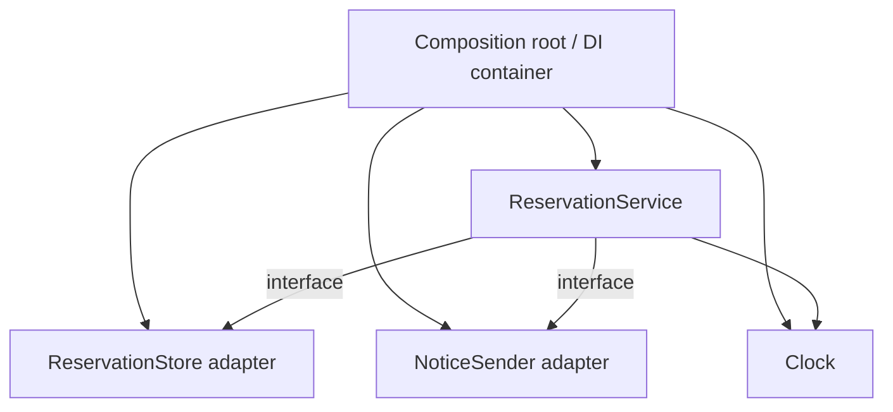
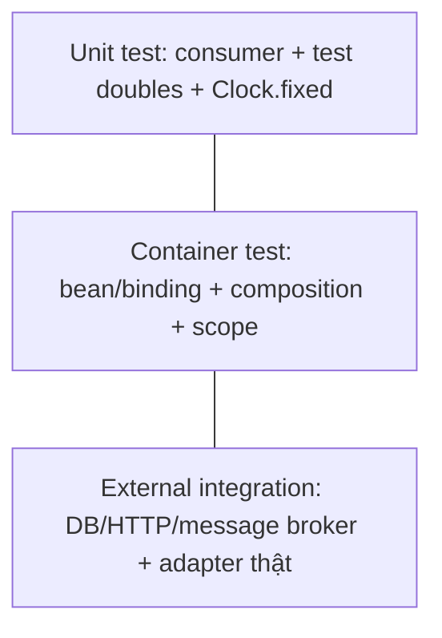
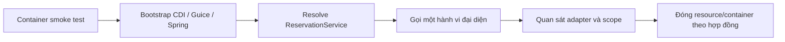

# Tách unit test khỏi kiểm thử tích hợp có khởi động container

Một trong những lợi ích thực tế của **Dependency Injection (DI)** là có thể kiểm tra phần nghiệp vụ **mà không phải khởi động ứng dụng hoặc DI container**. Nếu mỗi lần thử một nhánh của `BookingService` đều phải dựng Spring context, khởi động Jakarta CDI hoặc tạo Guice injector, bài kiểm thử đã phụ thuộc nhiều hơn mức cần thiết vào cấu hình lắp ghép. Ngược lại, chỉ viết unit test với fake cũng chưa chứng minh rằng container thật sẽ phân giải đúng interface, qualifier, scope và các factory của ứng dụng.

Bài thuộc chương **Kiểm thử** của module **DEPENDENCY_INJECTION**. Mục tiêu là tách hai câu hỏi:

1. **Unit test:** Với những dependency **đã được cấp đúng hợp đồng**, đối tượng nghiệp vụ có xử lý yêu cầu đúng không?
2. **Kiểm thử tích hợp có khởi động container:** Cấu hình DI có thực sự **tạo và nối đúng các đối tượng**, chọn đúng implementation, scope và vòng đời trong môi trường dự kiến không?

Ta dùng **constructor injection**, **composition root** và Java thuần để kiểm thử nhanh, có khả năng lặp lại, rồi giới thiệu một bài **container smoke test** riêng. Cách phân chia này giữ rõ trách nhiệm của **Inversion of Control (IoC)**: service sử dụng các collaborator, còn composition root/container quyết định cách tạo và lắp ghép.

## 1. Ranh giới khác nhau: hành vi nghiệp vụ và cơ chế lắp ghép

Giả sử hệ thống xác nhận đặt chỗ:



`ReservationService` có quy tắc: mã đặt chỗ phải hợp lệ, lấy thời điểm từ `Clock`, lưu xác nhận rồi yêu cầu gửi thông báo. Cơ chế lắp ghép quyết định adapter nào đảm nhiệm lưu trữ và thông báo.

Hai nhóm kiểm thử trả lời hai nhóm câu hỏi khác nhau:

| Tiêu chí | Unit test không khởi động container | Kiểm thử tích hợp có khởi động container |
| --- | --- | --- |
| Đối tượng cần chứng minh | Quy tắc của một consumer hoặc nhóm rất nhỏ | Wiring/binding, bean discovery, qualifier, factory, scope và lifecycle |
| Cách tạo service | `new ReservationService(fakeStore, fakeSender, fixedClock)` | Container tạo hoặc cung cấp service |
| Phụ thuộc ngoài | Thường dùng fake/stub/spy tại ranh giới | Có thể dùng adapter thử nghiệm; đôi khi nối tài nguyên thật |
| Cấu hình DI | Không cần | Có, và phải gần với cấu hình ứng dụng định kiểm tra |
| Lỗi phát hiện tốt | Thứ tự gọi, dữ liệu gửi, kiểm tra đầu vào, xử lý exception | Thiếu/trùng binding, sai qualifier, producer sai, scope sai |
| Lỗi không chứng minh | Ứng dụng có khởi động đúng với container không | Không thay thế việc bao phủ mọi nhánh nghiệp vụ |
| Chi phí chạy | Thường thấp, ít thiết lập | Thường cao hơn, phụ thuộc runtime và cấu hình |
| Thời điểm sử dụng | Thường xuyên cho logic nghiệp vụ | Khi cần xác nhận tích hợp DI, thay đổi wiring hoặc lifecycle |

**Quan trọng:** “Kiểm thử tích hợp” không nhất thiết phải khởi động container; ví dụ có thể kiểm tra một JDBC repository với database thử nghiệm mà không dùng DI container. Ngược lại, **container smoke test** có thể chỉ kiểm tra wiring bằng adapter in-memory, chưa truy cập database hoặc network. Đặt tên test theo **ranh giới nó thực sự kiểm chứng**, không theo việc có annotation hay không.

### 1.1. Ba tầng kiểm tra nên tách biệt



Ba tầng có thể bổ trợ nhau nhưng không thay thế nhau:

- **Unit test** có thể chứng minh service gọi lưu trước gửi; nó không chứng minh bean `ReservationStore` đã được đăng ký.
- **Container test** có thể chứng minh service nhận đúng store/sender trong container; nó không chứng minh SQL hoặc API thật hoạt động.
- **Kiểm thử adapter/tài nguyên ngoài** có thể chứng minh repository lưu đúng dữ liệu trên database thử nghiệm; nó không tự chứng minh service đã kiểm tra mã đặt chỗ trước khi lưu.

## 2. Thiết kế constructor để unit test không cần framework

Điều kiện quan trọng nhất là service **không tự tạo dependency hạ tầng** và không truy cập container trong logic nghiệp vụ.

Thiết kế khó kiểm thử:

```java
final class BadReservationService {
    void confirm(String bookingId) {
        // Tự chọn implementation, đọc thời gian hệ thống và gây tác dụng phụ.
        DatabaseReservationStore store = new DatabaseReservationStore();
        store.save(bookingId, java.time.Instant.now());
    }
}
```

`DatabaseReservationStore` ở đây là kiểu minh họa; ví dụ không phải chương trình chạy độc lập. Đoạn mã trộn việc **tạo phụ thuộc** với **sử dụng phụ thuộc**, khiến việc thay store hoặc cố định đồng hồ trong test trở nên khó.

Thiết kế thích hợp hơn là:

```java
final class ReservationService {
    private final ReservationStore store;
    private final NoticeSender sender;
    private final java.time.Clock clock;

    ReservationService(
            ReservationStore store,
            NoticeSender sender,
            java.time.Clock clock) {
        this.store = java.util.Objects.requireNonNull(store, "store");
        this.sender = java.util.Objects.requireNonNull(sender, "sender");
        this.clock = java.util.Objects.requireNonNull(clock, "clock");
    }
}
```

Service chỉ khai báo **những cộng tác viên cần thiết**. Chúng có thể được cấp bằng `new` tại composition root hoặc bởi một DI container, nhưng **quy tắc nghiệp vụ của service không đổi**. Constructor cũng làm thiếu phụ thuộc bắt buộc lộ rõ khi tạo service.

## 3. Ví dụ Java thuần đầy đủ: một service có ranh giới rõ

Ví dụ này dùng hai hợp đồng nhỏ:

- `ReservationStore` lưu một bản xác nhận.
- `NoticeSender` gửi yêu cầu thông báo theo mã đặt chỗ.

`Clock` là abstraction có sẵn trong JDK để test kiểm soát thời gian. Dữ liệu `Reservation` là giá trị của ứng dụng. Các adapter in-memory phục vụ minh họa, không mở DB hoặc kết nối mạng.

Lưu đoạn sau thành **`ReservationExample.java`**:

```java
import java.time.Clock;
import java.time.Instant;
import java.time.ZoneOffset;
import java.util.ArrayList;
import java.util.HashMap;
import java.util.List;
import java.util.Map;
import java.util.Objects;

public final class ReservationExample {
    private ReservationExample() {}

    public interface ReservationStore {
        void save(Reservation reservation);
    }

    public interface NoticeSender {
        void send(String bookingId);
    }

    public static final class Reservation {
        private final String bookingId;
        private final Instant confirmedAt;

        public Reservation(String bookingId, Instant confirmedAt) {
            this.bookingId = Objects.requireNonNull(bookingId, "bookingId");
            this.confirmedAt = Objects.requireNonNull(confirmedAt, "confirmedAt");
        }

        public String bookingId() {
            return bookingId;
        }

        public Instant confirmedAt() {
            return confirmedAt;
        }
    }

    public static final class ReservationService {
        private final ReservationStore store;
        private final NoticeSender sender;
        private final Clock clock;

        public ReservationService(
                ReservationStore store, NoticeSender sender, Clock clock) {
            this.store = Objects.requireNonNull(store, "store");
            this.sender = Objects.requireNonNull(sender, "sender");
            this.clock = Objects.requireNonNull(clock, "clock");
        }

        public Reservation confirm(String bookingId) {
            if (bookingId == null || bookingId.trim().isEmpty()) {
                throw new IllegalArgumentException("bookingId must not be blank");
            }

            Reservation confirmed =
                new Reservation(bookingId, clock.instant());
            store.save(confirmed);
            sender.send(bookingId);
            return confirmed;
        }
    }

    public static final class InMemoryReservationStore
            implements ReservationStore {
        private final Map<String, Reservation> byId = new HashMap<>();

        @Override
        public void save(Reservation reservation) {
            byId.put(reservation.bookingId(), reservation);
        }

        public Reservation find(String bookingId) {
            return byId.get(bookingId);
        }
    }

    public static final class RecordingNoticeSender
            implements NoticeSender {
        private final List<String> sent = new ArrayList<>();

        @Override
        public void send(String bookingId) {
            sent.add(bookingId);
        }

        public List<String> sent() {
            return List.copyOf(sent);
        }
    }

    public static void main(String[] args) {
        // Composition root bằng Java thuần, không có container.
        InMemoryReservationStore store = new InMemoryReservationStore();
        RecordingNoticeSender sender = new RecordingNoticeSender();
        Clock clock = Clock.fixed(
            Instant.parse("2026-01-10T10:15:30Z"), ZoneOffset.UTC);

        ReservationService service =
            new ReservationService(store, sender, clock);
        service.confirm("BK-001");

        System.out.println("Saved at: "
            + store.find("BK-001").confirmedAt());
        System.out.println("Notifications: " + sender.sent());
    }
}
```

Biên dịch và chạy với JDK 11 trở lên:

```bash
javac ReservationExample.java
java ReservationExample
```

Kết quả dự kiến:

```text
Saved at: 2026-01-10T10:15:30Z
Notifications: [BK-001]
```

Lệnh `new ReservationService(...)` trong `main()` là **constructor injection thủ công**. Ở điểm lắp ghép này, ta quyết định rõ:

- Dùng `InMemoryReservationStore` thay cho adapter database.
- Dùng `RecordingNoticeSender` thay cho API gửi tin thật.
- Dùng `Clock.fixed(...)` để kết quả thời gian xác định.

`ReservationService` không biết có Spring, CDI hay Guice hay không. Điều này cho phép unit test **chỉ dựng đúng phần đồ thị phục vụ hành vi cần kiểm tra**.

## 4. Unit test Java thuần: tạo consumer bằng constructor

Không cần thư viện mock để kiểm tra ví dụ này. Vì mỗi hợp đồng chỉ có một phương thức trừu tượng, ta có thể dùng lambda làm **test double**. Mỗi test tạo collaborator riêng, tránh trạng thái của test này rò sang test khác.

Lưu tệp **`ReservationUnitCheck.java`** cùng thư mục với `ReservationExample.java`:

```java
import java.time.Clock;
import java.time.Instant;
import java.time.ZoneOffset;
import java.util.ArrayList;
import java.util.Arrays;
import java.util.List;
import java.util.concurrent.atomic.AtomicInteger;

public final class ReservationUnitCheck {
    private static final Instant FIXED_TIME =
        Instant.parse("2026-01-10T10:15:30Z");
    private static final Clock FIXED_CLOCK =
        Clock.fixed(FIXED_TIME, ZoneOffset.UTC);

    public static void main(String[] args) {
        validConfirmationUsesInjectedCollaborators();
        invalidIdDoesNotCallCollaborators();
        storeFailurePreventsNotification();
        senderFailureIsObservable();
        missingDependencyFailsAtConstruction();
        testFixturesKeepTheirOwnState();
        System.out.println("PASS: 6 pure-Java reservation unit checks");
    }

    private static void validConfirmationUsesInjectedCollaborators() {
        List<String> events = new ArrayList<>();
        List<ReservationExample.Reservation> saved = new ArrayList<>();
        ReservationExample.ReservationStore store = reservation -> {
            events.add("save");
            saved.add(reservation);
        };
        ReservationExample.NoticeSender sender = id -> {
            events.add("send");
            check("BK-100".equals(id), "Wrong notice id");
        };

        ReservationExample.ReservationService service =
            new ReservationExample.ReservationService(
                store, sender, FIXED_CLOCK);
        ReservationExample.Reservation result = service.confirm("BK-100");

        check(saved.size() == 1 && saved.get(0) == result,
            "Service must save and return the same confirmed reservation");
        check(FIXED_TIME.equals(result.confirmedAt()),
            "Service must take time from injected Clock");
        check(events.equals(Arrays.asList("save", "send")),
            "Store must be called before sender");
    }

    private static void invalidIdDoesNotCallCollaborators() {
        AtomicInteger calls = new AtomicInteger();
        ReservationExample.ReservationService service =
            new ReservationExample.ReservationService(
                reservation -> calls.incrementAndGet(),
                id -> calls.incrementAndGet(),
                FIXED_CLOCK);

        boolean rejected = false;
        try {
            service.confirm(" ");
        } catch (IllegalArgumentException expected) {
            rejected = true;
        }
        check(rejected && calls.get() == 0,
            "Invalid input must not cause side effects");
    }

    private static void storeFailurePreventsNotification() {
        AtomicInteger sends = new AtomicInteger();
        ReservationExample.ReservationStore failingStore = reservation -> {
            throw new IllegalStateException("Storage unavailable");
        };
        ReservationExample.ReservationService service =
            new ReservationExample.ReservationService(
                failingStore, id -> sends.incrementAndGet(), FIXED_CLOCK);

        boolean failed = false;
        try {
            service.confirm("BK-FAIL");
        } catch (IllegalStateException expected) {
            failed = "Storage unavailable".equals(expected.getMessage());
        }
        check(failed && sends.get() == 0,
            "After save failure, sender must not be called");
    }

    private static void senderFailureIsObservable() {
        List<ReservationExample.Reservation> saved = new ArrayList<>();
        ReservationExample.ReservationService service =
            new ReservationExample.ReservationService(
                saved::add,
                id -> { throw new IllegalStateException("Sender unavailable"); },
                FIXED_CLOCK);

        boolean failed = false;
        try {
            service.confirm("BK-SEND-FAIL");
        } catch (IllegalStateException expected) {
            failed = "Sender unavailable".equals(expected.getMessage());
        }
        check(failed && saved.size() == 1,
            "Send failure must be visible; save already happened");
    }

    private static void missingDependencyFailsAtConstruction() {
        boolean rejected = false;
        try {
            new ReservationExample.ReservationService(
                null, id -> {}, FIXED_CLOCK);
        } catch (NullPointerException expected) {
            rejected = "store".equals(expected.getMessage());
        }
        check(rejected, "Missing required store must fail at construction");
    }

    private static void testFixturesKeepTheirOwnState() {
        ReservationExample.InMemoryReservationStore first =
            new ReservationExample.InMemoryReservationStore();
        ReservationExample.InMemoryReservationStore second =
            new ReservationExample.InMemoryReservationStore();

        ReservationExample.ReservationService service =
            new ReservationExample.ReservationService(
                first, id -> {}, FIXED_CLOCK);
        service.confirm("BK-ONLY-FIRST");

        check(first.find("BK-ONLY-FIRST") != null,
            "First fixture must receive the save");
        check(second.find("BK-ONLY-FIRST") == null,
            "Independent fixture must not receive the first fixture's state");
    }

    private static void check(boolean condition, String message) {
        if (!condition) {
            throw new AssertionError(message);
        }
    }
}
```

Chạy riêng bộ kiểm tra nghiệp vụ:

```bash
javac ReservationExample.java ReservationUnitCheck.java
java ReservationUnitCheck
```

Kết quả dự kiến:

```text
PASS: 6 pure-Java reservation unit checks
```

Các phép `check(...)` chủ động ném `AssertionError`, vì vậy không phụ thuộc cờ `-ea` của Java. Không có `@SpringBootTest`, `SeContainerInitializer` hay `Guice.createInjector(...)`. Sự vắng mặt của container là **một lựa chọn có chủ đích**: bài test chỉ kiểm tra trách nhiệm của `ReservationService`.

### 4.1. Các kết luận mà unit test được phép đưa ra

| Phép kiểm | Điều thực sự chứng minh |
| --- | --- |
| `validConfirmationUsesInjectedCollaborators` | Dữ liệu và thời gian được dùng đúng, gọi lưu trước gửi |
| `invalidIdDoesNotCallCollaborators` | Đầu vào không hợp lệ được từ chối trước mọi tác dụng phụ |
| `storeFailurePreventsNotification` | Lỗi store dừng luồng xử lý trước khi gửi |
| `senderFailureIsObservable` | Lỗi sender không bị nuốt, nhưng store có thể đã được gọi |
| `missingDependencyFailsAtConstruction` | Constructor bắt buộc đủ phụ thuộc |
| `testFixturesKeepTheirOwnState` | Fake/in-memory fixture riêng không rò trạng thái |

Unit test **không chứng minh** rằng binding production tồn tại, rằng adapter database thực sự lưu bền vững, hoặc rằng notice đã tới người dùng. Đặc biệt, ví dụ cố ý để lộ tình huống **lưu thành công nhưng gửi thất bại**. Nếu nghiệp vụ yêu cầu giao nhận tin đáng tin cậy, cần thiết kế transaction/outbox hoặc retry/idempotency phù hợp; DI không tự giải quyết tính nhất quán này.

## 5. Kiểm thử có khởi động container nên chứng minh điều gì?

Khi thay composition root thủ công bằng container, những lỗi mới có thể xuất hiện dù mọi unit test đã đạt:

- Interface có nhiều implementation mà không có qualifier/ưu tiên rõ ràng.
- Container không tìm được bean/binding hoặc producer của một dependency bắt buộc.
- Factory/`@Provides` trả giá trị `null` hoặc ném exception.
- Cấu hình môi trường chọn nhầm adapter.
- Singleton hoặc request scope tạo/giữ sai instance; tài nguyên bị đóng trước khi các consumer dùng xong.
- Component mới bị bỏ khỏi bean discovery, module binding hoặc scan configuration.

Một **container smoke test** nên khởi động runtime với **cấu hình lắp ghép có ý nghĩa**, yêu cầu container cấp entry point, sau đó xác minh vài mối nối và scope quan trọng. Không cần lặp lại toàn bộ các trường hợp unit test: mục tiêu khác nhau.



### 5.1. Một bài smoke test phải đủ gần cấu hình thật

Nếu production dùng `ApplicationModule` nhưng bài container test tạo một `FakeTestModule` hoàn toàn khác, việc test pass chỉ chứng minh **module giả đó** hợp lệ. Nó chưa chứng minh production wiring đúng.

Có hai hướng thiết kế hiệu quả:

1. **Dùng lại cấu hình/module thực** và thay thế có chủ đích **ranh giới hạ tầng bên ngoài** (ví dụ dùng database thử nghiệm, test sink hoặc profile in-memory đã được ứng dụng hỗ trợ). Khi đó test kiểm tra phần wiring quan trọng của production.
2. **Kiểm tra một module cô lập có mục tiêu riêng**, ví dụ module thông báo, rồi đặt tên bài test đúng theo phạm vi ấy. Đừng kết luận nó xác nhận được toàn bộ ứng dụng.

Việc dùng fake trong container test **không sai**, nhưng cần biết phần binding nào đang được kiểm tra và phần nào đã bị thay thế. Khi một thay đổi liên quan đến qualifier hoặc scope, hãy bảo đảm test thực sự đi qua cấu hình đó.

## 6. Ví dụ container smoke test riêng với Guice

Để minh họa một container, ta dùng **Google Guice**. `ReservationExample` ở phần 3 **vẫn không import Guice**; bài kiểm tra sau chỉ thêm Guice trong lớp lắp ghép. Đây là lựa chọn quan trọng: unit test có thể biên dịch bằng JDK thuần, còn test tích hợp DI cần thư viện Guice.

Tạo tệp **`GuiceWiringCheck.java`** cạnh `ReservationExample.java`:

```java
import java.time.Clock;
import java.time.Instant;
import java.time.ZoneOffset;
import java.util.List;
import com.google.inject.AbstractModule;
import com.google.inject.Guice;
import com.google.inject.Injector;
import com.google.inject.Provides;
import com.google.inject.Singleton;

public final class GuiceWiringCheck {
    // Module ứng dụng cho profile in-memory được kiểm tra.
    // Trong dự án thật, smoke test nên tái sử dụng module/profile triển khai.
    public static final class InMemoryAppModule extends AbstractModule {
        @Override
        protected void configure() {
            bind(Clock.class).toInstance(Clock.fixed(
                Instant.parse("2026-01-10T10:15:30Z"), ZoneOffset.UTC));
        }

        @Provides
        @Singleton
        ReservationExample.ReservationStore store() {
            return new ReservationExample.InMemoryReservationStore();
        }

        @Provides
        @Singleton
        ReservationExample.NoticeSender sender() {
            return new ReservationExample.RecordingNoticeSender();
        }

        @Provides
        ReservationExample.ReservationService service(
                ReservationExample.ReservationStore store,
                ReservationExample.NoticeSender sender,
                Clock clock) {
            // Constructor của service không cần Guice annotation.
            return new ReservationExample.ReservationService(
                store, sender, clock);
        }
    }

    public static void main(String[] args) {
        Injector injector = Guice.createInjector(new InMemoryAppModule());

        ReservationExample.ReservationService service =
            injector.getInstance(ReservationExample.ReservationService.class);
        ReservationExample.ReservationStore store =
            injector.getInstance(ReservationExample.ReservationStore.class);
        ReservationExample.NoticeSender sender =
            injector.getInstance(ReservationExample.NoticeSender.class);

        check(store == injector.getInstance(
                ReservationExample.ReservationStore.class),
              "Store binding must reuse the scoped instance");
        check(sender == injector.getInstance(
                ReservationExample.NoticeSender.class),
              "Sender binding must reuse the scoped instance");

        ReservationExample.Reservation result = service.confirm("BK-GUICE");

        ReservationExample.InMemoryReservationStore actualStore =
            (ReservationExample.InMemoryReservationStore) store;
        ReservationExample.RecordingNoticeSender actualSender =
            (ReservationExample.RecordingNoticeSender) sender;

        check(actualStore.find("BK-GUICE") == result,
              "Service must receive the store bound by injector");
        check(actualSender.sent().equals(List.of("BK-GUICE")),
              "Service must receive the sender bound by injector");
        check(result.confirmedAt().equals(
                Instant.parse("2026-01-10T10:15:30Z")),
              "Injector must provide the configured Clock");

        System.out.println("PASS: Guice container wiring checks");
    }

    private static void check(boolean ok, String message) {
        if (!ok) {
            throw new AssertionError(message);
        }
    }
}
```

Đoạn Guice **không thể biên dịch chỉ bằng JDK**: cần thêm thư viện Guice cùng các phụ thuộc tương ứng vào classpath, rồi biên dịch `ReservationExample.java` và `GuiceWiringCheck.java` trong project đã cấu hình thư viện đó. Dòng `PASS` là **kết quả mong đợi khi test đạt**, không phải kết quả đã chạy trong bài viết:

```text
PASS: Guice container wiring checks
```

`InMemoryAppModule` định nghĩa ba dependency. Hai phương thức `@Provides @Singleton` cung cấp store và sender dùng chung trong injector. Phương thức `@Provides` thứ ba xây service bằng constructor thuần Java. Bài kiểm tra:

1. **Khởi động Guice injector** thay vì tự lắp graph trong test.
2. Yêu cầu injector phân giải `ReservationService`.
3. So sánh việc lấy lặp lại store/sender để xác minh scope của **hai binding được cấu hình singleton**.
4. Gọi một hành vi đại diện và quan sát rằng service thật sự sử dụng những instance container cấp.
5. Kiểm tra `Clock` cố định đã được binding đúng.

Nếu thay `InMemoryAppModule` bằng module production có database hoặc HTTP client, môi trường test cần cấu hình tài nguyên thử nghiệm phù hợp. Không nên chuyển một bài kiểm tra chỉ cần wiring thành bài kiểm tra phụ thuộc dịch vụ production thật.

### 6.1. Vì sao ví dụ không cần `@Inject` trong service?

Vì `@Provides` trực tiếp gọi constructor:

```java
return new ReservationExample.ReservationService(store, sender, clock);
```

Guice đã phân giải ba tham số cho provider method; service được tạo qua constructor như Java thuần. Đây là **DI ở tầng cấu hình**, không phải service locator trong nghiệp vụ. Nếu bỏ provider và muốn Guice tự dựng `ReservationService` từ constructor, phải cấu hình cơ chế constructor injection tương ứng với API Guice (ví dụ dùng `@Inject` hoặc explicit binding) và vẫn bảo đảm đủ binding cho mọi tham số.

### 6.2. Nếu dùng Jakarta CDI hoặc Spring thì nguyên tắc tương tự

Với **Jakarta CDI**, một kiểm thử container dùng CDI runtime tương thích có thể khởi động `SeContainer`, phân giải bean theo type/qualifier, thực thi một luồng ngắn rồi đóng container/context. Với **Spring**, một bài test tải `ApplicationContext` có thể xác minh bean registration, qualifier, profile, scope và lifecycle. Cú pháp và điều kiện bootstrap khác nhau, nhưng **câu hỏi cần kiểm tra giống nhau**:

- Container có tìm được component bắt buộc không?
- Điểm tiêm đơn trị có đúng một implementation không?
- Scope có tạo hoặc tái sử dụng instance đúng kỳ vọng không?
- Configuration profile và giá trị cấu hình có được áp dụng đúng không?
- Khi kết thúc test, ai chịu trách nhiệm đóng container và các tài nguyên nó sở hữu?

Đừng kết luận “unit test phải dùng `@SpringBootTest`” chỉ vì project sử dụng Spring. Logic của service không cần framework thì cứ kiểm tra bằng constructor injection và fake. Chỉ khởi động context khi **điều cần chứng minh thuộc về context**.

## 7. Scope và lifecycle là lý do chính đáng để dùng container test

Một unit test tạo `new ReservationService(...)` chứng minh consumer sử dụng đối tượng được đưa vào. Nó **không đủ** để chứng minh container đã cấu hình singleton, request scope hay producer/disposer đúng.

Ví dụ, nếu application-scoped service giữ một dependency gắn với một request, lỗi có thể chỉ xuất hiện khi chuyển từ request này sang request khác. Nếu một client dùng chung bị đóng trong một service, các consumer còn lại có thể hỏng. Vì vậy, khi cần xác nhận scope:

| Quy tắc cần kiểm tra | Cách kiểm tra có ý nghĩa |
| --- | --- |
| Hai consumer phải dùng chung instance bất biến hoặc adapter được phép chia sẻ | Lấy hai consumer từ cùng container và quan sát identity/hành vi đúng phạm vi |
| Hai request không được dùng chung state request | Tạo hai scope/request hợp lệ, so sánh trạng thái độc lập |
| Provider/factory phải tạo resource mới mỗi tác vụ | Gọi hai lần theo hợp đồng, ghi nhận ID/lifecycle và cleanup |
| Container phải dọn bean nó quản lý khi scope kết thúc | Đóng context/container rồi kiểm tra callback/close trong adapter test |
| Shared client không bị đóng khi một consumer hoàn thành | Gọi consumer thứ hai sau consumer thứ nhất, trước thời điểm owner đóng |

**Cẩn trọng với proxy:** ở một số scope, container cấp **client proxy** để chuyển tiếp đến contextual instance. So sánh hai tham chiếu bằng `==` có thể đo cùng proxy, không trực tiếp chứng minh rằng đối tượng đích bên trong giống nhau. Khi test scope của CDI/Spring, hãy dựa vào ngữ nghĩa của framework và hành vi/ID của contextual instance được quan sát trong context phù hợp, thay vì chỉ so sánh proxy.

### 7.1. Owner của container và tài nguyên

Trong unit test, test tự tạo fake thì test tự chịu trách nhiệm cleanup nếu fake có `close()`. Trong container test, **runtime quản lý những thành phần thuộc phạm vi của nó** theo quy tắc tương ứng, nhưng không thể tự suy rằng mọi resource bên ngoài sẽ được đóng.

CDI SE có `SeContainer` triển khai `AutoCloseable`, nên có thể dùng `try-with-resources` để đóng container. Với **Guice**, bản thân `Injector` không có một hợp đồng đóng toàn bộ mọi dependency theo kiểu `AutoCloseable` chung cho tất cả binding; ứng dụng cần tổ chức cleanup cho resource mà nó sở hữu. Với Spring, việc đóng context và gọi lifecycle callback phụ thuộc cách context được tạo/quản lý trong test.

Nếu hai test chia sẻ một context có state mutable, phải có chiến lược reset dữ liệu hoặc tạo scope/fixture riêng. Đừng dùng một singleton mutable giữa mọi bài test chỉ vì tạo container nhiều lần tốn thời gian; một bài test nhanh nhưng bị nhiễm trạng thái có thể kém đáng tin hơn.

## 8. Chọn test theo rủi ro thay vì khởi động container cho mọi tình huống

Một chiến lược thực tế là **đưa từng quy tắc về cấp kiểm thử gần nhất có đủ thông tin để chứng minh nó**.

| Tình huống | Cấp kiểm thử ưu tiên | Giải thích |
| --- | --- | --- |
| Kiểm tra mã đặt chỗ rỗng | Unit test | Chỉ cần service và fake |
| Chứng minh service gọi store trước sender | Unit test | Quan sát thứ tự lời gọi qua test double |
| Thay đổi thuật toán tính phí thuần túy | Unit test | Không liên quan cơ chế đăng ký bean |
| Thêm một implementation và qualifier mới | Container test | Cần kiểm tra chính sách phân giải |
| Thay đổi module Guice hoặc producer CDI | Container test | Thay đổi trực tiếp cơ chế wiring |
| Thay scope của một dependency mutable | Container/scope test | Cần xác minh hành vi trong đúng context |
| Thay JDBC SQL hoặc mapping | Adapter integration test | Cần DB thử nghiệm hoặc tài nguyên phù hợp |
| Thay chính sách giao thông báo thật | Adapter/integration hoặc E2E test | Cần quan sát giao thức và tình huống lỗi thực tế |
| Thay toàn bộ tuyến request qua HTTP | Test tích hợp HTTP hoặc E2E | Nhiều tầng cần hoạt động cùng nhau |

Không có tỷ lệ cố định bắt buộc về số lượng unit/container/integration test. Hãy ưu tiên các phép kiểm tra có **phản hồi nhanh và định vị lỗi rõ** cho quy tắc cục bộ, bổ sung kiểm thử tích hợp ở ranh giới có rủi ro.

### 8.1. Test double cần đơn giản nhưng không được che lỗi hợp đồng

Một fake repository trong unit test có thể ghi vào `List` để quan sát dữ liệu, nhưng không mô phỏng đầy đủ transaction, unique constraint hoặc tính nhất quán khi hai luồng đồng thời. Nếu một service phụ thuộc vào các bảo đảm đó, phải kiểm thử thêm với adapter thực tế hoặc môi trường tích hợp.

Không nên mock **chính service đang được kiểm thử** rồi chỉ xác nhận mock trả đúng giá trị đã khai báo. Unit test có giá trị khi thực thi **mã thật của consumer** với cộng tác viên có thể kiểm soát.

Tương tự, test quá phụ thuộc vào thứ tự gọi mọi method nội bộ có thể trở nên mong manh khi refactor hợp lệ. Chỉ xác nhận thứ tự khi thứ tự là **hợp đồng quan sát được** hoặc một bất biến nghiệp vụ, ví dụ không gửi thông báo trước khi lưu thành công.

## 9. Sai lầm thường gặp khi trộn hai nhóm kiểm thử

### 9.1. Khởi động toàn bộ framework để thử một `if`

Một bài `@SpringBootTest` hoặc CDI container test cho phép nhánh `bookingId == null` chạy, nhưng nó đồng thời kéo theo hàng loạt bean, cấu hình, profile và đôi khi tài nguyên ngoài. Nếu mục tiêu chỉ là xác minh kiểm tra input, hãy dùng unit test thuần.

### 9.2. Test chỉ với fake rồi kết luận production wiring đúng

Unit test có thể tạo `new ReservationService(fakeStore, fakeSender, fixedClock)` thành công dù production thiếu `NoticeSender` binding. Chỉ container test sử dụng **cấu hình triển khai liên quan** mới phát hiện được lỗi wiring đó.

### 9.3. Dùng một test module hoàn toàn khác production

Nếu container test tự khai báo mọi fake qua một module không liên quan tới module đang triển khai, test không xác nhận các binding/qualifier của production. Hãy tái sử dụng hoặc kết hợp configuration thật với những override có lý do rõ, đồng thời mô tả phần bị thay thế.

### 9.4. Dùng `Clock.systemUTC()` trong mọi unit test

Kết quả thời gian có thể khác nhau giữa các lần chạy và tạo test phụ thuộc môi trường. Tiêm `Clock.fixed(...)` giúp các assertion có thể lặp lại. Chỉ kiểm tra tương tác thật với đồng hồ hệ thống ở nơi thực sự có nhu cầu tích hợp.

### 9.5. Không thu dọn scope/container sau test

Một context, connection pool, thread hoặc subscription còn sống có thể làm test kế tiếp nhiễm trạng thái hoặc khiến tiến trình không kết thúc. Test phải xác định **ai là owner** và gọi cleanup đúng theo runtime. Không giả định garbage collector sẽ đóng resource.

### 9.6. Bỏ qua lỗi phát sinh muộn

Một container có thể khởi động thành công nhưng một provider chỉ tạo object khi gọi, hoặc một context request chỉ hoạt động trong request. Vì thế, container test nên **lấy đúng entry point và thực hiện một hành vi ngắn**, không chỉ khẳng định bootstrap không ném exception.

### 9.7. Đưa container vào logic nghiệp vụ

Nếu service gọi `injector.getInstance(...)` hoặc `applicationContext.getBean(...)` sâu trong method, dependency thật bị che khuất. Cách đó làm unit test khó dựng service và tái tạo service locator. Thường nên giữ thao tác tra cứu container ở bootstrap/adapters, rồi tiêm dependency thông qua constructor.

## 10. Quy trình tổ chức test cho một module DI

1. **Vẽ đường phụ thuộc của consumer.** Xác định những collaborator trực tiếp: store, sender, clock, policy.
2. **Giữ constructor dễ gọi bằng Java thuần.** Không phụ thuộc vào container để tạo service khi kiểm tra logic.
3. **Viết unit test cho quy tắc và đường lỗi.** Tạo fake mới cho từng test; cố định thời gian; xác minh dữ liệu và các tác dụng phụ cần thiết.
4. **Tập trung cấu hình DI ở composition root.** Đối với container, tạo module/bean configuration và qualifier rõ ràng.
5. **Viết một container smoke test đúng mục đích.** Tái sử dụng cấu hình liên quan; yêu cầu container cấp entry point; kiểm tra wiring và scope quan trọng.
6. **Bổ sung integration test cho adapter thật.** Kiểm tra database, HTTP, queue, transaction hoặc lifecycle với môi trường thử nghiệm.
7. **Đảm bảo cô lập và cleanup.** Mỗi test phải kiểm soát trạng thái, context và tài nguyên mà nó sở hữu.
8. **Phân loại lỗi theo tầng.** Assertion về dữ liệu là vấn đề nghiệp vụ; unsatisfied binding là vấn đề composition; SQL timeout là vấn đề hạ tầng/tích hợp.
9. **Chạy theo vòng phản hồi phù hợp.** Unit test thường được chạy liên tục khi sửa code; container và external integration test được chạy khi thay wiring/hạ tầng và trong quy trình kiểm tra phù hợp của dự án.

### Bài tập tự kiểm tra

Một ứng dụng thanh toán có `PaymentService` nhận `PaymentGateway`, `FraudRule` và `Clock`. Production chọn `CardGateway` bằng qualifier; service sống suốt ứng dụng, còn mỗi thanh toán cần một transaction mới. Hiện toàn bộ test đều khởi động Spring context và dùng một database chung.

Hãy thử thiết kế lại bộ test:

1. Nhánh từ chối thanh toán khi dữ liệu không hợp lệ thuộc **unit test** hay **container test**? Test double nào cần thiết?
2. Để chứng minh qualifier chọn đúng `CardGateway`, cần test ở ranh giới nào?
3. Làm sao kiểm tra mỗi transaction có vòng đời riêng và được đóng đúng khi nghiệp vụ ném lỗi?
4. Nếu tất cả unit test đều dùng chung một fake mutable singleton, lỗi nào có thể xảy ra?
5. Container bootstrap pass nhưng request đầu tiên mới ném lỗi do một provider tạo transaction muộn. Container smoke test nên bổ sung bước nào?
6. Test nào cần database thật hoặc môi trường thử nghiệm, và test nào nên tách khỏi nó?

Một hướng giải: unit test `PaymentService` bằng fake gateway, fake fraud rule và `Clock.fixed`; container test kiểm tra qualifier/binding production và scope/provider của transaction trong ngữ cảnh hợp lệ; adapter integration test kiểm tra giao dịch và database bằng tài nguyên thử nghiệm. Tạo fixture độc lập và cleanup đúng owner, chỉ khởi động container khi chính cơ chế container là đối tượng cần kiểm chứng.

**Ghi nhớ:** **Unit test chứng minh hành vi của consumer khi phụ thuộc đã được cấp; container test chứng minh cơ chế cấp và lắp ghép các phụ thuộc có hoạt động đúng.** Constructor injection làm hai loại kiểm thử có thể tách nhau: Java thuần kiểm tra nghiệp vụ nhanh, trong khi CDI/Guice/Spring context được dùng có chọn lọc để kiểm tra binding, qualifier, scope và lifecycle. Sau đó, integration test với tài nguyên thật hoặc môi trường thử nghiệm xác nhận các bảo đảm hạ tầng mà cả unit test lẫn container smoke test chưa bao phủ.
