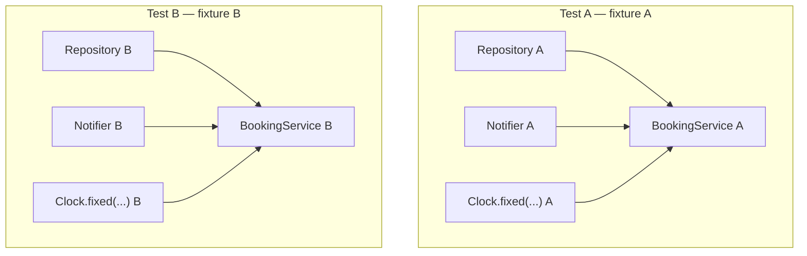
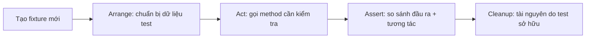

# Giữ dữ liệu và trạng thái phụ thuộc độc lập giữa các lần kiểm thử

Một bài kiểm thử có thể **chạy đúng khi đứng một mình nhưng thất bại khi chạy cả bộ test**. Nguyên nhân thường không nằm ở logic được kiểm thử mà ở **trạng thái còn sót từ lần chạy trước**: repository giả lưu dữ liệu, mock giữ số lần gọi, cache tĩnh chưa được xóa, connection dùng chung chưa được trả hoặc một đồng hồ phụ thuộc thời gian thực.

**Dependency Injection (DI)** giúp giải quyết vấn đề bằng cách cho phép mỗi bài kiểm thử **tự cấp các cộng tác viên cần thiết**. Tuy nhiên, việc class nhận phụ thuộc qua constructor không tự động làm test độc lập: nếu nhiều test vẫn inject **cùng một instance có trạng thái**, chúng vẫn có thể ảnh hưởng nhau. Cần thiết kế rõ *ranh giới tạo fixture, phạm vi chia sẻ, dữ liệu đầu vào và quyền sở hữu tài nguyên*.

Bài này thuộc chương **Kiểm thử** của nội dung **Dependency Injection và Inversion of Control (IoC)**. Ta sẽ thực hành constructor injection bằng Java thuần, tạo fixture mới cho mỗi phép kiểm thử, xử lý fake có trạng thái, kiểm soát thời gian bằng `Clock`, tách kiểm thử nghiệp vụ khỏi kiểm thử lắp ghép và chuẩn bị cho những trường hợp có DI container, cơ sở dữ liệu hoặc chạy test song song.

## 1. Thế nào là hai phép kiểm thử độc lập?

Một phép kiểm thử có tính độc lập khi **kết quả của nó không phụ thuộc vào việc phép kiểm thử khác đã chạy hay chưa, chạy trước hay sau, hoặc để lại trạng thái nào**. Nó phải tự chuẩn bị dữ liệu cần thiết, thực hiện hành vi cần kiểm tra, đánh giá kết quả rồi dọn những tài nguyên do chính nó sở hữu.

Ví dụ, hai bài kiểm thử cùng dùng `InMemoryBookingRepository`:

```text
Test A:
  save("BK-001")
  assert find("BK-001") != null

Test B:
  assert find("BK-001") == null
```

Nếu cả hai dùng **chung repository**, Test B chỉ đúng khi chạy trước Test A. Đây là **test pollution**: bài kiểm thử bị ảnh hưởng bởi trạng thái mà bài khác để lại. Nếu mỗi test tự tạo repository mới, cả hai có thể đúng trong bất kỳ thứ tự nào.

Các loại trạng thái có thể gây ô nhiễm:

| Nơi giữ trạng thái | Ví dụ | Biện pháp thường phù hợp |
| --- | --- | --- |
| Đối tượng fake/mock | Danh sách `save(...)` đã gọi, bộ đếm `send(...)` | Tạo fake mới trong từng test |
| Repository trong bộ nhớ | `Map<String, Booking>` lưu booking từ test trước | Tạo repository mới hoặc kho dữ liệu riêng |
| Biến `static` mutable/singleton | Cache, counter, registry toàn cục | Tránh trạng thái chung; nếu bắt buộc, cô lập và dọn rõ ràng |
| Đồng hồ/random/ID | `Instant.now()`, UUID mới, random seed không cố định | Inject `Clock`, bộ sinh ID hoặc nguồn ngẫu nhiên kiểm soát được |
| Tài nguyên ngoài | File, database, queue, server, environment | Sử dụng tài nguyên riêng cho test; cleanup và chính sách ownership |
| DI container | Bean singleton có trạng thái, context cache | Hiểu scope, tách dữ liệu giữa test và kiểm tra cơ chế reset/cleanup |

**Tính độc lập không có nghĩa mọi object trong mọi test đều phải khác nhau.** Một constant bất biến, định nghĩa enum hoặc bộ dữ liệu chỉ đọc không gây ô nhiễm thì có thể dùng chung. Điều cần tránh là **trạng thái mutable được chia sẻ ngoài chủ ý**.

## 2. DI hỗ trợ cô lập test theo cơ chế nào?

Với constructor injection, `BookingService` yêu cầu những cộng tác viên nó cần:

```java
final class BookingService {
    private final BookingRepository repository;
    private final BookingNotifier notifier;
    private final java.time.Clock clock;

    BookingService(BookingRepository repository,
                   BookingNotifier notifier,
                   java.time.Clock clock) {
        this.repository =
            java.util.Objects.requireNonNull(repository, "repository");
        this.notifier =
            java.util.Objects.requireNonNull(notifier, "notifier");
        this.clock =
            java.util.Objects.requireNonNull(clock, "clock");
    }
}
```

Trong ứng dụng chạy thật, **composition root** tạo repository và notifier phù hợp rồi inject vào service. Trong unit test, **mỗi phép thử đóng vai trò composition root thu nhỏ**: nó tạo fake/repository riêng, chọn đồng hồ cố định và gọi chính constructor đó.



Ở sơ đồ, Test A và Test B không có cạnh nối giữa các object có trạng thái. Khi A lưu booking vào repository A, B không quan sát được dữ liệu đó. Hai test cũng có bộ đếm lời gọi notifier riêng. Đây là một lợi ích thiết thực của **IoC**: service không giữ quyền tự tạo hoặc tra cứu các cộng tác viên toàn cục; caller của constructor kiểm soát đồ thị được sử dụng trong mỗi lần kiểm thử.

Điều quan trọng cần phân biệt: **DI là cơ chế truyền phụ thuộc; tính độc lập là chính sách tạo và sử dụng các instance khi test**. Chỉ viết `@Inject` hoặc dùng framework mock không làm chính sách đó tự đúng.

## 3. Một anti-pattern nhỏ nhưng dễ mắc

Xét phép thử sau:

```java
// Anti-pattern minh họa: các lớp được định nghĩa ở phần ví dụ phía dưới.
final class SharedTests {
    static final InMemoryBookingRepository REPOSITORY =
        new InMemoryBookingRepository();
    static final BookingAppTest.RecordingNotifier NOTIFIER =
        new BookingAppTest.RecordingNotifier();

    static void testCreate() {
        BookingService service = new BookingService(
            REPOSITORY, NOTIFIER, java.time.Clock.systemUTC());
        service.create("BK-001", 100);
    }

    static void testEmptyRepository() {
        // Có thể thất bại nếu testCreate chạy trước!
        if (REPOSITORY.findById("BK-001") != null) {
            throw new AssertionError("Repository phai rong");
        }
    }
}
```

Mặc dù mỗi test tạo một `BookingService` mới, **cả hai service vẫn dùng repository và notifier tĩnh chung**. Bộ đếm notifier cũng có thể tích lũy, khiến các assertion kiểu “chỉ gọi một lần” thất bại vì test trước đã gọi.

Thay bằng:

```java
static void testCreate() {
    InMemoryBookingRepository repository =
        new InMemoryBookingRepository();
    BookingAppTest.RecordingNotifier notifier =
        new BookingAppTest.RecordingNotifier();
    BookingService service = new BookingService(
        repository, notifier,
        java.time.Clock.fixed(
            java.time.Instant.parse("2026-01-01T00:00:00Z"),
            java.time.ZoneOffset.UTC));
    // ... thực hiện test này ...
}

static void testEmptyRepository() {
    InMemoryBookingRepository repository =
        new InMemoryBookingRepository();
    // Repository chưa bị test nào khác thay đổi.
}
```

Đây là mẫu minh họa, không phải chương trình biên dịch độc lập; `BookingAppTest.RecordingNotifier` là fake được định nghĩa trong file kiểm thử ở phần 6. Khi thấy một object được khai báo `static final`, **đừng mặc định nó bất biến**: `final` chỉ ngăn gán lại **tham chiếu**, không ngăn sửa nội dung `Map` hoặc bộ đếm bên trong.

## 4. Thiết kế test data, fake và fixture theo phạm vi từng phép thử

Một fixture là **tập đối tượng và dữ liệu cần thiết để chạy một phép kiểm thử**. Với service tạo booking, fixture có thể gồm:

- `InMemoryBookingRepository` mới, ban đầu rỗng.
- `RecordingNotifier` mới, ban đầu chưa ghi nhận lời gọi nào.
- `Clock.fixed(...)` để thời điểm có thể dự đoán.
- `BookingService` mới, nhận ba cộng tác viên đó qua constructor.

Fixture không nên tự thực hiện một loạt hành động khó đoán khi được tạo. Nó nên **chuẩn bị trạng thái ban đầu rõ ràng**; bài test quyết định khi nào gọi nghiệp vụ và khi nào thêm dữ liệu cho kịch bản.



Đây là cấu trúc **Arrange – Act – Assert – Cleanup**. Với fake thuần Java và các object trong bộ nhớ không có `close()`, thường không cần thao tác cleanup riêng; các instance trở nên có thể thu gom khi test kết thúc và không còn tham chiếu tới chúng. Với file, kết nối, socket, thread hoặc container, cleanup cần thực hiện rõ.

Một lưu ý nhỏ nhưng quan trọng: không nên đưa mọi thứ vào một `BaseTest` toàn cục rồi tự động cấu hình hàng chục dependency dù test chỉ cần hai. Fixture nên **nhỏ, có tên rõ và đủ minh bạch** để người đọc biết dữ liệu ban đầu của test là gì.

## 5. Ví dụ ứng dụng Java thuần

Ta dùng `BookingService` với ba dependency. Repository lưu booking; notifier ghi nhận sự kiện tạo thành công; clock cung cấp thời gian. Quy tắc nghiệp vụ là:

1. Booking phải có ID gồm chữ, số hoặc dấu gạch ngang và có số tiền dương.
2. Booking trùng ID không được lưu đè.
3. Chỉ thông báo **sau khi** repository lưu thành công.

Tạo file `BookingApp.java` trong một thư mục riêng dành cho ví dụ để tránh trùng tên class với mã ở các bài học khác:

```java
import java.time.Clock;
import java.time.Instant;
import java.util.HashMap;
import java.util.Map;
import java.util.Objects;

final class Booking {
    private final String id;
    private final int amount;
    private final Instant createdAt;

    Booking(String id, int amount, Instant createdAt) {
        if (id == null || !id.matches("[A-Za-z0-9-]+")) {
            throw new IllegalArgumentException("bookingId khong hop le");
        }
        if (amount <= 0) {
            throw new IllegalArgumentException("amount phai > 0");
        }
        this.id = id;
        this.amount = amount;
        this.createdAt = Objects.requireNonNull(createdAt, "createdAt");
    }

    String id() {
        return id;
    }

    int amount() {
        return amount;
    }

    Instant createdAt() {
        return createdAt;
    }
}

interface BookingRepository {
    void save(Booking booking);
    Booking findById(String id);
}

interface BookingNotifier {
    void onCreated(Booking booking);
}

final class InMemoryBookingRepository implements BookingRepository {
    // HashMap du cho vi du test tuan tu; khong mac dinh thread-safe.
    private final Map<String, Booking> bookings = new HashMap<>();

    @Override
    public void save(Booking booking) {
        Objects.requireNonNull(booking, "booking");
        if (bookings.containsKey(booking.id())) {
            throw new IllegalStateException("bookingId da ton tai");
        }
        bookings.put(booking.id(), booking);
    }

    @Override
    public Booking findById(String id) {
        return bookings.get(id);
    }

    int count() {
        return bookings.size();
    }
}

final class ConsoleBookingNotifier implements BookingNotifier {
    @Override
    public void onCreated(Booking booking) {
        System.out.println("NOTIFY " + booking.id());
    }
}

final class BookingService {
    private final BookingRepository repository;
    private final BookingNotifier notifier;
    private final Clock clock;

    BookingService(BookingRepository repository,
                   BookingNotifier notifier, Clock clock) {
        this.repository =
            Objects.requireNonNull(repository, "repository");
        this.notifier =
            Objects.requireNonNull(notifier, "notifier");
        this.clock = Objects.requireNonNull(clock, "clock");
    }

    Booking create(String id, int amount) {
        Booking booking = new Booking(id, amount, clock.instant());
        repository.save(booking);
        notifier.onCreated(booking);
        return booking;
    }
}

public class BookingApp {
    public static void main(String[] args) {
        // Composition root cua chuong trinh chay that.
        InMemoryBookingRepository repository =
            new InMemoryBookingRepository();
        BookingNotifier notifier = new ConsoleBookingNotifier();
        BookingService service = new BookingService(
            repository, notifier, Clock.systemUTC());

        Booking result = service.create("BK-001", 250);
        System.out.println("CREATED " + result.id());
        System.out.println("SAVED "
            + (repository.findById(result.id()) == result));
    }
}
```

Biên dịch và chạy với JDK 8 trở lên:

```bash
javac BookingApp.java
java BookingApp
```

Kết quả:

```text
NOTIFY BK-001
CREATED BK-001
SAVED true
```

Ở chương trình thực, composition root chủ động chọn `ConsoleBookingNotifier` và `Clock.systemUTC()`. Trong test, ta sẽ thay notifier bằng fake ghi nhận lời gọi và đồng hồ bằng một giá trị cố định, còn **mã của `BookingService` không đổi**.

## 6. Test đầy đủ: tạo fixture mới trong mỗi phép thử

Tạo file `BookingAppTest.java` cùng thư mục với `BookingApp.java`. Đây là bộ test Java thuần, dùng `main` và `AssertionError` để tránh phụ thuộc vào JUnit hay thư viện mock.

```java
import java.time.Clock;
import java.time.Instant;
import java.time.ZoneOffset;

public class BookingAppTest {
    // Du lieu bat bien co the dung chung giua cac phep thu.
    private static final Instant FIXED_TIME =
        Instant.parse("2026-01-01T00:00:00Z");

    static final class RecordingNotifier implements BookingNotifier {
        int calls;
        Booking lastBooking;

        @Override
        public void onCreated(Booking booking) {
            calls++;
            lastBooking = booking;
        }
    }

    static final class Fixture {
        final InMemoryBookingRepository repository =
            new InMemoryBookingRepository();
        final RecordingNotifier notifier = new RecordingNotifier();
        final Clock clock = Clock.fixed(FIXED_TIME, ZoneOffset.UTC);
        final BookingService service =
            new BookingService(repository, notifier, clock);
    }

    public static void main(String[] args) {
        testCreateSavesAndNotifies();
        testDuplicateDoesNotNotifyAgain();
        testInvalidInputDoesNotTouchDependencies();
        testRepositoryFailureDoesNotNotify();
        testSeparateFixturesDoNotShareState();
        System.out.println("BookingAppTest PASSED");
    }

    static void testCreateSavesAndNotifies() {
        Fixture f = new Fixture(); // Tao moi, khong nhan state tu test khac.

        Booking booking = f.service.create("BK-001", 250);

        check(f.repository.findById("BK-001") == booking,
            "Khong luu booking vua tao");
        check(f.repository.count() == 1, "Kho phai co mot booking");
        check(booking.amount() == 250, "Sai so tien");
        check(booking.createdAt().equals(FIXED_TIME), "Sai thoi diem");
        check(f.notifier.calls == 1, "Phai thong bao dung mot lan");
        check(f.notifier.lastBooking == booking,
            "Phai thong bao dung booking");
    }

    static void testDuplicateDoesNotNotifyAgain() {
        Fixture f = new Fixture();
        Booking first = f.service.create("BK-DUP", 100);

        boolean rejected = false;
        try {
            f.service.create("BK-DUP", 500);
        } catch (IllegalStateException expected) {
            rejected = true;
        }

        check(rejected, "Phai tu choi bookingId trung");
        check(f.repository.findById("BK-DUP") == first,
            "Khong duoc ghi de booking da co");
        check(f.repository.count() == 1, "Khong duoc tao booking thu hai");
        check(f.notifier.calls == 1,
            "Lan save that bai khong duoc gui thong bao");
    }

    static void testInvalidInputDoesNotTouchDependencies() {
        Fixture f = new Fixture();
        boolean rejected = false;

        try {
            f.service.create("", 100);
        } catch (IllegalArgumentException expected) {
            rejected = true;
        }

        check(rejected, "Phai tu choi ID khong hop le");
        check(f.repository.count() == 0, "Khong duoc luu du lieu sai");
        check(f.notifier.calls == 0, "Khong thong bao khi du lieu sai");
    }

    static void testRepositoryFailureDoesNotNotify() {
        // Fake phu thuoc rieng cho kịch ban repository loi.
        BookingRepository failingRepository = new BookingRepository() {
            @Override
            public void save(Booking booking) {
                throw new IllegalStateException("storage failed");
            }

            @Override
            public Booking findById(String id) {
                return null;
            }
        };
        RecordingNotifier notifier = new RecordingNotifier();
        BookingService service = new BookingService(
            failingRepository, notifier,
            Clock.fixed(FIXED_TIME, ZoneOffset.UTC));

        boolean failed = false;
        try {
            service.create("BK-FAIL", 120);
        } catch (IllegalStateException expected) {
            failed = true;
        }

        check(failed, "Loi repository phai duoc truyen len");
        check(notifier.calls == 0,
            "Khong thong bao khi repository chua luu thanh cong");
    }

    static void testSeparateFixturesDoNotShareState() {
        Fixture a = new Fixture();
        Fixture b = new Fixture();

        a.service.create("BK-SAME", 100);
        check(b.repository.findById("BK-SAME") == null,
            "Fixture B khong duoc thay du lieu cua A");
        check(b.notifier.calls == 0,
            "Notifier B khong duoc nhan loi goi tu A");

        // Co the dung cung ID vi hai kho la hai instance rieng.
        b.service.create("BK-SAME", 200);
        check(a.repository.findById("BK-SAME").amount() == 100,
            "Du lieu A khong duoc bi B ghi de");
        check(b.repository.findById("BK-SAME").amount() == 200,
            "B phai giu du lieu rieng");
        check(a.notifier.calls == 1 && b.notifier.calls == 1,
            "Moi notifier chi ghi nhan loi goi cua fixture minh");
    }

    static void check(boolean condition, String message) {
        if (!condition) {
            throw new AssertionError(message);
        }
    }
}
```

Chạy:

```bash
javac BookingApp.java BookingAppTest.java
java BookingAppTest
```

Kết quả mong đợi:

```text
BookingAppTest PASSED
```

Các test dùng cùng **`FIXED_TIME` bất biến** nhưng không dùng chung repository hay notifier. Test thứ nhất tạo một booking; test thứ hai tự chuẩn bị booking trùng; test thứ ba cố tình dùng dữ liệu sai; test thứ tư inject một repository ném lỗi; test cuối chứng minh hai fixture có dữ liệu và bộ đếm lời gọi độc lập.

**Điểm then chốt:** mọi test có thể chạy mà không cần một test khác chuẩn bị dữ liệu trước. Không có phương thức `testCreateSavesAndNotifies()` nào phải chạy để `testDuplicateDoesNotNotifyAgain()` có đủ dữ liệu; test duplicate tự tạo trạng thái cho chính nó.

## 7. Vì sao tạo fixture mới thường tốt hơn gọi `reset()`?

Có thể viết một fake với phương thức xóa dữ liệu, rồi dùng lại fake trong nhiều test:

```java
// Minh họa một lựa chọn dễ bị quên chi tiết.
sharedRepository.clear();
sharedNotifier.resetCount();
sharedNotifier.resetLastBooking();
```

Cách này có một số rủi ro:

1. Khi fake được thêm trường mới, ví dụ `lastError` hoặc `events`, người bảo trì phải nhớ cập nhật `reset()`.
2. Một test có thể quên reset, khiến kết quả phụ thuộc thứ tự.
3. Nếu test chạy song song, test A có thể reset đúng lúc test B đang sử dụng instance.
4. Nếu service hoặc đối tượng khác giữ tham chiếu, reset fake chưa chắc xóa hết trạng thái liên quan.

**Tạo instance mới theo từng test thường đơn giản và rõ hơn** cho fake/repository nhẹ trong bộ nhớ. Reset vẫn có thể phù hợp khi phụ thuộc cực kỳ tốn kém hoặc framework định nghĩa một cơ chế làm sạch đáng tin cậy. Khi đó, phải kiểm soát ownership, trạng thái được reset và concurrency, thay vì xem reset như lựa chọn mặc định.

Với thư viện mock, thao tác reset invocation cũng không tự động dọn database, file, cache, message queue hay những thay đổi khác mà mock không sở hữu.

## 8. Cô lập dữ liệu đầu vào, không chỉ cô lập mock

Một test có fake riêng nhưng vẫn có thể chia sẻ **dữ liệu mutable**:

```java
// Anti-pattern minh họa:
static final java.util.List<String> SHARED_ITEMS =
    new java.util.ArrayList<>();

static void testA() {
    SHARED_ITEMS.add("BK-001");
}

static void testB() {
    if (!SHARED_ITEMS.isEmpty()) {
        throw new AssertionError("Tuong test moi co du lieu rong");
    }
}
```

Thay vì cho tất cả test sửa cùng danh sách tĩnh, hãy tạo dữ liệu mới tại nơi chuẩn bị:

```java
java.util.List<String> ids = new java.util.ArrayList<>();
ids.add("BK-001");
// ids thuoc test dang chay; test khac tao danh sach moi.
```

Nếu một fixture nhận một object nghiệp vụ mutable rồi fake lưu chính tham chiếu của object đó, thay đổi object ở sau thời điểm gọi có thể khiến assertion về **dữ liệu đã được gửi trước đó** khó tin cậy. Khi contract yêu cầu snapshot, fake hoặc DTO test có thể tạo bản sao bất biến tại thời điểm ghi nhận. Không nhất thiết deep-copy mọi thứ: hãy quyết định theo hợp đồng dữ liệu, và ưu tiên **value object bất biến** cho các giá trị cần so sánh.

**Tên và ID test** cũng có thể là nguồn va chạm khi dùng tài nguyên ngoài. Dùng `BK-001` trong hai repository mới là hợp lệ vì hai kho độc lập. Nhưng nếu hai test cùng ghi `BK-001` vào **một bảng DB dùng chung**, đó là xung đột dù hai service/fake ở Java là hai instance riêng.

## 9. Đồng hồ, random và thứ tự chạy phải có thể kiểm soát

Nhiều bài test tưởng là độc lập nhưng thực tế phụ thuộc nguồn dữ liệu không ổn định:

```java
// Test dễ flaky nếu khẳng định timestamp tuyệt đối:
java.time.Instant now = java.time.Instant.now();
```

Nếu logic cần biết thời gian, cho service nhận `Clock` và truyền `Clock.fixed(...)` trong test:

```java
java.time.Instant expected =
    java.time.Instant.parse("2026-01-01T00:00:00Z");
java.time.Clock testClock =
    java.time.Clock.fixed(expected, java.time.ZoneOffset.UTC);
```

Đồng hồ cố định **không đồng nghĩa mô phỏng toàn bộ hệ thống thời gian**; nếu cần kiểm tra hết hạn theo tiến trình, hãy dùng một `Clock` có thể điều khiển bước tiến hoặc tạo fixture mới với mốc thời gian xác định.

Tương tự, đối với ID do hệ thống sinh ra, có thể inject `IdGenerator` hoặc một factory nhận seed/cấu hình cố định khi test. Khi dùng random, tránh để assertion dựa vào **giá trị không thể dự đoán** nếu bản thân tính ngẫu nhiên không phải mục tiêu kiểm tra.

Về thứ tự, đừng giải quyết test pollution bằng cách “đặt test A chạy trước B” hoặc `Thread.sleep(...)` để chờ test khác hoàn tất. Làm vậy chỉ che giấu mối phụ thuộc. Mỗi phép kiểm thử nên tạo chính dữ liệu của nó, còn sự đồng bộ phải dựa trên tín hiệu hoặc điều kiện cụ thể khi kiểm tra luồng bất đồng bộ.

## 10. Khi có JUnit hoặc framework kiểm thử

Ví dụ `main` ở trên giúp nhìn rõ việc tạo fixture trong Java thuần. Khi dùng JUnit, ý tưởng tương đương là khởi tạo các dependency trong **mỗi test method** hoặc `@BeforeEach`.

Ví dụ khung JUnit 5:

```java
// Minh họa cho JUnit Jupiter; cần dependency JUnit 5.
// Các class nghiệp vụ là những class trong BookingApp.java.
import org.junit.jupiter.api.BeforeEach;
import org.junit.jupiter.api.Test;
import static org.junit.jupiter.api.Assertions.*;

class BookingServiceJUnitTest {
    private InMemoryBookingRepository repository;
    private BookingService service;

    @BeforeEach
    void setUp() {
        repository = new InMemoryBookingRepository();
        BookingNotifier noOpNotifier = booking -> { };
        service = new BookingService(repository, noOpNotifier,
            java.time.Clock.fixed(
                java.time.Instant.parse("2026-01-01T00:00:00Z"),
                java.time.ZoneOffset.UTC));
    }

    @Test
    void savesBooking() {
        Booking result = service.create("BK-JUNIT", 90);
        assertSame(result, repository.findById("BK-JUNIT"));
    }
}
```

`@BeforeEach` làm rõ ranh giới tạo fixture. Tuy nhiên, **việc framework tạo test class mới không bảo đảm trạng thái ngoài class được tách biệt**. Một biến `static` mutable, database chung hoặc bean singleton trong application context cache vẫn có thể sống qua nhiều phương thức test. Hãy xem phạm vi thật của từng object, không chỉ annotation trên test.

Đối với mock framework, tạo mock mới tại `@BeforeEach` hoặc cơ chế tương đương giúp số lần gọi được tính từ đầu cho từng test. Nếu test phải thay thế nhiều mock giữa chừng, có thể là dấu hiệu fixture đang chứa quá nhiều trách nhiệm hoặc một test đang gộp nhiều kịch bản.

## 11. Khi kiểm thử với DI container: context cache không phải dữ liệu test riêng

DI container thường quản lý **đối tượng dùng chung** theo scope; bộ kiểm thử có thể cache application context để giảm chi phí khởi động. Đây là tối ưu hữu ích, nhưng dễ làm người viết test lầm tưởng mỗi test tự nhiên có repository trống hoặc singleton mới.

Hãy phân biệt:

| Điều có thể được dùng lại | Nguy cơ | Cách kiểm soát |
| --- | --- | --- |
| Application context/injector | Bean singleton giữ state từ test trước | Test chỉ dùng bean stateless, hoặc tổ chức dữ liệu riêng/reset có chủ đích |
| Bean repository in-memory | Map dữ liệu tồn tại qua nhiều test | Tạo repository theo test, thay binding hoặc xóa dữ liệu có kiểm soát |
| Database test | Bản ghi/sequence tồn tại sau transaction | Transaction rollback khi phù hợp, schema/test data riêng, cleanup |
| External service giả lập | Request log hoặc kịch bản lỗi còn sót | Reset stub server hoặc tạo server riêng cho test |
| Scope theo request | Request scope chưa được kích hoạt hoặc bị sử dụng ngoài scope | Thiết lập đúng test context/request và dọn sau test |

Một container có thể cung cấp chức năng **thay binding, dùng profile riêng, reset context hoặc đánh dấu context cần tạo lại**. Tên API và hậu quả hiệu năng khác nhau giữa Spring, Jakarta CDI, Guice và các công cụ liên quan. Trong Spring, chẳng hạn, có `@DirtiesContext` cho những trường hợp context đã bị thay đổi cần được loại khỏi cache; không nên dùng nó đại trà chỉ để che một thiết kế test giữ quá nhiều trạng thái chia sẻ.

**Scope singleton không có nghĩa test độc lập.** Nếu bean singleton có một `ArrayList` các sự kiện đã xử lý, test sau vẫn có thể nhìn thấy sự kiện cũ khi cùng context được tái sử dụng. Cần hoặc loại bỏ state không cần thiết khỏi singleton, hoặc cấp môi trường riêng cho từng test.

Ngoài ra, một test unit service dùng fake chỉ chứng minh hành vi service. Nó **không kiểm tra** container chọn đúng bean, qualifier, scope hoặc lifecycle; những mục đó cần test wiring/container riêng.

## 12. Cô lập tài nguyên ngoài: file, database, message queue

### 12.1. File tạm theo từng test

Nếu test adapter ghi ra file, đừng cho mọi test ghi chung `data/output.txt`. Hãy dùng đường dẫn tạm riêng rồi dọn tài nguyên trong `finally`:

```java
// Mẫu Java thuần độc lập: minh họa quyền sở hữu file test.
java.nio.file.Path file =
    java.nio.file.Files.createTempFile("booking-test-", ".txt");
try {
    java.nio.file.Files.write(
        file,
        "BK-001".getBytes(java.nio.charset.StandardCharsets.UTF_8));
    String content = new String(
        java.nio.file.Files.readAllBytes(file),
        java.nio.charset.StandardCharsets.UTF_8);
    if (!"BK-001".equals(content)) {
        throw new AssertionError("Sai noi dung file");
    }
} finally {
    java.nio.file.Files.deleteIfExists(file);
}
```

Đây là đoạn minh họa để đặt trong một phương thức có khai báo hoặc xử lý `IOException`. Nó không nằm trong hai file chương trình chạy được ở phần 5–6. Nếu adapter mở stream/connection, cần đóng stream trước khi xóa file; một số hệ điều hành không cho xóa file còn đang mở.

### 12.2. Database

Với integration test, có thể dùng database/schema riêng, transaction rollback, dữ liệu có ID riêng hoặc môi trường test được tạo/hủy theo suite. Mỗi cách có giới hạn:

- **Rollback** hữu ích khi toàn bộ thao tác chạy trong **cùng transaction** được kiểm soát; nó không mặc nhiên hoàn tác lời gọi từ luồng khác, transaction đã commit riêng, email gửi đi hay thông điệp đã publish.
- **Truncate bảng dùng chung** có thể phá dữ liệu của test chạy song song; cần database/schema cô lập hoặc cơ chế điều phối phù hợp.
- **ID riêng cho test** giảm va chạm tên nhưng không tự cô lập sequence, global constraint, cache hoặc các bảng liên quan.
- **Test container hoặc database tạm** có chi phí nhưng cho phép kiểm tra schema/SQL thực tế và giảm nguy cơ dùng nhầm dữ liệu sản xuất.

Khi test repository, hãy xác nhận kết quả qua dữ liệu thực sự được ghi/đọc, không chỉ kiểm tra rằng object `JdbcBookingRepository` được khởi tạo.

### 12.3. Queue, network và bất đồng bộ

Nếu test gửi event vào queue dùng chung, sự kiện có thể vẫn còn khi test khác bắt đầu. Khi đó, chọn queue/topic namespace riêng, consumer group riêng hoặc dọn hàng đợi theo quy trình kiểm soát; đồng thời chờ **tín hiệu hoàn tất phù hợp** trước khi assert. Tránh `sleep` với thời gian đoán mò.

Việc fake một gateway trong unit test giúp cô lập side effect, nhưng integration test vẫn cần xác nhận việc gọi gateway thật trong môi trường thử nghiệm có quyền truy cập và dữ liệu an toàn.

## 13. Kiểm thử song song làm lộ những phụ thuộc bị giấu

Hai test có thể qua khi chạy tuần tự nhưng thất bại khi chạy song song nếu chúng chia sẻ cache tĩnh, port mạng, thư mục tạm, ID cố định trên database chung hoặc singleton mutable.

```text
Test A: xóa bảng booking
Test B: tạo booking BK-002
Test A: assert bảng rỗng      -> có thể thất bại
Test B: assert booking tồn tại -> có thể thất bại nếu A xóa sau bước tạo
```

Trong bài kiểm thử độc lập, **đừng lấy việc chạy tuần tự thành công làm bằng chứng an toàn khi chạy song song**. Muốn chạy song song cần bổ sung biện pháp cô lập ở mức tài nguyên ngoài và đồng bộ cho bất cứ trạng thái chung bắt buộc nào.

Cũng không nên “sửa” bằng cách khóa toàn bộ suite nếu có thể cấp cơ sở dữ liệu, schema, topic hoặc path riêng: khóa khiến test phụ thuộc lẫn nhau và giảm khả năng phát hiện sự chia sẻ không mong muốn. Khóa hoặc chạy tuần tự có thể cần thiết với tài nguyên độc quyền thực sự, nhưng nên là quyết định được ghi rõ.

`HashMap` trong ví dụ chạy tuần tự chưa phải repository thread-safe. Hai test sử dụng **hai instance HashMap khác nhau** không gây xung đột giữa chúng; nhưng nếu nhiều luồng cùng thao tác trên **một** instance, vẫn phải chọn cấu trúc và cơ chế đồng bộ phù hợp.

## 14. Độc lập không đồng nghĩa tránh mọi loại test tích hợp

Kiến trúc kiểm thử nên có các lớp rõ ràng:

| Lớp kiểm thử | Đối tượng được xác minh | Phụ thuộc sử dụng | Chiến lược cô lập |
| --- | --- | --- | --- |
| **Unit test** | Quy tắc của `BookingService` | Fake repository/notifier, fixed clock | Instance mới mỗi test, dữ liệu tự chuẩn bị |
| **Wiring test** | Composition root/container chọn và nối đúng implementation | Cấu hình, context/injector có kiểm soát | Binding/profile riêng, không giữ state bị ô nhiễm |
| **Integration test** | Repository, DB, file hoặc gateway thực hiện hợp đồng | Tài nguyên thử nghiệm thực | Database/schema/path riêng, cleanup đáng tin cậy |
| **End-to-end test** | Luồng đầy đủ từ đầu vào tới kết quả | Nhiều thành phần thật | Môi trường, tài khoản và dữ liệu test cô lập; quản lý side effect |

Nếu một unit test thất bại, có thể tập trung vào mã service và các lời gọi fake. Nếu một wiring test thất bại, điều tra binding/scope. Nếu integration test thất bại, xem schema, cấu hình, transaction và trạng thái tài nguyên. Việc tách mục tiêu làm lỗi dễ chẩn đoán hơn và hạn chế bài test phải khởi động cả hệ thống khi không cần.

Không phải mọi test đều phải chạy cùng một cấp: **mức cô lập và mức hiện thực của phụ thuộc cần phù hợp với câu hỏi test muốn trả lời**.

## 15. Các lỗi phổ biến và hướng xử lý

| Lỗi thiết kế test | Hậu quả | Hướng khắc phục |
| --- | --- | --- |
| Dùng `static final` cho fake mutable | Dữ liệu và số lời gọi tồn tại qua nhiều test | Tạo fake/fixture mới cho mỗi test |
| Test B dựa vào dữ liệu Test A tạo ra | Kết quả phụ thuộc thứ tự chạy | Test B tự arrange dữ liệu cần thiết |
| Chỉ tạo service mới, vẫn inject repository cũ | Vẫn chia sẻ state qua phụ thuộc | Tạo **cả đồ thị stateful** phù hợp với test |
| Gọi `reset()` nhưng quên trường mới | State sót lại, test khó đoán | Ưu tiên khởi tạo mới hoặc reset có hợp đồng đầy đủ |
| Dùng `Instant.now()` rồi so sánh timestamp tuyệt đối | Flaky do thời gian thực | Inject `Clock.fixed(...)` |
| Hai integration test cùng dùng một file hoặc DB ID | Dữ liệu trùng, ghi đè, xóa nhầm | Tài nguyên/namespaces riêng và cleanup |
| Container cache singleton mutable mà không reset | Test sau thấy state test trước | Điều chỉnh scope, binding hoặc cô lập context |
| Chỉ mock repository, cho rằng đã kiểm tra SQL | Lỗi adapter không bị phát hiện | Integration test repository với DB thử nghiệm |
| Bật chạy song song trên state chung | Race condition và lỗi không ổn định | Cô lập tài nguyên hoặc đồng bộ có chủ đích |
| Quên đóng tài nguyên mở trong test | Rò rỉ handle, cổng, connection, thread | `try-with-resources`, `finally` hoặc lifecycle hook phù hợp |

## 16. Checklist trước khi thêm một phép kiểm thử

1. **Xác định đối tượng cần kiểm tra:** service, cách lắp ghép, adapter hay luồng end-to-end?
2. **Liệt kê mọi phụ thuộc có trạng thái:** repository, fake, cache, clock, ID generator, file, DB, queue, context container.
3. **Chỉ rõ phạm vi fixture:** thành phần mutable nào được tạo mới cho phép kiểm thử này?
4. **Tự chuẩn bị input:** test có thể chạy ngay cả khi chưa test nào khác chạy không?
5. **Sử dụng nguồn dữ liệu có thể dự đoán:** đồng hồ cố định, ID rõ, dữ liệu được định nghĩa trong test.
6. **Assert đúng mục tiêu:** giá trị kết quả, trạng thái lưu và tương tác cần thiết; không dựa vào log hoặc thứ tự ngầm.
7. **Dọn tài nguyên mình sở hữu:** file tạm, transaction, connection, server giả lập và công việc nền.
8. **Kiểm tra thực thi lặp lại:** test có qua khi chạy riêng, chạy nhiều lần và đảo thứ tự không?
9. **Nếu chạy song song:** tài nguyên ngoài, ID, cache và mutable singleton đã được cô lập hoặc đồng bộ chưa?
10. **Khi dùng DI container:** test có vô tình dùng context/bean singleton từ phép thử trước không?

## 17. Bài tập tự luyện

**Bài 1 — Tìm nguồn ô nhiễm.** Một lớp test khai báo `static final RecordingNotifier NOTIFIER`. Test đầu tiên gọi service hai lần; test thứ hai mong `NOTIFIER.calls == 0`. Hãy giải thích vì sao test thứ hai phụ thuộc thứ tự, rồi sửa để mỗi test có notifier riêng.

**Bài 2 — Fixture độc lập.** Mở rộng `BookingAppTest` với `testCreateSecondBooking`. Hãy tạo `new Fixture()` và dùng lại ID `BK-001` mà test trước đã dùng. Kiểm tra số booking là 1 và notifier được gọi một lần. Giải thích tại sao ID trùng giữa hai test không gây vấn đề trong trường hợp này.

**Bài 3 — Phụ thuộc thất bại.** Viết một `FailingNotifier` ném exception trong `onCreated(...)`. Sau khi gọi `service.create(...)`, repository có thể đã lưu booking nhưng request báo lỗi. Hãy viết test để chứng minh hành vi hiện tại và nêu cơ chế phù hợp hơn (transaction/outbox hoặc chính sách retry) nếu nghiệp vụ đòi hỏi tính nhất quán mạnh. Test không tự giải quyết tính nguyên tử.

**Bài 4 — Đồng hồ.** Thay `Clock.systemUTC()` bằng `Clock.fixed(...)` trong một unit test kiểm tra `createdAt`. Giải thích vì sao test không cần `Thread.sleep(...)` và tại sao đồng hồ cố định tạo kết quả lặp lại được.

**Bài 5 — File tạm.** Thay một fake repository bằng adapter ghi file. Cho mỗi test một đường dẫn tạo bởi `Files.createTempFile(...)`; đọc lại nội dung và xóa trong `finally`. Sau đó chạy hai test với cùng booking ID và xác nhận chúng không chạm cùng file.

**Bài 6 — Container cache.** Một integration test dùng bean singleton `InMemoryBookingRepository` trong application context được cache. Test A thêm booking; Test B giả định repository rỗng. Hãy đề xuất hai cách sửa: thiết kế lại cách cô lập repository/context, hoặc dọn dữ liệu có kiểm soát trước mỗi test. Nêu giới hạn khi test chạy song song.

**Bài 7 — Chạy theo thứ tự bất kỳ.** Đổi thứ tự các hàm test trong `BookingAppTest.main(...)`. Nếu đã thiết kế fixture đúng, các test vẫn qua vì mỗi hàm tự tạo state cần thiết. Hãy thử thêm một biến tĩnh `savedBooking` dùng chung để thấy vì sao thứ tự lại trở thành vấn đề.

**Bài 8 — Phân biệt mức kiểm thử.** Một test dùng `RecordingRepository` và kiểm tra service gọi `save` một lần. Có kết luận được câu SQL `INSERT` của `JdbcBookingRepository` đúng không? *Đáp án:* không; cần integration test adapter với schema và database thử nghiệm.

**Kết luận:** constructor injection làm cho việc **cấp phụ thuộc khác nhau ở từng phép kiểm thử** trở nên đơn giản, nhưng tính độc lập chỉ xuất hiện khi **dữ liệu và trạng thái có thể thay đổi không bị dùng chung ngoài chủ ý**. Hãy tạo fixture mới, giữ nguồn thời gian và ID kiểm soát được, xác định đúng scope/ownership và làm sạch tài nguyên ngoài. Với những nguyên tắc đó, bộ test Java thuần có thể chạy lặp lại, không phụ thuộc thứ tự và tiếp tục đáng tin khi ứng dụng chuyển sang DI container.
