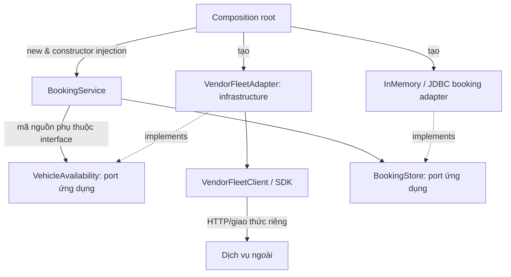

# DI với Adapter để cô lập dịch vụ bên ngoài

Trong chương **Kỹ thuật kết hợp** của module **Dependency Injection (DI)**, ta kết hợp hai công cụ giải quyết hai vấn đề khác nhau:

- **Adapter** chuyển một giao diện không phù hợp (SDK, REST API, client JDBC, message broker...) thành **hợp đồng mà ứng dụng thực sự cần**, qua đó cô lập kiểu dữ liệu và cách hoạt động riêng của nhà cung cấp.
- **Dependency Injection** cung cấp adapter đó cho mã nghiệp vụ từ bên ngoài, thay vì để mã nghiệp vụ tự khởi tạo client hoặc tự chọn nhà cung cấp. **Inversion of Control (IoC)** xuất hiện khi quyền tạo và lắp ghép được đưa về *composition root* hoặc một DI container.

Chỉ dùng DI để inject trực tiếp một SDK bên ngoài **chưa đủ cô lập** dịch vụ đó: lớp nghiệp vụ vẫn có thể hiểu endpoint, HTTP status code hoặc kiểu exception của SDK. Chỉ dùng Adapter mà để lớp nghiệp vụ tự gọi `new VendorAdapter(...)` cũng **chưa tách được lựa chọn triển khai**. Ghép cả hai giúp consumer chỉ biết một **port** ổn định, còn composition root quyết định **adapter cụ thể**.

Sau bài này, bạn có thể:

- Phân biệt **port hướng consumer**, **adapter hạ tầng**, **client/SDK của bên thứ ba** và **composition root**.
- Vẽ hướng phụ thuộc mã nguồn và luồng gọi runtime khi kết hợp DI với Adapter.
- Chuyển đổi request/response và lỗi bên ngoài mà không làm lộ chi tiết HTTP/SDK vào use case.
- Tạo một adapter cụ thể tại composition root, truyền qua constructor injection và thay bằng fake trong unit test Java thuần.
- Thiết kế các trường hợp dịch vụ ngoài trả kết quả không xác định, mất kết nối, thay đổi phiên bản hoặc quá tải.
- Xem xét scope, vòng đời, bảo mật, retry, timeout và transaction trước khi mở rộng sang DI container.

## 1. Bài toán: nghiệp vụ phụ thuộc quá chặt vào API của nhà cung cấp

Giả sử ứng dụng thuê xe cần kiểm tra một xe có còn khả dụng trong khoảng thời gian đặt hay không. Đội xe được quản lý bởi một hệ thống ngoài với API trả:

```text
GET /fleet/availability?vehicleCode=CAR-12&from=2026-12-01&until=2026-12-04

HTTP 200
{ "availabilityCode": "FREE" }
```

Đây là **giao thức minh họa**, không phải endpoint thực. Hệ thống ngoài dùng `FREE`, `BUSY`, `NO_DATA` và HTTP status để diễn đạt trạng thái. Nghiệp vụ ứng dụng chỉ muốn biết: **có thể tiếp tục đặt xe hay không?**

Một cách viết dễ mắc phải:

```java
// Phản mẫu minh họa; tên các lớp SDK chỉ mang tính giả định.
final class BadBookingService {
    private final VendorFleetSdk sdk;

    BadBookingService(VendorFleetSdk sdk) {
        this.sdk = sdk; // Có DI nhưng nghiệp vụ vẫn phụ thuộc SDK!
    }

    void book(String vehicleId, String from, String until) {
        VendorHttpReply reply = sdk.getAvailability(
                vehicleId, from, until);
        if (reply.statusCode() != 200) {
            throw new RuntimeException("Vendor request failed");
        }
        if ("FREE".equals(reply.availabilityCode())) {
            // Tiếp tục lưu đặt xe...
        }
    }
}
```

Các lớp `VendorFleetSdk` và `VendorHttpReply` ở đây là kiểu **giả định để minh họa phản mẫu**; ví dụ đầy đủ ở phần 5 sẽ tự định nghĩa loại dữ liệu tương đương.

Vấn đề không nằm ở việc constructor có inject hay không. `BadBookingService` vẫn phải biết:

1. Mã `"FREE"` do vendor quy ước.
2. `200` là một HTTP status thành công.
3. Cách định dạng ngày và tên tham số của request.
4. Khi nào vendor lỗi và kiểu exception cần xử lý.
5. SDK của hãng đang được sử dụng.

Nếu chuyển sang nhà cung cấp khác trả `"AVAILABLE"` hoặc cấu trúc JSON khác, mã nghiệp vụ có thể phải sửa. Nếu vendor đổi thư viện, nhiều unit test cũng phải phụ thuộc kiểu dữ liệu của thư viện ấy. **DI đã tách phần tạo SDK, nhưng chưa tách ngôn ngữ của SDK khỏi nghiệp vụ.**

## 2. Kết hợp Port + Adapter + Dependency Injection

Hãy thiết kế theo nhu cầu của **consumer** trước:

```java
enum Availability {
    AVAILABLE,
    UNAVAILABLE
}

interface VehicleAvailability {
    Availability check(AvailabilityRequest request);
}
```

`VehicleAvailability` là **port** (hợp đồng ứng dụng cần). `AvailabilityRequest` là dữ liệu ứng dụng chứa mã xe và khoảng ngày. Các kiểu này không nói về HTTP, tên vendor, JSON, connection hoặc SDK.

Một `VendorFleetAdapter` triển khai `VehicleAvailability` và dịch giao thức bên ngoài:

```text
BookingService
    -> VehicleAvailability.check(request)
       -> VendorFleetAdapter
          -> VendorFleetClient.fetch(vehicleCode, fromIso, untilIso)
          <- VendorReply(statusCode, availabilityCode)
       <- AVAILABLE / UNAVAILABLE / lỗi ứng dụng
    -> tiếp tục hoặc từ chối đặt xe
```

### Hai hướng phụ thuộc cần nhận diện



**Hướng phụ thuộc trong mã nguồn:** `BookingService` phụ thuộc port của ứng dụng. `VendorFleetAdapter` phụ thuộc port đó để triển khai và phụ thuộc client của vendor để gọi ra ngoài. **Hướng lời gọi lúc chạy:** `BookingService` gọi một object adapter cụ thể đã được lắp sẵn.

Không cần đặt tên chính xác là `Port` trong mọi class. Điểm quyết định là **mã nghiệp vụ không import kiểu vendor** và **việc lựa chọn adapter nằm ngoài mã nghiệp vụ**.

| Thành phần | Có quyền biết gì? | Không nên gánh trách nhiệm gì? |
| --- | --- | --- |
| `BookingService` (consumer) | Quy tắc đặt xe, `VehicleAvailability`, `BookingStore` | HTTP, JSON, SDK vendor, token, retry của client |
| `VehicleAvailability` (port) | Dữ liệu và ý nghĩa nghiệp vụ của việc kiểm tra | DTO/status code/exception riêng của vendor |
| `VendorFleetAdapter` | Cả port lẫn SDK; ánh xạ input, output, lỗi | Quyết định toàn bộ chính sách đặt xe của use case |
| `VendorFleetClient` | Giao thức kết nối tới hệ thống vendor | Quy tắc xác nhận đặt xe của ứng dụng |
| Composition root | Chọn implementation, cấu hình client, scope và ownership | Xử lý logic đặt xe mỗi lần request |

Adapter tại ranh giới dịch vụ ngoài đôi khi được gọi là **anti-corruption layer**: nó hạn chế việc mô hình/thuật ngữ của hệ thống khác lan vào mô hình của ứng dụng.

## 3. Thiết kế hợp đồng trước khi viết adapter

Một port tốt không nhất thiết có nhiều method. Hãy mô tả đầy đủ **ngữ nghĩa** của hành vi:

- **Input:** mã xe có rỗng không, khoảng ngày gồm đầu/cuối nào, có hợp lệ không?
- **Output:** `AVAILABLE` khác `UNAVAILABLE` thế nào? Có bao gồm số lượng xe hay chỉ một xe?
- **Không xác định:** vendor trả `NO_DATA` có nghĩa “hết xe” hay “không thể kết luận”? Không tự gộp hai trường hợp nếu nghiệp vụ cần phân biệt.
- **Lỗi:** mất mạng, timeout và vendor từ chối request được biểu diễn ở ranh giới nào?
- **Thời gian:** trạng thái “khả dụng” có hiệu lực trong bao lâu? Nó có bảo đảm giữ chỗ sau khi kiểm tra không?
- **Nhất quán:** kiểm tra trước, ghi sau có bảo đảm không trùng đặt xe khi hai request chạy đồng thời không?

Trong bài này, port trả **hai trạng thái nghiệp vụ** `AVAILABLE` và `UNAVAILABLE`. Khi vendor lỗi hoặc trả kết quả không thể hiểu, adapter ném một **exception ứng dụng**, không tự đổi thành `UNAVAILABLE`. Cách xử lý này tránh đánh đồng “không còn xe” với “không biết do dịch vụ ngoài lỗi”.

Nếu use case thực sự cần phân biệt nhiều trạng thái hơn (ví dụ `UNKNOWN` là kết quả nghiệp vụ có thể hiển thị), có thể thiết kế một *result type* giàu thông tin thay vì exception. Điều quan trọng là **hợp đồng rõ**, không phải mọi port đều phải dùng enum + exception giống hệt nhau.

## 4. Adapter dịch những thứ gì?

| Bên ngoài có thể cung cấp | Adapter chuyển thành | Vì sao nên dịch? |
| --- | --- | --- |
| `vehicleCode`, ngày ISO trong query string | `AvailabilityRequest(vehicleId, fromInclusive, untilExclusive)` | Consumer dùng thuật ngữ và kiểu Java có ngữ nghĩa |
| `"FREE"` và `"BUSY"` | `AVAILABLE` và `UNAVAILABLE` | Không rò mã trạng thái riêng của vendor |
| `"NO_DATA"` hoặc mã không biết | Lỗi ứng dụng có ngữ nghĩa “chưa xác định” | Không nhầm lẫn với việc thật sự hết chỗ |
| Lỗi socket/timeout của SDK | `AvailabilityCheckFailedException` giữ `cause` | Consumer không cần catch loại lỗi của SDK |
| HTTP 503 hoặc response không hợp lệ | Lỗi tích hợp theo hợp đồng port | Quyết định retry/fallback tập trung ở biên phù hợp |
| URL, API key, retry/backoff, TLS | Cấu hình client/adapter tại hạ tầng | Không làm bẩn constructor nghiệp vụ |

**Không nên giả vờ trừu tượng hóa:** đổi tên `VendorHttpReply` thành `FleetResult` nhưng vẫn giữ nguyên `getStatusCode()` và `getRawJson()`, buộc consumer tự diễn giải vendor, thì ranh giới chưa thật sự được cải thiện.

## 5. Ví dụ Java 17 chạy được: cô lập API kiểm tra tình trạng xe

Ví dụ dưới đây là **Java thuần**. `VendorFleetClient` mô phỏng API/SDK của bên thứ ba để bạn tự chạy mà không cần mạng; trong ứng dụng thật, một implementation của client sẽ gọi HTTP/SDK. `VendorFleetAdapter` chuyển giao thức giả định sang hợp đồng ứng dụng. `BookingService` được tạo bằng constructor injection.

Đặt toàn bộ vào file `DiAdapterIsolationDemo.java`:

```java
import java.time.LocalDate;
import java.util.ArrayList;
import java.util.List;
import java.util.Objects;

public class DiAdapterIsolationDemo {
    // --------- Model và port thuộc phía ứng dụng ---------

    record AvailabilityRequest(
            String vehicleId,
            LocalDate fromInclusive,
            LocalDate untilExclusive) {
        AvailabilityRequest {
            if (vehicleId == null || vehicleId.isBlank()) {
                throw new IllegalArgumentException("Missing vehicle ID");
            }
            Objects.requireNonNull(fromInclusive, "fromInclusive");
            Objects.requireNonNull(untilExclusive, "untilExclusive");
            if (!untilExclusive.isAfter(fromInclusive)) {
                throw new IllegalArgumentException("Invalid date interval");
            }
        }
    }

    enum Availability {
        AVAILABLE, UNAVAILABLE
    }

    @FunctionalInterface
    interface VehicleAvailability {
        Availability check(AvailabilityRequest request);
    }

    record Booking(String id, AvailabilityRequest request) { }

    @FunctionalInterface
    interface BookingStore {
        void save(Booking booking);
    }

    static final class VehicleUnavailableException
            extends RuntimeException {
        VehicleUnavailableException(String vehicleId) {
            super("Vehicle unavailable: " + vehicleId);
        }
    }

    // Lỗi của port: không yêu cầu caller biết SDK cụ thể.
    static final class AvailabilityCheckFailedException
            extends RuntimeException {
        AvailabilityCheckFailedException(String message) {
            super(message);
        }

        AvailabilityCheckFailedException(String message, Throwable cause) {
            super(message, cause);
        }
    }

    // --------- Use case chỉ phụ thuộc port ---------

    static final class BookingService {
        private final VehicleAvailability availability;
        private final BookingStore store;

        BookingService(VehicleAvailability availability, BookingStore store) {
            this.availability =
                    Objects.requireNonNull(availability, "availability");
            this.store = Objects.requireNonNull(store, "store");
        }

        Booking book(String bookingId, AvailabilityRequest request) {
            if (bookingId == null || bookingId.isBlank()) {
                throw new IllegalArgumentException("Missing booking ID");
            }
            Objects.requireNonNull(request, "request");
            Availability result = Objects.requireNonNull(
                    availability.check(request), "availability result");
            if (result == Availability.UNAVAILABLE) {
                throw new VehicleUnavailableException(request.vehicleId());
            }

            Booking booking = new Booking(bookingId, request);
            store.save(booking);
            return booking;
        }
    }

    // --------- Giao thức mô phỏng của nhà cung cấp ---------
    // Chỉ adapter và mã cấu hình cần hiểu các loại này.

    record VendorReply(int httpStatus, String availabilityCode) { }

    static final class VendorTransportException
            extends RuntimeException {
        VendorTransportException(String message) {
            super(message);
        }
    }

    @FunctionalInterface
    interface VendorFleetClient {
        VendorReply fetch(
                String vehicleCode, String fromIso, String untilIso);
    }

    // --------- Adapter kết nối port ứng dụng với vendor ---------

    static final class VendorFleetAdapter
            implements VehicleAvailability {
        private final VendorFleetClient client;

        VendorFleetAdapter(VendorFleetClient client) {
            this.client = Objects.requireNonNull(client, "client");
        }

        @Override
        public Availability check(AvailabilityRequest request) {
            Objects.requireNonNull(request, "request");
            VendorReply reply;
            try {
                reply = client.fetch(
                        request.vehicleId(),
                        request.fromInclusive().toString(),
                        request.untilExclusive().toString());
            } catch (VendorTransportException error) {
                throw new AvailabilityCheckFailedException(
                        "Fleet provider is unreachable", error);
            }

            if (reply == null || reply.httpStatus() != 200) {
                throw new AvailabilityCheckFailedException(
                        "Fleet provider returned no usable response");
            }

            if ("FREE".equals(reply.availabilityCode())) {
                return Availability.AVAILABLE;
            }
            if ("BUSY".equals(reply.availabilityCode())) {
                return Availability.UNAVAILABLE;
            }
            throw new AvailabilityCheckFailedException(
                    "Unknown fleet availability code");
        }
    }

    // Test double chỉ ở phía hạ tầng: giả lập vendor cụ thể.
    static final class RecordingVendorClient implements VendorFleetClient {
        private final VendorReply reply;
        private final boolean failTransport;
        String lastVehicleCode;
        String lastFromIso;
        String lastUntilIso;

        RecordingVendorClient(VendorReply reply, boolean failTransport) {
            this.reply = reply;
            this.failTransport = failTransport;
        }

        @Override
        public VendorReply fetch(
                String vehicleCode, String fromIso, String untilIso) {
            lastVehicleCode = vehicleCode;
            lastFromIso = fromIso;
            lastUntilIso = untilIso;
            if (failTransport) {
                throw new VendorTransportException("simulated timeout");
            }
            return reply;
        }
    }

    static AvailabilityRequest sampleRequest() {
        return new AvailabilityRequest(
                "CAR-12",
                LocalDate.of(2026, 12, 1),
                LocalDate.of(2026, 12, 4));
    }

    static void check(boolean ok, String message) {
        if (!ok) {
            throw new AssertionError(message);
        }
    }

    static void testAdapterMapsVendorData() {
        RecordingVendorClient client =
                new RecordingVendorClient(new VendorReply(200, "FREE"),
                        false);
        VehicleAvailability adapter = new VendorFleetAdapter(client);
        List<Booking> stored = new ArrayList<>();
        BookingService service = new BookingService(adapter, stored::add);

        Booking result = service.book("B-01", sampleRequest());

        check(result.equals(new Booking("B-01", sampleRequest())),
                "Unexpected booking result");
        check(stored.equals(List.of(result)), "Expected one save");
        check("CAR-12".equals(client.lastVehicleCode),
                "Vehicle code mapping failed");
        check("2026-12-01".equals(client.lastFromIso),
                "Start date mapping failed");
        check("2026-12-04".equals(client.lastUntilIso),
                "Exclusive end mapping failed");
    }

    static void testUnavailableVehicle() {
        VehicleAvailability adapter = new VendorFleetAdapter(
                new RecordingVendorClient(
                        new VendorReply(200, "BUSY"), false));
        List<Booking> stored = new ArrayList<>();
        BookingService service = new BookingService(adapter, stored::add);
        boolean rejected = false;
        try {
            service.book("B-02", sampleRequest());
        } catch (VehicleUnavailableException expected) {
            rejected = true;
        }
        check(rejected && stored.isEmpty(),
                "Busy vehicle must not be booked");
    }

    static void testUnknownVendorCode() {
        VehicleAvailability adapter = new VendorFleetAdapter(
                new RecordingVendorClient(
                        new VendorReply(200, "NO_DATA"), false));
        List<Booking> stored = new ArrayList<>();
        BookingService service = new BookingService(adapter, stored::add);
        boolean integrationFailed = false;
        try {
            service.book("B-03", sampleRequest());
        } catch (AvailabilityCheckFailedException expected) {
            integrationFailed = true;
        }
        check(integrationFailed && stored.isEmpty(),
                "Unknown result must not become AVAILABLE");
    }

    static void testTransportFailureIsTranslated() {
        VehicleAvailability adapter = new VendorFleetAdapter(
                new RecordingVendorClient(null, true));
        List<Booking> stored = new ArrayList<>();
        BookingService service = new BookingService(adapter, stored::add);
        boolean translated = false;
        try {
            service.book("B-04", sampleRequest());
        } catch (AvailabilityCheckFailedException expected) {
            translated = expected.getCause()
                    instanceof VendorTransportException;
        }
        check(translated && stored.isEmpty(),
                "Transport failure must be translated and preserve cause");
    }

    static void testPureUseCaseWithoutVendor() {
        // Unit test use case hoàn toàn không cần vendor hoặc adapter.
        List<Booking> stored = new ArrayList<>();
        BookingService service = new BookingService(
                request -> Availability.AVAILABLE,
                stored::add);

        Booking result = service.book("B-TEST", sampleRequest());
        check(stored.equals(List.of(result)),
                "Use case must work with a simple fake port");
    }

    public static void main(String[] args) {
        // Một composition root minh họa, không mở mạng thật.
        VendorFleetClient client = (code, from, until) ->
                new VendorReply(200, "FREE");
        VehicleAvailability adapter = new VendorFleetAdapter(client);
        List<Booking> stored = new ArrayList<>();
        BookingService service = new BookingService(adapter, stored::add);
        service.book("B-DEMO", sampleRequest());
        check(stored.size() == 1, "Composition root was not wired");

        testAdapterMapsVendorData();
        testUnavailableVehicle();
        testUnknownVendorCode();
        testTransportFailureIsTranslated();
        testPureUseCaseWithoutVendor();
        System.out.println("PASS: 5 tests of DI + Adapter");
    }
}
```

Biên dịch và chạy trong thư mục chứa file:

```bash
javac DiAdapterIsolationDemo.java
java DiAdapterIsolationDemo
```

Kết quả dự kiến:

```text
PASS: 5 tests of DI + Adapter
```

### Đọc ví dụ theo từng ranh giới

**Tại `BookingService`:** constructor chỉ nhận `VehicleAvailability` và `BookingStore`. Không có import `VendorReply`, không biết `"FREE"`, không biết URL hay mã HTTP. Unit test của use case có thể truyền một lambda trả `Availability.AVAILABLE` để bỏ qua toàn bộ hạ tầng.

**Tại `VendorFleetAdapter`:** method `check` nhận kiểu ứng dụng, chuyển `LocalDate` thành ISO-8601 string phù hợp với giao thức vendor, gọi `VendorFleetClient.fetch`, rồi chuyển dữ liệu trả về thành enum hoặc exception của ứng dụng. Nếu mã vendor không xác định, adapter **không mặc định cho phép đặt xe**.

**Tại composition root:** mã khởi động tạo client, adapter và service. Trong production, `VendorFleetClient` có thể là một client HTTP đã cấu hình base URL, credential, timeout và connection pool. Những chi tiết đó không làm thay đổi constructor `BookingService`.

**Tại test:** mỗi bài test tạo một client giả hoặc một port giả để kiểm tra đúng lớp đang quan tâm. Thử sai mã vendor kiểm tra adapter; dùng lambda `request -> AVAILABLE` kiểm tra service mà không phụ thuộc vendor.

Ví dụ dùng `List` thường và chạy tuần tự; nó không mô phỏng quy tắc đồng thời của database thật hoặc khả năng giữ chỗ nguyên tử. `VendorReply` cũng chỉ là DTO tự viết để minh họa giao diện SDK, **không phải** yêu cầu ứng dụng phải tự phát triển HTTP client production.

## 6. Tách kiểm thử use case khỏi kiểm thử adapter

Khi dùng DI với Adapter, hai lớp kiểm thử nên trả lời **hai câu hỏi độc lập**:

| Lớp kiểm thử | Câu hỏi | Dependency thay thế |
| --- | --- | --- |
| **Unit test của `BookingService`** | Khi port trả khả dụng/hết chỗ/lỗi, use case có đúng không? | Fake/stub của `VehicleAvailability` và `BookingStore` |
| **Unit test của `VendorFleetAdapter`** | Adapter có ánh xạ ngày, status, lỗi của vendor chính xác không? | Fake của `VendorFleetClient` |
| **Contract/integration test của client thật** | JSON, timeout, xác thực và API bên ngoài có thực sự đúng hợp đồng đã giả định không? | Dùng mock HTTP server có kiểm soát, sandbox hoặc môi trường tích hợp phù hợp |
| **Integration test của composition root** | Cấu hình DI có chọn đúng adapter/credential/scope và đóng tài nguyên đúng không? | Graph hoặc DI container với hạ tầng kiểm thử |

### Test use case không cần biết vendor

```java
List<Booking> stored = new ArrayList<>();
BookingService sut = new BookingService(
        request -> Availability.UNAVAILABLE,
        stored::add);

boolean rejected = false;
try {
    sut.book("B-FAIL", sampleRequest());
} catch (VehicleUnavailableException expected) {
    rejected = true;
}
if (!rejected || !stored.isEmpty()) {
    throw new AssertionError("Unavailable vehicle was booked");
}
```

Đây là đoạn ngắn có thể đặt bên trong `DiAdapterIsolationDemo` (nơi tên các kiểu nested và `sampleRequest()` có sẵn). Nó làm nổi bật giá trị DI: **test tự làm composition root nhỏ**, tạo SUT bằng `new` và truyền implementation mà nó kiểm soát.

### Test adapter không cần BookingService

```java
RecordingVendorClient client = new RecordingVendorClient(
        new VendorReply(200, "BUSY"), false);
VehicleAvailability adapter = new VendorFleetAdapter(client);
Availability result = adapter.check(sampleRequest());

if (result != Availability.UNAVAILABLE) {
    throw new AssertionError("Wrong vendor mapping");
}
```

Với một SDK thực, ta nên có thêm **contract test** để phát hiện vendor đổi tên field, đổi ý nghĩa status code hoặc thay cách xác thực. Fake trả đúng dữ liệu ta tưởng tượng **không chứng minh** hệ thống bên ngoài luôn tuân theo giả định đó.

## 7. Lỗi bên ngoài: đừng để API vendor quyết định toàn bộ chính sách nghiệp vụ

Lỗi ở ranh giới tích hợp không phải chỉ có thành công và thất bại:

| Tình huống | Adapter cần làm rõ | Consumer/ứng dụng cần quyết định |
| --- | --- | --- |
| Vendor nói xe hết chỗ | Trả `UNAVAILABLE` | Thông báo không thể đặt |
| Timeout hoặc mất mạng | Chuyển thành lỗi tích hợp; giữ `cause` | Dừng, retry có kiểm soát hoặc xử lý trạng thái chưa xác định |
| Vendor trả trạng thái lạ | Từ chối ánh xạ thiếu căn cứ | Báo/giám sát thay đổi hợp đồng hoặc đưa vào quy trình xử lý lỗi |
| HTTP 429/quota | Giữ thông tin có thể retry nếu hợp đồng cần | Backoff/jitter, tôn trọng quota và deadline |
| HTTP 401/403 | Phân biệt lỗi cấu hình/quyền truy cập | Sửa credential/permission; không retry vô hạn |
| Vendor trả response thành công nhưng dữ liệu thiếu | Xác minh dữ liệu bắt buộc ở adapter | Không xem dữ liệu không xác định là `AVAILABLE` |

**Không nên bắt mọi `RuntimeException` rồi âm thầm trả `UNAVAILABLE`.** Cách đó trộn lỗi lập trình, lỗi parse và tình trạng thật sự hết chỗ. Trong ví dụ, adapter chỉ bắt `VendorTransportException` tại lời gọi client; các response sai được kiểm tra và báo lỗi có chủ đích. Adapter production cần một bộ chuyển lỗi đầy đủ hơn theo hợp đồng SDK.

Việc chọn **fail-open** hay **fail-closed** là quyết định có tác động nghiệp vụ và an toàn, không phải mẹo kỹ thuật. Với hành động tạo booking, trả lời `AVAILABLE` khi dịch vụ ngoài không phản hồi có thể tạo đặt trùng. Nhưng quyết định tạm ngừng toàn bộ đặt xe khi vendor chập chờn cũng có chi phí vận hành; cần quy định rõ trong use case và chính sách sản phẩm.

### Retry, timeout và idempotency

Các lớp hạ tầng có thể điều khiển timeout, retry, backoff, circuit breaker, rate limiting và caching. Tuy nhiên:

- **Retry** chỉ an toàn khi thao tác có hợp đồng phù hợp. Truy vấn kiểm tra tình trạng thường dễ retry hơn thao tác thanh toán/tạo đặt xe có side effect.
- **Timeout** cần budget tổng theo request; nhiều tầng retry có thể cộng dồn khiến request chờ quá lâu.
- **Circuit breaker** có thể ngắt gọi ra ngoài khi vendor lỗi liên tục; nó không tự biết chính sách fallback nghiệp vụ.
- **Cache** có thể trả dữ liệu cũ. Với tình trạng xe, dữ liệu cũ có thể gây đặt trùng, nên phải xác định TTL và mức nhất quán.
- **Observability** cần phân biệt lỗi vendor, lỗi adapter và từ chối nghiệp vụ, nhưng không log API key, token hoặc dữ liệu cá nhân nhạy cảm.

Đặc biệt, thao tác **kiểm tra còn chỗ rồi ghi booking** không bảo đảm tính nguyên tử: giữa hai bước, request khác có thể giữ xe. Nếu quy tắc bắt buộc là **không bao giờ đặt trùng**, nên thiết kế một thao tác *reserve/commit* nguyên tử ở phía có quyền quyết định tồn kho, hoặc dùng một giao thức đặt giữ chỗ/cơ chế nhất quán thích hợp. Adapter chỉ đổi giao diện, **không tạo ra transaction phân tán**.

## 8. Một hay nhiều adapter?

Có thể cần nhiều adapter cùng triển khai một port:

```text
VehicleAvailability
  ├── VendorFleetAdapter
  ├── SecondaryFleetAdapter
  ├── CachedAvailabilityAdapter
  └── InMemoryAvailabilityFake (test)
```

Composition root có thể chọn theo environment, feature flag hoặc deployment:

```java
// Pseudocode trong composition root, không phải code hoàn chỉnh:
VehicleAvailability port =
        config.useExternalFleet()
            ? new VendorFleetAdapter(configuredVendorClient)
            : new InMemoryAvailabilityFake();

BookingService service = new BookingService(port, bookingStore);
```

Phần cấu hình nằm ngoài consumer. Nếu lựa chọn phụ thuộc **từng request** (ví dụ xe thuộc nhà cung cấp A hay B), có thể inject một **routing port** hoặc strategy/factory mà hợp đồng vẫn theo ngôn ngữ nghiệp vụ. Đừng để `BookingService` tự gọi `new VendorAClient(...)` hoặc switch trên tên SDK trừ khi đó thực sự là quyết định miền nghiệp vụ cần hiển thị ở use case.

### Adapter có thể trang trí adapter khác

Một `CachingAvailabilityAdapter` có thể triển khai cùng `VehicleAvailability`, nhận một `VehicleAvailability` khác qua constructor và thêm cache. Một `LoggingAvailabilityAdapter` có thể đo latency hay gắn trace mà không thay service. Đây là kết hợp Adapter với **Decorator** và DI:

```text
BookingService
  -> MetricsAvailabilityDecorator
      -> VendorFleetAdapter
          -> VendorFleetClient
```

Composition root lắp đúng thứ tự các lớp. Chỉ thêm cache, fallback, metrics hoặc retry khi chính sách của chúng được xác định rõ; không cần tạo chuỗi wrapper phức tạp cho mọi tích hợp.

## 9. Scope, lifecycle và quyền sở hữu tài nguyên

**Một adapter có thể được chia sẻ** nếu nó không giữ dữ liệu của từng request và các dependency bên dưới hỗ trợ gọi đồng thời. Nhưng việc constructor inject một client với field `final` **không tự làm client thread-safe**.

| Thành phần | Vòng đời thường hợp lý | Ai chịu trách nhiệm dọn? |
| --- | --- | --- |
| `BookingService` không có trạng thái request | Có thể dùng chung theo ứng dụng nếu các port phù hợp | Composition root/container quản lý đối tượng; không tự đóng client mượn |
| `VendorFleetAdapter` không có trạng thái request | Có thể dùng chung theo ứng dụng | Chỉ đóng tài nguyên **do adapter thực sự sở hữu** theo hợp đồng |
| HTTP client/connection pool | Thường sống lâu, tái sử dụng theo host | Composition root hoặc container nếu chính nó tạo/sở hữu |
| HTTP request/response body/connection lease | Theo từng lời gọi tới vendor | Client/adapter đóng hoặc hoàn trả theo API cụ thể |
| Request ID, khoảng ngày, correlation ID | Theo từng lời gọi | Truyền qua tham số/context đúng scope; không lưu trên singleton |
| Client theo phiên giao dịch | Theo transaction/job nếu API quy định | Owner tương ứng đóng khi unit of work kết thúc |

Để áp dụng DI bằng Java thuần, composition root có thể tạo client, bọc bằng adapter, rồi inject port:

```java
VendorFleetClient client = buildVendorClient(config);
VehicleAvailability availability = new VendorFleetAdapter(client);
BookingService bookingService =
        new BookingService(availability, bookingStore);
```

Đây là **mã cấu trúc**: `buildVendorClient`, `config` và `bookingStore` đại diện cho phần bootstrap thực tế. Nếu client là `AutoCloseable` và được root tạo, root phải đóng nó theo lifecycle sau khi ngừng nhận request và xử lý những công việc còn sử dụng client. Không để `BookingService` tự ý `close()` client/adapter được inject để dùng chung.

Khi dùng Spring, CDI hoặc container khác, cấu hình bean có thể thay chỗ các lệnh `new`. Nhưng nguyên tắc không đổi: **adapter triển khai port**, container chỉ thực hiện việc đăng ký/cấp dependency và những callback vòng đời mà nó quản lý. Container không tự sửa mapping vendor hoặc giải quyết mọi vấn đề idempotency, concurrency và timeout.

## 10. Chiến lược thay nhà cung cấp mà không làm vỡ nghiệp vụ

Khi vendor đổi API hoặc doanh nghiệp thay nhà cung cấp:

1. **Giữ ngữ nghĩa port** nếu nhu cầu nghiệp vụ chưa đổi. Đừng chỉnh tên method port theo từng phiên bản SDK.
2. **Viết adapter mới** cho giao thức/SDK mới; dịch các mã, đơn vị đo và lỗi sang cùng hợp đồng ứng dụng.
3. **Đặt contract test cho từng adapter** để chứng minh chúng tuân theo ý nghĩa chung của `VehicleAvailability`.
4. **Chuyển binding ở composition root** theo môi trường hoặc cấu hình rollout, không sửa `BookingService`.
5. **Quan sát hành vi và lỗi**, đặc biệt khi hai vendor diễn giải khác nhau về ngày kết thúc, múi giờ, trạng thái “chưa xác định” hoặc độ trễ dữ liệu.
6. **Dọn client cũ theo ownership**, tránh đóng tài nguyên khi còn request đang dùng nếu thực hiện chuyển đổi nóng.

Việc giữ nguyên interface không bảo đảm hai vendor có cùng **hành vi thật**. Ví dụ, một nhà cung cấp coi ngày kết thúc là **bao gồm**, còn port dùng `untilExclusive`. Adapter phải chuyển đúng quy tắc thời gian; nếu không thể biểu đạt hoặc bảo đảm đầy đủ, cần điều chỉnh hợp đồng hoặc công bố giới hạn thay vì âm thầm giả định tương đương.

## 11. Các phản mẫu cần tránh

| Phản mẫu | Vì sao có hại | Hướng điều chỉnh |
| --- | --- | --- |
| Inject thẳng SDK và đưa `VendorReply` vào use case | Lộ chi tiết vendor, khó thay đổi và unit test | Định nghĩa port hướng consumer, viết adapter dịch dữ liệu |
| Service tự tạo `new VendorFleetAdapter(...)` | Mã nghiệp vụ quyết định triển khai và cấu hình | Lắp adapter tại composition root |
| Adapter chỉ chuyển tiếp `getRawResponse()` | Consumer vẫn phải hiểu HTTP/JSON | Adapter ánh xạ thành khái niệm nghiệp vụ có ngữ nghĩa |
| Mọi lỗi vendor bị chuyển thành “hết xe” | Che sự cố tích hợp, có thể đưa ra quyết định sai | Phân biệt `UNAVAILABLE` với lỗi/không xác định |
| Dùng HTTP status code như business status | HTTP `200` chỉ nói request thành công, không nói xe còn trống | Kiểm tra cả payload và điều kiện nghiệp vụ |
| Dùng singleton adapter giữ request ID/user token trong field mutable | Rò dữ liệu giữa request, không an toàn đa luồng | Truyền dữ liệu theo request hoặc scope phù hợp |
| Retry mọi thao tác mà không xét idempotency | Có thể gây đặt trùng, trừ tiền hai lần | Retry theo hợp đồng và idempotency key khi cần |
| Mock vendor trong mọi unit test của BookingService | Unit test bị buộc biết SDK, phức tạp khi vendor đổi | Unit test service bằng port fake; test adapter riêng |
| Xem adapter là giải pháp đảm bảo không đặt trùng | Kiểm tra và lưu vẫn là hai bước cạnh tranh | Thiết kế reserve/commit nguyên tử hoặc giao thức nhất quán |

## 12. Bài tập và tự kiểm tra

### Bài tập 1 — Refactor mã phụ thuộc SDK

Cho một service trực tiếp gọi `VendorFleetClient.fetch` rồi kiểm tra `"FREE"`. Hãy refactor service nhận `VehicleAvailability` qua constructor, viết `VendorFleetAdapter` để chuyển DTO và đổi phần khởi tạo trong composition root. Chỉ rõ file/lớp nào phải import kiểu vendor.

### Bài tập 2 — Thêm trạng thái vendor

Giả sử vendor bắt đầu trả `"MAINTENANCE"`. Quyết định nó có thể ánh xạ sang `UNAVAILABLE` theo **hợp đồng** hay cần một trạng thái/lỗi riêng. Viết test adapter chứng minh cách xử lý; **không** tự gộp trạng thái nếu chưa hiểu ngữ nghĩa.

### Bài tập 3 — Kiểm thử hai ranh giới

Viết hai test độc lập:

- Unit test `BookingService` bằng lambda port `request -> Availability.UNAVAILABLE`; xác nhận không lưu đặt xe.
- Unit test `VendorFleetAdapter` bằng `RecordingVendorClient` trả HTTP 200 + `"BUSY"`; xác nhận ánh xạ về `UNAVAILABLE` và định dạng ngày chính xác.

Giải thích vì sao test thứ nhất không cần biết vendor trong khi test thứ hai phải kiểm tra giao thức vendor.

### Bài tập 4 — Lỗi nhà cung cấp

Cho client ném `VendorTransportException` hoặc trả HTTP 503. Kiểm tra adapter chuyển thành `AvailabilityCheckFailedException` và không cho phép `BookingService` lưu booking. Nếu vendor có thể trả `429`, đề xuất cách phân biệt lỗi tạm thời để retry có giới hạn mà không làm lộ HTTP status vào use case.

### Bài tập 5 — Scope và shutdown

Giả sử `VendorFleetClient` thực tế dùng HTTP connection pool. Hãy xác định nơi tạo/đóng pool, nơi lưu request data, thứ tự ngừng nhận request rồi đóng client, và vì sao field `final` không tự bảo đảm thread-safety.

### Bài tập 6 — Giới hạn của kiểm tra còn xe

Hai khách cùng gọi `VehicleAvailability.check` và đều nhận `AVAILABLE` trước khi bất kỳ ai lưu booking. Hãy giải thích vì sao Adapter + DI **không loại bỏ race condition**. Đề xuất port mạnh hơn như `ReservationPort.tryReserve(...)` được hiện thực bằng thao tác nguyên tử phía hệ thống có quyền quyết định tồn kho.

### Câu hỏi tự kiểm tra

- DI giải quyết phần nào mà Adapter không tự giải quyết, và ngược lại?
- Một service được inject SDK trực tiếp đã được cô lập khỏi vendor chưa?
- Vì sao port nên dùng `LocalDate` và enum nghiệp vụ thay vì DTO HTTP của nhà cung cấp?
- Vì sao `NO_DATA` hoặc timeout không nên mặc định tương đương `UNAVAILABLE`?
- Khi nào cần test `BookingService` với fake port, khi nào cần contract test adapter với server giả hoặc sandbox?
- Adapter dùng chung giữa nhiều request có tự an toàn đa luồng không?
- Khi thay nhà cung cấp, thành phần nào thường phải thay và thành phần nào có thể giữ nguyên?

**Kết hợp DI với Adapter** nghĩa là thiết kế một **hợp đồng do ứng dụng làm chủ**, viết adapter để chuyển giao thức bên ngoài sang hợp đồng đó, rồi dùng **constructor injection** và **composition root** để lựa chọn triển khai. Cách tiếp cận này giúp thay client, SDK hoặc nhà cung cấp với tác động nhỏ hơn lên use case; kiểm thử logic nghiệp vụ bằng **Java thuần** trước khi đưa DI container vào ứng dụng. Sự cô lập thực sự còn phụ thuộc vào việc xử lý đúng ngữ nghĩa dữ liệu, lỗi, tính nhất quán, scope và vòng đời tài nguyên.
