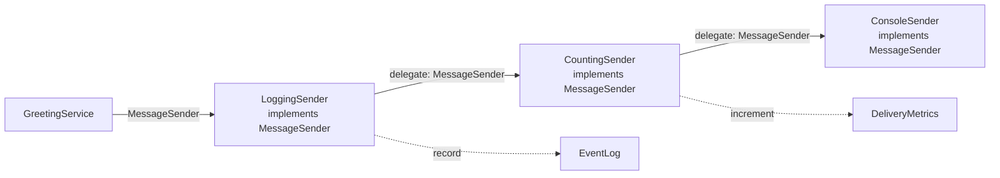
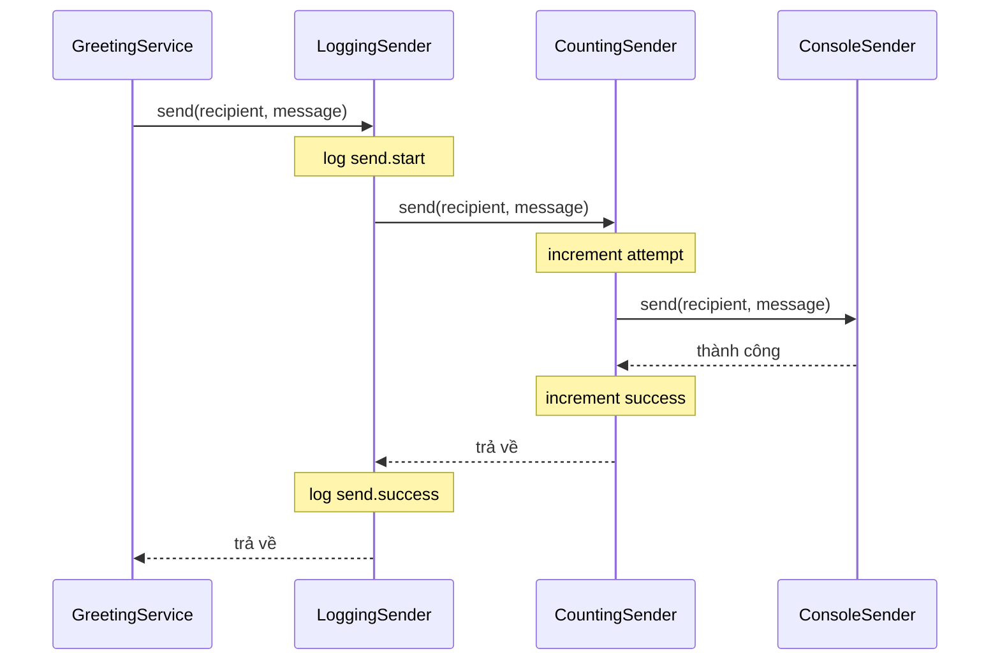

# DI với Decorator để thêm hành vi qua cùng một hợp đồng

## 1. Bài toán: thêm hành vi mà không sửa service nghiệp vụ

Giả sử hệ thống gửi thông báo cho người dùng. Ban đầu, một `GreetingService` chỉ cần gọi `MessageSender.send(...)`. Sau đó, sản phẩm yêu cầu ghi log mỗi lần gửi và thống kê số lượt gửi thành công/thất bại. Ta có thể đưa việc ghi log, đếm số lượt vào `GreetingService`, nhưng như vậy service phải biết về hệ thống quan sát, tăng số dependency và gánh thêm trách nhiệm không thuộc nghiệp vụ chính.

**Decorator** cho phép bọc một đối tượng bằng một đối tượng khác **cùng triển khai hợp đồng mà consumer đang dùng**. Đối tượng bọc có thể thực hiện hành vi trước hoặc sau khi chuyển lời gọi cho đối tượng bên trong (delegate). Kết hợp với **Dependency Injection (DI)**, composition root có thể tạo chuỗi decorator và inject lớp ngoài cùng cho service. Service vẫn chỉ thấy một `MessageSender`.

Đây là bài thuộc chương **Kỹ thuật kết hợp** của module **Dependency Injection**. Ta tiếp nối mục tiêu của **Dependency Injection và Inversion of Control (IoC)**: tách việc sử dụng dependency khỏi quá trình tạo, lựa chọn và lắp ghép; thực hành **constructor injection**, **composition root**, quản lý **scope và vòng đời**, kiểm thử bằng **Java thuần** trước khi xem xét DI container hoặc các cơ chế tương tự interceptor/AOP.

Sau bài này, bạn có thể:

1. Nhận diện các vai trò Component, Concrete Component, Decorator và Client.
2. Tạo nhiều decorator dùng **cùng một interface** và lắp chúng thành chuỗi bằng constructor injection.
3. Giải thích thứ tự chạy, truyền exception, kết quả trả về và việc cấu hình bật/tắt từng lớp bọc.
4. Phân biệt Decorator với Strategy, Adapter, Proxy và các cơ chế interception.
5. Kiểm thử từng lớp cũng như chuỗi hoàn chỉnh, đồng thời tránh lỗi liên quan đến ownership, scope và concurrency.

## 2. Cấu trúc của Decorator

Một Decorator điển hình có bốn vai trò:

| Vai trò | Trách nhiệm | Trong ví dụ |
| --- | --- | --- |
| **Component (hợp đồng chung)** | API mà client có thể gọi | `MessageSender` |
| **Concrete Component** | Thực hiện chức năng cốt lõi | `ConsoleSender` |
| **Decorator** | Cùng triển khai Component, giữ tham chiếu tới Component khác | `LoggingSender`, `CountingSender` |
| **Client** | Chỉ biết Component, không phụ thuộc chuỗi decorator | `GreetingService` |

Một Decorator **khác với helper đơn thuần** ở chỗ nó có thể đứng vào vị trí của đối tượng được bọc vì nó triển khai đúng contract mà client yêu cầu.



Trong đồ thị này, cạnh **`Service → LoggingSender`** là quan hệ sử dụng dependency. Các cạnh **`LoggingSender → CountingSender → ConsoleSender`** biểu diễn chuỗi ủy quyền. Hai cạnh đến `EventLog` và `DeliveryMetrics` là các dependency bổ sung của decorator; cả hai cũng có thể được inject.

Chương trình không bắt buộc có abstract class `BaseDecorator`. Một lớp chỉ cần triển khai interface chung và giữ `delegate` là đã đủ. Base class chỉ hữu ích khi nhiều decorator thực sự có logic chung cần tái sử dụng.

### 2.1. Cùng interface nhưng không nhất thiết cùng nhiệm vụ

`ConsoleSender` thực sự chuyển nội dung đến một đích (trong demo là console). `LoggingSender` không tự gửi thay cho delegate; nó thêm log quanh hành động gửi. `CountingSender` thêm số liệu. Cả ba có cùng chữ ký `send` và có thể thay nhau ở vị trí mà `GreetingService` cần `MessageSender`.

Tuy nhiên, **cùng chữ ký Java chưa đủ để bảo đảm thay thế được về ngữ nghĩa**. Nếu hợp đồng yêu cầu “gửi tối đa một lần”, decorator tự động retry có thể vi phạm. Nếu hợp đồng quy định exception phải được truyền nguyên vẹn, decorator không nên lặng lẽ nuốt lỗi. Khi thiết kế, hãy xác định rõ hành vi nào decorator được phép thêm và hành vi nào phải giữ nguyên.

## 3. DI hỗ trợ Decorator ở đâu?

Decorator và DI trả lời hai câu hỏi khác nhau:

- **Decorator**: làm thế nào để thêm trách nhiệm quanh một thao tác mà không thay đổi interface client sử dụng?
- **DI**: ai tạo các đối tượng và cung cấp dependency cho client/decorator?

Không có DI, một decorator có thể tự tạo đối tượng bên trong:

```java
// Ví dụ cần tránh khi muốn cấu hình và kiểm thử linh hoạt:
final class LoggingSender implements MessageSender {
    private final MessageSender delegate = new ConsoleSender();

    // ...
}
```

Đoạn trên chỉ minh họa ý tưởng, chưa có phương thức `send` nên không biên dịch độc lập. Lớp `LoggingSender` đã biết cứng `ConsoleSender`; test muốn thay delegate bằng fake sẽ khó hơn, và không thể tùy ý thêm `CountingSender` vào giữa mà không sửa lớp.

Với **constructor injection**:

```java
final class LoggingSender implements MessageSender {
    private final MessageSender delegate;
    private final EventLog eventLog;

    LoggingSender(MessageSender delegate, EventLog eventLog) {
        this.delegate = java.util.Objects.requireNonNull(delegate);
        this.eventLog = java.util.Objects.requireNonNull(eventLog);
    }

    // send(...) thực hiện log và chuyển lời gọi cho delegate.
}
```

Constructor công khai **hai dependency thực sự cần có**. Composition root quyết định delegate cụ thể là `ConsoleSender` hay một decorator khác. Đây chính là **Inversion of Control** tại điểm lắp ghép: `LoggingSender` sử dụng các đối tượng đã nhận, không tự chọn và tạo chúng.

## 4. Ví dụ hoàn chỉnh bằng Java thuần

Ta xây dựng chuỗi:

```text
GreetingService
  -> LoggingSender
       -> CountingSender
            -> ConsoleSender
```

Lớp ngoài cùng ghi thông báo bắt đầu/kết thúc; lớp giữa ghi bộ đếm attempt/success/failure; lớp trong cùng thực hiện gửi. Những sự kiện quan sát được không chứa nội dung thông báo hay thông tin nhạy cảm của người nhận.

Tạo file **`App.java`** (JDK 11 trở lên):

```java
import java.io.IOException;
import java.util.Objects;

// Component: cùng một hợp đồng cho mọi hiện thực và decorator.
interface MessageSender {
    void send(String recipient, String message) throws IOException;
}

// Concrete Component: chức năng cốt lõi của ví dụ.
final class ConsoleSender implements MessageSender {
    @Override
    public void send(String recipient, String message) {
        System.out.println("SEND to " + recipient + ": " + message);
    }
}

// Các cộng tác viên ghi nhận hành vi quan sát được.
interface EventLog {
    void record(String event);
}

interface DeliveryMetrics {
    void increment(String counter);
}

// Decorator 1: thêm log trước và sau khi delegate xử lý.
final class LoggingSender implements MessageSender {
    private final MessageSender delegate;
    private final EventLog log;

    LoggingSender(MessageSender delegate, EventLog log) {
        this.delegate = Objects.requireNonNull(delegate, "delegate");
        this.log = Objects.requireNonNull(log, "log");
    }

    @Override
    public void send(String recipient, String message) throws IOException {
        log.record("send.start");
        try {
            delegate.send(recipient, message);
            log.record("send.success");
        } catch (IOException | RuntimeException error) {
            log.record("send.failure");
            throw error; // Giữ nguyên lỗi do delegate hoặc log gây ra.
        }
    }
}

// Decorator 2: đếm số lần gọi và kết quả.
final class CountingSender implements MessageSender {
    private final MessageSender delegate;
    private final DeliveryMetrics metrics;

    CountingSender(MessageSender delegate, DeliveryMetrics metrics) {
        this.delegate = Objects.requireNonNull(delegate, "delegate");
        this.metrics = Objects.requireNonNull(metrics, "metrics");
    }

    @Override
    public void send(String recipient, String message) throws IOException {
        metrics.increment("send.attempt");
        try {
            delegate.send(recipient, message);
            metrics.increment("send.success");
        } catch (IOException | RuntimeException error) {
            metrics.increment("send.failure");
            throw error;
        }
    }
}

// Client: chỉ sử dụng MessageSender, không biết các lớp bọc.
final class GreetingService {
    private final MessageSender sender;

    GreetingService(MessageSender sender) {
        this.sender = Objects.requireNonNull(sender, "sender");
    }

    void greet(String recipient) throws IOException {
        if (recipient == null || recipient.isBlank()) {
            throw new IllegalArgumentException("recipient is blank");
        }
        sender.send(recipient, "Xin chao!");
    }
}

public final class App {
    public static void main(String[] args) throws IOException {
        // Composition root: tạo từng dependency và quyết định thứ tự bọc.
        MessageSender core = new ConsoleSender();
        DeliveryMetrics metrics =
            name -> System.out.println("METRIC " + name);
        EventLog log =
            event -> System.out.println("LOG " + event);

        MessageSender counted = new CountingSender(core, metrics);
        MessageSender logged = new LoggingSender(counted, log);

        // Inject lớp bọc ngoài cùng qua constructor của client.
        GreetingService greetings = new GreetingService(logged);
        greetings.greet("alice@example.test");
    }
}
```

Biên dịch và chạy:

```bash
javac App.java
java App
```

Kết quả kỳ vọng:

```text
LOG send.start
METRIC send.attempt
SEND to alice@example.test: Xin chao!
METRIC send.success
LOG send.success
```

Ví dụ không gửi email thật: `ConsoleSender` chỉ ghi ra console. `IOException` trong interface biểu diễn khả năng adapter hạ tầng tương lai thất bại khi gửi. `EventLog` và `DeliveryMetrics` trong ví dụ có thao tác đồng bộ; contract thực tế cần quy định lỗi của các hệ thống quan sát được xử lý thế nào.

### 4.1. Đọc thứ tự chạy từ ngoài vào trong



**Trước lời gọi delegate**, các decorator chạy từ **ngoài vào trong**. **Sau khi delegate trả về**, phần kết thúc chạy theo **chiều ngược lại**. Nếu delegate ném exception, những nhánh `catch` ở lớp bên trong và bên ngoài sẽ được xử lý theo thứ tự unwind của call stack.

### 4.2. Đổi thứ tự bọc sẽ đổi ý nghĩa đo lường

Nếu root lắp:

```java
MessageSender loggedFirst = new LoggingSender(core, log);
MessageSender countedOuter = new CountingSender(loggedFirst, metrics);
GreetingService service = new GreetingService(countedOuter);
```

thì bộ đếm attempt chạy **trước** log start; bộ đếm success chạy **sau** log success. Nếu thêm decorator cache, retry, rate limit hoặc transaction, thứ tự bọc còn tác động trực tiếp đến ý nghĩa nghiệp vụ:

| Chuỗi (ngoài → trong) | Điều cần hiểu |
| --- | --- |
| Logging → Counting → Core | Log bao trọn cả thao tác đếm và gửi; metric đếm một lần gọi delegate |
| Counting → Logging → Core | Metric bao trọn thao tác log và gửi; metric có thể tính cả lỗi của logger |
| Retry → Counting → Core | Nếu retry được thực hiện, Count thường ghi theo **mỗi lần thử bên trong** |
| Counting → Retry → Core | Count thường ghi **một lần yêu cầu bên ngoài** bất kể có bao nhiêu lần retry |

Hai ví dụ retry ở bảng **chỉ nói về thứ tự**, không khuyến nghị tự động retry thao tác gửi thực. Với I/O có tác dụng bên ngoài, retry cần hợp đồng idempotency, timeout, xử lý trùng lặp và điều kiện xác định kết quả lần gọi trước. **Decorator không tự tạo bảo đảm exactly-once**.

## 5. Bật/tắt decorator tại composition root

Khi có cấu hình khởi động, root có thể chỉ tạo những lớp bọc phù hợp. `GreetingService` không cần biến `boolean enableLogging` hay nhánh `if` cho logic quan sát:

```java
// Minh họa lắp ghép; core/metrics/log là các biến đã được root chuẩn bị.
MessageSender sender = core;

if (enableMetrics) {
    sender = new CountingSender(sender, metrics);
}
if (enableLogging) {
    sender = new LoggingSender(sender, log);
}

GreetingService greetings = new GreetingService(sender);
```

Đoạn trên là fragment về cấu hình, trong đó các biến `enableMetrics`, `enableLogging` đến từ nguồn cấu hình đã được parse/validate tại startup. Có thể tạo các biến này từ cấu hình ứng dụng theo cách dự án quy định. Khi bật cả hai, Logging là lớp ngoài cùng; khi tắt cả hai, client vẫn nhận `core` qua cùng một constructor.

Điểm mạnh của DI là **một API của consumer** hoạt động với mọi cách lắp ghép:

- Không decorator: `new GreetingService(core)`.
- Có log: `new GreetingService(new LoggingSender(core, log))`.
- Có metric: `new GreetingService(new CountingSender(core, metrics))`.
- Cả hai: truyền vào chuỗi do composition root đã xây.

Tùy yêu cầu, một ứng dụng có thể dùng profile/`@Bean`/conditional registration trong DI container để tạo chuỗi tương đương. Nhưng ngay cả khi dùng framework, **quy tắc thứ tự bọc phải rõ ràng** và tránh vô tình đăng ký nhiều bean cùng kiểu khiến phân giải mơ hồ hoặc tự tham chiếu vòng.

## 6. Kiểm thử Decorator bằng Java thuần

Chìa khóa là tạo **fake delegate** và **fake collaborator** rồi kiểm tra lời gọi quan sát được. Nhờ constructor injection, unit test không cần mở console thực, database, HTTP client hay DI container.

Tạo file **`AppTest.java`** cùng thư mục với `App.java`:

```java
import java.io.IOException;
import java.util.ArrayList;
import java.util.List;

public final class AppTest {
    public static void main(String[] args) throws IOException {
        testSuccessfulChain();
        testFailurePropagation();
        System.out.println("PASS");
    }

    static void testSuccessfulChain() throws IOException {
        List<String> calls = new ArrayList<>();

        MessageSender fake = (recipient, message) ->
            calls.add("delegate.send");
        EventLog fakeLog = calls::add;
        DeliveryMetrics fakeMetrics =
            counter -> calls.add("metric." + counter);

        MessageSender chain = new LoggingSender(
            new CountingSender(fake, fakeMetrics),
            fakeLog
        );
        new GreetingService(chain).greet("bob@example.test");

        List<String> expected = List.of(
            "send.start",
            "metric.send.attempt",
            "delegate.send",
            "metric.send.success",
            "send.success"
        );
        check(calls.equals(expected), "wrong call order: " + calls);
    }

    static void testFailurePropagation() {
        List<String> calls = new ArrayList<>();

        MessageSender failing = (recipient, message) -> {
            calls.add("delegate.failure");
            throw new IOException("simulated transport failure");
        };
        EventLog fakeLog = calls::add;
        DeliveryMetrics fakeMetrics =
            counter -> calls.add("metric." + counter);

        MessageSender chain = new LoggingSender(
            new CountingSender(failing, fakeMetrics),
            fakeLog
        );
        try {
            chain.send("bob@example.test", "hello");
            throw new AssertionError("expected IOException");
        } catch (IOException expected) {
            check("simulated transport failure".equals(expected.getMessage()),
                  "original exception was not propagated");
        }

        List<String> expectedCalls = List.of(
            "send.start",
            "metric.send.attempt",
            "delegate.failure",
            "metric.send.failure",
            "send.failure"
        );
        check(calls.equals(expectedCalls),
              "wrong failure path: " + calls);
    }

    private static void check(boolean condition, String message) {
        if (!condition) {
            throw new AssertionError(message);
        }
    }
}
```

Biên dịch:

```bash
javac App.java AppTest.java
java AppTest
```

Kết quả dự kiến là `PASS`. Test chứng minh ba điểm riêng biệt:

1. **Client không biết decorator:** `GreetingService` được tạo từ fake hoặc chuỗi thật qua cùng một constructor.
2. **Đúng thứ tự:** các lớp bọc chạy trước/sau delegate như thiết kế.
3. **Không nuốt lỗi của delegate:** khi delegate ném `IOException`, hai decorator ghi nhận failure và đẩy exception lên bên gọi.

Ví dụ ghi nhận mọi sự kiện vào một `List<String>` duy nhất để kiểm tra thứ tự. Vì test chạy một luồng, `ArrayList` là đủ; nếu kiểm thử nhiều luồng thì danh sách này cần cơ chế an toàn đồng thời hoặc phương pháp kiểm chứng khác.

### 6.1. Nên test từng decorator hay chỉ test chuỗi?

Nên có những kiểm thử có mục đích:

| Đối tượng test | Điều cần xác minh |
| --- | --- |
| `LoggingSender` với fake delegate | Log bắt đầu/kết thúc hoặc failure, gọi delegate đúng một lần, truyền lỗi phù hợp |
| `CountingSender` với fake delegate | Attempt/success/failure đúng theo contract của một lời gọi |
| Chuỗi cả hai | Thứ tự wrapper và kết quả tổng hợp đúng |
| `GreetingService` với fake `MessageSender` | Nghiệp vụ cung cấp đúng recipient/message, không cần quan tâm decorator |
| Composition root/configuration | Đã bật đúng decorator và thứ tự bọc, không thiếu/trùng binding |

Đừng chỉ kiểm tra việc `new LoggingSender(...)` trả về object khác `null`: test như vậy không xác nhận Decorator đã bảo toàn hành vi. Ngược lại, cũng không cần test lại tất cả quy tắc `GreetingService` qua từng chuỗi decorator nếu có thể kiểm tra riêng phần nghiệp vụ và phần lắp ghép.

## 7. Xử lý exception và kết quả trả về

### 7.1. Decorator phải giữ nghĩa của hợp đồng

Trong ví dụ, `MessageSender.send` có kiểu trả về `void` và có thể ném `IOException`. Lớp bọc ghi log/metric rồi cho exception tiếp tục đi lên. Nếu một API trả về kết quả, decorator phải trả lại **kết quả từ delegate** trừ khi hợp đồng cho phép biến đổi:

```java
interface PriceCalculator {
    int calculate(int subtotalCents);
}

final class LoggingPriceCalculator implements PriceCalculator {
    private final PriceCalculator delegate;
    private final EventLog log;

    LoggingPriceCalculator(PriceCalculator delegate, EventLog log) {
        this.delegate = java.util.Objects.requireNonNull(delegate);
        this.log = java.util.Objects.requireNonNull(log);
    }

    @Override
    public int calculate(int subtotalCents) {
        log.record("calculate.start");
        int result = delegate.calculate(subtotalCents);
        log.record("calculate.success");
        return result;
    }
}
```

Trong đoạn này, `LoggingPriceCalculator` không đổi giá. Nếu nó âm thầm cộng 10% phí, đó đã là thay đổi **ngữ nghĩa tính giá**, cần thiết kế và đặt tên rõ thay vì coi là quan sát thuần túy.

### 7.2. Hãy định nghĩa chính sách lỗi của chính decorator

Mã `LoggingSender` và `CountingSender` ở mục 4 minh họa kiểu **quan sát đồng bộ**. Nếu `log.record` hoặc `metrics.increment` ném `RuntimeException`, chúng **có thể làm thao tác gửi bị thất bại hoặc bị báo lỗi**, thậm chí khi delegate đã gửi thành công. Ví dụ, nếu `metrics.increment("send.success")` ném lỗi, `CountingSender` sẽ vào `catch`, thử ghi `send.failure` và truyền exception đi tiếp. Điều đó cho thấy mô hình minh họa **không bảo đảm metric tương ứng trạng thái gửi khi chính metric backend lỗi**.

Trong ứng dụng thật, cần chọn chính sách phù hợp:

- **Fail-open cho telemetry:** lỗi của hệ thống log/metrics không được làm thất bại thao tác nghiệp vụ; ghi nhận hoặc chuyển lỗi telemetry theo kênh riêng. Tránh catch tràn lan rồi im lặng bỏ qua mọi lỗi.
- **Fail-closed cho yêu cầu bắt buộc:** audit bắt buộc hoặc policy bảo mật có thể yêu cầu từ chối thao tác khi không ghi nhận được sự kiện. Khi đó việc decorator chặn luồng phải là phần được công bố trong contract.
- **Nếu delegate đã có side effect:** exception sau khi delegate trả về không đồng nghĩa với việc tác vụ gửi chắc chắn chưa xảy ra. Người gọi không nên retry vô điều kiện nếu API không có idempotency.

Do đó, khi sử dụng Decorator, phải phân biệt **lỗi từ delegate** và **lỗi từ hành vi bổ sung**. Các test ở mục 6 chỉ kiểm tra trường hợp delegate thất bại, chưa kiểm thử chính sách lỗi của log/metric.

### 7.3. Ghi nhận lỗi mà không làm lộ dữ liệu

Chỉ log thông tin cần thiết cho quan sát: tên thao tác, mã sự kiện, thời gian, correlation ID theo quy định. Không tự động ghi toàn bộ nội dung thông báo, mật khẩu, token hoặc dữ liệu người nhận vào telemetry. Decorator nằm ở ranh giới chung nên tác động lan rộng đến nhiều consumer; lỗi ghi log dữ liệu nhạy cảm cũng lan rộng tương tự.

## 8. Quản lý scope, ownership và vòng đời trong chuỗi Decorator

**Constructor injection chuyển tham chiếu, không tự chuyển quyền sở hữu.** Trong demo, các decorator được root tạo và giữ trong vòng đời ứng dụng; chúng **mượn** delegate do root lắp ghép, trừ khi có hợp đồng khác. `GreetingService` cũng chỉ mượn `MessageSender`.

Giả sử core là một adapter nắm HTTP client hoặc file writer cần đóng, còn log dùng một file khác:

```text
Composition root (owner)
  ├── mở và sở hữu CoreSender có close()
  ├── mở và sở hữu EventLog có close()
  ├── tạo LoggingSender(CountingSender(core, metrics), log)
  └── cấp lớp ngoài cùng cho GreetingService
```

Một trình tự đóng phù hợp là:

1. Dừng nhận công việc mới và bảo đảm các lần gọi `send` còn chạy đã hoàn tất hoặc được hủy an toàn.
2. Đóng những decorator có **tài nguyên riêng** theo hợp đồng nếu có.
3. Đóng core adapter và các resource nền do root sở hữu khi không còn consumer cần.
4. Đóng log/metrics backend sau khi không còn decorator cần ghi sự kiện shutdown.

Nếu một decorator được thiết kế để **sở hữu delegate và tự đóng delegate** khi `close()`, phải ghi điều đó rõ trong contract; root **không được đồng thời đóng cùng instance như một owner thứ hai**. Ngược lại, nếu decorator chỉ mượn delegate, `close()` của decorator (nếu có) chỉ quản lý resource riêng của nó. Không có quy tắc Java bắt buộc một decorator phải implement `AutoCloseable`; vòng đời phụ thuộc vào tài nguyên nó giữ.

### 8.1. Tại sao scope phải tương thích?

Một `LoggingSender` singleton giữ trực tiếp `RequestContext` thuộc một request có thể dùng context sau khi request kết thúc. Nếu decorator cần dữ liệu request, hãy nhận dữ liệu qua từng lời gọi (ví dụ correlation ID do lớp trên cung cấp), hoặc inject provider/scope abstraction được thiết kế cho runtime và bảo đảm đúng vòng đời.

Trong ứng dụng nhiều luồng, state mutable như counter thủ công phải được đồng bộ, dùng `AtomicLong` hoặc metrics backend phù hợp. Bản thân decorator giữ trường `final` không đồng nghĩa với thread-safe: delegate, logger và bộ đếm đều cần có hợp đồng concurrency nhất quán. Đặc biệt, `close()` không được chạy đồng thời với `send` nếu implementation không hỗ trợ.

### 8.2. Decorator được dùng chung hay tạo mới?

| Tình huống | Lựa chọn thường hợp lý | Câu hỏi cần kiểm tra |
| --- | --- | --- |
| Logging/metrics stateless của toàn ứng dụng | Có thể chia sẻ một chuỗi wrapper | Dependency nền và logger có thread-safe không? |
| Thông tin riêng một request | Cấp dữ liệu từng lần gọi hoặc decorator theo request | Không để instance/request state sống quá scope |
| Retry với state tạm cho mỗi lần gọi | Giữ state ở biến cục bộ của lời gọi | Có an toàn khi nhiều request dùng cùng decorator không? |
| Decorator có file/socket riêng | Scope gắn với owner của resource | Ai đóng và theo thứ tự nào? |

Không nên tạo lại cả chuỗi cho từng lời gọi chỉ vì muốn dùng DI. Ngược lại, không nên để một singleton giữ dữ liệu request hoặc transaction đã hết hạn.

## 9. Decorator khác Strategy, Adapter, Proxy và AOP

Các kỹ thuật này đều có thể xuất hiện quanh dependency, nhưng trọng tâm thiết kế khác nhau:

| Kỹ thuật | Mục tiêu chính | Dấu hiệu phân biệt |
| --- | --- | --- |
| **Decorator** | Bổ sung hành vi cho một đối tượng trong khi giữ cùng hợp đồng | Giữ một delegate cùng Component, thường gọi trước/sau |
| **Strategy** | Hoán đổi một thuật toán/chính sách | Context chọn chiến lược; không nhất thiết bọc chiến lược khác |
| **Adapter** | Biến đổi một API/hợp đồng bên ngoài thành API client cần | Input/output interface thường khác nhau |
| **Proxy** | Kiểm soát truy cập vào đối tượng: lazy, remote, bảo vệ, cache... | Có thể cùng interface; trọng tâm là đại diện/kiểm soát truy cập |
| **AOP / interceptor** | Chèn hành vi cắt ngang tại join point theo cấu hình/framework | Có thể tạo hiệu ứng tương tự Decorator nhưng được lắp tự động |
| **DI** | Cung cấp/lắp ghép dependency | Không tự quy định hành vi bọc |

Đôi khi ranh giới không tuyệt đối: một caching proxy cùng interface cũng có thể được mô tả bằng cấu trúc Decorator. Điều quan trọng là **đọc trách nhiệm và hợp đồng**, không chỉ nhận diện “class triển khai cùng interface”.

### 9.1. Khi nào Decorator tốt hơn sửa service?

Nếu muốn thêm logging/metrics cho nhiều service cùng sử dụng một hợp đồng, Decorator giúp tái sử dụng và giữ lớp nghiệp vụ ít phụ thuộc hơn. Nếu một hành vi là **quy tắc nghiệp vụ riêng**, ví dụ tính mức giảm giá cho khách VIP, nên xem xét Strategy hoặc logic domain có tên rõ ràng thay vì giấu trong “logging decorator”.

Decorator phát huy hiệu quả khi phần bổ sung thực sự nên nằm ở **ranh giới của một dependency**. Một điều kiện liên quan nhiều thao tác giao dịch hoặc cả quy trình nghiệp vụ có thể cần orchestration/interceptor ở ranh giới khác, thay vì chèn vào từng adapter.

### 9.2. Container và framework chỉ thay đổi cách lắp ghép

Trong một DI container, có thể đăng ký:

```java
// Ví dụ khái niệm tại composition root, không phụ thuộc framework.
MessageSender concrete = new ConsoleSender();
MessageSender decorated = new LoggingSender(
    new CountingSender(concrete, metrics),
    log
);
GreetingService service = new GreetingService(decorated);
```

Spring có thể làm công việc tương tự với các phương thức `@Bean`. Nhưng nếu đăng ký cả core và decorator dưới cùng interface rồi để Spring tự inject theo type, phải có quy tắc chỉ rõ **bean nào là core, bean nào là outermost**, ví dụ tên/qualifier có ý nghĩa hoặc cấu hình wiring cụ thể. Nếu một `@Bean` đang tạo decorator lại nhận vô điều kiện chính bean type mà nó đang đăng ký, có thể tạo circular dependency hoặc ambiguity.

Vì vậy, viết được **đồ thị bọc rõ ràng bằng Java thuần** là bước tốt trước khi đưa vào container.

## 10. Những lỗi thiết kế thường gặp

| Dấu hiệu | Hậu quả | Cách điều chỉnh |
| --- | --- | --- |
| Decorator tự `new` core thay vì nhận qua constructor | Khó thay core và test riêng | Inject delegate qua constructor |
| Decorator không triển khai cùng contract | Client phải biết lớp bọc cụ thể | Giữ interface dùng chung, tách API quản trị nếu cần |
| Quên gọi delegate | Chức năng chính bị mất | Test lời gọi delegate đúng số lần và thứ tự |
| Gọi delegate hai lần do thao tác “đo thời gian” | Có thể thực hiện side effect hai lần | Gọi delegate một lần; đo trước/sau lời gọi đó |
| Nuốt exception để log thành công | Báo kết quả sai và khó retry đúng | Truyền lỗi hoặc dùng policy xử lý lỗi được công bố |
| Telemetry failure làm logic thành công bị báo lỗi | Người gọi có thể retry dù tác vụ đã xảy ra | Quy định fail-open/fail-closed theo hợp đồng |
| Không xác định thứ tự giữa Retry/Count/Cache | Metric sai ngữ nghĩa hoặc sai kết quả | Vẽ chuỗi wrapper và test thứ tự |
| Hai wrapper cùng tự đóng core | Double close hoặc use-after-close | Một owner rõ ràng; các wrapper mượn hoặc chuyển giao có hợp đồng |
| Đưa request state vào singleton decorator | Dữ liệu cũ, race hoặc hết scope | Scope tương thích hoặc cấp dữ liệu mỗi lời gọi |
| Đăng ký nhiều bean cùng interface nhưng không phân biệt core/decorator | Missing/ambiguous/circular DI binding | Wiring tường minh tại composition root |
| Dùng decorator cho mọi hành vi chỉ vì có thể | Chuỗi khó theo dõi, nhiều lớp không cần thiết | Chỉ thêm khi có trách nhiệm độc lập thật |

## 11. Bài tập tự kiểm tra

**Bài 1 — Tìm đúng vai trò.** Trong chuỗi `GreetingService → LoggingSender → CountingSender → ConsoleSender`, đâu là Component, Concrete Component, Decorator và Client?

*Gợi ý:* `MessageSender` là Component; `ConsoleSender` là Concrete Component; hai lớp bọc là Decorator; `GreetingService` là Client.

**Bài 2 — Đổi thứ tự và dự đoán log.** Root chuyển `CountingSender` thành wrapper ngoài cùng, `LoggingSender` thành wrapper bên trong. Hãy liệt kê thứ tự sự kiện của một lần gửi thành công.

*Gợi ý:* metric attempt, log start, core send, log success, metric success. Viết test dựa trên một danh sách sự kiện chung để xác minh.

**Bài 3 — Thêm kiểm tra dữ liệu.** Tạo `ValidatingSender` triển khai `MessageSender`, từ chối recipient rỗng và chuyển dữ liệu hợp lệ tới delegate. Bạn đặt lớp bọc này ở ngoài hay trong Logging/Counting? Quyết định nào làm metric attempt tính cả request bị từ chối?

*Gợi ý:* cấu hình thứ tự có ý nghĩa. Nếu validation ở ngoài toàn chuỗi, request invalid không đi vào Counting; nếu Counting ở ngoài Validating, attempt có thể tính cả request invalid.

**Bài 4 — Gặp exception của metrics.** Delegate gửi thành công, nhưng `metrics.increment("send.success")` ném exception. Hãy dự đoán hành vi của mã minh họa mục 4 và đề xuất một chính sách fail-open thích hợp khi metric chỉ phục vụ quan sát.

*Gợi ý:* exception từ metric bị nhánh catch của Counting bắt, sau đó Counting cố ghi failure; caller có thể nhận lỗi dù gửi đã xong. Cần tách lỗi telemetry khỏi lỗi delegate và test chính sách mong muốn.

**Bài 5 — Scope.** Một `LoggingSender` singleton giữ một `RequestContext` có thời gian sống theo request. Hãy chỉ ra nguy cơ và đề xuất API mới.

*Gợi ý:* truyền dữ liệu request cần thiết theo lời gọi hoặc dùng provider đúng scope; không giữ trực tiếp context đã hết hiệu lực.

**Bài 6 — Ownership.** `FileSender` và `FileEventLog` đều cần `close()`. Root tạo hai resource, rồi inject chúng vào `LoggingSender`. Nếu decorator không sở hữu resource, ai đóng và theo thứ tự nào?

*Gợi ý:* root dừng các consumer trước; sau đó đóng core và logger khi không còn sử dụng. Không để `GreetingService` đóng dependency được inject.

## 12. Checklist khi phối hợp DI và Decorator

1. **Có một Component contract rõ ràng?** Client chỉ cần contract đó?
2. **Decorator có thực sự giữ cùng contract?** Tham số, kết quả và exception vẫn mang cùng ý nghĩa?
3. **Delegate được inject?** Có lớp nào tự tạo core/đọc service locator?
4. **Mỗi lần gọi delegate đúng số lần dự kiến?** Có nguy cơ duplicate side effect?
5. **Thứ tự wrapper có chủ ý?** Log, metric, retry, cache có ý nghĩa đúng vị trí?
6. **Hành vi lỗi được định nghĩa?** Lỗi do delegate hay telemetry, ai truyền lên?
7. **Có thể bật/tắt lớp bọc từ composition root?** Business service giữ nguyên?
8. **Scope phù hợp?** Shared singleton có state mutable hoặc request context không?
9. **Ownership được xác định?** Ai đóng tài nguyên core/decorator và khi nào?
10. **Có test bằng fake?** Kiểm tra thứ tự, exception, kết quả và cả cấu hình graph cần thiết?

## 13. Ghi nhớ

**Decorator thêm hành vi qua cùng một hợp đồng** bằng cách giữ và gọi một delegate. **Dependency Injection quyết định ai cung cấp delegate và các cộng tác viên bổ sung**, để từng decorator không phải tự tìm hoặc tạo hạ tầng. Composition root là nơi tự nhiên để quyết định lớp nào bọc lớp nào, thứ tự và cấu hình bật/tắt, rồi inject lớp ngoài cùng cho consumer.

Mô hình này giúp service nghiệp vụ tập trung vào việc sử dụng dependency, còn logging, metrics và các trách nhiệm độc lập có thể kiểm thử riêng bằng Java thuần. Khi mở rộng sang DI container, vẫn phải giữ tường minh **thứ tự bọc, hợp đồng kết quả/lỗi, scope, ownership và vòng đời**; container tự động hóa việc tạo/lắp ghép nhưng không thay thế các quyết định thiết kế ấy.
