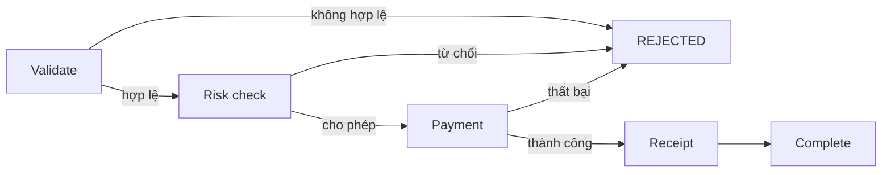
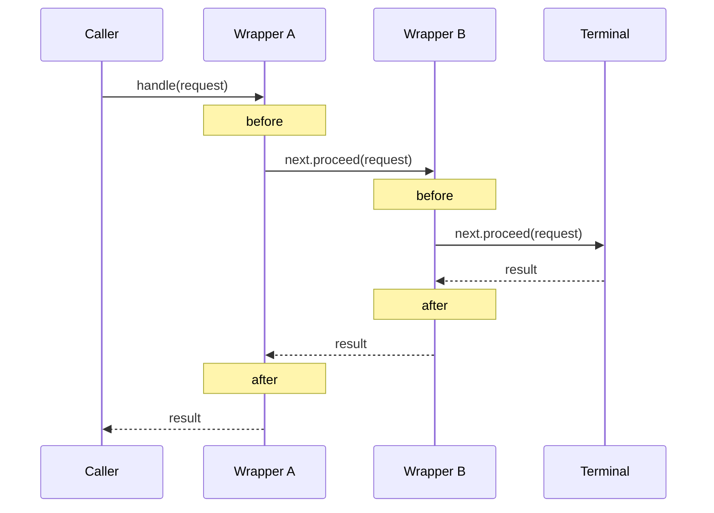

# Lắp ghép chuỗi trách nhiệm và quy định thứ tự xử lý

## Mục tiêu học tập

Sau bài này, bạn có thể:

- Mô tả **Chain of Responsibility (chuỗi trách nhiệm)** và một **processing pipeline**, giải thích khi nào bước hiện tại tiếp tục chuyển việc cho bước kế tiếp và khi nào nó được phép dừng chuỗi.
- Phân biệt **thứ tự tạo đối tượng** với **thứ tự thực thi** của các bước, đồng thời xác định bước nào bắt buộc phải chạy trước bước nào.
- Lắp ghép các bước bằng **constructor injection** tại **composition root**, không để bước xử lý tự `new` bước tiếp theo hoặc tra cứu DI container.
- Thiết kế hợp đồng cho kết quả, lỗi, **short-circuit**, trạng thái từng request và trách nhiệm quản lý tài nguyên.
- Kiểm thử thứ tự xử lý, nhánh dừng sớm và tác dụng phụ bằng **Java thuần**, trước khi chuyển cách lắp ghép sang một DI container.

Bài thuộc chương **Kỹ thuật kết hợp** của mô-đun **Dependency Injection (DI) và Inversion of Control (IoC)**. Thay vì chỉ tiêm một dependency đơn lẻ, ta sẽ kết hợp nhiều thành phần thành một **chuỗi phối hợp** có thứ tự. DI tách việc *sử dụng các bước xử lý* khỏi *việc tạo và nối chúng*; Chain of Responsibility giúp tổ chức cách mỗi bước **xử lý hoặc chuyển tiếp**.

## 1. Chuỗi trách nhiệm giải quyết bài toán nào?

Giả sử một chức năng checkout cần thực hiện:

1. **Validation:** xác minh mã đơn, địa chỉ liên hệ và số tiền hợp lệ.
2. **Risk check:** áp dụng chính sách xem đơn có được phép tiếp tục thanh toán không.
3. **Payment:** gọi cổng thanh toán giả lập.
4. **Receipt:** phát thông báo xác nhận sau khi thanh toán thành công.
5. **Complete:** trả kết quả cuối cùng cho caller.

Thứ tự này có ý nghĩa nghiệp vụ: không nên thanh toán trước khi kiểm tra rủi ro; không nên gửi xác nhận đã thanh toán trước khi thanh toán được chấp thuận.



Tại mỗi bước, một trong hai điều xảy ra:

- **Chuyển tiếp:** bước đang xử lý xong phần trách nhiệm của mình và gọi **bước kế tiếp**.
- **Dừng chuỗi (short-circuit):** bước quyết định không gọi bước kế tiếp, trả kết quả từ chối hoặc phát lỗi theo hợp đồng.

Trong Chain of Responsibility cổ điển, một handler có thể **tự xử lý** yêu cầu hoặc **chuyển** cho handler sau. Trong biến thể *middleware/pipeline* được dùng ở bài này, một số bước **bắt buộc phải chạy tuần tự nếu bước trước cho phép**, và mỗi bước có thể dừng sớm. Sự phân biệt này giúp tránh hiểu sai rằng “mỗi yêu cầu chỉ có đúng một handler được chạy”.

### Vì sao kết hợp với DI?

Không có DI, một bước có thể tự tạo bước kế tiếp:

```java
// Phản ví dụ, chỉ minh họa ý tưởng:
class HardCodedValidation {
    void process(CheckoutRequest request) {
        // Cố định ngay cả cách tạo và thứ tự bước sau:
        new HardCodedRiskCheck(new HardCodedPaymentStep())
                .process(request);
    }
}
```

Khi đó thay implementation, thay thứ tự hoặc kiểm thử một bước sẽ buộc sửa hoặc dựng nhiều đối tượng liên quan. Chúng ta muốn từng bước chỉ biết **hợp đồng cần thiết**, còn composition root kiểm soát toàn bộ chuỗi. Đoạn phản ví dụ không phải mã chạy độc lập; các lớp `HardCoded...` chỉ là tên minh họa.

## 2. Hai thứ tự khác nhau: tạo và xử lý

Một đồ thị có thể được tạo theo **thứ tự từ cuối về đầu** nhưng được **thực thi từ đầu đến cuối**. Chẳng hạn, khi xây chuỗi bằng cách bọc lần lượt từ bước cuối:

```text
Tạo terminal handler
  -> bọc ReceiptStep
  -> bọc PaymentStep
  -> bọc RiskStep
  -> bọc ValidationStep

Khi gọi:
ValidationStep -> RiskStep -> PaymentStep -> ReceiptStep -> terminal
```

Hai thứ tự này không mâu thuẫn. Composition root có thể dùng vòng lặp duyệt ngược để **nối chuỗi**, nhưng nghiệp vụ chạy theo thứ tự **được khai báo**. Không nên dùng thứ tự xuất hiện của file nguồn, thứ tự quét class hoặc thứ tự sinh bean làm thay thế cho một **quy tắc thứ tự rõ ràng**.

| Loại thứ tự | Ai quyết định? | Ví dụ | Điều cần kiểm tra |
| --- | --- | --- | --- |
| **Thứ tự khởi tạo** | Composition root hoặc DI container | Tạo gateway trước khi tạo `PaymentStep` | Mỗi bước nhận dependency hợp lệ khi được tạo |
| **Thứ tự nối chuỗi** | Mã lắp ghép | Khai báo `[Validation, Risk, Payment, Receipt]` | Cạnh `next` trỏ đúng handler |
| **Thứ tự thực thi** | Hợp đồng của chuỗi | Validation → Risk → Payment → Receipt | Tác dụng phụ không xảy ra trước điều kiện tiên quyết |
| **Thứ tự khi dừng** | Bước quyết định short-circuit | Risk từ chối → không gọi Payment/Receipt | Các bước sau không bị gọi |
| **Thứ tự cleanup** | Quyền sở hữu resource, `try/finally` | Mở session → dùng → đóng | Cleanup được thực hiện kể cả khi có lỗi |

Một bước có thể thêm logic **sau khi gọi `next`**, khi đó thứ tự thực thi không còn đơn giản là một danh sách tuyến tính. Ta sẽ xét trường hợp này ở mục 6.

## 3. Định nghĩa hợp đồng chuỗi có kiểu rõ ràng

Ta cần phân biệt:

- **Dữ liệu yêu cầu:** `CheckoutRequest` chứa thông tin của lần checkout đang chạy.
- **Kết quả:** `CheckoutResult` cho biết được chấp thuận hay bị từ chối.
- **Bước xử lý:** `CheckoutStep` xử lý yêu cầu và được trao khả năng chuyển tiếp.
- **Liên kết đến phần còn lại của chuỗi:** `CheckoutNext` là một interface nhỏ để `proceed(...)`, không phải container tổng quát.

```java
@FunctionalInterface
interface CheckoutNext {
    CheckoutResult proceed(CheckoutRequest request);
}

interface CheckoutStep {
    CheckoutResult handle(CheckoutRequest request, CheckoutNext next);
}
```

Mỗi bước **không cần giữ một field trỏ sang bước sau**. Bộ lắp ghép sẽ truyền `next` khi tạo chuỗi. Điều này cho phép dùng cùng một instance bước trong nhiều chuỗi nếu implementation **không giữ state của request** và các dependency của nó hỗ trợ chia sẻ.

### Hợp đồng chuyển tiếp

Với pipeline trong bài:

1. Một bước có thể **gọi `next.proceed(request)` đúng một lần** để tiếp tục, hoặc **không gọi** nếu từ chối.
2. Các bước validation, risk và payment **không được gọi bước sau trước khi điều kiện của chúng thành công**.
3. `CheckoutResult.approved` chỉ được trả từ terminal sau khi các bước bắt buộc trong pipeline hoàn tất bình thường.
4. Nếu bước phát sinh ngoại lệ, chuỗi dừng bằng ngoại lệ; không giả định các tác dụng phụ trước đó được hoàn tác.
5. Bản demo là xử lý **đồng bộ** và mỗi lượt xử lý truyền một request riêng. Nếu đổi sang bất đồng bộ, hợp đồng `next`, thời điểm hoàn thành và việc đóng tài nguyên phải được thiết kế lại.

Không có gì trong kiểu chữ ký Java tự bảo đảm một handler **chỉ gọi `next` một lần**. Đây là quy ước hành vi cần được ghi rõ, thực thi và kiểm thử. Bước có hành vi retry gọi nhiều lần cần một **hợp đồng khác** và phải cân nhắc idempotency của những bước có tác dụng phụ như payment.

## 4. Java thuần: lắp chuỗi ở composition root

Ví dụ sau chỉ mô phỏng thanh toán và phát biên nhận bằng console; **không xử lý tiền hoặc gửi email thật**. Mỗi bước nhận collaborator cần thiết qua constructor, còn builder nối chúng ở ranh giới lắp ghép.

Lưu toàn bộ đoạn sau vào **`Main.java`** (JDK 8 trở lên):

```java
import java.util.Arrays;
import java.util.List;
import java.util.Objects;

// Dữ liệu riêng của mỗi lần checkout.
final class CheckoutRequest {
    final String orderId;
    final String recipient;
    final long amountVnd;

    CheckoutRequest(String orderId, String recipient, long amountVnd) {
        this.orderId = Objects.requireNonNull(orderId, "orderId");
        this.recipient = Objects.requireNonNull(recipient, "recipient");
        // Cho phép dữ liệu không hợp lệ đến ValidationStep để minh họa.
        this.amountVnd = amountVnd;
    }
}

final class CheckoutResult {
    final boolean approved;
    final String code;

    private CheckoutResult(boolean approved, String code) {
        this.approved = approved;
        this.code = Objects.requireNonNull(code, "code");
    }

    static CheckoutResult paid() {
        return new CheckoutResult(true, "PAID");
    }

    static CheckoutResult rejected(String reason) {
        return new CheckoutResult(false, reason);
    }
}

@FunctionalInterface
interface CheckoutNext {
    CheckoutResult proceed(CheckoutRequest request);
}

interface CheckoutStep {
    CheckoutResult handle(CheckoutRequest request, CheckoutNext next);
}

// Những dependency ổn định của các bước.
interface TraceSink {
    void record(String event);
}

interface RiskPolicy {
    boolean allows(CheckoutRequest request);
}

interface PaymentGateway {
    boolean charge(CheckoutRequest request);
}

interface ReceiptNotifier {
    void notifyPaid(CheckoutRequest request);
}

final class ConsoleTraceSink implements TraceSink {
    @Override
    public void record(String event) {
        System.out.println("[TRACE] " + event);
    }
}

// Policy demo: các đơn vượt ngưỡng không được tự động thanh toán.
final class AmountLimitRiskPolicy implements RiskPolicy {
    private final long maxAmountVnd;

    AmountLimitRiskPolicy(long maxAmountVnd) {
        if (maxAmountVnd <= 0) {
            throw new IllegalArgumentException("maxAmountVnd must be positive");
        }
        this.maxAmountVnd = maxAmountVnd;
    }

    @Override
    public boolean allows(CheckoutRequest request) {
        return request.amountVnd <= maxAmountVnd;
    }
}

final class DemoPaymentGateway implements PaymentGateway {
    @Override
    public boolean charge(CheckoutRequest request) {
        System.out.println("[DEMO] Thanh toán đơn " + request.orderId
                + ": " + request.amountVnd + " VND");
        return true;
    }
}

final class ConsoleReceiptNotifier implements ReceiptNotifier {
    @Override
    public void notifyPaid(CheckoutRequest request) {
        System.out.println("[DEMO] Biên nhận " + request.orderId
                + " -> " + request.recipient);
    }
}

final class ValidationStep implements CheckoutStep {
    private final TraceSink trace;

    ValidationStep(TraceSink trace) {
        this.trace = Objects.requireNonNull(trace, "trace");
    }

    @Override
    public CheckoutResult handle(CheckoutRequest request, CheckoutNext next) {
        trace.record("validation");
        if (request.orderId.trim().isEmpty()
                || request.recipient.trim().isEmpty()
                || request.amountVnd <= 0) {
            return CheckoutResult.rejected("INVALID_ORDER");
        }
        return next.proceed(request);
    }
}

final class RiskStep implements CheckoutStep {
    private final RiskPolicy policy;
    private final TraceSink trace;

    RiskStep(RiskPolicy policy, TraceSink trace) {
        this.policy = Objects.requireNonNull(policy, "policy");
        this.trace = Objects.requireNonNull(trace, "trace");
    }

    @Override
    public CheckoutResult handle(CheckoutRequest request, CheckoutNext next) {
        trace.record("risk");
        if (!policy.allows(request)) {
            return CheckoutResult.rejected("RISK_DENIED");
        }
        return next.proceed(request);
    }
}

final class PaymentStep implements CheckoutStep {
    private final PaymentGateway gateway;
    private final TraceSink trace;

    PaymentStep(PaymentGateway gateway, TraceSink trace) {
        this.gateway = Objects.requireNonNull(gateway, "gateway");
        this.trace = Objects.requireNonNull(trace, "trace");
    }

    @Override
    public CheckoutResult handle(CheckoutRequest request, CheckoutNext next) {
        trace.record("payment");
        if (!gateway.charge(request)) {
            return CheckoutResult.rejected("PAYMENT_REJECTED");
        }
        return next.proceed(request);
    }
}

final class ReceiptStep implements CheckoutStep {
    private final ReceiptNotifier notifier;
    private final TraceSink trace;

    ReceiptStep(ReceiptNotifier notifier, TraceSink trace) {
        this.notifier = Objects.requireNonNull(notifier, "notifier");
        this.trace = Objects.requireNonNull(trace, "trace");
    }

    @Override
    public CheckoutResult handle(CheckoutRequest request, CheckoutNext next) {
        trace.record("receipt");
        notifier.notifyPaid(request);
        return next.proceed(request);
    }
}

// Lắp ghép một danh sách bước theo thứ tự được khai báo.
final class CheckoutPipeline {
    private final CheckoutNext entry;

    CheckoutPipeline(List<CheckoutStep> steps, CheckoutNext terminal) {
        Objects.requireNonNull(steps, "steps");
        CheckoutNext current =
                Objects.requireNonNull(terminal, "terminal");

        // Bọc từ cuối về đầu để lúc chạy đi từ đầu danh sách tới cuối.
        for (int i = steps.size() - 1; i >= 0; i--) {
            CheckoutStep step =
                    Objects.requireNonNull(steps.get(i), "step " + i);
            CheckoutNext downstream = current;
            current = request -> step.handle(request, downstream);
        }
        this.entry = current;
    }

    CheckoutResult process(CheckoutRequest request) {
        return entry.proceed(Objects.requireNonNull(request, "request"));
    }
}

// Consumer cao nhất không biết cách pipeline được tạo.
final class CheckoutService {
    private final CheckoutPipeline pipeline;

    CheckoutService(CheckoutPipeline pipeline) {
        this.pipeline = Objects.requireNonNull(pipeline, "pipeline");
    }

    CheckoutResult checkout(CheckoutRequest request) {
        return pipeline.process(request);
    }
}

// Composition root: chọn provider, quy định thứ tự, nối chuỗi.
public class Main {
    public static void main(String[] args) {
        TraceSink trace = new ConsoleTraceSink();
        RiskPolicy risk = new AmountLimitRiskPolicy(500_000L);
        PaymentGateway payments = new DemoPaymentGateway();
        ReceiptNotifier receipts = new ConsoleReceiptNotifier();

        // Thứ tự nghiệp vụ hiển thị rõ bằng danh sách.
        List<CheckoutStep> steps = Arrays.asList(
                new ValidationStep(trace),
                new RiskStep(risk, trace),
                new PaymentStep(payments, trace),
                new ReceiptStep(receipts, trace));

        CheckoutNext terminal = request -> {
            trace.record("complete");
            return CheckoutResult.paid();
        };

        CheckoutService service =
                new CheckoutService(new CheckoutPipeline(steps, terminal));

        CheckoutResult success = service.checkout(
                new CheckoutRequest("DH-OK", "a@example.com", 200_000L));
        System.out.println("DH-OK: " + success.approved
                + " | " + success.code);

        CheckoutResult denied = service.checkout(
                new CheckoutRequest("DH-RISK", "b@example.com", 600_000L));
        System.out.println("DH-RISK: " + denied.approved
                + " | " + denied.code);
    }
}
```

Chạy bằng JDK:

```bash
javac -encoding UTF-8 Main.java
java Main
```

Kết quả dự kiến:

```text
[TRACE] validation
[TRACE] risk
[TRACE] payment
[DEMO] Thanh toán đơn DH-OK: 200000 VND
[TRACE] receipt
[DEMO] Biên nhận DH-OK -> a@example.com
[TRACE] complete
DH-OK: true | PAID
[TRACE] validation
[TRACE] risk
DH-RISK: false | RISK_DENIED
```

Lần thứ nhất đi qua cả bốn bước. Lần thứ hai **dừng ở RiskStep**; không có `[TRACE] payment`, `[TRACE] receipt` hoặc `[TRACE] complete` cho đơn bị từ chối.

### Tại sao vòng lặp duyệt ngược vẫn chạy đúng thứ tự?

Đoạn quan trọng:

```java
CheckoutNext current = terminal;
for (int i = steps.size() - 1; i >= 0; i--) {
    CheckoutStep step = steps.get(i);
    CheckoutNext downstream = current;
    current = request -> step.handle(request, downstream);
}
```

Tại mỗi vòng, biến `downstream` nắm giữ **phần chuỗi đã được lắp ghép**. Lambda mới gọi bước hiện tại và trao cho nó khả năng chuyển tiếp vào phần chuỗi đó. Sau khi xây xong, `entry` trỏ tới wrapper của `ValidationStep`. Chỉ đến khi `process(...)` chạy thì từng bước mới thực thi.

**Bước được duyệt trước khi xây không phải bước được chạy trước.** Cần nhìn vào cấu trúc bọc `next` để suy ra thứ tự thực thi. Mỗi biến `step` và `downstream` được khai báo mới ở từng lần lặp nên lambda giữ đúng bước tại vị trí đó, không vô tình giữ một biến đếm thay đổi.

## 5. Thứ tự nào là bắt buộc, thứ tự nào có thể cấu hình?

Không nên coi mọi hoán vị bước là hợp lệ. Trong ví dụ checkout:

| Cặp bước | Quan hệ ưu tiên | Vì sao? |
| --- | --- | --- |
| Validation → Risk | **Bắt buộc** trong thiết kế này | Policy chỉ nên nhận yêu cầu đã qua kiểm tra dữ liệu cơ bản. |
| Risk → Payment | **Bắt buộc** | Không thanh toán đơn bị từ chối bởi chính sách rủi ro. |
| Payment → Receipt | **Bắt buộc** | Chỉ gửi xác nhận đã thanh toán sau khi gateway trả thành công. |
| Receipt → Complete | **Theo hợp đồng demo** | Demo xem hoàn tất sau khi lời gọi phát biên nhận kết thúc bình thường. |
| Metrics/Tracing → các bước khác | **Có thể linh hoạt theo mục tiêu** | Tracing cần đo cả nhánh bị từ chối có thể đặt ở ngoài toàn bộ chuỗi. |

Nếu đổi `ReceiptStep` lên trước `PaymentStep`, chương trình vẫn có thể **biên dịch**, nhưng lại phát biên nhận “đã thanh toán” trước khi biết thanh toán được chấp nhận. Đó là **lỗi thứ tự nghiệp vụ**, không phải lỗi của constructor injection.

Trong hệ thống lớn, khi một số bước thực sự cấu hình được, hãy:

1. Xác định **các bước bắt buộc** mà cấu hình không được phép bỏ qua.
2. Ghi rõ **quan hệ ưu tiên** (ví dụ `Validation` trước `Payment`), thay vì chỉ lưu một số thứ tự không có ngữ nghĩa.
3. Kiểm tra **bước bị thiếu, trùng, hoặc thứ tự vi phạm ràng buộc** khi khởi động.
4. Chỉ cho phép thay thứ tự của các bước **độc lập hoặc được hợp đồng cho phép**.
5. Kiểm thử ít nhất một chuỗi hợp lệ và các cấu hình sai quan trọng.

Trong bài, danh sách bước là **cấu hình code tại composition root**. Nếu về sau đọc danh sách từ file cấu hình, cần thêm validation; không nên tin một danh sách do người dùng gửi mà cho phép bỏ qua `RiskStep` hoặc đưa `PaymentStep` lên đầu.

## 6. Khi một bước gọi `next` rồi làm việc tiếp: thứ tự có thể đảo ở chiều ra

Pipeline có thể có các bước kiểu **wrapper/interceptor**: thực hiện logic **trước** và **sau** lời gọi `next`. Ví dụ một bước đo thời gian:

```java
final class TimingStep implements CheckoutStep {
    private final TraceSink trace;

    TimingStep(TraceSink trace) {
        this.trace = java.util.Objects.requireNonNull(trace, "trace");
    }

    @Override
    public CheckoutResult handle(CheckoutRequest request, CheckoutNext next) {
        long startedAt = System.nanoTime();
        trace.record("timing-enter");
        try {
            return next.proceed(request);
        } finally {
            long elapsedNanos = System.nanoTime() - startedAt;
            trace.record("timing-exit-ns=" + elapsedNanos);
        }
    }
}
```

Đây là đoạn mở rộng **có thể đặt cạnh `Main.java`**, nhưng chưa được thêm vào danh sách bước của ví dụ chính. `System.nanoTime()` thích hợp để đo **khoảng thời gian trong cùng tiến trình**, không phải thời điểm lịch và không đưa ra cam kết SLA.

Nếu có hai wrapper A, B và một terminal, luồng thực thi có thể là:

```text
A: before
  B: before
    terminal
  B: after
A: after
```



`finally` chạy cả khi phần chuỗi bên trong ném ngoại lệ. Tuy vậy, nếu chính cleanup ném ngoại lệ khác, nó có thể ảnh hưởng đường báo lỗi; trong hệ thống thật nên xác định chính sách xử lý/log lỗi cleanup.

**Không áp dụng nhầm mô hình wrapper cho tác dụng phụ quan trọng.** Đặt payment trong phần “after” của một bước có thể khiến terminal báo thành công trước khi thực hiện thanh toán nếu không thiết kế kết quả và rollback cẩn thận. Với luồng nghiệp vụ phức tạp hoặc có nhiều trạng thái, một **workflow/orchestrator tường minh** thường dễ kiểm tra hơn một chuỗi callback nhiều tầng.

## 7. Scope, thread safety và vòng đời của các bước

Trong ví dụ, `ValidationStep`, `RiskStep`, `PaymentStep` và `ReceiptStep` giữ **tham chiếu ổn định** tới các collaborator; dữ liệu `CheckoutRequest` chỉ đi qua tham số `handle`. Vì các bước không giữ `currentOrder` trong field mutable, cùng một pipeline có thể được dùng lại cho nhiều yêu cầu **nếu** các collaborator của nó cũng hỗ trợ gọi đồng thời an toàn.

| Thành phần | Phạm vi trong demo | Điều cần cân nhắc khi dùng thật |
| --- | --- | --- |
| `CheckoutService` / `CheckoutPipeline` | Tạo một lần trong `Main` | Có giữ state của từng request không? |
| `ValidationStep` | Một instance trong chuỗi | Chỉ kiểm tra dữ liệu đầu vào; không lưu thông tin request. |
| `RiskStep` | Một instance giữ `RiskPolicy` | Policy dùng chung có bất biến hoặc an toàn luồng không? |
| `PaymentStep` | Một instance giữ `PaymentGateway` | Client thanh toán dùng chung có thread-safe, timeout/idempotency đúng không? |
| `ReceiptStep` | Một instance giữ `ReceiptNotifier` | Gửi đồng bộ hay async? Khi nào được coi là hoàn thành? |
| `CheckoutRequest` | Instance mới theo lần gọi | Không giữ vào field dùng chung của step hoặc pipeline. |
| Transaction/session/stream | Thường thuộc một thao tác | Cần factory hẹp và hợp đồng đóng rõ ràng. |

**Constructor injection không tự động tạo singleton.** Nếu `Main` lắp hai `CheckoutPipeline` từ hai danh sách bước riêng, đó là hai đồ thị. Nếu chúng dùng cùng một `PaymentGateway`, cả hai vẫn chia sẻ gateway ấy. Scope phụ thuộc vào **nơi tạo và cách truyền instance**, không phụ thuộc tên pattern.

### Không để trạng thái request rò sang lần xử lý khác

Phản ví dụ:

```java
// Nguy hiểm nếu step được dùng chung cho nhiều request.
class UnsafeRiskStep {
    private CheckoutRequest currentRequest;

    void setRequest(CheckoutRequest request) {
        this.currentRequest = request;
    }

    boolean allowed() {
        return currentRequest.amountVnd <= 500_000L;
    }
}
```

Nếu hai request chạy đồng thời và cùng sửa `currentRequest`, lần kiểm tra thứ nhất có thể đọc dữ liệu của lần thứ hai. Truyền `CheckoutRequest` qua tham số `handle(request, next)` giúp giữ dữ liệu thao tác ở đúng phạm vi gọi.

### Khi step cần tạo tài nguyên mới

Nếu mỗi lần checkout cần một `PaymentSession` riêng, `PaymentStep` nên nhận **`PaymentSessionFactory`** qua constructor, sau đó mở một phiên trong `handle`. Không nên giữ một session ngắn hạn trong field của step dùng chung hoặc truyền cả DI container vào step chỉ để gọi `resolve(...)`.

```java
interface PaymentSession extends AutoCloseable {
    boolean charge(CheckoutRequest request);
    @Override void close();
}

interface PaymentSessionFactory {
    PaymentSession open();
}

// Phác thảo một bước khi tài nguyên phải đóng sau lời gọi đồng bộ:
final class SessionPaymentStep implements CheckoutStep {
    private final PaymentSessionFactory sessions;

    SessionPaymentStep(PaymentSessionFactory sessions) {
        this.sessions = java.util.Objects.requireNonNull(sessions, "sessions");
    }

    @Override
    public CheckoutResult handle(CheckoutRequest request, CheckoutNext next) {
        try (PaymentSession session = sessions.open()) {
            if (!session.charge(request)) {
                return CheckoutResult.rejected("PAYMENT_REJECTED");
            }
        }
        return next.proceed(request);
    }
}
```

Đoạn này là **lựa chọn thay thế** cho `PaymentStep`, không được thêm cùng lúc vào pipeline demo (tránh thanh toán hai lần). Trong ví dụ, session được đóng **trước khi chuyển sang ReceiptStep**, vì không bước nào phía sau cần session. Với giao dịch nhiều bước hoặc thao tác bất đồng bộ, thời điểm đóng và quyền sở hữu phải được thiết kế lại theo hợp đồng thực tế.

**Quan trọng:** việc đóng phiên sau khi charge thành công không tự bảo đảm toàn bộ thao tác thanh toán đã được commit hay có thể hoàn tác. Mỗi loại resource phải có hợp đồng riêng. Việc chia một luồng có tác dụng phụ thành các step không tự tạo ra tính nguyên tử của transaction.

## 8. Kiểm thử đúng thứ tự và short-circuit bằng Java thuần

Một bài kiểm tra tốt không chỉ xác nhận kết quả cuối cùng `PAID`, mà còn kiểm tra **những bước nào đã chạy và bước nào không được chạy**. Dùng fake giúp ta đo thứ tự một cách ổn định, không phụ thuộc đồng hồ hoặc dịch vụ bên ngoài.

Lưu vào **`PipelineCheck.java`** cạnh `Main.java`:

```java
import java.util.ArrayList;
import java.util.Arrays;
import java.util.List;

public class PipelineCheck {
    static final class RecordingTrace implements TraceSink {
        final List<String> events = new ArrayList<>();

        @Override
        public void record(String event) {
            events.add(event);
        }
    }

    static final class FakeRisk implements RiskPolicy {
        boolean allowed = true;
        int calls;

        @Override
        public boolean allows(CheckoutRequest request) {
            calls++;
            return allowed;
        }
    }

    static final class FakePayment implements PaymentGateway {
        boolean approved = true;
        int charges;

        @Override
        public boolean charge(CheckoutRequest request) {
            charges++;
            return approved;
        }
    }

    static final class FakeReceipt implements ReceiptNotifier {
        int notifications;

        @Override
        public void notifyPaid(CheckoutRequest request) {
            notifications++;
        }
    }

    static CheckoutService build(RecordingTrace trace, FakeRisk risk,
                                 FakePayment payments, FakeReceipt receipts) {
        List<CheckoutStep> steps = Arrays.asList(
                new ValidationStep(trace),
                new RiskStep(risk, trace),
                new PaymentStep(payments, trace),
                new ReceiptStep(receipts, trace));
        CheckoutNext terminal = request -> {
            trace.record("complete");
            return CheckoutResult.paid();
        };
        return new CheckoutService(new CheckoutPipeline(steps, terminal));
    }

    static void expectOrder(List<String> actual, String... expected) {
        if (!actual.equals(Arrays.asList(expected))) {
            throw new AssertionError(
                    "Sai thứ tự: actual=" + actual
                            + ", expected=" + Arrays.asList(expected));
        }
    }

    public static void main(String[] args) {
        RecordingTrace trace = new RecordingTrace();
        FakeRisk risk = new FakeRisk();
        FakePayment payments = new FakePayment();
        FakeReceipt receipts = new FakeReceipt();
        CheckoutService service = build(trace, risk, payments, receipts);

        // 1. Luồng thành công: các bước phải chạy đúng thứ tự.
        CheckoutResult success = service.checkout(
                new CheckoutRequest("DH-01", "a@example.com", 200_000L));
        if (!success.approved || !"PAID".equals(success.code)
                || risk.calls != 1 || payments.charges != 1
                || receipts.notifications != 1) {
            throw new AssertionError("Luồng thành công không đúng");
        }
        expectOrder(trace.events,
                "validation", "risk", "payment", "receipt", "complete");

        // 2. Validation từ chối: không được gọi Risk, Payment, Receipt.
        trace.events.clear();
        CheckoutResult invalid = service.checkout(
                new CheckoutRequest("  ", "a@example.com", 200_000L));
        if (invalid.approved || !"INVALID_ORDER".equals(invalid.code)
                || risk.calls != 1 || payments.charges != 1
                || receipts.notifications != 1) {
            throw new AssertionError("Không dừng đúng tại validation");
        }
        expectOrder(trace.events, "validation");

        // 3. Risk từ chối: Payment và Receipt không được chạy.
        trace.events.clear();
        risk.allowed = false;
        CheckoutResult blocked = service.checkout(
                new CheckoutRequest("DH-02", "b@example.com", 200_000L));
        if (blocked.approved || !"RISK_DENIED".equals(blocked.code)
                || risk.calls != 2 || payments.charges != 1
                || receipts.notifications != 1) {
            throw new AssertionError("Không dừng đúng tại risk");
        }
        expectOrder(trace.events, "validation", "risk");

        // 4. Gateway từ chối: không gửi receipt hoặc chạy terminal.
        trace.events.clear();
        risk.allowed = true;
        payments.approved = false;
        CheckoutResult unpaid = service.checkout(
                new CheckoutRequest("DH-03", "c@example.com", 200_000L));
        if (unpaid.approved || !"PAYMENT_REJECTED".equals(unpaid.code)
                || risk.calls != 3 || payments.charges != 2
                || receipts.notifications != 1) {
            throw new AssertionError("Không dừng đúng tại payment");
        }
        expectOrder(trace.events, "validation", "risk", "payment");

        System.out.println("PASS: thứ tự và các nhánh short-circuit");
    }
}
```

Chạy:

```bash
javac -encoding UTF-8 Main.java PipelineCheck.java
java PipelineCheck
```

Ở đây, `CheckoutPipeline` và `CheckoutService` hoàn toàn không cần biết đang dùng fake hay implementation demo. Test **bắt lỗi thứ tự** nếu vô tình đổi danh sách `steps`, và **bắt lỗi short-circuit** nếu một step gọi `next` trong nhánh lẽ ra phải dừng.

Điều chưa được kiểm tra ở bài này: kết nối thanh toán thật, transaction phân tán, timeout, retry, idempotency, xử lý đồng thời, tính đúng của container khi tạo bean và các cơ chế middleware cụ thể của framework. Những yêu cầu đó cần kiểm thử tích hợp/hệ thống tương ứng.

## 9. Các anti-pattern khi lắp ghép chuỗi

### 9.1. Mỗi step tự tạo step sau

```java
// Minh họa anti-pattern, không phải class hoàn chỉnh.
// class PaymentStep {
//     ReceiptStep next = new ReceiptStep(new ConsoleReceiptNotifier(), trace);
// }
```

Điều này kéo việc chọn implementation và xây đồ thị vào mã xử lý, khó thay fake và thay thứ tự. Hãy cấp collaborator qua constructor và để composition root nối chúng.

### 9.2. Cho step cầm DI container

```java
// Phác thảo anti-pattern:
// PaymentGateway payment = container.resolve(PaymentGateway.class);
// CheckoutStep next = container.resolve(ReceiptStep.class);
```

Step đang làm thêm công việc lắp ghép, che giấu dependency thực. Container phù hợp ở ranh giới khởi động, không phải trong logic `handle`. Khi cần một dependency mới cho thao tác, tiêm một **factory/provider có kiểu cụ thể**.

### 9.3. Để thứ tự tự xuất hiện từ đăng ký bean

Trong framework, các bean có thể được tìm bằng kiểu, annotation hoặc một cơ chế sắp xếp. Nếu thứ tự mang nghĩa nghiệp vụ, nó phải được **khai báo và kiểm tra tường minh**. Cơ chế như annotation thứ tự (nếu framework hỗ trợ) chỉ nên là **phương tiện cấu hình**, không phải nguồn duy nhất để hiểu vì sao Risk phải chạy trước Payment.

### 9.4. Coi mọi step đều có thể bỏ qua

Validation và Risk có thể là **điều kiện bắt buộc**. Bật/tắt tùy ý một bước an toàn hoặc kiểm toán theo cấu hình có thể vi phạm chính sách hệ thống. Nếu một feature thực sự tùy chọn, hãy phân định nó với các bước bắt buộc và kiểm tra cấu hình hợp lệ ngay khi lắp ghép.

### 9.5. Dùng chain để che một workflow phức tạp

Nếu các bước cần nhảy qua nhiều trạng thái, rollback, phối hợp nhiều transaction hoặc chờ bất đồng bộ, chuỗi `next` có thể khó theo dõi. Khi đó một **orchestrator** hoặc state machine có thể phù hợp hơn. Chain of Responsibility không thay cho thiết kế nghiệp vụ về thứ tự tác dụng phụ.

### 9.6. Retry toàn chuỗi mà không kiểm soát tác dụng phụ

Nếu payment đã được thực hiện nhưng receipt thất bại, chạy lại **từ ValidationStep** có thể **thu tiền lần thứ hai**. Retry cần xác định phạm vi nào có thể thử lại, khóa idempotency và trạng thái tiến trình. Ví dụ demo không thực thi thanh toán thật, không có cơ chế bù trừ hoặc idempotency.

## 10. Chuỗi trong DI container và những điều không tự động có

Khi chuyển sang DI container, các bước có thể được tạo qua cấu hình/bean:

```text
composition root / configuration:
    trace        = resolve TraceSink
    riskPolicy   = resolve RiskPolicy
    gateway      = resolve PaymentGateway
    notifier     = resolve ReceiptNotifier

    validation   = new ValidationStep(trace)
    risk         = new RiskStep(riskPolicy, trace)
    payment      = new PaymentStep(gateway, trace)
    receipt      = new ReceiptStep(notifier, trace)

    pipeline     = CheckoutPipeline(
        [validation, risk, payment, receipt], terminal)
    checkout     = CheckoutService(pipeline)
```

Đây là **pseudocode về ý nghĩa lắp ghép**, không phải API của một DI container cụ thể. Container có thể thay các lệnh tạo/resolve, nhưng:

- **Vẫn phải định nghĩa thứ tự nghiệp vụ** ở cấu hình hoặc một bộ lắp ghép có kiểm tra.
- **Vẫn phải quyết định scope**: step nào dùng chung, dependency nào phải tạo theo request.
- **Vẫn phải định nghĩa short-circuit**: step nào có quyền dừng và kết quả/lỗi nào trả về.
- **Vẫn phải xác định vòng đời**, nhất là với database transaction, HTTP client hoặc tác vụ async.
- **Vẫn nên giữ khả năng kiểm thử bằng Java thuần** qua các interface của step và collaborator.

Một container có thể hỗ trợ lắp ghép danh sách handler tự động, nhưng không thể suy ra đầy đủ **ngữ nghĩa giao dịch và chính sách an toàn** chỉ từ tên class hoặc thứ tự quét annotation.

## 11. Checklist thiết kế và bài tập vận dụng

Khi thiết kế một chuỗi trách nhiệm mới, hãy hỏi:

1. **Mỗi bước làm đúng một nhiệm vụ gì?** Đó là kiểm tra, biến đổi dữ liệu, tạo tác dụng phụ hay ghi nhận thông tin?
2. **Đầu vào/đầu ra của bước có hợp đồng rõ không?** Bước sửa dữ liệu, trả kết quả hay báo lỗi như thế nào?
3. **Ai có quyền short-circuit?** Dừng chuỗi trả mã từ chối hay ném ngoại lệ?
4. **Thứ tự nghiệp vụ bắt buộc là gì?** Bước nào phải trước Payment, bước nào chỉ chạy sau thành công?
5. **Mỗi bước có được gọi `next` một lần, không lần nào, hay nhiều lần?** Có cho phép retry hoặc fork không?
6. **Composition root có lắp ghép tường minh không?** Có thể nhìn vào danh sách và biết thứ tự thực thi không?
7. **Các bước có giữ trạng thái request trong field không?** Nếu pipeline dùng chung, hãy tránh lẫn dữ liệu hoặc giới hạn scope rõ ràng.
8. **Factory và resource ownership được quy định chưa?** Step nào mở phiên, bước nào đóng và lúc nào?
9. **Nếu một bước phát lỗi sau tác dụng phụ, hệ thống làm gì?** Có trạng thái trung gian, idempotency, retry, outbox hay bù trừ không?
10. **Có test xác nhận trace đúng thứ tự và các nhánh dừng sớm không?** Đừng chỉ kiểm tra kết quả cuối.

### Bài tập: chuỗi xử lý upload

Một dịch vụ nhận file tải lên cần:

- Kiểm tra tên và dung lượng file.
- Quét mã độc.
- Ghi file vào kho lưu trữ.
- Phát sự kiện `FileStored`.
- Ghi metrics thời gian xử lý (tùy chọn).

Hãy thử trả lời:

1. **Thứ tự nào là bắt buộc?** Gợi ý: validate và scan phải xảy ra trước ghi file vào nơi được coi là an toàn; sự kiện `FileStored` chỉ được phát sau khi việc lưu đã thành công theo hợp đồng.
2. **Bước nào có thể dừng chuỗi?** Validate hoặc scan có thể từ chối; storage có thể báo lỗi và không phát sự kiện.
3. **Metrics nên đặt ở đâu?** Nếu muốn đo cả yêu cầu lỗi, có thể dùng wrapper ngoài cùng với `try/finally`, thay vì đặt sau storage.
4. **Nếu quét mã độc bất đồng bộ thì sao?** Hợp đồng pipeline đồng bộ trong bài không còn đủ; cần thiết kế trạng thái chờ/đã quét, completion, deadline và quyền sở hữu stream.
5. **Ai lắp ghép các bước?** Composition root chọn scanner, storage, event publisher và nối chuỗi; mỗi bước chỉ nhận hợp đồng cần thiết.
6. **Nếu phát `FileStored` thất bại sau khi file đã lưu?** Không tự chạy lại toàn chuỗi một cách mù quáng; cần thiết kế retry có kiểm soát, idempotency hoặc outbox phù hợp.

**Kết luận:** DI và Chain of Responsibility bổ trợ nhau: **DI** giúp mỗi bước độc lập với việc tạo và chọn collaborator; **chuỗi trách nhiệm** giúp biểu đạt việc **xử lý, chuyển tiếp và dừng sớm**. Khi thứ tự có ý nghĩa nghiệp vụ, phải coi nó là một **phần của hợp đồng hệ thống** — được lắp ghép rõ tại composition root, có ràng buộc, có kiểm thử và có trách nhiệm vòng đời cụ thể — chứ không phải tác dụng phụ tình cờ của quá trình đăng ký component trong framework.
