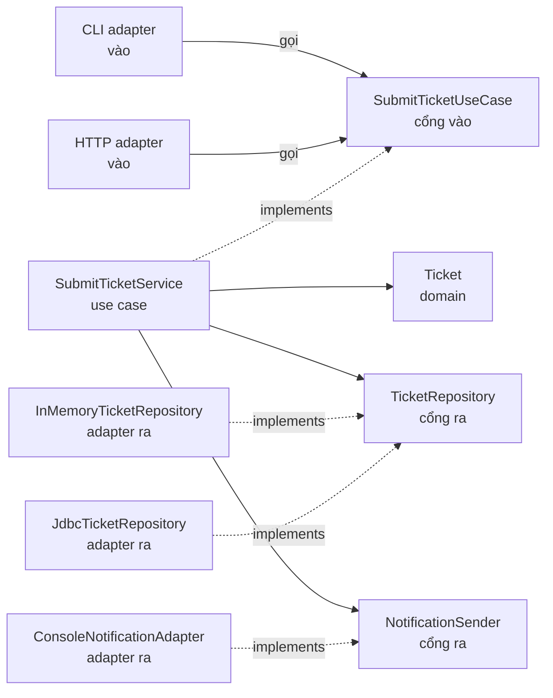

# Cổng và bộ chuyển đổi trong kiến trúc phân tách nghiệp vụ, hạ tầng

Một lớp xử lý nghiệp vụ có thể cần lưu dữ liệu, gửi thông báo hoặc nhận yêu cầu từ người dùng. Nhưng **nghiệp vụ không nhất thiết phải biết yêu cầu đến từ HTTP, dòng lệnh hay message broker**, cũng không cần biết kết quả được lưu bằng JDBC, tệp hay một kho trong bộ nhớ.

**Ports and Adapters** (thường gọi là *Hexagonal Architecture*, hay kiến trúc cổng và bộ chuyển đổi) tổ chức các mối quan hệ đó bằng một ranh giới: **cổng (*port*) mô tả cách giao tiếp với lõi ứng dụng; bộ chuyển đổi (*adapter*) nối cổng với công nghệ hoặc cách tương tác cụ thể**. Các phần hạ tầng nằm ngoài lõi có thể thay thế được nếu giữ đúng hợp đồng mà lõi dựa vào.

Khi kết hợp với **Dependency Injection (DI)**, ý tưởng trở nên thực hành được ngay trong Java thuần: lớp nghiệp vụ nhận các cổng cần thiết qua constructor, còn **composition root** quyết định adapter nào được tạo, đưa chúng vào object graph và quản lý vòng đời. Bài thuộc chương **Kỹ thuật kết hợp** của module **DEPENDENCY_INJECTION**, tập trung vào cách phân tách việc *sử dụng* dependency khỏi việc *tạo và lắp ghép* chúng, trước khi mở rộng sang DI container.

## 1. Kết quả cần đạt

Sau bài học, bạn có thể:

- Giải thích vai trò của **lõi nghiệp vụ/application**, **cổng vào**, **cổng ra**, **adapter vào** và **adapter ra**.
- Phân biệt **hướng lời gọi lúc chạy** với **hướng phụ thuộc mã nguồn**; nhận diện nơi cần áp dụng Dependency Inversion Principle (DIP).
- Thiết kế cổng theo nhu cầu của lớp sử dụng thay vì sao chép API của thư viện hoặc database.
- Lắp ghép một adapter vào và nhiều adapter ra bằng **constructor injection** và **composition root** trong Java thuần.
- Thay đổi công nghệ tương tác hoặc lưu trữ mà không phải sửa quy tắc nghiệp vụ, khi hợp đồng không thay đổi.
- Kiểm thử use case với fake/spy và kiểm tra wiring ở ranh giới composition root.
- Nêu các giới hạn: DI không tự tạo transaction, xác thực, bảo đảm thread-safety hay xử lý vòng đời tài nguyên.

## 2. Vấn đề khi nghiệp vụ bị ghép chặt vào công nghệ

Giả sử cần xử lý yêu cầu sửa chữa thiết bị. Khi người dùng gửi mã phiếu, mã thiết bị và địa chỉ liên hệ, ứng dụng phải kiểm tra dữ liệu, lưu phiếu và yêu cầu gửi thông báo xác nhận.

Một cách triển khai ban đầu có thể dồn mọi việc vào một lớp:

```java
// Phác họa anti-pattern; JdbcTicketStore và SmtpClient là API giả định.
final class TicketService {
    String submit(String ticketId, String assetId, String email) {
        if (ticketId == null || ticketId.isBlank()) {
            throw new IllegalArgumentException("ticket ID is required");
        }

        JdbcTicketStore store = new JdbcTicketStore(
                System.getenv("DB_URL"));
        store.insert(ticketId, assetId, email);

        SmtpClient smtp = new SmtpClient(
                System.getenv("SMTP_HOST"));
        smtp.send(email, "Ticket created: " + ticketId);
        return ticketId;
    }
}
```

Đây là **mã minh họa kiến trúc**, không phải chương trình biên dịch độc lập. Các vấn đề chính:

1. **Nghiệp vụ biết công nghệ cụ thể:** service phải import lớp JDBC, SMTP và đọc tên biến môi trường.
2. **Không thể thay adapter độc lập:** muốn lưu trong bộ nhớ ở unit test phải sửa hoặc can thiệp vào logic tạo dependency.
3. **Không rõ vòng đời:** nếu client mở socket, ai chịu trách nhiệm đóng và tái sử dụng?
4. **Đường lỗi khó kiểm soát:** lưu thành công rồi gửi SMTP lỗi có thể khiến caller nhận lỗi nhưng phiếu vẫn tồn tại.
5. **Nhiều điểm vào dễ lặp logic:** nếu sau đó bổ sung HTTP controller và message consumer, chúng có thể gọi những luồng xử lý khác nhau hoặc sao chép chính sách xác thực/kiểm tra.

**Mục tiêu không phải cấm mọi lệnh `new` trong lõi.** Tạo một value object `Ticket` để biểu diễn dữ liệu nghiệp vụ là bình thường. Điều cần tách là quyết định *dùng loại database nào*, *khởi tạo SMTP ra sao*, *nhận request bằng công nghệ gì* và *ai sở hữu tài nguyên*.

## 3. Các khối của Ports and Adapters

| Thành phần | Nhiệm vụ | Ví dụ trong hệ thống phiếu sửa chữa |
| --- | --- | --- |
| **Domain / lõi nghiệp vụ** | Dữ liệu, bất biến, quy tắc không phụ thuộc hạ tầng | `Ticket` và kiểm tra dữ liệu hợp lệ |
| **Application service / use case** | Điều phối một ca sử dụng; gọi các cổng cần thiết | `SubmitTicketService` |
| **Cổng vào (*inbound/input port*)** | Hợp đồng mô tả chức năng ứng dụng cung cấp cho bên gọi | `SubmitTicketUseCase.submit(command)` |
| **Adapter vào (*driving/primary adapter*)** | Nhận dữ liệu từ bên ngoài, chuyển thành lời gọi qua cổng vào | CLI, HTTP controller, message consumer |
| **Cổng ra (*outbound/output port*)** | Hợp đồng về khả năng mà lõi cần từ bên ngoài | `TicketRepository`, `NotificationSender` |
| **Adapter ra (*driven/secondary adapter*)** | Hiện thực cổng ra bằng công nghệ cụ thể | Repository JDBC, repository in-memory, adapter SMTP |
| **Composition root** | Chọn, tạo và lắp ghép adapter với use case; quản lý cấu hình và lifecycle | `Main.compose(...)` |

Từ *primary/secondary* là cách gọi về **hướng điều khiển tương tác**, không có nghĩa adapter thứ cấp kém quan trọng hơn. Một cổng có thể có nhiều adapter, và một adapter có thể phục vụ nhiều cổng nếu thiết kế yêu cầu.

**“Hexagonal” là hình ảnh kiến trúc**, không bắt buộc hệ thống phải có sáu cổng hay sáu adapter. Số lượng cổng nên phản ánh các tương tác có ý nghĩa, không phải số cạnh của hình vẽ.

### 3.1. Cổng vào: ứng dụng cung cấp khả năng gì?

Cổng vào mô tả những hành động mà một bên sử dụng ứng dụng được phép yêu cầu:

```java
interface SubmitTicketUseCase {
    String submit(SubmitTicketCommand command);
}
```

Hợp đồng này không nói đến HTTP status, request header, `Scanner` hoặc cú pháp message broker. HTTP controller và CLI đều có thể **dịch dữ liệu đầu vào sang `SubmitTicketCommand`** rồi gọi cùng cổng vào.

Không phải mọi ứng dụng đều cần một interface riêng cho mỗi use case. Nếu chỉ có một điểm gọi đơn giản và không cần phân tách hợp đồng qua module, một application service có public method rõ ràng cũng có thể đóng vai trò cổng vào. Ở bài này ta dùng interface để thấy ranh giới một cách trực quan.

### 3.2. Cổng ra: lõi cần khả năng gì?

Lõi cần lưu phiếu và yêu cầu gửi xác nhận:

```java
interface TicketRepository {
    void saveNew(Ticket ticket);
}

interface NotificationSender {
    void requestConfirmation(String email, String ticketId);
}
```

Các hợp đồng được viết theo **ngôn ngữ và dữ liệu của use case**, không dùng `java.sql.Connection`, `ResultSet`, SMTP session hoặc các kiểu dữ liệu riêng của SDK. Chúng mô tả điều lõi cần; adapter sẽ chuyển lời gọi đó thành SQL, API hoặc hành vi thích hợp.

Đây là phần quan trọng của **Dependency Inversion Principle**: lớp ở phía nghiệp vụ phụ thuộc vào abstraction phù hợp với mình; implementation hạ tầng phụ thuộc vào hợp đồng ấy, thay vì nghiệp vụ phụ thuộc trực tiếp công nghệ.

### 3.3. Adapter không phải một “lõi nghiệp vụ thứ hai”

Adapter làm nhiệm vụ dịch và kết nối:

- Adapter HTTP đọc request, ánh xạ sang command, gọi use case rồi ánh xạ kết quả sang HTTP response.
- Adapter JDBC chuyển phương thức `saveNew(ticket)` thành lệnh ghi database.
- Adapter email chuyển `requestConfirmation(...)` thành lệnh gửi phù hợp.

**Quy tắc nghiệp vụ chung** như khi nào được tạo phiếu, ID có hợp lệ không hoặc trạng thái nào được phép chuyển tiếp không nên được sao chép riêng trong controller và repository. Ngược lại, kiểm tra **định dạng vận chuyển** như JSON hợp lệ hay xác thực HTTP token thuộc về ranh giới adapter tương ứng. Hai loại kiểm tra có thể cùng tồn tại nhưng phục vụ mục đích khác nhau.

## 4. Hướng lời gọi và hướng phụ thuộc là hai chuyện khác nhau

Ở **runtime**, một thao tác thường đi theo luồng:

```text
Người dùng / hệ thống ngoài
  -> Adapter vào (CLI, HTTP, consumer)
  -> Cổng vào / application service
  -> Domain rule
  -> Cổng ra (repository, notification)
  -> Adapter ra
  -> Database hoặc dịch vụ ngoài
```

Nhưng khi xem **dependency mã nguồn**, chiều quan trọng là:

- Adapter vào biết **cổng vào** (hoặc use case ở lõi).
- Application service biết **domain** và **cổng ra**.
- Adapter ra biết **cổng ra** để implement.
- **Composition root** biết cả cổng lẫn adapter cụ thể để thực hiện wiring.
- Lõi **không cần import** JDBC, SMTP, web framework hay một container API.



Sơ đồ biểu diễn **quan hệ mã nguồn chính và lời gọi qua cổng**, không vẽ toàn bộ dây nối đối tượng thực tế. Composition root nằm bên ngoài lõi và có thể chọn `InMemoryTicketRepository` hoặc `JdbcTicketRepository` cho cùng `TicketRepository`.

**Một điểm dễ nhầm:** vì use case *gọi* phương thức của repository lúc chạy, không có nghĩa use case phải import lớp `JdbcTicketRepository`. Dependency mã nguồn có thể hướng về một abstraction, còn lúc runtime lời gọi được chuyển đến implementation qua đa hình của Java.

## 5. DI, DIP và Ports and Adapters khác nhau ở đâu?

Ba khái niệm bổ trợ nhau nhưng không đồng nghĩa:

| Khái niệm | Câu hỏi cốt lõi | Vai trò trong bài |
| --- | --- | --- |
| **Ports and Adapters** | Tách lõi khỏi các hình thức tương tác/hạ tầng bằng những ranh giới nào? | Phân chia cổng vào/ra, adapter vào/ra và lõi |
| **Dependency Inversion Principle (DIP)** | Mã nguồn của phần chính phụ thuộc vào chi tiết hay abstraction? | `SubmitTicketService` phụ thuộc `TicketRepository`, không phụ thuộc JDBC |
| **Dependency Injection (DI)** | Ai tạo và cung cấp các cộng tác viên cho bên sử dụng? | Root gọi `new SubmitTicketService(repository, sender)` |
| **Inversion of Control (IoC)** | Quyền điều khiển tạo/ghép và luồng gọi được đảo về phía khung vận hành/bên ngoài ra sao? | Core không tự tìm adapter; adapter vào kích hoạt use case |

Một chương trình có DI nhưng vẫn **không có ranh giới Ports and Adapters tốt** nếu service nhận trực tiếp `JdbcTicketRepository` và `SmtpClient` qua constructor. Nó được *inject* nhưng vẫn phụ thuộc chi tiết công nghệ.

Ngược lại, một hệ thống có interface “trông giống port” nhưng service vẫn gọi `GlobalContainer.get(...)` hoặc tự `new` adapter bên trong thì khả năng thay thế/test độc lập chưa thực sự rõ ràng.

**Tên interface không đủ chứng minh thiết kế tốt.** Một cổng nên phản ánh nhu cầu ổn định, có hành vi và lỗi được mô tả, chứ không phải một bản sao cơ học của SDK bên ngoài.

## 6. Thiết kế use case từ bài toán nghiệp vụ

Với yêu cầu tạo phiếu sửa chữa thiết bị, ta xác định:

**Đầu vào có ý nghĩa:** ID phiếu, mã thiết bị, địa chỉ liên hệ.

**Bất biến tối thiểu của ví dụ:** các trường không được `null` hoặc chỉ gồm khoảng trắng. Đây là validation đơn giản phục vụ ví dụ; một hệ thống thật cần quy tắc định danh, quyền gửi yêu cầu, kiểm soát người dùng/tenant và xác thực email thích hợp.

**Trình tự dùng cổng ra:**

1. Tạo `Ticket` hợp lệ.
2. Yêu cầu repository lưu phiếu mới.
3. Yêu cầu gửi thông báo xác nhận.
4. Trả lại mã phiếu cho bên gọi.

Use case điều phối **khi nào sử dụng** repository và sender. Composition root quyết định **repository và sender cụ thể nào** được cung cấp.

### 6.1. Hợp đồng lỗi phải được suy nghĩ cùng hợp đồng thành công

`TicketRepository.saveNew(...)` phải có nghĩa rõ ràng: khi ID đã tồn tại thì không ghi đè hay ném exception? Adapter trả về sau khi đã bền vững hay chỉ xếp yêu cầu ghi vào queue? `NotificationSender.requestConfirmation(...)` có nghĩa đã gửi thực tế hay mới gửi yêu cầu vào một hệ thống khác?

Trong ví dụ tự chứa:

- Fake repository **từ chối ID trùng** bằng `IllegalArgumentException`.
- Adapter thông báo console chỉ **in một dòng**; đó không phải bằng chứng email thực đã đến nơi.
- Nếu `saveNew` ném lỗi, use case **không gọi sender**.
- Nếu sender lỗi sau khi lưu thành công, dữ liệu đã lưu **không tự rollback**.

Đó là những lựa chọn minh họa. Trong production, cần mô tả hành vi lỗi, transaction, idempotency và chiến lược nhất quán riêng.

## 7. Chương trình Java thuần hoàn chỉnh: cổng, adapter và composition root

Để dễ chạy thử, toàn bộ lớp được đặt trong **một file `Main.java`**. Trong ứng dụng thực tế, các thành phần này có thể nằm ở nhiều package/module; mục 9 sẽ đưa ra cách tổ chức tham khảo.

Ví dụ sử dụng **JDK 11 trở lên**, không dùng DI container, không kết nối database, không gửi email thật.

```java
import java.util.ArrayList;
import java.util.Arrays;
import java.util.LinkedHashMap;
import java.util.List;
import java.util.Map;
import java.util.Objects;
import java.util.Optional;

public class Main {
    // DỮ LIỆU CỦA CỔNG VÀO: không chứa HTTP/CLI-specific API.
    static final class SubmitTicketCommand {
        final String ticketId;
        final String assetId;
        final String contactEmail;

        SubmitTicketCommand(
                String ticketId,
                String assetId,
                String contactEmail) {
            this.ticketId = ticketId;
            this.assetId = assetId;
            this.contactEmail = contactEmail;
        }
    }

    // DOMAIN: bất biến hợp lệ trước khi dùng cổng ra.
    static final class Ticket {
        final String id;
        final String assetId;
        final String contactEmail;

        Ticket(SubmitTicketCommand command) {
            Objects.requireNonNull(command, "command");
            if (command.ticketId == null || command.ticketId.isBlank()
                    || command.assetId == null || command.assetId.isBlank()
                    || command.contactEmail == null
                    || command.contactEmail.isBlank()) {
                throw new IllegalArgumentException(
                        "ticket ID, asset ID and email are required");
            }
            this.id = command.ticketId;
            this.assetId = command.assetId;
            this.contactEmail = command.contactEmail;
        }
    }

    // CỔNG VÀO (input/inbound port): use case ứng dụng cung cấp.
    interface SubmitTicketUseCase {
        String submit(SubmitTicketCommand command);
    }

    // CÁC CỔNG RA (output/outbound ports): khả năng lõi cần.
    interface TicketRepository {
        void saveNew(Ticket ticket);
    }

    interface NotificationSender {
        void requestConfirmation(String email, String ticketId);
    }

    // APPLICATION SERVICE: chỉ biết domain và các cổng.
    static final class SubmitTicketService
            implements SubmitTicketUseCase {
        private final TicketRepository tickets;
        private final NotificationSender notifications;

        SubmitTicketService(
                TicketRepository tickets,
                NotificationSender notifications) {
            this.tickets = Objects.requireNonNull(tickets, "tickets");
            this.notifications =
                    Objects.requireNonNull(notifications, "notifications");
        }

        @Override
        public String submit(SubmitTicketCommand command) {
            Ticket ticket = new Ticket(command);
            tickets.saveNew(ticket);
            notifications.requestConfirmation(
                    ticket.contactEmail, ticket.id);
            return ticket.id;
        }
    }

    // ADAPTER RA #1: fake repository trong bộ nhớ.
    static final class InMemoryTicketRepository
            implements TicketRepository {
        private final Map<String, Ticket> records = new LinkedHashMap<>();

        @Override
        public void saveNew(Ticket ticket) {
            Objects.requireNonNull(ticket, "ticket");
            if (records.putIfAbsent(ticket.id, ticket) != null) {
                throw new IllegalArgumentException(
                        "duplicate ticket ID: " + ticket.id);
            }
        }

        Optional<Ticket> find(String ticketId) {
            return Optional.ofNullable(records.get(ticketId));
        }

        int count() {
            return records.size();
        }
    }

    // ADAPTER RA #2: chỉ in yêu cầu gửi xác nhận.
    static final class ConsoleNotificationAdapter
            implements NotificationSender {
        @Override
        public void requestConfirmation(String email, String ticketId) {
            System.out.println("Notification requested: "
                    + email + " for " + ticketId);
        }
    }

    // ADAPTER RA KHÁC: bỏ qua side effect có chủ đích trong demo.
    static final class SilentNotificationAdapter
            implements NotificationSender {
        @Override
        public void requestConfirmation(String email, String ticketId) {
            // Chế độ demo; không dùng làm default production.
        }
    }

    // SPY cho unit test: quan sát lời gọi output port.
    static final class RecordingNotificationAdapter
            implements NotificationSender {
        final List<String> calls = new ArrayList<>();

        @Override
        public void requestConfirmation(String email, String ticketId) {
            calls.add(email + ":" + ticketId);
        }
    }

    // ADAPTER VÀO: nhận các chuỗi dòng lệnh và gọi cổng vào.
    static final class CommandLineTicketAdapter {
        private final SubmitTicketUseCase useCase;

        CommandLineTicketAdapter(SubmitTicketUseCase useCase) {
            this.useCase = Objects.requireNonNull(useCase, "useCase");
        }

        void handle(String[] arguments) {
            if (arguments.length != 3) {
                throw new IllegalArgumentException(
                        "Usage: java Main [--silent] "
                        + "<ticket-id> <asset-id> <email>");
            }
            SubmitTicketCommand command = new SubmitTicketCommand(
                    arguments[0], arguments[1], arguments[2]);
            String createdId = useCase.submit(command);
            System.out.println("Submitted ticket: " + createdId);
        }
    }

    static final class Application {
        final CommandLineTicketAdapter cli;
        final InMemoryTicketRepository repository;

        Application(
                CommandLineTicketAdapter cli,
                InMemoryTicketRepository repository) {
            this.cli = Objects.requireNonNull(cli, "cli");
            this.repository = Objects.requireNonNull(
                    repository, "repository");
        }
    }

    // COMPOSITION ROOT: biết implementation và nối graph.
    static Application compose(boolean silent) {
        InMemoryTicketRepository repository =
                new InMemoryTicketRepository();
        NotificationSender sender = silent
                ? new SilentNotificationAdapter()
                : new ConsoleNotificationAdapter();

        SubmitTicketUseCase useCase =
                new SubmitTicketService(repository, sender);
        CommandLineTicketAdapter cli =
                new CommandLineTicketAdapter(useCase);
        return new Application(cli, repository);
    }

    // UNIT TEST JAVA THUẦN: không khởi động CLI hoặc database.
    static void runChecks() {
        InMemoryTicketRepository fake =
                new InMemoryTicketRepository();
        RecordingNotificationAdapter spy =
                new RecordingNotificationAdapter();
        SubmitTicketUseCase sut = new SubmitTicketService(fake, spy);

        // Đường thành công: lưu và yêu cầu gửi đúng dữ liệu.
        String createdId = sut.submit(new SubmitTicketCommand(
                "TEST-1", "LAPTOP-2", "test@example.test"));
        if (!"TEST-1".equals(createdId)
                || fake.find("TEST-1").isEmpty()
                || !spy.calls.equals(
                        List.of("test@example.test:TEST-1"))) {
            throw new AssertionError("wrong successful behavior");
        }

        // Dữ liệu sai bị từ chối trước khi dùng outbound ports.
        boolean invalidRejected = false;
        try {
            sut.submit(new SubmitTicketCommand(
                    "TEST-BAD", " ", "test@example.test"));
        } catch (IllegalArgumentException expected) {
            invalidRejected = true;
        }
        if (!invalidRejected
                || fake.count() != 1
                || spy.calls.size() != 1) {
            throw new AssertionError("invalid input reached adapters");
        }

        // Repository lỗi: service không được gọi thông báo.
        TicketRepository failingRepository = ticket -> {
            throw new IllegalStateException("storage unavailable");
        };
        RecordingNotificationAdapter afterFailure =
                new RecordingNotificationAdapter();
        SubmitTicketUseCase failingSut = new SubmitTicketService(
                failingRepository, afterFailure);
        boolean saveFailed = false;
        try {
            failingSut.submit(new SubmitTicketCommand(
                    "TEST-2", "LAPTOP-3", "second@example.test"));
        } catch (IllegalStateException expected) {
            saveFailed = true;
        }
        if (!saveFailed || !afterFailure.calls.isEmpty()) {
            throw new AssertionError("notified after save failure");
        }
    }

    public static void main(String[] args) {
        // Cấu hình khởi động, không đưa flag --silent vào use case.
        boolean silent = args.length > 0
                && "--silent".equals(args[0]);
        String[] ticketArgs = silent
                ? Arrays.copyOfRange(args, 1, args.length)
                : args;

        if (ticketArgs.length != 3) {
            throw new IllegalArgumentException(
                    "Usage: java Main [--silent] "
                    + "<ticket-id> <asset-id> <email>");
        }

        Application app = compose(silent);
        app.cli.handle(ticketArgs);
        runChecks();
        System.out.println("Plain Java checks: PASS");
    }
}
```

Biên dịch và chạy:

```bash
javac -encoding UTF-8 Main.java
java Main T-100 A-25 learner@example.test
```

Kết quả dự kiến:

```text
Notification requested: learner@example.test for T-100
Submitted ticket: T-100
Plain Java checks: PASS
```

Chọn adapter thông báo khác mà không sửa use case:

```bash
java Main --silent T-100 A-25 learner@example.test
```

Kết quả:

```text
Submitted ticket: T-100
Plain Java checks: PASS
```

**Lưu ý:** `--silent` chỉ là lựa chọn **demo** để quan sát khả năng thay adapter. Trong ứng dụng có nghĩa vụ thông báo bắt buộc, một no-op adapter không được phép trở thành default hoặc fallback âm thầm. Chế độ lưu trong bộ nhớ cũng **không bền vững** giữa các lần chạy và không an toàn cho nhiều thread đồng thời.

### 7.1. Truy vết một yêu cầu đi qua các cổng

1. `main()` đọc tham số dùng cho bootstrap (`--silent`), rồi gọi `compose(...)`.
2. Root tạo một `InMemoryTicketRepository` và chọn một implementation của `NotificationSender`.
3. Root tạo `SubmitTicketService(repository, sender)` và tiêm nó vào `CommandLineTicketAdapter` dưới kiểu `SubmitTicketUseCase`.
4. CLI adapter chuyển ba tham số sang `SubmitTicketCommand`, gọi `useCase.submit(command)`.
5. Service tạo `Ticket` và kiểm tra dữ liệu nghiệp vụ; sau đó sử dụng `TicketRepository.saveNew(...)` và `NotificationSender.requestConfirmation(...)`.
6. Adapter ra thực thi chi tiết lưu/ghi log theo hợp đồng. Use case không chứa `if (silent)`, `System.getenv()` hay tên các adapter cụ thể.

Đây là cùng một đường đi nếu thay adapter CLI bằng HTTP controller: HTTP adapter chỉ cần tạo command phù hợp và gọi cổng vào. **Use case không phải biết endpoint, JSON, HTTP status hoặc framework annotation.**

### 7.2. Kiểm thử mà không dựng adapter vào

`runChecks()` không tạo `CommandLineTicketAdapter`. Nó trực tiếp tạo:

- **Fake** `InMemoryTicketRepository` để xem phiếu đã được lưu hay chưa.
- **Spy** `RecordingNotificationAdapter` để ghi nhận yêu cầu thông báo.
- **Stub lỗi** `failingRepository` để kiểm tra hành vi khi lưu thất bại.

Vì SUT là `SubmitTicketService` được cung cấp các outbound port qua constructor, unit test có thể kiểm tra nghiệp vụ **không cần CLI, HTTP server hoặc database**. Điều này không thay thế kiểm thử adapter/graph production, nhưng giúp lỗi nghiệp vụ có phạm vi quan sát nhỏ hơn.

### 7.3. Ranh giới cố ý của ví dụ

Chương trình chỉ dùng validation tối thiểu và các adapter trong bộ nhớ, chạy đồng bộ trong một tiến trình. `NotificationSender.requestConfirmation(...)` là **yêu cầu tạo thông báo**, không đảm bảo thư đã được gửi hoặc nhận. Nếu việc gửi lỗi sau khi lưu, ví dụ chưa có cơ chế rollback/phục hồi tự động.

Đây là **giới hạn về giao dịch và độ tin cậy**, không phải lỗi có thể sửa chỉ bằng thêm một cổng. Trong hệ thống thật phải định nghĩa trạng thái phiếu, idempotency, retry, outbox hoặc cơ chế bù trừ tùy yêu cầu.

## 8. Cách đặt cổng ở đâu để giữ đúng hướng phụ thuộc?

Một cách tổ chức tham khảo khi tách các lớp lồng từ ví dụ thành file Java riêng:

```text
src/main/java/example/tickets/
  domain/
    Ticket.java
  application/
    SubmitTicketCommand.java
    SubmitTicketUseCase.java
    SubmitTicketService.java
    TicketRepository.java
    NotificationSender.java
  adapters/
    in/
      cli/
        CommandLineTicketAdapter.java
      http/
        HttpTicketController.java
    out/
      persistence/
        InMemoryTicketRepository.java
        JdbcTicketRepository.java
      notification/
        ConsoleNotificationAdapter.java
        SmtpNotificationAdapter.java
  bootstrap/
    Main.java
    Application.java
```

Đây **không phải cấu trúc bắt buộc**. Một dự án nhỏ có thể dùng ít package; một ứng dụng lớn có thể dùng module Java hoặc Gradle riêng để cưỡng chế hướng dependency.

**Nguyên tắc đáng giữ hơn tên thư mục:**

- `domain` không phụ thuộc hạ tầng hoặc loại giao thức nhận request.
- `application` có thể phụ thuộc `domain` và các hợp đồng nó sở hữu, nhưng không import controller, JDBC hoặc SMTP implementation.
- `adapters.in` phụ thuộc cổng vào và các loại request/response thích hợp; nó không tự quyết định chính sách nghiệp vụ.
- `adapters.out` implement cổng ra và có thể import SDK/framework riêng.
- `bootstrap` biết các implementation cụ thể và quyết định graph được chạy.

Một interface tên `TicketRepository` đặt trong package `application` nhưng trả về `ResultSet` của JDBC **vẫn làm rò chi tiết hạ tầng vào lõi**. Vị trí file không cứu được hợp đồng có abstraction kém.

### 8.1. Cổng có phải luôn nằm trong domain không?

Không. Có thể đặt cổng ở **lớp sở hữu nhu cầu**:

- Hợp đồng nghiệp vụ thật sự thuộc domain có thể đặt trong domain.
- Repository hoặc notification port chỉ phục vụ use case điều phối có thể đặt trong application.
- Cổng vào được định nghĩa như một API use case của application.

Điều quan trọng là **hướng phụ thuộc** và **tính ổn định của hợp đồng**. Đừng chuyển mọi adapter-specific API vào domain chỉ để thỏa một sơ đồ thư mục.

### 8.2. Adapter có thể gọi trực tiếp domain không?

Có những tương tác mà adapter dùng các value object thuộc domain; điều đó không tự động sai. Nhưng adapter vào không nên **tự ghép nhiều quy tắc nghiệp vụ** thay vì đi qua use case đã định nghĩa. Nếu một controller bỏ qua `SubmitTicketUseCase` để tự gọi repository, notification và thay đổi trạng thái phiếu, các điểm vào sẽ khó giữ cùng chính sách.

## 9. Thiết kế port theo nhu cầu thay vì sao chép hạ tầng

Một “cổng” tồi có thể trông như:

```java
// Mã minh họa sai hướng: contract của lõi rò JDBC.
interface TicketStorePort {
    java.sql.ResultSet executeQuery(String sql) throws java.sql.SQLException;
}
```

Để dùng port này, application service vẫn phải hiểu SQL, cursor, checked exception và cách đóng result set. Chỉ đặt tên “Port” không xóa phụ thuộc công nghệ.

Cổng có nghĩa nghiệp vụ hơn:

```java
interface TicketRepository {
    void saveNew(Ticket ticket);
}
```

Adapter JDBC sẽ chuyển lời gọi này thành SQL và quản lý các chi tiết mapping, connection/transaction theo hợp đồng của ứng dụng. Mô hình này còn cho phép viết fake repository phục vụ unit test.

### 9.1. Không phóng to interface cho mọi tính năng tương lai

Một repository có hàng chục phương thức không liên quan có thể buộc consumer phụ thuộc quá rộng. Hãy thiết kế hợp đồng theo **nhu cầu hiện có**: lưu phiếu mới, tra cứu theo ID hoặc cập nhật trạng thái nếu use case thực sự cần.

Không nhất thiết mỗi phương thức có một interface, nhưng nên tránh một “universal gateway” trộn HTTP, email, truy vấn dữ liệu, cache và mọi chính sách vào cùng object. Đó là vấn đề về **Interface Segregation** và cohesion, không giải quyết bằng cách tiêm một object lớn hơn.

### 9.2. Cổng phải quy định cả thất bại

Ví dụ `saveNew(ticket)` phải nói rõ trường hợp ID trùng, lỗi lưu và tính bền vững. Nếu adapter A từ chối trùng ID, adapter B âm thầm ghi đè và adapter C chỉ giữ trong một hàng đợi không bền vững, chúng **không hoàn toàn thay thế nhau về hành vi** dù cùng implements interface.

Hợp đồng về exception, return type, side effect, retry/idempotency và thứ tự thao tác quan trọng không kém chữ ký phương thức. Đây là lý do **contract test** cần thiết khi có nhiều adapter ra.

## 10. Inbound adapter khác outbound adapter ở đâu?

| Khía cạnh | Adapter vào | Adapter ra |
| --- | --- | --- |
| Hướng tương tác | Bên ngoài **kích hoạt** chức năng ứng dụng | Lõi **yêu cầu** khả năng từ bên ngoài |
| Hợp đồng liên quan | Gọi inbound port | Implement outbound port |
| Ví dụ | CLI, REST controller, message listener, scheduled job | JDBC repository, HTTP client, mail sender, file store |
| Chuyển đổi chủ yếu | Từ request/event bên ngoài sang command/query của use case | Từ lệnh của use case sang giao thức/tài nguyên hạ tầng |
| Sai lầm thường gặp | Controller chứa logic nghiệp vụ hoặc gọi thẳng DB | Adapter để chi tiết JDBC/SDK rò ngược vào core |
| Loại test thích hợp | Kiểm tra mapping/validation giao thức và gọi use case đúng | Contract, integration, lỗi I/O, transaction, cleanup |

**Một thành phần có thể xuất hiện ở cả hai phía trong các tương tác khác nhau.** Chẳng hạn, adapter message broker có thể nhận event để kích hoạt use case (adapter vào), đồng thời gửi event đi theo yêu cầu của use case khác (adapter ra). Phân loại theo **vai trò của từng tương tác**, không theo tên công nghệ.

### 10.1. HTTP controller gọi application service

Phác họa controller giả định:

```java
// Mã khái niệm; HttpRequest/HttpResponse không phải API Java chuẩn.
final class HttpTicketController {
    private final SubmitTicketUseCase useCase;

    HttpTicketController(SubmitTicketUseCase useCase) {
        this.useCase = useCase;
    }

    HttpResponse post(HttpRequest request) {
        SubmitTicketCommand command = new SubmitTicketCommand(
                request.ticketId(),
                request.assetId(),
                request.contactEmail());
        String id = useCase.submit(command);
        return HttpResponse.created(id);
    }
}
```

Adapter HTTP có thể còn xác thực request, giải mã JSON, xử lý trạng thái lỗi và trả status code. Nhưng công thức nghiệp vụ, quy tắc lưu và thông báo vẫn thuộc use case hoặc domain. Đoạn mã là **phác họa kiến trúc**, không phải chương trình HTTP chạy được.

## 11. Thay adapter tại composition root

Khi có nhiều adapter cho cùng cổng, root quyết định lựa chọn:

```java
// Mã phác họa: thông tin kết nối JDBC và class adapter được giả định.
TicketRepository repository = mode.equals("production")
        ? new JdbcTicketRepository(dataSource)
        : new InMemoryTicketRepository();

NotificationSender sender = new SmtpNotificationAdapter(smtpClient);
SubmitTicketUseCase useCase =
        new SubmitTicketService(repository, sender);
```

Nhưng **không nên tự động dùng in-memory repository nếu cấu hình database production sai hoặc không kết nối được**. Default và fallback phải có chính sách rõ; với dữ liệu quan trọng, **fail fast** an toàn hơn một adapter bỏ qua tính bền vững.

Composition root còn chịu trách nhiệm:

- Đọc **typed configuration** và từ chối giá trị không hợp lệ.
- Tạo và chia sẻ đúng những instance có scope thích hợp.
- Giữ **quyền sở hữu** connection pool, client hoặc listener sống lâu.
- Kích hoạt các hoạt động có tác dụng phụ **sau khi graph sẵn sàng**, rồi đóng theo thứ tự phù hợp.
- Đảm bảo không tiêm dependency request-scoped vào object application-scoped nếu object ấy sẽ giữ target quá lifetime.

**DI container** có thể tự động hóa phần wiring, binding và scope. Tuy nhiên, DI container không thay thế quyết định rằng cổng nên mô tả hành vi gì, adapter nào là an toàn cho môi trường hiện tại, hay ai chịu trách nhiệm transaction.

## 12. Vòng đời, transaction và tính nhất quán qua nhiều adapter

Mô hình Ports and Adapters giúp tách các chi tiết hạ tầng, nhưng **không tự làm biến mất các vấn đề vận hành**.

### 12.1. Dùng chung object nào?

Một HTTP client, connection pool hoặc adapter repository được thiết kế thread-safe có thể được root dùng chung. Nhưng một transaction, request context hoặc connection mượn từ pool thường chỉ hợp lệ trong **một đơn vị công việc**.

Nếu một `SubmitTicketService` được dùng chung cả ứng dụng và giữ `RequestSession` của request đầu tiên trong field, nó có thể tạo **captive dependency**. Hướng sửa thường là tiêm factory/provider đúng hợp đồng, truyền dữ liệu request theo phương thức, hoặc tạo phần graph ngắn hạn cho mỗi yêu cầu.

### 12.2. Ai đóng tài nguyên?

Thông thường:

- Root/host tạo và đóng pool/client dùng chung khi shutdown.
- Handler hoặc unit-of-work boundary tạo và đóng lease, stream, transaction theo request/task.
- Adapter JDBC quản lý việc mượn/trả connection theo API pool thực; use case không nên gọi `Connection.close()` trực tiếp.
- Adapter event listener cần một cơ chế `start()/close()` rõ, tránh nhận sự kiện ngay khi constructor vừa bắt đầu.

Một cổng nếu chỉ được dùng để diễn đạt việc lưu dữ liệu **không nhất thiết cần kế thừa `AutoCloseable`**. Thường adapter hoặc resource owner quản lý lifecycle ở tầng thích hợp.

### 12.3. Lưu xong nhưng thông báo lỗi thì sao?

Giả sử `tickets.saveNew(ticket)` thành công, sau đó `notifications.requestConfirmation(...)` ném exception. Việc use case gọi qua hai interface không tạo transaction xuyên hai hệ thống.

Các chiến lược thực tế có thể bao gồm:

1. **Lưu trạng thái cần thông báo** cùng phiếu và xử lý gửi sau.
2. **Transactional outbox** khi database hỗ trợ ghi phiếu và bản ghi outbox trong một transaction.
3. **Retry có idempotency**, khóa định danh và xử lý duplicate theo hợp đồng.
4. **Chấp nhận trạng thái trung gian** và có cơ chế giám sát/khôi phục.

Lựa chọn phụ thuộc vào yêu cầu nghiệp vụ và hạ tầng. Không nên giả định chỉ vì adapter trả về thành công rằng hệ thống ngoài đã xử lý đúng một lần.

## 13. Kiểm thử theo các ranh giới

Có thể phân tầng kiểm thử mà không phải khởi động tất cả mọi thứ cho từng test:

| Cấp kiểm thử | Điều cần chứng minh | Cách thử gợi ý |
| --- | --- | --- |
| **Domain test** | Bất biến và chính sách của `Ticket` | Tạo dữ liệu hợp lệ/sai bằng Java thuần |
| **Use case unit test** | Lưu trước khi yêu cầu thông báo; đầu vào sai không gọi adapter; lỗi lưu không thông báo | Fake repository, spy sender, stub lỗi |
| **Inbound adapter test** | CLI/HTTP mapping đúng dữ liệu, lỗi được chuyển sang kết quả giao thức phù hợp | Fake `SubmitTicketUseCase` hoặc stub có ghi nhận |
| **Outbound contract test** | Các repository cùng giữ quy tắc ID trùng, quy tắc lỗi và dữ liệu cần thiết | Chạy chung bộ kiểm tra trên từng adapter |
| **Outbound integration test** | JDBC mapping, schema, transaction, SMTP/HTTP, timeout | Adapter thật trong môi trường kiểm soát |
| **Composition/wiring test** | Root chọn đúng adapter, cung cấp đủ dependency, scope và shutdown hợp lý | Khởi động graph tương ứng môi trường |
| **End-to-end test** | Một đường đi qua các ranh giới thực tế hoạt động theo yêu cầu | Chạy hệ thống tích hợp với hạ tầng phù hợp |

Ở mục 7, `runChecks()` minh họa use case unit test:

- Fake repository xác nhận dữ liệu được lưu.
- Spy sender xác nhận dữ liệu thông báo.
- Command có mã thiết bị rỗng bị từ chối trước khi gọi cổng ra.
- Repository giả ném lỗi giúp khẳng định sender không bị gọi sau khi lưu thất bại.

Nó **không chứng minh** CLI parser bao phủ mọi trường hợp, SMTP/JDBC thực hoạt động, giao dịch phân tán đúng hoặc component được đóng an toàn khi có nhiều thread. Cần chọn test bổ sung theo rủi ro thực tế.

### 13.1. Contract test hữu ích khi thay adapter

Giả sử cả `InMemoryTicketRepository` và `JdbcTicketRepository` implement `TicketRepository`. Một bộ kiểm tra dùng chung nên xác minh:

1. `saveNew(ticket)` cho phiếu mới hoạt động theo hợp đồng.
2. Lưu ID trùng được xử lý đúng như đã định nghĩa, **không silently overwrite** nếu hợp đồng cấm.
3. Bản ghi lưu có đủ thông tin cần dùng; không tự thay đổi định dạng hoặc tenant.
4. Khi gặp lỗi hạ tầng, adapter báo lỗi mà application service có thể xử lý theo chính sách.

Với JDBC, có thể cần test thật để chứng minh unique constraint và transaction; fake in-memory chỉ mô phỏng được một phần.

## 14. Những hiểu lầm và anti-pattern thường gặp

| Hiểu lầm / cách làm | Vấn đề | Hướng điều chỉnh |
| --- | --- | --- |
| “DI tự động tạo Hexagonal Architecture” | Constructor injection vẫn có thể nhận trực tiếp lớp JDBC/SDK | Thiết kế port đúng nhu cầu lõi, adapter implement bên ngoài |
| “Mỗi interface đều là port tốt” | Interface có thể chỉ copy API framework hoặc không có hợp đồng | Đặt tên và hành vi theo use case, kiểm tra hướng dependency |
| “Hexagonal cần đúng sáu cổng” | Lẫn lộn hình minh họa với ràng buộc kỹ thuật | Tạo số cổng theo tương tác thực |
| Use case tự đọc `System.getenv()` rồi chọn adapter | Phân tán wiring, test khó | Root đọc cấu hình, tạo và inject implementation |
| Controller gọi thẳng database và tự tính chính sách | Mỗi inbound adapter có logic riêng, dễ lệch hành vi | Đi qua cổng/use case chung |
| Port trả `ResultSet` hoặc kiểu SDK | Hạ tầng rò vào lõi qua hợp đồng | Dùng kiểu domain/application thích hợp |
| Adapter lặng lẽ nuốt lỗi hoặc trả dữ liệu giả | Vi phạm hợp đồng, làm nghiệp vụ tưởng thành công | Mô tả lỗi và fallback hợp lệ |
| Lớp nghiệp vụ chứa interface cho mọi helper nhỏ | Quá nhiều abstraction không đem lại ranh giới hữu ích | Chỉ tạo abstraction khi có nhu cầu/contract rõ |
| Adapter repository chứa toàn bộ quy tắc nghiệp vụ | Quy tắc bị trùng hoặc gắn vào database | Đặt policy ở domain/application phù hợp |
| Fake in-memory được dùng ngầm ở production | Không bền vững, nguy cơ mất dữ liệu | Cấu hình lựa chọn minh bạch, production fail fast |
| Singleton giữ transaction/request context | Captive dependency, lỗi use-after-close | Factory/parameter/request graph, ownership rõ |
| Cho rằng save + notification tự có tính nguyên tử | Lỗi một adapter có thể tạo trạng thái từng phần | Thiết kế transaction/outbox/idempotency phù hợp |

### 14.1. Không cần tạo interface cho mọi lớp

`SubmitTicketService` chỉ có một implementation trong ví dụ, nhưng cổng vào `SubmitTicketUseCase` giúp các inbound adapter phụ thuộc vào một hợp đồng rõ ràng. Nếu trong hệ thống nhỏ interface này không đem lại ích lợi cụ thể, có thể để adapter gọi public method của application service mà vẫn giữ ranh giới hạ tầng.

Ngược lại, cổng ra thường đặc biệt hữu ích vì nó giữ cho lõi không biết chi tiết database, email, queue hoặc API bên ngoài. **Nhu cầu thay thế và ổn định hợp đồng quan trọng hơn số lượng interface**.

### 14.2. Có phải “adapter” luôn là một class?

Không. Một adapter có thể là class, một tập class, lambda, factory hoặc module kết nối protocol. Trong Java thuần, một lambda:

```java
NotificationSender sender =
        (email, id) -> System.out.println("Requested for " + id);
```

đã là một implementation hợp lệ của outbound port cho ví dụ nhỏ. Khi adapter có cấu hình, retry, circuit breaker, tài nguyên hoặc mapping phức tạp, class chuyên biệt thường rõ ràng và dễ kiểm thử hơn.

## 15. Quy trình kết hợp Ports and Adapters với DI thủ công

Một cách làm từng bước khi tách một ứng dụng đang ghép chặt:

1. **Khoanh vùng một use case thật.** Ví dụ tạo phiếu sửa chữa; xác định input, kết quả và side effect cần có.
2. **Viết quy tắc nghiệp vụ rõ ràng.** Dữ liệu nào là hợp lệ, thao tác nào được phép, lỗi nào phải báo?
3. **Thiết kế cổng vào.** Mô tả chức năng mà CLI/HTTP/message adapter được phép yêu cầu.
4. **Thiết kế cổng ra từ nhu cầu lõi.** Thay vì chọn database trước rồi copy API của nó, hãy hỏi use case cần lưu/đọc gì.
5. **Viết service phụ thuộc port qua constructor.** Kiểm tra dependency bắt buộc và không khởi tạo adapter trong service.
6. **Tạo adapter đơn giản bằng Java thuần.** In-memory repository và recording sender là khởi đầu dễ quan sát.
7. **Viết composition root.** Chọn, tạo, lắp graph; phân biệt cấu hình khởi động với dữ liệu của mỗi request.
8. **Tạo adapter vào.** Chuyển input CLI/HTTP thành command/use case, chuyển kết quả hoặc lỗi ra giao thức phù hợp.
9. **Kiểm thử riêng các ranh giới.** Domain/use case unit test, adapter contract test, wiring và integration khi cần.
10. **Thêm adapter thật có kiểm soát.** Xác định transaction, timeout, retries, scope, readiness, cleanup và logging an toàn.

Làm theo thứ tự này giúp sử dụng **DI như cơ chế lắp ghép**, thay vì coi việc thêm annotation là mục tiêu của kiến trúc.

## 16. Bài thực hành mở rộng

### Bài A: thêm HTTP adapter mà không sửa lõi

Đề bài: hệ thống cần nhận `POST /tickets` ngoài CLI.

Yêu cầu: xác định controller sẽ dịch các trường JSON nào thành `SubmitTicketCommand`; controller gọi hợp đồng nào; application service có cần import kiểu HTTP request/response không?

**Gợi ý:** Controller nhận/gỡ lỗi dữ liệu giao thức, tạo command và gọi `SubmitTicketUseCase`. Application service không cần biết HTTP. Cần quy tắc ánh xạ lỗi thành status phù hợp và kiểm tra bảo mật tại boundary.

### Bài B: thay repository in-memory bằng JDBC

Đề bài: tạo `JdbcTicketRepository implements TicketRepository`.

Yêu cầu: chỉ ra class nào phải biết `DataSource`, ai sở hữu connection pool, use case có phải sửa không và cần kiểm thử bổ sung điều gì?

**Gợi ý:** JDBC adapter và root biết `DataSource`; application service vẫn gọi `saveNew(ticket)`. Kiểm thử constraint ID trùng, mapping, transaction, connection cleanup và lỗi I/O bằng integration/contract test.

### Bài C: xử lý thông báo lỗi sau khi lưu

Đề bài: phiếu được lưu nhưng gửi xác nhận thất bại. Có nên bắt exception rồi tự trả về “chưa lưu” không?

**Gợi ý:** Không nên phản ánh sai trạng thái đã thực hiện. Cần định nghĩa kết quả và chính sách nhất quán: lưu yêu cầu gửi để retry, transactional outbox hoặc trạng thái chờ thông báo. DI không tự rollback side effect.

### Bài D: kiểm soát scope

Đề bài: một shared `SubmitTicketService` giữ `RequestTransaction` của request A trong constructor và dùng tiếp ở request B.

**Gợi ý:** Đây là nguy cơ captive dependency. Có thể tạo transaction trong request handler/factory và truyền đúng lifetime, hoặc tạo một phần graph ngắn hạn theo request. Không kéo dài transaction chỉ để singleton sử dụng.

## 17. Tự kiểm tra

**Tình huống 1.** HTTP controller nhận request, kiểm tra JSON rồi tự gọi `JdbcTicketRepository` và `SmtpClient`. Use case hiện có chỉ được CLI gọi. Vấn đề kiến trúc là gì?

**Gợi ý:** Adapter HTTP bỏ qua cổng vào/use case, dễ sao chép và làm lệch nghiệp vụ giữa hai điểm vào. Nên để controller dịch input rồi gọi `SubmitTicketUseCase`.

**Tình huống 2.** `TicketRepository` có phương thức trả `java.sql.ResultSet`. Dù nằm trong package application, cổng này đã tách lõi khỏi JDBC tốt chưa?

**Gợi ý:** Chưa. Cổng đang rò công nghệ qua kiểu dữ liệu. Nên trả/nhận kiểu nghiệp vụ hoặc DTO phù hợp và để adapter chuyển đổi.

**Tình huống 3.** Composition root tạo `new SubmitTicketService(new JdbcTicketRepository(...), sender)`. Đây có phải constructor injection không? Service có nhất thiết biết JDBC không?

**Gợi ý:** Có, nếu service nhận `TicketRepository` qua constructor. Root biết triển khai JDBC nhưng service không cần import lớp JDBC. Đây là ranh giới quan trọng.

**Tình huống 4.** Unit test truyền `InMemoryTicketRepository` và `RecordingNotificationAdapter` vào service; không mở HTTP server hay SMTP. Có đang kiểm thử đúng use case không?

**Gợi ý:** Có thể đúng nếu kiểm tra hành vi của service và hợp đồng các outbound port. Nhưng chưa xác minh wiring/adapter thật; cần test bổ sung theo rủi ro.

**Tình huống 5.** Có hai adapter gửi xác nhận, một adapter luôn in ra console và một adapter thực sự gửi email. Có nên tự rơi về console nếu SMTP production mất kết nối?

**Gợi ý:** Không, trừ khi sản phẩm có chính sách fallback như vậy và người dùng hiểu ý nghĩa. In console không tương đương gửi email; fallback âm thầm có thể vi phạm hợp đồng.

**Tình huống 6.** Một nhóm định tạo đủ sáu interface để “đúng Hexagonal”. Đây có phải tiêu chí thiết kế đáng tin cậy?

**Gợi ý:** Không. Số cạnh hình lục giác chỉ mang tính minh họa. Port nên xuất phát từ những tương tác có ý nghĩa và nhu cầu của lõi.

**Tình huống 7.** Một `MessageConsumer` vừa nhận sự kiện để gọi `SubmitTicketUseCase` vừa gửi event theo một cổng ra khác. Nó là adapter vào hay ra?

**Gợi ý:** Tùy **vai trò của từng tương tác**: nhận và kích hoạt use case là vai trò adapter vào; gửi event theo yêu cầu lõi là adapter ra.

**Tình huống 8.** Service lưu thành công, notification thất bại. Nếu dùng interface và constructor injection đầy đủ, lỗi nhất quán đã tự được giải quyết chưa?

**Gợi ý:** Chưa. DI và Ports and Adapters chỉ làm rõ ranh giới. Cần thiết kế chính sách giao dịch, retry/outbox, trạng thái hoặc bù trừ phù hợp.

## 18. Ghi nhớ

- **Cổng (*port*) là hợp đồng giao tiếp với lõi; bộ chuyển đổi (*adapter*) nối hợp đồng ấy với giao thức hoặc công nghệ cụ thể.**
- **Cổng vào** biểu diễn chức năng ứng dụng cung cấp; **adapter vào** kích hoạt use case. **Cổng ra** biểu diễn khả năng lõi cần; **adapter ra** hiện thực khả năng ấy.
- **Hướng lời gọi lúc chạy khác hướng phụ thuộc mã nguồn.** Application service có thể gọi repository qua interface mà không phụ thuộc trực tiếp JDBC.
- **DIP** định hướng dependency vào abstraction; **DI** cung cấp collaborator từ bên ngoài; **Ports and Adapters** tổ chức các ranh giới; **composition root** lắp graph thực tế.
- **Hợp đồng tốt không rò kiểu SDK/framework**, có hành vi lỗi và bảo đảm thay thế đủ rõ để kiểm thử.
- **Java thuần đã đủ để thực hành kiến trúc** bằng constructor injection, fake/spy và composition root, trước khi dùng DI container.
- **Không có kiến trúc nào tự tạo transaction, thread-safety hoặc lifecycle đúng.** Scope, ownership, side effect và cleanup vẫn phải được thiết kế và kiểm thử.

Khi thêm một công nghệ mới, hãy tự hỏi: **“Lõi thực sự cần khả năng gì, cổng nào nên diễn đạt nhu cầu ấy, adapter nào chịu trách nhiệm chuyển đổi, và composition root sẽ lắp nó vào đâu?”** Trả lời rõ những câu hỏi này giúp nghiệp vụ ít lệ thuộc hạ tầng và hệ thống dễ thay đổi, kiểm thử hơn.
