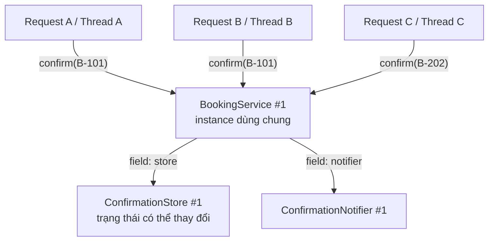

# DI không tự bảo đảm an toàn luồng cho đối tượng được chia sẻ

## 1. Một đối tượng được inject vào nhiều nơi có tự an toàn luồng?

**Không.** Dependency Injection (DI) quyết định **ai cung cấp tham chiếu đến dependency**, còn *thread safety* phụ thuộc vào **trạng thái bên trong đối tượng, cách các luồng truy cập và các bảo đảm đồng thời của implementation**.

Trong ứng dụng đặt chỗ, composition root có thể tạo một repository rồi truyền cùng instance cho nhiều service:

```java
ConfirmationStore store = new InMemoryConfirmationStore();
BookingService serviceA = new BookingService(store, notifier);
BookingService serviceB = new BookingService(store, notifier);
```

Đoạn này minh họa cách lắp ghép; chương trình hoàn chỉnh ở mục 6 sẽ định nghĩa các loại tương ứng.

Hai service nhận cùng một `store`, nên khi nhiều request thực thi đồng thời, chúng có thể **truy cập và thay đổi cùng trạng thái**. Việc repository được đưa vào constructor, được đánh dấu `@Singleton` hay được DI container quản lý **không tự biến các thao tác của nó thành nguyên tử hoặc an toàn luồng**.

Trong chương **Đồng thời và bất đồng bộ** của module **DEPENDENCY_INJECTION**, ta tiếp tục mục tiêu học **Dependency Injection** và **Inversion of Control (IoC)** để tách *việc sử dụng dependency* khỏi *việc tạo và lắp ghép object*, thực hành **constructor injection**, **composition root**, quản lý **scope/vòng đời** và **kiểm thử bằng Java thuần** trước khi mở rộng sang DI container.

> **Nguyên tắc cốt lõi:** DI quản lý việc cấp đối tượng và có thể hỗ trợ scope, nhưng **bảo đảm đồng thời là một phần của hợp đồng và implementation**. Khi nhiều luồng có thể đi vào cùng một instance, hãy chứng minh hoặc thiết kế tính an toàn của chính instance đó.

## 2. Đối tượng dùng chung xuất hiện trong object graph như thế nào?

Giả sử một ứng dụng có một `BookingService` được dùng chung. Service nhận hai dependency: `ConfirmationStore` và `ConfirmationNotifier`. Nhiều request gọi cùng một instance service:



Sơ đồ cần được hiểu theo hai tầng:

- **Object graph:** `BookingService #1` có tham chiếu đến `ConfirmationStore #1` và `ConfirmationNotifier #1`. Các instance này được tạo và cấp từ composition root.
- **Luồng thực thi:** Thread A, B, C có thể đồng thời đi qua các method của **cùng một service** và **cùng một store**, dù mỗi request truyền mã đặt chỗ khác nhau.

Điều DI có thể giúp ta làm rõ là **object nào đang được chia sẻ**. Điều DI không làm thay là **ngăn mọi thread race** trên trường hoặc collection có thể thay đổi của object đó.

### “Cùng interface” không có nghĩa “cùng instance”

```java
ConfirmationStore first = new InMemoryConfirmationStore();
ConfirmationStore second = new InMemoryConfirmationStore();

System.out.println(first == second); // false
```

Hai biến cùng kiểu `ConfirmationStore` nhưng trỏ hai object khác nhau. Một số dependency có thể **tách instance nhưng vẫn chia sẻ backend** (ví dụ hai adapter dùng cùng database), vì thế cũng không được suy rằng `first != second` thì dữ liệu hoàn toàn cô lập.

Ngược lại, một **instance singleton** có thể được mọi thread sử dụng đồng thời. Singleton chỉ nói về **số lượng instance trong một scope/container**, không phải về tính nguyên tử, tính nhất quán hoặc khả năng chạy đa luồng.

## 3. Vì sao `final` và constructor injection chưa đủ?

Ví dụ một service giữ dependency bằng trường `final`:

```java
final class BookingService {
    private final ConfirmationStore store;

    BookingService(ConfirmationStore store) {
        this.store = java.util.Objects.requireNonNull(store, "store");
    }
}
```

`final` giúp tham chiếu `store` không bị gán sang object khác sau constructor. Java cũng có các bảo đảm về *final fields* khi đối tượng được khởi tạo đúng cách, nhưng không vì thế mà mọi **trạng thái thay đổi được bên trong `store`** trở nên an toàn luồng.

Nếu store chứa:

```java
private final java.util.Set<String> confirmed = new java.util.HashSet<>();
```

thì field `confirmed` là `final`, nhưng **`HashSet` vẫn thay đổi được và không an toàn cho các thao tác cập nhật đồng thời không được đồng bộ**.

Hãy phân biệt:

| Tính chất | Nó nói về điều gì? | Có bảo đảm an toàn luồng không? |
| --- | --- | --- |
| `private final ConfirmationStore store` | Tham chiếu của service không bị gán lại. | **Không** đối với trạng thái của store. |
| `private final HashSet<String> ids` | Tham chiếu collection không đổi. | **Không**; phần tử và cấu trúc trong set vẫn thay đổi. |
| Đối tượng bất biến đúng nghĩa (*immutable*) | Trạng thái quan sát được không thay đổi sau khởi tạo đúng cách. | Thường rất thuận lợi cho chia sẻ, nhưng vẫn phải xét dependency bên trong và cách công bố instance. |
| `volatile int count` | Khả năng nhìn thấy giá trị/quan hệ thứ tự thích hợp cho biến đó. | **Không** biến `count++` thành phép tăng nguyên tử. |
| `AtomicInteger.incrementAndGet()` | Một thao tác tăng/đọc về giá trị nguyên tử. | **Có** cho thao tác đó; không tự đảm bảo bất biến trải qua nhiều biến khác. |
| `ConcurrentHashMap.newKeySet().add(id)` | Thao tác thêm khóa được triển khai an toàn cho dùng đồng thời. | **Có** cho thao tác thêm; không giải quyết mọi giao dịch nghiệp vụ ngoài set. |

**An toàn công bố đối tượng** (*safe publication*) và **an toàn các thao tác sau khi công bố** là hai vấn đề khác nhau. Constructor injection và trường `final` có thể hỗ trợ tạo đối tượng có bất biến rõ ràng, nhưng các hoạt động tiếp theo trên state mutable vẫn cần cơ chế đồng bộ phù hợp.

## 4. Race condition: “kiểm tra rồi thực hiện” không phải một phép nguyên tử

Giả sử repository cần ghi nhận việc xác nhận mới và chỉ trả `true` ở lần đầu tiên:

```java
// KHÔNG an toàn khi nhiều thread cùng xử lý một ID.
boolean markConfirmed(String id) {
    if (confirmed.contains(id)) {
        return false;
    }
    confirmed.add(id);
    return true;
}
```

Dù giả sử mỗi thao tác `contains` và `add` đứng riêng được gọi trên một collection hỗ trợ đồng thời, **cặp thao tác “kiểm tra rồi thêm” vẫn có thể không nguyên tử như một bước duy nhất**.

Một lịch chạy có thể là:

| Thời điểm | Thread A | Thread B | Trạng thái |
| --- | --- | --- | --- |
| T1 | `contains("B-101") -> false` | | Chưa có ID |
| T2 | | `contains("B-101") -> false` | Chưa có ID |
| T3 | `add("B-101")` | | Đã có ID |
| T4 | | `add("B-101")` | ID vẫn chỉ có một phần tử nếu set xử lý đúng |
| T5 | `return true` | `return true` | **Hai request đều tưởng mình là lần đầu** |

Nếu service gửi thông báo khi nhận `true`, hai request có thể **gửi hai thông báo**. Vấn đề ở đây không chỉ là collection có bị hỏng dữ liệu hay không, mà còn là **tính nguyên tử của quyết định nghiệp vụ**.

### Cách cải thiện ở ranh giới store

Nếu hợp đồng là “trả `true` đúng khi ID được thêm vào tập lần đầu”, ta có thể trả trực tiếp kết quả nguyên tử của một cấu trúc đồng thời:

```java
private final java.util.Set<String> confirmed =
        java.util.concurrent.ConcurrentHashMap.newKeySet();

boolean markConfirmed(String id) {
    return confirmed.add(id);
}
```

`add(id)` vừa thực hiện thao tác thêm, vừa cho biết lời gọi đó **có thêm phần tử mới hay không**. Với các lời gọi đồng thời trên cùng ID, trong mô hình set này chỉ một lời gọi giành được kết quả `true`; các lời gọi còn lại trả `false`.

**Quan trọng:** trong hệ thống thật, đặt chỗ có thể phải **tồn tại trước khi xác nhận**, cần kiểm tra trạng thái, giao dịch, ràng buộc phiên bản và tác dụng phụ đi kèm. Khi đó một set không đủ mô tả nghiệp vụ. Có thể dùng câu lệnh database nguyên tử với điều kiện, transaction phù hợp hoặc một thao tác store có ngữ nghĩa rõ như `confirmIfNew(id)`. Cơ chế đồng thời phải bảo vệ **toàn bộ bất biến cần thiết**, không chỉ một lệnh `add`.

## 5. Những giải pháp đồng thời thường được cân nhắc

Không có một công cụ đồng thời phù hợp mọi dependency. Chọn theo **đặc tính state** và **hợp đồng**:

| Lựa chọn | Hợp khi | Cần cân nhắc |
| --- | --- | --- |
| **Trạng thái bất biến** (*immutable state*) | Cấu hình, policy, danh mục ít thay đổi. | Công bố đúng cách; nested object cũng cần bất biến hoặc được quản lý rõ. |
| **Không giữ state theo request** | Service chỉ điều phối qua tham số method và dependency an toàn. | Dependency vẫn có thể mutable và bị chia sẻ; “service stateless” chưa chứng minh cả graph an toàn. |
| **`synchronized` / lock** | Cần bảo vệ một nhóm thao tác trên state trong cùng một tiến trình. | Phạm vi khóa, nguy cơ tranh chấp/deadlock; không tự bảo vệ giữa nhiều process. |
| **Atomic variables** | Counter, flag, phép đọc/ghi/cập nhật nguyên tử đơn giản. | Không đủ cho bất biến nhiều biến hoặc giao dịch nhiều resource. |
| **Concurrent collection** | Nhiều thread cập nhật cấu trúc dữ liệu với thao tác được API bảo đảm. | Chuỗi “đọc rồi ghi” nhiều lệnh vẫn có thể race; dùng thao tác atomic phù hợp như `putIfAbsent`. |
| **Thread confinement / request scope** | Trạng thái chỉ thuộc một request hoặc một worker. | Đừng đưa tham chiếu request vào singleton hoặc chia sẻ qua callback không kiểm soát. |
| **Queue / actor / một luồng sở hữu state** | Muốn tuần tự hóa thao tác trên state cụ thể. | Throughput, backpressure, xử lý lỗi và shutdown của worker. |
| **Database transaction/constraint** | Nhiều process/instance cùng sửa dữ liệu dùng chung. | Isolation level, conflict/retry, unique constraints và bảo đảm từ storage. |

**Không được mặc định bọc toàn bộ `BookingService.confirm(...)` trong `synchronized` là giải pháp cuối cùng.** Nó có thể tuần tự hóa các lời gọi qua **một instance service trong một JVM**, nhưng không bảo vệ trường hợp có nhiều instance service hoặc nhiều node ứng dụng cùng ghi vào database. Nó còn có thể khóa quá lâu khi thực hiện I/O ngoài mạng.

Thay vì đồng bộ hóa tùy tiện ở consumer, hãy xác định **ai sở hữu bất biến** và đặt thao tác nguyên tử ở tầng có khả năng bảo vệ bất biến đó — repository, transaction boundary, domain aggregate hoặc một dịch vụ điều phối có chính sách rõ ràng.

## 6. Ví dụ Java thuần: shared service, shared store và thao tác an toàn

Chương trình này cố ý lắp **một instance `BookingService` dùng chung** cho nhiều tác vụ chạy trong `ExecutorService`. Mỗi tác vụ xác nhận **cùng mã đặt chỗ**. Store dùng `ConcurrentHashMap.newKeySet()` để chỉ một lời gọi được tính là lần xác nhận đầu tiên, còn notifier dùng `ConcurrentLinkedQueue` để ghi kết quả an toàn đồng thời.

Lưu **toàn bộ** đoạn sau vào `Main.java`. Yêu cầu **JDK 11 trở lên**, không cần Spring, DI container hay thư viện ngoài.

```java
import java.util.ArrayList;
import java.util.List;
import java.util.Objects;
import java.util.Queue;
import java.util.Set;
import java.util.concurrent.ConcurrentHashMap;
import java.util.concurrent.ConcurrentLinkedQueue;
import java.util.concurrent.CountDownLatch;
import java.util.concurrent.ExecutorService;
import java.util.concurrent.Executors;
import java.util.concurrent.Future;
import java.util.concurrent.TimeUnit;

public class Main {
    interface ConfirmationStore {
        // true chỉ khi ID được ghi nhận lần đầu; false nếu đã ghi nhận.
        boolean markConfirmed(String bookingId);
    }

    interface ConfirmationNotifier {
        void send(String bookingId);
    }

    // Adapter an toàn cho nghiệp vụ tập hợp ID trong bài.
    static final class ConcurrentConfirmationStore
            implements ConfirmationStore {
        private final Set<String> confirmed =
                ConcurrentHashMap.newKeySet();

        @Override
        public boolean markConfirmed(String bookingId) {
            if (bookingId == null || bookingId.isBlank()) {
                throw new IllegalArgumentException("bookingId không hợp lệ");
            }
            return confirmed.add(bookingId);
        }

        boolean isConfirmed(String bookingId) {
            return confirmed.contains(bookingId);
        }
    }

    // Mỗi lần gửi được ghi vào queue an toàn khi nhiều luồng gọi.
    static final class RecordingNotifier implements ConfirmationNotifier {
        private final Queue<String> sentIds = new ConcurrentLinkedQueue<>();

        @Override
        public void send(String bookingId) {
            sentIds.add(bookingId);
        }

        int count() {
            return sentIds.size();
        }

        boolean contains(String bookingId) {
            return sentIds.contains(bookingId);
        }
    }

    // Consumer không tự tạo store, notifier hoặc executor.
    static final class BookingService {
        private final ConfirmationStore store;
        private final ConfirmationNotifier notifier;

        BookingService(ConfirmationStore store, ConfirmationNotifier notifier) {
            this.store = Objects.requireNonNull(store, "store");
            this.notifier = Objects.requireNonNull(notifier, "notifier");
        }

        boolean confirm(String bookingId) {
            if (bookingId == null || bookingId.isBlank()) {
                throw new IllegalArgumentException("bookingId không hợp lệ");
            }

            boolean firstConfirmation = store.markConfirmed(bookingId);
            if (firstConfirmation) {
                notifier.send(bookingId);
            }
            return firstConfirmation;
        }
    }

    // Hỗ trợ test nhiều thread đồng thời đi qua CÙNG service.
    static int confirmConcurrently(BookingService service, int participants)
            throws Exception {
        if (participants <= 0) {
            throw new IllegalArgumentException("participants phải > 0");
        }

        ExecutorService executor = Executors.newFixedThreadPool(participants);
        CountDownLatch ready = new CountDownLatch(participants);
        CountDownLatch start = new CountDownLatch(1);
        List<Future<Boolean>> results = new ArrayList<>();

        try {
            for (int i = 0; i < participants; i++) {
                results.add(executor.submit(() -> {
                    ready.countDown();
                    start.await();
                    return service.confirm("B-101");
                }));
            }

            if (!ready.await(10, TimeUnit.SECONDS)) {
                throw new IllegalStateException("Worker chưa sẵn sàng");
            }

            // Thả các worker cùng lúc để tạo sự cạnh tranh trên store.
            start.countDown();
            int firstConfirmations = 0;
            for (Future<Boolean> future : results) {
                if (future.get(10, TimeUnit.SECONDS)) {
                    firstConfirmations++;
                }
            }
            return firstConfirmations;
        } finally {
            // Nếu chờ sẵn sàng thất bại vẫn không để worker chờ latch mãi.
            start.countDown();
            executor.shutdownNow();
        }
    }

    public static void main(String[] args) throws Exception {
        // COMPOSITION ROOT: tạo và cấp các dependency dùng chung.
        ConcurrentConfirmationStore store =
                new ConcurrentConfirmationStore();
        RecordingNotifier notifier = new RecordingNotifier();
        BookingService service = new BookingService(store, notifier);

        int firstConfirmations = confirmConcurrently(service, 8);

        if (firstConfirmations != 1
                || notifier.count() != 1
                || !store.isConfirmed("B-101")) {
            throw new AssertionError("Vi phạm contract xác nhận một lần");
        }

        // Gọi lại cùng ID không tạo xác nhận mới.
        boolean repeated = service.confirm("B-101");

        System.out.println("Số lời gọi trả true: " + firstConfirmations);
        System.out.println("Lần gọi lặp trả true? " + repeated);
        System.out.println("Số thông báo: " + notifier.count());
    }
}
```

Biên dịch và chạy:

```bash
javac -encoding UTF-8 Main.java
java Main
```

Kết quả dự kiến:

```text
Số lời gọi trả true: 1
Lần gọi lặp trả true? false
Số thông báo: 1
```

### Điểm mấu chốt nằm ở đâu?

- **Composition root** tạo `ConcurrentConfirmationStore`, `RecordingNotifier` và `BookingService`, rồi cấp chúng qua constructor. Đó là phần **DI**.
- **`ExecutorService`** cho nhiều thread gọi **cùng service**. Đây là tình huống **đồng thời**.
- **`ConcurrentHashMap.newKeySet().add(...)`** có thao tác thêm được bảo đảm an toàn đồng thời. Đây là phần bảo vệ **bất biến xác nhận một lần** của ví dụ.
- **`ConcurrentLinkedQueue`** giúp recorder ghi các lượt gửi mà không dùng `ArrayList` mutable chung không đồng bộ.
- **`CountDownLatch`** tăng khả năng các tác vụ đi vào phần xử lý ở gần cùng một thời điểm, nhưng **không phải bằng chứng cho mọi interleaving có thể xảy ra**.
- **`Future.get(...)`** giúp thread chính chờ kết quả và quan sát exception từ tác vụ; không nên chỉ submit task rồi kết luận từ log chưa hoàn tất.

Test ở đây sử dụng notifier **không thất bại**. Vì thế một lời gọi trả `true` dẫn đến một ghi nhận trong queue. **Nếu notifier thật ném lỗi sau khi store đã xác nhận**, lời gọi khác có thể nhận `false` và **không gửi lại**. DI và set đồng thời **không bảo đảm giao thông báo exactly-once** trong hệ thống phân tán. Cần thiết kế retry, idempotency, outbox hoặc cơ chế khôi phục phù hợp theo yêu cầu.

### Tại sao không dùng `HashSet` trong mã đa luồng này?

`HashSet` không đưa ra bảo đảm an toàn cho việc nhiều thread đồng thời gọi `add` hoặc `contains` trong khi có cập nhật. Ngay cả khi nhìn vào một lần chạy thấy đúng, đó chỉ là một lịch chạy tình cờ; có thể vẫn tồn tại race hoặc trạng thái không nhất quán.

Đổi thành concurrent set **giải quyết điều kiện cần của ví dụ**; nó không có nghĩa mọi logic sử dụng set đều tự an toàn. Nếu viết lại thành `if (!set.contains(id)) { set.add(id); send(...); }` thì cặp kiểm tra + thêm vẫn có thể gây gửi trùng vì không đồng bộ thành một quyết định nguyên tử.

## 7. Minh họa có kiểm soát: `volatile` không làm phép tăng thành nguyên tử

Để thấy rõ **visibility khác atomicity**, hãy xét bộ đếm:

```java
final class RacyCounter {
    volatile int value;

    void increment() {
        value++; // đọc -> cộng -> ghi: không phải một thao tác nguyên tử.
    }
}
```

`volatile` có những bảo đảm về việc đọc/ghi và khả năng nhìn thấy giá trị giữa các luồng, nhưng `value++` vẫn là **read-modify-write**. Hai thread có thể đọc cùng một giá trị rồi ghi trùng kết quả, làm **mất lượt tăng** (*lost update*).

Có thể thêm class dưới đây **bên ngoài `Main`** vào cuối tệp `Main.java` của mục 6. Demo cố tình cho hai luồng đọc cùng giá trị trước khi được phép ghi; vì thế kết quả mất một lượt tăng **có thể quan sát một cách có kiểm soát** mà không phụ thuộc kỳ vọng race tự xảy ra.

```java
class VolatileCounterDemo {
    static final class Counter {
        volatile int value;
    }

    public static void main(String[] args) throws Exception {
        Counter counter = new Counter();
        java.util.concurrent.CountDownLatch bothRead =
                new java.util.concurrent.CountDownLatch(2);
        java.util.concurrent.CountDownLatch allowWrite =
                new java.util.concurrent.CountDownLatch(1);

        Runnable update = () -> {
            int observed = counter.value; // Hai thread đều đọc 0.
            bothRead.countDown();
            try {
                allowWrite.await();
            } catch (InterruptedException interrupted) {
                Thread.currentThread().interrupt();
                return;
            }
            counter.value = observed + 1;
        };

        Thread first = new Thread(update);
        Thread second = new Thread(update);
        first.start();
        second.start();

        bothRead.await();      // Chờ cả hai đã đọc xong.
        allowWrite.countDown();
        first.join();
        second.join();

        System.out.println("Hai lần tăng, kết quả: " + counter.value);
    }
}
```

Chạy sau khi biên dịch lại:

```bash
javac -encoding UTF-8 Main.java
java VolatileCounterDemo
```

Kết quả:

```text
Hai lần tăng, kết quả: 1
```

**Đây là minh họa cố ý đồng bộ lịch đọc/ghi**, không phải phép đo hiệu năng. Nếu dùng một `AtomicInteger` và mỗi thread gọi `incrementAndGet()` thay cho hai bước đọc/ghi tách biệt, kết quả hai lần tăng sẽ là `2`. Nếu dùng `synchronized`, cần bảo vệ **toàn bộ** phép tăng, không khóa riêng một lệnh đọc rồi mở khóa trước khi ghi.

## 8. Kiểm thử tính an toàn khi thay implementation của store

Khi DI cho phép thay repository, **hợp đồng đồng thời** cũng cần được xem là một phần của khả năng thay thế.

Ví dụ hai implementation:

```java
// Minh họa, không nằm trong mã chạy ở mục 6.
final class UnsafeConfirmationStore implements ConfirmationStore {
    private final java.util.Set<String> ids = new java.util.HashSet<>();

    @Override
    public boolean markConfirmed(String id) {
        return ids.add(id);
    }
}
```

`HashSet.add` có thể đáp ứng ngữ nghĩa “thêm một lần” trong điều kiện **một thread**, nhưng không bảo đảm đúng khi nhiều thread gọi trên cùng instance. Thay nó vào một service singleton có thể phá hợp đồng vận hành mà consumer đang dựa vào.

Để thêm một bài kiểm tra hành vi độc lập, đặt class sau ngoài `Main` trong cùng tệp `Main.java` của mục 6:

```java
class BookingConcurrencyTest {
    public static void main(String[] args) throws Exception {
        Main.ConcurrentConfirmationStore store =
                new Main.ConcurrentConfirmationStore();
        Main.RecordingNotifier notifier =
                new Main.RecordingNotifier();
        Main.BookingService service =
                new Main.BookingService(store, notifier);

        int first = Main.confirmConcurrently(service, 16);

        if (first != 1
                || notifier.count() != 1
                || !notifier.contains("B-101")) {
            throw new AssertionError(
                    "Xác nhận đồng thời phải tạo đúng một thông báo");
        }

        if (service.confirm("B-101")) {
            throw new AssertionError(
                    "Xác nhận lặp phải trả false");
        }

        if (!service.confirm("B-202") || notifier.count() != 2) {
            throw new AssertionError(
                    "ID độc lập phải tạo thêm một xác nhận");
        }

        System.out.println("PASS: shared store có thao tác xác nhận nguyên tử");
    }
}
```

Chạy:

```bash
javac -encoding UTF-8 Main.java
java BookingConcurrencyTest
```

Kết quả dự kiến:

```text
PASS: shared store có thao tác xác nhận nguyên tử
```

Test này kiểm chứng **tình huống cụ thể** trên implementation `ConcurrentConfirmationStore`, không chứng minh đúng cho mọi điều kiện CPU, tải, số luồng, quá trình shutdown hay nhiều JVM. Một bộ concurrency test có thể chạy với nhiều số lượng thread và lặp lại nhiều lần để tăng khả năng phát hiện lỗi, nhưng **test qua không thay thế lập luận về bảo đảm nguyên tử từ API/cơ chế đồng bộ**.

**Không nên sửa test để cố làm `HashSet` “thỉnh thoảng thất bại” rồi cho rằng nếu chạy 1.000 lần không lỗi là nó thread-safe.** Tính an toàn cần được thiết kế và chứng minh dựa trên hợp đồng implementation, cùng với kiểm thử bổ sung.

## 9. Stateless service và stateful dependency: vì sao phải xem toàn đồ thị?

Một `BookingService` có thể không chứa field nào thay đổi theo request ngoài tham chiếu đến dependency. Ta gọi nó là **stateless đối với dữ liệu yêu cầu**, nhưng nó có thể vẫn phụ thuộc vào một store hoặc notifier **có trạng thái**.

| Thành phần | Ví dụ trạng thái | Có cần kiểm tra đồng thời? |
| --- | --- | --- |
| `BookingService` không lưu `currentBookingId` | Chỉ có các dependency `final`. | Xem contract và việc gọi đồng thời vào dependency. |
| `ConfirmationStore` dùng `HashSet` | Các ID đã xác nhận. | Có, nếu dùng chung giữa nhiều request. |
| `RecordingNotifier` dùng `ConcurrentLinkedQueue` | ID của các lần gửi. | API queue có bảo đảm phù hợp, nhưng logic trên nhiều thao tác vẫn cần xét. |
| Email/HTTP client thật | Connection pool, buffer, trạng thái retry. | Phụ thuộc vào tài liệu thread-safety của thư viện và cách cấu hình. |
| Request context | User ID, correlation ID, transaction context. | Tránh giữ nhầm trong singleton; cách truyền/propagate phải đúng scope. |

Lỗi rất phổ biến:

```java
final class UnsafeBookingService {
    // Sai nếu singleton được gọi bởi nhiều request cùng lúc.
    private String currentBookingId;

    void confirm(String bookingId) {
        currentBookingId = bookingId;
        // Trong lúc làm tiếp, một thread khác có thể ghi đè field này.
    }
}
```

Giải pháp thường là giữ `bookingId` như **tham số/biến cục bộ của lời gọi**, hoặc lưu trong một đối tượng theo request có lifecycle rõ ràng. Đừng dùng singleton mutable chỉ vì container tạo được nó.

### Một request mới có bắt buộc một instance service mới?

Không nhất thiết. Nếu service thực sự không lưu trạng thái request và mọi dependency chia sẻ đều có contract thread-safe phù hợp, một service dùng chung có thể hoạt động tốt. Tạo service mới cho mỗi request cũng **không giải quyết** việc các service đó vẫn cùng ghi vào một database hoặc cache chung.

Tương tự, một repository request-scoped không tự làm database trở nên chỉ phục vụ một request; cơ sở dữ liệu là tài nguyên có thể được truy cập đồng thời bởi nhiều phiên và cả nhiều ứng dụng.

## 10. Bất đồng bộ: dependency được inject không đồng nghĩa context đi theo task

Trong luồng đồng bộ, code có thể chạy trên thread đang xử lý request. Nhưng khi sử dụng `CompletableFuture`, `ExecutorService` hoặc hàng đợi, phần việc có thể chạy ở **thread khác**, **thời điểm khác**. Dependency được inject vẫn là tham chiếu, nhưng **dữ liệu theo request và ngữ cảnh chạy** có thể không đi theo một cách tự động.

Ví dụ minh họa ý tưởng:

```java
// Có thể dùng với các kiểu ở mục 6, trong một scope quản lý executor.
CompletableFuture<Boolean> future = CompletableFuture.supplyAsync(
        () -> service.confirm("B-202"),
        executor);
Boolean completed = future.join();
```

Ở đây `service` là một `Main.BookingService` hoặc `BookingService` trong phạm vi phù hợp, `executor` là một `Executor` được cấp. Nếu muốn ghép mã vào một phương thức Java thực tế, cần import `java.util.concurrent.CompletableFuture` và cung cấp biến `service`, `executor`. Khác với `runConcurrent(...)`, đoạn này chỉ mô tả một tác vụ và trách nhiệm cấp executor.

**DI không tự truyền những thứ sau vào task**:

- Dữ liệu của request như `bookingId`, tenant, customer hoặc quyền gọi;
- `ThreadLocal` của thread khởi tạo task;
- Scope request/transaction/security do framework quản lý;
- Quyền sở hữu những tài nguyên chỉ tồn tại đến cuối request.

Nếu một tác vụ chạy sau khi request kết thúc và giữ tham chiếu tới resource đã đóng, nó có thể thất bại. Nếu một executor pool dùng lại thread, `ThreadLocal` không được xóa đúng cách có thể khiến ngữ cảnh của request trước còn sót lại. Vì vậy, không nên phụ thuộc vào việc “DI container chắc chắn truyền context sang async worker”.

### Cấp dữ liệu theo request một cách tường minh

Thay vì bắt task đọc global mutable state hoặc `ThreadLocal` tùy ý, có thể tạo một **giá trị đầu vào không thay đổi** rồi truyền nó vào:

```java
// Các lớp dưới đây chỉ minh họa API, không ghép vào Main.java ở mục 6.
final class ConfirmationCommand {
    final String bookingId;
    final String tenantId;

    ConfirmationCommand(String bookingId, String tenantId) {
        this.bookingId = java.util.Objects.requireNonNull(bookingId);
        this.tenantId = java.util.Objects.requireNonNull(tenantId);
    }
}

// Khi tạo task, truyền command cụ thể của request này.
ConfirmationCommand command =
        new ConfirmationCommand("B-202", "tenant-A");

// Tham chiếu command được capture; không đọc trạng thái toàn cục thay đổi.
CompletableFuture<Boolean> task = CompletableFuture.supplyAsync(
        () -> service.confirm(command.bookingId),
        executor);
```

Ví dụ chỉ dùng `bookingId` cho method `confirm` của bài; trong ứng dụng nhiều tenant, chính service/store còn cần **kiểm tra tenant và quyền truy cập** ở ranh giới nghiệp vụ thích hợp. Việc truyền tenant vào command không tự cấp quyền xử lý, nhưng giúp tránh trộn lẫn dữ liệu theo request giữa các task.

### Executor thuộc về ai?

Một `ExecutorService` có thread và hàng đợi nên có **vòng đời riêng**. Composition root hoặc lifecycle manager thường tạo, cấu hình và đóng nó; service nghiệp vụ không nên `shutdown()` một executor dùng chung sau mỗi lần xử lý.

Cần xác định:

1. Khi ứng dụng shutdown, có dừng nhận task mới không?
2. Có chờ các task đang chạy hoặc xử lý task còn trong queue không?
3. Timeout/cancellation có được truyền đến tác vụ và dependency dưới nó không?
4. Tác vụ thất bại được log, báo về caller hay retry như thế nào?
5. Task có chạy trong scope hợp lệ và còn quyền dùng resource không?

`CompletableFuture.join()` ném exception dạng `CompletionException` khi task thất bại. `Future.get()` có thể ném `ExecutionException`; thời gian chờ cũng cần giới hạn nếu caller không thể đợi vô hạn. DI không tự quyết định chính sách xử lý các exception và timeout này.

## 11. Scope và lifetime: sai phạm vi có thể thành lỗi đồng thời

Một số scope thường gặp trong DI:

| Scope | Đặc điểm dùng lại | Rủi ro khi có đồng thời/bất đồng bộ |
| --- | --- | --- |
| **Application/singleton** | Một instance trong scope container tương ứng. | Mutable state dùng chung giữa request/luồng; cần thread safety. |
| **Request** | Instance tồn tại cho một request cụ thể theo framework. | Không giữ tham chiếu sang task sống lâu hơn request mà không có cơ chế chuyển giao dữ liệu/lifecycle phù hợp. |
| **Prototype/transient** | Tạo instance mới theo quy tắc của container/factory. | Instance mới vẫn có thể dùng chung backend; tài nguyên phải có owner quản lý. |
| **Thread-local scope** | State gắn với thread theo cơ chế cụ thể. | Thread pool tái sử dụng thread; async hop làm mất/sót context nếu không dọn/propagate đúng. |
| **Lazy shared** | Chưa tạo target cho đến lần dùng đầu, sau đó chia sẻ. | Khởi tạo đầu tiên phải an toàn nếu nhiều thread cùng kích hoạt; target cũng phải thread-safe. |

Một singleton có thể được inject **proxy** trỏ đến target theo request. Khi đó reference mà singleton giữ là proxy ổn định, nhưng target thực tế có thể thay đổi theo request. Điều này hỗ trợ quản lý scope ở những framework có cơ chế tương ứng, nhưng **không tự truyền request context qua thread mới** và không bảo đảm đúng khi gọi proxy ngoài active scope.

**Đừng suy từ tên annotation** (ví dụ singleton, component, service) rằng class “an toàn để chia sẻ”. Phải xem trạng thái, contract đồng thời và cách container sử dụng instance thực tế.

## 12. Hợp đồng phụ thuộc phải nói rõ kỳ vọng đồng thời

Nếu một port được dùng trong singleton có thể gọi đồng thời, khả năng thay thế implementation không chỉ là “cùng chữ ký method”. Nên ghi rõ các kỳ vọng có thể quan sát:

- **Thread safety:** instance có được phép nhận nhiều lời gọi đồng thời không?
- **Atomicity:** `markConfirmed(id)` trả `true` tối đa một lần khi nhiều request cùng xác nhận cùng ID không?
- **Visibility:** sau khi thao tác hoàn tất, lời gọi khác quan sát trạng thái mới theo điều kiện nào?
- **Ordering:** các thao tác trên các ID khác nhau có yêu cầu thứ tự không?
- **Idempotency:** gọi lặp có làm phát sinh side effect mới không?
- **Failure semantics:** nếu store lỗi sau khi thay đổi trạng thái, có báo rõ kết quả không xác định hay có bảo đảm rollback?
- **Scope:** đối tượng có phù hợp chia sẻ giữa request/tenant/worker không?
- **External concurrency:** nếu nhiều JVM cùng xác nhận, ranh giới nguyên tử nằm ở đâu?

Với `ConfirmationStore` của mục 6, hợp đồng là **mỗi ID chỉ có một lần thêm thành công vào cùng kho lưu trữ đã định nghĩa**. `ConcurrentConfirmationStore` đáp ứng điều đó trong **một JVM và một instance set**. Nếu production dùng database chung cho nhiều node, cần bảo đảm từ database hoặc cơ chế phân tán phù hợp.

Một adapter in-memory có thể đạt tất cả unit test tuần tự nhưng **không** phải implementation thay thế hợp lệ nếu consumer đòi hỏi an toàn cho nhiều thread. Hãy bổ sung điều khoản đồng thời vào tài liệu port và **contract/concurrency test** ở mức phù hợp.

## 13. Các lỗi thường gặp khi trộn DI và concurrency

| Nhận định hoặc cách làm | Vì sao sai hoặc rủi ro? | Hướng xử lý |
| --- | --- | --- |
| “Dependency inject bằng constructor nên thread-safe.” | Constructor chỉ cấp tham chiếu; state mutable vẫn có race. | Đánh giá contract đồng thời của chính dependency. |
| “`final HashSet` là immutable.” | `final` không khóa nội dung collection. | Dùng cấu trúc đồng thời/immutable hoặc đồng bộ đúng scope. |
| “Đánh dấu `volatile` làm `count++` nguyên tử.” | Tăng gồm đọc, cộng, ghi. | `AtomicInteger` hoặc khóa bảo vệ toàn bộ thao tác. |
| “Dùng `ConcurrentHashMap` thì mọi chuỗi contains+put đều atomic.” | Nhiều thao tác kết hợp vẫn có cửa sổ race. | Dùng API atomic phù hợp như `putIfAbsent`/`compute` theo contract. |
| “Singleton đồng nghĩa tuần tự hóa lời gọi.” | Nhiều thread có thể vào cùng instance cùng lúc. | Bảo vệ state hoặc dùng thread confinement. |
| “Tạo repository mới cho mỗi request là xong.” | Backend/database vẫn có thể chia sẻ trạng thái. | Thiết kế concurrency ở nơi sở hữu dữ liệu thực. |
| “Service stateless nghĩa là cả graph stateless.” | Các dependency có thể stateful. | Phân tích tất cả instance được chia sẻ trong object graph. |
| “`synchronized` ở một service bảo vệ mọi node cluster.” | Lock JVM chỉ có hiệu lực trong cùng đối tượng/tiến trình liên quan. | Giao dịch/constraint phân tán ở data store khi cần. |
| “Ghi nhận state trước rồi gửi thông báo đảm bảo exactly-once.” | Nếu gửi lỗi sau khi ghi, request khác có thể không thử lại. | Outbox, retry/idempotency, trạng thái phân phối riêng. |
| “DI tự truyền `ThreadLocal` qua `CompletableFuture`.” | Task có thể chạy ở thread khác hoặc sau khi scope hết. | Truyền context tường minh hoặc dùng propagation có bảo đảm của framework. |
| “Tự shutdown executor trong service sau khi xử lý.” | Có thể làm hỏng consumer khác đang dùng executor chung. | Lifecycle owner đóng tại scope ứng dụng. |
| “Test đa luồng chạy một lần là chứng minh hoàn toàn.” | Một lần chạy chỉ bao phủ một số interleaving. | Dựa vào API/cơ chế đồng bộ, bổ sung test stress và review hợp đồng. |
| “Một DI container sẽ tự sửa collection không thread-safe.” | Container không thay đổi bản chất của `HashMap`/`HashSet`. | Chọn implementation an toàn ngay từ thiết kế. |

## 14. Checklist khi review một dependency được chia sẻ

Khi thấy một class được inject vào nhiều service hoặc một singleton service, hãy kiểm tra:

1. **Tham chiếu nào thực sự được chia sẻ?** Có phải cùng instance, proxy hay các instance khác cùng backend?
2. **State nào thay đổi?** Field, collection, cache, connection/session, counter hoặc dữ liệu tenant?
3. **Những method nào có thể chạy đồng thời?** Controller, scheduler, listener, callback, async task?
4. **Bất biến cần bảo vệ là gì?** Không trùng xác nhận, không trộn request, không mất update hay thứ tự nào?
5. **Phạm vi nguyên tử ở đâu?** Một method collection, lock trong JVM, transaction ở database hay giao thức phân tán?
6. **`final`/`volatile` đang được hiểu đúng chưa?** Có phép read-modify-write nhiều bước chưa được bảo vệ không?
7. **Service không giữ state nhưng dependency có giữ không?** Đánh giá cả graph chứ không riêng consumer.
8. **Dữ liệu request được truyền thế nào sang async worker?** Có dựa vào `ThreadLocal` hoặc resource đã kết thúc scope không?
9. **Ai sở hữu executor/tài nguyên?** Ai tạo, ai shutdown và khi nào?
10. **Nếu một side effect lỗi sau side effect khác thì sao?** Có chính sách giao dịch, retry, idempotency, outbox hoặc xử lý bù?
11. **Implementation thay thế có cùng contract đồng thời không?** Unit test tuần tự không đủ kết luận.
12. **Bằng chứng là gì?** Kết hợp lập luận theo API/Java Memory Model, code review và test đa luồng có kiểm soát.

## 15. Bài tập và gợi ý đối chiếu

### Bài 1 — Xác định đối tượng cần bảo vệ

Một `BookingService` có hai field `private final`: `BookingRepository` và `NotificationClient`. Repository chứa `HashMap` mutable; client lưu `ArrayList` các thông báo đã gửi. Cả hai được dùng chung trong singleton service. Đối tượng nào cần kiểm tra thread safety? Vì sao `final` trên service không đủ?

### Bài 2 — Tìm race trong check-then-act

Xét:

```java
if (!confirmed.contains(id)) {
    confirmed.add(id);
    notifier.send(id);
}
```

Hãy viết một interleaving của hai thread cùng ID dẫn đến hai lượt gửi. Nếu thay collection bằng concurrent set nhưng vẫn giữ hai câu lệnh `contains` và `add`, lỗi có tự hết không? Sửa thế nào để quyết định thêm lần đầu là một thao tác nguyên tử?

### Bài 3 — Phân biệt visibility và atomicity

Với `volatile int counter`, vì sao hai thread cùng gọi `counter++` có thể làm mất lượt tăng? Hãy thay bằng `AtomicInteger.incrementAndGet()` hoặc `synchronized` bảo vệ toàn bộ phép tăng và giải thích phạm vi bảo đảm.

### Bài 4 — Chọn scope

Một request có `RequestContext` mang `tenantId` và `correlationId`. `BookingService` dùng chung cho mọi request và đôi khi tạo async task. Có nên lưu context của request cuối vào field của singleton không? Khi task có thể chạy sau khi request kết thúc, cần truyền dữ liệu/lifetime thế nào?

### Bài 5 — Nhiều instance ứng dụng

Hai process ứng dụng đều kết nối cùng bảng đặt chỗ. Mỗi process dùng một `ConcurrentHashMap` riêng để tránh xác nhận trùng. Điều này có đủ đảm bảo chỉ một lần xác nhận trên toàn hệ thống không? Hãy đề xuất ràng buộc/transaction phía database hoặc cơ chế nguyên tử phân tán phù hợp.

### Bài 6 — Lỗi ở notifier

Một `ConfirmationStore` nguyên tử đã ghi nhận `B-101`; notifier gửi email lỗi trước khi hoàn thành. Request thứ hai gọi `confirm("B-101")` được `false` và không gửi. Hãy giải thích vì sao đây không phải lỗi của DI và đề xuất chính sách phục hồi không tạo thông báo trùng vô hạn.

### Bài 7 — Đọc kết quả test

Chạy `BookingConcurrencyTest` ở mục 8 thấy PASS. Có thể kết luận cả system production an toàn với hàng nghìn request và nhiều node không? Những hợp đồng hoặc tầng test nào còn thiếu?

### Gợi ý tự đối chiếu

- **Bài 1:** cả repository và client đều có state mutable cần thiết kế truy cập đồng thời; `final` chỉ giữ tham chiếu trên service ổn định.
- **Bài 2:** cả A và B có thể thấy `contains(id) == false` rồi cùng đi tiếp; concurrent collection không tự làm hai câu lệnh thành một transaction. Có thể dựa vào giá trị trả về của thao tác `add(id)` nguyên tử để quyết định gửi.
- **Bài 3:** `volatile` giúp visibility nhưng không gộp read-modify-write; atomic increment hoặc lock đúng phạm vi giải quyết lost update trong một JVM/instance tương ứng.
- **Bài 4:** dùng command/value object bất biến theo request, truyền tường minh vào task hoặc propagation do framework đảm bảo; không giữ context request trong singleton không kiểm soát.
- **Bài 5:** hai map trên hai process không chia sẻ state; cần thực thi uniqueness/atomic update tại database hoặc một hệ thống phối hợp chung đáng tin cậy.
- **Bài 6:** trạng thái xác nhận và việc giao thông báo là hai tác dụng phụ khác nhau. Có thể dùng outbox với retry có giới hạn và idempotency theo message key; phải xét kết quả không xác định của API ngoài.
- **Bài 7:** test chỉ chứng minh một implementation trong các lịch chạy được kiểm tra; production cần test storage, đồng thời nhiều process, failure handling, scope/lifecycle và quan sát vận hành.

**Ghi nhớ:** DI/IoC giúp **lắp ghép và lựa chọn phụ thuộc**, nhưng **không tự bảo đảm an toàn luồng** cho một object được chia sẻ. Constructor injection cùng `final` không khiến collection mutable trở thành thread-safe; singleton không tự tuần tự hóa request; chuyển sang async không tự mang theo context. Hãy chọn scope, hợp đồng đồng thời, cấu trúc dữ liệu và ranh giới nguyên tử phù hợp với từng dependency, kiểm thử bằng Java thuần trước, rồi kiểm tra thêm wiring/scope/lifecycle khi dùng DI container.
