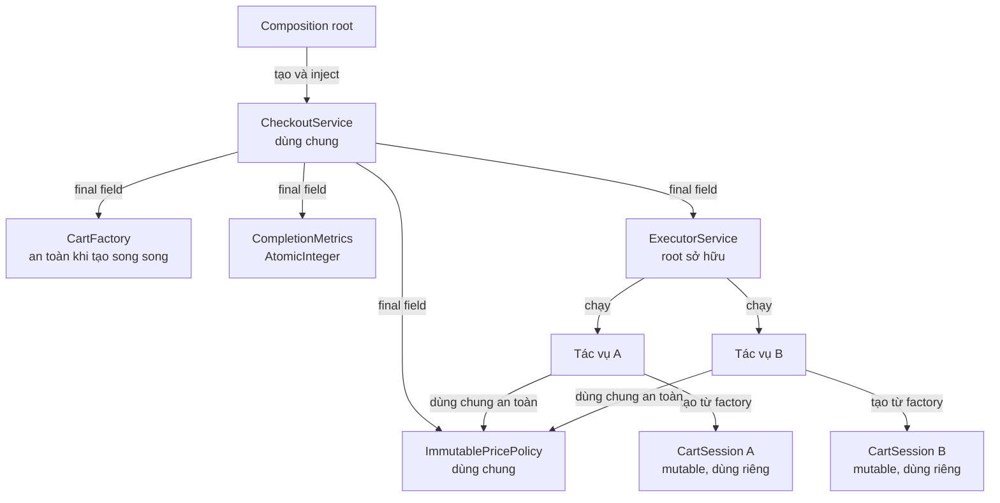
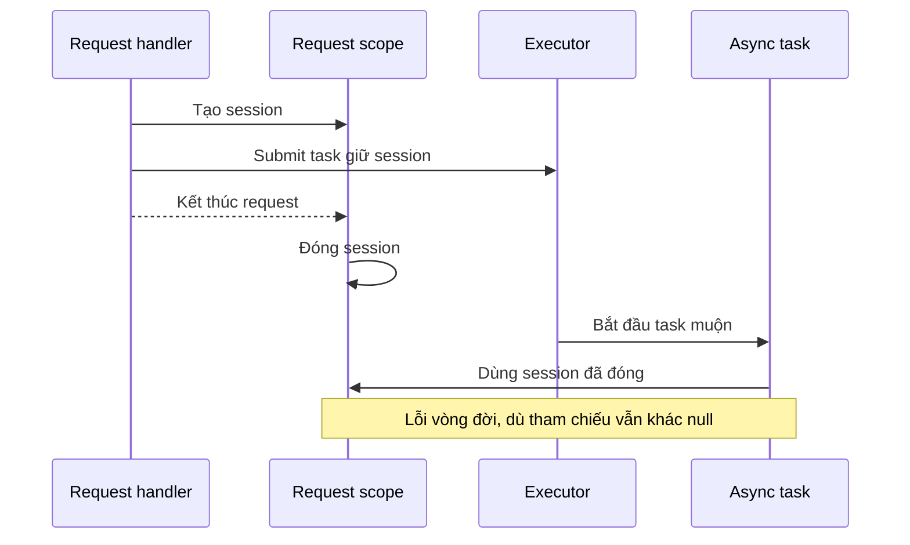

# Phụ thuộc bất biến và phụ thuộc chứa trạng thái thay đổi

Trong chương **Đồng thời và bất đồng bộ** của học phần **Dependency Injection (DI)**, một câu hỏi thường bị bỏ sót khi thiết kế constructor injection là: **dependency được truyền vào sẽ được bao nhiêu luồng hoặc tác vụ sử dụng, và bản thân nó có giữ trạng thái thay đổi hay không?**

Hai đối tượng có cùng interface và đều có thể được inject vào service, nhưng mức an toàn khi chia sẻ rất khác nhau:

- Một `TaxPolicy` có cấu hình cố định, bất biến, có thể được nhiều luồng sử dụng mà không cần khóa nếu các thao tác của nó không truy cập trạng thái mutable bên ngoài.
- Một `Counter` có trường `int count` được nhiều luồng cùng tăng có thể mất cập nhật.
- Một `CartSession` giữ danh sách mặt hàng mutable có thể hoàn toàn hợp lệ nếu **mỗi tác vụ sở hữu một instance riêng**, không chia sẻ instance giữa các luồng.
- Một `ExecutorService` là hạ tầng có vòng đời: có thể được nhiều consumer sử dụng theo hợp đồng, nhưng cần xác định ai tạo, ai ngừng nhận công việc và ai đóng.

**Dependency Injection (DI) và Inversion of Control (IoC)** giúp tách việc *sử dụng* khỏi *tạo và lắp ghép* các dependency. Tuy vậy, chỉ việc truyền một interface qua constructor **không tự làm dependency trở nên bất biến hoặc thread-safe**. **Composition root** vẫn phải chọn implementation, phạm vi chia sẻ (*scope*), cách khởi tạo an toàn, cùng chủ sở hữu tài nguyên. Bài này thực hành bằng Java thuần trước khi xét DI container.

## 1. Phân biệt đối tượng bất biến, đối tượng có trạng thái và đối tượng an toàn luồng

| Loại dependency | Ví dụ | Có trạng thái thay đổi? | Có thể chia sẻ giữa luồng? |
| --- | --- | --- | --- |
| **Bất biến thực sự** | Policy có các trường `final` chứa giá trị bất biến | Không sau khi dựng | Thường có, nếu được công bố an toàn và không dùng cộng tác viên mutable không được bảo vệ |
| **Không trạng thái** (*stateless*) | Validator chỉ tính toán từ đầu vào | Không giữ trạng thái riêng giữa các lần gọi | Thường có, nếu các dependency được gọi cũng phù hợp |
| **Mutable nhưng thread-safe** | `AtomicInteger`, cache đồng bộ đúng cách | Có | Có, trong phạm vi hợp đồng an toàn luồng của nó |
| **Mutable, không thread-safe** | `ArrayList`, `HashMap` thông thường, session tự viết | Có | Không nên chia sẻ để truy cập đồng thời nếu không có biện pháp đồng bộ |
| **Có trạng thái gắn với tác vụ/request** | Giỏ hàng, transaction context, request accumulator | Có | Nên tạo và sử dụng trong phạm vi tác vụ/request theo hợp đồng |
| **Có tài nguyên cần đóng** | Connection pool, file writer, HTTP client | Có thể có | Phải kiểm tra thread safety **và** vòng đời, không suy chỉ từ interface |

Ba khái niệm cần tách biệt:

1. **Immutability (bất biến)**: trạng thái quan sát được của đối tượng không thay đổi sau khi xây dựng.
2. **Thread safety (an toàn luồng)**: hành vi đúng theo hợp đồng khi nhiều luồng truy cập trong những điều kiện được hỗ trợ.
3. **Scope và ownership**: instance được ai sử dụng, trong bao lâu, và ai chịu trách nhiệm đóng tài nguyên.

Bất biến là một cách mạnh để đạt an toàn khi chia sẻ, nhưng **không phải cách duy nhất**. Một bộ đếm dùng `AtomicInteger` vẫn mutable nhưng có các thao tác tăng nguyên tử. Ngược lại, một đối tượng chỉ có trường `final` vẫn có thể **không bất biến** nếu trường đó trỏ đến một danh sách mutable.

### 1.1. `final` không có nghĩa là toàn bộ đối tượng bất biến

```java
final class UnsafeConfig {
    private final java.util.List<String> endpoints;

    UnsafeConfig(java.util.List<String> endpoints) {
        this.endpoints = endpoints; // Giữ lại list có thể bị sửa từ ngoài.
    }

    java.util.List<String> endpoints() {
        return endpoints; // Trả trực tiếp list có thể bị sửa.
    }
}
```

Dù field là `final`, bên gọi vẫn có thể thay đổi danh sách:

```java
var source = new java.util.ArrayList<String>();
source.add("server-a");

var config = new UnsafeConfig(source);
source.add("server-b"); // config đã quan sát trạng thái thay đổi.
```

Để tạo một snapshot không thể thêm/xóa qua API của danh sách, có thể sao chép:

```java
final class EndpointConfig {
    private final java.util.List<String> endpoints;

    EndpointConfig(java.util.List<String> source) {
        this.endpoints = java.util.List.copyOf(source);
    }

    java.util.List<String> endpoints() {
        return endpoints;
    }
}
```

`List.copyOf` là **sao chép nông**: phần tử trong danh sách cũng cần bất biến, hoặc phải có chính sách sao chép riêng, nếu muốn cả đồ thị dữ liệu bất biến. Với `String`, các phần tử vốn bất biến nên ví dụ này phù hợp.

### 1.2. Thread-safe không đồng nghĩa mọi thao tác phức hợp đều nguyên tử

`ConcurrentHashMap` hỗ trợ truy cập đồng thời theo hợp đồng của nó, nhưng chuỗi **kiểm tra rồi cập nhật** vẫn có thể cần một thao tác nguyên tử chuyên dụng:

```java
// Không đủ để bảo đảm "chỉ thêm nếu chưa tồn tại" một cách nguyên tử:
if (!map.containsKey(key)) {
    map.put(key, value);
}

// Cách diễn đạt rõ điều kiện thêm nguyên tử cho một key:
map.putIfAbsent(key, value);
```

Tương tự, `AtomicInteger.incrementAndGet()` tăng một bộ đếm nguyên tử, nhưng **không** biến quy trình “kiểm tra hạn mức → ghi database → gửi thông báo” thành một transaction. Những bất biến trải qua nhiều object hoặc hệ thống vẫn cần thiết kế đồng bộ, giao dịch hoặc idempotency phù hợp.

## 2. DI quyết định phạm vi chia sẻ nhưng không tự bảo vệ trạng thái

Một constructor như sau chỉ thể hiện **nhu cầu phụ thuộc**:

```java
final class CheckoutService {
    private final PricePolicy pricing;
    private final CartFactory carts;

    CheckoutService(PricePolicy pricing, CartFactory carts) {
        this.pricing = java.util.Objects.requireNonNull(pricing);
        this.carts = java.util.Objects.requireNonNull(carts);
    }
}
```

Nó không cho biết `PricePolicy` được dùng chung hay được tạo mới, hoặc `CartFactory` có an toàn khi hai luồng cùng gọi `open()` không. Những quyết định ấy nằm tại **composition root** hoặc cấu hình DI container.

Một thiết kế phù hợp cho nhiều tác vụ là:



Ở đây:

- `CheckoutService` giữ các dependency **được thiết kế để sử dụng đồng thời**.
- `ImmutablePricePolicy` có thể được chia sẻ nếu cấu hình bất biến và được công bố an toàn.
- `CartFactory` được chia sẻ, nhưng **mỗi `open()` tạo một `CartSession` mới**.
- Mỗi session mutable chỉ được sử dụng trong **một tác vụ**; không cần khóa cho mọi phép thêm phần tử.
- `CompletionMetrics` sử dụng biến đếm nguyên tử cho trạng thái thực sự cần chia sẻ.
- `ExecutorService` là một dependency hạ tầng được inject; **root sở hữu**, service không tùy tiện gọi `shutdown()`.

**Quan trọng:** một instance service có thể được dùng đồng thời mà không có field mutable của chính nó. Nhưng tính an toàn của service vẫn phụ thuộc vào **các dependency được giữ** và cách service sử dụng chúng.

## 3. Java Memory Model: đối tượng được chia sẻ phải được công bố an toàn

*Safe publication* (công bố an toàn) là việc chuyển tham chiếu đến đối tượng sang luồng khác qua cơ chế có bảo đảm về khả năng nhìn thấy trạng thái đã khởi tạo.

Ví dụ sau không phải một cơ chế công bố an toàn đáng tin cậy:

```java
// Minh họa vấn đề; không dùng làm mẫu cho chương trình đa luồng.
static SomeService shared;

void create() {
    shared = new SomeService(...);
}

// Một luồng khác đọc shared mà không có đồng bộ phù hợp.
```

Java Memory Model quy định các quan hệ **happens-before** để biết khi nào phép ghi của luồng này được luồng kia nhìn thấy. Những cách công bố thường có bảo đảm thích hợp gồm:

- Đưa object vào cấu trúc đồng bộ, khóa hoặc biến `volatile` theo quy tắc Java Memory Model.
- Sử dụng cơ chế thread-safe của `java.util.concurrent` như executor và blocking queue đúng hợp đồng.
- Hoàn tất khởi tạo trước khi cấp object qua cấu hình/container có cơ chế công bố an toàn.
- Dùng `final` cho trạng thái bất biến đã được khởi tạo đúng cách; **không để `this` thoát ra trước khi constructor hoàn tất**.

Trường `final` đem lại những bảo đảm quan trọng về khả năng nhìn thấy giá trị đã gán trong constructor, nhưng không chữa được việc nội dung của một collection mutable bị sửa không đồng bộ sau đó. `volatile` hỗ trợ khả năng nhìn thấy và thứ tự của các thao tác thích hợp; nó **không biến phép `count++` thành nguyên tử**.

Trong ví dụ chính, composition root tạo `CheckoutService` rồi nộp tác vụ bằng `ExecutorService`. Các cơ chế đồng bộ của executor và `CompletableFuture` giúp thiết lập việc chuyển công việc/kết quả giữa các luồng theo hợp đồng concurrency của Java. Mọi trạng thái mutable dùng chung vẫn phải có chính sách bảo vệ riêng.

## 4. Ví dụ Java thuần: chính sách bất biến, session mutable riêng, metrics nguyên tử

Tạo file `ConcurrentDiDemo.java`. Ví dụ chạy được trên **JDK 11 trở lên**, không cần DI container. Nó xử lý hai báo giá bằng executor gồm hai worker và kiểm tra:

1. Cùng một cấu hình giá bất biến được chia sẻ.
2. Mỗi tác vụ nhận một `CartSession` khác nhau.
3. Bộ đếm thành công được cập nhật qua `AtomicInteger`.
4. Session được đóng cả khi tác vụ ném lỗi.
5. `CompletableFuture` chuyển kết quả hoặc lỗi về phía caller.

```java
import java.util.ArrayList;
import java.util.List;
import java.util.Objects;
import java.util.Queue;
import java.util.concurrent.CompletableFuture;
import java.util.concurrent.CompletionException;
import java.util.concurrent.ConcurrentLinkedQueue;
import java.util.concurrent.Executor;
import java.util.concurrent.ExecutorService;
import java.util.concurrent.Executors;
import java.util.concurrent.atomic.AtomicInteger;

public class ConcurrentDiDemo {

    // Dependency bất biến: chỉ chứa một giá trị đã kiểm tra.
    static final class PricePolicy {
        private final long taxBasisPoints;

        PricePolicy(long taxBasisPoints) {
            if (taxBasisPoints < 0 || taxBasisPoints > 10_000) {
                throw new IllegalArgumentException("Invalid tax rate");
            }
            this.taxBasisPoints = taxBasisPoints;
        }

        long total(long subtotalCents) {
            if (subtotalCents < 0) {
                throw new IllegalArgumentException("Negative subtotal");
            }
            long tax = Math.multiplyExact(
                    subtotalCents, taxBasisPoints) / 10_000;
            return Math.addExact(subtotalCents, tax);
        }
    }

    // Session mutable, KHÔNG thread-safe. Chỉ dùng trong một task.
    static final class CartSession implements AutoCloseable {
        private final List<Long> amounts = new ArrayList<>();
        private boolean closed;
        private int closeCalls;

        void add(long amountCents) {
            ensureOpen();
            if (amountCents < 0) {
                throw new IllegalArgumentException("Negative amount");
            }
            amounts.add(amountCents);
        }

        long subtotal() {
            ensureOpen();
            long result = 0;
            for (long amount : amounts) {
                result = Math.addExact(result, amount);
            }
            return result;
        }

        private void ensureOpen() {
            if (closed) {
                throw new IllegalStateException("Cart is closed");
            }
        }

        @Override
        public void close() {
            if (!closed) {
                closed = true;
                closeCalls++;
                amounts.clear();
            }
        }

        boolean isClosed() {
            return closed;
        }

        int closeCount() {
            return closeCalls;
        }
    }

    // Cổng factory để service không tự quyết định constructor/session.
    interface CartFactory {
        CartSession open();
    }

    // Factory chia sẻ được: queue và counter hỗ trợ truy cập đồng thời.
    static final class TrackingCartFactory implements CartFactory {
        private final Queue<CartSession> created =
                new ConcurrentLinkedQueue<>();
        private final AtomicInteger creationCount = new AtomicInteger();

        @Override
        public CartSession open() {
            CartSession session = new CartSession();
            created.add(session);
            creationCount.incrementAndGet();
            return session;
        }

        int createdCount() {
            return creationCount.get();
        }

        List<CartSession> snapshot() {
            return List.copyOf(created);
        }
    }

    // Trạng thái mutable nhưng có thao tác tăng an toàn khi dùng đồng thời.
    static final class CompletionMetrics {
        private final AtomicInteger successes = new AtomicInteger();

        void recordSuccess() {
            successes.incrementAndGet();
        }

        int successCount() {
            return successes.get();
        }
    }

    static final class CheckoutService {
        private final PricePolicy policy;
        private final CartFactory factory;
        private final CompletionMetrics metrics;
        private final Executor executor;

        CheckoutService(
                PricePolicy policy,
                CartFactory factory,
                CompletionMetrics metrics,
                Executor executor) {
            this.policy = Objects.requireNonNull(policy, "policy");
            this.factory = Objects.requireNonNull(factory, "factory");
            this.metrics = Objects.requireNonNull(metrics, "metrics");
            this.executor = Objects.requireNonNull(executor, "executor");
        }

        CompletableFuture<Long> quoteAsync(long... amountsCents) {
            Objects.requireNonNull(amountsCents, "amountsCents");

            // Snapshot trước khi nộp task: caller sửa mảng sau đó
            // không làm thay đổi dữ liệu mà task sẽ xử lý.
            long[] snapshot = amountsCents.clone();

            return CompletableFuture.supplyAsync(() -> {
                // Session chỉ tồn tại trong một task; task sở hữu
                // resource trả về từ factory theo hợp đồng của ví dụ.
                try (CartSession cart = factory.open()) {
                    for (long amount : snapshot) {
                        cart.add(amount);
                    }

                    long total = policy.total(cart.subtotal());
                    metrics.recordSuccess();
                    return total;
                }
            }, executor);
        }
    }

    private static void check(boolean condition, String message) {
        if (!condition) {
            throw new AssertionError(message);
        }
    }

    public static void main(String[] args) {
        // COMPOSITION ROOT: root sở hữu pool và lắp ghép dependency.
        ExecutorService pool = Executors.newFixedThreadPool(2);
        try {
            PricePolicy sharedPolicy = new PricePolicy(1_000); // 10%
            TrackingCartFactory factory = new TrackingCartFactory();
            CompletionMetrics metrics = new CompletionMetrics();

            CheckoutService service = new CheckoutService(
                    sharedPolicy, factory, metrics, pool);

            CompletableFuture<Long> first =
                    service.quoteAsync(10_000, 5_000);
            CompletableFuture<Long> second =
                    service.quoteAsync(2_000);

            check(first.join() == 16_500, "Wrong first quote");
            check(second.join() == 2_200, "Wrong second quote");

            List<CartSession> sessions = factory.snapshot();
            check(factory.createdCount() == 2 && sessions.size() == 2,
                    "Each task must create one cart");
            check(sessions.get(0) != sessions.get(1),
                    "Tasks must not share mutable cart");
            check(sessions.get(0).isClosed()
                            && sessions.get(1).isClosed(),
                    "Both carts must be closed");
            check(sessions.get(0).closeCount() == 1
                            && sessions.get(1).closeCount() == 1,
                    "Each cart must close exactly once");
            check(metrics.successCount() == 2,
                    "Two successful quotes expected");

            // Lỗi trong task vẫn phải đóng session.
            boolean failedAsExpected = false;
            try {
                service.quoteAsync(-1).join();
            } catch (CompletionException error) {
                failedAsExpected =
                        error.getCause() instanceof IllegalArgumentException;
            }

            check(failedAsExpected, "Expected invalid input failure");
            check(factory.createdCount() == 3,
                    "Failure path must still create a cart");
            CartSession failedCart = factory.snapshot().get(2);
            check(failedCart.isClosed() && failedCart.closeCount() == 1,
                    "Failed task must close its cart");
            check(metrics.successCount() == 2,
                    "Failed quote must not count as success");

            System.out.println(
                    "PASS: two quotes, isolated carts, safe metrics, cleanup");
        } finally {
            // Root đóng executor sau khi đã join các future cần thiết.
            pool.shutdown();
        }
    }
}
```

Biên dịch và chạy:

```bash
javac ConcurrentDiDemo.java
java ConcurrentDiDemo
```

Kết quả mong đợi:

```text
PASS: two quotes, isolated carts, safe metrics, cleanup
```

**Giới hạn của ví dụ:** đây là tính toán đơn giản trên RAM, không thực hiện I/O bất đồng bộ thật. `CompletableFuture.supplyAsync` đưa phép tính tới `Executor` được inject; task có thể chạy trên worker thread, còn caller chờ kết quả bằng `join()` để kiểm chứng. Việc dùng executor không có nghĩa các thao tác bên trong task tự động trở thành non-blocking I/O.

### 4.1. Vì sao `PricePolicy` có thể dùng chung?

`PricePolicy` có một field primitive `final long taxBasisPoints`, được kiểm tra tại constructor và không có phương thức sửa. `total` chỉ tính dựa trên tham số cùng giá trị bất biến; nó không ghi vào trạng thái chung. Vì vậy, cùng một instance có thể phục vụ cả hai task theo thiết kế này.

Một policy khác có thể giữ cache mutable, số lần gọi hoặc tham chiếu tới nguồn dữ liệu ngoài. Khi đó, **việc lớp tên là `PricePolicy` không bảo đảm nó thread-safe**. Cần xem lại toàn bộ trạng thái mà phương thức sử dụng.

### 4.2. Vì sao `CartSession` không cần đồng bộ mọi phương thức?

`CartSession` chứa `ArrayList` mutable cùng cờ `closed` bình thường. Nó **không phải class thread-safe**. Tuy nhiên, mỗi tác vụ nhận một instance mới từ `TrackingCartFactory.open()` và chỉ tác vụ đó dùng nó cho tới khi `try-with-resources` đóng.

Đây là **thread confinement**: trạng thái mutable được giới hạn trong một luồng/tác vụ ở thời gian nó hoạt động. Việc factory lưu tham chiếu vào queue để quan sát khi test không có nghĩa những task khác đồng thời sửa session đó. Test chỉ đọc các session sau khi các future đã hoàn tất.

Nếu chuyển `CartSession` thành dependency dùng chung trong singleton `CheckoutService`, hai task có thể thêm phần tử vào cùng một danh sách và trộn dữ liệu của hai yêu cầu. Khi đó cần thiết kế lại scope hoặc đồng bộ; tốt hơn là giữ session theo thao tác nếu đúng nghiệp vụ.

### 4.3. Vì sao factory phải an toàn khi gọi song song?

Nhiều task có thể cùng gọi `factory.open()`. Nếu factory dùng một `ArrayList` chung mà không có đồng bộ để lưu danh sách created, chính code theo dõi cũng có thể gây data race.

Ví dụ dùng:

- `ConcurrentLinkedQueue` để lưu các tham chiếu tạo mới từ nhiều worker.
- `AtomicInteger` để đếm instance đã tạo.
- Không chia sẻ nội dung mutable bên trong mỗi `CartSession` giữa các task.

Đây là thiết kế phục vụ mô phỏng và kiểm thử. Trong sản phẩm thực, factory có thể chỉ tạo object mà không giữ danh sách mọi instance; việc giữ toàn bộ danh sách mãi có thể gây tăng bộ nhớ không mong muốn.

### 4.4. Vì sao phải sao chép dữ liệu trước khi nộp task?

Một lời gọi như:

```java
long[] input = {10_000};
CompletableFuture<Long> future = service.quoteAsync(input);
input[0] = 1; // Caller sửa mảng sau khi nộp task.
```

Nếu task sử dụng chính mảng `input`, kết quả sẽ phụ thuộc vào **thời điểm luồng worker đọc dữ liệu**. Đó là một dạng chia sẻ dữ liệu mutable xuyên ranh giới bất đồng bộ.

Phương thức `quoteAsync` gọi `amountsCents.clone()` trước khi nộp task. Bởi vì các phần tử là primitive `long`, bản sao này tách hoàn toàn các giá trị cần dùng. Với mảng chứa các object mutable, `clone()` chỉ sao chép mảng tham chiếu, không tự sao chép sâu những object bên trong.

## 5. Kiểm thử bất đồng bộ một cách xác định

Không nên dựa vào `Thread.sleep(100)` rồi đoán task nào đã chạy trước. Những test như vậy phụ thuộc tải CPU và dễ chập chờn. Vì `CheckoutService` nhận `Executor` qua constructor, ta có thể dùng **executor điều khiển được trong test**.

Tạo file `ConcurrentDiTest.java` trong cùng thư mục:

```java
import java.util.ArrayList;
import java.util.List;
import java.util.concurrent.CompletableFuture;
import java.util.concurrent.CompletionException;
import java.util.concurrent.Executor;

public class ConcurrentDiTest {

    private static void check(boolean ok, String message) {
        if (!ok) {
            throw new AssertionError(message);
        }
    }

    static void testInputSnapshotAndLifecycle() {
        List<Runnable> pending = new ArrayList<>();

        // Executor này GIỮ task lại, không chạy ngay.
        Executor paused = pending::add;
        var factory = new ConcurrentDiDemo.TrackingCartFactory();
        var metrics = new ConcurrentDiDemo.CompletionMetrics();

        var service = new ConcurrentDiDemo.CheckoutService(
                new ConcurrentDiDemo.PricePolicy(1_000),
                factory, metrics, paused);

        long[] input = {10_000};
        CompletableFuture<Long> future = service.quoteAsync(input);

        check(pending.size() == 1 && !future.isDone(),
                "Task must be queued but not yet executed");
        check(factory.createdCount() == 0,
                "Cart must not be created before task starts");

        input[0] = -99; // Thay đổi sau khi nộp task.
        pending.remove(0).run();

        check(future.join() == 11_000,
                "Task must use a copied input snapshot");
        check(factory.createdCount() == 1,
                "One task should create one cart");
        check(metrics.successCount() == 1,
                "Successful task should increment metrics");

        var cart = factory.snapshot().get(0);
        check(cart.isClosed() && cart.closeCount() == 1,
                "Cart should close after task completes");
    }

    static void testFailureStillClosesSession() {
        // Executor chạy task ngay trên luồng gọi để test xác định.
        Executor direct = Runnable::run;
        var factory = new ConcurrentDiDemo.TrackingCartFactory();
        var metrics = new ConcurrentDiDemo.CompletionMetrics();
        var service = new ConcurrentDiDemo.CheckoutService(
                new ConcurrentDiDemo.PricePolicy(1_000),
                factory, metrics, direct);

        boolean rejected = false;
        try {
            service.quoteAsync(-1).join();
        } catch (CompletionException error) {
            rejected = error.getCause() instanceof IllegalArgumentException;
        }

        check(rejected, "Expected input error from async task");
        check(factory.createdCount() == 1,
                "Failed task still opens a cart");
        check(metrics.successCount() == 0,
                "Failure must not count as success");

        var failedCart = factory.snapshot().get(0);
        check(failedCart.isClosed() && failedCart.closeCount() == 1,
                "Failed task must close resource once");
    }

    public static void main(String[] args) {
        testInputSnapshotAndLifecycle();
        testFailureStillClosesSession();
        System.out.println("PASS: snapshot and async cleanup");
    }
}
```

Chạy:

```bash
javac ConcurrentDiDemo.java ConcurrentDiTest.java
java ConcurrentDiTest
```

Kết quả mong đợi:

```text
PASS: snapshot and async cleanup
```

Trong test thứ nhất, thứ tự diễn ra chính xác:

```text
quoteAsync(input) -> chụp bản sao -> queue giữ Runnable
caller sửa input
test gọi Runnable.run() -> dùng bản sao -> trả future hoàn tất
test kiểm tra kết quả, số tạo và close
```

Trong test thứ hai, `Runnable::run` khiến phần việc được thực hiện trực tiếp trên luồng test. Đây là một `Executor` hợp lệ cho mục đích mô phỏng deterministic; **nó không chứng minh service sẽ chạy trên luồng khác**. Test riêng với pool thật mới kiểm tra được tương tác giữa luồng, và những test đó nên có đồng bộ xác định thay vì dựa vào thời gian ngủ tùy ý.

## 6. Vì sao bộ đếm mutable thông thường có thể sai?

Một phương thức:

```java
void increment() {
    count++; // Đọc, cộng và ghi: không phải một thao tác nguyên tử.
}
```

gồm nhiều bước logic. Hai worker có thể cùng đọc `0`, cùng tính `1`, rồi cùng ghi `1`. Lẽ ra hai lần tăng phải đưa giá trị lên `2`, nhưng kết quả có thể chỉ là `1`.

Để **trình bày chắc chắn một lịch thực thi dẫn đến mất cập nhật**, ta có thể dùng hai `CountDownLatch` buộc cả hai task đọc giá trị cũ trước khi được phép ghi. Tạo file `LostUpdateDemo.java`:

```java
import java.util.concurrent.CountDownLatch;
import java.util.concurrent.ExecutorService;
import java.util.concurrent.Executors;
import java.util.concurrent.Future;

public class LostUpdateDemo {
    static final class PlainCounter {
        int count;
    }

    public static void main(String[] args) throws Exception {
        PlainCounter unsafe = new PlainCounter();
        CountDownLatch bothRead = new CountDownLatch(2);
        CountDownLatch allowWrite = new CountDownLatch(1);
        ExecutorService executor = Executors.newFixedThreadPool(2);

        try {
            Runnable incrementFromSnapshot = () -> {
                int snapshot = unsafe.count; // Cả hai đọc 0.
                bothRead.countDown();

                try {
                    allowWrite.await();
                } catch (InterruptedException error) {
                    Thread.currentThread().interrupt();
                    throw new IllegalStateException(error);
                }

                unsafe.count = snapshot + 1; // Cả hai ghi 1.
            };

            Future<?> first = executor.submit(incrementFromSnapshot);
            Future<?> second = executor.submit(incrementFromSnapshot);

            bothRead.await();     // Chờ chắc chắn cả hai đã đọc.
            allowWrite.countDown(); // Cho phép cả hai ghi.

            first.get();
            second.get();

            if (unsafe.count != 1) {
                throw new AssertionError("Expected a lost update");
            }

            System.out.println("Lost update: expected 2, actual 1");
        } finally {
            executor.shutdownNow();
        }
    }
}
```

Kết quả mong đợi:

```text
Lost update: expected 2, actual 1
```

Đây là một **thí nghiệm cố ý tạo lỗi**: hai worker đã giữ giá trị đọc trong biến cục bộ trước khi ghi. Các latch tạo quan hệ đồng bộ để test không lệ thuộc vào việc scheduler có tình cờ tạo race hay không. Không dùng mẫu `PlainCounter` này làm bộ đếm chia sẻ trong production.

Cách sửa cho phép tăng nguyên tử:

```java
java.util.concurrent.atomic.AtomicInteger count =
        new java.util.concurrent.atomic.AtomicInteger();

count.incrementAndGet();
```

Với state phức tạp hơn một bộ đếm, có thể cần `synchronized`, `ReentrantLock`, cấu trúc concurrent chuyên dụng hoặc thiết kế **không chia sẻ mutable state**. Lựa chọn dựa trên bất biến cần giữ, không phải chỉ vì có nhiều thread.

### `volatile` có giải quyết `count++` không?

Không. Khai báo `volatile int count` giúp một số yêu cầu về khả năng nhìn thấy giá trị và thứ tự bộ nhớ, nhưng phép `count++` vẫn là chuỗi đọc–sửa–ghi, không trở thành nguyên tử. Dùng `AtomicInteger.incrementAndGet()` khi mục tiêu là tăng nguyên tử một biến đếm, hoặc khóa khi cần bảo vệ một bất biến phức hợp.

## 7. Async scope: tác vụ có thể sống lâu hơn lời gọi tạo ra nó

Một lỗi DI thường gặp khi thêm bất đồng bộ:

1. Request bắt đầu, root/request scope tạo một `RequestSession`.
2. Handler khởi tạo một task chạy sau và truyền tham chiếu tới `RequestSession`.
3. Handler kết thúc, scope đóng session.
4. Task chạy muộn và sử dụng **session đã đóng**.

Sơ đồ thời gian:



**Không có DI container nào tự làm một tài nguyên đã đóng trở nên hợp lệ trở lại.** Cần chọn một trong các chiến lược phù hợp:

- Đợi tác vụ hoàn tất **trước khi đóng scope**, nếu yêu cầu xử lý đồng bộ về mặt vòng đời.
- Chuyển dữ liệu cần thiết thành **snapshot bất biến**, rồi tạo dependency theo scope mới ở chính tác vụ.
- Inject **factory/provider** để mỗi task mở tài nguyên của riêng nó và đóng tại điểm hoàn tất, như `CartSession` trong ví dụ chính.
- Dùng cơ chế quản lý lifecycle của framework nếu nó có **scope propagation** rõ ràng và được kiểm chứng.

Không nên mặc định `ThreadLocal` hoặc dữ liệu context của request tự lan sang `CompletableFuture`. Executor thường tái sử dụng thread; giá trị trong `ThreadLocal` có thể không xuất hiện ở thread xử lý hoặc bị giữ sót từ tác vụ trước. Nếu chủ động dùng `ThreadLocal`, cần thiết kế truyền context thích hợp và dọn bằng `remove()` ở ranh giới tác vụ.

## 8. Ai sở hữu executor, future và tài nguyên được tạo trong task?

Trong ví dụ:

| Đối tượng | Ai tạo? | Ai sử dụng? | Ai quản lý vòng đời? |
| --- | --- | --- | --- |
| `PricePolicy` bất biến | Composition root | Nhiều task qua `CheckoutService` | Root/container theo phạm vi ứng dụng |
| `TrackingCartFactory` | Composition root | Nhiều task | Root/container; factory chỉ tạo session |
| `CompletionMetrics` | Composition root | Nhiều task | Root/container |
| `ExecutorService` | Composition root | `CheckoutService` nộp task | **Root** quyết định `shutdown` |
| `CartSession` mới từ `open()` | Factory tạo theo yêu cầu task | Một task | **Task** đóng bằng `try-with-resources` theo hợp đồng |
| `CompletableFuture<Long>` | `quoteAsync` trả về | Caller quan sát kết quả | Caller quyết định chờ, xử lý lỗi, hủy theo API; không sở hữu pool chỉ vì có future |

`CheckoutService` không gọi `pool.shutdown()` sau từng tác vụ: làm vậy có thể khiến các caller khác không nộp được công việc. Ngược lại, root cũng không nên đóng pool hoặc tài nguyên dùng chung **khi còn task hợp lệ đang hoạt động**.

`CompletableFuture.join()` trả kết quả hoặc ném `CompletionException` khi phép tính thất bại. Ở đây lỗi đầu vào âm xuất hiện **trong task**, nên caller nhìn thấy thông qua future; `try-with-resources` vẫn đóng session trước khi future kết thúc bất thường. Với API khác, cần kiểm tra cách propagating cancellation, timeout và interrupt của chính API đó.

### 8.1. Hủy future không nhất thiết dừng công việc đang chạy

`CompletableFuture.cancel(...)` không phải cam kết chung rằng body của task đã bị ngừng hoặc rằng thread được interrupt. Nếu resource do task sở hữu đang sử dụng, cần thiết kế **cooperative cancellation**, timeout tại các thao tác I/O, và cách chờ task kết thúc phù hợp.

Đừng dùng `future.isCancelled()` làm bằng chứng rằng mọi resource đã được đóng. Để khẳng định cleanup, cần quan sát điểm hoàn tất thật của task hoặc các sự kiện quản lý vòng đời mà hệ thống cam kết.

### 8.2. Task bất đồng bộ không được tùy tiện giữ tham chiếu request-scoped

Ví dụ không nên làm:

```java
// Ví dụ minh họa: session do request sở hữu.
CompletableFuture.runAsync(
        () -> session.saveLater(),
        executor);

// Request kết thúc và đóng session trước khi task chắc chắn chạy xong.
```

Thay bằng pattern trong đó task nhận **dữ liệu bất biến** cùng **factory/provider hợp lệ**, tự mở resource mới trong phạm vi tác vụ và tự đóng:

```java
// Minh họa pattern: các kiểu là hợp đồng riêng của ứng dụng.
final String idSnapshot = request.bookingId();

CompletableFuture.runAsync(() -> {
    try (BookingSession session = sessionFactory.open()) {
        session.save(idSnapshot);
    }
}, executor);
```

*`BookingSession`, `sessionFactory` và `request` ở đoạn này là các kiểu/biến minh họa, không nằm trong chương trình `ConcurrentDiDemo.java`.*

Nếu phải bảo toàn giao dịch hoặc tính nhất quán giữa request và task, cần xem xét transaction boundary, outbox, queue và idempotency; việc mở một session mới chưa đủ để đảm bảo nghiệp vụ hoàn thành đúng một lần.

## 9. Scope của DI container và phụ thuộc có trạng thái

Container có thể gọi một binding là `singleton`, `request`, `prototype`, `transient` hoặc tên tương đương, nhưng cách hiểu chính xác tùy framework. Đừng suy rằng:

- **Singleton** đồng nghĩa bất biến hoặc thread-safe.
- **Prototype/transient** luôn được tự đóng bởi container sau mỗi lần dùng.
- **Request-scoped** luôn có thể dùng an toàn trong tác vụ chạy sau request.
- **Provider** luôn trả instance mới.
- **Được inject qua constructor** nghĩa là đã xử lý đúng lifecycle.

Ví dụ, singleton `CheckoutService` chứa `PricePolicy` bất biến và `CompletionMetrics` dùng `AtomicInteger` có thể phù hợp. Nhưng nếu singleton giữ trực tiếp một `CartSession` mutable, mọi request có nguy cơ ghi vào cùng danh sách: một **captive dependency** hoặc thiết kế scope sai.

Khi container inject proxy cho dependency sống ngắn, `==` trên proxy có thể trả đúng cho proxy dùng chung nhưng **không phản ánh identity của target** thực ở mỗi request. Muốn kiểm tra scope, hãy quan sát các instance target/hành vi trong các request khác nhau theo cơ chế container hỗ trợ.

Vì vậy, trước khi quyết định scope cần hỏi:

1. Đối tượng có trạng thái mutable không?
2. Những luồng/tác vụ nào có thể truy cập nó cùng lúc?
3. Từng thao tác có cần cách ly trạng thái không?
4. Đối tượng có tài nguyên cần đóng không?
5. Có task nào còn chạy sau khi scope gốc kết thúc không?
6. Nếu dùng chung, các operation có thread-safe và các bất biến kết hợp có được bảo toàn không?

## 10. Kiểm thử concurrency cho hệ thống dùng DI

Không nên chỉ viết stress test rồi khẳng định “chạy 10.000 lần không lỗi là thread-safe”. Test concurrency cần bộc lộ **bất biến** và kiểm soát lịch thực thi ở mức có thể.

| Mục tiêu | Phương pháp | Giới hạn |
| --- | --- | --- |
| Bất biến dữ liệu vào async | Executor giữ task, sửa dữ liệu sau submit, rồi mới chạy | Kiểm tra snapshot, không chứng minh race bất kỳ |
| Mỗi task có session riêng | Factory ghi identity, sau khi future hoàn tất kiểm tra `!=` | Không kiểm tra hạ tầng thật |
| Metrics dùng chung không mất cập nhật | Nhiều task + `AtomicInteger`, xác minh tổng sau khi hoàn tất | Không chứng minh mọi nghiệp vụ phức hợp là nguyên tử |
| Race đọc–sửa–ghi | Dùng `CountDownLatch` ép hai task đọc trước khi ghi | Minh họa lịch gây race, không phải bộ kiểm chứng mọi lịch |
| Cleanup khi task lỗi | Cho fake session ném lỗi, kiểm tra `closeCount` và trace | Chưa bao quát thất bại của resource thật |
| Đóng sau khi tất cả task kết thúc | Fake ghi `start/use/close` và barrier đồng bộ | Cần thêm kiểm tra shutdown khi có I/O thật |
| Scope theo request | Dựng hai scope, so identity và trạng thái | Khi container dùng proxy phải quan sát đúng target |

Một phép thử mạnh nên phân biệt rõ:

- **Cấu trúc:** service được cấp dependency nào và mỗi task nhận object nào.
- **Hành vi:** task xử lý dữ liệu riêng, không trộn state.
- **An toàn concurrency:** thao tác chia sẻ dùng cơ chế đồng bộ đúng.
- **Vòng đời:** không có resource bị đóng sớm hoặc bị quên đóng.
- **Lỗi:** exception được truyền về caller và trạng thái cleanup vẫn hợp lệ.

Trong unit test, dùng fake hoặc executor điều khiển được; trong integration test, xác minh thêm cấu hình executor thật, connection pool, thời gian chờ và hợp đồng của adapter bên ngoài.

## 11. Những lỗi thiết kế thường gặp

| Dấu hiệu | Nguyên nhân thường gặp | Cách điều chỉnh |
| --- | --- | --- |
| Service singleton giữ `ArrayList` giao dịch của mọi request | Mutable state bị chia sẻ ngoài ý muốn | Tách state thành session theo request/task |
| Dependency có field `final List` nên được coi là bất biến | `final` chỉ cố định tham chiếu | Sao chép phòng vệ, dùng phần tử bất biến |
| Đổi `int count` thành `volatile int count` để sửa `count++` | Nhầm visibility với atomicity | `AtomicInteger` hoặc khóa đúng bất biến |
| Task giữ `requestContext` sau khi request kết thúc | Dependency vượt scope hợp lệ | Snapshot dữ liệu và tạo resource trong task |
| Chia sẻ `HashMap` rồi gọi đồng thời | Không có bảo vệ cho mutable state | `ConcurrentHashMap` hoặc confinement/đồng bộ phù hợp |
| Đóng executor trong service sau mỗi lời gọi | Service không phải owner của pool | Root/container điều phối shutdown |
| Nghĩ `cancel` đã đóng toàn bộ resource | Nhầm trạng thái future với trạng thái task | Cooperative cancellation và cleanup có kiểm chứng |
| Dùng `ThreadLocal` trong pool mà không dọn | Thread được tái sử dụng giữa các request | Truyền context rõ ràng, `remove()` khi kết thúc |
| Test phụ thuộc `Thread.sleep` | Phụ thuộc lịch scheduler và tải máy | Latch/barrier hoặc executor có thể điều khiển |
| Bọc mọi exception bằng `Optional.empty()` trong async | Biến lỗi thành kết quả “không có” | Giữ ngữ nghĩa lỗi và nguyên nhân |
| Dùng chung HTTP client không kiểm tra hợp đồng | “Singleton” không bảo đảm thread-safe | Xem tài liệu API, test và lifecycle cụ thể |
| Factory trả session mới nhưng caller không đóng | Ownership không rõ | Hợp đồng rõ, `try-with-resources` trong scope dùng |

Một thiết kế tốt không nhất thiết loại bỏ hoàn toàn trạng thái thay đổi. Điều cốt lõi là **đặt mutable state ở đúng phạm vi và dùng đúng cơ chế đồng bộ khi phải chia sẻ nó**.

## 12. Bài tập thực hành

**Bài 1 — Phân loại dependency.** Với một service nhận `Clock` bất biến, `AtomicInteger` đếm thành công, `ArrayList<String>` dùng để gom log theo request và `ExecutorService`, hãy phân loại trạng thái, khả năng chia sẻ và owner của từng dependency. **Gợi ý:** `AtomicInteger` là mutable nhưng có thao tác nguyên tử; `ArrayList` nên được giới hạn trong scope request nếu không có đồng bộ.

**Bài 2 — Phá an toàn khi dùng chung.** Sửa `CheckoutService` để lưu một `CartSession` duy nhất trong field và dùng nó ở cả hai task. Vì sao `CartSession` không còn thread-confined? Hãy đề xuất kiểm thử xác minh hai yêu cầu không trộn số tiền và hai phiên có identity khác nhau.

**Bài 3 — Kiểm thử snapshot.** Bỏ `clone()` khỏi `quoteAsync`. Chạy `ConcurrentDiTest` với executor trì hoãn. Phép thử nào thất bại, và vì sao việc sửa mảng trước khi task chạy lại là bằng chứng tốt hơn `Thread.sleep`?

**Bài 4 — Thay đồng bộ sai.** Viết `volatile int successes` và tăng bằng `successes++` trong nhiều task. Giải thích vì sao `volatile` không đảm bảo số lần tăng được bảo toàn; thay bằng `AtomicInteger.incrementAndGet()`.

**Bài 5 — Scope bất đồng bộ.** Một handler inject `RequestSession`, rồi submit tác vụ chạy sau khi handler trả về. Vẽ timeline request, thời điểm đóng session và lúc task dùng nó. Thiết kế lại bằng factory mở session riêng trong task.

**Bài 6 — Kiểm thử cleanup.** Sửa `CartSession.add` để ném lỗi trên một giá trị đầu vào. Xác minh số lần `close()` vẫn bằng một. Sau đó cho `CartFactory.open` ném lỗi **trước khi trả session**: task có resource nào để đóng không, và ai chịu trách nhiệm dọn trạng thái đã mở một phần trong factory?

**Bài 7 — Identity và scope.** Dựng hai `CheckoutService` dùng chung một `PricePolicy` bất biến nhưng mỗi service có factory khác nhau. Phân biệt dependency nào nên `==`, những session nào nên `!=`, và khi nào sharing là một phần của hợp đồng thay vì chi tiết triển khai.

## 13. Ghi nhớ

**Dependency bất biến** có thể dễ dàng chia sẻ giữa nhiều luồng nếu được xây dựng và công bố an toàn. **Dependency mutable** không nhất thiết sai: nó có thể được chia sẻ với đồng bộ đúng, hoặc tốt hơn được giới hạn trong một tác vụ/request khi trạng thái thuộc về riêng tác vụ đó.

Trong **DI và IoC**, service nêu rõ những cộng tác viên cần dùng qua constructor; **composition root** quyết định implementation, scope, sharing và owner của tài nguyên. Java thuần với `AtomicInteger`, `CompletableFuture`, executor được inject, `CountDownLatch` và `try-with-resources` đã đủ để thực hành các bất biến quan trọng về đồng thời và bất đồng bộ. DI container về sau giúp tự động hóa lắp ghép, **không thay thế trách nhiệm thiết kế thread safety, truyền context hay quản lý vòng đời**.
