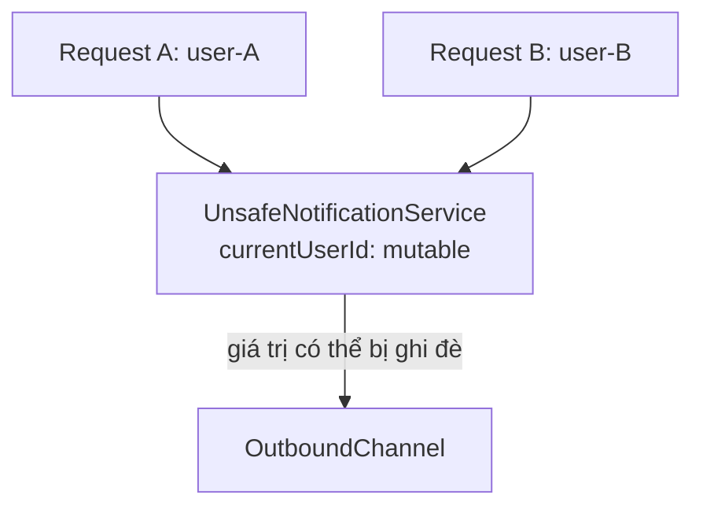
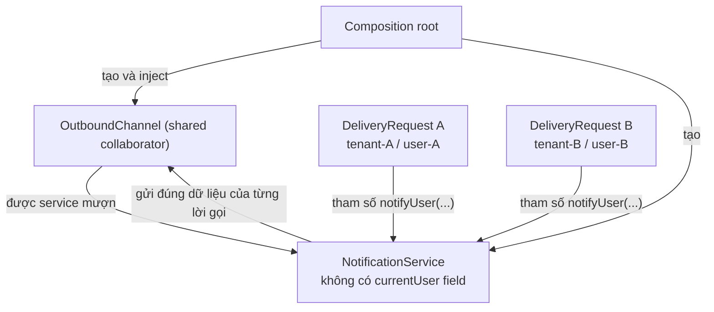
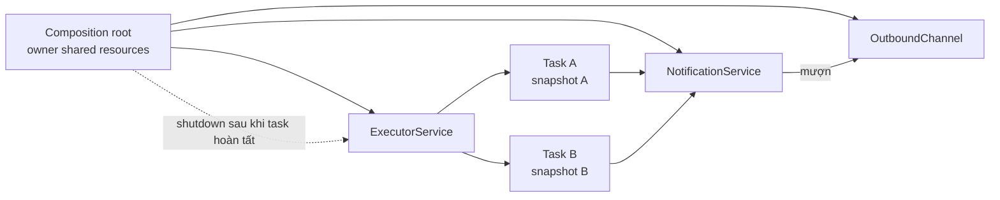

# Không giữ dữ liệu người dùng trong thành phần dùng chung toàn ứng dụng

> **Chương:** Đồng thời và bất đồng bộ  
> **Bối cảnh:** Dependency Injection (DI) và Inversion of Control (IoC) giúp tách việc tạo, lắp ghép dependency khỏi lớp sử dụng. Khi composition root tạo một service dùng chung cho nhiều request, cần bảo đảm service không lưu trạng thái riêng của từng người dùng vào những trường dùng chung. Bài này dùng constructor injection và Java thuần trước khi mở rộng sang DI container.

## 1. Mục tiêu học tập

Sau bài học, bạn có thể:

1. Phân biệt **dependency dùng chung** với **dữ liệu riêng của từng request/người dùng** trong một object graph.
2. Giải thích vì sao một service application-scoped/singleton có field `currentUserId` hoặc `currentTenant` dễ gây **race condition**, nhầm dữ liệu giữa request và rủi ro bảo mật.
3. Thiết kế service **stateless theo request**: dependency được inject qua constructor, còn dữ liệu request đi qua tham số phương thức hoặc đối tượng context bất biến.
4. Biết cách tạo **snapshot dữ liệu cần thiết** trước khi chuyển việc cho executor bất đồng bộ, thay vì lưu hoặc mượn một request-scoped object đã hết hiệu lực.
5. Nhận diện giới hạn của `ThreadLocal`, scoped proxy, provider, mutable collaborator và `final` khi xử lý song song.
6. Viết ví dụ Java thuần và bộ kiểm thử sử dụng fake, `CountDownLatch`, `Future`, không giả định thứ tự hoàn thành của các tác vụ.
7. Liên hệ yêu cầu này với **scope**, **resource ownership**, **lifecycle** và khả năng mở rộng sang DI container.

## 2. Application scope không đồng nghĩa với một request

Trong ứng dụng web hoặc service chạy dài hạn, composition root hay DI container thường tạo một số component **một lần** rồi cho nhiều request cùng sử dụng:

- `NotificationService` điều phối gửi thông báo.
- `PaymentGateway` hoặc HTTP client dùng chung.
- `OrderRepository` hoặc một đối tượng truy cập pool đã được thiết kế an toàn cho nhiều luồng.
- `Clock`, formatter không có trạng thái mutable, hoặc cấu hình ứng dụng ổn định.

Một bean singleton trong Spring thường là **một instance trong mỗi application context**, không mặc nhiên là một instance duy nhất toàn JVM. Nhiều request hoặc nhiều luồng có thể đồng thời gọi phương thức trên cùng instance đó.

Ngược lại, những dữ liệu dưới đây **thường thay đổi theo từng yêu cầu**:

- ID người dùng đang được xác thực.
- ID tenant hoặc phạm vi quyền truy cập của request.
- Mã đơn hàng, tham số tìm kiếm, giỏ hàng và lựa chọn kênh nhận thông báo.
- Correlation/request ID, kết quả kiểm tra quyền đã thực hiện cho request cụ thể.
- Transaction, session và các resource chỉ hợp lệ trong một unit of work.

**Quy tắc trọng tâm:** Đừng đặt dữ liệu của *người dùng đang xử lý* vào trường mutable của một service dùng chung chỉ vì service đó được inject vào nhiều nơi. Việc inject service thành công không nói gì về tính an toàn của trạng thái bên trong nó.

### 2.1. Phân biệt ba loại trạng thái

| Loại trạng thái | Ví dụ | Nơi lưu phù hợp |
| --- | --- | --- |
| **Cấu hình toàn ứng dụng** | Endpoint cố định, timeout, chiến lược retry đã cấu hình | Dependency/config bất biến hoặc quản lý đồng bộ rõ ràng ở application scope |
| **Trạng thái nghiệp vụ lâu dài có chủ sở hữu** | Số dư tài khoản, trạng thái đơn hàng | Kho lưu trữ nghiệp vụ hoặc hệ thống dữ liệu với ranh giới quyền truy cập và nhất quán rõ |
| **Dữ liệu ngữ cảnh request/người dùng** | `currentUserId`, `tenantId` của request hiện tại | Tham số phương thức, request context hợp lệ trong scope hoặc snapshot bất biến truyền cho task |

Một cache toàn ứng dụng có thể chứa dữ liệu của nhiều người dùng **khi được thiết kế có chủ đích** với khóa phân tách tenant/user, quyền truy cập, thời hạn lưu, đồng bộ và bảo vệ dữ liệu. Điều cần tránh ở đây là **trường “người dùng hiện tại” mutable trong một singleton** mà mọi request cùng đọc/ghi.

## 3. Phản ví dụ: một service dùng chung lưu `currentUserId`

Xét mã sau (các kiểu `OutboundChannel` và `UserRequest` là hợp đồng minh họa):

```java
// PHẢN VÍ DỤ: không sử dụng trong ứng dụng nhiều request.
final class UnsafeNotificationService {
    private final OutboundChannel channel;
    private String currentUserId; // Trạng thái request nằm trong singleton.

    UnsafeNotificationService(OutboundChannel channel) {
        this.channel = channel;
    }

    void send(UserRequest request) {
        currentUserId = request.userId();
        // Một request khác có thể ghi đè currentUserId tại đây.
        channel.send(request.tenantId(), currentUserId, request.message());
    }
}
```

Nếu có hai luồng:

```text
Thời điểm     Luồng A (người A)              Luồng B (người B)
-----------   -----------------------------  ------------------------------
T1            currentUserId = "user-A"
T2                                           currentUserId = "user-B"
T3            channel.send(..., "user-B", ...)
T4                                           channel.send(..., "user-B", ...)
```

Thông báo có thể bị gắn với **người dùng khác**. Việc ghi đè có thể xảy ra giữa hai dòng code dù cả hai đều nhìn thấy một dependency được inject hợp lệ.

### 3.1. Tại sao lỗi này nghiêm trọng?

1. **Sai hành vi nghiệp vụ:** yêu cầu của A có thể sử dụng thông tin của B.
2. **Rò rỉ hoặc nhầm dữ liệu giữa người dùng/tenant:** nguy hiểm hơn lỗi hiển thị thông thường nếu ID tenant quyết định nguồn dữ liệu hoặc phân quyền.
3. **Khó tái hiện:** test tuần tự có thể luôn thành công, còn lỗi chỉ xuất hiện khi hai request xen kẽ đúng thời điểm.
4. **Giữ dữ liệu lâu không chủ đích:** field singleton có thể giữ tham chiếu đến dữ liệu của request đã kết thúc, đặc biệt khi field giữ cả object graph lớn.
5. **Đường lỗi khó kiểm soát:** nếu method ném exception trước khi xóa field, dữ liệu request trước có thể còn được dùng nhầm ở lần sau.



Đây vừa là vấn đề **shared mutable state**, vừa là vi phạm ranh giới **scope**. Thêm nhiều thread chỉ làm cơ hội xảy ra lỗi lớn hơn; ngay cả chương trình tuần tự cũng có thể lưu thông tin request quá thời gian hợp lệ nếu field không được dọn.

### 3.2. `volatile`, `synchronized` và `final` có giải quyết không?

- `volatile String currentUserId` giúp bảo đảm một số quy tắc về visibility, **không gắn giá trị vào đúng request**. Luồng A vẫn có thể đọc giá trị luồng B vừa ghi.
- Đặt `synchronized` quanh toàn bộ thao tác có thể ngăn một số xen kẽ ở code đồng bộ, nhưng **không biến trạng thái request thành application state hợp lý**. Nó cũng có thể làm nghẽn mọi request và không che phủ tác vụ bất đồng bộ được khởi chạy bên trong.
- `final OutboundChannel channel` chỉ ngăn gán lại **tham chiếu dependency**. Nó không làm channel tự động thread-safe, cũng không bảo vệ một field `currentUserId` khác.
- Dùng `ConcurrentHashMap` hoặc `AtomicReference` cho “current user” không tự giải quyết ý nghĩa: vẫn cần khóa theo đúng request/tenant và chính sách truy cập rõ ràng.

**Cách sửa ưu tiên:** Không đưa “người dùng hiện tại” vào trạng thái dùng chung ngay từ đầu. Truyền dữ liệu cần thiết qua tham số của mỗi lời gọi hoặc giữ trong scope riêng.

## 4. Thiết kế tốt hơn: singleton stateless theo request

Một `NotificationService` dùng chung nên giữ **những collaborator được inject**, nhưng không giữ ID người dùng hoặc message hiện tại. Dữ liệu của một request được đóng gói thành object bất biến.



Các thông tin đặc trưng của người dùng đi theo **lời gọi riêng**, không qua field được các luồng cùng sửa. Đây là ứng dụng thực tế của constructor injection:

- Constructor mang **dependency ổn định** cần cho service.
- Method mang **dữ liệu nghiệp vụ** của lần xử lý.
- Composition root chọn implementation và quản lý lifecycle của dependency dùng chung.

### 4.1. Đối tượng ngữ cảnh nên bất biến khi chuyển giữa các luồng

Một request snapshot hợp lý có thể gồm các trường `final` chỉ chứa các kiểu bất biến (ví dụ `String`), được xác thực khi xây dựng. Với danh sách/map hoặc object mutable, cần tạo **bản sao phù hợp** chứ không chỉ đặt reference vào field `final`.

> **Lưu ý về xác thực:** Ví dụ bên dưới sử dụng các định danh tenant/user giả lập do code cung cấp. Trong hệ thống thật, tenant ID và user ID dùng để quyết định quyền truy cập phải đến từ **ngữ cảnh xác thực đáng tin cậy** và được xác minh ở ranh giới phù hợp; không nên tin trực tiếp ID do client tự gửi.

## 5. Ví dụ Java thuần: một service dùng chung cho nhiều request

Tạo file `Main.java` với toàn bộ mã sau. Đây là demo gửi thông báo qua console, **không kết nối tới dịch vụ gửi thật**. Mã tương thích với Java 8 trở lên.

```java
import java.util.Objects;
import java.util.concurrent.ExecutorService;
import java.util.concurrent.Executors;
import java.util.concurrent.Future;
import java.util.concurrent.TimeUnit;

// Snapshot bất biến của một lời gửi riêng biệt.
final class DeliveryRequest {
    private final String tenantId;
    private final String userId;
    private final String message;

    DeliveryRequest(String tenantId, String userId, String message) {
        this.tenantId = requireText(tenantId, "tenantId");
        this.userId = requireText(userId, "userId");
        this.message = requireText(message, "message");
    }

    private static String requireText(String value, String name) {
        if (value == null || value.trim().isEmpty()) {
            throw new IllegalArgumentException(name + " is required");
        }
        return value;
    }

    String tenantId() {
        return tenantId;
    }

    String userId() {
        return userId;
    }

    String message() {
        return message;
    }
}

// Hợp đồng hạ tầng mà service cần dùng.
interface OutboundChannel {
    void send(String tenantId, String userId, String message);
}

// Adapter mô phỏng. Trong thực tế cần kiểm tra thread safety của adapter.
final class ConsoleOutboundChannel implements OutboundChannel {
    @Override
    public void send(String tenantId, String userId, String message) {
        System.out.println(
                tenantId + "/" + userId + ": " + message);
    }
}

// Service dùng chung, nhưng không lưu trạng thái của từng request.
final class NotificationService {
    private final OutboundChannel channel;

    NotificationService(OutboundChannel channel) {
        this.channel = Objects.requireNonNull(channel, "channel");
    }

    void notifyUser(DeliveryRequest request) {
        Objects.requireNonNull(request, "request");
        channel.send(
                request.tenantId(),
                request.userId(),
                request.message());
    }
}

public class Main {
    public static void main(String[] args) throws Exception {
        // Composition root: chọn, tạo và inject collaborator dùng chung.
        OutboundChannel channel = new ConsoleOutboundChannel();
        NotificationService notifications = new NotificationService(channel);

        // Mỗi request là một object bất biến độc lập.
        DeliveryRequest first = new DeliveryRequest(
                "tenant-A", "user-A", "Thông báo của A");
        DeliveryRequest second = new DeliveryRequest(
                "tenant-B", "user-B", "Thông báo của B");

        ExecutorService executor = Executors.newFixedThreadPool(2);
        try {
            // Mỗi task giữ snapshot riêng; cùng gọi một service.
            Future<?> a = executor.submit(
                    () -> notifications.notifyUser(first));
            Future<?> b = executor.submit(
                    () -> notifications.notifyUser(second));

            a.get(5, TimeUnit.SECONDS);
            b.get(5, TimeUnit.SECONDS);
        } finally {
            // Root sở hữu executor nên root chịu trách nhiệm dừng.
            executor.shutdown();
            if (!executor.awaitTermination(5, TimeUnit.SECONDS)) {
                executor.shutdownNow();
                if (!executor.awaitTermination(5, TimeUnit.SECONDS)) {
                    throw new IllegalStateException(
                            "Executor did not terminate");
                }
            }
        }
    }
}
```

Biên dịch và chạy:

```bash
javac -encoding UTF-8 Main.java
java Main
```

Chương trình in hai dòng, **thứ tự không cố định**:

```text
tenant-A/user-A: Thông báo của A
tenant-B/user-B: Thông báo của B
```

Điều quan trọng không phải dòng nào xuất hiện trước, mà là **mỗi dòng luôn ghép đúng tenant, user và nội dung từ cùng một `DeliveryRequest`**. Không có trường `currentUserId` nào trên `NotificationService` để luồng khác ghi đè.

### 5.1. Vì sao đây là DI đúng nghĩa?

`NotificationService` nhận `OutboundChannel` qua constructor. Nó không tự đọc môi trường, không tự tạo client và không biết adapter nào được chọn. `Main` là **composition root**, nơi xây object graph và sở hữu executor.

Trong hệ thống lớn, một DI container có thể tạo `NotificationService` và `OutboundChannel` theo scope phù hợp. **Container chỉ tự động hóa việc lắp ghép**, không thể làm một field chứa user context trở nên an toàn nếu thiết kế vẫn dùng mutable application state.

### 5.2. Việc dùng `final` đủ chưa?

`DeliveryRequest` trong ví dụ giữ ba `String` bất biến trong các trường `final`, không có setter. Đây là snapshot phù hợp để truyền giữa các task.

Tuy nhiên, nếu thay `String message` bằng `List<Item>` mutable, `final` chỉ cố định reference đến list. Caller vẫn có thể sửa list trong lúc worker đang đọc. Khi đó cần sao chép defensively và xét cả các phần tử có mutable hay không.

## 6. Bài kiểm thử Java thuần: phát hiện lẫn dữ liệu giữa request

Ta sẽ xây fake thread-safe ghi nhận mỗi lời gửi. Không dùng mock framework hoặc container. Test tạo nhiều request có bộ `tenantId`/`userId`/`message` **khác nhau**, cho các tác vụ bắt đầu gần nhau qua `CountDownLatch`, sau đó xác minh tất cả bản ghi thuộc đúng request ban đầu.

Giữ `Main.java` của mục 5 và tạo file `NotificationConcurrencyTest.java` trong cùng thư mục:

```java
import java.util.ArrayList;
import java.util.List;
import java.util.concurrent.Callable;
import java.util.concurrent.ConcurrentLinkedQueue;
import java.util.concurrent.CountDownLatch;
import java.util.concurrent.ExecutorService;
import java.util.concurrent.Executors;
import java.util.concurrent.Future;
import java.util.concurrent.TimeUnit;

// Giá trị ghi nhận không bị sửa đổi sau khi tạo.
final class DeliveryEvent {
    final String tenantId;
    final String userId;
    final String message;

    DeliveryEvent(String tenantId, String userId, String message) {
        this.tenantId = tenantId;
        this.userId = userId;
        this.message = message;
    }
}

// Fake dùng ConcurrentLinkedQueue để an toàn khi các luồng cùng ghi.
final class RecordingChannel implements OutboundChannel {
    private final ConcurrentLinkedQueue<DeliveryEvent> events =
            new ConcurrentLinkedQueue<>();

    @Override
    public void send(String tenantId, String userId, String message) {
        events.add(new DeliveryEvent(tenantId, userId, message));
    }

    int count() {
        return events.size();
    }

    boolean hasExact(DeliveryRequest request) {
        for (DeliveryEvent event : events) {
            if (event.tenantId.equals(request.tenantId())
                    && event.userId.equals(request.userId())
                    && event.message.equals(request.message())) {
                return true;
            }
        }
        return false;
    }
}

public class NotificationConcurrencyTest {
    public static void main(String[] args) throws Exception {
        RecordingChannel fake = new RecordingChannel();
        // Đúng một instance service dùng chung trong toàn bộ test.
        NotificationService notifications = new NotificationService(fake);

        final int total = 100;
        List<DeliveryRequest> requests = new ArrayList<>();
        for (int i = 0; i < total; i++) {
            // userId và message riêng để phát hiện ghép sai dữ liệu.
            requests.add(new DeliveryRequest(
                    "tenant-" + (i % 4),
                    "user-" + i,
                    "message-" + i));
        }

        CountDownLatch start = new CountDownLatch(1);
        ExecutorService executor = Executors.newFixedThreadPool(8);
        try {
            List<Future<Void>> results = new ArrayList<>();

            for (DeliveryRequest request : requests) {
                Callable<Void> work = () -> {
                    start.await();
                    notifications.notifyUser(request);
                    return null;
                };
                results.add(executor.submit(work));
            }

            // Thả các task; không dựa vào thứ tự thực thi cụ thể.
            start.countDown();
            for (Future<Void> result : results) {
                result.get(5, TimeUnit.SECONDS);
            }
        } finally {
            executor.shutdown();
            if (!executor.awaitTermination(5, TimeUnit.SECONDS)) {
                executor.shutdownNow();
                if (!executor.awaitTermination(5, TimeUnit.SECONDS)) {
                    throw new IllegalStateException(
                            "Executor did not terminate");
                }
            }
        }

        check(fake.count() == total,
                "Mỗi request phải tạo đúng một delivery");
        for (DeliveryRequest request : requests) {
            check(fake.hasExact(request),
                    "Sai bộ tenant/user/message của "
                            + request.userId());
        }

        // Một dependency bắt buộc không được là null.
        boolean missingDependencyRejected = false;
        try {
            new NotificationService(null);
        } catch (NullPointerException expected) {
            missingDependencyRejected = true;
        }
        check(missingDependencyRejected,
                "Phải từ chối thiếu OutboundChannel");

        // Request không hợp lệ phải bị chặn từ lúc tạo snapshot.
        boolean invalidRequestRejected = false;
        try {
            new DeliveryRequest("tenant-A", " ", "message");
        } catch (IllegalArgumentException expected) {
            invalidRequestRejected = true;
        }
        check(invalidRequestRejected,
                "Không chấp nhận userId trống");

        System.out.println("PASS");
    }

    private static void check(boolean condition, String message) {
        if (!condition) {
            throw new AssertionError(message);
        }
    }
}
```

Chạy:

```bash
javac -encoding UTF-8 Main.java NotificationConcurrencyTest.java
java NotificationConcurrencyTest
```

Kết quả mong đợi:

```text
PASS
```

### 6.1. Bộ kiểm thử này chứng minh gì?

- Cùng một `NotificationService` nhận các snapshot riêng và gửi đúng bộ dữ liệu cho mỗi request trong những lần thực thi được kiểm thử.
- Fake dùng cấu trúc dữ liệu an toàn khi nhiều luồng ghi, nên bản thân fake không tạo race vô ý.
- `Future.get(...)` giúp quan sát lỗi ném ra trong worker, thay vì chỉ đếm sự kiện và bỏ qua exception.
- `CountDownLatch` đồng bộ thời điểm bắt đầu tương đối giữa các tác vụ. Nó **không tạo ra một thứ tự xen kẽ cố định** và không chứng minh tuyệt đối code sẽ đúng với mọi lịch chạy.
- Executor được dừng trong `finally`, ngay cả khi có tác vụ ném exception hoặc vượt timeout.

Đây là **kiểm thử hành vi** của thiết kế stateless. Nó không phải bằng chứng toán học về thread safety, cũng không thay thế review thiết kế memory visibility, kiểm thử tải hay integration test với gateway/network thật.

### 6.2. Tại sao không kiểm kết quả theo thứ tự?

Hai task `A` và `B` có thể hoàn thành theo bất kỳ thứ tự nào. Dùng assertion “sự kiện thứ nhất phải thuộc A” khiến test có thể thất bại dù nghiệp vụ vẫn đúng. Ta kiểm **tập các bộ giá trị** đã gửi và tổng số lời gọi, thay vì dựa vào thứ tự do scheduler không cam kết.

Nếu hệ thống **thực sự yêu cầu đúng thứ tự** theo từng người dùng hoặc từng khóa giao dịch, hãy nêu điều đó trong hợp đồng và chọn cơ chế sắp hàng/đồng bộ riêng. DI không tự đảm bảo thứ tự xử lý.

## 7. Bất đồng bộ: không kéo nguyên request context sang task nền một cách tùy tiện

Một request có thể kết thúc trước khi tác vụ được submit hoàn tất. Nếu worker giữ một đối tượng context chỉ sống trong request, task có thể đọc trạng thái hết hạn, gặp lỗi scope hoặc sử dụng thông tin thay đổi sau khi submit.

### 7.1. Phản ví dụ: giữ reference đến context sống ngắn

```java
// Mã minh họa; RequestContext và executor là kiểu/biến giả định.
void accept(RequestContext context) {
    executor.submit(() -> {
        // Có thể chạy sau khi request đã kết thúc/đóng context.
        sendFor(context.currentUserId());
    });
}
```

Trong các framework có request scope, việc truy cập bean request-scoped từ worker khi không còn scope hoạt động có thể gây lỗi. Nếu context mutable, worker cũng có thể nhìn thấy dữ liệu đã bị thay đổi. Và nếu lưu reference đó trong một queue tồn tại lâu, vòng đời của dữ liệu request bị kéo dài ngoài ý định.

### 7.2. Chuyển snapshot tối thiểu tại ranh giới submit

```java
// Minh họa: auth là ngữ cảnh đã được xác thực đáng tin cậy.
void accept(AuthenticatedContext auth, String message) {
    DeliveryRequest snapshot = new DeliveryRequest(
            auth.tenantId(),
            auth.userId(),
            message);

    executor.submit(() -> notifications.notifyUser(snapshot));
}
```

Thay vì để worker tự tra “user hiện tại” từ singleton hay một request context đã đóng, ta chuyển một object bất biến chứa **đúng những trường cần cho công việc**. Không chuyển cookie, session, thông tin xác thực thô hoặc cả object graph chỉ để lấy một vài ID.

Quan trọng: snapshot không tự chứng minh quyền của người dùng **vẫn hợp lệ ở thời điểm tác vụ chạy**. Với tác vụ nhạy cảm, worker còn cần chính sách kiểm tra quyền lại, token ủy quyền có thời hạn, hoặc cơ chế chấp nhận công việc đã được phê duyệt theo thiết kế hệ thống.

### 7.3. Context cho logging/tracing không giống context cho phân quyền

Trace ID hoặc correlation ID có thể được đưa vào snapshot để gắn log với tác vụ. Các thư viện logging sử dụng `ThreadLocal`/MDC có thể không tự truyền context qua executor; phải chủ động truyền và **khôi phục/xóa** ở cuối tác vụ.

Tuy nhiên, **không nên dùng giá trị MDC làm nguồn xác thực quyền truy cập**. Thông tin audit/tracing và thông tin security có hợp đồng, nguồn tin cậy và vòng đời khác nhau.

## 8. `ThreadLocal` không phải “request scope” tự động

`ThreadLocal<T>` cho phép lưu giá trị theo **luồng**, không phải theo người dùng hay request. Trong server dùng thread pool, một worker thread có thể xử lý nhiều request khác nhau theo thời gian.

Phản ví dụ:

```java
// Không nên dùng làm nguồn user identity mặc định.
private static final ThreadLocal<String> CURRENT_USER =
        new ThreadLocal<>();

void process(String userId) {
    CURRENT_USER.set(userId);
    doWork(); // Có thể ném exception.
    // Quên remove(): worker thread còn giữ userId khi nhận request sau.
}
```

Nếu một task không dọn `ThreadLocal`, request tiếp theo chạy trên cùng thread có thể nhìn thấy dữ liệu cũ. Mặt khác, task gửi sang một executor khác **thường không kế thừa ThreadLocal đó** theo cách mong đợi.

Khi một thư viện hoặc framework buộc dùng thread-bound context, phải bọc ranh giới rõ ràng:

```java
void process(String userId) {
    CURRENT_USER.set(userId);
    try {
        doWork();
    } finally {
        CURRENT_USER.remove();
    }
}
```

Đoạn này dọn context trên **luồng hiện tại**, nhưng chưa giải quyết việc context được truyền đúng sang các luồng khác hay tác vụ continuation. Với hệ thống async phức tạp, ưu tiên **truyền ngữ cảnh tường minh** hoặc dùng cơ chế context propagation/scoping chính thức mà framework hỗ trợ, kèm test về thời gian sống và cleanup.

**`InheritableThreadLocal` không phải giải pháp tổng quát cho thread pool**: thread có thể được tái sử dụng thay vì tạo mới cho mỗi request, và việc sao chép giá trị ở thời điểm tạo thread không đồng nghĩa với truyền đúng ngữ cảnh ở thời điểm submit.

## 9. Scope của DI container và những hiểu lầm phổ biến

Khi chuyển lên Spring hoặc container khác, ý tưởng cơ bản không đổi:

| Tình huống | Rủi ro | Hướng giải quyết |
| --- | --- | --- |
| Singleton bean có field `currentUser`/`currentTenant` mutable | Request ghi đè lẫn nhau hoặc giữ dữ liệu cũ | Giữ singleton stateless theo request; truyền tham số/context |
| Singleton inject trực tiếp object có state theo request | Scope mismatch hoặc sử dụng reference sai vòng đời | Thiết kế request-scoped dependency, provider/proxy hoặc truyền tham số đúng ranh giới |
| Request-scoped proxy được inject vào singleton | Proxy chung có thể trỏ đến target khác nhau theo request | Không giữ target hoặc context ngoài scope; hiểu rõ cách resolve |
| Task executor dùng dependency chỉ hợp lệ trong request | Worker chạy khi request scope đã đóng | Chuyển snapshot, tạo scope công việc phù hợp và quản lý lifecycle |
| Application-scoped HTTP client được dùng đồng thời | Nếu client hoặc cấu hình mutable không thread-safe, có race | Chọn adapter hỗ trợ concurrency hoặc thiết kế đồng bộ/factory |
| Một session/transaction được chia sẻ qua nhiều request | Giao dịch lẫn nhau, lỗi trạng thái và cleanup | Session/unit-of-work theo scope của tác vụ, không inject cố định vào singleton |

### 9.1. Scoped proxy không chữa được mọi vấn đề

Một proxy cho phép component sống lâu gọi một dependency mà target được resolve theo request hợp lệ. Nhưng điều đó **không cho phép** giữ reference đến target sau khi scope kết thúc, và cũng không bảo đảm worker bất đồng bộ có request scope đang hoạt động.

Nếu logic cần user ID, truyền một giá trị rõ ràng thường đơn giản hơn việc buộc lớp nghiệp vụ truy cập request-scoped security context qua provider. Khi phải dùng proxy/provider, kiểm tra contract về thời điểm resolve, quyền truy cập và cleanup.

### 9.2. Singleton chỉ nói về identity, không nói thread safety

Một bean singleton là **một instance dùng chung theo scope của container**. Điều này không đảm bảo:

- Mọi field của nó bất biến.
- Mọi dependency mà nó giữ đều thread-safe.
- Mọi method của nó có thể gọi đồng thời.
- Mọi giao dịch/connection được dùng riêng.
- Mỗi request tự động có dữ liệu người dùng tách biệt.

**Quy tắc thiết kế của service và adapter vẫn cần kiểm tra**, ngay cả khi container dựng object graph thành công.

## 10. Resource ownership và thời gian sống của tác vụ

Trong ví dụ ở mục 5, composition root tạo executor và chủ động shutdown. `NotificationService` mượn `OutboundChannel` được inject, không tự đóng nó sau mỗi lần gửi.

Khi dùng tài nguyên thật, cần thêm các ràng buộc:

1. **Tài nguyên application-scoped:** HTTP client, connection pool hoặc executor được owner đóng sau khi không còn task sử dụng.
2. **Tài nguyên per-request/per-operation:** transaction hoặc lease phải được tạo, sử dụng, đóng đúng scope. Không truyền thẳng lease đã đóng sang task nền.
3. **Shutdown:** ngừng nhận tác vụ mới, đợi hoặc hủy task còn chạy theo chính sách, sau đó đóng client/pool mà task phụ thuộc.
4. **Lỗi/timeout:** task ném exception vẫn phải cleanup tài nguyên do nó sở hữu. `Future.get()` ném `TimeoutException` **không tự hủy** tác vụ; caller phải có chính sách cancel, shutdown và giám sát.
5. **Không đóng dependency mượn:** một consumer không được gọi `close()` trên client dùng chung sau khi hoàn thành yêu cầu riêng của mình.



Thứ tự dừng đúng quan trọng như thứ tự tạo. Việc container quản lý một client không tự chứng minh worker không còn dùng client khi context đóng.

## 11. Kiểm tra thiết kế và kiểm thử trong dự án thực tế

Khi review một service được dùng chung, hãy thực hiện:

1. **Liệt kê các trường instance:** field nào là dependency ổn định; field nào chứa tenant, user, request ID, transaction hoặc dữ liệu nghiệp vụ của lần xử lý?
2. **Truy vết đường ghi/đọc:** method nào gán trạng thái mutable, method nào đọc nó, và hai request có thể xen kẽ không?
3. **Xem nơi tạo object:** composition root/container tạo bao nhiêu instance? Có chia sẻ giữa nhiều thread hay chỉ một request?
4. **Chuyển dữ liệu per-request sang tham số:** tạo request snapshot bất biến ở ranh giới đã xác thực.
5. **Xem dependency bên dưới:** service có thể stateless, nhưng một collaborator mutable không thread-safe vẫn gây race.
6. **Xem điểm chuyển async:** có giữ `HttpServletRequest`, transaction, session hoặc context có thời gian sống ngắn trong task không?
7. **Xác định ownership và cleanup:** ai tạo và dừng executor/client/pool? Tác vụ có hoàn tất trước khi resource đóng?
8. **Viết test tuần tự và đồng thời:** dùng dữ liệu request đặc trưng, fake thread-safe, latch/future và assertion không phụ thuộc thứ tự.
9. **Bổ sung integration test:** kiểm context propagation, quyền truy cập, backend thật, retry, cancellation và tải nếu có.

Một số mẫu cảnh báo trong code review:

```java
// Không nên đặt trong singleton dùng cho nhiều người dùng:
private String currentTenantId;
private UserProfile activeUser;
private List<Order> currentCart;
private RequestContext lastRequest;
private Transaction currentTransaction;
```

Các trường này có thể hợp lệ trong **đối tượng có scope riêng đúng nghĩa** hoặc mô hình nghiệp vụ có ownership rõ. Nhưng khi chúng đại diện cho “request hiện tại” trong singleton, cần sửa ranh giới dữ liệu.

## 12. Các ngộ nhận cần tránh

**“Chỉ có một instance nên sẽ an toàn hơn.”** Không. Một instance được nhiều request dùng chung có thể làm tăng nguy cơ state bị ghi đè, nếu chứa trường mutable theo người dùng.

**“Dùng `volatile` để không lẫn user.”** Không. Visibility không đảm bảo mỗi request đọc đúng giá trị của chính nó.

**“`final` làm toàn bộ object thread-safe.”** Không. `final` chỉ giới hạn gán lại reference hoặc giúp bảo đảm một số tính chất khởi tạo; nội dung object được tham chiếu vẫn có thể mutable.

**“Request scope tự truyền sang mọi worker thread.”** Không thể giả định. Một task chạy trên executor khác cần cơ chế truyền context hoặc snapshot được thiết kế rõ.

**“`ThreadLocal` tương đương một user.”** Sai. Nó gắn với thread, không phải identity của user. Thread pool có thể tái sử dụng worker cho nhiều user.

**“Đồng bộ hóa mọi method là đủ.”** Một số race có thể được ngăn, nhưng còn vấn đề dữ liệu giữ quá lâu, lựa chọn scope sai, xử lý async và chi phí khóa không cần thiết.

**“Provider/proxy sẽ tự sửa mọi scope mismatch.”** Không. Chúng quyết định cách lấy dependency theo ngữ cảnh; caller vẫn phải bảo đảm có scope hợp lệ và không giữ target sau khi kết thúc.

**“Test chạy 100 lần không lỗi chứng minh không có race.”** Không. Kiểm thử đồng thời tăng độ tin cậy nhưng không thể bao quát mọi cách xen kẽ. Thiết kế loại bỏ shared mutable per-user state là biện pháp gốc.

**“Không lưu user context trong singleton nghĩa là không được cache.”** Không hoàn toàn. Cache dữ liệu nhiều user cần thiết kế phân tách khóa, quyền truy cập, thời hạn và nhất quán. Nó khác với một field `currentUser` bị mọi request ghi đè.

## 13. Bài tập tự luyện

**Bài 1 — Nhận diện lỗi.** Một `AccountService` singleton có field `lastTenant` và gán trong `getAccount(tenantId, accountId)`. Một request khác có thể gọi method giữa lúc xử lý. Nêu rủi ro và cách truyền tenant hợp lệ hơn.

**Bài 2 — Dùng `volatile`?** Đổi `String currentUserId` thành `volatile String currentUserId` có đảm bảo luồng A không gửi thông báo bằng ID của B không? Giải thích.

**Bài 3 — Kiểm thử.** Trong `NotificationConcurrencyTest`, vì sao phải dùng fake thread-safe và vì sao không kiểm sự kiện A luôn đứng trước B? Thử thêm nhiều tenant hơn và tăng `total`, nhưng nêu giới hạn của stress test.

**Bài 4 — Context bất đồng bộ.** Một HTTP handler submit công việc rồi trả response. Task giữ reference đến request-scoped object chứa session và user ID. Hãy đề xuất một snapshot an toàn hơn và xác định những dữ liệu nào **không nên** chuyển sang worker.

**Bài 5 — `ThreadLocal`.** Một executor dùng lại thread giữa request A và B. Handler A gọi `CURRENT_USER.set("A")` nhưng quên `remove()` khi exception. Điều gì có thể xảy ra với handler B? Cách cleanup nào bắt buộc khi phải dùng `ThreadLocal`?

**Bài 6 — Ownership.** Một singleton `NotificationService` dùng HTTP client được composition root tạo. Service gọi `client.close()` trong `finally` sau mỗi lời gửi, trong khi một task khác vẫn đang chạy. Hãy sửa trách nhiệm đóng và mô tả thứ tự shutdown.

**Bài 7 — Scope của cache.** Có hệ thống bắt buộc cache dữ liệu riêng theo tenant ở application scope. Vì sao “đổi `HashMap` thành `ConcurrentHashMap`” vẫn chưa đủ? Hãy nêu các tiêu chí về khóa, quyền truy cập, TTL và thống nhất dữ liệu.

**Gợi ý đối chiếu:**

1. Field singleton có thể bị request khác ghi đè; truyền `tenantId` cùng dữ liệu request đã được xác thực vào lời gọi, không dùng `lastTenant` làm ngữ cảnh hiện hành.
2. Không. `volatile` không gắn dữ liệu với từng lời gọi hoặc biến phép ghi và đọc thành một đơn vị nghiệp vụ nguyên tử.
3. Fake phải không tự gây race; thứ tự task không được scheduler bảo đảm. Stress test có thể phát hiện lỗi nhưng không chứng minh mọi lịch chạy đều đúng.
4. Tạo snapshot bất biến chứa các định danh/công việc tối thiểu từ nguồn tin cậy; không chuyển nguyên request/session/transaction, cookie hoặc secret không cần thiết; cân nhắc xác minh quyền lại.
5. Thread B có thể thấy ID A cũ; dọn `remove()` trong `finally` và dùng cơ chế context propagation đúng khi chuyển thread.
6. Service chỉ mượn client; owner dừng nhận việc, đợi/cancel task, sau đó đóng client và executor theo dependency/lifecycle được thiết kế.
7. Concurrent map chỉ hỗ trợ một số thao tác đồng thời; vẫn cần khóa đúng tenant/user, kiểm quyền mỗi lần đọc, eviction/TTL, tính nhất quán và chính sách quản lý bộ nhớ.

## 14. Ghi nhớ

**Dependency dùng chung không có nghĩa dữ liệu người dùng cũng được dùng chung.** Với DI, composition root hoặc container có thể tạo một `NotificationService` cho cả ứng dụng; service nên giữ các collaborator phù hợp, còn tenant ID, user ID và thông tin của lần xử lý đi qua **tham số hoặc snapshot riêng**.

Khi xử lý đồng thời và bất đồng bộ, ưu tiên **thiết kế không có shared mutable per-user state**, rồi kiểm thử bằng Java thuần với fake thread-safe, `Future` và phép kiểm không phụ thuộc thứ tự. Quan tâm cả **scope, context propagation, quyền truy cập, ownership và shutdown** trước khi mở rộng sang DI container; container quản lý việc lắp ghép, không tự sửa lỗi chia sẻ dữ liệu giữa người dùng.
