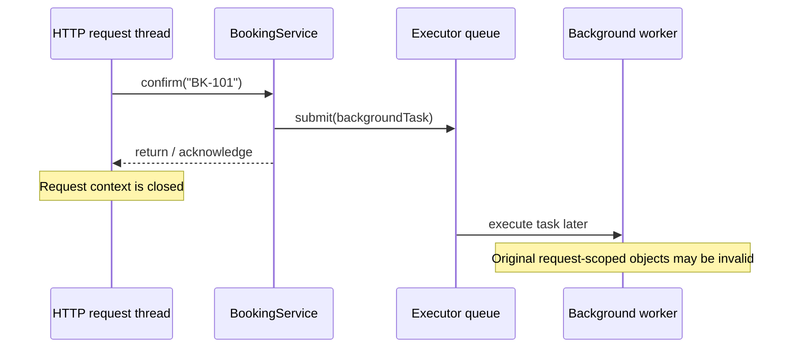
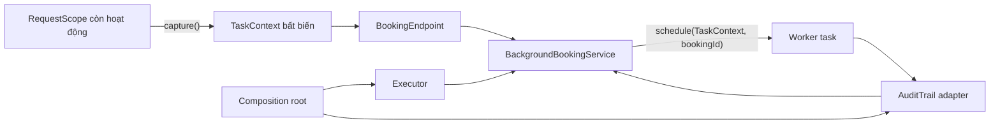

# Phạm vi yêu cầu và dữ liệu ngữ cảnh khi chuyển sang tác vụ nền

Trong ứng dụng Java sử dụng **Dependency Injection (DI)**, một request HTTP có thể tạo ra nhiều đối tượng có vòng đời ngắn: thông tin người dùng, tenant hiện hành, request ID, transaction, đối tượng request-scoped hoặc một connection đang sử dụng. Khi xử lý đồng bộ, các đối tượng này thường còn hợp lệ trong khoảng thời gian request hoạt động. Nhưng nếu service chuyển một công việc sang `Executor`, `CompletableFuture` hoặc hàng đợi tác vụ nền, **request có thể đã kết thúc trước khi công việc bắt đầu**.

Một sai lầm phổ biến là đưa nguyên `HttpServletRequest`, `RequestContext` mutable, bean request-scoped hoặc `ThreadLocal` cho worker và mặc nhiên cho rằng chúng vẫn hợp lệ. Kết quả có thể là thiếu ngữ cảnh, đọc dữ liệu của request khác, sử dụng resource đã đóng hoặc rò rỉ dữ liệu nhạy cảm.

Bài này thuộc chương **Đồng thời và bất đồng bộ** của module **DEPENDENCY_INJECTION**. Ta học cách xác định ranh giới **request scope**, chuyển **dữ liệu ngữ cảnh tối thiểu** sang tác vụ nền qua đối tượng bất biến, quản lý scope và vòng đời của executor bằng **composition root**, đồng thời kiểm thử bằng **Java thuần** trước khi dựa vào cơ chế context propagation của DI container.

## 1. Request scope kết thúc ở đâu?

**Scope** mô tả phạm vi tồn tại và tái sử dụng một đối tượng theo quy tắc của ứng dụng/container. Với request scope, instance thường gắn với một request hoặc ngữ cảnh xử lý request tương ứng. Khi request kết thúc, các dependency chỉ hợp lệ trong scope đó không nên được tác vụ nền tiếp tục sử dụng nếu không có cơ chế quản lý mới phù hợp.

Xét trình tự sau:



Điểm cần nhớ: **việc gọi `submit(...)` không kéo dài vòng đời của request**. Một future trả về có thể chưa hoàn tất khi request đã được đóng; worker có thể chạy trên thread khác hoặc sau một khoảng trễ.

### 1.1. Phân biệt scope, thread và tác vụ

| Khái niệm | Ý nghĩa | Lưu ý khi chuyển sang worker |
| --- | --- | --- |
| Request scope | Vòng đời gắn với request/ngữ cảnh đang hoạt động | Không mặc định còn hoạt động sau khi request trả kết quả |
| Thread | Luồng Java thực thi một đoạn mã | Pool có thể tái sử dụng một thread cho nhiều request |
| `ThreadLocal<T>` | Dữ liệu gắn với **thread cụ thể** | Không tự động xuất hiện trên thread khác; có thể rò sang tác vụ kế tiếp nếu không dọn |
| Task context | Dữ liệu tối thiểu cần cho một tác vụ | Có thể sao chép thành value object độc lập với request |
| DI scope | Quy tắc container cấp instance trong context | Không được suy rằng scope tự lan theo mọi executor |
| Transaction/connection | Resource hoặc đơn vị công việc có vòng đời riêng | Không chuyển nguyên transaction đang mở giữa các tác vụ |

**Request scope không đồng nghĩa với thread scope.** Một HTTP request có thể được xử lý qua nhiều bước bất đồng bộ, trong khi một thread pool có thể phục vụ nhiều request nối tiếp. Một cơ chế framework có thể hỗ trợ truyền context theo quy tắc riêng, nhưng không nên suy đoán rằng mọi đối tượng request-scoped, transaction và quyền bảo mật sẽ được chuyển đúng chỉ vì DI container đang hoạt động.

## 2. Phân loại thông tin trước khi chuyển giao

Một bài thiết kế tốt không hỏi “làm sao truyền cả request cho worker?” mà hỏi: **worker cần chính xác dữ liệu nào để thực hiện công việc, và dữ liệu ấy còn hợp lệ trong bao lâu?**

Ví dụ tác vụ nền ghi dấu vết xác nhận đặt chỗ có thể chỉ cần:

- `requestId`: để liên kết log/sự kiện với request gốc;
- `tenantId`: để xác định phạm vi dữ liệu cần xử lý;
- `bookingId`: định danh công việc.

Không cần truyền cookie, token đăng nhập, session HTTP, đối tượng request gốc, transaction hoặc toàn bộ hồ sơ người dùng.

| Nhóm dữ liệu | Ví dụ | Cách xử lý phù hợp |
| --- | --- | --- |
| Giá trị bất biến cần thiết | `requestId`, `tenantId`, `bookingId` | Sao chép sang `TaskContext` rõ ràng |
| Dữ liệu lớn hoặc mutable | `Map` của request, entity đang được chỉnh sửa | Chỉ lấy trường cần dùng; cân nhắc truyền ID để worker đọc lại |
| Bean sống theo request | request-scoped resolver, request context object | Không giữ trực tiếp qua ranh giới; chụp giá trị cần thiết khi scope hợp lệ |
| `ThreadLocal`/MDC | Correlation ID gắn với thread | Chuyển rõ giá trị; chỉ thiết lập lại MDC có kiểm soát nếu cần và luôn cleanup |
| Security principal/token | User identity, quyền truy cập, credential | Tối thiểu hóa; kiểm tra quyền ở đúng ranh giới, không sao chép secret tùy tiện |
| Transaction/ORM session | `Connection`, `EntityManager`, unit of work | Không chia sẻ transaction đang mở; worker tạo phạm vi giao dịch của chính nó |
| Đối tượng phục vụ logic chung | Policy bất biến, client thread-safe | Có thể tiêm vào worker theo scope thích hợp, do owner quản lý |

### 2.1. Chụp snapshot không phải sao chép object graph

Một **snapshot** có thể là đối tượng Java bất biến chứa vài chuỗi/ID đã được validate. Nó không nên giữ tham chiếu ngầm đến `HttpServletRequest` hoặc `RequestContext` mutable. Nếu snapshot chứa `List`, `Map` hoặc một kiểu mutable, cần sao chép phòng thủ (defensive copy) và không phát tán tham chiếu có thể bị sửa sau khi enqueue.

Không có quy tắc “mọi trường của request đều được chuyển đi”. Càng ít dữ liệu, tác vụ nền càng ít bị ràng buộc vào thời gian sống của request, giảm rủi ro rò dữ liệu và dễ kiểm thử.

### 2.2. ID của tenant không tự thay thế kiểm tra quyền

Worker có thể cần `tenantId` để chọn phân vùng dữ liệu, nhưng chỉ đưa ID vào message **không chứng minh người gọi được phép thao tác trên tenant đó**. Quy tắc nghiệp vụ có thể yêu cầu kiểm tra quyền trước khi enqueue, kiểm tra lại khi thực thi, hoặc cả hai — đặc biệt với công việc chờ lâu, retry hoặc được xử lý ở tiến trình khác.

Đừng truyền token sống ngắn hoặc toàn bộ `SecurityContext` rồi coi đó là quyền vĩnh viễn. Dữ liệu bảo mật và quyết định ủy quyền cần tuân theo chính sách hệ thống, hạn sử dụng và mức độ nhạy cảm.

## 3. Các cách làm dễ gây lỗi

### 3.1. Capture trực tiếp một request-scoped object

```java
// Ví dụ PHẢN DIỆN, chỉ minh họa lỗi thiết kế:
void submitBad(RequestData request, Executor executor) {
    executor.execute(() -> {
        // Lambda giữ request ở heap, nhưng không kéo dài scope hợp lệ.
        audit.write(request.getTenantId(), request.getRequestId());
    });
}
```

`RequestData` và `audit` là các kiểu/biến giả định, không thuộc chương trình chạy ở phần 5. Nếu request đã bị đóng, `getTenantId()` có thể báo lỗi hoặc trả trạng thái không còn đáng tin. Việc lambda vẫn giữ tham chiếu Java **không** có nghĩa resource bên trong chưa đóng.

### 3.2. Dựa vào `ThreadLocal` như thể context tự đi theo tác vụ

```java
static final ThreadLocal<String> CURRENT_TENANT = new ThreadLocal<>();

// Thread xử lý request:
CURRENT_TENANT.set("tenant-a");
executor.execute(() -> {
    String tenant = CURRENT_TENANT.get(); // Có thể là null ở worker.
});
CURRENT_TENANT.remove();
```

`ThreadLocal` gắn với **thread hiện tại**, không tự sao chép sang thread trong pool. Ngay cả khi môi trường cho phép context propagation, phải xác định cơ chế sử dụng và cleanup. Với thread pool, quên `remove()` khi thiết lập context cho worker có thể khiến tác vụ tiếp theo trên cùng thread nhìn thấy dữ liệu của tác vụ trước.

`InheritableThreadLocal` cũng không phải giải pháp tổng quát cho pool: thread thường được tạo và tái sử dụng ở thời điểm khác với request, nên dữ liệu kế thừa có thể không phản ánh request hiện hành. Hạn chế dựa vào ambient context cho nghiệp vụ cần kiểm soát rõ tenant/user.

### 3.3. Chuyển transaction hoặc connection đang mở sang background task

Một transaction thường có ranh giới commit/rollback và có thể gắn với thread hoặc request theo thư viện đang dùng. Nếu request trả kết quả trong khi worker còn dùng connection, caller có thể đóng/trả connection về pool trước. Nếu worker xử lý sau, nó có thể sử dụng resource không còn hợp lệ.

Thay vì truyền transaction, hãy truyền **dữ liệu/ID cần xử lý**, để worker mở transaction mới theo hợp đồng của adapter, commit/rollback và kết thúc vòng đời tại worker. Không mặc định một `EntityManager`, session ORM hoặc connection có thể truy cập đồng thời từ hai thread.

## 4. Thiết kế lắp ghép an toàn: snapshot trước, xử lý sau

Một cách thiết kế phù hợp với **constructor injection** là:

1. Tầng request đang hoạt động đọc những dữ liệu cần thiết và tạo `TaskContext` bất biến.
2. Tầng điều phối gọi `BackgroundBookingService.schedule(context, bookingId)`.
3. `BackgroundBookingService` sử dụng một `Executor` được tiêm từ composition root, không tự tạo thread mỗi lần request.
4. Worker nhận **TaskContext dạng giá trị**, không giữ request-scoped bean.
5. Adapter dùng trong worker có scope và thread-safety thích hợp; các resource ngắn hạn được tạo/đóng trong scope xử lý của worker.
6. Chủ sở hữu executor đóng nó khi ứng dụng kết thúc, theo chính sách dừng nhận việc và chờ công việc còn lại.



**Tách việc tạo dependency khỏi việc sử dụng dependency:** controller không cần biết loại executor, worker không tự lấy `HttpServletRequest`, còn composition root chọn executor và adapter. Khi nâng cấp sang DI container, những hợp đồng và test Java thuần vẫn giữ được.

## 5. Ví dụ Java 11 hoàn chỉnh: chuyển snapshot sang worker

Ví dụ sau dùng một `RequestScope` **tự mô phỏng bằng Java thuần**. Đây không phải request scope của Servlet, Jakarta CDI hay Spring; mục đích là làm rõ ngữ nghĩa **hết hạn sau `close()`**. `TaskContext` bất biến được tạo khi request còn hoạt động và có thể dùng độc lập sau đó.

`BackgroundBookingService` nhận `Executor` và `AuditTrail` qua constructor. `CompletableFuture.runAsync(...)` đưa công việc vào executor; lỗi khi thực thi được phản ánh qua future. `BookingEndpoint` đóng vai tầng request: nó chỉ lấy snapshot và chuyển cho service.

Lưu mã vào **`RequestAsyncExample.java`**:

```java
import java.util.List;
import java.util.Objects;
import java.util.concurrent.CompletableFuture;
import java.util.concurrent.CopyOnWriteArrayList;
import java.util.concurrent.Executor;
import java.util.concurrent.ExecutorService;
import java.util.concurrent.Executors;
import java.util.concurrent.TimeUnit;

public final class RequestAsyncExample {
    private RequestAsyncExample() {}

    private static String required(String value, String name) {
        Objects.requireNonNull(value, name);
        String text = value.trim();
        if (text.isEmpty()) {
            throw new IllegalArgumentException(name + " must not be blank");
        }
        return text;
    }

    // Mô phỏng đối tượng chỉ hợp lệ trong thời gian request hoạt động.
    public static final class RequestScope implements AutoCloseable {
        private final String requestId;
        private final String tenantId;
        private boolean open = true;

        public RequestScope(String requestId, String tenantId) {
            this.requestId = required(requestId, "requestId");
            this.tenantId = required(tenantId, "tenantId");
        }

        public TaskContext capture() {
            if (!open) {
                throw new IllegalStateException("Request scope is closed");
            }
            return new TaskContext(requestId, tenantId);
        }

        @Override
        public void close() {
            open = false;
        }
    }

    // Chỉ chứa các dữ liệu cần thiết và bất biến của tác vụ.
    public static final class TaskContext {
        private final String requestId;
        private final String tenantId;

        public TaskContext(String requestId, String tenantId) {
            this.requestId = required(requestId, "requestId");
            this.tenantId = required(tenantId, "tenantId");
        }

        public String requestId() {
            return requestId;
        }

        public String tenantId() {
            return tenantId;
        }
    }

    public interface AuditTrail {
        void record(TaskContext context, String bookingId);
    }

    // Adapter minh họa hỗ trợ nhiều worker thêm sự kiện đồng thời.
    public static final class InMemoryAuditTrail implements AuditTrail {
        private final List<String> events = new CopyOnWriteArrayList<>();

        @Override
        public void record(TaskContext context, String bookingId) {
            events.add(
                context.tenantId() + "|" + context.requestId() + "|" + bookingId);
        }

        public List<String> events() {
            return List.copyOf(events);
        }
    }

    public static final class BackgroundBookingService {
        private final Executor executor;
        private final AuditTrail auditTrail;

        public BackgroundBookingService(Executor executor, AuditTrail auditTrail) {
            this.executor = Objects.requireNonNull(executor, "executor");
            this.auditTrail = Objects.requireNonNull(auditTrail, "auditTrail");
        }

        public CompletableFuture<Void> schedule(
                TaskContext context, String bookingId) {
            TaskContext snapshot = Objects.requireNonNull(context, "context");
            String id = required(bookingId, "bookingId");

            return CompletableFuture.runAsync(
                () -> auditTrail.record(snapshot, id),
                executor
            );
        }
    }

    public static final class BookingEndpoint {
        private final BackgroundBookingService background;

        public BookingEndpoint(BackgroundBookingService background) {
            this.background = Objects.requireNonNull(background, "background");
        }

        public CompletableFuture<Void> confirm(
                RequestScope request, String bookingId) {
            Objects.requireNonNull(request, "request");
            // Snapshot được lấy trước khi rời khỏi request scope.
            return background.schedule(request.capture(), bookingId);
        }
    }

    public static void main(String[] args) throws Exception {
        // Composition root sở hữu executor và chịu trách nhiệm shutdown.
        ExecutorService executor = Executors.newSingleThreadExecutor();
        try {
            InMemoryAuditTrail auditTrail = new InMemoryAuditTrail();
            BackgroundBookingService background =
                new BackgroundBookingService(executor, auditTrail);
            BookingEndpoint endpoint = new BookingEndpoint(background);

            CompletableFuture<Void> completion;
            try (RequestScope request =
                    new RequestScope("req-101", "tenant-a")) {
                completion = endpoint.confirm(request, "BK-101");
            } // Scope của request đã đóng.

            // main() chờ completion chỉ để trình diễn kết quả ổn định.
            completion.get(3, TimeUnit.SECONDS);
            System.out.println(auditTrail.events());
        } finally {
            executor.shutdown();
            if (!executor.awaitTermination(3, TimeUnit.SECONDS)) {
                executor.shutdownNow();
            }
        }
    }
}
```

Chạy với JDK 11 trở lên:

```bash
javac RequestAsyncExample.java
java RequestAsyncExample
```

Kết quả mong đợi:

```text
[tenant-a|req-101|BK-101]
```

Điểm quan trọng không phải `newSingleThreadExecutor()` mà là **worker chỉ giữ `TaskContext`**. Request đã đóng trước khi `main()` chờ future hoàn thành; dù executor xử lý sớm hay muộn, worker không cần truy cập `RequestScope`. `CopyOnWriteArrayList` được dùng để việc ghi/đọc danh sách sự kiện có cơ chế đồng thời phù hợp cho ví dụ nhỏ; đây không phải lựa chọn tối ưu cho luồng ghi có tần suất rất cao.

### 5.1. Đừng nhầm “đã enqueue” với “đã hoàn thành”

`endpoint.confirm(...)` trả `CompletableFuture<Void>` khi công việc đã được lên lịch thành công; điều đó **không bảo đảm công việc đã ghi audit xong**. Nếu executor từ chối nhận việc (ví dụ lúc shutdown), lời gọi có thể ném `RejectedExecutionException` ngay lúc submit. Nếu adapter ném lỗi **trong lúc chạy**, future có thể hoàn tất ngoại lệ; caller cần quan sát theo chính sách.

Trong ví dụ, `completion.get(...)` được dùng ở `main()` để chương trình không kết thúc trước khi có kết quả. Trong dịch vụ HTTP không đồng bộ thật, có thể trả một response thể hiện yêu cầu đã được tiếp nhận và theo dõi tiến trình theo ID. **Đừng tuyên bố tác vụ đã thành công chỉ vì nó được đưa vào executor.**

### 5.2. Lifetime của executor thuộc composition root

`BackgroundBookingService` nhận một `Executor` đã được tạo; nó **không** gọi `shutdown()` sau mỗi request. Trong mô hình trên, `main()` sở hữu `ExecutorService` và đóng nó sau khi ngừng sử dụng. Nếu có nhiều service dùng chung executor, một service tự đóng pool có thể ảnh hưởng các service còn lại.

Ví dụ này dùng một executor đơn giản để dạy DI. Ứng dụng server cần lựa chọn loại pool, giới hạn hàng đợi, chính sách từ chối, shutdown và chờ tác vụ phù hợp với tải thực tế. `Executors.newSingleThreadExecutor()` không phải cấu hình mặc định khuyến nghị cho mọi workload; một hàng đợi có thể tăng không giới hạn nếu tốc độ nhận việc lớn hơn tốc độ xử lý.

## 6. Kiểm tra bất đồng bộ mà không cần `sleep()` hay server

Unit test không cần chạy trên thread thật chỉ để kiểm tra **cách chuyển giao context**. Ta có thể tiêm một `Executor` thử nghiệm **xếp Runnable vào hàng đợi**, rồi chủ động chạy công việc sau khi request đã đóng. Nhờ vậy, thời điểm thực thi hoàn toàn xác định và không phụ thuộc timing của hệ điều hành.

Tạo tệp **`RequestAsyncCheck.java`** cạnh ví dụ trên:

```java
import java.util.ArrayDeque;
import java.util.ArrayList;
import java.util.List;
import java.util.Objects;
import java.util.Queue;
import java.util.concurrent.CompletableFuture;
import java.util.concurrent.CompletionException;
import java.util.concurrent.Executor;
import java.util.concurrent.RejectedExecutionException;

public final class RequestAsyncCheck {
    // Test double cho Executor: chỉ chạy khi test chủ động gọi runNext().
    static final class QueuedExecutor implements Executor {
        private final Queue<Runnable> tasks = new ArrayDeque<>();

        @Override
        public void execute(Runnable command) {
            tasks.add(Objects.requireNonNull(command, "command"));
        }

        int pending() {
            return tasks.size();
        }

        void runNext() {
            tasks.remove().run();
        }
    }

    private static RequestAsyncExample.BookingEndpoint endpoint(
            Executor executor, RequestAsyncExample.AuditTrail audit) {
        return new RequestAsyncExample.BookingEndpoint(
            new RequestAsyncExample.BackgroundBookingService(
                executor, audit));
    }

    private static void check(boolean condition, String message) {
        if (!condition) {
            throw new AssertionError(message);
        }
    }

    private static void snapshotSurvivesRequestEnd() {
        QueuedExecutor executor = new QueuedExecutor();
        RequestAsyncExample.InMemoryAuditTrail audit =
            new RequestAsyncExample.InMemoryAuditTrail();
        RequestAsyncExample.BookingEndpoint endpoint =
            endpoint(executor, audit);

        CompletableFuture<Void> future;
        try (RequestAsyncExample.RequestScope request =
                new RequestAsyncExample.RequestScope("req-1", "tenant-a")) {
            future = endpoint.confirm(request, "BK-1");
            check(executor.pending() == 1 && !future.isDone(),
                "Work should be queued, not executed");
        }

        // Request đã đóng, giờ mới thực thi tác vụ.
        executor.runNext();
        future.join();
        check(audit.events().equals(List.of("tenant-a|req-1|BK-1")),
            "Worker must use the captured values");
    }

    private static void closedRequestCannotBeCaptured() {
        QueuedExecutor executor = new QueuedExecutor();
        RequestAsyncExample.BookingEndpoint endpoint =
            endpoint(executor, (context, id) -> {});
        RequestAsyncExample.RequestScope request =
            new RequestAsyncExample.RequestScope("req-2", "tenant-a");
        request.close();

        boolean rejected = false;
        try {
            endpoint.confirm(request, "BK-2");
        } catch (IllegalStateException expected) {
            rejected = "Request scope is closed".equals(
                expected.getMessage());
        }
        check(rejected && executor.pending() == 0,
            "Closed request must not submit work");
    }

    private static void differentRequestsRemainIsolated() {
        QueuedExecutor executor = new QueuedExecutor();
        RequestAsyncExample.InMemoryAuditTrail audit =
            new RequestAsyncExample.InMemoryAuditTrail();
        RequestAsyncExample.BookingEndpoint endpoint =
            endpoint(executor, audit);

        CompletableFuture<Void> first;
        CompletableFuture<Void> second;
        try (RequestAsyncExample.RequestScope request =
                new RequestAsyncExample.RequestScope("req-a", "tenant-a")) {
            first = endpoint.confirm(request, "BK-A");
        }
        try (RequestAsyncExample.RequestScope request =
                new RequestAsyncExample.RequestScope("req-b", "tenant-b")) {
            second = endpoint.confirm(request, "BK-B");
        }

        check(executor.pending() == 2, "Both tasks must be queued");
        executor.runNext();
        executor.runNext();
        first.join();
        second.join();
        check(audit.events().equals(List.of(
            "tenant-a|req-a|BK-A",
            "tenant-b|req-b|BK-B")),
            "Task context must not leak across requests");
    }

    private static void invalidIdIsRejectedBeforeEnqueue() {
        QueuedExecutor executor = new QueuedExecutor();
        RequestAsyncExample.BookingEndpoint endpoint =
            endpoint(executor, (context, id) -> {});
        boolean rejected = false;
        try (RequestAsyncExample.RequestScope request =
                new RequestAsyncExample.RequestScope("req-3", "tenant-a")) {
            try {
                endpoint.confirm(request, " ");
            } catch (IllegalArgumentException expected) {
                rejected = "bookingId must not be blank".equals(
                    expected.getMessage());
            }
        }
        check(rejected && executor.pending() == 0,
            "Invalid input must not enqueue work");
    }

    private static void failureIsVisibleThroughFuture() {
        QueuedExecutor executor = new QueuedExecutor();
        RequestAsyncExample.BookingEndpoint endpoint =
            endpoint(executor, (context, id) -> {
                throw new IllegalStateException("Audit unavailable");
            });
        CompletableFuture<Void> future;
        try (RequestAsyncExample.RequestScope request =
                new RequestAsyncExample.RequestScope("req-4", "tenant-a")) {
            future = endpoint.confirm(request, "BK-4");
        }

        executor.runNext();
        boolean failed = false;
        try {
            future.join();
        } catch (CompletionException expected) {
            Throwable cause = expected.getCause();
            failed = cause instanceof IllegalStateException
                && "Audit unavailable".equals(cause.getMessage());
        }
        check(failed, "Background failure must remain observable");
    }

    private static void backgroundDoesNotNeedAmbientThreadLocal() {
        QueuedExecutor executor = new QueuedExecutor();
        ThreadLocal<String> ambient = new ThreadLocal<>();
        List<String> seen = new ArrayList<>();
        RequestAsyncExample.BookingEndpoint endpoint =
            endpoint(executor, (context, id) -> {
                // Đang thực thi khi ThreadLocal của request không còn.
                check(ambient.get() == null,
                    "Worker must not depend on ambient request state");
                seen.add(context.tenantId() + ":" + id);
            });

        ambient.set("temporary-request-value");
        CompletableFuture<Void> future;
        try {
            try (RequestAsyncExample.RequestScope request =
                    new RequestAsyncExample.RequestScope(
                        "req-5", "tenant-a")) {
                future = endpoint.confirm(request, "BK-5");
            }
        } finally {
            ambient.remove();
        }

        executor.runNext();
        future.join();
        check(seen.equals(List.of("tenant-a:BK-5")),
            "Explicit snapshot must work without ThreadLocal");
    }

    private static void rejectedExecutorIsObservable() {
        Executor rejected = command -> {
            throw new RejectedExecutionException("Queue is full");
        };
        RequestAsyncExample.BookingEndpoint endpoint =
            endpoint(rejected, (context, id) -> {});

        boolean failed = false;
        try (RequestAsyncExample.RequestScope request =
                new RequestAsyncExample.RequestScope("req-6", "tenant-a")) {
            try {
                endpoint.confirm(request, "BK-6");
            } catch (RejectedExecutionException expected) {
                failed = "Queue is full".equals(expected.getMessage());
            }
        }
        check(failed, "Submission rejection must not be hidden");
    }

    public static void main(String[] args) {
        snapshotSurvivesRequestEnd();
        closedRequestCannotBeCaptured();
        differentRequestsRemainIsolated();
        invalidIdIsRejectedBeforeEnqueue();
        failureIsVisibleThroughFuture();
        backgroundDoesNotNeedAmbientThreadLocal();
        rejectedExecutorIsObservable();
        System.out.println("PASS: 7 request-context async checks");
    }
}
```

Biên dịch và chạy:

```bash
javac RequestAsyncExample.java RequestAsyncCheck.java
java RequestAsyncCheck
```

Kết quả mong đợi:

```text
PASS: 7 request-context async checks
```

### 6.1. Ý nghĩa của từng phép kiểm

| Phép kiểm | Điều được chứng minh | Giới hạn |
| --- | --- | --- |
| `snapshotSurvivesRequestEnd` | Task chạy **sau** khi request đóng vẫn dùng được snapshot | Không chứng minh worker chạy khác thread trong test |
| `closedRequestCannotBeCaptured` | Scope đã đóng không được dùng để tạo công việc mới | Chỉ là quy tắc của `RequestScope` mô phỏng |
| `differentRequestsRemainIsolated` | Hai tác vụ giữ tenant/request ID riêng | Không thay thế kiểm thử phân quyền |
| `invalidIdIsRejectedBeforeEnqueue` | Dữ liệu sai không tiêu tốn lượt xếp hàng | Không kiểm tra mọi quy tắc nghiệp vụ |
| `failureIsVisibleThroughFuture` | Lỗi adapter được phản ánh vào future | Caller production vẫn cần chính sách theo dõi/retry |
| `backgroundDoesNotNeedAmbientThreadLocal` | Sau cleanup `ThreadLocal`, worker vẫn có đủ dữ liệu | Không phải test tự động cho framework propagation |
| `rejectedExecutorIsObservable` | Khi executor từ chối, caller biết việc chưa được nhận | Không mô phỏng đầy đủ quá tải thật |

Ở đây `QueuedExecutor` không tạo thread mới, vì mục tiêu unit test là **kiểm soát thời điểm chạy và nội dung context**, không phải đo hiệu năng hay tính đúng đắn của scheduler JDK. Đây là ưu điểm của việc tiêm `Executor` qua constructor thay vì gọi trực tiếp `Executors.new...` trong `BookingEndpoint`.

Các phép kiểm tra chủ động ném `AssertionError` qua `check(...)`, nên không cần cờ `-ea`. Ví dụ dùng `CompletableFuture.join()` trên những future đã hoàn tất nhờ `runNext()`, tránh test bị treo hoặc cần `Thread.sleep(...)`.

## 7. DI, scope và ownership khi công việc chạy trên executor

DI không chỉ chọn **loại executor** mà còn phải quyết định **ai sở hữu executor và các dependency được worker dùng**.

| Dependency | Phạm vi phù hợp trong ví dụ | Ai tạo/đóng? |
| --- | --- | --- |
| `RequestScope` | Một request | Tầng request tạo/đóng sau khi xử lý request |
| `TaskContext` | Một lần enqueue/tác vụ | Snapshot immutable, không cần `close()` |
| `BookingEndpoint` | Có thể tái sử dụng nếu không giữ state request | Composition root/container quản lý |
| `BackgroundBookingService` | Có thể dùng chung nếu collaborator đáp ứng điều kiện đồng thời | Composition root/container cấp |
| `ExecutorService` | Thường dùng chung theo một nhóm workload | Owner ứng dụng tạo, giới hạn tải và shutdown |
| `AuditTrail` | Tùy adapter, có thể dùng chung nếu thread-safe | Owner ứng dụng/container quản lý client/resource |
| Connection/transaction của worker | Theo từng công việc/transaction | Worker hoặc tầng transaction quản lý theo hợp đồng |

### 7.1. Không biến singleton thành nơi giữ request state

Một service dùng chung có thể an toàn nếu nó chỉ giữ dependency phù hợp như executor, adapter thread-safe và policy bất biến. Trái lại, nếu service có trường mutable `currentTenant` rồi ghi nó mỗi lần xử lý request, nhiều request đồng thời có thể ghi đè lẫn nhau.

```java
// PHẢN DIỆN: service được dùng chung, tenant thay đổi theo request.
final class UnsafeBackgroundService {
    private String currentTenant;

    void accept(String tenantId) {
        currentTenant = tenantId;
    }
}
```

Ví dụ này chỉ minh họa nguy cơ mutable state, không phải chương trình đầy đủ. Thay vì giữ request state trong field của singleton, hãy truyền `TaskContext` theo **tham số từng lời gọi** và đóng gói nó vào runnable của chính tác vụ. Nhưng điều đó cũng không tự làm mọi adapter thread-safe: các tài nguyên dùng chung vẫn cần kiểm tra an toàn đồng thời.

### 7.2. Vòng đời của worker không phụ thuộc vòng đời của HTTP request

Khi đã tách snapshot, worker có thể chạy sau khi request trả kết quả. Tuy nhiên, ứng dụng vẫn phải quyết định xử lý công việc còn chờ khi shutdown. Một tác vụ đang chạy trong `ExecutorService` của tiến trình **không có bảo đảm bền vững nếu tiến trình bị dừng hoặc crash**.

Nếu nghiệp vụ yêu cầu “một khi đã tiếp nhận thì phải xử lý được dù server restart”, hãy cân nhắc **hàng đợi bền vững, outbox, job store và cơ chế retry/idempotency**. Tác vụ Java trong bộ nhớ thích hợp cho demo hoặc workload cho phép mất công việc theo chính sách. Không dùng kết quả `execute(...)` thành công làm bằng chứng rằng dữ liệu đã được lưu bền vững.

## 8. Context propagation tự động: khi nào hữu ích, khi nào không đủ?

Một số framework/runtime có cơ chế truyền các phần context nhất định qua executor do framework quản lý, chẳng hạn trace/correlation metadata, security context hoặc context liên quan đến request. Nhưng **phạm vi thực tế phải được xác minh theo loại context, runtime và cách tạo task**.

Tránh giả định chung:

- Jakarta CDI có `@RequestScoped` không có nghĩa mọi `CompletableFuture.runAsync(...)` tự duy trì request context. Nếu một worker cần bean theo context, phải bảo đảm context hợp lệ/được kích hoạt theo quy tắc của runtime; tốt hơn là tách phần dữ liệu cần dùng khi có thể.
- Trong Spring, request scope hoặc security context có thể gắn với request/thread và dùng proxy/holder. Chuyển sang executor tự tạo mà không có cơ chế propagation được cấu hình không bảo đảm worker thấy cùng ngữ cảnh.
- `ThreadLocal` và MDC chủ yếu phục vụ gắn metadata với thread. Nếu cần lập lại context để ghi log, thiết lập nó trong một phạm vi có `try/finally` và khôi phục/xóa sau khi chạy để không rò sang task tiếp theo.
- Ngay cả khi trace ID được truyền thành công, điều đó **không có nghĩa** transaction, HTTP session hay quyền truy cập được chuyển giao và còn hiệu lực.

### 8.1. Nếu cần MDC cho log

Có thể viết một adapter ở ranh giới executor: nhận `TaskContext` bất biến, thiết lập correlation metadata trước khi gọi task và dọn sạch sau đó. Mã sau là **pseudocode**, không thuộc Java SE:

```text
submit(taskContext, action):
    enqueue(() -> {
        previous = captureLoggingContext()
        try:
            installLoggingContext(taskContext.requestId)
            action()
        finally:
            restoreLoggingContext(previous)
    })
```

Không cần đưa nguyên `HttpServletRequest` vào adapter này. Hãy giữ context logging ở mức **dữ liệu tối thiểu**, không ghi token hoặc thông tin nhạy cảm. Nếu hệ thống đã có thư viện context propagation phù hợp, có thể sử dụng nó thay vì tự cài đặt, nhưng vẫn cần test việc cleanup và tính đúng đắn theo runtime.

### 8.2. Hệ thống phân tán nên mang context trong message rõ ràng

Khi tác vụ chạy ở tiến trình khác, mọi đối tượng Java theo request đều không thể được truyền trực tiếp. Message nên chứa định danh công việc, trace/correlation ID, tenant hoặc dữ liệu nghiệp vụ cần thiết theo schema được version hóa. Không đưa nguyên object graph của DI container vào message và không coi việc có tenant ID là đã xác minh quyền.

Các dữ liệu trong message cần được validate ở phía nhận; có thể phải kiểm tra lại quyền hoặc trạng thái booking. Nếu message bị xử lý nhiều lần do retry, worker phải có chiến lược idempotent hoặc deduplication tùy bảo đảm giao nhận của hệ thống.

## 9. Lỗi và quá tải: lựa chọn khi enqueue khác với lựa chọn khi execute

Có hai thời điểm báo lỗi đáng phân biệt:

1. **Lúc gửi tác vụ:** validate request, capture context và cố đưa runnable vào executor. Có thể bị từ chối do shutdown hoặc chính sách giới hạn tải.
2. **Lúc thực thi:** worker gọi adapter và có thể thất bại do lỗi nghiệp vụ hoặc tài nguyên ngoài.

Trong ví dụ `CompletableFuture.runAsync(...)`, lỗi runtime được ghi nhận trên future; nó không tự hiển thị cho HTTP client nếu caller đã trả response và bỏ quên future. Ứng dụng thực tế cần cơ chế quan sát completion, ghi metric/log đúng mức, cập nhật trạng thái job, retry hoặc trả kết quả theo giao thức phù hợp.

| Rủi ro | Biện pháp thiết kế |
| --- | --- |
| Request kết thúc trước khi worker chạy | Snapshot bất biến trước khi enqueue; không giữ bean request-scoped |
| Thread pool dùng lại thread và rò `ThreadLocal` | Không dựa vào ambient context; cleanup trong `finally` nếu cần |
| Context chứa bí mật quá rộng | Chỉ truyền ID/trường cần thiết, kiểm soát quyền ở ranh giới thích hợp |
| Queue quá tải | Giới hạn số tác vụ, chính sách từ chối/backpressure, metric rõ ràng |
| Task ném exception nhưng caller không theo dõi | Quan sát future hoặc quản lý job state/error channel |
| Worker chạy lại do retry | Xác định idempotency và xử lý trùng lặp |
| Request transaction đã đóng | Worker có transaction độc lập và owner quản lý commit/rollback |
| Shutdown khi task còn chạy | Quy định draining, timeout, cancellation và cleanup |
| Job cần tồn tại qua restart | Dùng cơ chế lưu công việc bền vững thay vì chỉ executor trong bộ nhớ |

Một lưu ý về **cancellation**: `CompletableFuture.cancel(...)` không nên bị hiểu là tự động dừng mọi tác vụ I/O đang chạy; cách dừng thực tế phụ thuộc implementation, cơ chế interruption và hợp đồng của adapter. Nếu hệ thống cần hủy công việc, hãy xây dựng protocol hợp tác hủy rõ ràng.

## 10. Quy trình áp dụng trong dự án có DI

1. **Xác định ranh giới request và worker.** Worker có thể bắt đầu sau khi response đã trả hay không? Có thể chạy ở thread hoặc tiến trình khác không?
2. **Liệt kê dữ liệu cần thiết.** Chỉ giữ ID và giá trị tối thiểu; không giữ trực tiếp request/session/transaction.
3. **Chụp immutable `TaskContext` khi request hợp lệ.** Validate kiểu dữ liệu và cân nhắc yêu cầu bảo mật trước khi xếp hàng.
4. **Định nghĩa hợp đồng worker.** Ví dụ `schedule(TaskContext, bookingId)` trả future hoặc job ID theo nhu cầu nghiệp vụ.
5. **Tiêm executor và adapter bằng constructor.** Composition root/container quyết định loại pool, scope, thread safety và owner.
6. **Quản lý resource tại scope của worker.** Mỗi transaction/connection ngắn hạn được mở và đóng đúng nơi; không vay resource đã hết hạn từ request.
7. **Tách lỗi enqueue khỏi lỗi execute.** Thiết kế chính sách từ chối, theo dõi completion, retry và bảo đảm trả lời HTTP đúng nghĩa.
8. **Kiểm thử Java thuần với executor có thể điều khiển.** Đóng request trước khi chạy task; xác minh không rò context, lỗi future, xác thực đầu vào và submit rejection.
9. **Kiểm thử tích hợp framework nếu dùng context propagation.** Xác nhận đúng loại context và cleanup trên runtime/worker pool thực.
10. **Xác định độ bền cần thiết.** Nếu không được mất tác vụ khi restart, dùng hàng đợi/job store bền vững và idempotency.

### Bài tập thực hành

Một ứng dụng đặt chỗ có controller nhận HTTP request và tiêm `@RequestScoped BookingRequestContext`, trong đó chứa `tenantId`, `requestId` và một connection của transaction đang mở. Controller muốn gửi email xác nhận bằng `CompletableFuture.runAsync(...)` rồi trả `202 Accepted` ngay.

Hãy thiết kế lại theo các câu hỏi:

1. **Những trường nào được chụp thành snapshot?** Có nên truyền nguyên bean `BookingRequestContext` hoặc connection không?
2. **Ai là owner của executor?** Nếu `EmailService` và `AuditService` cùng dùng pool, chúng có nên tự shutdown sau mỗi lời gọi không?
3. **Worker cần một database transaction mới** hay có thể tiếp tục dùng transaction request đã đóng?
4. **Khi executor từ chối enqueue**, HTTP response nên báo “đã tiếp nhận” hay báo lỗi nhận việc theo giao thức đã định?
5. **Nếu gửi email thất bại sau khi HTTP trả `202`**, client/nhân viên vận hành sẽ biết kết quả qua đâu?
6. **Nếu server restart ngay sau `202`**, công việc có được bảo đảm tồn tại không? Nếu bắt buộc có, cần bổ sung cơ chế nào?
7. **Unit test không dùng framework** nào chứng minh task chạy sau khi request đóng vẫn có đúng tenant và request ID?

Một hướng giải: controller kiểm tra điều kiện cần thiết rồi tạo `TaskContext(tenantId, requestId)` bất biến và truyền thêm booking ID; worker nhận sender/repository thích hợp qua DI, tự quản lý transaction theo từng job. Composition root sở hữu executor và quyết định shutdown. Nếu yêu cầu gửi bền vững, dùng outbox/job queue thay vì chỉ lưu Runnable trong bộ nhớ; trạng thái job và lỗi phải được theo dõi. Unit test dùng queued executor có thể điều khiển; integration test kiểm tra context propagation/transaction của framework và adapter thực tế.

**Ghi nhớ:** **Kết thúc HTTP request không có nghĩa tác vụ nền đã hoàn thành, và việc tiêm một dependency không làm request scope của nó sống mãi.** Hãy chuyển **dữ liệu ngữ cảnh tối thiểu, bất biến và được kiểm tra** sang worker; giữ transaction và tài nguyên ngắn hạn trong scope của chính worker; cấp executor và adapter qua constructor từ composition root. Nhờ vậy, Dependency Injection tiếp tục giúp tách việc tạo khỏi sử dụng ngay cả khi luồng xử lý vượt qua ranh giới thread, request hoặc tiến trình.
