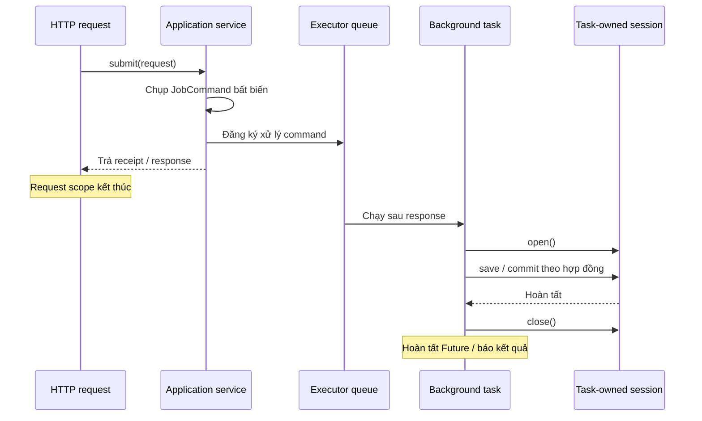
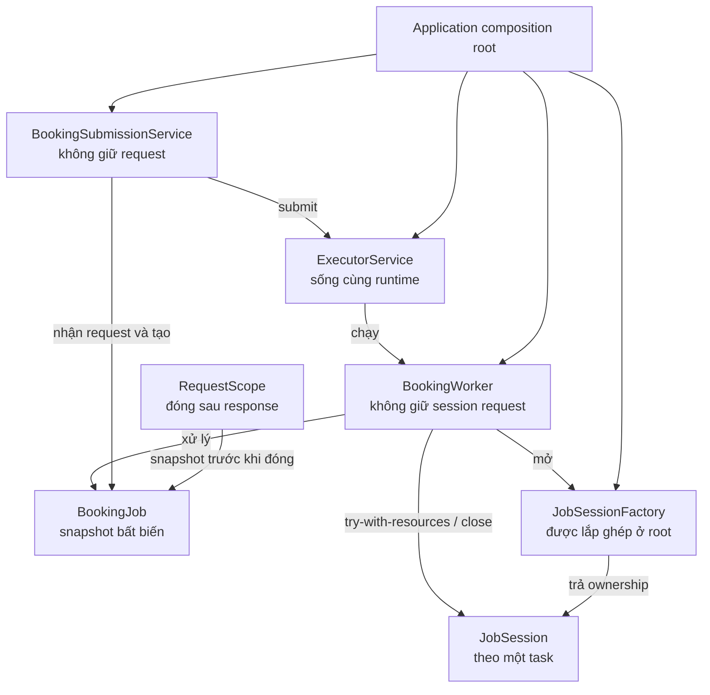

# Vòng đời phụ thuộc khi công việc tiếp tục sau khi yêu cầu kết thúc

Trong chương **Đồng thời và bất đồng bộ** của module **Dependency Injection**, một lỗi khó phát hiện xuất hiện khi tác vụ được khởi chạy trong một HTTP request nhưng **tiếp tục chạy sau khi request đã kết thúc**. Mã có thể trông hợp lệ vì tất cả dependency đã được truyền qua constructor, nhưng một dependency **chỉ sống trong request** không còn hợp lệ khi background task sử dụng nó.

Ví dụ: request nhận lệnh đặt thuê xe, ứng dụng đẩy việc lưu/audit sang `ExecutorService`, rồi trả response. Task sau đó truy cập `RequestContext`, transaction, entity manager hoặc một stream thuộc request đã được framework đóng. Kết quả có thể là lỗi "session closed", thiếu ngữ cảnh bảo mật, dữ liệu sai request, hoặc lỗi xảy ra quá muộn để trả về cho client.

**Dependency Injection (DI)** và **Inversion of Control (IoC)** giúp chỉ rõ *ai cấp dependency*; **scope, ownership và vòng đời** mới trả lời *dependency còn dùng được trong bao lâu*. **Constructor injection** không kéo dài thời gian sống của một session chỉ vì service giữ nó trong trường `final`. **Composition root** hoặc runtime cần tổ chức các tài nguyên sống lâu, còn mỗi tác vụ phải tự quản lý những tài nguyên ngắn hạn mà nó mở.

Sau bài học, bạn có thể:

- Phân biệt vòng đời **HTTP request**, **background task**, **transaction/session**, **thread pool** và **ứng dụng**.
- Nhận diện lỗi khi lambda hoặc `CompletableFuture` vô tình bắt giữ một dependency đã hết scope.
- Lựa chọn giữa **chờ task hoàn tất**, **chụp dữ liệu bất biến và tạo scope mới**, hoặc **hàng đợi bền vững** tùy cam kết nghiệp vụ.
- Thiết kế `JobCommand` bất biến và factory mở session riêng cho từng task.
- Kiểm thử bằng **Java 11 thuần** để buộc task chạy *sau* khi request đóng, không cần `Thread.sleep()` hoặc server/container.
- Xem xét lỗi bất đồng bộ, cancellation, timeout, truyền ngữ cảnh, idempotency và shutdown.

## 1. Vì sao request kết thúc nhưng công việc vẫn đang chạy?

Một request thường có một trình tự gần như:

```text
Thread xử lý request:
  nhận HTTP request
      -> xác thực / mở request scope
      -> gọi application service
      -> gửi task vào executor
      -> trả response
      -> đóng request scope / transaction theo framework

Thread background (có thể chạy muộn hơn):
      -> lấy task trong hàng đợi
      -> thực hiện xử lý
      -> dùng những dependency mà lambda đã giữ lại
      -> hoàn tất hoặc báo lỗi
```

Hai luồng không nhất thiết kết thúc cùng nhau. Một lời gọi như `executor.execute(task)` hoặc `CompletableFuture.runAsync(task, executor)` **chỉ gửi công việc cho executor**; không có nghĩa công việc đã hoàn tất trước khi phương thức trả về.



Đây là sơ đồ **một đường xử lý có chủ đích**. Với Java servlet/framework có cơ chế xử lý HTTP bất đồng bộ, thời điểm request scope được giữ hoặc kết thúc còn phụ thuộc API và cách cấu hình; không thể khẳng định mọi framework luôn đóng scope ngay sau method handler đầu tiên. Điều bắt buộc là **xác định chính xác giới hạn sống của từng dependency** và không truy cập nó vượt quá giới hạn đó.

### 1.1. Đừng nhầm thời gian sống của service và tài nguyên mà service dùng

| Thành phần | Thời gian sống thường thấy | Có an toàn để task tiếp tục dùng sau response không? |
| --- | --- | --- |
| `BookingService` không giữ state theo request | Có thể sống cùng ứng dụng | Có thể, nếu các dependency và hành vi bên trong cũng phù hợp |
| `PricingPolicy` bất biến | Có thể dùng chung | Thường có, nếu contract và implementation cho phép |
| `RequestContext` / đối tượng HTTP request | Theo request hoặc async request scope tương ứng | **Không mặc định**; cần kiểm tra vòng đời của framework |
| JDBC `Connection` / transaction / ORM session | Theo transaction hay unit of work | Không đem một session đã kết thúc sang background task |
| `InputStream` đọc body upload | Thường thuộc request hay thao tác mở stream | Không đọc sau khi owner đã đóng; cần tách/persist dữ liệu trước |
| `ExecutorService` dùng chung | Theo runtime ứng dụng | Task có thể dùng khi executor đang hoạt động, nhưng executor phải được quản lý shutdown |
| HTTP client hoặc connection pool dùng chung | Theo runtime/container nếu thiết kế như vậy | Có thể mượn khi chưa đóng; task không tự đóng tài nguyên chung |
| `JobCommand` bất biến chứa ID, tham số cần thiết | Sống theo công việc | Có, nếu dữ liệu đã được copy và không phụ thuộc object hết scope |

**Một tham chiếu còn tồn tại trong Java không chứng minh tài nguyên còn hợp lệ.** GC có thể chưa thu hồi object, nhưng transaction đã commit/rollback, connection đã trả về pool, security context đã bị xóa, hoặc request body stream đã đóng.

## 2. Lỗi phổ biến: lambda bắt giữ dependency của request

Ví dụ minh họa một handler đã có một object chỉ hợp lệ trong request:

```java
// Chỉ minh họa thiết kế nguy hiểm; không phải chương trình độc lập.
void handle(BookingRequest request, java.util.concurrent.Executor executor) {
    executor.execute(() -> {
        // Lambda giữ tham chiếu tới request.
        String bookingId = request.bookingId();
        // Có thể chạy sau khi request bị đóng.
        process(bookingId);
    });
    // Handler trả về; framework có thể kết thúc request scope.
}
```

Đoạn code không nhất thiết sai cú pháp và không nhất thiết thất bại khi chạy nhanh. Task có thể được executor thực thi **trước** khi request kết thúc, làm lỗi biến mất trong môi trường phát triển, nhưng xuất hiện khi tải tăng và hàng đợi bị chậm.

Một dạng nguy hiểm hơn:

```java
// Không nên chuyển session của transaction hiện tại sang background task.
executor.execute(() -> entityManager.persist(entity));
// EntityManager / transaction có thể thuộc request và không còn hợp lệ.
```

Với JPA, `EntityManager` gắn với persistence context/transaction và không nên chia sẻ tùy tiện giữa nhiều thread. Tương tự, một JDBC connection hoặc một request-bound session thường không được dùng đồng thời hoặc sau khi transaction kết thúc. Một `CompletableFuture` nắm giữ object đó sẽ không tự gia hạn vòng đời.

### 2.1. Ba kiểu lỗi thường lẫn nhau

| Vấn đề | Hiện tượng | Gốc rễ |
| --- | --- | --- |
| **Use after close** | `IllegalStateException`, session closed, stream closed | Task dùng tài nguyên sau khi owner đã thu hồi |
| **Sai scope / dữ liệu cũ** | Ghi nhầm tenant, dùng request context trước đó | Tham chiếu hoặc `ThreadLocal` được giữ/tái sử dụng sai vòng đời |
| **Thiếu xử lý kết quả bất đồng bộ** | Response báo thành công nhưng task sau đó thất bại | Caller không chờ, không theo dõi Future, không có cơ chế ghi trạng thái/retry |

Thay `entityManager` bằng interface `BookingRepository` có thể che chi tiết hạ tầng, nhưng **không tự sửa vấn đề** nếu implementation của repository cũng đang giữ một session request-scoped. Phải xem cả **đồ thị đối tượng lúc chạy** và quyền sở hữu.

## 3. Quy tắc sống còn: dependency phải hợp lệ suốt thời gian được sử dụng

Xét một tác vụ `T` bắt đầu sau khi request `R` kết thúc:

- Nếu tài nguyên `D` chỉ hợp lệ trong `R`, thì task `T` **không thể tiếp tục dựa vào instance `D` đó**.
- Nếu task cần truy cập database, nó nên **mở unit of work mới** hoặc gọi một port/adapter được thiết kế để tự quản lý session cho chính task.
- Nếu task cần vài giá trị từ request, hãy **chụp dữ liệu cần thiết trước khi request đóng** thành một message/command độc lập.
- Nếu hành động cần được bảo đảm kể cả sau khi tiến trình chết, chỉ dùng `ExecutorService` trong bộ nhớ là **chưa đủ**.

Quan hệ ownership cần rõ:



Đồ thị có nhiều loại cạnh: **dùng dependency**, **đăng ký task**, **sở hữu tài nguyên**. Không phải tất cả các cạnh là field reference. Điểm quan trọng là `BookingWorker` nhận nguồn tạo session, **không nhận một `JobSession` đã mở từ request**.

## 4. Ba cách giải quyết theo cam kết nghiệp vụ

Không có một lời giải duy nhất cho mọi tác vụ bất đồng bộ. Hãy xác định trước **response của API hứa điều gì**.

| Mục tiêu | Hướng thiết kế | Điểm cần lưu ý |
| --- | --- | --- |
| Response phải phản ánh tác vụ đã hoàn tất | **Chờ/join** toàn bộ công việc cần thiết trước khi kết thúc scope | Không trả thành công khi còn tác vụ bắt buộc thất bại; cần timeout và xử lý lỗi |
| Chấp nhận công việc, xử lý trong cùng tiến trình sau response | **Snapshot command bất biến** + task mở tài nguyên riêng | Phải theo dõi trạng thái và lỗi; mất process có thể mất job |
| Phải xử lý được sau restart, retry, scale nhiều instance | **Hàng đợi bền vững / outbox** + worker độc lập | Delivery, idempotency, retry, deduplication, transaction và giám sát |

### 4.1. Chờ tác vụ khi nó thực sự thuộc request

Khi kết quả bắt buộc phải có trước khi trả HTTP response, có thể đợi `CompletableFuture`:

```java
// Minh họa: executor và các hàm được định nghĩa ở ứng dụng thực tế.
CompletableFuture<Result> work =
        CompletableFuture.supplyAsync(() -> calculateQuote(input), executor);
Result result = work.join(); // Chờ trước khi phản hồi.
```

`join()` chặn thread gọi cho đến khi hoàn tất; một framework hỗ trợ async request có thể nối Future vào cơ chế trả response thay vì block thread. Dù vậy, **scope của dependency phải được framework duy trì hợp lệ** nếu task sử dụng chúng. Chờ Future không tự bảo đảm session transaction hay các object gắn thread được truyền đúng cách.

Nếu nhiều task con phải hoàn tất trước khi request kết thúc, ta cần theo dõi tất cả task, tập hợp lỗi và quyết định hủy khi lỗi. `CompletableFuture.allOf(...)` là một công cụ trên Java 11; nó không tự quản lý ownership hoặc bảo đảm task còn chạy đã bị dừng khi một task thất bại.

### 4.2. Snapshot command và mở tài nguyên riêng ở worker

Khi response chỉ xác nhận **đã nhận yêu cầu**, nên chuyển một tập dữ liệu độc lập:

```java
final class BookingJob {
    final String bookingId;
    final String tenantId;
    final String traceId;

    BookingJob(String bookingId, String tenantId, String traceId) {
        this.bookingId = java.util.Objects.requireNonNull(bookingId);
        this.tenantId = java.util.Objects.requireNonNull(tenantId);
        this.traceId = java.util.Objects.requireNonNull(traceId);
    }
}
```

Một **snapshot** đúng nghĩa không phải chỉ là wrapper chứa `HttpServletRequest`, `EntityManager` hay một `Map` mutable đang dùng chung với handler. Nó phải sao chép và xác thực những **giá trị cần thiết**. Nếu payload có list/map mutable, cần copy phòng vệ hoặc cấu trúc bất biến; trường `final` chỉ làm cố định tham chiếu, không tự deep-copy.

Worker mở session riêng cho task:

```java
// Hợp đồng minh họa; ví dụ runnable đầy đủ ở phần 6.
try (JobSession session = sessionFactory.open()) {
    session.save(command);
}
```

`JobSessionFactory` có thể dùng pool do application root sở hữu. **Task sở hữu session đã mở và phải đóng nó**; task không đóng pool sau mỗi công việc. Đây là áp dụng đồng thời **factory có phạm vi hẹp** và **resource ownership**.

### 4.3. Đưa việc xử lý sang hàng đợi bền vững

Nếu khách đặt xe cần bảo đảm công việc được xử lý **ngay cả khi service restart** hoặc mạng mất kết nối, executor nội bộ không đủ. Một hướng thiết kế:

```text
HTTP request
  -> validate / authorize
  -> ghi booking + outbox event trong cùng transaction (nếu có)
  -> commit
  -> trả trạng thái được chấp nhận phù hợp

Outbox publisher
  -> publish vào broker, retry khi lỗi

Background worker độc lập
  -> nhận BookingJob
  -> mở transaction/session của riêng worker
  -> xử lý idempotent
  -> ack / retry / dead-letter theo chính sách
```

Mẫu **transactional outbox** xử lý khoảng trống giữa việc commit trạng thái trong database và công bố message ra broker; chi tiết triển khai còn tùy hệ thống. Hàng đợi thường có khả năng **giao lại thông điệp**, vì thế xử lý cần **idempotency key** hoặc chiến lược chống trùng. Không nên tuyên bố "exactly once" chỉ vì dùng queue.

HTTP `202 Accepted` thường thích hợp khi server đã chấp nhận yêu cầu nhưng xử lý chưa xong; **nó không có nghĩa tác vụ chắc chắn đã hoàn tất**. API cần cung cấp cách tra trạng thái, thông báo kết quả và định nghĩa lỗi/retry theo hợp đồng.

## 5. Phân biệt request data và request resource

Một số giá trị có thể vượt qua boundary an toàn; một số khác cần mở lại ở worker.

| Thứ lấy từ request | Có nên chuyển thẳng sang job? | Cách làm phù hợp |
| --- | --- | --- |
| `bookingId`, `tenantId` đã xác thực | Có, khi nghiệp vụ thật sự cần | Lưu giá trị bất biến, kiểm tra quyền theo ranh giới phù hợp |
| `traceId`/correlation ID | Thường có, nếu không chứa dữ liệu nhạy cảm | Copy string đã giới hạn độ dài, tạo trace span mới ở worker |
| Dữ liệu đặt xe đã được xác thực | Có thể | Chụp immutable DTO và chỉ giữ trường cần thiết |
| `HttpServletRequest`, servlet response | Không nên với task sống ngoài request | Chỉ trích xuất dữ liệu cần thiết trước khi handoff |
| `InputStream` body upload | Không chuyển stream sẽ đóng sau request | Đọc/copy trước, hoặc persist payload và chuyển tham chiếu bền vững |
| `EntityManager`, JDBC connection, transaction handle | Không dùng qua boundary khi scope đã hết | Worker tự mở unit of work/transaction mới |
| ORM entity đang lazy-load theo session | Không phụ thuộc lazy getter ở worker sau session đóng | Chuyển ID/snapshot, worker query lại trong session mới |
| `SecurityContext`/principal mutable | Không copy nguyên object theo thói quen | Chuyển ID tối thiểu hoặc yêu cầu xác thực/ủy quyền lại tại worker |
| `ThreadLocal`/MDC của thread handler | Không tự truyền qua thread pool | Truyền metadata có kiểm soát và thiết lập/xóa quanh task |

Đặc biệt, **tenantId lấy từ request không tự động đáng tin**. Nó cần được so khớp với danh tính/ủy quyền ở thời điểm nhận yêu cầu, và worker cần một mô hình thực thi với quyền tối thiểu hoặc kiểm tra lại những quyền có thể đã thay đổi. Không đưa access token hoặc password vào queue nếu job không cần; dữ liệu lưu bền vững có thể tồn tại lâu và được nhiều hệ thống đọc.

## 6. Ví dụ Java 11 tự chứa: task chạy sau khi request đã đóng

Chúng ta sẽ tạo một ví dụ **đơn luồng, có thể điều khiển hoàn toàn bằng Java thuần**. Một `ManualExecutor` giữ task trong hàng đợi nhưng **không chạy ngay**; chương trình đóng request trước rồi mới gọi `drain()` để mô phỏng độ trễ background. Vì vậy test không dựa vào tốc độ CPU hoặc `Thread.sleep()`.

Đồ thị sử dụng:

- `RequestScope` mô phỏng một request-bound object có thời điểm đóng; sau `close()`, lời gọi truy cập bị từ chối.
- `BookingJob` là dữ liệu bất biến gồm ba chuỗi đã kiểm tra; nó sống độc lập với request.
- `BookingSubmissionService` nhận `Executor` và `BookingWorker` qua constructor; nó chụp command **trước** khi giao task.
- `BookingWorker` mở một `JobSession` **trong task**, đóng bằng `try-with-resources` kể cả khi lưu lỗi.
- `InMemoryJobSessionFactory` mô phỏng adapter lưu trữ với thống kê session mở/đóng. Đây là fake test, không phải transaction JDBC thật.
- `Clock.fixed(...)` làm thời điểm xử lý xác định để dễ kiểm tra.

Lưu thành `AsyncRequestLifetimeDemo.java` và chạy với **Java 11 trở lên**:

```bash
javac AsyncRequestLifetimeDemo.java
java AsyncRequestLifetimeDemo
```

```java
import java.time.Clock;
import java.time.Instant;
import java.time.ZoneOffset;
import java.util.ArrayList;
import java.util.HashMap;
import java.util.List;
import java.util.Map;
import java.util.Objects;
import java.util.concurrent.CompletableFuture;
import java.util.concurrent.CompletionException;
import java.util.concurrent.Executor;

public final class AsyncRequestLifetimeDemo {
    static void check(boolean condition, String message) {
        if (!condition) {
            throw new AssertionError(message);
        }
    }

    static String required(String value, String label) {
        if (value == null || value.isBlank()) {
            throw new IllegalArgumentException(label + " is required");
        }
        return value;
    }

    // 1. Request-bound object: chỉ dùng hợp lệ trước khi close().
    static final class RequestScope implements AutoCloseable {
        private final String bookingId;
        private final String tenantId;
        private final String traceId;
        private boolean closed;

        RequestScope(String bookingId, String tenantId, String traceId) {
            this.bookingId = required(bookingId, "bookingId");
            this.tenantId = required(tenantId, "tenantId");
            this.traceId = required(traceId, "traceId");
        }

        String bookingId() {
            ensureOpen();
            return bookingId;
        }

        BookingJob snapshot() {
            ensureOpen();
            // Sao chép các giá trị String bất biến, không truyền RequestScope.
            return new BookingJob(bookingId, tenantId, traceId);
        }

        private void ensureOpen() {
            if (closed) {
                throw new IllegalStateException("Request scope closed");
            }
        }

        boolean isClosed() {
            return closed;
        }

        @Override
        public void close() {
            closed = true;
        }
    }

    // 2. Dữ liệu độc lập, có thể tồn tại sau khi request kết thúc.
    static final class BookingJob {
        final String bookingId;
        final String tenantId;
        final String traceId;

        BookingJob(String bookingId, String tenantId, String traceId) {
            this.bookingId = required(bookingId, "bookingId");
            this.tenantId = required(tenantId, "tenantId");
            this.traceId = required(traceId, "traceId");
        }
    }

    static final class SavedBooking {
        final BookingJob job;
        final Instant processedAt;

        SavedBooking(BookingJob job, Instant processedAt) {
            this.job = Objects.requireNonNull(job);
            this.processedAt = Objects.requireNonNull(processedAt);
        }
    }

    // 3. Mỗi task mở một session riêng, caller sở hữu và phải đóng.
    interface JobSession extends AutoCloseable {
        void save(BookingJob job, Instant processedAt);

        @Override
        void close();
    }

    @FunctionalInterface
    interface JobSessionFactory {
        JobSession open();
    }

    // 4. Fake lưu trữ để kiểm tra scope, không mô phỏng JDBC/ACID.
    static final class InMemoryJobSessionFactory implements JobSessionFactory {
        private final Map<String, SavedBooking> saved = new HashMap<>();
        private int opened;
        private int closed;
        private int active;

        @Override
        public synchronized JobSession open() {
            opened++;
            active++;
            return new MemoryJobSession(this);
        }

        private synchronized void save(BookingJob job, Instant processedAt) {
            if ("BK-FAIL".equals(job.bookingId)) {
                throw new IllegalStateException("Simulated storage failure");
            }
            if (saved.containsKey(job.bookingId)) {
                throw new IllegalStateException("Duplicate booking");
            }
            saved.put(job.bookingId, new SavedBooking(job, processedAt));
        }

        private synchronized void release() {
            if (active < 1) {
                throw new IllegalStateException("No active session");
            }
            active--;
            closed++;
        }

        synchronized SavedBooking find(String bookingId) {
            return saved.get(bookingId);
        }

        synchronized int openedCount() {
            return opened;
        }

        synchronized int closedCount() {
            return closed;
        }

        synchronized int activeCount() {
            return active;
        }
    }

    static final class MemoryJobSession implements JobSession {
        private final InMemoryJobSessionFactory owner;
        private boolean closed;

        MemoryJobSession(InMemoryJobSessionFactory owner) {
            this.owner = Objects.requireNonNull(owner);
        }

        @Override
        public void save(BookingJob job, Instant processedAt) {
            if (closed) {
                throw new IllegalStateException("Job session already closed");
            }
            owner.save(
                    Objects.requireNonNull(job),
                    Objects.requireNonNull(processedAt));
        }

        @Override
        public void close() {
            if (!closed) {
                closed = true;
                owner.release();
            }
        }
    }

    // 5. Worker có vòng đời ứng dụng; session chỉ có vòng đời một task.
    static final class BookingWorker {
        private final JobSessionFactory sessionFactory;
        private final Clock clock;

        BookingWorker(JobSessionFactory sessionFactory, Clock clock) {
            this.sessionFactory = Objects.requireNonNull(sessionFactory);
            this.clock = Objects.requireNonNull(clock);
        }

        void process(BookingJob job) {
            try (JobSession session = sessionFactory.open()) {
                session.save(job, clock.instant());
            }
        }
    }

    // 6. Consumer không giữ RequestScope trong field hoặc lambda.
    static final class BookingSubmissionService {
        private final BookingWorker worker;
        private final Executor executor;

        BookingSubmissionService(BookingWorker worker, Executor executor) {
            this.worker = Objects.requireNonNull(worker);
            this.executor = Objects.requireNonNull(executor);
        }

        CompletableFuture<Void> submit(RequestScope request) {
            BookingJob job = Objects.requireNonNull(request).snapshot();
            // Lambda chỉ bắt giữ command bất biến và worker dài hạn.
            return CompletableFuture.runAsync(
                    () -> worker.process(job), executor);
        }
    }

    // 7. Executor test: chấp nhận trước, chạy khi test quyết định.
    static final class ManualExecutor implements Executor {
        private final List<Runnable> queued = new ArrayList<>();

        @Override
        public void execute(Runnable task) {
            queued.add(Objects.requireNonNull(task));
        }

        int pendingCount() {
            return queued.size();
        }

        void drain() {
            while (!queued.isEmpty()) {
                queued.remove(0).run();
            }
        }
    }

    public static void main(String[] args) {
        Instant fixedTime = Instant.parse("2026-01-15T08:00:00Z");
        Clock clock = Clock.fixed(fixedTime, ZoneOffset.UTC);
        InMemoryJobSessionFactory sessions = new InMemoryJobSessionFactory();
        ManualExecutor executor = new ManualExecutor();
        BookingWorker worker = new BookingWorker(sessions, clock);
        BookingSubmissionService service =
                new BookingSubmissionService(worker, executor);

        // 8. Handoff hợp lệ: đóng request trước khi task thực thi.
        RequestScope request =
                new RequestScope("BK-001", "TENANT-7", "TRACE-42");
        CompletableFuture<Void> accepted;
        try (RequestScope scope = request) {
            accepted = service.submit(scope);
            check(executor.pendingCount() == 1, "Task must be queued");
            check(sessions.find("BK-001") == null, "Task must not run yet");
        }
        check(request.isClosed(), "Request must already be closed");
        executor.drain(); // Mới bắt đầu xử lý sau khi response giả lập kết thúc.
        accepted.join();

        SavedBooking result = sessions.find("BK-001");
        check(result != null, "Booking must be stored");
        check("TENANT-7".equals(result.job.tenantId), "Tenant snapshot");
        check("TRACE-42".equals(result.job.traceId), "Trace snapshot");
        check(result.processedAt.equals(fixedTime), "Clock snapshot");
        check(sessions.openedCount() == 1
                && sessions.closedCount() == 1
                && sessions.activeCount() == 0, "Session must be released");
        System.out.println("Luu sau request: BK-001");

        // 9. Task thất bại: Future lỗi, nhưng session riêng vẫn được đóng.
        RequestScope failedRequest =
                new RequestScope("BK-FAIL", "TENANT-7", "TRACE-43");
        CompletableFuture<Void> failed;
        try (RequestScope scope = failedRequest) {
            failed = service.submit(scope);
        }
        executor.drain();
        try {
            failed.join();
            throw new AssertionError("Expected storage failure");
        } catch (CompletionException error) {
            Throwable cause = error.getCause();
            check(cause instanceof IllegalStateException
                    && "Simulated storage failure".equals(cause.getMessage()),
                    "Unexpected async failure");
        }
        check(sessions.openedCount() == 2
                && sessions.closedCount() == 2
                && sessions.activeCount() == 0, "Failed task leaked session");
        check(sessions.find("BK-FAIL") == null, "Failed job must not be saved");
        System.out.println("Task loi, session da dong: PASS");

        // 10. Anti-pattern: lambda bắt giữ RequestScope sẽ hết hạn.
        RequestScope unsafe =
                new RequestScope("BK-UNSAFE", "TENANT-7", "TRACE-44");
        CompletableFuture<Void> broken =
                CompletableFuture.runAsync(() -> unsafe.bookingId(), executor);
        unsafe.close();
        executor.drain();
        try {
            broken.join();
            throw new AssertionError("Expected request-scope failure");
        } catch (CompletionException error) {
            check(error.getCause() instanceof IllegalStateException
                    && "Request scope closed".equals(
                            error.getCause().getMessage()), "Wrong error");
        }
        System.out.println("Bat giu request da dong: detected");
        System.out.println("Kiem thu Java thuan: PASS");
    }
}
```

Kết quả dự kiến:

```text
Luu sau request: BK-001
Task loi, session da dong: PASS
Bat giu request da dong: detected
Kiem thu Java thuan: PASS
```

Không có scheduler chạy nền thật; `ManualExecutor` chỉ mô phỏng khoảng thời gian giữa **submit** và **execute**. Bài test xác nhận thứ tự:

1. `submit(...)` chụp command khi request vẫn mở.
2. Request được đóng; lúc này **chưa có booking nào được lưu**.
3. `drain()` chạy task, worker mở session riêng, lưu booking và đóng session.
4. Khi ghi lỗi, `CompletableFuture` chứa exception; `try-with-resources` vẫn giải phóng session.
5. Phần cuối cố ý bắt giữ `RequestScope` trong lambda để cho thấy lỗi xuất hiện sau khi request đã đóng.

**Đây là mô hình kiểm thử**, không phải thư viện quản lý request thực. `RequestScope` tự định nghĩa `close()` để tái hiện ranh giới vòng đời; framework thực tế quản lý request scope khác nhau. `InMemoryJobSessionFactory` dùng `HashMap` có các method đồng bộ cho demo, **không mô phỏng transaction, connection pool hoặc crash recovery**.

### 6.1. Tại sao test không dùng `Thread.sleep()`?

Một test sử dụng `Thread.sleep(100)` để "hy vọng" task chạy sau khi request kết thúc là test phụ thuộc scheduler của hệ điều hành. Máy nhanh/chậm hoặc tải CI khác nhau có thể làm kết quả đảo ngược. `ManualExecutor` khiến thứ tự **đóng request trước, chạy task sau** là quyết định của test, không phải may rủi.

Điều này chứng minh tính đúng đắn của **logic quản lý vòng đời theo kịch bản**, nhưng không chứng minh tính an toàn đồng thời của adapter production. Muốn kiểm tra race condition thực, phải bổ sung integration/concurrency tests có executor thật và các hợp đồng thread-safety thích hợp.

### 6.2. Vì sao worker nhận factory chứ không nhận session?

`BookingWorker` có thể sống cùng ứng dụng, trong khi `JobSession` chỉ nên tồn tại trong mỗi thao tác. Nếu constructor của worker nhận một `JobSession` đã được mở trong request, nó sẽ giữ tài nguyên quá lâu. Tiêm `JobSessionFactory` cho đúng consumer **cần mở scope**, rồi `try-with-resources` trong mỗi `process(...)`, làm rõ **thời điểm tạo** và **quyền đóng**.

Mặt khác, `BookingSubmissionService` **không cần factory**; nó chỉ cần một `BookingWorker` đã được lắp ghép và một `Executor` để gửi việc. Factory được giữ đúng nơi cần tạo session, không lan qua mọi lớp.

## 7. Lỗi bất đồng bộ không biến mất chỉ vì dùng `CompletableFuture`

Một `CompletableFuture<Void>` cho phép quan sát thành công/thất bại khi task chạy. Nhưng nếu handler trả response rồi **bỏ qua Future**, lỗi có thể chỉ nằm trong Future mà không được xử lý theo hợp đồng nghiệp vụ.

Các trường hợp cần phân biệt:

| Thời điểm lỗi | Ví dụ | Tác động |
| --- | --- | --- |
| Trước handoff | Kiểm tra input/authorization thất bại | Có thể trả lỗi đồng bộ, chưa có job |
| Ngay lúc submit | Executor đang shutdown hoặc queue đầy; `RejectedExecutionException` | Job có thể chưa được chấp nhận; cần lỗi hoặc retry/backpressure rõ |
| Sau submit nhưng trước khi chạy | Ứng dụng crash, process bị kill | Task trong queue RAM có thể mất vĩnh viễn |
| Trong task | Database/network lỗi, session mở thất bại | Future hoàn tất lỗi; response trước đó không thể "sửa lại" |
| Task hoàn tất nhưng kết quả ngoài không chắc chắn | Timeout sau khi gọi API thanh toán | Có thể phải tra cứu trạng thái/idempotency, tránh xử lý trùng |

Trong ví dụ, `failed.join()` ném `CompletionException` với nguyên nhân từ việc lưu. Nếu chạy production, cần có cơ chế lưu trạng thái job, metric, log/correlation ID, timeout/retry theo yêu cầu. Không nên mặc định `exceptionally(error -> null)` chỉ để che lỗi và coi job đã thành công.

### 7.1. Timeout không nhất thiết hủy công việc đang chạy

Khi caller dùng timeout để ngừng chờ, **task có thể vẫn chạy**. Trên Java 11, `CompletableFuture.orTimeout(...)` đánh dấu Future hoàn tất bất thường sau timeout, nhưng không bảo đảm công việc nền đã bị dừng. Tương tự, `CompletableFuture.cancel(true)` không có cam kết ngắt ngay task nền do `runAsync` khởi chạy.

Nếu một job phải có cơ chế hủy, cần một hợp đồng cancellation/cooperative interruption rõ ràng, những điểm kiểm tra trạng thái hủy và chính sách xử lý khi đã commit một phần. Không dùng timeout như một thao tác rollback transaction.

### 7.2. Task đã được nhận có thể không chạy trong shutdown

Nếu executor được gọi `shutdown()`, nó không nhận thêm task mới, nhưng những task đã gửi có thể tiếp tục theo chính sách executor. `shutdownNow()` cố gắng dừng task và trả về các task chưa bắt đầu, nhưng không bảo đảm job đang chạy dừng ngay.

Với một hệ thống yêu cầu xử lý mọi job đã được nhận, phải chọn cơ chế drain/queue bền vững và điều kiện hoàn tất rõ. Chỉ "gửi được vào executor" **không tương đương** một cam kết lưu trữ công việc bền vững.

## 8. Truyền trace và security context giữa các thread

Nhiều framework đặt correlation ID, tenant context hoặc principal trong `ThreadLocal` của thread HTTP. Một background task thường chạy trên **thread khác**; không thể trông đợi `ThreadLocal` của request tự xuất hiện.

Khi cần truyền metadata phục vụ logging, có thể chụp một giá trị an toàn và thiết lập quanh task:

```java
// Ví dụ Java thuần, minh họa việc dọn ThreadLocal quanh task.
ThreadLocal<String> traceContext = new ThreadLocal<>();
String capturedTraceId = "TRACE-42"; // Đã validate từ request.

executor.execute(() -> {
    String previous = traceContext.get();
    try {
        traceContext.set(capturedTraceId);
        processWithoutRequestContext();
    } finally {
        if (previous == null) {
            traceContext.remove();
        } else {
            traceContext.set(previous);
        }
    }
});
```

Đoạn trên minh họa, các biến `executor` và phương thức `processWithoutRequestContext()` là thành phần của ứng dụng thật, không thuộc file demo. **Dọn `ThreadLocal` trong `finally` là bắt buộc** khi thread pool tái sử dụng thread, để ngữ cảnh không rò sang công việc tiếp theo.

Không sao chép nguyên `SecurityContext` hoặc token xác thực sang thread khác theo phản xạ. Nếu worker cần quyền thao tác, phải xác định mô hình ủy quyền: job được phép làm gì, ai là người yêu cầu, quyền có bị thu hồi từ lúc submit đến lúc chạy không, và cách audit. Framework có thể cung cấp cơ chế context propagation, nhưng phải hiểu rõ lifecycle và phạm vi dữ liệu được truyền.

### 8.1. Dữ liệu bất biến vẫn có thể chứa thông tin cần bảo vệ

Một `BookingJob` được thiết kế bất biến không có nghĩa mọi field đều an toàn để giữ lâu, log hoặc gửi qua broker. Tránh đưa password, access token, dữ liệu thẻ hoặc toàn bộ HTTP body vào job nếu không có nhu cầu. Dùng định danh và truy vấn lại dữ liệu theo quyền của worker khi phù hợp; bảo vệ hàng đợi và log bằng kiểm soát truy cập, retention và mã hóa thích hợp.

## 9. Scope của dependency và quyền sở hữu tài nguyên

**Scope** quyết định instance sống bao lâu; **ownership** quyết định ai được đóng; **đồng thời** quyết định nó có thể bị sử dụng từ bao nhiêu thread. Cả ba phải nhất quán.

| Dependency | Scope thường phù hợp | Ai cấp/đóng? | Lỗi cần tránh |
| --- | --- | --- | --- |
| `BookingSubmissionService` không giữ request state | Ứng dụng | Composition root/container | Lưu `RequestScope` vào field singleton |
| `BookingWorker` stateless ngoài factory/clock | Ứng dụng | Composition root/container | Giữ một session ngắn hạn trong constructor |
| `JobSessionFactory` dùng pool | Ứng dụng | Root sở hữu pool; worker chỉ mở lease | Đóng pool sau từng job |
| `JobSession` | Một job/transaction | Worker mở và đóng trong `try-with-resources` | Dùng lại sau close hoặc giữa nhiều task |
| `ExecutorService` | Runtime ứng dụng | Runtime shutdown và chờ task theo chính sách | Handler tự shutdown pool dùng chung |
| `BookingJob` bất biến | Một job | Handoff tạo và job giữ | Bắt giữ request object hoặc mutable payload |
| Thread-local trace | Thời gian thực thi một task | Adapter/worker thiết lập và dọn trong `finally` | Rò trace/tenant giữa các task |

Ngay cả khi `BookingWorker` có các trường `private final`, implementation của `JobSessionFactory` phải an toàn khi nhiều worker thread gọi `open()` đồng thời. Các object stateful theo request/transaction thì không nên chia sẻ tùy ý giữa các task. Tránh singleton có một `EntityManager` hoặc JDBC `Connection` chung cho mọi tác vụ.

### 9.1. Shutdown đúng thứ tự

Với background task dùng database và network client, ứng dụng nên:

1. **Ngừng nhận yêu cầu mới** hoặc ngừng giao job cho executor.
2. **Dừng nhận task mới** vào executor theo chính sách.
3. **Chờ/drain hoặc hủy có kiểm soát** các task đã nhận; xử lý timeout và công việc chưa hoàn tất.
4. **Chỉ đóng connection pool/client** sau khi chắc chắn các task cần chúng đã dừng hoặc được chuyển sang hệ thống khác.
5. Ghi nhận trạng thái thất bại, công việc chưa hoàn tất và các lỗi cleanup phục vụ giám sát.

`ExecutorService.shutdown()` không đồng nghĩa mọi task đã hoàn tất; `awaitTermination(...)` mới chờ trong thời hạn. Nếu chờ thất bại, phải có chính sách ứng dụng rõ (từ chối shutdown, cảnh báo, chuyển job, hủy có kiểm soát). Không đóng phụ thuộc đang được task sử dụng chỉ vì đã gọi `shutdown()`.

### 9.2. Không "cứu" sai scope bằng provider một cách máy móc

Một `Supplier<RequestContext>` hoặc scoped proxy có thể trì hoãn việc lấy context, nhưng **không đảm bảo** task có request context hợp lệ khi chạy sau response. Provider chỉ có ích khi nó trả đúng **scope mới** mà worker thực sự sở hữu, ví dụ `JobSessionFactory.open()` tạo session theo task. Không dùng lazy/proxy chỉ để né lỗi "request scope not active".

## 10. Chọn phép kiểm thử để phát hiện lỗi thật

| Phạm vi test | Điều cần chứng minh | Cách tiếp cận |
| --- | --- | --- |
| Handoff và lifetime | Task chỉ giữ snapshot, chạy sau request đóng vẫn đúng | Manual executor, đóng request trước `drain()` |
| Resource ownership | Session được mở/đóng theo mỗi job, kể cả khi lỗi | Fake session factory đếm open/close |
| Xử lý lỗi | Future hoặc job status ghi nhận thất bại | Fake repository ném exception khi xử lý |
| Cô lập tenant/context | Không dùng tenant/trace của request trước | Chạy nhiều job với metadata khác nhau, kiểm tra kết quả |
| Thread-safety | Không có race khi chạy nhiều task thật | Executor thật, concurrency tests và adapter phù hợp |
| Scope framework | Request scope/transaction/proxy hoạt động đúng theo framework | Context/integration tests với cấu hình thật |
| Delivery sau restart | Job không mất khi process hoặc broker lỗi | Integration/failure-recovery tests với queue/outbox bền vững |
| Shutdown | Không đóng pool trước task, không để job mất âm thầm | Lifecycle tests kiểm tra drain, timeout và failure policy |

Một **unit test chạy với `ManualExecutor`** rất tốt để kiểm soát thứ tự, nhưng không kiểm tra tính liên tục của thread pool thật. Một **integration test chạy với executor thật** không tự chứng minh persistence sau crash. Đừng trộn các cam kết và suy ra nhiều hơn điều test thực sự quan sát.

## 11. Các sai lầm thường gặp

| Sai lầm | Vì sao nguy hiểm | Cách cải thiện |
| --- | --- | --- |
| Lambda capture `HttpServletRequest` hoặc request-scoped bean | Task chạy sau close sẽ truy cập object hết hạn | Chụp DTO bất biến trong request |
| Chuyển nguyên `EntityManager`/transaction sang executor | Sai thread/scope, connection có thể đã đóng | Worker mở transaction/session riêng |
| Để singleton giữ `RequestContext` trong field `final` | Giữ dữ liệu request cũ, sai lifetime | Truyền dữ liệu mỗi thao tác hoặc tạo scope mới |
| Tin `CompletableFuture.runAsync` nghĩa là công việc đã thành công | Task có thể chưa chạy hoặc thất bại sau response | Theo dõi Future/job status và định nghĩa response |
| Gọi `Thread.sleep` để thử "task chạy trễ" | Test không xác định, dễ flake | Manual executor hoặc scheduler điều khiển được |
| Dùng `ThreadLocal` của handler mà không propagate | Worker thiếu context | Copy metadata tối thiểu, set/remove quanh task |
| Không xóa MDC/ThreadLocal sau task | Rò metadata sang task khác trên thread tái sử dụng | `finally` restore/remove, kiểm thử rò scope |
| Dùng `cancel(true)` như rollback | Task có thể vẫn chạy/đã commit | Cooperative cancellation và idempotency |
| Trả "đã hoàn tất" trước khi job thực hiện | Hợp đồng API sai, lỗi đến muộn | Trả trạng thái accepted/pending và kênh tra cứu |
| Dùng executor RAM cho công việc bắt buộc tồn tại sau crash | Job có thể mất khi process dừng | Durable queue/outbox và retry |
| Handler gọi `executor.shutdown()` hoặc đóng client | Gây lỗi cho request khác/task đang chạy | Root/runtime sở hữu resource lifetime |
| Copy cả security context/token vào job | Lộ dữ liệu, quyền có thể hết hạn | Minimum-privilege job identity và kiểm soát authorization |

## 12. Bài tập tự đánh giá

**Bài 1 — Bắt giữ sai.** `BookingController` gọi `CompletableFuture.runAsync(() -> uploadInputStream.read(), executor)` rồi trả response. Vấn đề gì có thể xảy ra?

*Gợi ý:* Stream thuộc request có thể bị đóng trước khi task đọc. Cần đọc/persist nội dung trước handoff hoặc chuyển tham chiếu bền vững đến dữ liệu; worker tự mở stream của mình khi xử lý.

**Bài 2 — Chỉ cần `final`?** Một singleton `BookingWorker` giữ `private final EntityManager manager` được tạo từ request đầu tiên. Field không đổi thì việc dùng ở request sau có an toàn không?

*Gợi ý:* Không. `final` chỉ cố định tham chiếu; session/transaction có scope ngắn và có thể không thread-safe. Worker nên mở unit of work riêng cho từng task.

**Bài 3 — Thiết kế handoff.** Một job cần ID booking, tenant và trace ID. Bạn sẽ truyền toàn bộ `HttpServletRequest` hay một immutable command?

*Gợi ý:* Chụp command với các giá trị tối thiểu đã kiểm tra khi request còn hợp lệ. Không chuyển session, input stream hoặc token không cần thiết.

**Bài 4 — Test sau response.** Hãy thiết kế test bảo đảm background task chỉ chạy khi request đã đóng nhưng không dùng `Thread.sleep`.

*Gợi ý:* Dùng `ManualExecutor` có hàng đợi, gọi `submit` trong scope request, đóng scope, rồi `drain` và xác nhận task hoàn tất bằng snapshot.

**Bài 5 — Task thất bại.** Worker mở session, `save` ném exception. Ai cần đóng session và lỗi được quan sát bằng cách nào?

*Gợi ý:* Worker sở hữu session và dùng `try-with-resources`. `CompletableFuture` hoàn tất bất thường; caller/job tracking quan sát lỗi và áp dụng retry theo hợp đồng.

**Bài 6 — Trả response sớm.** API trả `200 OK` với thông điệp "đã lưu booking" ngay sau khi `runAsync` đăng ký task, nhưng database chưa được ghi. Có vấn đề gì?

*Gợi ý:* Response đang tuyên bố thành công sớm. Nếu chỉ nhận xử lý, dùng trạng thái accepted/pending, cung cấp receipt/tracking; nếu phải hoàn tất trước response thì chờ và xác nhận kết quả.

**Bài 7 — Timeout.** `CompletableFuture.orTimeout(...)` xảy ra khi job vẫn đang gọi API ngoài. Có chắc job bị hủy và chưa ghi dữ liệu không?

*Gợi ý:* Không. Timeout đánh dấu kết quả Future theo chính sách API nhưng không đảm bảo dừng task nền hoặc rollback side effect. Cần cơ chế hủy/idempotency riêng.

**Bài 8 — Thread-local.** Một thread trong pool vừa xử lý tenant A, sau đó xử lý tenant B. Nếu MDC/ThreadLocal không được xóa sau tenant A, điều gì có thể xảy ra?

*Gợi ý:* Log hoặc logic có thể sử dụng ngữ cảnh cũ, gây lẫn tenant. Thiết lập context rõ ràng và cleanup trong `finally`.

**Bài 9 — Delivery sau restart.** Job bắt buộc phải gửi hóa đơn dù server restart đúng lúc. Chỉ `ExecutorService` có đủ không?

*Gợi ý:* Không. Chọn durable queue/outbox, trạng thái xử lý, retry và idempotency. Thiết kế worker có session riêng và không giữ request scope.

## 13. Checklist khi triển khai công việc vượt qua request

- Đã xác định rõ **request kết thúc ở đâu** và framework có kéo dài async request scope hay không?
- Task có đang **bắt giữ request object, session, connection, lazy entity hay input stream** sống ngắn không?
- Dữ liệu cần dùng về sau đã được **chụp lại và xác thực** thành immutable command, không chứa reference mutable/request-bound chưa?
- Worker có **tự mở và đóng tài nguyên theo task** bằng factory/port phù hợp không?
- Singleton/background worker có tránh giữ dependency request-scoped hoặc transaction-scoped không?
- Khi trả response trước lúc task hoàn tất, API có nói rõ **accepted/pending** và có cách theo dõi kết quả không?
- Có phân biệt **lỗi lúc submit, lỗi trong task, timeout và cancellation** không?
- Nếu job bắt buộc tồn tại qua crash/restart, đã có queue/outbox bền vững, retry và idempotency chưa?
- Trace/tenant/security context có được truyền theo nguyên tắc quyền tối thiểu và dọn sau task chưa?
- Composition root/runtime có quản lý executor, pool và network client theo shutdown order an toàn không?
- Unit test có buộc task chạy **sau khi đóng request** mà không dùng sleep, và integration test có kiểm tra hành vi đa luồng thật khi cần không?

**Vòng đời của dependency phải bao trùm thời gian sử dụng thực tế của nó.** Khi công việc tiếp tục sau response, đừng giả định request scope sẽ đi theo task. Hãy chọn đúng cam kết: chờ task, handoff bằng command bất biến và mở scope mới, hoặc dùng hệ thống xử lý job bền vững. **Constructor injection** làm các phụ thuộc hiện rõ, **composition root** quản lý tài nguyên dài hạn, còn từng worker chịu trách nhiệm tài nguyên ngắn hạn của mình. Thiết kế như vậy giúp kiểm thử bằng Java thuần trước khi mở rộng sang DI container mà không đánh đổi tính đúng đắn khi xử lý bất đồng bộ.
