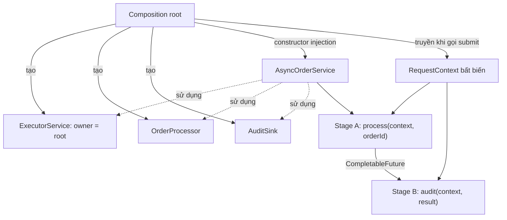

# Truyền ngữ cảnh tường minh và giới hạn của trạng thái theo luồng

## 1. Một request có thể đi qua nhiều luồng

Trong một ứng dụng Java, một yêu cầu có thể đi từ HTTP handler sang service, được đưa vào `ExecutorService`, tiếp tục qua `CompletableFuture` và hoàn tất ở một luồng khác. Trong suốt quá trình đó, các thành phần thường cần thông tin như **request ID**, **correlation ID**, **người dùng đã được xác thực** hoặc **thời hạn xử lý**.

Một cách làm quen thuộc là lưu các giá trị ấy trong `ThreadLocal` để không phải truyền chúng qua tham số phương thức. Cách này chỉ an toàn trong những điều kiện rất cụ thể: dữ liệu gắn với **một luồng**, không tự động gắn với **một request**. Khi công việc được chuyển vào thread pool, callback hoặc một chuỗi bất đồng bộ, mối liên hệ “một request = một thread” thường không còn đúng.

Trong chương **Đồng thời và bất đồng bộ** của module **Dependency Injection (DI)**, ta học cách **truyền ngữ cảnh tường minh** để bảo đảm dữ liệu đi cùng công việc, thay vì tình cờ đi cùng luồng đang chạy. Trọng tâm vẫn là **Inversion of Control (IoC)**: service nhận các dependency cần thiết qua constructor, còn **ngữ cảnh của một lần xử lý** được cấp qua tham số ở ranh giới thực thi. Bài thực hành bằng Java thuần, kết hợp composition root, quản lý scope/vòng đời và kiểm thử trước khi sử dụng DI container.

Sau bài này, bạn có thể:

1. Phân biệt **dependency của object** với **context của một thao tác**.
2. Giải thích vì sao `ThreadLocal` và `InheritableThreadLocal` không tự động truyền context chính xác qua executor và chuỗi bất đồng bộ.
3. Thiết kế `RequestContext` bất biến, truyền qua hàm, lambda và `CompletableFuture`.
4. Kiểm soát việc dọn `ThreadLocal`, tài nguyên theo request, shutdown executor và vấn đề dùng chung nhiều luồng.
5. Kiểm thử context passing bằng fake và executor đồng bộ, không cần DI container hoặc `sleep`.

## 2. Ba thứ khác nhau: dependency, context và thread state

Giả sử một `OrderService` cần ghi đơn hàng và xử lý một request có ID `req-42`. Ta có ba loại thông tin:

| Loại | Ví dụ | Vòng đời và cách cấp phù hợp |
| --- | --- | --- |
| **Dependency** | `OrderRepository`, `AuditSink`, `Executor` | Do composition root tạo/cấp qua constructor; có thể tồn tại qua nhiều request |
| **Request/operation context** | `requestId`, `actorId`, `startedAt` | Được tạo ở ranh giới request và truyền vào từng thao tác liên quan |
| **Thread state** | Giá trị lưu trong `ThreadLocal`, tên thread, trạng thái interrupt | Gắn với luồng đang thực thi; không mặc nhiên theo logic request khi chuyển luồng |

Hai chữ “inject” có thể gây nhầm lẫn: **constructor injection** cung cấp cộng tác viên mà service cần trong suốt vòng đời của nó. **Truyền context tường minh** thường diễn ra qua tham số phương thức, vì context thay đổi theo mỗi request.

```java
final class OrderService {
    private final OrderRepository repository; // dependency ổn định

    OrderService(OrderRepository repository) {
        this.repository = java.util.Objects.requireNonNull(repository);
    }

    void place(RequestContext context, String orderId) {
        repository.save(context, orderId);
    }
}
```

Đoạn này là **phác thảo API**; `OrderRepository` và `RequestContext` sẽ được định nghĩa đầy đủ ở phần 5. Cấu trúc quan trọng là: repository được inject ở constructor, còn context đi cùng lần gọi `place(...)`. Điều đó tránh việc một singleton service giữ request ID của request đầu tiên rồi vô tình dùng cho các request sau.

### 2.1. Ngữ cảnh không phải “túi chứa mọi thứ”

Một `RequestContext` tốt chỉ chứa thông tin cần dùng xuyên các bước của **một hoạt động**, với ngữ nghĩa rõ ràng. Không nên biến nó thành `Map<String, Object>` dùng để truyền tất cả repository, HTTP client, connection, callback và đối tượng mutable. Việc đó che giấu dependency và khiến ranh giới quyền sở hữu tài nguyên khó xác định.

Trong bài, context sẽ có `requestId`, `actorId` và `startedAt`. Các giá trị này được chốt tại đầu request. Chúng không phải “toàn bộ security context”; dữ liệu nhạy cảm và quyền truy cập phải được kiểm chứng bởi cơ chế xác thực/ủy quyền đáng tin cậy.

## 3. ThreadLocal hoạt động thế nào và giới hạn ở đâu?

`ThreadLocal<T>` cung cấp một ô giá trị riêng cho mỗi luồng sử dụng cùng một đối tượng `ThreadLocal`. Nếu luồng A gọi `set("A")` còn luồng B gọi `set("B")`, `get()` của từng luồng nhìn thấy giá trị tương ứng của nó. Đây là tính chất **cách ly theo luồng**, không phải cơ chế truyền tham số hoặc scope theo request.

### 3.1. Giá trị không tự chuyển sang worker thread

Ví dụ sau dùng `ThreadLocal` thường (không phải `InheritableThreadLocal`):

```java
import java.util.concurrent.ExecutorService;
import java.util.concurrent.Executors;

public final class ThreadLocalDemo {
    private static final ThreadLocal<String> REQUEST_ID = new ThreadLocal<>();

    public static void main(String[] args) throws Exception {
        ExecutorService worker = Executors.newSingleThreadExecutor();
        try {
            REQUEST_ID.set("req-42"); // Ghi trong thread chạy main.
            try {
                String seen = worker.submit(() -> {
                    return REQUEST_ID.get();
                }).get();
                System.out.println("main: " + REQUEST_ID.get());
                System.out.println("worker: " + seen);
            } finally {
                REQUEST_ID.remove();
            }
        } finally {
            worker.shutdown();
        }
    }
}
```

Kết quả thông thường của chương trình này:

```text
main: req-42
worker: null
```

**Lý do:** worker là một luồng khác, không có lời gọi `REQUEST_ID.set("req-42")`. Lời gọi `submit` chuyển **công việc** tới executor, không tự động sao chép giá trị của `ThreadLocal` thường.

Nếu worker trước đó từng xử lý một request và không xóa `ThreadLocal`, `get()` có thể trả về **giá trị cũ** thay vì `null`. Trường hợp đó còn nguy hiểm hơn: log, trace hoặc logic có thể bị gắn nhầm request.

### 3.2. Pool tái sử dụng luồng: rò rỉ thông tin giữa request

Một worker của thread pool có thể chạy:

```text
Thread "worker-1":
  Task A: REQUEST_ID.set("req-A"); chạy xong nhưng quên remove()
  Task B: không set REQUEST_ID; REQUEST_ID.get() -> "req-A"
```

Đây là **context contamination**. Request B không hề thuộc request A nhưng có thể thừa hưởng giá trị do thread worker được tái sử dụng.

Nếu thật sự phải dùng `ThreadLocal` trong một scope thực thi đồng bộ, tối thiểu phải quản lý theo mẫu:

```java
private static final ThreadLocal<String> REQUEST_ID = new ThreadLocal<>();

static void handleOnCurrentThread(String requestId, Runnable work) {
    REQUEST_ID.set(requestId);
    try {
        work.run();
    } finally {
        REQUEST_ID.remove();
    }
}
```

Đoạn trên là fragment đặt trong một class. `finally` chạy cả khi `work.run()` ném exception, giúp dọn giá trị trước khi thread nhận tác vụ tiếp theo. Tuy nhiên, **xóa trong finally không làm context tự lan truyền qua các thread khác**. Nếu có lời gọi bất đồng bộ, phải xử lý context tại ranh giới chuyển công việc.

Nếu code có nhiều scope `ThreadLocal` lồng nhau, việc `remove()` vô điều kiện có thể xóa giá trị của scope ngoài. Khi sử dụng mô hình lồng nhau có chủ đích, phải **lưu và khôi phục giá trị trước đó** theo hợp đồng; việc này càng làm truyền context ngầm phức tạp hơn.

### 3.3. InheritableThreadLocal cũng không giải quyết chuyện thread pool

`InheritableThreadLocal` có thể truyền giá trị từ thread cha sang thread con **khi thread con được tạo**, theo cơ chế kế thừa của Java. Nó không bảo đảm snapshot context được cập nhật **mỗi lần submit task**. Trong thread pool, các worker thường được tạo một lần rồi tái sử dụng:

- Task mới có thể chạy trên thread được tạo từ trước.
- Giá trị được kế thừa có thể là **giá trị tại lúc thread được tạo**, không phải giá trị của request hiện tại.
- Một task khác có thể ghi đè trạng thái cục bộ rồi không khôi phục.

Ngay cả khi mô hình thread-per-task phù hợp, kế thừa ngầm vẫn khiến đường đi dữ liệu khó theo dõi. Không nên dùng `InheritableThreadLocal` làm cơ chế truyền request context mặc định cho executor.

### 3.4. CompletableFuture không bảo đảm chạy trên một thread cố định

Các phương thức của `CompletableFuture` có quy tắc lên lịch khác nhau:

- `supplyAsync(task, executor)` gửi task tới executor được chỉ định.
- `thenApply(...)` không có hậu tố `Async` có thể chạy trên thread hoàn thành stage trước hoặc một thread khác tham gia quá trình hoàn thành theo quy tắc của `CompletableFuture`; không nên phụ thuộc vào một thread cụ thể.
- `thenApplyAsync(fn)` không truyền executor thường dùng default asynchronous execution facility (thường là `ForkJoinPool.commonPool()` trong trường hợp tiêu chuẩn).
- `thenApplyAsync(fn, executor)` gửi stage đó tới executor chỉ định.

Vì thế, đặt một giá trị vào `ThreadLocal` của thread xử lý HTTP không đồng nghĩa các stage trên sẽ nhìn thấy nó. **Mỗi ranh giới bất đồng bộ đều phải được xem xét**, đặc biệt khi có callback do framework hoặc thư viện lên lịch.

## 4. Truyền ngữ cảnh tường minh: nguyên tắc thiết kế

Thay vì để code bên trong đọc một biến ẩn:

```java
// Không nên là cách duy nhất để xác định request hiện tại:
String requestId = RequestIds.CURRENT.get();
```

hãy nhận ngữ cảnh qua API:

```java
void audit(RequestContext context, String event) {
    auditSink.record(context, event);
}
```

**Ngữ cảnh đi cùng lời gọi**, không phụ thuộc thread. Khi tạo một task bất đồng bộ, lambda có thể giữ tham chiếu tới object context **bất biến** của request:

```java
CompletableFuture.supplyAsync(
    () -> repository.save(context, orderId),
    executor
);
```

Lambda capture `context` và `orderId` khi task được tạo. Dù executor đưa task tới thread khác, hai tham chiếu vẫn được chuyển cho lambda như dữ liệu bình thường của Java. **Capture tham chiếu không tạo bản sao sâu**: nếu context chứa object mutable thì vẫn có nguy cơ race. Vì vậy, một **snapshot bất biến** thường dễ lý luận hơn.

### 4.1. Chọn trường dữ liệu có ngữ nghĩa rõ

| Trường | Mục đích | Lưu ý |
| --- | --- | --- |
| `requestId` / `correlationId` | Đối chiếu các bước/log của một hoạt động | Gán tại ingress; không dùng như bằng chứng quyền truy cập |
| `actorId` | Định danh chủ thể đã được xác thực | Phải xuất phát từ nguồn đáng tin cậy, không tin tùy tiện tham số client gửi |
| `startedAt` / `deadline` | Quan sát thời điểm, áp dụng ngân sách thời gian | Sử dụng kiểu thời gian bất biến, xử lý timeout/cancellation riêng |
| `locale` | Định dạng nội dung theo yêu cầu | Không dùng làm state toàn cục mutable |
| `traceId` | Liên kết các hoạt động trong tracing | Có thể cần thư viện tracing quản lý propagation với hệ thống bên ngoài |

Không nhất thiết đưa mọi trường vào mọi context. Chỉ giữ những trường thực sự cần cho luồng công việc; tránh đưa token, mật khẩu, dữ liệu nhạy cảm hoặc tham chiếu resource có thời gian sống ngắn vào một object được giữ lại lâu hơn request.

### 4.2. Immutable context không đồng nghĩa mọi thứ bên trong thread-safe

Một lớp có các trường `final String` và `final Instant` dễ được chia sẻ an toàn vì những giá trị đó bất biến. Nhưng `final List<String>` chỉ cố định tham chiếu đến list, **không** ngăn sửa nội dung list. Nếu cần danh sách hoặc map trong context, hãy chụp bản sao bất biến tại ranh giới (`List.copyOf`/`Map.copyOf` trên Java phù hợp) và lưu ý nội dung phần tử cũng phải an toàn.

## 5. Ví dụ hoàn chỉnh: context đi qua hai stage bất đồng bộ

Ta xây dựng ứng dụng xử lý đơn hàng mô phỏng. `AsyncOrderService` có ba dependency:

- `OrderProcessor` xử lý nghiệp vụ.
- `AuditSink` ghi sự kiện quan sát.
- `Executor` quyết định công việc chạy ở đâu.

Ba dependency này thuộc vòng đời service và được **inject qua constructor**. `RequestContext` được tạo cho **mỗi request** và truyền vào phương thức `submit(...)`.

### 5.1. Object graph và luồng thực thi



**Chú ý:** context không đi vào constructor của service. Một instance `AsyncOrderService` có thể xử lý nhiều yêu cầu độc lập; mỗi lần `submit` nhận context riêng.

### 5.2. Mã `App.java` chạy bằng Java 11+

```java
import java.time.Clock;
import java.time.Instant;
import java.util.Objects;
import java.util.concurrent.CompletableFuture;
import java.util.concurrent.Executor;
import java.util.concurrent.ExecutorService;
import java.util.concurrent.Executors;
import java.util.concurrent.TimeUnit;

// Dữ liệu của một request: bất biến và không chứa resource có close().
final class RequestContext {
    private final String requestId;
    private final String actorId;
    private final Instant startedAt;

    RequestContext(String requestId, String actorId, Instant startedAt) {
        this.requestId = requireText(requestId, "requestId");
        this.actorId = requireText(actorId, "actorId");
        this.startedAt = Objects.requireNonNull(startedAt, "startedAt");
    }

    String requestId() {
        return requestId;
    }

    String actorId() {
        return actorId;
    }

    Instant startedAt() {
        return startedAt;
    }

    private static String requireText(String value, String name) {
        if (value == null || value.isBlank()) {
            throw new IllegalArgumentException(name + " must not be blank");
        }
        return value;
    }
}

// Cộng tác viên nghiệp vụ: context được truyền rõ ràng.
interface OrderProcessor {
    String process(RequestContext context, String orderId);
}

final class DemoOrderProcessor implements OrderProcessor {
    @Override
    public String process(RequestContext context, String orderId) {
        return "accepted:" + orderId + " by " + context.actorId()
             + " (" + context.requestId() + ")";
    }
}

interface AuditSink {
    void record(RequestContext context, String event);
}

final class AsyncOrderService {
    private final OrderProcessor processor;
    private final AuditSink audit;
    private final Executor executor;

    AsyncOrderService(
            OrderProcessor processor,
            AuditSink audit,
            Executor executor) {
        this.processor = Objects.requireNonNull(processor, "processor");
        this.audit = Objects.requireNonNull(audit, "audit");
        this.executor = Objects.requireNonNull(executor, "executor");
    }

    CompletableFuture<String> submit(RequestContext context, String orderId) {
        Objects.requireNonNull(context, "context");
        if (orderId == null || orderId.isBlank()) {
            throw new IllegalArgumentException("orderId must not be blank");
        }

        // Stage 1 chạy trên executor; lambda giữ context của lời gọi này.
        CompletableFuture<String> processed = CompletableFuture.supplyAsync(
            () -> {
                audit.record(context, "order.start:" + orderId);
                return processor.process(context, orderId);
            },
            executor
        );

        // Stage 2 cũng có thể ở một thread khác, nhưng vẫn nhận đúng context.
        return processed.thenApplyAsync(result -> {
            audit.record(context, "order.success:" + orderId);
            return result;
        }, executor);
    }
}

public final class App {
    public static void main(String[] args) throws InterruptedException {
        // Composition root sở hữu executor và các dependency sống dài.
        ExecutorService workers = Executors.newFixedThreadPool(2);
        try {
            OrderProcessor processor = new DemoOrderProcessor();
            AuditSink audit = (context, event) ->
                System.out.println(context.requestId() + " | " + event
                    + " | thread=" + Thread.currentThread().getName());
            AsyncOrderService service =
                new AsyncOrderService(processor, audit, workers);

            Clock clock = Clock.systemUTC();
            RequestContext first = new RequestContext(
                "req-101", "user-A", Instant.now(clock));
            RequestContext second = new RequestContext(
                "req-102", "user-B", Instant.now(clock));

            CompletableFuture<String> a = service.submit(first, "O-101");
            CompletableFuture<String> b = service.submit(second, "O-102");

            // Owner chờ các công việc hoàn tất trước khi đóng executor.
            CompletableFuture.allOf(a, b).join();
            System.out.println(a.join());
            System.out.println(b.join());
        } finally {
            workers.shutdown();
            if (!workers.awaitTermination(10, TimeUnit.SECONDS)) {
                workers.shutdownNow();
            }
        }
    }
}
```

Biên dịch và chạy:

```bash
javac App.java
java App
```

Kết quả có thể có dạng:

```text
req-101 | order.start:O-101 | thread=pool-1-thread-1
req-102 | order.start:O-102 | thread=pool-1-thread-2
req-101 | order.success:O-101 | thread=pool-1-thread-2
req-102 | order.success:O-102 | thread=pool-1-thread-1
accepted:O-101 by user-A (req-101)
accepted:O-102 by user-B (req-102)
```

Tên thread và **thứ tự các dòng audit có thể thay đổi** giữa các lần chạy; không được viết test phụ thuộc vào thứ tự lập lịch cụ thể. Tuy nhiên, mỗi sự kiện luôn dùng **requestId của context tương ứng** vì context là tham số được capture, không phải lookup từ `ThreadLocal` của worker.

### 5.3. Đọc rõ nơi DI và context passing diễn ra

1. `App.main` tạo `ExecutorService`, `OrderProcessor` và `AuditSink`: đây là bước **lắp ghép dependency**.
2. `new AsyncOrderService(processor, audit, workers)` là **constructor injection**; service không tự tạo thread pool hoặc truy xuất container.
3. `new RequestContext(...)` diễn ra **theo từng lời gọi**; hai request khác nhau nhận hai context khác nhau.
4. `submit(context, orderId)` chuyển dữ liệu context vào hai lambda; khi chạy ở thread nào thì mỗi lambda vẫn có tham chiếu đúng.
5. `App.main` đợi `CompletableFuture.allOf(...).join()` trước khi shutdown executor để tránh đóng khi tác vụ còn cần nó.

**Hợp đồng quan trọng:** ví dụ xem một lần `process` thành công khi trả về `String`, rồi ghi một audit success. Nếu `process` ném exception, stage `thenApplyAsync` **không được chạy** và future hoàn thành ngoại lệ. Việc ghi audit failure, cancel, retry hay timeout là yêu cầu bổ sung cần thiết kế riêng; ví dụ không ngầm tuyên bố đã xử lý chúng.

## 6. Vòng đời context và tài nguyên khi xử lý bất đồng bộ

Không nên hiểu “truyền context” là “mọi thứ trong request được phép sống đến lúc nào cũng được”. Những giá trị như `String requestId` và `Instant startedAt` có thể lưu trong snapshot bất biến để chạy sau; những resource như `Connection`, `InputStream` hoặc transaction thường **không** thể giữ sử dụng tùy ý sau khi request kết thúc.

```text
T0: HTTP handler mở transaction/request scope
T1: handler submit async task, task capture RequestContext
T2: handler trả về, transaction hoặc request scope đóng
T3: task chạy và dùng RequestContext -> hợp lệ nếu context chỉ chứa dữ liệu bền
T4: task dùng Connection cũ trong context -> có thể use-after-close
```

Vì vậy:

- **Chỉ truyền dữ liệu cần thiết** qua ranh giới bất đồng bộ; ưu tiên dữ liệu bất biến hoặc snapshot.
- **Không nhét resource request-scoped vào context sống lâu**. Nếu tác vụ thật sự cần kết nối, hãy tạo/mượn kết nối trong chính scope của tác vụ theo hợp đồng.
- **Xác định owner của executor.** Trong ví dụ, composition root tạo và shutdown `ExecutorService`; `AsyncOrderService` chỉ mượn `Executor` và không tự gọi `shutdown()`.
- **Phối hợp shutdown.** Dừng nhận tác vụ mới, đợi/cancel các tác vụ đang chạy theo chính sách, sau đó mới đóng dependency mà chúng sử dụng.
- **Đặt thời hạn rõ.** Deadline là dữ liệu; kiểm tra deadline và thực thi cancellation/timeout là hành vi khác, không tự xảy ra chỉ vì context có một trường `deadline`.

### 6.1. Chú ý: `shutdownNow()` không bảo đảm mọi task dừng ngay

`ExecutorService.shutdownNow()` cố gắng ngắt các task đang chạy và trả về những task chưa bắt đầu; nếu task bỏ qua interrupt hoặc đang ở thư viện không đáp ứng interrupt, nó có thể còn tiếp tục. Đoạn `App` chỉ minh họa cơ chế shutdown cơ bản. Một server thực cần chính sách timeout, theo dõi completion và resource lifetime phù hợp, thay vì giả định gọi `shutdownNow()` là đã giải phóng an toàn mọi tài nguyên.

### 6.2. Security context: tường minh nhưng phải đáng tin cậy

Truyền `actorId` bằng một object chỉ mang thông tin **không tự xác thực chủ thể**. Trong hệ thống thật, thành phần ingress phải xác thực và xây dựng một context đáng tin cậy; business service vẫn cần kiểm tra quyền cho từng thao tác quan trọng. Không dùng ID do client tùy ý gửi làm bằng chứng ủy quyền, cũng không xuất token/credentials vào audit để “truyền cho chắc”.

Đặc biệt, khi task chạy bất đồng bộ sau khi HTTP request hoàn tất, một framework security context gắn với request/thread có thể không còn hợp lệ. Nên truyền **thông tin tối thiểu đã được xác minh** phù hợp với tác vụ, hoặc tái thiết lập ngữ cảnh bảo mật qua cơ chế được framework hỗ trợ và kiểm chứng quyền tại ranh giới phù hợp.

## 7. Kiểm thử context passing không cần thread pool thật

Nhờ inject `Executor` qua constructor, ta có thể dùng một executor chạy trực tiếp trên thread test:

```java
Executor direct = Runnable::run;
```

Điều này làm `supplyAsync(..., direct)` và `thenApplyAsync(..., direct)` thực thi ngay khi được gửi cho executor, giúp unit test **có tính xác định**, không cần `sleep` hay tranh chấp lịch chạy. Ta vẫn kiểm tra đúng API context passing, còn cơ chế lập lịch thread thật sẽ được kiểm chứng trong integration test riêng nếu cần.

Tạo file **`AppTest.java`** cùng thư mục với `App.java`:

```java
import java.time.Instant;
import java.util.ArrayList;
import java.util.List;
import java.util.concurrent.CompletionException;
import java.util.concurrent.Executor;

public final class AppTest {
    public static void main(String[] args) {
        testExplicitContextAndOrder();
        testFailureSkipsSuccessStage();
        System.out.println("PASS");
    }

    static void testExplicitContextAndOrder() {
        List<String> calls = new ArrayList<>();
        Executor direct = Runnable::run;

        OrderProcessor fake = (context, orderId) -> {
            calls.add("process:" + context.requestId()
                    + ":" + context.actorId() + ":" + orderId);
            return "accepted:" + orderId;
        };
        AuditSink audit = (context, event) ->
            calls.add("audit:" + context.requestId() + ":" + event);
        AsyncOrderService service = new AsyncOrderService(fake, audit, direct);

        RequestContext first = new RequestContext(
            "req-A", "actor-A", Instant.parse("2025-01-01T00:00:00Z"));
        RequestContext second = new RequestContext(
            "req-B", "actor-B", Instant.parse("2025-01-01T00:00:01Z"));

        check("accepted:O-1".equals(service.submit(first, "O-1").join()),
              "wrong first result");
        check("accepted:O-2".equals(service.submit(second, "O-2").join()),
              "wrong second result");

        List<String> expected = List.of(
            "audit:req-A:order.start:O-1",
            "process:req-A:actor-A:O-1",
            "audit:req-A:order.success:O-1",
            "audit:req-B:order.start:O-2",
            "process:req-B:actor-B:O-2",
            "audit:req-B:order.success:O-2"
        );
        check(calls.equals(expected), "wrong context/order: " + calls);
    }

    static void testFailureSkipsSuccessStage() {
        List<String> events = new ArrayList<>();
        OrderProcessor failing = (context, orderId) -> {
            throw new IllegalStateException("simulated failure");
        };
        AuditSink audit = (context, event) -> events.add(event);
        AsyncOrderService service =
            new AsyncOrderService(failing, audit, Runnable::run);
        RequestContext context = new RequestContext(
            "req-C", "actor-C", Instant.parse("2025-01-01T00:00:02Z"));

        try {
            service.submit(context, "O-3").join();
            throw new AssertionError("expected exceptional completion");
        } catch (CompletionException expected) {
            check(expected.getCause() instanceof IllegalStateException,
                  "wrong failure cause");
        }
        check(events.equals(List.of("order.start:O-3")),
              "success stage ran after failure: " + events);
    }

    private static void check(boolean condition, String message) {
        if (!condition) {
            throw new AssertionError(message);
        }
    }
}
```

Chạy:

```bash
javac App.java AppTest.java
java AppTest
```

Kết quả mong đợi:

```text
PASS
```

Đây là unit test cho **contract xử lý context**, không chứng minh rằng worker thread thật có thể chuyển, bị hủy hoặc giữ tài nguyên đúng khi shutdown. Những thuộc tính ấy cần test khác (chẳng hạn integration test với executor do test tạo và kiểm soát, barrier/latch thay vì sleep).

### 7.1. Nên kiểm thử gì thêm nếu có thread pool?

| Mục tiêu | Cách kiểm thử gợi ý |
| --- | --- |
| Hai request chạy đồng thời không lẫn context | Gửi hai task với context khác nhau, ghi event theo requestId |
| Không phụ thuộc `ThreadLocal` của caller | Set giá trị khác nhau trên caller và worker; xác minh kết quả vẫn theo tham số |
| Dọn `ThreadLocal` trong code adapter cũ | Chạy hai task liên tiếp trên cùng worker, kiểm tra lần hai không thấy giá trị cũ |
| Shutdown không đóng dependency quá sớm | Dùng `CountDownLatch` điều phối task đang chạy và thứ tự đóng |
| Failure được truyền qua future | Fake processor ném exception; kiểm tra cause và skip các stage success |
| Cancellation/timeout đúng hợp đồng | Test riêng sự khác nhau giữa hủy future, ngắt task và trạng thái thực của thao tác nền |

Tránh `Thread.sleep(100)` để “đợi thread chạy”: thời gian lập lịch khác nhau giữa máy và CI. `CountDownLatch`, `CyclicBarrier` hoặc các fake executor có thể điều khiển lịch chạy có tính xác định hơn.

## 8. Khi buộc phải làm việc với ThreadLocal/MDC của thư viện

Trong thực tế, một thư viện logging có thể dùng **MDC (Mapped Diagnostic Context)** để thêm request ID vào dòng log, hoặc một framework sử dụng thread-bound transaction/security context. Không phải lúc nào ta cũng có quyền sửa API của thư viện để chuyển toàn bộ sang truyền tham số tường minh.

Khi ấy có thể xây dựng một **adapter tại ranh giới bất đồng bộ**:

1. Chụp **snapshot** những giá trị cần chuyển tại thời điểm submit.
2. Trong worker, thiết lập thread-local state từ snapshot trước khi gọi task.
3. Chạy task bên trong `try`.
4. Trong `finally`, **khôi phục thread-local state trước đó** hoặc xóa theo hợp đồng, kể cả khi task ném exception.
5. Không dùng giá trị MDC như nguồn dữ liệu nghiệp vụ hoặc chứng cứ ủy quyền; dữ liệu chính vẫn được truyền tường minh nếu có thể.

### 8.1. Ví dụ wrapper cho một ThreadLocal cụ thể

Đây là helper minh họa cho code cũ dùng `ThreadLocal<String>`. Nó **không thay thế** việc truyền `RequestContext` qua API, và không tự động áp dụng cho mọi ThreadLocal khác.

```java
import java.util.Objects;

final class LegacyRequestId {
    static final ThreadLocal<String> CURRENT = new ThreadLocal<>();

    static Runnable wrap(Runnable task, String requestId) {
        Objects.requireNonNull(task, "task");
        Objects.requireNonNull(requestId, "requestId");

        return () -> {
            String previous = CURRENT.get();
            CURRENT.set(requestId);
            try {
                task.run();
            } finally {
                if (previous == null) {
                    CURRENT.remove();
                } else {
                    CURRENT.set(previous);
                }
            }
        };
    }
}
```

Khi submit:

```java
executor.execute(
    LegacyRequestId.wrap(
        () -> legacyLibraryCall(),
        context.requestId()
    )
);
```

Hai đoạn này là fragment: `executor`, `context` và `legacyLibraryCall()` do code gọi cung cấp. Context phải được capture **trước** khi task đi qua ranh giới. Wrapper đặt một scope tạm thời và khôi phục giá trị cũ trong worker, tránh ghi đè state do code bên ngoài đang quản lý.

**Giới hạn quan trọng:** wrapper chỉ có hiệu lực cho **task được wrap**. Nếu `legacyLibraryCall()` tự khởi tạo một future khác hoặc gửi task tới executor khác mà không wrap, context lại mất. Trong ứng dụng có MDC, transaction và security context, mỗi loại có lifecycle/quy tắc propagation riêng; không nên viết một wrapper “copy tất cả ThreadLocal” mà không hiểu dữ liệu nào hợp lệ và an toàn để chuyển.

### 8.2. Thread-bound transaction không thể được “chuyển” chỉ bằng set lại ID

Một transaction thực tế gắn với connection và trạng thái framework cụ thể, không phải chỉ là request ID trong `ThreadLocal`. Sao chép một ID sang worker không có nghĩa worker đã tham gia cùng transaction. Việc truyền trực tiếp connection/transaction đang mở sang task bất đồng bộ còn có thể vi phạm thread confinement hoặc scope của tài nguyên. Cần thiết kế ranh giới transaction phù hợp (ví dụ tạo transaction mới trong task nếu nghiệp vụ cho phép) thay vì tự mô phỏng propagation.

## 9. Những phương án khác và khi nào nên dùng

| Cơ chế | Hữu ích khi | Giới hạn cần nhớ |
| --- | --- | --- |
| **Tham số `RequestContext` tường minh** | Business flow có nhiều bước và cần context nhất quán | Chữ ký phương thức dài hơn; cần giữ context nhỏ và có nghĩa |
| **Constructor injection** | Cấp `Repository`, `Executor`, `AuditSink` sống qua nhiều lời gọi | Không nên inject context request vào singleton |
| **ThreadLocal** | Scope đồng bộ gắn chặt với một thread/adapter thư viện | Không tự đi theo async task; phải dọn trong finally |
| **InheritableThreadLocal** | Trường hợp giới hạn có thread con mới, hợp đồng kế thừa rõ | Không phù hợp làm cơ chế truyền ngữ cảnh theo mỗi lần submit vào pool |
| **Executor wrapper/context decorator** | Cầu nối cho thư viện thread-bound như MDC | Phải capture/restore đúng; không tự bao phủ nested async |
| **Framework context propagation** | Ứng dụng có tích hợp logging/tracing/reactive | Phụ thuộc framework, phiên bản và ranh giới thực thi |
| **Scoped/structured concurrency mechanisms** | Dự án dùng JDK/framework hỗ trợ scope có cấu trúc | Semantics, khả năng sẵn có và cách propagation khác nhau; không thay thế ownership |

Các nền tảng reactive có thể cung cấp **context riêng theo chuỗi tín hiệu** thay vì theo luồng. Điều đó giải quyết một phần bài toán truyền metadata, nhưng vẫn cần ranh giới rõ, xác thực dữ liệu và kiểm soát vòng đời. Tương tự, công cụ tracing có thể lan truyền trace context qua API hoặc protocol, không có nghĩa toàn bộ dữ liệu nghiệp vụ tự lan truyền.

## 10. Lỗi thiết kế thường gặp

| Dấu hiệu | Nguyên nhân/rủi ro | Hướng sửa |
| --- | --- | --- |
| Singleton service lưu `currentRequestId` vào trường mutable | Hai request đồng thời ghi đè nhau | Truyền context qua tham số, giữ service stateless |
| Set `ThreadLocal` ở HTTP thread rồi gọi `supplyAsync` | Worker khác thread nên không thấy context | Capture immutable context trong task hoặc adapter propagation rõ |
| Quên `remove()` sau khi xử lý task | Worker tái sử dụng dữ liệu request cũ | `try/finally`, restore previous value nếu có nested scope |
| Dùng `InheritableThreadLocal` để “sửa” executor | Copy khi tạo thread, không theo từng task | Truyền theo task hoặc cơ chế framework đúng contract |
| Giả định `thenApply` chạy trên thread của stage trước | Không có bảo đảm thread cố định | Dữ liệu qua tham số; chỉ định executor khi cần |
| Capture một `HashMap` context đang bị sửa | Race, thấy snapshot không nhất quán | Tạo object bất biến/snapshot trước khi submit |
| Chèn DB connection/transaction vào context để async dùng sau | Resource có thể đã đóng hoặc không thread-safe | Tách scope tác vụ; mở resource phù hợp trong task |
| Inject `RequestContext` trực tiếp vào singleton | Giữ context của một request qua nhiều request | Constructor inject dependency ổn định, phương thức nhận context |
| Service tự `Executors.newFixedThreadPool` rồi không shutdown | Ownership bị giấu, dễ rò rỉ thread | Root cấp executor và quản lý vòng đời |
| Test async bằng `sleep` | Flaky và phụ thuộc thời gian | Direct executor, latch/barrier, fake |
| Log nguyên token/PII trong context | Lộ dữ liệu nhạy cảm | Chỉ truyền/log metadata cần thiết và kiểm soát quyền |
| Sao chép MDC và giả định transaction cũng chuyển | Các thread-bound context có ngữ nghĩa khác nhau | Xử lý từng loại theo contract thư viện/framework |

## 11. Bài tập tự kiểm tra

**Bài 1 — Tìm lỗi theo luồng.** Một servlet filter gọi `CURRENT_USER.set(userId)`, sau đó controller submit task tới một fixed thread pool. Task gọi `CURRENT_USER.get()`. Trong trường hợp nào kết quả là `null`, sai user hoặc đúng user?

*Gợi ý:* phụ thuộc trạng thái của **worker thread**, không phụ thuộc user của caller. `null` nếu worker chưa set, giá trị cũ nếu worker còn state, và giá trị đúng chỉ khi có cơ chế thiết lập đúng trong worker. Kết quả đúng tình cờ không phải bảo đảm.

**Bài 2 — Sửa API.** Cho `InvoiceService.process(String invoiceId)` bên trong đọc `RequestContextHolder.current()`. Hãy đổi chữ ký để caller truyền context và giữ `InvoiceRepository` qua constructor.

*Gợi ý:* `InvoiceService(InvoiceRepository repo)` và `process(RequestContext context, String invoiceId)`. Đừng đặt context request vào trường của singleton service.

**Bài 3 — Hai stage.** `CompletableFuture.supplyAsync` chạy processor, sau đó `thenApplyAsync` ghi audit ở executor khác. Làm thế nào bảo đảm cả hai bước có cùng correlation ID?

*Gợi ý:* capture một object context bất biến trong cả hai lambda. Nếu audit adapter yêu cầu MDC, wrap riêng tại ranh giới executor phù hợp.

**Bài 4 — Dọn ThreadLocal.** Một task ném exception trước khi gọi `CURRENT.remove()`; thread sau đó phục vụ request khác. Hãy viết lại đoạn code để không bị rò giá trị.

*Gợi ý:* dùng `try/finally` quanh phần công việc; nếu có scope lồng nhau thì lưu/khôi phục giá trị trước đó.

**Bài 5 — Resource đã hết vòng đời.** Handler mở connection theo request rồi capture connection vào lambda `CompletableFuture`; handler kết thúc trước khi lambda dùng. Hãy xác định nguyên nhân và phương án ownership mới.

*Gợi ý:* truyền metadata/snapshot, không chuyển connection mượn; mở resource trong scope của task hoặc cấu trúc lại luồng đợi hoàn thành trước khi đóng owner.

**Bài 6 — Test deterministic.** Viết test cho `AsyncOrderService` truyền hai context có request ID khác nhau, kiểm tra từng lời gọi processor và audit tương ứng, không cần sleep.

*Gợi ý:* inject `Runnable::run` như một `Executor` trong unit test, rồi kiểm tra danh sách sự kiện theo thứ tự xác định.

**Bài 7 — Tracing vs authorization.** Một request chứa header `X-Actor-Id` và `X-Trace-Id`. Có thể dùng hai giá trị này như nhau để xử lý nghiệp vụ không?

*Gợi ý:* trace ID là metadata quan sát cần validate/phòng chống lạm dụng; actor ID cho ủy quyền phải đến từ cơ chế xác thực đáng tin cậy, không lấy nguyên văn header do client tùy ý cung cấp.

## 12. Checklist trước khi đưa xử lý bất đồng bộ vào hệ thống

1. **Dependency nào ổn định?** Repository, executor, logger đã được inject tại constructor chưa?
2. **Context nào theo request?** Các trường cần thiết đã được truyền tường minh qua tham số chưa?
3. **Context có bất biến không?** Có chứa `Map` mutable hoặc resource request-scoped không?
4. **Mỗi ranh giới async đã được xét chưa?** `supplyAsync`, `thenApplyAsync`, callback framework, nested task?
5. **Có phụ thuộc vào ThreadLocal không?** Nếu có, code nào set/restore/remove, và có đúng theo task không?
6. **MDC/tracing/security propagation có đúng hợp đồng?** Không tự đồng nhất metadata logging với chứng cứ ủy quyền?
7. **Scope/ownership có bao trùm thời gian chạy task không?** Có connection đã đóng hay executor shutdown quá sớm không?
8. **Failure/cancellation/timeout đã được thiết kế chưa?** Future thành công, thất bại hay hủy có dẫn đến thao tác dọn và audit phù hợp?
9. **Có kiểm thử tường minh bằng fake/direct executor không?** Test không phụ thuộc lịch chạy ngẫu nhiên?
10. **Có kiểm thử tích hợp phần chuyển luồng khi cần không?** Dùng latch/barrier thay cho sleep để điều khiển race?

## 13. Ghi nhớ

**ThreadLocal gắn với luồng; request context gắn với công việc.** Trong thread pool và xử lý bất đồng bộ, hai phạm vi đó không đồng nhất. Giao tiếp giữa các stage sẽ dễ hiểu và an toàn hơn khi mang theo **một `RequestContext` nhỏ, bất biến, được truyền qua tham số**, thay vì trông chờ state ẩn của thread.

**Constructor injection** vẫn dùng cho các dependency ổn định như processor, audit và executor; **composition root** tạo và quản lý vòng đời của chúng. Ngữ cảnh theo request được tạo tại ingress và truyền qua các hàm/lambda bất đồng bộ. Nếu cần làm việc với MDC hoặc API legacy dựa vào `ThreadLocal`, hãy giới hạn nó ở adapter có quy tắc capture/restore rõ ràng và dọn trong `finally`.

Những nguyên tắc này là nền tảng của DI và IoC trong hệ thống Java đồng thời: **tách việc sử dụng dependency khỏi việc tạo/lắp ghép đối tượng**, và tách **dữ liệu của một hoạt động** khỏi **thread tình cờ thực thi hoạt động ấy**. Khi chuyển sang DI container hoặc framework bất đồng bộ, các ranh giới scope, ownership, concurrency và kiểm thử vẫn cần được thiết kế tường minh.
