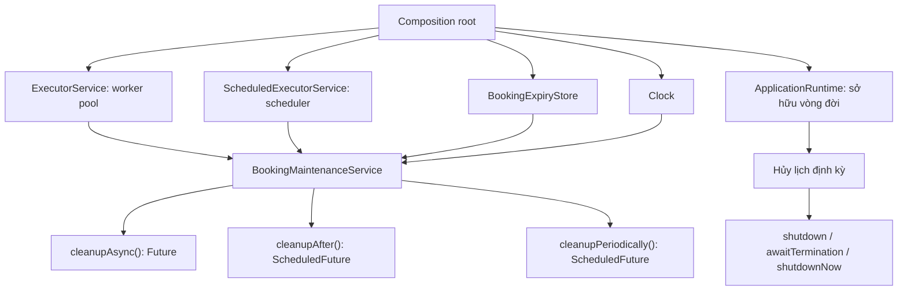
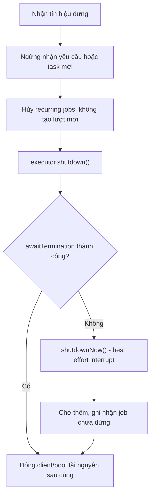

# Quản lý executor, scheduler và hủy công việc

Khi ứng dụng Java chuyển một công việc sang luồng khác hoặc chạy định kỳ, vấn đề không chỉ là gọi `submit(...)` hay `schedule(...)`. Ta phải trả lời được: **ai tạo nhóm luồng, ai có quyền gửi việc, khi nào dừng nhận việc, công việc đang chạy bị hủy thế nào và ai chịu trách nhiệm đóng tài nguyên?** Nếu những câu hỏi này không rõ ràng, ứng dụng có thể rò rỉ luồng, xử lý công việc sau khi request kết thúc hoặc không thể dừng sạch khi triển khai phiên bản mới.

Trong **Dependency Injection (DI)**, `ExecutorService` và `ScheduledExecutorService` là các **phụ thuộc hạ tầng có vòng đời**. Service có thể nhận chúng qua constructor để sử dụng, còn **composition root** tạo, cấu hình, chia sẻ và quản lý việc dừng chúng. Đây là cách thực hành **Inversion of Control (IoC)**: thành phần nghiệp vụ không tự ý tạo các thread pool không ai kiểm soát.

Bài thuộc chương **Đồng thời và bất đồng bộ**, tập trung vào quản lý executor, scheduler và hủy công việc. Ta sẽ xây dựng ví dụ Java thuần có `Future`, `ScheduledFuture`, xử lý interruption, dừng ứng dụng an toàn và kiểm thử bằng `CountDownLatch`, trước khi liên hệ đến DI container, scope và vòng đời.

## 1. Phân biệt executor, scheduler và công việc

**Executor** là một thành phần nhận công việc để thực thi, giúp tách *nơi yêu cầu làm việc* khỏi *cơ chế chạy việc*. `ExecutorService` bổ sung quản lý vòng đời và các thao tác như `submit(...)`, `shutdown()`. `ScheduledExecutorService` cho phép hẹn chạy sau một khoảng trễ hoặc lặp theo lịch.

| Khái niệm | API Java tiêu biểu | Trách nhiệm |
| --- | --- | --- |
| Thực thi một công việc | `Executor.execute(Runnable)` | Yêu cầu thực thi; không trả về kết quả |
| Thực thi có kết quả hoặc theo dõi | `ExecutorService.submit(Callable<T>)` | Trả `Future<T>` để lấy kết quả, quan sát hoàn thành hoặc hủy |
| Hẹn chạy một lần | `ScheduledExecutorService.schedule(...)` | Trả `ScheduledFuture`, có thể hủy trước hoặc trong khi chạy |
| Chạy định kỳ | `scheduleAtFixedRate(...)`, `scheduleWithFixedDelay(...)` | Quản lý các lần chạy lặp lại cho tới khi hủy, lỗi hoặc executor dừng |
| Dừng nhận việc mới | `ExecutorService.shutdown()` | Không nhận task mới; tiếp tục xử lý các task đã được nhận theo chính sách executor |
| Yêu cầu dừng mạnh hơn | `shutdownNow()` | Cố gắng ngắt task đang chạy và trả về danh sách task còn chờ chưa bắt đầu |

`Future` là **tay nắm theo dõi một công việc**, không phải chính thread đó. `future.cancel(true)` có thể gửi tín hiệu ngắt cho thread đang thực thi, nhưng không bảo đảm task ngừng tức thì. `future.get(timeout, unit)` chỉ giới hạn **thời gian caller chờ kết quả**; khi hết hạn, task không tự động bị hủy.

### Một câu hỏi về quyền sở hữu

Nếu `BookingMaintenanceService` nhận `ExecutorService` qua constructor, service **sử dụng** executor, nhưng không nhất thiết **sở hữu** nó. Pool có thể đang phục vụ cả `NotificationService` và `ReportService`. Vì thế, gọi `executor.shutdown()` trong một phương thức nghiệp vụ có thể làm các service khác không gửi được việc nữa.

**Quy ước đề xuất:** composition root hoặc một thành phần quản lý vòng đời được chỉ định sở hữu pool; các service chỉ được mượn để gửi task. Nếu một factory tạo một executor riêng cho một tác vụ thật sự độc lập, cần thể hiện rõ factory/caller nào sẽ chịu trách nhiệm đóng pool đó.

## 2. Đồ thị DI và đường đi của một công việc



Service **không** gọi `Executors.newFixedThreadPool(...)` ở mỗi request. Nó nhận executor, scheduler, repository và clock từ nơi lắp ghép. Điều đó có các lợi ích:

- Có thể thay implementation của executor hoặc chính sách thread pool khi cấu hình ứng dụng mà không sửa nghiệp vụ.
- Các service dùng chung một pool **khi việc chia sẻ được chủ ý**; không phát sinh pool ẩn sau mỗi constructor.
- Có điểm tập trung để đo số công việc, kiểm soát tài nguyên và dừng ứng dụng.
- Unit test có thể inject executor được điều khiển hoặc một pool riêng rồi đóng đúng lúc.

**Sơ đồ lắp ghép không giống đường gọi lúc chạy:** sau khi tạo service, chưa có task nào bắt buộc được thực thi. Chỉ khi `cleanupAsync()` hoặc `cleanupPeriodically(...)` được gọi, task mới được gửi vào pool. Cần theo dõi cả việc đã lắp ghép đúng executor và việc task thực sự chạy theo chính sách.

## 3. Chọn scope theo thời gian sống và khả năng chia sẻ

Executor thường là tài nguyên **tồn tại lâu hơn một request** vì tạo/đóng thread pool trên từng lời gọi gây chi phí và làm việc dừng khó kiểm soát. Tuy nhiên, “dùng chung” chỉ hợp lý khi pool có thể phục vụ mức tải và loại công việc của những service được nối vào nó.

| Thành phần | Scope thường cân nhắc | Lý do và điều kiện |
| --- | --- | --- |
| Executor cho xử lý tác vụ ứng dụng | Cấp ứng dụng | Tái sử dụng luồng, giới hạn số worker; cấu hình tải và queue phù hợp |
| Scheduler dùng để kích hoạt lịch | Cấp ứng dụng | Duy trì các tác vụ định kỳ và dễ dừng ở một nơi |
| Dữ liệu của một request | Theo request hoặc tham số task | Không giữ `currentUser`/`requestId` mutable trong service dùng chung |
| `Future` của một task | Gắn với caller hoặc thành phần theo dõi task | Caller có thể chờ, hủy hoặc quan sát lỗi theo hợp đồng |
| `ScheduledFuture` của task định kỳ | Bên đăng ký lịch và quản lý vòng đời | Cần hủy trước khi đóng scheduler hoặc thay cấu hình lịch |
| Kết nối/file handle mà task dùng | Theo chính sách ownership của tài nguyên | Đóng/trả khi task xong; không đồng nhất với thời gian sống của pool |

**Singleton không đồng nghĩa an toàn luồng.** Một service được inject vào nhiều request có thể bị gọi đồng thời. Không nên giữ `currentBooking` hoặc `currentRequestContext` trong các trường mutable rồi giả định executor sẽ tự cô lập dữ liệu. Hãy truyền dữ liệu bất biến vào từng `Runnable`/`Callable` và bảo đảm các repository hoặc cộng tác viên được dùng chung có chính sách đồng thời phù hợp.

Khi sử dụng pool cố định, cần nhớ `Executors.newFixedThreadPool(n)` có hàng đợi có thể tăng không giới hạn theo lượng task gửi vào. Trong production, hãy cân nhắc giới hạn queue, cơ chế từ chối hoặc tạo áp lực ngược (*backpressure*), timeout và đo tải bằng `ThreadPoolExecutor` hay thư viện phù hợp. **DI giải quyết quyền lắp ghép, không tự quyết định dung lượng an toàn cho pool.**

## 4. Scheduler: fixed rate và fixed delay khác nhau thế nào?

Hai phương thức chạy định kỳ có ngữ nghĩa khác nhau:

```java
// Lịch dựa theo mốc bắt đầu, cố bám chu kỳ dự kiến.
scheduler.scheduleAtFixedRate(job, 0, 10, TimeUnit.SECONDS);

// Lịch dựa theo thời điểm lần chạy trước hoàn thành.
scheduler.scheduleWithFixedDelay(job, 0, 10, TimeUnit.SECONDS);
```

Giả sử công việc kéo dài 15 giây:

| Phương thức | Mốc mong muốn | Điều cần hiểu |
| --- | --- | --- |
| `scheduleAtFixedRate` | Bắt đầu ở các mốc 0, 10, 20, 30... giây | Khi task chậm, lần chạy sau có thể bắt đầu muộn rồi chạy sát nhau để bám lịch |
| `scheduleWithFixedDelay` | Chạy xong rồi đợi thêm 10 giây | Giãn khoảng nghỉ giữa các lượt; phù hợp khi không muốn chạy liên tiếp |

Với các phương thức định kỳ của `ScheduledThreadPoolExecutor`, **các lượt chạy của chính cùng một task định kỳ không chồng lên nhau**; nếu một lượt lâu hơn chu kỳ, lượt tiếp theo bắt đầu trễ. Điều này **không ngăn những task khác** trong cùng pool chạy đồng thời khi scheduler có nhiều thread.

Khi chọn cách lập lịch:

- Dùng **fixed rate** nếu muốn bám nhịp theo thời điểm và chấp nhận lượt sau có thể chạy liền sau lượt trước khi bị trễ.
- Dùng **fixed delay** nếu muốn bảo đảm khoảng nghỉ tương đối sau khi mỗi lượt hoàn thành.
- Nếu cần thời điểm lịch thực như “02:00 hằng ngày theo múi giờ X”, hai API trên không tự mô hình hóa timezone, DST và lịch dân sự; cần tính thời điểm chạy tiếp theo hoặc dùng scheduler chuyên dụng.
- Một periodic task không nên chặn lâu nếu scheduler còn phải kích hoạt nhiều task quan trọng. Khi tách việc chạy sang worker pool khác, phải thiết kế cách xử lý queue, quá tải và khả năng nhiều lượt tác vụ chồng nhau.

**Quan trọng:** nếu một lần thực thi của tác vụ định kỳ ném exception không được bắt, các lần chạy tiếp theo thường bị dừng theo hợp đồng `ScheduledExecutorService`. Có thể chọn chính sách *fail-stop* có quan sát lỗi, hoặc bắt/log lỗi trong từng lượt để tiếp tục; đừng vô tình nuốt exception và coi công việc đã thành công.

## 5. Ví dụ Java thuần: một nơi sở hữu cả pool và lịch

Ví dụ xây dựng service dọn booking đã hết hạn. `BookingMaintenanceService` nhận các phụ thuộc qua constructor và có ba thao tác:

1. `cleanupAsync()` gửi một lượt dọn dẹp vào worker pool.
2. `cleanupAfter(...)` hẹn một lượt dọn dẹp qua scheduler.
3. `cleanupPeriodically(...)` đăng ký việc dọn dẹp lặp theo **fixed delay**.

`ApplicationRuntime` giữ các `ScheduledFuture` định kỳ được đăng ký qua runtime, hủy chúng khi dừng và chịu trách nhiệm đóng cả hai executor. Đây là một ví dụ về **ownership ở composition root**; service không có phương thức đóng pool.

Tạo file `ExecutorOwnershipDemo.java`:

```java
import java.time.Clock;
import java.time.Instant;
import java.util.ArrayList;
import java.util.List;
import java.util.Map;
import java.util.Objects;
import java.util.concurrent.ConcurrentHashMap;
import java.util.concurrent.ExecutionException;
import java.util.concurrent.ExecutorService;
import java.util.concurrent.Executors;
import java.util.concurrent.Future;
import java.util.concurrent.ScheduledExecutorService;
import java.util.concurrent.ScheduledFuture;
import java.util.concurrent.TimeUnit;
import java.util.concurrent.TimeoutException;

interface BookingExpiryStore {
    int purgeExpired(Instant now);
}

final class InMemoryBookingExpiryStore implements BookingExpiryStore {
    private final Map<String, Instant> expiresAt = new ConcurrentHashMap<>();

    void add(String bookingId, Instant expiry) {
        if (bookingId == null || bookingId.trim().isEmpty()) {
            throw new IllegalArgumentException("bookingId khong hop le");
        }
        expiresAt.put(bookingId, Objects.requireNonNull(expiry, "expiry"));
    }

    @Override
    public int purgeExpired(Instant now) {
        Objects.requireNonNull(now, "now");
        int removed = 0;
        for (Map.Entry<String, Instant> item : expiresAt.entrySet()) {
            if (!item.getValue().isAfter(now)
                    && expiresAt.remove(item.getKey(), item.getValue())) {
                removed++;
            }
        }
        return removed;
    }

    int size() {
        return expiresAt.size();
    }
}

final class BookingMaintenanceService {
    private final BookingExpiryStore store;
    private final ExecutorService workers;
    private final ScheduledExecutorService scheduler;
    private final Clock clock;

    BookingMaintenanceService(
            BookingExpiryStore store,
            ExecutorService workers,
            ScheduledExecutorService scheduler,
            Clock clock) {
        this.store = Objects.requireNonNull(store, "store");
        this.workers = Objects.requireNonNull(workers, "workers");
        this.scheduler = Objects.requireNonNull(scheduler, "scheduler");
        this.clock = Objects.requireNonNull(clock, "clock");
    }

    Future<Integer> cleanupAsync() {
        return workers.submit(() -> store.purgeExpired(clock.instant()));
    }

    ScheduledFuture<Integer> cleanupAfter(long delay, TimeUnit unit) {
        if (delay < 0) {
            throw new IllegalArgumentException("delay phai >= 0");
        }
        Objects.requireNonNull(unit, "unit");
        return scheduler.schedule(
            () -> store.purgeExpired(clock.instant()), delay, unit);
    }

    ScheduledFuture<?> cleanupPeriodically(
            long initialDelay, long delay, TimeUnit unit) {
        if (initialDelay < 0 || delay <= 0) {
            throw new IllegalArgumentException("delay khong hop le");
        }
        Objects.requireNonNull(unit, "unit");

        return scheduler.scheduleWithFixedDelay(() -> {
            try {
                store.purgeExpired(clock.instant());
            } catch (RuntimeException error) {
                // Chinh sach minh hoa: ghi loi roi tiep tuc cac luot sau.
                // Production can logger, metrics va bao dong phu hop.
                System.err.println("Cleanup failed: "
                    + error.getClass().getSimpleName());
            }
        }, initialDelay, delay, unit);
    }
}

final class ApplicationRuntime implements AutoCloseable {
    private final BookingMaintenanceService service;
    private final ExecutorService workers;
    private final ScheduledExecutorService scheduler;
    private final List<ScheduledFuture<?>> recurring = new ArrayList<>();
    private boolean closed;

    ApplicationRuntime(BookingMaintenanceService service,
                       ExecutorService workers,
                       ScheduledExecutorService scheduler) {
        this.service = Objects.requireNonNull(service, "service");
        this.workers = Objects.requireNonNull(workers, "workers");
        this.scheduler = Objects.requireNonNull(scheduler, "scheduler");
    }

    BookingMaintenanceService service() {
        return service;
    }

    synchronized ScheduledFuture<?> startRecurring(
            long initialDelay, long delay, TimeUnit unit) {
        if (closed) {
            throw new IllegalStateException("ApplicationRuntime da dong");
        }
        ScheduledFuture<?> handle =
            service.cleanupPeriodically(initialDelay, delay, unit);
        recurring.add(handle);
        return handle;
    }

    @Override
    public void close() {
        synchronized (this) {
            if (closed) {
                return;
            }
            closed = true;
            // Khong tao luot moi; luot dang chay duoc phep hoan tat.
            for (ScheduledFuture<?> handle : recurring) {
                handle.cancel(false);
            }
        }
        stopGracefully(scheduler);
        stopGracefully(workers);
    }

    private static void stopGracefully(ExecutorService executor) {
        executor.shutdown(); // Tu choi cong viec moi.
        try {
            if (!executor.awaitTermination(2, TimeUnit.SECONDS)) {
                executor.shutdownNow(); // Co gang interrupt task dang chay.
                if (!executor.awaitTermination(2, TimeUnit.SECONDS)) {
                    System.err.println("Executor chua dung hoan toan");
                }
            }
        } catch (InterruptedException interrupted) {
            executor.shutdownNow();
            Thread.currentThread().interrupt();
        }
    }
}

final class CompositionRoot {
    private CompositionRoot() {
    }

    static ApplicationRuntime build(BookingExpiryStore store, Clock clock) {
        Objects.requireNonNull(store, "store");
        Objects.requireNonNull(clock, "clock");
        ExecutorService workers = Executors.newFixedThreadPool(2);
        ScheduledExecutorService scheduler =
            Executors.newSingleThreadScheduledExecutor();
        BookingMaintenanceService service =
            new BookingMaintenanceService(store, workers, scheduler, clock);
        return new ApplicationRuntime(service, workers, scheduler);
    }
}

public class ExecutorOwnershipDemo {
    public static void main(String[] args)
            throws InterruptedException, ExecutionException, TimeoutException {
        Instant now = Instant.parse("2026-01-01T12:00:00Z");
        Clock clock = Clock.fixed(now, java.time.ZoneOffset.UTC);
        InMemoryBookingExpiryStore store = new InMemoryBookingExpiryStore();
        store.add("BK-EXPIRED", Instant.parse("2026-01-01T11:00:00Z"));
        store.add("BK-ACTIVE", Instant.parse("2026-01-01T13:00:00Z"));

        // Composition root so huu pool va scheduler.
        try (ApplicationRuntime app = CompositionRoot.build(store, clock)) {
            Future<Integer> immediate = app.service().cleanupAsync();
            System.out.println("REMOVED " + immediate.get(2, TimeUnit.SECONDS));

            ScheduledFuture<Integer> oneShot =
                app.service().cleanupAfter(0, TimeUnit.SECONDS);
            System.out.println("SCHEDULED_REMOVED "
                + oneShot.get(2, TimeUnit.SECONDS));

            // Hen sau mot gio; huy truoc khi chay de minh hoa cancel.
            ScheduledFuture<?> periodic =
                app.startRecurring(3600, 3600, TimeUnit.SECONDS);
            System.out.println("CANCELLED " + periodic.cancel(false));
            System.out.println("REMAINING " + store.size());
        } // Dong recurring handles, scheduler va worker pool.
    }
}
```

Biên dịch và chạy bằng JDK 8 trở lên:

```bash
javac ExecutorOwnershipDemo.java
java ExecutorOwnershipDemo
```

Kết quả kỳ vọng trong môi trường chạy bình thường:

```text
REMOVED 1
SCHEDULED_REMOVED 0
CANCELLED true
REMAINING 1
```

`Clock.fixed(...)` giúp kết quả dọn dẹp không phụ thuộc đồng hồ thật. `cleanupAsync()` được gửi vào worker pool và chờ kết quả qua `Future.get(2, SECONDS)`; `cleanupAfter(0, ...)` được scheduler chạy một lần; tác vụ định kỳ được hẹn sau một giờ rồi bị hủy trước khi bắt đầu. Vì vậy, ví dụ **không cần `Thread.sleep(...)` để tạo kết quả mong đợi**. Trên máy bị quá tải, một phép chờ có timeout vẫn có thể hết hạn; khi đó `TimeoutException` báo rằng caller chưa nhận kết quả đúng hạn, không có nghĩa task bị hủy.

Trong ứng dụng thật, `InMemoryBookingExpiryStore` chỉ là adapter học tập. Việc dọn dữ liệu thật có thể cần transaction, batch, giới hạn thời gian, khả năng chạy lại an toàn và coordination nếu nhiều tiến trình cùng dọn. `ConcurrentHashMap` hỗ trợ thao tác `remove(key, value)` nguyên tử trên từng entry, nhưng không thay thế thiết kế nhất quán cho một quy trình nhiều bước.

### Một giới hạn của ví dụ về quyền sở hữu

`ApplicationRuntime` quản lý các lịch được đăng ký qua `startRecurring(...)`. Nếu code khác gọi trực tiếp `service().cleanupPeriodically(...)`, runtime **không lưu riêng handle đó**, dù khi scheduler đóng thì lịch cũng không thể tiếp tục vô hạn. Trong ứng dụng lớn, nên **chỉ công bố API đăng ký lịch ở thành phần quản lý vòng đời** hoặc tập trung đăng ký để mọi lịch đều có chủ sở hữu rõ ràng. `ApplicationRuntime` đồng bộ thao tác `startRecurring` và phần đánh dấu đóng để tránh đăng ký lịch mới sau khi runtime đã đóng.

`close()` hủy recurring với `cancel(false)`: không yêu cầu ngắt lượt đang thực thi, rồi `shutdown()` chờ các việc đã nhận hoàn tất trong thời hạn. Nếu hết hạn, `shutdownNow()` được dùng như bước dự phòng; nó chỉ *cố gắng* ngắt task, không thể bảo đảm thread dừng ngay. Mã minh họa không thực hiện tiến trình shutdown nhiều giai đoạn như dừng nhận HTTP request, chờ công việc đang xử lý và thu hồi kết nối; hệ thống server phải xác định thứ tự này rõ ràng.

## 6. Hủy công việc là hợp tác, không phải nút “kill thread”

Với `Future<?> handle`:

```java
boolean accepted = handle.cancel(false); // Huy neu co the, khong interrupt.
boolean mayInterrupt = handle.cancel(true); // Cho phep interrupt neu dang chay.
```

Hai lựa chọn không tương đương:

- **`cancel(false)`**: nếu task chưa chạy, cố gắng ngăn task chạy. Nếu task đã chạy, không yêu cầu interrupt. Tùy trạng thái, `cancel(...)` có thể đánh dấu future là cancelled dù việc đang chạy chưa thật sự kết thúc.
- **`cancel(true)`**: nếu task đang chạy, executor có thể interrupt thread thực thi. Task phải **hợp tác với interruption**, kiểm tra tín hiệu hoặc dừng ở điểm chờ có thể bị ngắt.
- Giá trị trả về **`true` không phải bằng chứng thread đã dừng**. Muốn xác nhận cleanup hoàn tất, cần cơ chế phối hợp như `CountDownLatch`, trạng thái hoàn thành riêng hoặc quản lý shutdown.
- `isCancelled()` và `isDone()` mô tả trạng thái future, không tự chứng minh mọi side effect của task đã được hoàn tác.

Một task biết hợp tác với interruption:

```java
Runnable cancellableJob = () -> {
    try {
        while (!Thread.currentThread().isInterrupted()) {
            // Lam mot don vi cong viec ngan.
            // Dieu kien trong vi du chi de minh hoa.
            TimeUnit.MILLISECONDS.sleep(100);
        }
    } catch (InterruptedException interrupted) {
        // Phuc hoi co ngat neu code o tang tren can quan sat.
        Thread.currentThread().interrupt();
    } finally {
        // Giai phong tai nguyen ma chinh task so huu.
    }
};
```

`Thread.sleep(...)` ở đoạn này **minh họa điểm chờ có thể bị ngắt**, không phải kỹ thuật đồng bộ test. Trong production, task cần xác định trạng thái dừng, xử lý tài nguyên và các bước không thể hoàn tác. Đừng bắt `InterruptedException` rồi tiếp tục vòng lặp như không có gì: điều đó làm tín hiệu dừng bị mất.

**Giới hạn quan trọng:** một lời gọi I/O hoặc thư viện bên ngoài có thể không phản hồi ngay với interruption. Cần cấu hình timeout, cancellation API của client hoặc cơ chế đóng tài nguyên theo hợp đồng thư viện; không dựa hoàn toàn vào `cancel(true)`.

### `Future.get(timeout)` không đồng nghĩa `cancel`

```java
Future<Integer> future = service.cleanupAsync();
try {
    Integer removed = future.get(2, TimeUnit.SECONDS);
    System.out.println(removed);
} catch (TimeoutException tooSlow) {
    future.cancel(true); // Quyet dinh chu dong, neu hop dong cho phep.
}
```

Khi `get` hết hạn, task có thể vẫn đang chạy. Hủy là **quyết định của caller** dựa trên việc có cho phép bỏ dở nhiệm vụ hay không. Một tác vụ đã ghi dữ liệu rồi bị interrupt không tự động rollback dữ liệu đó. Cần thiết kế idempotency, transaction hoặc cơ chế bù trừ nếu nghiệp vụ yêu cầu.

Khi `get` ném `ExecutionException`, lỗi thật của `Callable` thường nằm trong `getCause()`. Khi future đã bị hủy, gọi `get` có thể ném `CancellationException`. Các lỗi này nên được phân biệt khi thiết kế API quan sát trạng thái job.

## 7. Kiểm thử không dùng sleep: kết quả, lịch và hủy có tín hiệu

Để test async, **đừng dự đoán một task hoàn thành sau đúng bao nhiêu mili giây** rồi gọi `Thread.sleep(...)`. Dùng `Future.get(timeout)` để quan sát kết quả, `CountDownLatch` để biết một task đã bắt đầu hoặc đã thoát, và đóng tất cả pool tạo riêng trong test.

Tạo file `ExecutorOwnershipDemoTest.java` **cùng thư mục** với file ví dụ:

```java
import java.time.Clock;
import java.time.Instant;
import java.time.ZoneOffset;
import java.util.concurrent.CountDownLatch;
import java.util.concurrent.ExecutionException;
import java.util.concurrent.ExecutorService;
import java.util.concurrent.Executors;
import java.util.concurrent.Future;
import java.util.concurrent.ScheduledFuture;
import java.util.concurrent.TimeUnit;

public class ExecutorOwnershipDemoTest {
    private static final Clock FIXED_CLOCK = Clock.fixed(
        Instant.parse("2026-01-01T12:00:00Z"), ZoneOffset.UTC);

    public static void main(String[] args) throws Exception {
        testIndependentApplicationRuntimes();
        testScheduledOnceAndRecurringCancellation();
        testAsyncFailureIsObservable();
        testCooperativeCancellation();
        System.out.println("ExecutorOwnershipDemoTest PASSED");
    }

    static void testIndependentApplicationRuntimes() throws Exception {
        InMemoryBookingExpiryStore first = new InMemoryBookingExpiryStore();
        InMemoryBookingExpiryStore second = new InMemoryBookingExpiryStore();
        Instant expiredAt = Instant.parse("2026-01-01T11:00:00Z");
        first.add("BK-1", expiredAt);
        second.add("BK-2", expiredAt);

        // Moi test so huu runtime, worker pool va scheduler rieng.
        try (ApplicationRuntime a = CompositionRoot.build(first, FIXED_CLOCK);
             ApplicationRuntime b = CompositionRoot.build(second, FIXED_CLOCK)) {
            int removed = a.service().cleanupAsync().get(2, TimeUnit.SECONDS);
            check(removed == 1, "A phai xoa mot booking");
            check(first.size() == 0, "Kho A phai rong");
            check(second.size() == 1, "A khong duoc thay doi kho B");
        }
    }

    static void testScheduledOnceAndRecurringCancellation()
            throws Exception {
        InMemoryBookingExpiryStore store = new InMemoryBookingExpiryStore();
        store.add("BK-3", Instant.parse("2026-01-01T11:00:00Z"));

        try (ApplicationRuntime runtime =
                 CompositionRoot.build(store, FIXED_CLOCK)) {
            ScheduledFuture<Integer> once =
                runtime.service().cleanupAfter(0, TimeUnit.SECONDS);
            check(once.get(2, TimeUnit.SECONDS) == 1,
                "Scheduler phai chay job mot lan");

            ScheduledFuture<?> recurring = runtime.startRecurring(
                3600, 3600, TimeUnit.SECONDS);
            check(recurring.cancel(false), "Phai huy duoc lich chua chay");
            check(recurring.isCancelled(), "Handle phai bao cancelled");
        }
    }

    static void testAsyncFailureIsObservable() throws Exception {
        BookingExpiryStore brokenStore = cutoff -> {
            throw new IllegalStateException("storage failed");
        };

        try (ApplicationRuntime runtime =
                 CompositionRoot.build(brokenStore, FIXED_CLOCK)) {
            Future<Integer> future = runtime.service().cleanupAsync();
            boolean observed = false;
            try {
                future.get(2, TimeUnit.SECONDS);
            } catch (ExecutionException failure) {
                observed =
                    failure.getCause() instanceof IllegalStateException;
            }
            check(observed, "Phai quan sat duoc loi task qua Future");
        }
    }

    static void testCooperativeCancellation() throws Exception {
        ExecutorService executor = Executors.newSingleThreadExecutor();
        CountDownLatch started = new CountDownLatch(1);
        CountDownLatch exited = new CountDownLatch(1);
        Future<?> handle = null;

        try {
            handle = executor.submit(() -> {
                started.countDown();
                try {
                    // Cho vo han cho toi khi bi interrupt: khong sleep doan.
                    new CountDownLatch(1).await();
                } catch (InterruptedException interrupted) {
                    Thread.currentThread().interrupt();
                } finally {
                    exited.countDown();
                }
            });

            check(started.await(2, TimeUnit.SECONDS),
                "Job phai bat dau truoc khi huy");
            check(handle.cancel(true), "Yeu cau huy phai duoc chap nhan");
            check(exited.await(2, TimeUnit.SECONDS),
                "Job phai thoat khi nhan interruption");
            check(handle.isCancelled(), "Future phai bao cancelled");
        } finally {
            if (handle != null) {
                handle.cancel(true);
            }
            executor.shutdownNow();
            executor.awaitTermination(2, TimeUnit.SECONDS);
        }
    }

    private static void check(boolean condition, String message) {
        if (!condition) {
            throw new AssertionError(message);
        }
    }
}
```

Chạy:

```bash
javac ExecutorOwnershipDemo.java ExecutorOwnershipDemoTest.java
java ExecutorOwnershipDemoTest
```

Kết quả mong đợi:

```text
ExecutorOwnershipDemoTest PASSED
```

Các test trong ví dụ tạo **executor riêng** và dọn sau khi kết thúc, tránh việc test trước để lại task ảnh hưởng test sau. `CountDownLatch` giúp test biết task đang chờ rồi mới gọi `cancel(true)`, tránh tranh chấp giữa “hủy lúc chưa chạy” và “hủy khi đang chạy”. Latch `exited` chứng minh task đã rời khỏi khối chạy trong test này, trong khi `future.isCancelled()` chỉ nói lên trạng thái future.

Timeout trong test là **giới hạn chờ**, không phải “ngủ đủ lâu để task chạy”. Nếu môi trường CI quá tải, một timeout chặt có thể gây thất bại do độ trễ của hệ thống; điều chỉnh timeout phù hợp nhưng vẫn giữ đồng bộ dựa trên tín hiệu thay vì `sleep` mù.

## 8. Shutdown đúng thứ tự: ngừng nhận, hủy, chờ, rồi dọn

Một quy trình dừng thường gồm:



Thứ tự thực tế phải phản ánh phụ thuộc của ứng dụng. Nếu worker vẫn cần database client để xử lý task đã nhận, **đừng đóng database trước khi worker kết thúc**. Nếu scheduler định kỳ còn gửi việc mới vào worker pool, cần **ngừng lịch trước**, sau đó mới shutdown worker.

`shutdown()` **không chờ** pool dừng xong: nó chuyển sang trạng thái không nhận việc mới. Dùng `awaitTermination(timeout, unit)` để chờ có giới hạn. `shutdownNow()` thường gửi interrupt tới các worker đang chạy và trả danh sách công việc chưa bắt đầu, nhưng task không hợp tác có thể tiếp tục chạy. Cần quan sát trường hợp quá hạn thay vì ghi log “đã dừng sạch” khi chưa có bằng chứng.

Nếu thread điều phối bị interrupt trong khi chờ, thông thường cần yêu cầu dừng khẩn và **khôi phục cờ interrupt** bằng `Thread.currentThread().interrupt()`. Bài mẫu thể hiện nguyên tắc này trong `stopGracefully(...)`.

**Các lịch `ScheduledFuture` bị hủy không nên bị quên trong queue mãi.** Với `ScheduledThreadPoolExecutor` cụ thể, có tùy chọn `setRemoveOnCancelPolicy(true)` giúp loại bỏ các task hủy khỏi hàng đợi sớm hơn. Đây là cấu hình của class triển khai, không phải phương thức chung của mọi `ScheduledExecutorService`; hữu ích khi ứng dụng tạo/hủy rất nhiều lịch dài hạn.

## 9. Lỗi, timeout và quá tải không được che giấu

Việc chạy bất đồng bộ khiến exception không nhất thiết xuất hiện ngay tại lệnh `submit(...)`. Một `Callable` ném lỗi thường dẫn tới `Future.get()` ném `ExecutionException`; nếu caller không bao giờ lấy kết quả hoặc có cơ chế quan sát khác, lỗi có thể bị bỏ sót trong giám sát ứng dụng.

Đối với job định kỳ:

- **Fail-stop:** cho exception thoát khỏi `Runnable` để các lượt tiếp theo dừng, sau đó có cơ chế quan sát `ScheduledFuture`/lỗi. Phù hợp khi tiếp tục chạy có thể gây hại.
- **Tiếp tục có kiểm soát:** bắt exception, log/metric/alert rồi cho phép lượt sau chạy tiếp. Mẫu `cleanupPeriodically(...)` chọn cách này; trong production không nên chỉ dựa vào `System.err`.
- **Retry:** cần chính sách riêng về số lần, khoảng chờ, idempotency và phân biệt lỗi tạm thời với lỗi lâu dài. `scheduleWithFixedDelay` **không tự** là một chính sách retry an toàn cho mọi tác vụ.

Pool còn có thể bị **quá tải**: nhiều task bị xếp hàng, độ trễ tăng và bộ nhớ tăng. Phản ứng phù hợp có thể là giới hạn queue, trả lỗi sớm, trì hoãn producer hoặc điều tiết tốc độ gửi việc. Đừng tăng số thread vô hạn để “chữa” một task đang chặn ở database hay network.

Một **deadlock do chờ cùng pool** cũng dễ xuất hiện: task A chạy trên executor một luồng, gửi task B vào chính executor đó rồi gọi `B.get()`; B không có thread để chạy vì A đang chiếm worker và chờ B. Nên tránh block trong task để đợi việc con trên pool có dung lượng không đủ; có thể phối hợp bất đồng bộ hoặc tách executor theo loại công việc khi hợp lý.

## 10. Context của request không tự đi theo luồng

Một service có thể xử lý đồng thời nhiều request. Không nên giữ thông tin request hiện tại trong trường mutable của singleton:

```java
// Anti-pattern: request sau co the ghi de gia tri request truoc.
class UnsafeAsyncService {
    private String currentUser;

    void run(String userId, ExecutorService executor) {
        currentUser = userId;
        executor.submit(() -> System.out.println(currentUser));
    }
}
```

Thay bằng **snapshot dữ liệu cần thiết cho task**:

```java
void run(String userId, ExecutorService executor) {
    final String capturedUser = java.util.Objects.requireNonNull(userId);
    executor.submit(() -> System.out.println(capturedUser));
}
```

Một `ThreadLocal` gắn với thread xử lý request **không tự động có mặt trên worker thread** của executor. Nếu cần mang correlation ID, thông tin tenant hoặc ngữ cảnh bảo mật, hãy truyền dữ liệu có phạm vi rõ ràng vào task hoặc sử dụng cơ chế context propagation được thư viện/framework hỗ trợ; đồng thời bảo đảm cleanup để thông tin không rò rỉ sang task tiếp theo trên cùng worker.

Đặc biệt, với request-scope bean hoặc resource transaction, **không nên giữ trực tiếp một object chỉ hợp lệ trong request** rồi sử dụng sau khi request kết thúc. Việc chuyển thực thi sang executor không tự kéo dài lifetime của các phụ thuộc ngắn hạn.

## 11. `CompletableFuture` và các cơ chế bất đồng bộ của framework

`CompletableFuture` cho phép xây chuỗi xử lý bất đồng bộ:

```java
java.util.concurrent.CompletableFuture<Integer> result =
    java.util.concurrent.CompletableFuture.supplyAsync(
        () -> store.purgeExpired(clock.instant()), workers);
```

Trong đoạn này, executor được **truyền tường minh**. Nếu dùng `supplyAsync(...)` mà không cung cấp executor, Java thường sử dụng cơ chế thực thi mặc định của `CompletableFuture` (phổ biến là `ForkJoinPool.commonPool()` trong điều kiện thích hợp). Điều đó có thể khiến công việc chạy ngoài pool được cấu hình cho ứng dụng; không nên dựa vào default khi công việc cần quota, observability, context hay quy tắc dừng rõ ràng.

**`CompletableFuture.cancel(true)` không có cùng bảo đảm interrupt với `Future` từ `ExecutorService.submit(...)`.** Theo hợp đồng của `CompletableFuture`, tham số `mayInterruptIfRunning` không điều khiển interruption khi implementation của nó không dùng interrupt để kiểm soát xử lý. Hủy một stage cũng không đồng nghĩa mọi tác vụ phía trước hoặc side effect đã dừng. Cần thiết kế cơ chế cancellation riêng nếu thực sự phải dừng tác vụ đang chạy.

Trong framework DI, executor có thể là một bean/binding quản lý vòng đời, scheduler có thể được đăng ký qua annotation hoặc module cấu hình, và hệ thống có thể cung cấp cơ chế propagation, retry, shutdown riêng. **Những cơ chế ấy là tính năng cụ thể của framework**. Nguyên tắc chung vẫn là xác định **pool thuộc ai, ai gửi việc, khi nào hủy và ai đóng tài nguyên**.

## 12. Anti-pattern thường gặp

| Anti-pattern | Hệ quả | Hướng xử lý |
| --- | --- | --- |
| Service tạo `newFixedThreadPool(...)` trong mỗi request | Rò rỉ thread, khó quan sát và dừng | Inject executor; composition root sở hữu pool |
| Một service mượn executor rồi gọi `shutdown()` | Service khác không gửi được việc nữa | Chỉ owner thực hiện shutdown |
| Chỉ gọi `shutdown()` rồi giả định task đã dừng | Task vẫn chạy, tài nguyên bị đóng quá sớm | `awaitTermination` có timeout, fallback và quan sát |
| `future.get(timeout)` hết hạn rồi bỏ mặc | Task có thể tiếp tục tiêu tốn tài nguyên | Quyết định hủy/giám sát theo hợp đồng nghiệp vụ |
| Tin `cancel(true)` luôn ngắt được I/O | Task có thể không phản hồi interruption | Timeout và cancellation API chuyên dụng |
| Bắt `InterruptedException` rồi tiếp tục im lặng | Mất tín hiệu dừng | Cleanup và khôi phục cờ interrupt khi phù hợp |
| Scheduler định kỳ ném exception không được quan sát | Lịch có thể dừng mà không ai biết | Chính sách log/metric/fail-stop rõ ràng |
| Dùng fixed rate cho job lâu mà không hiểu lịch | Lượt sau chạy sát nhau khi bị trễ | Chọn fixed delay hoặc phối hợp tải theo nhu cầu |
| Gửi task vô hạn vào fixed pool không giới hạn queue | Độ trễ, bộ nhớ tăng | Capacity planning, bounded queue, backpressure |
| Dùng field singleton chứa `currentRequest` | Dữ liệu request bị trộn giữa task | Truyền snapshot riêng vào mỗi task |
| Test async bằng `Thread.sleep(...)` | Flaky, phụ thuộc tốc độ máy | `Future.get(timeout)`, latch, tín hiệu hoàn thành |
| Đóng database trước khi worker dừng | Task bị lỗi dùng resource đã đóng | Xác lập thứ tự shutdown từ nơi sở hữu |

## 13. Checklist trước khi triển khai tác vụ bất đồng bộ

1. **Xác định loại tác vụ:** một lần, định kỳ, cần deadline, có thể hủy hay bắt buộc hoàn tất?
2. **Chọn API phù hợp:** `execute`, `submit`, `schedule`, fixed rate hay fixed delay theo ngữ nghĩa thực tế.
3. **Chỉ rõ ownership:** ai tạo executor/scheduler, ai được submit, ai giữ handle, ai có quyền cancel và shutdown?
4. **Thiết kế scope:** dữ liệu request/tenant được truyền theo task; không giữ state ngắn hạn trong singleton.
5. **Đặt giới hạn tải:** kích thước pool, hàng đợi, thời gian chờ, rejection/backpressure và giám sát.
6. **Mô tả chính sách lỗi:** exception được ai quan sát, periodic job có dừng hay tiếp tục, retry có idempotent không?
7. **Mô tả cancellation:** task phản hồi interrupt thế nào, tài nguyên nào cần đóng, task có thể bỏ dở ở bước nào?
8. **Dựng shutdown có thứ tự:** ngừng nhận việc, hủy lịch, chờ task, yêu cầu dừng mạnh hơn nếu quá hạn, đóng tài nguyên cuối.
9. **Viết test có tín hiệu:** dùng `Future`/`CountDownLatch`, không dựa vào độ trễ ước đoán; đóng pool riêng của test.
10. **Khi dùng DI container:** kiểm tra binding của pool, scope, shutdown hook, proxy/context propagation và chính sách framework thực tế.

## 14. Bài tập tự luyện

**Bài 1 — Tìm lỗi ownership.** `NotificationService` nhận `ExecutorService` qua constructor, rồi gọi `shutdown()` sau khi gửi một email. `ReportService` dùng cùng pool. Hãy mô tả lỗi có thể xảy ra và chuyển trách nhiệm shutdown về composition root.

**Bài 2 — So sánh hai lịch.** Một tác vụ dọn booking mất 15 giây, chu kỳ cấu hình 10 giây. Hãy mô tả sự khác biệt giữa `scheduleAtFixedRate` và `scheduleWithFixedDelay`. Những lượt của *cùng một periodic task* có tự động chồng lên nhau không?

**Bài 3 — Hủy cooperative.** Sửa `testCooperativeCancellation()` để task liên tục xử lý nhiều phần việc và kiểm tra `Thread.currentThread().isInterrupted()` giữa các phần. Dùng latch xác nhận task thực sự thoát; không chỉ kiểm tra `future.isCancelled()`.

**Bài 4 — Deadline và công việc đang chạy.** Caller gọi `future.get(500, MILLISECONDS)` rồi nhận `TimeoutException`. Task đã tự dừng chưa? Nếu hệ thống quyết định bỏ tác vụ, cần làm gì và giới hạn của `cancel(true)` là gì?

**Bài 5 — Phân chia pool.** Một pool chỉ có một worker. Task A gửi task B vào cùng pool rồi chờ `B.get()`. Hãy giải thích nguy cơ deadlock và đề xuất cách tránh việc chờ đồng bộ theo mô hình này.

**Bài 6 — Scope request.** Một singleton service có trường `currentTenant` và gửi task async đọc trường này. Hãy viết lại để tenant được capture thành dữ liệu bất biến của từng task và nêu cách xử lý khi cần `ThreadLocal` hoặc request-scoped bean.

**Bài 7 — Shutdown.** Vẽ thứ tự dừng cho hệ thống có HTTP server, recurring scheduler, worker pool và database pool. Thành phần nào phải dừng nhận việc trước? Thành phần nào chỉ được đóng sau khi tác vụ hoàn tất?

**Bài 8 — Kiểm thử lịch.** Bổ sung test với `cleanupAfter(0, TimeUnit.SECONDS)`, dùng `ScheduledFuture.get(timeout)` để xác nhận kết quả. Sau đó tạo một lịch có delay rất dài và hủy bằng `cancel(false)`; bảo đảm test đóng toàn bộ executor kể cả khi assertion thất bại.

**Kết luận:** DI/IoC làm rõ **ai cung cấp executor/scheduler** cho các service; composition root xác định **scope và quyền sở hữu**; `Future` và `ScheduledFuture` cung cấp cách quan sát hoặc yêu cầu hủy công việc. Cancellation cần task hợp tác, còn shutdown cần một quy trình dừng nhận việc, chờ và dọn tài nguyên đúng thứ tự. Kiểm soát được ba ranh giới **tạo – sử dụng – kết thúc** là điều kiện để tác vụ bất đồng bộ an toàn và dễ kiểm thử khi ứng dụng chuyển từ Java thuần sang DI container.
