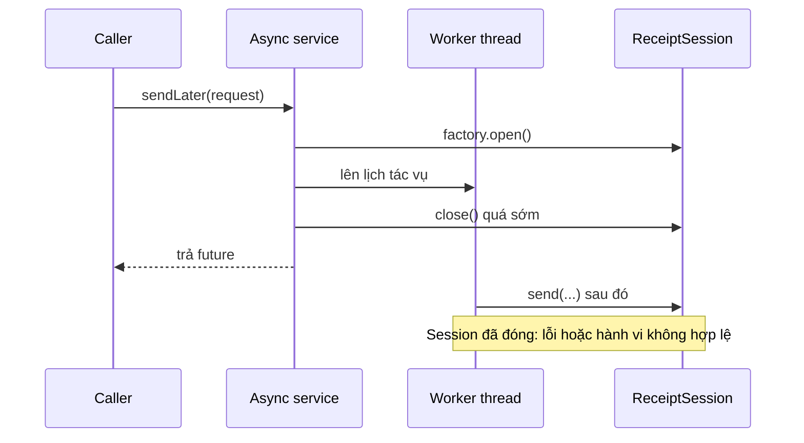

# Giữ tài nguyên sống đủ lâu nhưng đóng đúng lúc khi xử lý bất đồng bộ

## Mục tiêu học tập

Sau bài này, bạn có thể:

- Xác định **thời điểm sử dụng cuối cùng** của một tài nguyên khi công việc được chuyển sang thread khác hoặc trả về `CompletionStage`.
- Giải thích tại sao đóng tài nguyên ngay khi **phương thức trả về** có thể quá sớm, trong khi quên đóng khi công việc kết thúc lại gây rò rỉ.
- Tách rõ **đối tượng sống lâu** (service, factory, executor/client dùng chung) và **tài nguyên ngắn hạn** (session, stream, transaction handle) bằng constructor injection và composition root.
- Chọn giữa hai mẫu: **mở/đóng bên trong tác vụ async** và **đóng sau khi stage của thao tác thực sự hoàn thành**.
- Diễn giải đúng ý nghĩa của **completion, timeout, cancellation, lỗi và shutdown**, không nhầm việc ngừng chờ với việc đã dừng tác vụ.
- Kiểm thử vòng đời tài nguyên bằng Java thuần với **executor có thể điều khiển** và factory giả, không phụ thuộc vào `Thread.sleep(...)`.

Bài thuộc chương **Đồng thời và bất đồng bộ** của module **Dependency Injection (DI)** và **Inversion of Control (IoC)**. Ta tiếp tục tách việc *sử dụng* dependency khỏi việc *tạo và lắp ghép* bằng constructor injection, composition root, scope và vòng đời. Khi có xử lý bất đồng bộ, điều quan trọng hơn nữa là **bên sở hữu tài nguyên phải biết khi nào công việc sử dụng tài nguyên thực sự kết thúc**.

## 1. Ranh giới thời gian thay đổi khi có bất đồng bộ

Trong chương trình đồng bộ, `try-with-resources` thường mô tả chính xác vùng sử dụng tài nguyên:

```java
// Ví dụ ý tưởng đồng bộ.
try (ReceiptSession session = factory.open("req-01")) {
    session.send("a@example.com", "Đơn đã thanh toán");
} // send() đã trả về; Java gọi close() tại đây.
```

Nếu `send(...)` là thao tác đồng bộ và chỉ sử dụng session trong thời gian lời gọi, việc đóng ngay sau `send(...)` là phù hợp. Nhưng khi công việc được **lên lịch chạy sau** thì block `try` ở caller có thể kết thúc **trước** khi tác vụ bắt đầu.

### Phản ví dụ: đóng ngay sau khi lên lịch

```java
// Sai: đây là ví dụ rút gọn, chưa phải file Java độc lập.
CompletionStage<Void> sendLater(ReceiptRequest request) {
    try (ReceiptSession session = factory.open(request.requestId)) {
        return CompletableFuture.runAsync(
                () -> session.send(request.recipient, request.message),
                executor);
    } // session.close() chạy khi vừa TRẢ future, không đợi tác vụ.
}
```

Giả sử `executor` chưa chạy tác vụ ngay. Caller mở session, xếp tác vụ vào hàng đợi, rời `try` và **đóng session**. Một lúc sau worker mới gọi `session.send(...)` trên đối tượng đã đóng, có thể gây `IllegalStateException` hoặc lỗi I/O.



**Lỗi không nằm ở `try-with-resources`**. Lỗi nằm ở chỗ **phạm vi lexical của block `try` không bao phủ khoảng thời gian sử dụng thực tế**.

### Bốn thời điểm phải phân biệt

| Mốc | Ý nghĩa | Có được đóng tài nguyên chưa? |
| --- | --- | --- |
| **Đã tạo session** | Factory trả về một handle hợp lệ | Chưa, nếu tác vụ còn cần handle. |
| **Đã lên lịch** | Executor nhận tác vụ, caller có thể nhận future | **Chưa**, vì tác vụ có thể chưa bắt đầu. |
| **Đã hoàn thành công việc dùng session** | Không còn bước nào đọc/ghi qua session | Có thể đóng theo hợp đồng sở hữu. |
| **Đã đóng session** | Handle được giải phóng hoặc trả về pool theo hợp đồng | Future trả cho caller có thể được hoàn thành sau bước này. |

Việc một future đã hoàn thành **không tự động chứng minh tài nguyên được đóng**, trừ khi chính hợp đồng và cách triển khai bảo đảm điều đó. Ngược lại, khi caller ngừng chờ vì timeout, công việc nền vẫn có thể tiếp tục và vẫn cần tài nguyên.

## 2. Scope, quyền sở hữu và completion là ba câu hỏi khác nhau

Trước khi viết mã, hãy chỉ ra ba loại đối tượng:

1. **Service/factory dùng chung:** tồn tại qua nhiều request, được chọn và lắp ghép tại composition root. Nó cung cấp *khả năng mở session* chứ không nhất thiết giữ một session cụ thể.
2. **Dữ liệu của một request:** ví dụ `requestId`, `recipient` và nội dung thông báo. Nó cần được mang theo công việc async dưới dạng dữ liệu phù hợp, không giữ trong field `currentRequest` của singleton.
3. **Session ngắn hạn:** một đối tượng có vòng đời bắt đầu khi `open()` được gọi và kết thúc khi **bên được giao quyền sở hữu** gọi `close()`.

| Câu hỏi | Phải trả lời rõ | Sai lầm điển hình |
| --- | --- | --- |
| **Ai tạo?** | Factory, pool, composition root hay framework? | Consumer tự `new` client hạ tầng tùy tiện. |
| **Ai sử dụng?** | Thread/tác vụ nào còn cần session? | Caller đóng session khi worker chưa chạy. |
| **Ai sở hữu?** | Bên nào có trách nhiệm gọi `close()`? | Một request đóng client dùng chung của toàn ứng dụng. |
| **Khi nào hoàn thành?** | Sau I/O cuối, sau khi queue nhận hay sau khi hệ thống đích xác nhận? | Đóng theo mốc Accepted mặc dù transport còn dùng handle. |
| **Scope là gì?** | Một request, một operation hay toàn ứng dụng? | Singleton giữ session/transaction của request trước. |

**Mốc completion phải khớp với lần sử dụng cuối.** Nếu một thư viện báo hoàn thành stage khi mới đưa công việc vào queue nhưng vẫn giữ quyền sử dụng stream để ghi dữ liệu sau đó, không được đóng stream chỉ dựa trên stage “accepted” ấy. Cần theo dõi stage/hợp đồng biểu diễn **thao tác thật sự đã thôi sử dụng tài nguyên**.

## 3. Cách đơn giản nhất: mở tài nguyên bên trong tác vụ async

Khi thao tác trên session **đồng bộ ở trong worker**, ta có thể để worker tự mở, dùng và đóng session:

```java
return CompletableFuture.supplyAsync(() -> {
    try (ReceiptSession session = factory.open(request.requestId)) {
        session.send(request.recipient, request.message);
        return "SEND_COMPLETED";
    }
}, executor);
```

Thứ tự ở đây là:

```text
Caller gọi service
    -> executor chấp nhận task
    -> service trả future cho caller
Worker bắt đầu task
    -> factory.open()
    -> session.send(...)
    -> session.close()
    -> task trả kết quả hoặc lỗi
    -> future hoàn thành
```

Lợi ích:

- Nếu tác vụ **chưa bắt đầu**, session **chưa được mở**; không có một session tạo sớm rồi bị bỏ quên khi hàng đợi chưa chạy.
- Khi `send(...)` ném ngoại lệ, `try-with-resources` vẫn gọi `close()`. Nếu `close()` cũng lỗi, Java giữ ngoại lệ chính và đưa lỗi đóng vào danh sách suppressed theo cơ chế của nó.
- Session thuộc **một lần thực thi tác vụ**, không nằm trong field của service dùng chung.
- Executor được **tiêm vào**, không được service tự tạo và tự `shutdown()`.

Với `CompletableFuture.supplyAsync`, nếu executor **từ chối tác vụ ngay lúc đăng ký** (chẳng hạn `RejectedExecutionException`), lời gọi lên lịch có thể ném lỗi **trước khi trả future**. Vì session chưa được mở nên nhánh này không rò session. Cần tài liệu hóa cả đường lỗi khi đăng ký và đường lỗi hoàn thành future.

### Đồ thị dependency và timeline

```mermaid
flowchart LR
    M["Main / composition root"] -->|tạo và inject| S["AsyncReceiptService"]
    S -->|field ổn định| F["ReceiptSessionFactory"]
    S -->|field ổn định| E["Executor"]
    R["ReceiptRequest per operation"] -.->|method parameter| S
    F -.->|open() bên trong worker| X["ReceiptSession per task"]
    X -->|send rồi close| OUT["Kết quả thao tác"]
```

Sơ đồ này mô tả sự khác nhau giữa **dependency mà service giữ lâu dài** và **tài nguyên được tạo khi tác vụ cần đến**. `ReceiptSession` không bị giữ trong một field của `AsyncReceiptService`.

## 4. Ví dụ Java thuần hoàn chỉnh

Ví dụ chỉ giả lập gửi xác nhận qua console; không gửi email, không gọi dịch vụ ngoài và không thực hiện thanh toán thật. Chương trình sử dụng **một worker thread** để đầu ra minh họa có thứ tự dễ theo dõi. Cùng thiết kế có thể sử dụng thread pool nhiều worker, nhưng khi đó cần kiểm tra khả năng gọi đồng thời an toàn của factory và các collaborator.

Lưu toàn bộ đoạn dưới vào **`Main.java`** (JDK 8 trở lên):

```java
import java.util.Objects;
import java.util.concurrent.CompletableFuture;
import java.util.concurrent.CompletionStage;
import java.util.concurrent.Executor;
import java.util.concurrent.ExecutorService;
import java.util.concurrent.Executors;
import java.util.concurrent.TimeUnit;
import java.util.concurrent.atomic.AtomicInteger;

// Dữ liệu bất biến cho một lượt gửi.
final class ReceiptRequest {
    final String requestId;
    final String recipient;
    final String message;

    ReceiptRequest(String requestId, String recipient, String message) {
        this.requestId = requiredText(requestId, "requestId");
        this.recipient = requiredText(recipient, "recipient");
        this.message = requiredText(message, "message");
    }

    static String requiredText(String value, String field) {
        Objects.requireNonNull(value, field);
        if (value.trim().isEmpty()) {
            throw new IllegalArgumentException(field + " must not be blank");
        }
        return value;
    }
}

// Session có trạng thái, chỉ hợp lệ trước khi close().
interface ReceiptSession extends AutoCloseable {
    void send(String recipient, String message);

    @Override
    void close();
}

interface ReceiptSessionFactory {
    ReceiptSession open(String requestId);
}

// Session giả lập: từng instance có số thứ tự riêng.
final class ConsoleReceiptSession implements ReceiptSession {
    private final int id;
    private final String requestId;
    private boolean closed;

    ConsoleReceiptSession(int id, String requestId) {
        this.id = id;
        this.requestId = requestId;
    }

    @Override
    public void send(String recipient, String message) {
        if (closed) {
            throw new IllegalStateException("Session đã đóng");
        }
        System.out.println("[SESSION " + id + "] SEND " + requestId
                + " => " + recipient + ": " + message);
    }

    @Override
    public void close() {
        if (!closed) {
            closed = true;
            System.out.println("[SESSION " + id + "] CLOSE " + requestId);
        }
    }
}

// Factory có thể dùng chung nhưng cấp một session mới mỗi open().
final class ConsoleReceiptSessionFactory implements ReceiptSessionFactory {
    private final AtomicInteger nextId = new AtomicInteger();

    @Override
    public ReceiptSession open(String requestId) {
        int id = nextId.incrementAndGet();
        System.out.println("[SESSION " + id + "] OPEN " + requestId);
        return new ConsoleReceiptSession(id, requestId);
    }
}

// Consumer chỉ biết hai dependency ổn định đã được tiêm.
final class AsyncReceiptService {
    private final ReceiptSessionFactory sessionFactory;
    private final Executor executor;

    AsyncReceiptService(ReceiptSessionFactory sessionFactory, Executor executor) {
        this.sessionFactory =
                Objects.requireNonNull(sessionFactory, "sessionFactory");
        this.executor = Objects.requireNonNull(executor, "executor");
    }

    CompletionStage<String> sendAsync(ReceiptRequest request) {
        Objects.requireNonNull(request, "request");

        // Session chỉ được tạo SAU KHI worker bắt đầu chạy.
        return CompletableFuture.supplyAsync(() -> {
            try (ReceiptSession session = sessionFactory.open(request.requestId)) {
                session.send(request.recipient, request.message);
                return "Hoàn thành gửi mô phỏng: " + request.requestId;
            }
            // try-with-resources đã close trước khi future hoàn thành.
        }, executor);
    }
}

// Composition root quản lý cả executor và đồ thị đối tượng.
public class Main {
    public static void main(String[] args) throws Exception {
        ExecutorService worker = Executors.newSingleThreadExecutor();
        try {
            ReceiptSessionFactory factory = new ConsoleReceiptSessionFactory();
            AsyncReceiptService service = new AsyncReceiptService(factory, worker);

            CompletableFuture<String> first = service.sendAsync(
                    new ReceiptRequest("req-01", "a@example.com", "Đơn DH-01")
            ).toCompletableFuture();

            CompletableFuture<String> second = service.sendAsync(
                    new ReceiptRequest("req-02", "b@example.com", "Đơn DH-02")
            ).toCompletableFuture();

            // Chờ có giới hạn ở ranh giới ứng dụng demo, không chặn trong service.
            System.out.println(first.get(3, TimeUnit.SECONDS));
            System.out.println(second.get(3, TimeUnit.SECONDS));
        } finally {
            // Main tạo worker, nên Main quản lý shutdown.
            worker.shutdown();
            if (!worker.awaitTermination(3, TimeUnit.SECONDS)) {
                worker.shutdownNow(); // Cố gắng ngắt; không bảo đảm dừng I/O.
            }
        }
    }
}
```

Chạy:

```bash
javac -encoding UTF-8 Main.java
java Main
```

Đầu ra minh họa:

```text
[SESSION 1] OPEN req-01
[SESSION 1] SEND req-01 => a@example.com: Đơn DH-01
[SESSION 1] CLOSE req-01
[SESSION 2] OPEN req-02
Hoàn thành gửi mô phỏng: req-01
[SESSION 2] SEND req-02 => b@example.com: Đơn DH-02
[SESSION 2] CLOSE req-02
Hoàn thành gửi mô phỏng: req-02
```

**Thứ tự in các dòng giữa worker và caller có thể xen kẽ khác nhau**, ngay cả khi chỉ có một worker, vì hai thread cùng ghi console. Điều được bảo đảm bởi code là, trong *mỗi task*, `OPEN → SEND → CLOSE` xảy ra theo thứ tự; future của task chỉ hoàn thành **sau** khi `try-with-resources` đóng session. Thứ tự giữa việc caller in kết quả task A và worker bắt đầu task B không cần cố định.

### Ai tạo, ai giữ và ai đóng?

| Thành phần | Nơi tạo | Phạm vi | Ai đóng? |
| --- | --- | --- | --- |
| `AsyncReceiptService` | `Main` | Được tái sử dụng cho các lần gửi | Không có phương thức đóng trong ví dụ. |
| `ReceiptSessionFactory` | `Main` | Dùng chung qua các task | Factory demo không giữ tài nguyên cần đóng. |
| `ExecutorService` | `Main` | Dùng chung cho nhiều task | **`Main`** gọi `shutdown()`/`awaitTermination()`. |
| `ReceiptRequest` | Caller tại mỗi lời gọi | Dữ liệu riêng của một task | Không có tài nguyên cần đóng. |
| `ReceiptSession` | Factory, bên trong worker | Chỉ trong task đang dùng nó | **Worker** qua `try-with-resources`. |

Đây là phân công ownership có chủ đích. `AsyncReceiptService` **không được tự shutdown executor dùng chung**, và `ReceiptSession` **không được tự đóng factory/client dùng chung** nếu hợp đồng không chuyển quyền sở hữu đó cho session.

## 5. Khi API của dependency đã bất đồng bộ sẵn

Mẫu ở mục 4 dùng **một thao tác `send(...)` đồng bộ chạy trên worker**. Nó không thích hợp nếu chính dependency trả một `CompletionStage` vì công việc I/O vẫn tiếp tục **sau khi method `sendAsync(...)` trả về**.

Ví dụ về lỗi tương tự:

```java
// Sai nếu uploadAsync chỉ trả stage khi I/O CHƯA kết thúc.
try (AsyncUploadSession session = factory.open()) {
    return session.uploadAsync(bytes);
} // Đóng ngay sau khi NHẬN stage, có thể làm hỏng upload.
```

Lần này, chỉ chuyển block `try` sang một worker **vẫn chưa đủ**: worker cũng có thể nhận stage rồi kết thúc trước khi upload xong. Cần gắn việc đóng session với **mốc hoàn thành đúng theo hợp đồng upload**.

### Mẫu đóng sau completion, bao gồm cả đường lỗi

Đoạn sau là **ví dụ API độc lập** với `Main.java`. Ta giả định:

- `uploadAsync(bytes)` trả một stage hoàn thành **sau khi dependency đã thôi sử dụng session** cho upload đó.
- `AsyncUploadSession.close()` không khai báo checked exception.
- Caller của `uploadWithCleanup(...)` được giao quyền sở hữu session và chỉ được coi kết quả hoàn tất **sau bước đóng**.

```java
import java.util.Objects;
import java.util.concurrent.CompletableFuture;
import java.util.concurrent.CompletionStage;

interface AsyncUploadSession extends AutoCloseable {
    CompletionStage<String> uploadAsync(byte[] bytes);

    @Override
    void close();
}

final class AsyncUploadSupport {
    private AsyncUploadSupport() {}

    static CompletionStage<String> uploadWithCleanup(
            AsyncUploadSession session, byte[] bytes) {
        Objects.requireNonNull(session, "session");
        CompletableFuture<String> outcome = new CompletableFuture<>();
        CompletionStage<String> work;

        try {
            work = Objects.requireNonNull(
                    session.uploadAsync(bytes), "upload stage");
        } catch (RuntimeException | Error startFailure) {
            // Lỗi trước khi có stage vẫn phải đóng session.
            try {
                session.close();
            } catch (RuntimeException | Error closeFailure) {
                startFailure.addSuppressed(closeFailure);
            }
            outcome.completeExceptionally(startFailure);
            return outcome;
        }

        // Chỉ đóng sau completion đúng nghĩa là "không còn dùng session".
        work.whenComplete((value, failure) -> {
            Throwable closeFailure = null;
            try {
                session.close();
            } catch (RuntimeException | Error closing) {
                closeFailure = closing;
            }

            if (failure != null) {
                if (closeFailure != null && closeFailure != failure) {
                    failure.addSuppressed(closeFailure);
                }
                outcome.completeExceptionally(failure);
            } else if (closeFailure != null) {
                outcome.completeExceptionally(closeFailure);
            } else {
                outcome.complete(value);
            }
        });
        return outcome;
    }
}
```

Mẫu này thể hiện một chi tiết quan trọng: **đóng tài nguyên là một phần của kết quả**. Nếu upload thành công nhưng `close()` báo lỗi, `outcome` vẫn được hoàn thành với lỗi. Nếu upload lỗi và đóng cũng lỗi, lỗi đóng được lưu dưới dạng *suppressed* của nguyên nhân chính để không che mất nguyên nhân upload thất bại.

**Chú ý:** `whenComplete` có thể chạy ngay trên thread hoàn thành stage. Nếu `close()` chặn lâu, callback này cũng có thể chặn thread đó. Trong hệ thống thật, việc chuyển cleanup sang executor thích hợp có thể cần thiết, nhưng phải giữ nguyên bảo đảm **outcome chỉ hoàn thành sau cleanup** và phải xử lý cả trường hợp executor từ chối công việc.

### Tại sao không chỉ gọi `whenComplete(... close ...)` rồi trả stage gốc?

Nếu viết:

```java
// Thiếu hợp đồng cleanup hoàn tất nếu trả lại stage gốc:
work.whenComplete((result, error) -> session.close());
return work;
```

Caller nhận `work` là stage **gốc**, có thể quan sát nó hoàn thành trước khi callback đóng session kết thúc. Lỗi trong `close()` cũng có thể chỉ nằm trong stage **mới** do `whenComplete` tạo nhưng đã bị bỏ qua. Vì thế, khi cleanup là một phần của hợp đồng, hãy trả **stage được kết hợp với cleanup** và làm rõ cách ưu tiên lỗi.

Một cách khác với hợp đồng đơn giản là trả trực tiếp `work.whenComplete(...)`; tuy nhiên khi muốn **kiểm soát và bảo toàn cả hai lỗi**, như ví dụ trên, stage `outcome` riêng giúp biểu đạt quy tắc rõ ràng.

## 6. Timeout và cancellation không đồng nghĩa đã đóng tài nguyên

Một sai lầm phổ biến là coi việc caller hết thời gian chờ như tín hiệu chắc chắn rằng worker đã dừng:

```java
// Ví dụ ý tưởng tại caller; timeout chỉ giới hạn việc chờ.
try {
    String result = future.get(500, TimeUnit.MILLISECONDS);
    System.out.println(result);
} catch (java.util.concurrent.TimeoutException timeout) {
    System.out.println("Đã hết thời gian chờ");
    // KHÔNG được kết luận worker đã dừng hoặc session đã đóng.
}
```

Trong đoạn này, `future` là `CompletableFuture<String>` đã có; những checked exception khác từ `get(...)` vẫn cần được xử lý hoặc khai báo ở phương thức chứa đoạn mã.

### Các trạng thái có thể khác nhau

| Sự kiện | Kết quả người gọi quan sát | Công việc nền và tài nguyên |
| --- | --- | --- |
| `get(timeout)` trả kết quả | Caller nhận giá trị trong giới hạn | Trong mẫu `supplyAsync` mục 4, session đã đóng trước khi task hoàn thành. |
| `get(timeout)` ném `TimeoutException` | Caller **ngừng chờ** | Task có thể vẫn đang chạy; session còn cần sống cho đến lần sử dụng cuối. |
| `future.cancel(true)` | Future có thể ở trạng thái cancelled | `CompletableFuture` không bảo đảm ngắt tác vụ đang chạy; tài nguyên không tự đóng ngay. |
| `executor.shutdown()` | Ngừng nhận task mới | Các task đã nhận thường được cho tiếp tục; cần chờ kết thúc/cleanup. |
| `executor.shutdownNow()` | Cố gắng dừng task và trả về task chưa bắt đầu | Ngắt là **best effort**, không bảo đảm I/O chặn sẽ lập tức kết thúc. |
| Stage hoàn thành exceptionally | Kết quả biểu diễn lỗi | Lỗi **không tự bảo đảm** cleanup nếu code không đặt cleanup ở đúng đường lỗi. |

Trong Java, `CompletableFuture.cancel(true)` không cung cấp cơ chế ngắt tác vụ như một lời bảo đảm của `FutureTask`. Một tác vụ đang sử dụng session vẫn có thể chạy đến khi hoàn tất hoặc bị cơ chế khác dừng. Nếu cancellation là yêu cầu nghiệp vụ, dependency phải có **API hủy thực sự** với hợp đồng cụ thể và kiểm soát tác dụng phụ; không chỉ dựa vào việc đổi trạng thái một future.

Ở mẫu mục 4, session được **mở trong tác vụ**. Nếu tác vụ không bao giờ chạy, sẽ **không có session bị mở sớm** bởi tác vụ đó. Nếu tác vụ đã bắt đầu, `try-with-resources` đóng session khi luồng xử lý rời block — trừ trường hợp tác vụ **không thể kết thúc** (ví dụ I/O treo không có deadline). Vì vậy, cấu hình timeout **ở tầng client/I/O** vẫn quan trọng; giới hạn `get(...)` của caller không giải quyết được mọi rò rỉ tài nguyên.

### Timeout ở nhiều tầng

Giả sử yêu cầu HTTP có deadline 2 giây, nhưng gửi dữ liệu đến dịch vụ ngoài có thể chặn trong 30 giây. Nếu caller dừng chờ sau 2 giây mà worker vẫn chờ I/O 30 giây, session có thể còn tồn tại suốt khoảng đó. Cần phân biệt:

1. **Deadline tổng của nghiệp vụ**: lúc nào kết quả còn có giá trị với caller.
2. **Timeout chờ future**: caller chịu chờ bao lâu.
3. **Timeout của I/O thực**: socket/read/write phải giới hạn như thế nào.
4. **Deadline/cancellation truyền xuống dependency**: nếu có, được thực thi với mức bảo đảm nào.

Không nên tự áp timeout cho **một future dùng chung** theo cách làm thay đổi kết quả mà các consumer khác đang chờ nếu hai nơi có ngân sách chờ khác nhau. Tùy API, có thể dùng một *dependent stage* riêng cho từng caller và định nghĩa rõ việc có hay không truyền tín hiệu hủy xuống công việc gốc.

## 7. Request scope và context khi chuyển thread

Một vấn đề khác là **resource đã mở bên ngoài worker nhưng thuộc request đang kết thúc**. Chẳng hạn, web framework có thể quản lý một session hoặc transaction theo request. Khi endpoint trả response, request scope đóng trong khi background task vẫn giữ tham chiếu đến object đó.

### Phản ví dụ giữ resource request vào async task

```java
// Minh họa nguy cơ: requestSession có thể hết scope trước khi worker dùng.
CompletionStage<Void> submit(RequestSession requestSession, Executor executor) {
    return CompletableFuture.runAsync(
            () -> requestSession.save("audit record"), executor);
}
```

Nếu request kết thúc và hạ tầng đóng `requestSession` trước khi lambda chạy, worker đang dùng một tài nguyên đã hết hạn. Không phải mọi framework đều có cùng scope; phải đọc hợp đồng lifecycle của framework cụ thể.

Cách thiết kế an toàn hơn thường là:

- **Chụp dữ liệu cần thiết** thành DTO bất biến trước khi rời request, ví dụ `requestId`, `orderId` và nội dung đã được kiểm tra; không giữ nguyên HTTP request hay session mở.
- **Mở tài nguyên mới đúng scope trong worker** bằng factory đã tiêm, hoặc mở/đóng trong lifecycle rõ ràng của công việc nền.
- Không phụ thuộc ngầm vào `ThreadLocal` của luồng HTTP. Khi dùng executor khác, context như trace/correlation ID, locale hoặc thông tin xác thực được phép chuyển tiếp phải có cơ chế lan truyền đã thiết kế và dọn dẹp đúng lúc.
- Không gắn context nhạy cảm vào task sống quá hạn theo thói quen; chỉ truyền dữ liệu thực sự cần và được phép sử dụng.

Ví dụ `AsyncReceiptService` đã áp dụng ý đầu tiên: `ReceiptRequest` có các field `final`, được tạo cho từng lời gọi; service không có field `currentRecipient` hay `currentRequest` bị nhiều task ghi đè.

## 8. Thread safety và scope không phải cùng một vấn đề

Trong `Main.java`:

- `ConsoleReceiptSessionFactory` có thể dùng chung; `AtomicInteger` cấp ID tăng một cách nguyên tử.
- Mỗi `ConsoleReceiptSession` là **instance riêng**, chỉ được một tác vụ sử dụng trong phạm vi demo.
- `AsyncReceiptService` chứa hai tham chiếu `final` và không lưu dữ liệu từng request vào field.
- Executor có thể thực hiện nhiều tác vụ cùng lúc nếu đổi thành thread pool.

Điều đó **không có nghĩa** mọi implementation thay thế đều an toàn luồng. Một factory giữ `ArrayList` mutable nhưng cập nhật không đồng bộ sẽ không tự trở nên thread-safe chỉ vì được tiêm qua constructor. Một client dùng chung với state phiên không được bảo vệ cũng có thể gây lỗi.

| Khái niệm | Câu hỏi đúng | Ví dụ |
| --- | --- | --- |
| **Scope** | Có bao nhiêu instance được chia sẻ giữa bao nhiêu tác vụ? | Một factory chung, một session cho mỗi task. |
| **Thread safety** | Nếu nhiều thread gọi cùng một instance, state có được bảo vệ? | `AtomicInteger` giúp việc tăng ID nguyên tử. |
| **Ownership** | Ai được đóng instance/tài nguyên? | Task đóng session của mình; `Main` đóng executor. |
| **Completion semantics** | Khi stage hoàn thành, tác vụ nào đã thật sự kết thúc? | Mẫu `supplyAsync` hoàn thành sau block `try-with-resources`. |
| **Business correctness** | Thử lại, gửi trùng và tác dụng phụ có được kiểm soát? | Không gửi lại mù quáng sau timeout. |

Đặc biệt, **an toàn luồng không bảo đảm đúng scope nghiệp vụ**. Một field `AtomicReference<String> currentUser` an toàn theo thao tác nguyên tử vẫn có thể làm lẫn hai user nếu singleton được dùng chung. Truyền dữ liệu của từng task qua parameter/DTO là quyết định tách biệt với việc đồng bộ hóa.

## 9. Kiểm thử vòng đời không cần ngủ hay phụ thuộc thời gian

Để kiểm tra tài nguyên được **mở sau khi task bắt đầu và đóng trước khi future hoàn thành**, ta dùng một `Executor` giả chỉ **xếp Runnable vào hàng đợi**. Test tự gọi `runNext()` để quyết định lúc task chạy.

Test cũng kiểm tra:

1. Session **chưa mở** ngay khi `sendAsync(...)` trả future.
2. Session được **đóng đúng một lần** trên đường thành công.
3. Session vẫn được **đóng khi `send(...)` ném lỗi**.
4. Khi executor **từ chối lên lịch**, factory không bị gọi và không có session bị mở sớm.

Lưu **`AsyncResourceCheck.java`** cạnh `Main.java`:

```java
import java.util.ArrayDeque;
import java.util.ArrayList;
import java.util.List;
import java.util.Queue;
import java.util.concurrent.CompletableFuture;
import java.util.concurrent.CompletionException;
import java.util.concurrent.Executor;
import java.util.concurrent.RejectedExecutionException;

public class AsyncResourceCheck {
    static final class ManualExecutor implements Executor {
        final Queue<Runnable> queued = new ArrayDeque<>();
        boolean reject;

        @Override
        public void execute(Runnable command) {
            if (reject) {
                throw new RejectedExecutionException("no capacity");
            }
            queued.add(command);
        }

        void runNext() {
            queued.remove().run(); // Chạy có chủ đích trên thread test.
        }
    }

    static final class RecordingSession implements ReceiptSession {
        final String requestId;
        final boolean failOnSend;
        int sends;
        int closes;
        String lastRecipient;

        RecordingSession(String requestId, boolean failOnSend) {
            this.requestId = requestId;
            this.failOnSend = failOnSend;
        }

        @Override
        public void send(String recipient, String message) {
            if (closes != 0) {
                throw new IllegalStateException("use after close");
            }
            sends++;
            lastRecipient = recipient;
            if (failOnSend) {
                throw new IllegalStateException("simulated send failure");
            }
        }

        @Override
        public void close() {
            closes++;
        }
    }

    static final class RecordingFactory implements ReceiptSessionFactory {
        final List<RecordingSession> sessions = new ArrayList<>();
        boolean failNext;

        @Override
        public ReceiptSession open(String requestId) {
            RecordingSession session =
                    new RecordingSession(requestId, failNext);
            failNext = false;
            sessions.add(session);
            return session;
        }
    }

    public static void main(String[] args) {
        ManualExecutor executor = new ManualExecutor();
        RecordingFactory factory = new RecordingFactory();
        AsyncReceiptService service = new AsyncReceiptService(factory, executor);

        // 1. Lên lịch nhưng chưa thực thi: không được mở session.
        CompletableFuture<String> success = service.sendAsync(
                new ReceiptRequest("req-ok", "a@example.com", "Hello"))
                .toCompletableFuture();

        if (success.isDone() || !factory.sessions.isEmpty()
                || executor.queued.size() != 1) {
            throw new AssertionError("Session được mở quá sớm");
        }

        executor.runNext();
        if (!"Hoàn thành gửi mô phỏng: req-ok".equals(success.join())
                || factory.sessions.size() != 1) {
            throw new AssertionError("Kết quả thành công không đúng");
        }
        RecordingSession first = factory.sessions.get(0);
        if (first.sends != 1 || first.closes != 1
                || !"req-ok".equals(first.requestId)
                || !"a@example.com".equals(first.lastRecipient)) {
            throw new AssertionError("Chưa gửi/đóng session đúng lúc");
        }

        // 2. Exception trong send: try-with-resources vẫn close().
        factory.failNext = true;
        CompletableFuture<String> failed = service.sendAsync(
                new ReceiptRequest("req-fail", "b@example.com", "Fail"))
                .toCompletableFuture();

        if (failed.isDone() || factory.sessions.size() != 1) {
            throw new AssertionError("Task lỗi đã chạy quá sớm");
        }
        executor.runNext();
        try {
            failed.join();
            throw new AssertionError("Future phải hoàn thành exceptionally");
        } catch (CompletionException error) {
            if (!(error.getCause() instanceof IllegalStateException)) {
                throw error;
            }
        }

        RecordingSession second = factory.sessions.get(1);
        if (second.sends != 1 || second.closes != 1
                || !"req-fail".equals(second.requestId)) {
            throw new AssertionError("Session phải đóng trên đường lỗi");
        }

        // 3. Executor từ chối trước khi worker chạy: chưa có session mới.
        executor.reject = true;
        try {
            service.sendAsync(
                    new ReceiptRequest("req-reject", "c@example.com", "Retry"));
            throw new AssertionError("Lẽ ra phải từ chối lên lịch");
        } catch (RejectedExecutionException expected) {
            // Không có lần open() nào cho tác vụ bị từ chối.
        }
        if (factory.sessions.size() != 2 || !executor.queued.isEmpty()) {
            throw new AssertionError("Rò session hoặc task khi bị từ chối");
        }

        System.out.println("PASS: mở đúng lúc, đóng đúng lúc và xử lý lỗi");
    }
}
```

Chạy:

```bash
javac -encoding UTF-8 Main.java AsyncResourceCheck.java
java AsyncResourceCheck
```

Kiểm thử này **không chạy đa luồng thật**: `ManualExecutor` cố ý chạy task trên thread kiểm thử để điều khiển chính xác thứ tự. Nó chứng minh **vòng đời và trạng thái future theo hợp đồng demo**, không chứng minh tính an toàn luồng của mọi implementation. Muốn đánh giá race, throughput hoặc shutdown khi I/O treo, cần kiểm thử chuyên biệt.

### Khi cần kiểm thử mẫu `CompletionStage` có I/O thật

Với `AsyncUploadSession` ở mục 5, có thể tạo fake mà `uploadAsync(...)` trả một `CompletableFuture<String>` **chưa complete**. Kiểm tra:

- Sau khi nhận stage, `close()` **chưa được gọi**.
- Sau khi test gọi `pending.complete("OK")`, session được đóng và stage `outcome` trả kết quả.
- Sau `pending.completeExceptionally(error)`, session vẫn được đóng, lỗi chính vẫn được báo.
- Nếu `session.uploadAsync(...)` ném lỗi ngay, session được đóng mà không đợi callback.
- Nếu `close()` ném lỗi, kiểm tra quy tắc ưu tiên và suppressed exception.

Đây là cách kiểm tra **mốc completion** mà không cần dùng thời gian thực hoặc dịch vụ bên ngoài.

## 10. Những ngộ nhận thường gặp

| Nhận định sai | Cách hiểu đúng |
| --- | --- |
| “Ra khỏi method nghĩa là tác vụ xong.” | Async method có thể trả future trước khi worker bắt đầu. |
| “Đặt `try-with-resources` ở caller luôn an toàn.” | Phải bao trùm **toàn bộ thời gian session được sử dụng**, không chỉ thời gian lên lịch. |
| “Future timeout thì session đã được giải phóng.” | Timeout có thể chỉ ngừng chờ; worker vẫn chạy và vẫn cần session. |
| “`cancel(true)` luôn ngắt worker.” | `CompletableFuture` không bảo đảm ngắt công việc đã lên lịch. |
| “`whenComplete(... close ...)` rồi trả future gốc là đủ.” | Caller có thể quan sát future gốc đã xong trước cleanup; lỗi cleanup có thể bị bỏ qua. |
| “Một singleton bean có thể giữ request session để dùng sau.” | Session có thể hết scope khi request kết thúc; cần dữ liệu snapshot và tài nguyên mở đúng vòng đời. |
| “Tiêm Executor đồng nghĩa service được quyền shutdown.” | Quyền đóng thuộc bên sở hữu, thường là composition root hoặc container. |
| “Factory luôn trả session mới.” | Phải xác định trong hợp đồng; có thể cấp handle từ pool. |
| “Thread-safe tức là không thể lẫn dữ liệu request.” | Thread safety không thay thế việc chọn đúng scope và không giữ state của từng request trong singleton. |
| “Tác vụ thành công đồng nghĩa hệ thống ngoài đã nhận/giao dữ liệu.” | Cần định nghĩa rõ mốc **Accepted**, **Processed** hay **Delivered** trong hợp đồng. |

## 11. Quy trình lựa chọn mẫu vòng đời

Khi thiết kế một thao tác async có dependency tài nguyên, hãy làm tuần tự:

1. **Xác định lần sử dụng cuối:** tài nguyên có cần đến lúc method trả về, lúc task kết thúc hay lúc một stage do thư viện trả về hoàn thành?
2. **Kiểm tra chữ ký/hợp đồng dependency:** `send()` đồng bộ hay `sendAsync()`? Future biểu diễn mốc nào?
3. **Chọn nơi mở tài nguyên:** có thể mở **bên trong worker** không? Nếu có, đây thường là lựa chọn đơn giản, ít rủi ro leak trước khi task chạy.
4. **Chọn nơi đóng:** `try-with-resources` bên trong task hoặc callback/finalizer được liên kết với **completion thực** của thao tác.
5. **Xác định đường lỗi:** nếu mở thất bại, lên lịch bị từ chối, I/O lỗi hoặc `close()` lỗi thì kết quả nào được báo? Ai cleanup?
6. **Xác định cancellation/timeout:** caller ngừng chờ có tác động gì tới công việc nền? Có cơ chế dừng I/O và giới hạn deadline ở dependency không?
7. **Bảo vệ dữ liệu request:** truyền DTO/snapshot cần thiết; đừng giữ session request hoặc `ThreadLocal` ngầm quá vòng đời.
8. **Xác định owner của executor/client:** nơi khởi tạo chịu trách nhiệm shutdown resource dùng chung; consumer chỉ đóng resource nó được giao sở hữu.
9. **Kiểm tra chia sẻ/đồng thời:** factory và client được gọi từ nhiều thread có an toàn không? Session có được dùng chỉ trong một task hay bị chia sẻ ngoài ý muốn?
10. **Viết test điều khiển completion:** không cần ngủ; kiểm tra số lần mở, đóng, thời điểm hoàn thành và mọi nhánh lỗi.

### Bài tập vận dụng: xuất file trong background job

Một API nhận yêu cầu xuất báo cáo. Endpoint trả về mã job ngay; worker cần đọc dữ liệu, ghi stream tới storage và cập nhật trạng thái job. Storage stream cần đóng. Job có thể chạy lâu hơn HTTP request.

Hãy phân tích:

1. **Có được mở stream trong endpoint rồi truyền vào worker không?** Thường không nên, vì resource có thể bị đóng khi HTTP request kết thúc hoặc worker chưa chạy. Nên chuyển dữ liệu/job ID, để worker mở stream tại đúng scope.
2. **Nếu worker trả future khi mới enqueue upload, đã được đóng stream chưa?** Chưa chắc. Phải tìm stage xác nhận không còn thao tác I/O nào sử dụng stream và chỉ đóng sau mốc đó.
3. **Khi client HTTP bỏ kết nối hoặc timeout, có được xóa job và đóng stream ngay không?** Chỉ khi có hợp đồng cancellation và biết chắc worker đã thôi dùng resource; việc client ngừng chờ không tự hủy job.
4. **Nếu storage upload thành công nhưng cập nhật trạng thái job thất bại?** Có nguy cơ tác dụng phụ một phần; cần idempotency/trạng thái tiến trình/reconciliation, không chạy lại toàn bộ upload một cách mù quáng.
5. **Ai đóng storage client dùng chung và ai đóng stream từng job?** Composition root/container quản lý client dùng chung; worker hoặc thành phần sở hữu phiên từng job đóng stream theo hợp đồng.
6. **Test thế nào?** Fake factory/stream và stage điều khiển để xác nhận stream chưa đóng trước last-use, đóng khi thành công/thất bại và không bị mở khi executor từ chối task.

Khi chuyển sang DI container, bạn có thể giao việc tạo service, factory và executor cho framework. Tuy nhiên, **container không thể tự suy ra thời điểm sử dụng cuối của một tài nguyên đang được tác vụ bất đồng bộ giữ**. Cần thiết kế đúng **scope, ownership và completion semantics** ngay từ Java thuần: **mở khi bắt đầu cần dùng, giữ đủ lâu cho tới lần sử dụng cuối, và đóng trên mọi đường kết thúc hợp lệ**.
