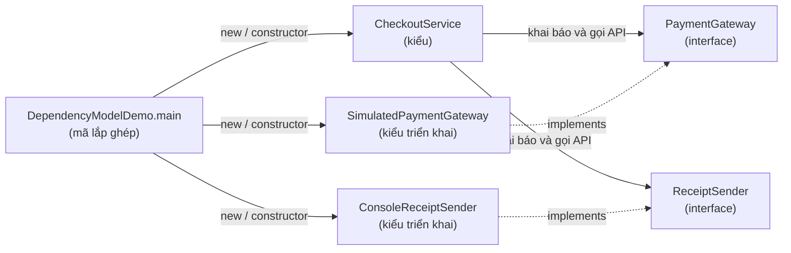
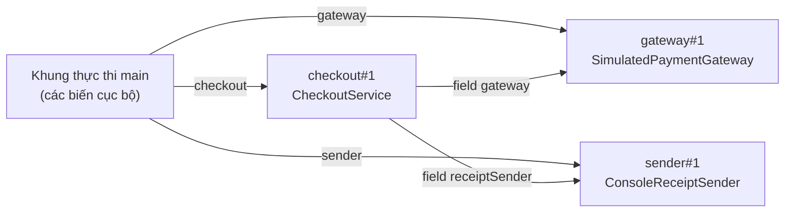

# Phụ thuộc giữa các kiểu trong mã nguồn và giữa các đối tượng lúc chạy

Trong Java, câu “`CheckoutService` phụ thuộc vào `PaymentGateway`” có thể mô tả **hai mối quan hệ khác nhau**: mã nguồn của `CheckoutService` cần biết *kiểu* `PaymentGateway` để biên dịch, và một *đối tượng* `CheckoutService` đang giữ tham chiếu đến một đối tượng thanh toán cụ thể khi chương trình chạy. Hai đồ thị này liên quan đến nhau nhưng không đồng nhất.

Đây là nền tảng để hiểu **Dependency Injection (DI)** và **Inversion of Control (IoC)**: tách phần **sử dụng** phụ thuộc ra khỏi phần **tạo và lắp ghép** đối tượng, sau đó kiểm soát chúng tại *composition root* (điểm lắp ghép của ứng dụng). Trước khi dùng DI container, ta cần nhìn rõ các quan hệ ấy bằng Java thuần.

## 1. Hai lớp phụ thuộc cần phân biệt

| Khía cạnh | Phụ thuộc giữa các kiểu trong mã nguồn | Phụ thuộc giữa các đối tượng lúc chạy |
| --- | --- | --- |
| Câu hỏi | “Mã của kiểu A cần biết kiểu nào để được kiểm tra/biên dịch?” | “Đối tượng A cụ thể đang tham chiếu hoặc gọi đối tượng nào?” |
| Đơn vị quan sát | Lớp, interface, kiểu của field/tham số, lời gọi, biểu thức `new`, kế thừa... | Các instance cụ thể được tạo trong một lần chạy, ví dụ `checkout#1`, `gateway#1` |
| Thời điểm nhìn rõ | Khi đọc mã nguồn và kiểm tra kiểu; một số quan hệ còn tồn tại trong bytecode | Khi khởi tạo, lắp ghép và thực thi; có thể thay đổi theo cấu hình hoặc đường chạy |
| Ví dụ | `CheckoutService` khai báo field kiểu `PaymentGateway` | `checkout#1` giữ tham chiếu đến `simulatedGateway#1` |
| Cách can thiệp | Đổi thiết kế API, chuyển từ kiểu triển khai sang abstraction | Truyền instance khác, thay cách chia sẻ instance, đổi phạm vi/vòng đời |

**Chú ý về thuật ngữ:** “phụ thuộc lúc biên dịch” ở đây nói về quan hệ **mã nguồn/kiểu tĩnh**; không có nghĩa Java sẽ tạo đối tượng đó lúc biên dịch. Ngược lại, kiểu cũng có biểu diễn trong JVM lúc chạy. Điểm cần phân biệt là **quan hệ giữa các kiểu** và **quan hệ giữa những instance cụ thể**.

### 1.1. Phụ thuộc giữa các kiểu xuất hiện ở đâu?

Giả sử một lớp có các khai báo sau:

```java
class CheckoutService {
    private final PaymentGateway gateway;

    CheckoutService(PaymentGateway gateway) {
        this.gateway = gateway;
    }

    String checkout(int amountVnd) {
        return gateway.charge(amountVnd);
    }
}
```

Trong ví dụ này, `CheckoutService` **phụ thuộc về mặt kiểu** vào `PaymentGateway` bởi:

- Field và tham số constructor khai báo kiểu `PaymentGateway`.
- Lời gọi `gateway.charge(...)` phải hợp lệ theo API của `PaymentGateway`.
- Nếu API của `PaymentGateway` thay đổi không tương thích, mã `CheckoutService` có thể phải sửa và biên dịch lại.

Một lớp còn có thể phụ thuộc vào kiểu khác qua `extends`, `implements`, kiểu trả về, generic, annotation, lời gọi phương thức tĩnh hoặc biểu thức `new ConcreteClass()`. Những quan hệ này có độ gắn kết khác nhau: **phụ thuộc vào interface** vẫn là phụ thuộc về kiểu, nhưng thường cho phép thay đổi implementation dễ hơn so với phụ thuộc trực tiếp vào lớp cụ thể.

Ví dụ:

```java
// Phần sử dụng bị gắn trực tiếp vào cách tạo implementation:
class TightlyCoupledCheckoutService {
    private final SimulatedPaymentGateway gateway =
            new SimulatedPaymentGateway();
}
```

Ở đây lớp sử dụng đã biết cả `SimulatedPaymentGateway` và cách khởi tạo nó. Muốn đổi implementation, ta thường phải sửa chính lớp này. Trong khi đó, với constructor nhận `PaymentGateway`, lớp sử dụng chỉ cần API đã thống nhất.

### 1.2. Phụ thuộc giữa các đối tượng là gì?

Giả sử có biểu thức:

```java
PaymentGateway gateway = new SimulatedPaymentGateway();
CheckoutService checkout = new CheckoutService(gateway);
```

Khi thực thi:

1. JVM tạo một đối tượng `SimulatedPaymentGateway`.
2. JVM tạo một đối tượng `CheckoutService`.
3. Constructor truyền tham chiếu đến đối tượng gateway vào `CheckoutService`, và field của checkout giữ tham chiếu ấy.

Vì vậy, một cạnh trong đồ thị lúc chạy là:

```text
checkout#1 : CheckoutService  ──gateway──>  gateway#1 : SimulatedPaymentGateway
```

`PaymentGateway` trong dòng khai báo là **kiểu của biến**, không phải một đối tượng interface được tạo ra. Đối tượng thật có kiểu chạy là `SimulatedPaymentGateway`. Cùng một lớp `CheckoutService` có thể tạo ra nhiều instance trỏ tới những gateway khác nhau.

Cũng cần phân biệt **tham chiếu được giữ lâu dài** (ví dụ field `gateway`) với **lời gọi ngắn hạn** (ví dụ biến cục bộ). Một sơ đồ đối tượng thường chọn vẽ các tham chiếu quan trọng tại một thời điểm xác định; nó không nhất thiết hiển thị toàn bộ lời gọi hay từng đối tượng tạm thời.

## 2. Ví dụ Java đầy đủ: thanh toán và gửi biên nhận

Bài toán: khi thanh toán thành công, dịch vụ checkout gọi cổng thanh toán rồi gửi mã giao dịch cho người mua. `CheckoutService` chỉ biết **hai hợp đồng**: `PaymentGateway` và `ReceiptSender`.

Tạo file `DependencyModelDemo.java`:

```java
import java.util.Objects;

public class DependencyModelDemo {
    interface PaymentGateway {
        String charge(int amountVnd);
    }

    interface ReceiptSender {
        void send(String transactionId);
    }

    // Implementation mô phỏng để chạy bài học, không kết nối hệ thống thật.
    static final class SimulatedPaymentGateway implements PaymentGateway {
        private int nextId = 0;

        @Override
        public String charge(int amountVnd) {
            if (amountVnd <= 0) {
                throw new IllegalArgumentException("amountVnd must be positive");
            }
            nextId++;
            return "TX-" + nextId;
        }
    }

    static final class ConsoleReceiptSender implements ReceiptSender {
        @Override
        public void send(String transactionId) {
            System.out.println("Da gui bien nhan: " + transactionId);
        }
    }

    static final class CheckoutService {
        private final PaymentGateway gateway;
        private final ReceiptSender receiptSender;

        // Constructor injection: nhận phụ thuộc đã được tạo bên ngoài.
        CheckoutService(PaymentGateway gateway, ReceiptSender receiptSender) {
            this.gateway = Objects.requireNonNull(gateway, "gateway");
            this.receiptSender =
                    Objects.requireNonNull(receiptSender, "receiptSender");
        }

        String checkout(int amountVnd) {
            String transactionId = gateway.charge(amountVnd);
            receiptSender.send(transactionId);
            return transactionId;
        }
    }

    public static void main(String[] args) {
        // Composition root: tạo và nối các đối tượng.
        PaymentGateway gateway = new SimulatedPaymentGateway();
        ReceiptSender sender = new ConsoleReceiptSender();
        CheckoutService checkout = new CheckoutService(gateway, sender);

        String transactionId = checkout.checkout(250_000);
        System.out.println("Giao dich: " + transactionId);
    }
}
```

Chạy bằng JDK:

```bash
javac DependencyModelDemo.java
java DependencyModelDemo
```

Kết quả:

```text
Da gui bien nhan: TX-1
Giao dich: TX-1
```

### 2.1. Đồ thị phụ thuộc giữa các kiểu



Các cạnh quan trọng:

- `CheckoutService → PaymentGateway` và `CheckoutService → ReceiptSender`: lớp nghiệp vụ biết **abstraction** cần dùng.
- `SimulatedPaymentGateway → PaymentGateway`: lớp triển khai tuân theo interface; `implements` là quan hệ kiểu, có ký hiệu khác với hành vi truyền tham chiếu.
- `main → SimulatedPaymentGateway / ConsoleReceiptSender / CheckoutService`: mã ở composition root chủ động biết các lớp cụ thể để lắp ghép.

**DI không xóa hết các phụ thuộc giữa các kiểu.** Nó giúp dịch chuyển quyết định chọn và khởi tạo implementation về nơi lắp ghép; mã nghiệp vụ vẫn phụ thuộc vào hợp đồng cần sử dụng.

### 2.2. Đồ thị các đối tượng lúc chạy

Ngay sau ba lệnh tạo đối tượng trong `main`, đồ thị có thể hình dung như sau:



Đây là **ba đối tượng**, dù mã nguồn có thêm các interface. Chúng được tạo bởi `new`; các biến và field chỉ **giữ tham chiếu**, không tự động tạo thêm đối tượng.

Khi `checkout.checkout(250_000)` chạy, JVM dùng kiểu chạy thực tế của `gateway#1` để điều phối lời gọi `charge` đến `SimulatedPaymentGateway.charge`. Trình biên dịch chỉ cần xác nhận phương thức `charge(int)` tồn tại trên kiểu khai báo `PaymentGateway`.

## 3. Đổi đối tượng lúc chạy mà không sửa lớp sử dụng

Hãy tưởng tượng một cấu hình khác tạo `RealPaymentGateway` thay cho `SimulatedPaymentGateway` (cùng triển khai `PaymentGateway`), hoặc một bài test truyền fake vào constructor. `CheckoutService` không cần sửa, miễn implementation mới tôn trọng hợp đồng.

Ví dụ kiểm thử nhỏ với Java thuần, không cần DI container hay thư viện mock. Đặt đoạn sau **bên trong một phương thức** của `DependencyModelDemo` (các interface/lớp ở ví dụ trên phải còn trong cùng lớp):

```java
PaymentGateway fakeGateway = amountVnd -> "TEST-" + amountVnd;

final String[] capturedReceipt = {null};
ReceiptSender fakeSender = id -> capturedReceipt[0] = id;

CheckoutService checkout = new CheckoutService(fakeGateway, fakeSender);
String transactionId = checkout.checkout(100_000);

if (!"TEST-100000".equals(transactionId)
        || !"TEST-100000".equals(capturedReceipt[0])) {
    throw new AssertionError("Checkout did not use injected dependencies");
}
```

Trong cấu hình này, **các kiểu mà `CheckoutService` phụ thuộc không đổi**, nhưng các instance nằm ở phía sau `PaymentGateway` và `ReceiptSender` đã đổi thành những đối tượng do lambda tạo ra. Điều đó đủ để test luồng nghiệp vụ mà không gọi dịch vụ thanh toán hay gửi biên nhận thật.

Đây là lợi ích trực tiếp của **constructor injection**: phụ thuộc bắt buộc xuất hiện rõ trong constructor, lớp sử dụng không tự lựa chọn implementation, và bộ kiểm thử có thể kiểm soát instance được cung cấp.

> Trong ví dụ, fake chỉ xác minh lời gọi và giá trị truyền qua. Ở hệ thống thật, cần test thêm lỗi thanh toán, kết quả thất bại và hợp đồng hành vi của từng adapter.

## 4. Một kiểu có thể tham gia nhiều đồ thị đối tượng

Hai biến kiểu `CheckoutService` không nhất thiết trỏ tới cùng một instance. Tương tự, nhiều checkout có thể chia sẻ một gateway:

```java
PaymentGateway sharedGateway = new SimulatedPaymentGateway();

CheckoutService checkoutA =
        new CheckoutService(sharedGateway, id -> {});
CheckoutService checkoutB =
        new CheckoutService(sharedGateway, id -> {});
```

Các field `gateway` của `checkoutA` và `checkoutB` trỏ tới **cùng một đối tượng** `sharedGateway`. Nếu thay hai lệnh truyền bằng hai biểu thức `new SimulatedPaymentGateway()` riêng biệt, ta sẽ có **hai gateway khác nhau**. Quan hệ **giữa các kiểu** vẫn giữ nguyên, còn đồ thị **đối tượng** và trạng thái được chia sẻ đã đổi.

| Cách lắp ghép | Đối tượng gateway | Hệ quả |
| --- | --- | --- |
| Hai checkout nhận cùng biến `sharedGateway` | Một instance được dùng chung | Trạng thái trong gateway được chia sẻ; khi dùng đồng thời cần xem xét an toàn luồng |
| Mỗi checkout nhận một `new SimulatedPaymentGateway()` | Hai instance tách biệt | Trạng thái riêng; có thể tăng chi phí tạo hoặc quản lý tài nguyên |
| Tạo gateway mới cho từng yêu cầu | Vòng đời gắn với yêu cầu | Phải bảo đảm đóng/giải phóng tài nguyên phù hợp khi yêu cầu kết thúc |

Đây là cơ sở của khái niệm **scope** và **lifecycle** khi học DI container về sau. “Singleton” thường nói đến việc một container chia sẻ một instance trong phạm vi quản lý của nó; nó **không tự đảm bảo thread safety**. “Transient” thường nói đến việc tạo instance mới theo mỗi lần yêu cầu từ container; định nghĩa cụ thể cần theo framework đang dùng.

Trong Java thuần, người viết composition root tự quyết định tạo mới, tái sử dụng và giải phóng instance. Với một đối tượng sở hữu socket, file hoặc kết nối, cần có chiến lược quản lý vòng đời rõ ràng (ví dụ `AutoCloseable` và `try-with-resources` ở nơi sở hữu tài nguyên).

## 5. Quan hệ giữa DI, IoC và hai đồ thị

Tư duy nên áp dụng theo trình tự:

1. **Từ nhu cầu sử dụng**, định nghĩa API `PaymentGateway` và `ReceiptSender`; lớp nghiệp vụ chỉ dùng những khả năng cần thiết.
2. **Bằng constructor injection**, cho lớp nghiệp vụ nhận các instance đã được cung cấp.
3. **Tại composition root**, tạo implementation cụ thể, nối các tham chiếu và quản lý vòng đời phù hợp.
4. **Khi kiểm thử hoặc đổi cấu hình**, lắp một đồ thị instance khác mà giữ nguyên mã nghiệp vụ.

`CheckoutService` mất quyền tự quyết định cách tạo gateway; thành phần bên ngoài kiểm soát việc đó. Sự **đảo chiều quyền kiểm soát việc lắp ghép** là một biểu hiện của IoC, và **truyền phụ thuộc** là cách thực hiện DI. DI container chỉ tự động hóa việc dựng và quản lý một phần đồ thị; **không phải điều kiện để có DI**.

Một số ngộ nhận dễ gặp:

- **“Dùng interface là đã có DI.”** Chưa đủ. Một lớp vẫn có thể gọi `new ConcreteGateway()` ngay bên trong, khiến việc chọn implementation vẫn bị khóa cứng.
- **“Constructor nhận interface thì chương trình không còn phụ thuộc vào lớp cụ thể.”** Sai ở cấp toàn ứng dụng: composition root vẫn cần biết lớp cụ thể để tạo nó.
- **“Đồ thị kiểu và đồ thị đối tượng có số nút bằng nhau.”** Không đúng. Một kiểu có thể tạo nhiều instance, interface không thể trực tiếp được `new`, và nhiều tham chiếu có thể cùng trỏ một instance.
- **“Mỗi phụ thuộc kiểu đều tạo cạnh tham chiếu field lúc chạy.”** Không đúng. Lời gọi phương thức tĩnh, dùng kiểu cho biến cục bộ hoặc tạo đối tượng tạm thời có quan hệ kiểu nhưng không nhất thiết tạo field tham chiếu lâu dài.
- **“DI tự giải quyết vòng phụ thuộc.”** Không. Nếu A cần B và B cần A để khởi tạo, ta thường cần xem lại ranh giới trách nhiệm; constructor injection còn có thể giúp lộ rõ vòng này từ sớm.

## 6. Cách tự phân tích một đoạn mã Java

Khi gặp mã chưa rõ có được tách phụ thuộc tốt hay chưa, hãy lần lượt trả lời:

| Câu hỏi | Dấu hiệu cần tìm |
| --- | --- |
| **Lớp sử dụng biết những kiểu nào?** | Kiểu trong field, constructor, phương thức, `implements`, `new`, lời gọi tĩnh... |
| **Lớp nào quyết định implementation?** | Vị trí thực hiện `new ConcreteClass(...)` hoặc lựa chọn instance |
| **Đối tượng nào đang giữ tham chiếu tới đối tượng nào?** | Gán field, truyền tham chiếu qua constructor/setter, dùng chung instance |
| **Nếu đổi cổng thanh toán, cần sửa ở đâu?** | Chỉ composition root hay cả lớp nghiệp vụ? |
| **Nếu đổi phạm vi chia sẻ, ai chịu trách nhiệm?** | Mã lắp ghép/container và bên sở hữu vòng đời |
| **Có thể test bằng Java thuần không?** | Truyền fake/stub vào constructor, quan sát đầu ra và lời gọi |

### Bài tập thực hành

Từ `DependencyModelDemo` ở trên:

1. Tạo thêm `SilentReceiptSender` triển khai `ReceiptSender` nhưng không in ra console. Thay đúng **một dòng lắp ghép** trong `main`; quan sát rằng `CheckoutService` không thay đổi.
2. Tạo hai `CheckoutService` dùng chung một `SimulatedPaymentGateway`. Gọi `checkout` lần lượt và giải thích vì sao mã giao dịch lần hai là `TX-2`. Sau đó thay bằng hai gateway mới và giải thích vì sao cả hai có thể trả về `TX-1`.
3. Thử chuyển `new SimulatedPaymentGateway()` vào bên trong `CheckoutService`. Liệt kê những **cạnh phụ thuộc kiểu mới** trong lớp nghiệp vụ, rồi chỉ ra tại sao test với fake sẽ khó hơn.
4. Vẽ lại hai đồ thị: một sơ đồ **kiểu** ổn định theo mã nguồn và một sơ đồ **instance** tương ứng với từng cách lắp ghép.

**Điểm cần ghi nhớ:** phụ thuộc giữa các kiểu quyết định lớp nào phải biết API nào; phụ thuộc giữa các đối tượng quyết định instance nào tương tác và chia sẻ trạng thái khi chạy. Constructor injection giữ sự khác biệt ấy rõ ràng, còn composition root là nơi chủ động tạo đồ thị đối tượng.
