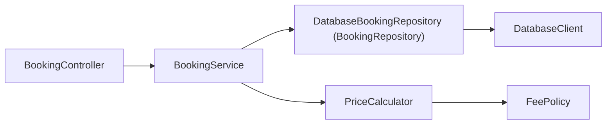

# Phụ thuộc trực tiếp, gián tiếp và đường truyền qua nhiều lớp

Trong một ứng dụng Java, một lớp hiếm khi tự làm tất cả công việc. `BookingController` tiếp nhận yêu cầu, `BookingService` xử lý nghiệp vụ, `BookingRepository` lưu dữ liệu và một thành phần khác giao tiếp với cơ sở dữ liệu. Mỗi thành phần chỉ gọi một vài thành phần lân cận, nhưng kết quả của một yêu cầu có thể phụ thuộc vào cả chuỗi phía sau chúng.

Hiểu **phụ thuộc trực tiếp**, **phụ thuộc gián tiếp** và **đường phụ thuộc qua nhiều lớp** giúp ta thiết kế constructor injection rõ ràng, chọn nơi lắp ghép đối tượng, khoanh vùng lỗi và xác định đúng ranh giới kiểm thử. Đây là một phần của Dependency Injection (DI) và Inversion of Control (IoC): đối tượng nhận các cộng tác viên cần dùng từ bên ngoài, còn việc tạo và nối các đối tượng được thực hiện tại nơi cấu hình ứng dụng (composition root).

## 1. Nhìn phụ thuộc như một đồ thị có hướng

Xét một **đồ thị phụ thuộc**: mỗi nút là một đối tượng hoặc vai trò thành phần; mũi tên `A → B` có nghĩa là **A cần B để thực hiện trách nhiệm của A**. Mũi tên đi từ bên sử dụng đến bên được sử dụng, không biểu thị thứ tự gọi trong mọi tình huống và cũng không có nghĩa B biết A.



Ở đồ thị này:

- `BookingController` **trực tiếp** phụ thuộc vào `BookingService`, vì có một cạnh `Controller → Service`.
- `BookingController` **gián tiếp** phụ thuộc vào `DatabaseBookingRepository`, `DatabaseClient`, `PriceCalculator` và `FeePolicy`, vì muốn đi từ controller đến những nút đó phải qua ít nhất một nút trung gian.
- `BookingService` trực tiếp phụ thuộc vào repository và calculator, nhưng gián tiếp phụ thuộc vào `DatabaseClient` và `FeePolicy`.
- `DatabaseClient` và `FeePolicy` nằm ở hai **nhánh** khác nhau. Một yêu cầu đặt chỗ có thể sử dụng cả hai nhánh, nhưng việc một nút có mặt trong đồ thị không có nghĩa mọi luồng xử lý luôn gọi tới nó.

Trong Java, cần phân biệt ba góc nhìn: **phụ thuộc mã nguồn** (lớp tham chiếu kiểu nào), **phụ thuộc đối tượng lúc chạy** (instance nào thực sự được cấp cho constructor) và **luồng gọi khi thực thi** (phương thức nào được gọi ở một yêu cầu cụ thể). Ví dụ, `BookingService` có thể khai báo trường kiểu giao diện `BookingRepository`, trong khi composition root truyền vào một `DatabaseBookingRepository`. Đồ thị trên mô tả đối tượng được lắp ghép khi chạy; ở mức mã nguồn, service chỉ cần biết hợp đồng `BookingRepository`.

> Trong bài này, “phụ thuộc gián tiếp” chỉ quan hệ giữa các thành phần/đối tượng trong ứng dụng. Nó khác với “transitive dependency” của Maven hoặc Gradle, vốn nói về các thư viện được kéo vào thông qua thư viện khác.

## 2. Trực tiếp và gián tiếp được xác định từ một điểm nhìn

**Phụ thuộc trực tiếp** tồn tại khi A cần làm việc với B qua một tham chiếu hoặc hợp đồng mà A sử dụng. Với constructor injection, dấu hiệu dễ nhận biết là B được truyền qua constructor của A:

```java
final class BookingController {
    private final BookingService service;

    BookingController(BookingService service) {
        this.service = java.util.Objects.requireNonNull(service);
    }

    void create(String bookingId, int price) {
        service.book(bookingId, price);
    }
}
```

Controller biết `BookingService` và gọi `book(...)`. Controller không cần biết service lưu dữ liệu ra sao hoặc tính giá qua những lớp nào.

**Phụ thuộc gián tiếp** tồn tại khi có đường đi từ A đến C qua một hay nhiều thành phần trung gian, chẳng hạn `BookingController → BookingService → BookingRepository`. Độ dài đường đi là số cạnh:

| Điểm bắt đầu | Thành phần đích | Đường đi | Độ dài | Quan hệ |
| --- | --- | --- | ---: | --- |
| `BookingController` | `BookingService` | Controller → Service | 1 | Trực tiếp |
| `BookingController` | `PriceCalculator` | Controller → Service → Calculator | 2 | Gián tiếp |
| `BookingController` | `DatabaseClient` | Controller → Service → Repository → DatabaseClient | 3 | Gián tiếp qua nhiều lớp |
| `BookingService` | `FeePolicy` | Service → Calculator → FeePolicy | 2 | Gián tiếp |

Quan hệ này **phụ thuộc vào nút xuất phát**: repository là phụ thuộc trực tiếp của service nhưng là phụ thuộc gián tiếp của controller. Nếu tồn tại nhiều đường từ A đến B, ta phải xem từng đường; A có thể vừa có cạnh trực tiếp đến B, vừa có một đường gián tiếp khác đến B. Khi nói “B là phụ thuộc trực tiếp của A”, chỉ cần biết có cạnh `A → B`, không cần giả định đó là đường duy nhất.

## 3. Đường truyền qua nhiều lớp tác động đến thiết kế ra sao?

Một đường phụ thuộc mô tả **chuỗi những thứ phải được lắp ghép** để một đối tượng đầu vào có thể sử dụng các chức năng phía dưới. Với `Controller → Service → Repository → DatabaseClient`, composition root cần tạo hoặc lấy `DatabaseClient`, cung cấp nó cho repository, đưa repository vào service rồi mới lắp controller.

Đường phụ thuộc không tự động tạo ra phụ thuộc mã nguồn giữa hai đầu đường. Controller không phải import `DatabaseClient`, không phải biết chuỗi kết nối và không phải tự khởi tạo repository. Tuy vậy, ở một luồng xử lý có lưu dữ liệu, lỗi từ `DatabaseClient` có thể đi qua repository và service đến controller nếu không được xử lý ở các tầng trung gian. **Tách phụ thuộc mã nguồn không loại bỏ các tác động vận hành qua đường phụ thuộc.**

Khi đọc một thiết kế, hãy để ý thêm hai đặc điểm:

- **Độ sâu:** chuỗi dài làm tăng số bước phải lần theo khi tìm nơi tạo đối tượng, nơi phát sinh lỗi hoặc vấn đề về vòng đời. Độ sâu lớn chưa chắc là sai nếu mỗi tầng có trách nhiệm rõ.
- **Độ rộng và tái sử dụng:** một service có thể phụ thuộc nhiều cộng tác viên (nhánh rẽ); một cộng tác viên có thể được nhiều service dùng chung (nhiều đường hội tụ). Cần xét cả việc chia sẻ instance, mức kết dính và ranh giới trách nhiệm, thay vì chỉ đếm số lớp.

## 4. Ví dụ Java thuần: lắp ghép từ nơi sử dụng đến nguồn lực cuối

Ví dụ dưới đây dùng constructor injection và một `DatabaseClient` **giả lập bằng việc in ra màn hình** để tập trung vào mô hình phụ thuộc, không yêu cầu framework hay cơ sở dữ liệu thật. Toàn bộ ví dụ có thể lưu thành `BookingExample.java` và chạy bằng Java:

```java
import java.util.Objects;

public class BookingExample {
    interface BookingRepository {
        void save(String bookingId, int total);
    }

    static final class DatabaseClient {
        void insertBooking(String bookingId, int total) {
            System.out.println("Luu " + bookingId + ", tong tien = " + total);
        }
    }

    static final class DatabaseBookingRepository implements BookingRepository {
        private final DatabaseClient databaseClient;

        DatabaseBookingRepository(DatabaseClient databaseClient) {
            this.databaseClient = Objects.requireNonNull(databaseClient);
        }

        @Override
        public void save(String bookingId, int total) {
            databaseClient.insertBooking(bookingId, total);
        }
    }

    static final class FeePolicy {
        int feeFor(int basePrice) {
            return basePrice / 10; // Quy tắc minh họa: phí 10%.
        }
    }

    static final class PriceCalculator {
        private final FeePolicy feePolicy;

        PriceCalculator(FeePolicy feePolicy) {
            this.feePolicy = Objects.requireNonNull(feePolicy);
        }

        int totalFor(int basePrice) {
            return basePrice + feePolicy.feeFor(basePrice);
        }
    }

    static final class BookingService {
        private final BookingRepository repository;
        private final PriceCalculator calculator;

        BookingService(BookingRepository repository, PriceCalculator calculator) {
            this.repository = Objects.requireNonNull(repository);
            this.calculator = Objects.requireNonNull(calculator);
        }

        int book(String bookingId, int basePrice) {
            int total = calculator.totalFor(basePrice);
            repository.save(bookingId, total);
            return total;
        }
    }

    static final class BookingController {
        private final BookingService service;

        BookingController(BookingService service) {
            this.service = Objects.requireNonNull(service);
        }

        void create(String bookingId, int basePrice) {
            int total = service.book(bookingId, basePrice);
            System.out.println("Da tao booking voi tong tien = " + total);
        }
    }

    public static void main(String[] args) {
        // Composition root: tạo từ các nút lá rồi lắp lên tầng trên.
        DatabaseClient databaseClient = new DatabaseClient();
        BookingRepository repository = new DatabaseBookingRepository(databaseClient);
        FeePolicy feePolicy = new FeePolicy();
        PriceCalculator calculator = new PriceCalculator(feePolicy);
        BookingService service = new BookingService(repository, calculator);
        BookingController controller = new BookingController(service);

        controller.create("BK-001", 200);
    }
}
```

Chạy bằng lệnh:

```bash
javac BookingExample.java
java BookingExample
```

Kết quả minh họa:

```text
Luu BK-001, tong tien = 220
Da tao booking voi tong tien = 220
```

Ở đây, constructor của `BookingController` chỉ khai báo một phụ thuộc trực tiếp là `BookingService`. Constructor của `BookingService` khai báo hai phụ thuộc trực tiếp là `BookingRepository` và `PriceCalculator`. `DatabaseClient` và `FeePolicy` **không đi xuyên qua** constructor của controller: composition root lắp từng đoạn của đồ thị đúng tại nơi chúng cần dùng.

Điều đó thể hiện IoC ở mức thiết kế: controller và service không tự quyết định dùng implementation cụ thể nào. DI cung cấp đối tượng từ ngoài vào, còn composition root giữ trách nhiệm tạo và lắp ghép. Một DI container có thể tự động hóa công việc ở composition root, nhưng không thay đổi bản chất của các cạnh phụ thuộc.

## 5. Kiểm thử đúng ranh giới của đường phụ thuộc

Với thiết kế trên, muốn kiểm thử riêng `BookingService`, ta có thể thay repository thật bằng một đối tượng ghi nhận dữ liệu. Nhờ vậy, bài kiểm thử nghiệp vụ không phải tạo `DatabaseClient` hoặc truy cập cơ sở dữ liệu.

Đoạn sau dùng các lớp lồng trong `BookingExample` ở trên; có thể đặt nó trong `main` để thử bằng Java thuần:

```java
BookingRepository recordingRepository = new BookingRepository() {
    @Override
    public void save(String bookingId, int total) {
        if (!bookingId.equals("BK-TEST") || total != 220) {
            throw new AssertionError("Du lieu luu khong dung");
        }
    }
};

BookingService serviceUnderTest = new BookingService(
    recordingRepository,
    new PriceCalculator(new FeePolicy())
);

int result = serviceUnderTest.book("BK-TEST", 200);
if (result != 220) {
    throw new AssertionError("Tong tien khong dung");
}
```

Thay instance của `BookingRepository` làm **cắt nhánh thực thi đi đến `DatabaseClient`** trong bài kiểm thử này. Tuy nhiên, `BookingService → PriceCalculator → FeePolicy` vẫn tồn tại vì bài kiểm thử còn dùng calculator và policy thật. Nếu cần kiểm thử riêng phép phối hợp của service mà không phụ thuộc quy tắc tính phí, có thể trừu tượng hóa vai trò tính giá bằng một interface rồi cấp fake calculator qua constructor. Chỉ nên thêm interface khi có nhu cầu thay thế, biến thể hoặc ranh giới thiết kế rõ ràng.

Phạm vi kiểm thử cần khớp điều muốn chứng minh:

| Cấp kiểm thử | Đồ thị phụ thuộc được sử dụng | Kiểm chứng được |
| --- | --- | --- |
| Unit test cho service | Service + fake repository + calculator/policy được chọn | Quy tắc điều phối, dữ liệu gửi cho repository |
| Integration test cho lưu trữ | Repository + database client + database thử nghiệm | Giao tiếp lưu trữ, cấu hình, truy vấn và mapping |
| Test luồng đầy đủ | Controller + service + các cộng tác viên thật hoặc môi trường thử nghiệm | Đường xử lý đi qua nhiều lớp và cách hệ thống phản hồi |

Unit test cho service **không chứng minh** rằng repository thật kết nối DB đúng. Ngược lại, integration test cho DB không thay thế việc kiểm tra quy tắc nghiệp vụ của service. Nhìn đường phụ thuộc giúp chọn phần đồ thị cần xuất hiện trong từng bài kiểm thử.

## 6. Những tình huống dễ hiểu nhầm

### 6.1. Che giấu phụ thuộc bằng cách tự `new` sâu trong lớp

```java
final class BadBookingService {
    void book(String id) {
        DatabaseClient db = new DatabaseClient();
        db.insertBooking(id, 100);
    }
}
```

`BadBookingService` vẫn trực tiếp phụ thuộc vào `DatabaseClient` về mã nguồn, nhưng constructor của nó không thể hiện điều đó; mã nguồn tự chọn implementation và tự kiểm soát vòng đời đối tượng. Khi kiểm thử, việc thay `DatabaseClient` trở nên khó. Constructor injection làm phụ thuộc trực tiếp rõ ràng và để nơi khác quản lý việc tạo đối tượng.

### 6.2. Truyền mọi phụ thuộc sâu nhất lên tận controller

Không cần sửa constructor của `BookingController` thành `BookingController(BookingService, DatabaseClient, FeePolicy)` chỉ vì quá trình đặt chỗ đi qua hai đối tượng ở tầng dưới. Điều đó làm controller biết chi tiết của các tầng mà nó không trực tiếp sử dụng. Mỗi thành phần nên yêu cầu **những cộng tác viên trực tiếp cần cho trách nhiệm của chính nó**; composition root chịu trách nhiệm hoàn thiện đường phụ thuộc còn lại.

### 6.3. Tưởng giao diện loại bỏ mọi phụ thuộc gián tiếp

`BookingService` phụ thuộc vào `BookingRepository` dưới dạng interface, nên nó không bị buộc biên dịch với class lưu DB cụ thể. Nhưng khi chạy với `DatabaseBookingRepository`, luồng `Service → Repository → DatabaseClient` vẫn tồn tại. Interface giảm sự gắn chặt giữa các lớp tại ranh giới thiết kế; nó không khiến database biến mất khỏi kiến trúc vận hành.

### 6.4. Bỏ qua scope, vòng đời và chia sẻ instance

Khi nhiều đường phụ thuộc gặp nhau ở cùng một đối tượng, cần xác định đối tượng được **chia sẻ** hay **tạo riêng**. Ví dụ, một `DatabaseClient` dùng chung có thể phù hợp nếu implementation được thiết kế an toàn cho truy cập đồng thời và có quản lý tài nguyên. Ngược lại, một service sống suốt ứng dụng giữ trực tiếp một `RequestContext` chỉ hợp lệ trong một request có thể dẫn đến dữ liệu sai ngữ cảnh. Tùy yêu cầu, composition root hoặc container phải quản lý scope, tạo đối tượng theo request, hoặc cung cấp một cơ chế truy xuất đúng ngữ cảnh thay vì giữ instance đã hết vòng đời.

### 6.5. Tạo vòng phụ thuộc

Đồ thị `A → B → C → A` tạo thành chu trình. Nếu cả ba constructor đều đòi instance còn lại ngay khi khởi tạo, việc lắp ghép thông thường không có điểm bắt đầu. Constructor injection thường làm chu trình này lộ rõ. Nên xem lại trách nhiệm: tách một phần nghiệp vụ ra thành thành phần thứ ba, đảo chiều lời gọi thông qua hợp đồng thích hợp hoặc dùng sự kiện nếu luồng nghiệp vụ cho phép. Thêm cơ chế tạo trễ chỉ để che chu trình có thể khiến thiết kế khó hiểu hơn.

## 7. Cách lần theo đường phụ thuộc khi đọc hoặc sửa mã nguồn

1. **Chọn nút bắt đầu**, ví dụ endpoint gặp lỗi hoặc service đang được kiểm thử.
2. **Liệt kê phụ thuộc trực tiếp** từ constructor, field và các cộng tác viên thực sự được sử dụng; ghi rõ kiểu interface nếu có.
3. **Tìm nơi lắp ghép** để biết implementation thực sự được truyền vào từng interface và scope của từng instance.
4. **Đi tiếp qua từng cạnh** đến thành phần cần khảo sát. Ghi lại những nhánh có thể được gọi trong trường hợp đang xét.
5. **Đặt ranh giới kiểm thử hoặc xử lý lỗi** tại tầng có đủ ngữ cảnh để hành động: fake một phụ thuộc trực tiếp khi unit test; kiểm tra cả đường khi integration test; chuyển lỗi kỹ thuật thành thông báo nghiệp vụ ở tầng thích hợp.

Ví dụ, nếu lưu booking thất bại, đường cần khảo sát là `Controller → Service → Repository → DatabaseClient`. Nếu tổng tiền sai nhưng lưu thành công, nhiều khả năng nên bắt đầu ở nhánh `Service → PriceCalculator → FeePolicy`. Đây là cách **thu hẹp vị trí cần điều tra**, không phải kết luận nguyên nhân chỉ từ hình vẽ.

## 8. Tự kiểm tra hiểu bài

**Tình huống A.** Với `A → B → C → D`, hãy xác định phụ thuộc trực tiếp và gián tiếp của B. B trực tiếp phụ thuộc C, gián tiếp phụ thuộc D; A nằm ở chiều ngược lại nên không phải phụ thuộc của B theo hướng mũi tên đang xét.

**Tình huống B.** Nếu thay `DatabaseBookingRepository` bằng `InMemoryBookingRepository` mà không sửa `BookingService`, đường nào thay đổi? Cạnh service đến hợp đồng `BookingRepository` vẫn giữ nguyên ở mức mã nguồn; nhánh đối tượng thực thi phía sau repository thay đổi và có thể không còn `DatabaseClient`.

**Tình huống C.** Nếu controller gọi service, nhưng một nhánh xử lý chỉ đọc dữ liệu cache và không gọi repository, có thể nói request đó đã truy cập DB không? Không. Sự hiện diện của đường phụ thuộc trong đồ thị lắp ghép không bảo đảm mọi lời gọi sẽ đi qua toàn bộ đường.

**Tình huống D.** Nếu constructor của service nhận 12 cộng tác viên, có nên chuyển tất cả chúng sang controller để “đơn giản hóa DI”? Không. Cần xem lại trách nhiệm và độ kết dính của service, tách những phần hợp lý, rồi để composition root lắp ghép theo trách nhiệm của từng lớp.

Một thiết kế DI tốt không có nghĩa là các phụ thuộc gián tiếp biến mất. Nó làm **các phụ thuộc trực tiếp rõ ràng**, giữ chi tiết ở đúng tầng, đồng thời cho phép ta quan sát và kiểm soát các **đường phụ thuộc xuyên nhiều lớp** khi cấu hình vòng đời, kiểm thử và xử lý sự cố.
