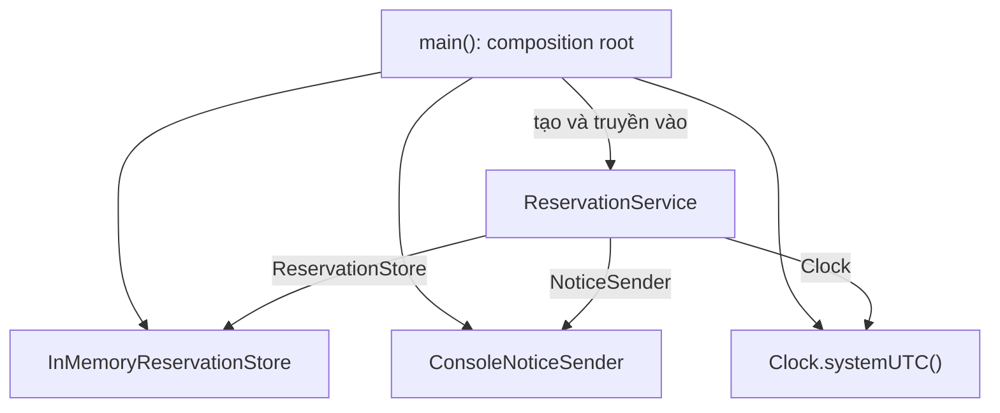

# Phụ thuộc được khai báo rõ so với phụ thuộc ẩn

Trong một chương trình Java, một lớp thường phải nhờ đối tượng hoặc dịch vụ khác để hoàn thành công việc: lưu dữ liệu, gửi thông báo, lấy thời gian hiện tại, đọc cấu hình hoặc gọi API. Cách lớp đó **bộc lộ và nhận các phụ thuộc** quyết định mức độ dễ hiểu, dễ kiểm thử và dễ thay thế của thiết kế.

Bài này thuộc chương **Mô hình phụ thuộc** của chủ đề **Dependency Injection (DI)**. Trọng tâm là phân biệt phụ thuộc được khai báo rõ với phụ thuộc ẩn, sau đó dùng **constructor injection** và **composition root** để tách việc *sử dụng* phụ thuộc khỏi việc *tạo và lắp ghép* đối tượng. Các ví dụ sử dụng Java thuần, chưa cần DI container.

## 1. Phụ thuộc là gì và thế nào là “rõ”?

Giả sử `ReservationService` xác nhận một lượt đặt chỗ. Nó cần lưu thông tin vào kho dữ liệu, gửi thông báo và ghi nhận thời điểm xác nhận. `ReservationStore`, `NoticeSender` và nguồn thời gian (`Clock`) là các phụ thuộc của nghiệp vụ đó.

Một phụ thuộc **được khai báo rõ** khi người đọc có thể xác định từ hợp đồng sử dụng đối tượng (thường là constructor hoặc tham số phương thức) rằng cần cung cấp khả năng nào để đối tượng làm việc. Ví dụ:

```java
ReservationService(ReservationStore store, NoticeSender sender, Clock clock)
```

Chỉ cần nhìn chữ ký constructor, ta biết lớp cần ba cộng tác viên. Người gọi quyết định cung cấp hiện thực nào và thời điểm tạo chúng.

Một phụ thuộc **ẩn** khi lớp tự tìm, tự tạo hoặc truy cập một khả năng từ môi trường ở bên trong phương thức, trong khi hợp đồng bên ngoài không cho thấy yêu cầu đó. Ví dụ: `new JdbcReservationStore(...)`, `System.getenv(...)`, `Instant.now()`, singleton toàn cục hoặc `ServiceLocator.get(...)` được gọi ngay trong nghiệp vụ.

> “Ẩn” là nói về khả năng nhận biết và kiểm soát phụ thuộc tại ranh giới của lớp, không có nghĩa Java không nhìn thấy tên kiểu trong mã nguồn. Đọc thân phương thức có thể phát hiện được phụ thuộc ẩn; vấn đề là người sử dụng lớp khó biết và khó thay thế nó một cách có chủ đích.

### Nhận biết qua hợp đồng

| Cách viết | Người tạo `ReservationService` nhìn thấy gì? | Hệ quả |
| --- | --- | --- |
| `ReservationService(ReservationStore store)` | Cần cung cấp một kho lưu trữ | Có thể chọn bản thật hoặc bản giả khi kiểm thử |
| `confirm(String code, Clock clock)` | Mỗi lần gọi phải cung cấp nguồn thời gian | Thích hợp khi phụ thuộc thay đổi theo lần gọi |
| `new FileReservationStore(...)` trong `confirm()` | Không thấy yêu cầu lưu trữ từ constructor | Nghiệp vụ bị gắn với cách tạo kho lưu trữ |
| `GlobalSender.INSTANCE.send(...)` | Không thấy yêu cầu gửi thông báo | Phụ thuộc trạng thái/cấu hình toàn cục |
| `ServiceLocator.get(NoticeSender.class)` | Không thấy yêu cầu ở chữ ký | Có thể lỗi lúc chạy khi chưa đăng ký dịch vụ |
| `Instant.now()` | Không thấy phụ thuộc vào đồng hồ thực | Kiểm thử theo thời gian khó tái lập |

**Lưu ý:** phụ thuộc được khai báo rõ không bắt buộc là một `interface`. Có thể tiêm một lớp cụ thể phù hợp, như `java.time.Clock`. Điều quan trọng là bên sử dụng nhận phụ thuộc từ ngoài và có hợp đồng dễ nhận biết. Ngược lại, chỉ khai báo một trường kiểu interface rồi tự `new` hiện thực trong constructor vẫn chưa tách được trách nhiệm tạo đối tượng.

## 2. Ví dụ phụ thuộc ẩn: nghiệp vụ tự quyết định hạ tầng

Đoạn Java sau ghi một xác nhận vào tệp của người dùng máy và lấy thời gian từ đồng hồ hệ thống:

```java
import java.io.IOException;
import java.io.UncheckedIOException;
import java.nio.file.Files;
import java.nio.file.Path;
import java.nio.file.StandardOpenOption;
import java.time.Instant;

final class HiddenReservationService {
    void confirm(String code) {
        Instant confirmedAt = Instant.now(); // Đồng hồ hệ thống ẩn
        Path file = Path.of(System.getProperty("user.home"), "reservations.log");

        try {
            Files.writeString(
                file,
                code + "," + confirmedAt + System.lineSeparator(),
                StandardOpenOption.CREATE,
                StandardOpenOption.APPEND
            );
        } catch (IOException error) {
            throw new UncheckedIOException(error);
        }

        System.out.println("Đã xác nhận: " + code); // Đích thông báo cố định
    }
}
```

`new HiddenReservationService()` trông như không có yêu cầu nào, nhưng `confirm()` cần quyền ghi tệp, thư mục người dùng, đồng hồ thực và kênh xuất chuẩn. Để kiểm thử, ta phải kiểm soát tệp, trạng thái môi trường và thời gian; nếu có nhiều kiểm thử chạy đồng thời, chúng còn có nguy cơ ảnh hưởng lẫn nhau. Khi đổi sang cơ sở dữ liệu hoặc dịch vụ thông báo, phải sửa mã nghiệp vụ.

Vấn đề chính không phải là lời gọi `Files.writeString` tự nó sai; vấn đề là **quyết định dùng tệp nào, đồng hồ nào và kênh thông báo nào đã bị khóa bên trong lớp nghiệp vụ**. Trong ứng dụng nhỏ, cách viết trực tiếp có thể chấp nhận được. Khi cần thay môi trường chạy hoặc kiểm thử độc lập, ranh giới đó trở thành điểm gây khó khăn.

## 3. Khai báo phụ thuộc bằng constructor injection

Ta tách ba khả năng mà nghiệp vụ cần: nơi lưu đặt chỗ, nơi gửi thông báo và nguồn thời gian. `ReservationService` chỉ điều phối quy tắc xác nhận; mã tạo đối tượng nằm ở `main()`.

Lưu đoạn mã sau vào `ReservationExample.java`:

```java
import java.time.Clock;
import java.time.Instant;
import java.util.HashMap;
import java.util.Map;
import java.util.Objects;

public final class ReservationExample {
    public interface ReservationStore {
        void save(String code, Instant confirmedAt);
    }

    public interface NoticeSender {
        void sendConfirmation(String code);
    }

    public static final class ReservationService {
        private final ReservationStore store;
        private final NoticeSender sender;
        private final Clock clock;

        public ReservationService(
                ReservationStore store,
                NoticeSender sender,
                Clock clock) {
            this.store = Objects.requireNonNull(store, "store");
            this.sender = Objects.requireNonNull(sender, "sender");
            this.clock = Objects.requireNonNull(clock, "clock");
        }

        public void confirm(String code) {
            if (code == null || code.trim().isEmpty()) {
                throw new IllegalArgumentException("code must not be blank");
            }

            Instant confirmedAt = Instant.now(clock);
            store.save(code, confirmedAt);
            sender.sendConfirmation(code);
        }
    }

    public static final class InMemoryReservationStore implements ReservationStore {
        private final Map<String, Instant> reservations = new HashMap<>();

        @Override
        public void save(String code, Instant confirmedAt) {
            reservations.put(code, confirmedAt);
        }

        public Instant findConfirmedAt(String code) {
            return reservations.get(code);
        }
    }

    public static final class ConsoleNoticeSender implements NoticeSender {
        @Override
        public void sendConfirmation(String code) {
            System.out.println("Đã xác nhận: " + code);
        }
    }

    public static void main(String[] args) {
        // Composition root: nơi tạo và lắp ghép đồ thị đối tượng.
        InMemoryReservationStore store = new InMemoryReservationStore();
        NoticeSender sender = new ConsoleNoticeSender();
        Clock clock = Clock.systemUTC();

        ReservationService service = new ReservationService(store, sender, clock);
        service.confirm("RSV-100");
        System.out.println("Thời điểm lưu: " + store.findConfirmedAt("RSV-100"));
    }
}
```

Chạy bằng JDK 11 trở lên:

```bash
javac ReservationExample.java
java ReservationExample
```

Thời gian in ra sẽ phụ thuộc thời điểm chạy. Điều đáng chú ý là `ReservationService` không biết `HashMap`, màn hình console hay cách khởi tạo đồng hồ hệ thống. Nó chỉ biết hợp đồng `ReservationStore`, `NoticeSender` và `Clock`.

Có ba quyết định thiết kế khác nhau:

1. **Lớp nghiệp vụ quy định cần gì:** constructor khai báo các cộng tác viên bắt buộc.
2. **Lớp nghiệp vụ quy định làm gì:** `confirm()` kiểm tra đầu vào, lấy thời gian, lưu và gửi thông báo theo thứ tự.
3. **Composition root quy định dùng cái nào:** `main()` tạo hiện thực và truyền chúng vào constructor.

Sơ đồ quan hệ:



Các phụ thuộc đi vào qua constructor và được giữ trong các trường `final`, giúp đối tượng luôn có đủ điều kiện sử dụng sau khi khởi tạo. `Objects.requireNonNull()` làm lỗi cấu hình lộ ra ngay ở điểm tạo thay vì xuất hiện muộn trong một nhánh nghiệp vụ. Nó không thay cho việc kiểm tra mọi tính hợp lệ của cấu hình thực tế, nhưng là ranh giới bảo vệ hữu ích.

## 4. Kiểm thử thuần Java: thay phụ thuộc mà không sửa nghiệp vụ

Mục tiêu của DI không chỉ là viết constructor dài hơn. Khi phụ thuộc được khai báo rõ, kiểm thử có thể đưa vào một bản ghi nhớ thay vì thực hiện I/O thật và dùng đồng hồ cố định thay vì chờ thời gian thực.

Tạo thêm `ReservationServiceCheck.java` cùng thư mục với ví dụ trên:

```java
import java.time.Clock;
import java.time.Instant;
import java.time.ZoneOffset;

public final class ReservationServiceCheck {
    static final class RecordingStore implements ReservationExample.ReservationStore {
        String savedCode;
        Instant savedAt;

        @Override
        public void save(String code, Instant confirmedAt) {
            savedCode = code;
            savedAt = confirmedAt;
        }
    }

    static final class RecordingSender implements ReservationExample.NoticeSender {
        String sentCode;

        @Override
        public void sendConfirmation(String code) {
            sentCode = code;
        }
    }

    public static void main(String[] args) {
        Instant expectedAt = Instant.parse("2026-01-10T10:15:30Z");
        Clock fixedClock = Clock.fixed(expectedAt, ZoneOffset.UTC);
        RecordingStore store = new RecordingStore();
        RecordingSender sender = new RecordingSender();

        ReservationExample.ReservationService service =
            new ReservationExample.ReservationService(store, sender, fixedClock);

        service.confirm("RSV-101");

        check("RSV-101".equals(store.savedCode), "Sai mã đã lưu");
        check(expectedAt.equals(store.savedAt), "Sai thời điểm xác nhận");
        check("RSV-101".equals(sender.sentCode), "Chưa gửi thông báo");

        boolean rejected = false;
        try {
            service.confirm(" ");
        } catch (IllegalArgumentException expected) {
            rejected = true;
        }
        check(rejected, "Phải từ chối mã rỗng");

        System.out.println("PASS: mọi kiểm tra đều đúng");
    }

    private static void check(boolean condition, String message) {
        if (!condition) {
            throw new AssertionError(message);
        }
    }
}
```

```bash
javac ReservationExample.java ReservationServiceCheck.java
java ReservationServiceCheck
```

Khi đúng, chương trình in `PASS: mọi kiểm tra đều đúng`. Đây là kiểm tra bằng Java thuần, không cần JUnit hay DI container. Bản `RecordingStore` và `RecordingSender` chỉ ghi nhận tương tác, không chạm cơ sở dữ liệu, tệp hay mạng. `Clock.fixed(...)` làm thời gian ổn định qua mọi lần chạy; phép kiểm `check(...)` chủ động ném lỗi ngay cả khi JVM không bật cơ chế `assert`.

Kiểm tra này chứng minh được mã xác nhận được lưu, thời điểm được lấy từ đồng hồ tiêm vào, thông báo được yêu cầu và đầu vào trắng bị từ chối. Nó **chưa** kiểm tra tích hợp với một kho dữ liệu hoặc kênh thông báo thật; các phần đó cần kiểm thử tích hợp riêng nếu triển khai thực tế.

## 5. Liên hệ giữa DI, Inversion of Control và composition root

**Dependency Injection** là cách cung cấp cộng tác viên từ bên ngoài cho đối tượng sử dụng chúng. **Inversion of Control (IoC)** là nguyên tắc rộng hơn: một phần quyền điều khiển, chẳng hạn quyết định tạo/lắp ghép dịch vụ nào, được chuyển ra khỏi đối tượng nghiệp vụ. DI là một cách thể hiện IoC, nhưng IoC không đồng nghĩa với việc phải dùng thư viện DI.

Trong ví dụ trên, `ReservationService` vẫn chủ động điều khiển thứ tự **lưu rồi gửi** vì đó là quy tắc nghiệp vụ. Phần được đảo chiều là quyền chọn **lưu ở đâu, gửi bằng cách nào và lấy thời gian từ đâu**.

**Composition root** là điểm tập trung việc tạo và nối các đối tượng, thường ở `main()`, bootstrap của ứng dụng, hoặc ranh giới khởi động một request/job. Tại đó có thể có nhiều lệnh `new`, vì đây chính là nơi có trách nhiệm lắp ghép. Các lớp nghiệp vụ nhận cộng tác viên đã được tạo, thay vì tự lắp ghép trong mỗi phương thức.

Container như Spring có thể tự động thực hiện một phần công việc của composition root, nhưng không tạo ra thiết kế tốt chỉ nhờ annotation. Nếu một lớp vẫn gọi singleton toàn cục hoặc tự `new` client hạ tầng, phụ thuộc đó vẫn ẩn dù ứng dụng đã dùng framework.

## 6. Độ rõ của phụ thuộc ảnh hưởng đến scope và vòng đời

Khi phần tạo đối tượng được đưa về composition root, nơi đó cũng cần quyết định **đối tượng tồn tại bao lâu** và có thể được chia sẻ hay không:

| Phụ thuộc | Vòng đời minh họa | Điều cần chú ý |
| --- | --- | --- |
| `ReservationService` không giữ trạng thái theo lượt đặt | Có thể tái sử dụng | Không lưu `currentReservationCode` trong một service dùng chung |
| `InMemoryReservationStore` | Sống theo lần chạy ví dụ | Mỗi bản instance có `Map` riêng; không tự nhiên trở thành kho dữ liệu toàn cục |
| `ConsoleNoticeSender` | Có thể chia sẻ | Hiện thực này không giữ trạng thái nghiệp vụ |
| `Clock` | Thường có thể chia sẻ | `Clock.fixed` phù hợp cho kiểm thử; `Clock.systemUTC` cho môi trường chạy thật |
| Đối tượng chứa dữ liệu của một request hoặc transaction | Theo đúng request/transaction | Không giữ chúng trong singleton nếu có trạng thái thay đổi |

Scope và vòng đời **không tự động** được giải quyết chỉ bằng constructor injection. Chẳng hạn, nếu nhiều luồng dùng chung `InMemoryReservationStore` trong ví dụ, `HashMap` chưa bảo đảm an toàn luồng; muốn chạy đồng thời cần chọn cấu trúc dữ liệu hoặc cơ chế đồng bộ phù hợp. Bài học ở đây là composition root làm rõ nơi ta đưa ra quyết định chia sẻ, chứ không mặc định mọi phụ thuộc đều có thể làm singleton.

## 7. Khi nào nên làm rõ phụ thuộc, khi nào không cần tiêm?

Ưu tiên khai báo rõ các khả năng tác động đến hành vi hoặc môi trường chạy: truy cập cơ sở dữ liệu, gửi HTTP/email, phát thông điệp, đọc cấu hình, thời gian, số ngẫu nhiên cần tái lập và các chính sách có khả năng thay đổi. Những ranh giới này thường quyết định chi phí kiểm thử hoặc thay thế hiện thực.

Không cần biến mọi lời gọi `new` thành DI. Việc tạo `new ArrayList<>()` làm biến tạm trong một thuật toán, `new BigDecimal(...)` để tính toán, hay sử dụng hàm thuần như `Math.max(...)` không khiến mã nghiệp vụ lệ thuộc vào tài nguyên bên ngoài. Tiêm các giá trị/tác vụ nội bộ như vậy đôi khi chỉ làm API cồng kềnh.

Các lựa chọn phổ biến:

- **Constructor injection:** dành cho phụ thuộc bắt buộc, dùng xuyên suốt vòng đời đối tượng. Phù hợp mặc định cho service có trạng thái cấu hình bất biến.
- **Method parameter injection:** dành cho dữ liệu hoặc khả năng thay đổi theo từng lần gọi. Ví dụ truyền `Clock` vào một phép tính độc lập thay vì giữ thành trường nếu chỉ một phương thức cần nó.
- **Setter injection:** có thể dùng khi thật sự cần cấu hình lại sau khi khởi tạo, nhưng phải xác định trạng thái hợp lệ trước khi gọi nghiệp vụ. Với phụ thuộc bắt buộc, setter dễ tạo giai đoạn đối tượng chưa sẵn sàng.

Một constructor có quá nhiều phụ thuộc có thể báo hiệu lớp đang gánh nhiều trách nhiệm. Không nên che tình trạng ấy bằng một `Dependencies` object khổng lồ hay service locator chỉ để chữ ký trông ngắn hơn; hãy xem lại ranh giới trách nhiệm trước.

### Những bẫy thường gặp

**Ẩn phụ thuộc dưới một interface:**

```java
class ReportService {
    private final ReportStore store = new JdbcReportStore();
}
```

`ReportStore` là abstraction, nhưng cách tạo `JdbcReportStore` vẫn bị cố định trong `ReportService`. Muốn chọn bản giả cần sửa lớp. (Đoạn này chỉ minh họa cấu trúc; `ReportStore` và `JdbcReportStore` là tên kiểu giả định.)

**Constructor chỉ chuyển chỗ tạo phụ thuộc:**

```java
class ReportService {
    private final ReportStore store;

    ReportService() {
        this.store = new JdbcReportStore();
    }
}
```

Không có `ReportStore` trong chữ ký constructor nên người tạo service vẫn không lựa chọn được hiện thực. Phân tách đúng là nhận `ReportStore store` từ bên ngoài và đặt `new JdbcReportStore()` tại composition root.

**Service locator cho cảm giác linh hoạt:** `ServiceLocator.get(ReportStore.class)` cho phép đổi đăng ký trong một registry nhưng che mất yêu cầu của `ReportService` đối với người gọi. Nó còn tạo lỗi cấu hình lúc chạy nếu registry không có dịch vụ phù hợp. Nếu có thể, truyền phụ thuộc rõ qua constructor để phát hiện thiếu đối số ngay tại nơi lắp ghép.

## 8. Quy trình chuyển một phụ thuộc ẩn thành phụ thuộc rõ

1. **Vẽ ranh giới cần bảo vệ.** Xem lớp nghiệp vụ đang gọi tài nguyên bên ngoài hoặc tạo cộng tác viên nào, kể cả thời gian, cấu hình và singleton.
2. **Xác định khả năng thực sự cần.** Thay vì truyền cả thư viện HTTP, có thể định nghĩa `NoticeSender` với đúng thao tác gửi xác nhận mà nghiệp vụ dùng.
3. **Khai báo qua constructor hoặc tham số.** Dùng trường `final` và kiểm tra các phụ thuộc bắt buộc ngay khi khởi tạo.
4. **Chuyển lệnh tạo về composition root.** Tại đây chọn hiện thực production, cấu hình, scope và cách tái sử dụng.
5. **Kiểm thử bằng hiện thực thay thế.** Dùng stub/fake/recording implementation và đầu vào cố định để kiểm tra quy tắc nghiệp vụ.
6. **Kiểm thử tích hợp tại ranh giới hạ tầng.** Xác nhận riêng rằng adapter thật kết nối được với cơ sở dữ liệu, mạng hoặc tệp.

### Tình huống tự kiểm tra

Bạn gặp lớp `InvoiceService` có constructor không tham số, bên trong gọi `LocalDate.now()`, `new EmailClient(...)` và `TaxPolicyRegistry.getDefault()`. Hãy tự trả lời:

1. Những khả năng nào đang bị ẩn đối với người tạo `InvoiceService`?
2. Nên đưa khả năng nào vào constructor, khả năng nào có thể nhận theo từng lần gọi?
3. Composition root cần tạo và truyền những đối tượng nào?
4. Làm sao kiểm thử hóa đơn ngày cuối tháng, không gửi email thật và không phụ thuộc vào registry toàn cục?

Một hướng giải hợp lý là dùng `Clock` (hoặc truyền ngày nghiệp vụ khi nó là dữ liệu đầu vào), một `NotificationSender` và một `TaxPolicy` được cấp từ ngoài. Bản test tiêm đồng hồ cố định, sender ghi nhận lời gọi và tax policy giả lập theo các trường hợp biên. Tên interface cụ thể có thể khác; tiêu chí là người đọc chữ ký biết rõ lớp cần gì và có thể quyết định cung cấp khả năng đó bằng cách nào.

**Ghi nhớ:** Phụ thuộc rõ giúp thấy yêu cầu của đối tượng trước khi sử dụng; DI chuyển quyền lựa chọn hiện thực về điểm lắp ghép; IoC giải thích sự dịch chuyển quyền điều khiển đó. Hiệu quả thực tế là mã nghiệp vụ ít ràng buộc hơn với môi trường chạy, kiểm thử dễ tái lập hơn và vòng đời cộng tác viên có nơi được quyết định rõ ràng.
