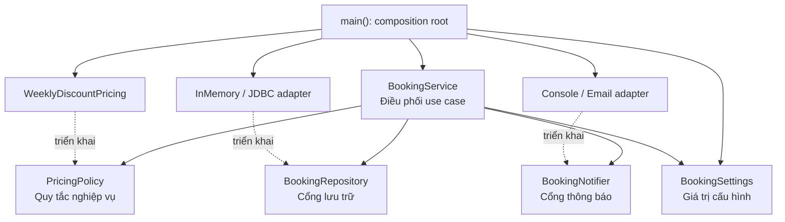

# Phụ thuộc nghiệp vụ, hạ tầng và cấu hình

Trong chương **Mô hình phụ thuộc** của Dependency Injection (DI), việc nhận diện *đối tượng đang phụ thuộc vào điều gì* quan trọng không kém việc biết *truyền phụ thuộc bằng cách nào*. DI và Inversion of Control (IoC) giúp tách mã **sử dụng** một phụ thuộc khỏi mã **tạo và lắp ghép** phụ thuộc đó. Muốn áp dụng đúng, trước hết cần phân biệt ba vai trò thường gặp: **nghiệp vụ**, **hạ tầng** và **cấu hình**.

Sau bài này, bạn có thể phân loại các phụ thuộc trong một luồng xử lý, xác định ranh giới giữa quy tắc và chi tiết kỹ thuật, dùng constructor injection với Java thuần, đặt việc lắp ghép tại *composition root*, đồng thời cân nhắc scope và vòng đời của từng đối tượng.

## 1. Phân loại theo trách nhiệm

Một lớp `A` có phụ thuộc vào `B` khi `A` cần hành vi hoặc dữ liệu do `B` cung cấp để thực hiện công việc của mình. Phụ thuộc có thể biểu hiện qua tham số constructor, lời gọi phương thức, giá trị cấu hình hoặc việc khởi tạo trực tiếp bằng `new`. Cách phân loại dưới đây dựa trên **trách nhiệm** của phụ thuộc, không dựa đơn thuần vào tên lớp, package hay việc nó có interface.

| Loại phụ thuộc | Câu hỏi nhận diện | Ví dụ trong ứng dụng đặt thuê xe | Lý do cần tách |
| --- | --- | --- | --- |
| **Nghiệp vụ** (*business dependency*) | "Quy tắc hoặc quyết định nào quyết định kết quả nghiệp vụ?" | `PricingPolicy` tính giảm giá thuê dài ngày; `EligibilityPolicy` quyết định khách đủ điều kiện thuê | Quy tắc có thể đổi độc lập và cần được kiểm thử theo tình huống nghiệp vụ |
| **Hạ tầng** (*infrastructure dependency*) | "Ứng dụng dùng cơ chế kỹ thuật nào để lưu, gửi, truy cập hoặc tích hợp?" | `JdbcBookingRepository`, `EmailBookingNotifier`, HTTP client, hệ thống hàng đợi | Có thể thay cơ sở dữ liệu, kênh gửi hoặc dịch vụ ngoài mà không viết lại luồng nghiệp vụ |
| **Cấu hình** (*configuration dependency*) | "Giá trị nào được chọn lúc triển khai/khởi động để điều chỉnh hành vi?" | Giá thuê mỗi ngày, số ngày thuê tối đa, endpoint dịch vụ, thời gian chờ | Tập trung nguồn giá trị, kiểm tra hợp lệ, tránh hard-code và đọc biến môi trường rải rác |

**Không phải ba nhóm hoàn toàn tách rời.** Ví dụ, "không cho thuê quá 30 ngày" là một **ràng buộc nghiệp vụ**; con số `30` có thể đến từ **cấu hình**. `PricingPolicy` vẫn chịu trách nhiệm áp dụng quy tắc, còn `BookingSettings` chỉ cung cấp các giá trị đầu vào. Tương tự, `BookingRepository` có thể là **cổng trừu tượng** (*port*) do tầng ứng dụng định nghĩa, dù việc lưu dữ liệu thực tế do một **adapter hạ tầng** đảm nhiệm.

### 1.1. Phụ thuộc nghiệp vụ

Đây là các thành phần thể hiện chính sách, quy tắc hoặc thuật toán đặc thù của bài toán: tính giá, phân bổ hạn mức, kiểm tra điều kiện, áp dụng khuyến mãi. Chúng thường được mô hình hóa bằng hàm thuần, đối tượng chính sách hoặc domain service.

Ví dụ, quy tắc "thuê từ 7 ngày được giảm 10%" thuộc `PricingPolicy`. Việc dùng `WeeklyDiscountPricing` hay `SeasonalPricing` là lựa chọn về **hành vi nghiệp vụ**. Không phải mọi quy tắc đều cần một interface: chỉ trừu tượng hóa khi có nhu cầu thay thế, biến thể rõ ràng hoặc cần cô lập trong kiểm thử.

### 1.2. Phụ thuộc hạ tầng

Đây là các thành phần tương tác với thế giới bên ngoài hoặc cung cấp cơ chế kỹ thuật: database, file, email, HTTP, cache, đồng hồ hệ thống. Chúng thường có I/O, lỗi mạng, trạng thái hoặc tài nguyên cần quản lý.

Tầng ứng dụng có thể gọi `BookingRepository.save(...)`, nhưng không cần biết triển khai bên dưới ghi vào PostgreSQL, bộ nhớ hay dịch vụ từ xa. Interface `BookingRepository` là **hợp đồng mà luồng nghiệp vụ cần**; `JdbcBookingRepository` mới là **chi tiết hạ tầng**. Đừng nhầm việc "có interface" với việc "đã tách đúng": nếu interface để lộ `Connection`, `ResultSet` hoặc HTTP status thì ranh giới vẫn phụ thuộc vào công nghệ.

### 1.3. Phụ thuộc cấu hình

Cấu hình thường là **dữ liệu** hơn là một service. Ví dụ `BookingSettings(maxDays, pricePerDay)` là một đối tượng bất biến chứa các giá trị đã được đọc và xác thực. Mã nghiệp vụ chỉ nhận đối tượng này, không tự gọi `System.getenv` hay đọc file cấu hình ở từng nơi.

Không đưa mọi hằng số vào cấu hình. Một quyết định nghiệp vụ cần được xem xét, kiểm thử và có chủ sở hữu rõ ràng dù ngưỡng của nó được cấu hình. Cũng không gộp mật khẩu, token và toàn bộ biến môi trường vào một "config object" rồi truyền cho mọi lớp: chỉ cấp giá trị mà lớp thực sự cần và bảo vệ bí mật theo quy định của hệ thống.

## 2. Nhìn ba loại phụ thuộc trong cùng một luồng

Giả sử ứng dụng có use case **đặt thuê xe**:

1. Kiểm tra số ngày thuê nằm trong giới hạn.
2. Tính tổng tiền theo chính sách giảm giá thuê từ 7 ngày.
3. Lưu thông tin đặt thuê.
4. Gửi thông báo xác nhận.

Nếu `BookingService` vừa tự viết công thức giá, vừa tạo JDBC connection, vừa đọc biến môi trường và gửi email, lớp này sẽ thay đổi vì quá nhiều lý do. Constructor injection giúp ta chuyển trách nhiệm tạo đối tượng ra ngoài và giữ cho luồng xử lý nhận đúng những phụ thuộc nó cần.



Mũi tên liền từ `BookingService` đến interface/giá trị cho biết **phụ thuộc trong mã nguồn**. `main` tạo các triển khai rồi truyền chúng vào service, hình thành **đồ thị đối tượng lúc chạy**. Đây là điểm giao giữa DI (cấp đối tượng từ bên ngoài) và IoC (service không quyết định cách khởi tạo phụ thuộc).

## 3. Ví dụ Java thuần: constructor injection và composition root

Ví dụ sau dùng Java 11 trở lên, lưu trong một file `DependencyKindsDemo.java` và chạy bằng `javac DependencyKindsDemo.java`, sau đó `java DependencyKindsDemo`. `InMemoryBookingRepository` cùng `ConsoleBookingNotifier` là các adapter minh họa, không yêu cầu framework hoặc DI container.

```java
import java.util.ArrayList;
import java.util.List;
import java.util.Objects;

public class DependencyKindsDemo {
    // Nghiệp vụ: hợp đồng cho cách tính giá.
    interface PricingPolicy {
        long quote(int days);
    }

    static final class WeeklyDiscountPricing implements PricingPolicy {
        private final long pricePerDay;

        WeeklyDiscountPricing(long pricePerDay) {
            if (pricePerDay <= 0) {
                throw new IllegalArgumentException("pricePerDay must be positive");
            }
            this.pricePerDay = pricePerDay;
        }

        @Override
        public long quote(int days) {
            if (days <= 0) {
                throw new IllegalArgumentException("days must be positive");
            }
            long gross = Math.multiplyExact(pricePerDay, days);
            return days >= 7 ? gross - gross / 10 : gross;
        }
    }

    // Dữ liệu nghiệp vụ.
    static final class Booking {
        final String customerId;
        final int days;
        final long totalPrice;

        Booking(String customerId, int days, long totalPrice) {
            this.customerId = customerId;
            this.days = days;
            this.totalPrice = totalPrice;
        }
    }

    // Các port do use case cần; triển khai là chi tiết hạ tầng.
    interface BookingRepository {
        void save(Booking booking);
    }

    interface BookingNotifier {
        void booked(Booking booking);
    }

    static final class InMemoryBookingRepository implements BookingRepository {
        final List<Booking> saved = new ArrayList<>();

        @Override
        public void save(Booking booking) {
            saved.add(booking);
        }
    }

    static final class ConsoleBookingNotifier implements BookingNotifier {
        @Override
        public void booked(Booking booking) {
            System.out.println("Da xac nhan dat thue cho " + booking.customerId);
        }
    }

    // Cấu hình: giá trị bất biến, kiểm tra một lần khi khởi tạo.
    static final class BookingSettings {
        final int maxDays;
        final long pricePerDay;

        BookingSettings(int maxDays, long pricePerDay) {
            if (maxDays <= 0 || pricePerDay <= 0) {
                throw new IllegalArgumentException("Invalid booking settings");
            }
            this.maxDays = maxDays;
            this.pricePerDay = pricePerDay;
        }
    }

    // Application service chỉ nhận các phụ thuộc qua constructor.
    static final class BookingService {
        private final PricingPolicy pricing;
        private final BookingRepository repository;
        private final BookingNotifier notifier;
        private final BookingSettings settings;

        BookingService(
                PricingPolicy pricing,
                BookingRepository repository,
                BookingNotifier notifier,
                BookingSettings settings) {
            this.pricing = Objects.requireNonNull(pricing);
            this.repository = Objects.requireNonNull(repository);
            this.notifier = Objects.requireNonNull(notifier);
            this.settings = Objects.requireNonNull(settings);
        }

        Booking book(String customerId, int days) {
            if (customerId == null || customerId.isBlank()) {
                throw new IllegalArgumentException("Customer ID is required");
            }
            if (days < 1 || days > settings.maxDays) {
                throw new IllegalArgumentException("Days out of allowed range");
            }

            Booking booking = new Booking(customerId, days, pricing.quote(days));
            repository.save(booking);
            notifier.booked(booking);
            return booking;
        }
    }

    // Composition root: nơi quyết định dùng triển khai và giá trị nào.
    public static void main(String[] args) {
        BookingSettings settings = new BookingSettings(30, 350_000L);
        PricingPolicy pricing = new WeeklyDiscountPricing(settings.pricePerDay);
        BookingRepository repository = new InMemoryBookingRepository();
        BookingNotifier notifier = new ConsoleBookingNotifier();
        BookingService service =
                new BookingService(pricing, repository, notifier, settings);

        Booking result = service.book("KH-01", 7);
        System.out.println("Tong tien: " + result.totalPrice + " VND");
        verifyWithoutContainer();
    }

    // Kiểm tra hành vi bằng Java thuần và các phụ thuộc thay thế.
    static void verifyWithoutContainer() {
        BookingSettings settings = new BookingSettings(10, 1_000L);
        InMemoryBookingRepository fakeRepository = new InMemoryBookingRepository();
        List<Booking> notifications = new ArrayList<>();
        BookingNotifier fakeNotifier = booking -> notifications.add(booking);

        BookingService service = new BookingService(
                new WeeklyDiscountPricing(settings.pricePerDay),
                fakeRepository,
                fakeNotifier,
                settings);

        Booking result = service.book("KH-TEST", 7);
        if (result.totalPrice != 6_300L
                || fakeRepository.saved.size() != 1
                || notifications.size() != 1) {
            throw new AssertionError("Unexpected booking result");
        }
        System.out.println("Kiem thu Java thuan: PASS");
    }
}
```

Với 7 ngày và giá `350_000` VND/ngày, tổng trước giảm là `2_450_000` VND; giảm 10% còn **2_205_000 VND**. Trong kiểm tra đơn giản, mức `1_000` VND/ngày cho 7 ngày tạo kết quả **6_300 VND**. Ta kiểm tra được cả phép tính, hành vi lưu và hành vi gửi thông báo mà không khởi động database, email server hay DI container.

Đây là ví dụ tối giản để làm rõ phụ thuộc. Hệ thống thực tế cần cân nhắc transaction, trường hợp lưu thành công nhưng gửi thông báo thất bại, retry/outbox, định danh đặt thuê, tính đồng thời và biểu diễn tiền tệ thích hợp. Những trách nhiệm đó không nên bị che khuất bằng một lời gọi `new` bên trong `BookingService`.

### Vì sao từng đối tượng nằm ở vị trí đó?

| Thành phần | Vai trò | Thay đổi khi nào? |
| --- | --- | --- |
| `WeeklyDiscountPricing` | Hiện thực chính sách giá (nghiệp vụ) | Điều kiện giảm giá hoặc công thức tính thay đổi |
| `BookingRepository` và `BookingNotifier` | Port mô tả hành vi mà use case cần | Nhu cầu lưu hoặc thông báo của use case thay đổi |
| `InMemoryBookingRepository`, `ConsoleBookingNotifier` | Adapter hạ tầng | Cơ chế lưu, kênh thông báo hoặc giao thức thay đổi |
| `BookingSettings` | Đối tượng giá trị cấu hình | Ngưỡng số ngày hoặc bảng giá được lựa chọn khác |
| `BookingService` | Điều phối thứ tự xử lý | Quy trình đặt thuê thay đổi |
| `main` | Composition root | Cần thay triển khai, chọn cấu hình hay vòng đời đối tượng |

Phần quan trọng nhất là `BookingService` **không biết** `InMemoryBookingRepository` hay `ConsoleBookingNotifier`. Khi đưa adapter thật vào hệ thống, ta chỉ cần lắp ghép một triển khai mới đáp ứng cùng hợp đồng tại composition root, miễn là hành vi và các điều kiện của hợp đồng được giữ nguyên.

## 4. Cấu hình được đưa vào ở đâu?

Trong ví dụ, `main` dùng giá trị trực tiếp để người học tập trung vào sơ đồ phụ thuộc. Khi có file cấu hình hoặc biến môi trường, hãy đọc và chuyển đổi chúng ở vùng khởi động:

```java
// Ví dụ đặt trong composition root, trước khi tạo BookingService:
String rawMaxDays = System.getenv().getOrDefault("BOOKING_MAX_DAYS", "30");
String rawDailyPrice = System.getenv().getOrDefault("BOOKING_DAILY_PRICE", "350000");

BookingSettings settings = new BookingSettings(
        Integer.parseInt(rawMaxDays),
        Long.parseLong(rawDailyPrice));
PricingPolicy pricing = new WeeklyDiscountPricing(settings.pricePerDay);
```

Nếu dữ liệu cấu hình sai, ứng dụng nên báo lỗi rõ ràng ngay ở lúc khởi động, thay vì để một yêu cầu đặt thuê bất chợt thất bại. Khi nguồn giá thay đổi theo từng khách hàng, mùa hoặc thời điểm, giá đó có thể trở thành **dữ liệu nghiệp vụ phải tra cứu** qua một port riêng, không còn là một giá trị cấu hình cố định. Hãy dựa trên nguồn gốc và vòng đời của dữ liệu để quyết định.

## 5. Mô hình phụ thuộc và chiều phụ thuộc

Một cách tổ chức phổ biến là:

- **Domain/application** định nghĩa hành vi cần dùng, các quy tắc và những port phù hợp với ngôn ngữ nghiệp vụ.
- **Infrastructure** triển khai các port đó để làm việc với database, HTTP, message broker hoặc bên thứ ba.
- **Composition root** biết cả hai phía và xây dựng các đối tượng thực tế.

Từ góc nhìn mã nguồn, `BookingService` trỏ tới `BookingRepository`, không trỏ tới `JdbcBookingRepository`. Từ góc nhìn lúc chạy, một instance `JdbcBookingRepository` lại được đưa vào `BookingService`. Đây chính là một cách áp dụng **Dependency Inversion Principle (DIP)** kết hợp với **Dependency Injection (DI)**:

**DIP** là nguyên tắc sắp xếp hướng phụ thuộc vào hợp đồng phù hợp; **DI** là kỹ thuật truyền phụ thuộc từ bên ngoài; **IoC** là ý tưởng tổng quát về chuyển quyền điều khiển việc tạo và kết nối thành phần ra khỏi mã sử dụng. Ba khái niệm liên quan, nhưng không đồng nghĩa.

Một số dấu hiệu ranh giới chưa tốt:

```java
class BadBookingService {
    void book(int days) {
        int maxDays = Integer.parseInt(System.getenv("BOOKING_MAX_DAYS"));
        // new JdbcBookingRepository(...).save(...);
        // new EmailClient(...).send(...);
        // Tự đọc cấu hình, tự tạo adapter và tự tính quy tắc tại đây.
    }
}
```

Lối viết trên khiến kiểm thử phải thiết lập môi trường, database và email ngay cả khi chỉ muốn xác minh chính sách. Khi phát hiện, hãy xác định phần nào là quy tắc, phần nào là adapter, phần nào là giá trị đầu vào rồi chuyển việc khởi tạo đến composition root.

## 6. Scope và vòng đời phụ thuộc

Sau khi phân loại **vai trò**, cần hỏi thêm **instance đó sống bao lâu**. Hai quyết định này khác nhau:

| Đối tượng | Vòng đời gợi ý | Điều cần chú ý |
| --- | --- | --- |
| `BookingSettings` bất biến | Một instance tại khởi động, dùng chung nếu cấu hình không đổi | Khi cần cấu hình động, xác định cơ chế cập nhật và tính nhất quán |
| `WeeklyDiscountPricing` không giữ trạng thái của từng yêu cầu | Có thể tái sử dụng | Tránh lưu dữ liệu khách hàng/yêu cầu vào field dùng chung |
| `BookingService` không giữ trạng thái phiên gọi | Có thể tái sử dụng khi mọi phụ thuộc đều an toàn | Chỉ cho dùng chung sau khi kiểm tra thread-safety của các phụ thuộc |
| `Booking` | Mỗi lần đặt thuê tạo một giá trị mới | Không biến dữ liệu của các yêu cầu khác nhau thành trạng thái toàn cục |
| Repository/database adapter | Theo thiết kế adapter, connection pool hoặc transaction | Quản lý đóng tài nguyên, connection và đồng thời; không mặc định một connection cho mọi thread |

Ví dụ `InMemoryBookingRepository` chứa `ArrayList` có thể dùng cho demo chạy một luồng, nhưng **không an toàn khi nhiều luồng ghi đồng thời**. Khi thay bằng triển khai thực tế, cần chính sách vòng đời và đồng bộ phù hợp. DI container có thể hỗ trợ scope như singleton/request/prototype, nhưng không tự khiến một đối tượng có trạng thái trở nên thread-safe.

## 7. Nguyên tắc thiết kế và lỗi thường gặp

1. **Tiêm phụ thuộc bắt buộc qua constructor.** Mỗi instance `BookingService` luôn được tạo với đủ hợp đồng và cấu hình hợp lệ. Không dùng field injection cho các yêu cầu bắt buộc nếu muốn giữ invariant dễ quan sát.
2. **Truyền đúng kiểu mà consumer cần.** `BookingService` cần `BookingRepository`, không cần `DataSource`, `EntityManager` hay cả "ApplicationContext".
3. **Không tạo adapter ngay trong consumer.** `new JdbcBookingRepository(...)` hoặc `new HttpClient(...)` nằm rải trong use case làm tăng mức kết dính.
4. **Không giấu phụ thuộc qua service locator.** Gọi `Container.get(BookingRepository.class)` bên trong `BookingService` vẫn khiến service phải tự tìm phụ thuộc ở runtime; constructor không còn cho thấy yêu cầu thực tế.
5. **Không lạm dụng interface hoặc container.** Một thuật toán đơn giản, ổn định có thể là một class thông thường; Java thuần với `new` tại composition root đã đủ để thực hành DI.
6. **Không biến cấu hình thành kho dữ liệu toàn cục.** Truyền vài giá trị cần thiết, hoặc object cấu hình có phạm vi rõ, để test dễ tạo trường hợp biên và tránh phụ thuộc ngầm.
7. **Giữ tính nhất quán giữa các thao tác I/O.** Nếu use case lưu dữ liệu rồi gửi email, cần quyết định lỗi gửi email ảnh hưởng thế nào tới giao dịch; DI chỉ làm rõ ranh giới, không tự giải quyết lỗi phân tán.

## 8. Tự kiểm tra hiểu biết

**Tình huống 1.** Một `RefundService` sử dụng `RefundPolicy` để tính số tiền được hoàn, `PaymentGateway` để gọi nhà cung cấp thanh toán và `RefundSettings` để lấy thời hạn cho phép hoàn. Hãy phân loại từng phụ thuộc.

**Gợi ý đáp án:** `RefundPolicy` là nghiệp vụ; `PaymentGateway` là port hướng tới một adapter hạ tầng; `RefundSettings` là cấu hình. Thời hạn hoàn có thể là một tham số của chính sách nghiệp vụ, dù giá trị đến từ cấu hình.

**Tình huống 2.** Một lớp gọi `LocalDate.now()` để quyết định khách đã quá hạn thanh toán hay chưa. Cần thay đổi gì để kiểm thử được chính xác ngày hết hạn?

**Gợi ý đáp án:** Tiêm `java.time.Clock` hoặc một cổng thời gian phù hợp qua constructor; composition root cấp `Clock.systemDefaultZone()`, kiểm thử cấp `Clock.fixed(...)`. Việc đọc thời gian là phụ thuộc kỹ thuật; quy tắc "quá hạn" vẫn thuộc nghiệp vụ.

**Tình huống 3.** Hệ thống đổi từ email sang thông báo đẩy, nhưng logic xác nhận đặt thuê không đổi. Bạn dự kiến sửa nơi nào?

**Gợi ý đáp án:** Thay adapter hiện thực `BookingNotifier` và cách lắp ghép ở composition root. `BookingService` không cần sửa nếu hợp đồng vẫn diễn tả đúng nhu cầu xác nhận đặt thuê.

## 9. Checklist khi phân tích một use case mới

Trước khi thêm constructor mới hoặc đưa DI container vào dự án, hãy trả lời:

- Kết quả nghiệp vụ do quy tắc nào quyết định, và quy tắc đó có cần một chính sách thay thế không?
- Có những tác vụ I/O, dịch vụ bên ngoài hoặc tài nguyên nào cần được ẩn sau port?
- Giá trị nào đến từ lúc triển khai, và nên được parse/validate tại đâu?
- Ai tạo đối tượng, ai sở hữu tài nguyên, và mỗi instance sống trong phạm vi nào?
- Có thể tạo use case với fake/in-memory adapter để kiểm tra trường hợp đúng, sai và lỗi mà không cần hạ tầng thật không?

Khi ba loại phụ thuộc được nhận diện theo trách nhiệm, **constructor injection** cho thấy rõ yêu cầu của mỗi lớp, **composition root** chịu trách nhiệm lắp ghép, và kiểm thử bằng **Java thuần** trở nên đơn giản. Đây là nền tảng hữu ích trước khi mở rộng sang các DI container như Spring hoặc CDI.
