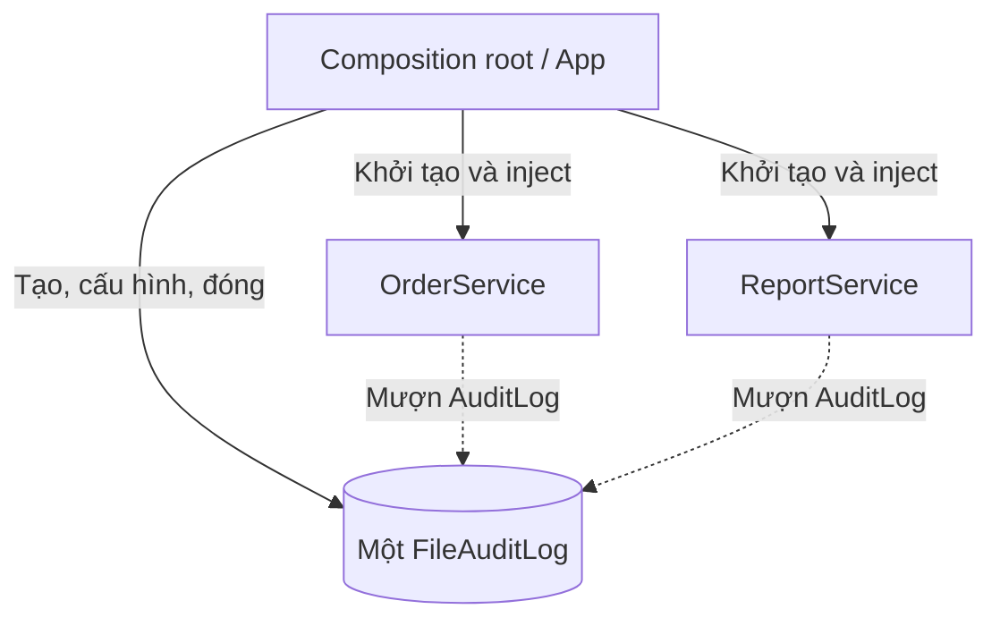

# Quan hệ sở hữu, sử dụng chung và chuyển giao tham chiếu đối tượng

## 1. Vì sao cần phân biệt các quan hệ này?

Trong **Dependency Injection (DI)**, một đối tượng nhận các cộng tác viên (dependency) từ bên ngoài, thường qua constructor, thay vì tự `new` chúng. Việc truyền dependency tưởng như đơn giản nhưng dẫn đến một số câu hỏi thiết kế quan trọng:

- Ai quyết định tạo dependency, cấu hình nó và kết thúc vòng đời của nó?
- Đối tượng nhận dependency được **sử dụng** nó đến mức nào? Có được đóng hoặc thay đổi trạng thái của nó không?
- Hai đối tượng có thể giữ tham chiếu tới cùng một instance hay cần hai instance độc lập?
- Khi một tham chiếu được truyền qua constructor, tham số hoặc kết quả trả về, **trách nhiệm quản lý** có chuyển theo không?

Đây là phần cốt lõi của **mô hình phụ thuộc**: tách quan hệ *biết đến và sử dụng một đối tượng* khỏi quan hệ *sở hữu và quản lý vòng đời đối tượng*. Trong Java thuần, việc phân biệt này dựa trên hợp đồng thiết kế và cấu trúc chương trình; Java không có cơ chế ownership tĩnh như một số ngôn ngữ khác.

Sau bài này, bạn có thể xác định chủ sở hữu một dependency, giải thích khi nào dùng chung instance là hợp lý, phân biệt truyền tham chiếu với chuyển giao quyền sở hữu, xây dựng một **composition root** quản lý vòng đời và kiểm thử các quan hệ đó mà chưa cần DI container.

## 2. Từ đối tượng, tham chiếu đến trách nhiệm sở hữu

### 2.1. Tham chiếu không đồng nghĩa với đối tượng

Xét đoạn Java:

```java
List<String> first = new ArrayList<>();
List<String> second = first;
second.add("A");

System.out.println(first);          // [A]
System.out.println(first == second); // true
```

Hai biến `first` và `second` giữ tham chiếu đến **cùng một đối tượng `ArrayList`**. Phép gán `second = first` sao chép *giá trị tham chiếu*, không tạo thêm danh sách. Tương tự, `new OrderService(auditLog)` truyền tham chiếu đến `auditLog`; bản thân thao tác truyền không quyết định ai phải đóng hoặc có quyền thay đổi nó.

Trong bài này, **sở hữu (ownership)** là khái niệm thiết kế: thành phần nào chịu trách nhiệm tạo hoặc tiếp nhận một tài nguyên, xác định phạm vi sử dụng hợp lệ và thực hiện bước kết thúc vòng đời nếu cần. Đây **không** phải khẳng định rằng chỉ chủ sở hữu mới có tham chiếu, cũng không phải quy tắc mà trình biên dịch Java sẽ tự kiểm tra.

### 2.2. Bốn quan hệ thường gặp

| Quan hệ | Ý nghĩa | Ví dụ trong DI | Trách nhiệm kết thúc vòng đời |
| --- | --- | --- | --- |
| **Sở hữu** | Một thành phần quản lý vòng đời của đối tượng/tài nguyên | Composition root tạo `FileAuditLog` | Root đóng logger khi ứng dụng ngừng dùng |
| **Mượn để sử dụng** (*borrow*) | Giữ hoặc nhận tham chiếu để gọi API theo hợp đồng | `OrderService` nhận `AuditLog` qua constructor | Service không tự đóng logger được cấp |
| **Sử dụng chung** (*share*) | Nhiều thành phần cùng trỏ tới một instance | `OrderService` và `ReportService` cùng nhận một logger | Chủ sở hữu đã xác định vẫn chịu trách nhiệm đóng |
| **Chuyển giao quyền sở hữu** (*transfer*) | Chuyển rõ ràng trách nhiệm quản lý sang bên nhận | Hàm nhận một `InputStream` và cam kết đóng nó | Bên nhận đóng; bên gửi ngừng sử dụng theo hợp đồng |

**Sử dụng chung** và **mượn** có thể đồng thời xảy ra: hai service cùng mượn một dependency do root sở hữu. **Chuyển giao tham chiếu** là thao tác truyền một giá trị tham chiếu; **chuyển giao quyền sở hữu** chỉ xảy ra khi hợp đồng API quy định trách nhiệm cũng chuyển đi.

### 2.3. Sở hữu, thời gian sống và garbage collection là ba vấn đề khác nhau

- **Sở hữu** trả lời: *ai chịu trách nhiệm quản lý tài nguyên?*
- **Thời gian sống** (*lifetime*) trả lời: *đối tượng còn được sử dụng hợp lệ trong khoảng nào?*
- **Garbage collection (GC)** liên quan đến khả năng thu hồi bộ nhớ của đối tượng không còn được truy cập. GC không bảo đảm đóng file, socket, transaction hoặc kết nối tại thời điểm nghiệp vụ cần.

Một dependency thuần tính toán, không nắm tài nguyên ngoài heap, có thể không cần thao tác `close()`. Ngược lại, `InputStream`, `Connection` hay đối tượng có `AutoCloseable` thường cần quy tắc đóng cụ thể, ngay cả khi chúng sẽ có lúc không còn tham chiếu.

## 3. Constructor injection: service được dùng nhưng không mặc nhiên sở hữu

Ví dụ dưới đây sử dụng một logger ghi sự kiện. Hai service chỉ biết đến **hợp đồng sử dụng** `AuditLog`. Composition root tạo, lắp ghép và đóng hiện thực `FileAuditLog`.

```java
// File: App.java — Java thuần, không dùng DI container
import java.io.BufferedWriter;
import java.io.IOException;
import java.io.UncheckedIOException;
import java.nio.file.Files;
import java.nio.file.Path;
import java.nio.file.StandardOpenOption;

interface AuditLog {
    void append(String event);
}

final class FileAuditLog implements AuditLog, AutoCloseable {
    private final BufferedWriter writer;

    FileAuditLog(Path path) throws IOException {
        this.writer = Files.newBufferedWriter(
            path,
            StandardOpenOption.CREATE,
            StandardOpenOption.APPEND
        );
    }

    @Override
    public void append(String event) {
        try {
            writer.write(event);
            writer.newLine();
        } catch (IOException error) {
            throw new UncheckedIOException(error);
        }
    }

    @Override
    public void close() throws IOException {
        writer.close();
    }
}

final class OrderService {
    private final AuditLog auditLog;

    OrderService(AuditLog auditLog) {
        this.auditLog = java.util.Objects.requireNonNull(auditLog);
    }

    void place(String orderId) {
        auditLog.append("ORDER:" + orderId);
    }
}

final class ReportService {
    private final AuditLog auditLog;

    ReportService(AuditLog auditLog) {
        this.auditLog = java.util.Objects.requireNonNull(auditLog);
    }

    void exported(String reportId) {
        auditLog.append("REPORT:" + reportId);
    }
}

public class App {
    public static void main(String[] args) throws IOException {
        // Composition root: tạo và sở hữu tài nguyên có thể đóng.
        try (FileAuditLog log = new FileAuditLog(Path.of("audit.log"))) {
            // Hai service mượn cùng một instance qua constructor.
            OrderService orders = new OrderService(log);
            ReportService reports = new ReportService(log);

            orders.place("O-17");
            reports.exported("R-07");
        } // Root đóng log sau khi cả hai service dùng xong.
    }
}
```

Chạy ví dụ bằng `javac App.java` rồi `java App`. File `audit.log` nhận hai dòng sự kiện; `try-with-resources` bảo đảm root gọi `close()` khi rời khối, kể cả nếu có ngoại lệ trong khối.



Các điểm cần quan sát:

1. `OrderService` **phụ thuộc vào hợp đồng `AuditLog`**, không gọi `new FileAuditLog(...)` và không biết cách mở file.
2. `FileAuditLog` triển khai `AutoCloseable`, còn interface `AuditLog` chỉ cấp thao tác `append`. Service không được trao API `close()` qua hợp đồng dependency.
3. Cả hai service cùng giữ tham chiếu đến một instance; không có hai file writer và không ai trong hai service nhận trách nhiệm đóng.
4. Root quản lý thứ tự: tạo tài nguyên → lắp ghép → sử dụng → đóng. Đây là ví dụ của **Inversion of Control (IoC)**: việc quyết định hiện thực và vòng đời được chuyển ra khỏi các service nghiệp vụ.

Ví dụ trên chạy **tuần tự**. `BufferedWriter` trong `FileAuditLog` không được thiết kế ở đây để nhiều luồng gọi `append` đồng thời; nếu chia sẻ logger giữa nhiều luồng, phải bổ sung cơ chế đồng bộ hoặc chọn hiện thực hỗ trợ concurrency. *Dùng chung được về mặt tham chiếu* không đồng nghĩa với *an toàn khi chạy đồng thời*.

## 4. Chuyển tham chiếu không tự chuyển quyền sở hữu

### 4.1. Constructor nhận tham chiếu và lưu lại

Với constructor injection:

```java
AuditLog log = /* đối tượng do composition root chuẩn bị */;
OrderService service = new OrderService(log);
```

Sau lời gọi, cả `log` tại root và trường `service.auditLog` (nội bộ service) vẫn trỏ đến **cùng instance**. Đây là truyền tham chiếu để sử dụng; không phải một thao tác *move* tự động. Java không khiến biến `log` của root mất hiệu lực sau khi gọi constructor.

Vì vậy, không thể suy luận rằng "đã inject thì service phải đóng dependency", hoặc "service giữ trường `final` nên nó là chủ sở hữu". `final` chỉ ngăn gán lại trường tham chiếu sau khi khởi tạo; nếu đối tượng được trỏ tới có thể thay đổi thì trạng thái của nó vẫn có thể bị sửa.

### 4.2. Mượn tham chiếu: bên gọi tiếp tục sở hữu

```java
final class FileHeaderReader {
    // Mượn stream; không đóng tài nguyên của bên gọi.
    int readFirstByte(java.io.InputStream source) throws java.io.IOException {
        return source.read();
    }
}

// Bên gọi sở hữu stream, kể cả khi chuyển nó vào phương thức.
try (java.io.InputStream input = java.nio.file.Files.newInputStream(path)) {
    int first = new FileHeaderReader().readFirstByte(input);
    // input vẫn dùng được trong phạm vi try nếu chưa tới EOF/close.
}
```

Hợp đồng của `readFirstByte` là **borrow**: nhận quyền đọc trong lúc gọi nhưng không quyết định lúc kết thúc vòng đời của stream. Bên gọi tiếp tục kiểm soát `close()`.

### 4.3. Chuyển giao sở hữu: phải thể hiện rõ hợp đồng

```java
final class InputConsumer {
    /**
     * Nhận quyền sở hữu source. Hàm đóng source trước khi trả về,
     * kể cả khi đọc hoặc xử lý dữ liệu bị lỗi.
     * Bên gọi không tiếp tục dùng source sau khi truyền vào.
     */
    byte[] consumeAndClose(java.io.InputStream source)
            throws java.io.IOException {
        try (java.io.InputStream owned =
                 java.util.Objects.requireNonNull(source)) {
            return owned.readAllBytes();
        }
    }
}
```

Phần `try-with-resources` biểu diễn **trách nhiệm đóng đã được bên nhận chấp nhận**. Tuy nhiên, Java không ngăn bên gọi lưu một alias khác hoặc tiếp tục sử dụng `source`. Để hợp đồng này đúng, bên gọi phải chủ động ngừng sử dụng các tham chiếu cũ, và tất cả bên liên quan phải thống nhất ai đóng. Không nên dùng API nhận sở hữu kiểu này khi cùng một stream đang được chia sẻ cho các consumer khác.

Đặt tên như `consumeAndClose`, Javadoc về quyền sở hữu và kiểu API phù hợp giúp giảm hiểu nhầm. Chỉ đặt tên phương thức `getX()` hay `createX()` không đủ để chứng minh quyền sở hữu; tài liệu hợp đồng mới là cơ sở.

### 4.4. Truyền tham chiếu khác với sao chép đối tượng

Khi cần cô lập trạng thái, ta có thể dùng defensive copy:

```java
final class RuleEngine {
    private final java.util.List<String> rules;

    RuleEngine(java.util.List<String> configuredRules) {
        this.rules = java.util.List.copyOf(configuredRules);
    }
}
```

`List.copyOf` giúp `RuleEngine` giữ một danh sách không sửa được từ API của nó và không bị tác động bởi việc thêm/xóa phần tử trong danh sách gốc. Nhưng đây là **sao chép nông**: nếu phần tử là các đối tượng mutable, hai danh sách vẫn có thể cùng trỏ tới từng phần tử. Sao chép cũng không tự giải quyết quyền sở hữu tài nguyên trong mỗi phần tử.

## 5. Sử dụng chung dependency: khi nào hợp lý?

Giả sử `A` và `B` đều cần `Dependency d`:

```java
Dependency d = createDependency();
A a = new A(d);
B b = new B(d);
```

Về mặt mô hình, ta có đồ thị `A → d ← B`. Mỗi cạnh là một quan hệ sử dụng; chỉ một nơi được giao trách nhiệm quản lý vòng đời `d`. Cách chia sẻ này phù hợp khi dependency có vòng đời đủ dài, có hợp đồng sử dụng ổn định và cách sử dụng chung không tạo xung đột trạng thái.

Ví dụ thường dễ chia sẻ là bộ chuyển đổi dữ liệu **không có trạng thái thay đổi**, cấu hình đã bất biến hoặc service bất biến chỉ thực hiện phép tính. Với đối tượng giữ trạng thái mutable, cache, bộ đệm, transaction hay kết nối, phải xem lại đồng bộ, ranh giới giao dịch và quy tắc hủy tài nguyên trước khi cho nhiều consumer dùng chung.

| Dependency | Có thể dùng chung? | Điều kiện trọng yếu |
| --- | --- | --- |
| `PriceCalculator` stateless | Thường có | Không ghi trạng thái dùng chung giữa các lời gọi |
| Cấu hình bất biến | Thường có | Giá trị không đổi trong phạm vi dự kiến |
| `FileAuditLog` | Có thể | Root quản lý đóng; nếu đa luồng phải xử lý an toàn ghi |
| `List` mutable làm nơi lưu kết quả tạm | Cần cân nhắc | Các bên có thể nhìn thấy/sửa trạng thái của nhau |
| `Connection`/transaction của một thao tác | Thường không chia sẻ xuyên thao tác | Gắn với một đơn vị công việc và thời điểm kết thúc xác định |

**Chia sẻ instance không đồng nghĩa với chia sẻ quyền sở hữu.** Nếu hai service cùng gọi `close()` lên tài nguyên được inject thì service còn lại có thể đang giữ tham chiếu tới tài nguyên đã đóng; nhiều API sẽ lỗi khi dùng tiếp. Quy tắc rõ ràng hơn là root sở hữu tài nguyên chung và các consumer chỉ thực hiện thao tác nghiệp vụ.

## 6. Ownership đi cùng scope và vòng đời

Trong thực hành DI, **scope** mô tả khoảng thời gian hoặc bối cảnh một instance được tái sử dụng. **Owner** là nơi chịu trách nhiệm kết thúc vòng đời phù hợp với scope đó.

| Scope minh họa | Ví dụ instance | Chủ sở hữu hợp lý | Ràng buộc |
| --- | --- | --- | --- |
| Toàn ứng dụng (*application*) | Logger, cấu hình bất biến | Application composition root | Chỉ đóng sau khi các consumer đã ngừng |
| Theo request/phiên làm việc | Request context, transaction | Cơ chế tạo và kết thúc request/phiên | Không để đối tượng sống vượt quá request |
| Theo một thao tác (*operation*) | Input stream, unit of work | Phương thức tạo/nhận quyền sở hữu | Đóng ngay khi thao tác kết thúc |
| Tạo riêng cho consumer (*transient*) | Stateless helper hoặc đối tượng riêng | Thành phần tạo/lắp ghép theo hợp đồng | Nếu có tài nguyên, vẫn phải xác định ai đóng |

Lưu ý: các nhãn trên là **mô hình vòng đời**, không phải cú pháp riêng của Java. Một DI container có thể giúp thực thi scope sau này, nhưng scope không tự trả lời mọi câu hỏi ownership; đặc biệt khi một dependency `AutoCloseable` được tạo bởi factory hoặc được chuyển ra khỏi phạm vi container.

### 6.1. Tránh dependency sống ngắn bị giữ bởi đối tượng sống dài

Xét tình huống một `ReportScheduler` tồn tại suốt thời gian chạy ứng dụng nhưng lưu trực tiếp `RequestContext` được tạo cho một request cụ thể:

```java
// Ví dụ SAI về vòng đời nếu scheduler sống lâu hơn request.
final class ReportScheduler {
    private final RequestContext request;

    ReportScheduler(RequestContext request) {
        this.request = request;
    }
}
```

Sau khi request kết thúc, scheduler vẫn giữ tham chiếu; context có thể chứa dữ liệu không còn hợp lệ hoặc tài nguyên đã đóng. Vấn đề này thường được gọi là **captive dependency**: đối tượng sống dài giữ dependency thuộc scope sống ngắn.

Cách xử lý là thay đổi ranh giới tạo và sử dụng: truyền context vào từng lần xử lý khi nó còn hợp lệ, hoặc inject một *factory/provider* có hợp đồng mở và kết thúc scope rõ ràng. Không giữ trực tiếp một instance request-scoped tại application singleton.

### 6.2. Dùng factory không phủ nhận Dependency Injection

Không phải dependency nào cũng phải được tạo một lần tại startup. Với resource sống theo thao tác, có thể inject **factory** thay vì inject trực tiếp resource:

```java
interface SourceFactory {
    java.io.InputStream open() throws java.io.IOException;
}

final class ImportService {
    private final SourceFactory sourceFactory;

    ImportService(SourceFactory sourceFactory) {
        this.sourceFactory = sourceFactory;
    }

    int countBytes() throws java.io.IOException {
        // Service sở hữu stream do factory trao cho mỗi lần gọi.
        try (java.io.InputStream source = sourceFactory.open()) {
            int count = 0;
            while (source.read() != -1) {
                count++;
            }
            return count;
        }
    }
}
```

Composition root quyết định hiện thực `SourceFactory`; `ImportService` chỉ biết hợp đồng mở stream. **Factory chuyển quyền sở hữu stream mới** cho `countBytes()`, còn chính `SourceFactory` vẫn là dependency được inject. Đoạn này minh họa việc chủ sở hữu của resource ngắn hạn có thể là một thao tác, không nhất thiết là root.

## 7. Thiết kế API để quyền sở hữu dễ nhận biết

Khi thiết kế một ranh giới dependency, hãy trả lời rõ các câu hỏi sau:

1. **Ai tạo instance?** Root, factory, consumer hay một API bên ngoài?
2. **Ai dùng và dùng đến khi nào?** Có consumer nào còn hoạt động sau khi tài nguyên kết thúc không?
3. **Có được chia sẻ không?** Dependency có mutable state, giới hạn theo request/transaction hoặc yêu cầu đồng bộ không?
4. **Ai đóng hoặc giải phóng?** Hãy gắn hành động này vào một phạm vi có điểm kết thúc xác định.
5. **Khi truyền qua API, bên nhận đang mượn hay nhận sở hữu?** Ghi thành hợp đồng rõ ràng, đặc biệt đối với `AutoCloseable`.

Một số nguyên tắc triển khai cụ thể:

- Inject **giao diện thao tác tối thiểu** cho consumer, ví dụ `AuditLog` với `append`; giữ API quản trị vòng đời ở nơi sở hữu, ví dụ `FileAuditLog.close()` tại root.
- Dùng `try-with-resources` ở nơi chịu trách nhiệm đóng `AutoCloseable`. Nếu quyền sở hữu được chuyển giao, thể hiện rõ trong tài liệu phương thức và tổ chức code để tránh đóng trùng.
- Giữ dependency bắt buộc ở constructor và dùng `Objects.requireNonNull` nếu `null` không hợp lệ; quan hệ phụ thuộc trở nên tường minh từ khi tạo service.
- Tránh để service tự lấy dependency từ biến toàn cục, singleton tĩnh hoặc service locator: các cách đó che giấu bên lắp ghép và làm mơ hồ người quản lý vòng đời.
- Không xem từ khóa `final`, `private` hoặc việc có nhiều alias là bằng chứng về ownership; chúng chỉ quy định khả năng truy cập hoặc gán lại tham chiếu.

Đối với dependency có thể đóng, một thỏa thuận đơn giản đáng áp dụng là: **"Dependency được inject là tài nguyên mượn, trừ khi hợp đồng nói rõ bên nhận tiếp quản ownership."** Đây là quy ước của hệ thống, không phải luật do Java hay DI tự áp đặt.

## 8. Kiểm thử quan hệ phụ thuộc với Java thuần

Không cần mở file thật để kiểm tra `OrderService`: tạo test double thực thi cùng hợp đồng `AuditLog`, truyền qua constructor và kiểm tra hành vi quan sát được.

```java
// File: AppTest.java — biên dịch cùng App.java
import java.util.ArrayList;
import java.util.List;

final class RecordingAuditLog implements AuditLog {
    final List<String> events = new ArrayList<>();

    @Override
    public void append(String event) {
        events.add(event);
    }
}

public class AppTest {
    public static void main(String[] args) {
        RecordingAuditLog fake = new RecordingAuditLog();
        OrderService service = new OrderService(fake);

        service.place("O-18");

        if (!fake.events.equals(List.of("ORDER:O-18"))) {
            throw new AssertionError("Sự kiện ghi không đúng: " + fake.events);
        }
        System.out.println("PASS");
    }
}
```

Chạy `javac App.java AppTest.java` và `java AppTest`. Test này chứng minh service chỉ cần **hợp đồng được inject** và không phải khởi tạo `FileAuditLog`, mở file hay tự giải phóng tài nguyên. Khi cần xác minh ownership của `AutoCloseable`, có thể tạo một fake đếm số lần `close()` rồi kiểm tra *root/factory/operation* đóng ở đúng thời điểm; không đặt yêu cầu đóng lên một service chỉ đang mượn.

## 9. Những lỗi thiết kế dễ gặp

| Dấu hiệu | Hậu quả | Hướng sửa |
| --- | --- | --- |
| Service gọi `new FileAuditLog(...)` ngay trong constructor | Tạo tài nguyên lặp, khó thay thế khi test, khó thống nhất vòng đời | Đưa việc tạo/lắp ghép vào composition root |
| Hai consumer cùng cho rằng mình sở hữu một stream | Một bên đóng sớm khiến bên còn lại lỗi; có thể đóng lặp | Chỉ định một nơi đóng, các bên khác mượn |
| Consumer giữ dependency đã bị root đóng | Có tham chiếu nhưng đối tượng không còn dùng hợp lệ | Sắp xếp phạm vi sử dụng nằm trong vòng đời chủ sở hữu |
| Đưa request context vào singleton application | Giữ trạng thái cũ hoặc tài nguyên đã kết thúc scope | Truyền theo lần gọi hoặc dùng provider có scope rõ |
| Chia sẻ đối tượng mutable cho nhiều luồng | Race condition, dữ liệu không nhất quán | Dùng đối tượng bất biến, cách ly theo scope hoặc đồng bộ thích hợp |
| Tưởng `final`/copy tham chiếu tạo ra bản sao | Các consumer vô tình ảnh hưởng lẫn nhau | Phân biệt alias với defensive/deep copy |
| Trông chờ GC thay cho `close()` | Tài nguyên ngoài bộ nhớ có thể bị giữ quá lâu | Dùng hợp đồng và điểm đóng xác định, thường là `try-with-resources` |

## 10. Bài tập tự kiểm tra

**Tình huống A.** `Application` tạo một `MetricsClient` và inject nó vào ba service. Một service tự `close()` client sau khi xử lý xong một request, trong khi hai service còn lại vẫn dùng client.

Hãy xác định lỗi ownership và cách điều chỉnh. **Gợi ý đáp án:** cả ba service đang dùng chung một instance; nếu root sở hữu client thì service chỉ mượn, không được tự đóng. Root đóng client sau khi cả ba ngừng sử dụng. Nếu muốn client theo request, hãy đổi phạm vi tạo thay vì để các service tùy ý đóng instance chung.

**Tình huống B.** `DataImporter` nhận `InputStream` qua constructor. Bên gọi giữ stream trong `try-with-resources`; `DataImporter` cũng đóng stream khi xong việc.

Đâu là điểm mơ hồ? **Gợi ý đáp án:** hai nơi có trách nhiệm đóng cùng resource. Cần chọn và ghi rõ một trong hai hợp đồng: importer chỉ mượn, để bên gọi đóng; hoặc importer nhận sở hữu, khi đó bên gọi không tiếp tục dùng và phải tổ chức việc đóng nhất quán. Đừng dựa vào việc một `close()` cụ thể có thể chạy lặp mà bỏ qua thỏa thuận.

**Tình huống C.** Một worker ứng dụng cần xử lý từng file độc lập, mỗi file có stream riêng. Có nên inject sẵn một stream dùng chung vào worker?

**Gợi ý đáp án:** thường không. Inject `SourceFactory`, mở stream cho từng thao tác và đóng trong cùng phạm vi. Cách này giúp mỗi file có vòng đời riêng mà vẫn tách việc chọn nguồn dữ liệu khỏi logic xử lý.

## 11. Ghi nhớ

DI và IoC giúp **tách việc sử dụng dependency khỏi việc tạo và lắp ghép nó**. Constructor injection truyền một tham chiếu và công khai quan hệ phụ thuộc; nó không tự chuyển quyền sở hữu. Composition root là nơi phù hợp để quản lý các dependency dùng chung có vòng đời ứng dụng, còn tài nguyên ngắn hạn có thể được tạo qua factory và do từng thao tác sở hữu.

Khi xem xét bất kỳ cạnh nào trong đồ thị đối tượng, luôn xác định ba điều riêng biệt: **ai sử dụng**, **ai sở hữu**, và **đối tượng còn hợp lệ đến khi nào**. Nếu ba điều này rõ ràng, việc mở rộng từ Java thuần sang DI container, quản lý scope và kiểm thử sẽ dễ kiểm soát hơn.
