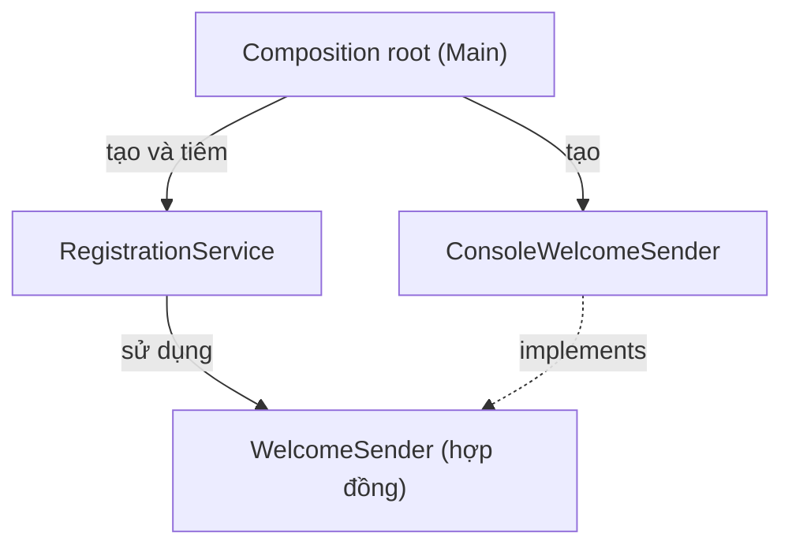

# Phụ thuộc vào lớp cụ thể và phụ thuộc vào hợp đồng

Trong **Dependency Injection (DI)**, một đối tượng cần cộng tác với đối tượng khác để hoàn thành công việc. Câu hỏi thiết kế quan trọng là: **mã nguồn của đối tượng sử dụng phụ thuộc phải biết chính xác lớp triển khai, hay chỉ cần biết một hợp đồng mô tả khả năng nó cần?** Cách chọn điểm phụ thuộc ảnh hưởng trực tiếp đến khả năng thay thế triển khai, kiểm thử và phân chia trách nhiệm khi lắp ghép hệ thống.

Bài học thuộc chương **Mô hình phụ thuộc** của module **DEPENDENCY_INJECTION**. Trọng tâm là phân biệt phụ thuộc vào lớp cụ thể với phụ thuộc vào hợp đồng, rồi dùng **constructor injection** và **composition root** để tách nơi *sử dụng* phụ thuộc khỏi nơi *tạo và lắp ghép* đối tượng. Các ví dụ chạy bằng Java thuần, không cần DI container.

## 1. Kết quả cần đạt

Sau bài học, bạn có thể:

- Nhận diện được một lớp đang gắn với **lớp cụ thể** qua kiểu của trường, tham số, lời gọi khởi tạo và API được sử dụng.
- Giải thích sự khác nhau giữa **phụ thuộc trong mã nguồn** và **đối tượng triển khai được sử dụng lúc chạy**.
- Thiết kế một **hợp đồng** vừa đủ cho nhu cầu của lớp sử dụng, rồi tiêm triển khai qua constructor.
- Đặt quyết định tạo và lắp ghép đối tượng tại **composition root**; kiểm thử hành vi bằng một triển khai thay thế trong Java thuần.
- Nhận biết khi nào việc tạo thêm interface giúp ích và khi nào nó chỉ làm thiết kế phức tạp hơn.

## 2. Hai cách biểu diễn một quan hệ phụ thuộc

Giả sử `RegistrationService` cần gửi lời chào mừng sau khi đăng ký. Một triển khai ban đầu là `ConsoleWelcomeSender`, in thông điệp ra màn hình; ở môi trường thực tế có thể thay bằng bộ gửi email, hàng đợi hoặc một adapter của dịch vụ ngoài.

### 2.1. Phụ thuộc vào lớp cụ thể

```java
final class RegistrationService {
    private final ConsoleWelcomeSender sender = new ConsoleWelcomeSender();

    void register(String email) {
        // Xử lý đăng ký (lược bỏ để tập trung vào quan hệ phụ thuộc).
        sender.sendWelcome(email);
    }
}
```

`RegistrationService` biết trực tiếp tên `ConsoleWelcomeSender`, tự tạo đối tượng và gọi phương thức của nó. Đây là **phụ thuộc vào lớp cụ thể**: kiểu phụ thuộc trong mã nguồn chính là kiểu triển khai.

Nếu muốn gửi qua SMTP, người viết có thể phải sửa `RegistrationService` để đổi trường và câu lệnh `new`. Nếu cần kiểm thử mà không in ra console, cũng khó đưa một đối tượng ghi nhận lời gọi vào thay thế. Việc tạo và sử dụng phụ thuộc bị trộn trong một lớp.

Lưu ý: **việc có hay không có `new` không quyết định một lớp phụ thuộc vào hợp đồng**. Đoạn sau đã nhận đối tượng từ bên ngoài nhưng vẫn phụ thuộc vào kiểu cụ thể:

```java
final class RegistrationService {
    private final ConsoleWelcomeSender sender;

    RegistrationService(ConsoleWelcomeSender sender) {
        this.sender = sender;
    }
}
```

Đây là *constructor injection*, nhưng `RegistrationService` vẫn phải biết `ConsoleWelcomeSender` ở thời điểm biên dịch. DI và việc phụ thuộc vào trừu tượng là hai quyết định có liên quan, **không đồng nghĩa** với nhau.

### 2.2. Phụ thuộc vào hợp đồng

Thay vì yêu cầu một bộ gửi cụ thể, `RegistrationService` chỉ yêu cầu khả năng **gửi lời chào mừng**:

```java
interface WelcomeSender {
    void sendWelcome(String email);
}

final class RegistrationService {
    private final WelcomeSender sender;

    RegistrationService(WelcomeSender sender) {
        this.sender = java.util.Objects.requireNonNull(sender);
    }

    void register(String email) {
        // Xử lý đăng ký.
        sender.sendWelcome(email);
    }
}
```

Lúc này, `RegistrationService` phụ thuộc trong mã nguồn vào `WelcomeSender`. Lớp triển khai nào đáp ứng hợp đồng đó có thể được truyền qua constructor. `WelcomeSender` là một **interface Java**, nhưng ý tưởng rộng hơn là phụ thuộc vào một **hợp đồng ổn định**: tập khả năng và quy tắc hành vi mà bên sử dụng thực sự cần.



Mũi tên từ `RegistrationService` đến `WelcomeSender` là **phụ thuộc khi biên dịch**. Tại **thời điểm chạy**, lời gọi `sendWelcome` vẫn phải được thực hiện bởi một đối tượng triển khai cụ thể. Hợp đồng không làm biến mất sự phụ thuộc vận hành; nó giúp lớp sử dụng không phải chọn và khởi tạo triển khai đó.

### 2.3. So sánh tác động

| Khía cạnh | Phụ thuộc vào lớp cụ thể | Phụ thuộc vào hợp đồng |
| --- | --- | --- |
| Kiểu mà lớp sử dụng biết | `ConsoleWelcomeSender` | `WelcomeSender` |
| Chọn triển khai | Thường nằm ngay trong lớp sử dụng hoặc rải rác trong ứng dụng | Có thể tập trung tại nơi lắp ghép |
| Thay triển khai | Có thể phải sửa lớp sử dụng nếu bị gắn với kiểu cụ thể | Thường thay ở composition root, miễn là hợp đồng được giữ |
| Kiểm thử độc lập | Khó thay hiệu ứng phụ khi lớp tự `new` | Có thể tiêm fake/stub/spy phù hợp |
| Chi phí thiết kế | Ít thành phần ban đầu | Cần xác định hợp đồng và bảo trì các triển khai |
| Rủi ro còn lại | Gắn chặt vào API của triển khai | Hợp đồng kém thiết kế vẫn tạo coupling; hành vi của từng triển khai vẫn cần kiểm chứng |

## 3. Ví dụ Java thuần: hợp đồng, triển khai và composition root

Ví dụ dưới đây có thể lưu nguyên khối thành **`Main.java`**. `ConsoleWelcomeSender` là một triển khai minh họa, **chỉ in ra console, không gửi email thật**. `RecordingWelcomeSender` ghi lại địa chỉ nhận để kiểm thử mà không cần thư viện bên ngoài.

```java
import java.util.ArrayList;
import java.util.List;
import java.util.Objects;

public class Main {
    // Hợp đồng theo nhu cầu của nghiệp vụ đăng ký.
    interface WelcomeSender {
        void sendWelcome(String email);
    }

    // Một triển khai cụ thể; có thể thay bằng adapter gửi email thật.
    static final class ConsoleWelcomeSender implements WelcomeSender {
        @Override
        public void sendWelcome(String email) {
            System.out.println("[console] Welcome: " + email);
        }
    }

    // Lớp sử dụng chỉ biết hợp đồng, không tự chọn triển khai.
    static final class RegistrationService {
        private final WelcomeSender sender;

        RegistrationService(WelcomeSender sender) {
            this.sender = Objects.requireNonNull(sender, "sender");
        }

        void register(String email) {
            Objects.requireNonNull(email, "email");
            // Minh họa: bỏ qua bước lưu tài khoản vào cơ sở dữ liệu.
            System.out.println("Registered: " + email);
            sender.sendWelcome(email);
        }
    }

    // Test double: ghi lại lời gọi thay vì tạo hiệu ứng phụ bên ngoài.
    static final class RecordingWelcomeSender implements WelcomeSender {
        private final List<String> recipients = new ArrayList<>();

        @Override
        public void sendWelcome(String email) {
            recipients.add(email);
        }

        List<String> recipients() {
            return List.copyOf(recipients);
        }
    }

    public static void main(String[] args) {
        // Composition root: chọn, tạo rồi nối các đối tượng của ứng dụng.
        WelcomeSender consoleSender = new ConsoleWelcomeSender();
        RegistrationService production = new RegistrationService(consoleSender);
        production.register("lan@example.com");

        // Kiểm thử đơn giản trong Java thuần.
        RecordingWelcomeSender fakeSender = new RecordingWelcomeSender();
        RegistrationService underTest = new RegistrationService(fakeSender);
        underTest.register("test@example.com");

        if (!fakeSender.recipients().equals(List.of("test@example.com"))) {
            throw new AssertionError("Welcome message was not requested");
        }
        System.out.println("Plain Java verification: PASS");
    }
}
```

Chạy với JDK 11 trở lên:

```bash
javac -encoding UTF-8 Main.java
java Main
```

Kết quả dự kiến:

```text
Registered: lan@example.com
[console] Welcome: lan@example.com
Registered: test@example.com
Plain Java verification: PASS
```

**Điểm cần quan sát:** hai đối tượng `RegistrationService` chạy cùng một logic, nhưng nhận hai triển khai `WelcomeSender` khác nhau. Việc lựa chọn diễn ra khi **lắp ghép đối tượng** (`main`), không nằm trong `register`. Đây là nền tảng của DI bằng tay trước khi tìm hiểu DI container.

Đoạn kiểm thử chỉ xác nhận `RegistrationService` đã **yêu cầu** gửi thông báo đến đúng địa chỉ. Nó không xác nhận email đã được giao thành công, cũng không kiểm chứng một adapter SMTP thực tế. Những trách nhiệm đó cần được kiểm thử riêng theo hợp đồng và điều kiện tích hợp của triển khai.

## 4. Hợp đồng tốt không chỉ là một interface

Thêm từ khóa `interface` không tự động tạo ra sự tách biệt có ý nghĩa. Hợp đồng phải được thiết kế từ **nhu cầu của bên sử dụng**, không sao chép toàn bộ API của một thư viện hoặc adapter.

Ví dụ, `RegistrationService` cần *yêu cầu gửi lời chào mừng*; nó không cần biết máy chủ SMTP, phiên kết nối hoặc mã phản hồi của nhà cung cấp:

```java
// Rò rỉ chi tiết kỹ thuật vào tầng nghiệp vụ:
interface WelcomeSender {
    SmtpSession openSession();
    SmtpResponse sendThroughSession(SmtpSession session, String email);
}

// Hợp đồng gắn với nhu cầu của lớp sử dụng:
interface WelcomeSender {
    void sendWelcome(String email);
}
```

Hai khai báo cùng tên ở trên là **hai phương án để so sánh**, không đặt cạnh nhau trong cùng một tệp Java. Trong phương án đầu, lớp nghiệp vụ vẫn phải hiểu khái niệm SMTP và điều phối việc gửi. Trong phương án sau, triển khai phụ trách những chi tiết đó.

Một hợp đồng dùng được lâu dài cần làm rõ ít nhất:

- **Ý nghĩa thao tác:** `sendWelcome(email)` là yêu cầu gửi thông báo chào mừng, không chỉ là một lời gọi đến thư viện SMTP.
- **Đầu vào và điều kiện hợp lệ:** ví dụ `email` có được phép rỗng hoặc `null` không, và ai kiểm tra dữ liệu.
- **Lỗi và thời điểm hoàn thành:** lỗi gửi được ném ra cho bên gọi, trả về kết quả hay được xử lý bất đồng bộ? Khi phương thức trả về, điều gì đã được bảo đảm?
- **Hiệu ứng phụ:** có thể gửi lặp hay không, có cần idempotency, retry hoặc giới hạn số lần gửi? Những điều này cần quy định theo yêu cầu thực tế.

Ví dụ Java ở mục 3 dùng hợp đồng tối giản để minh họa DI; nó **chưa** định nghĩa mọi quy tắc xử lý lỗi, giao hàng hoặc giao dịch. Trong ứng dụng thật, hãy xác định các quy tắc ấy trước khi cho nhiều triển khai thay thế lẫn nhau.

### Ai nên sở hữu hợp đồng?

Nếu `WelcomeSender` mô tả nhu cầu của ca sử dụng đăng ký, có thể đặt nó gần **tầng application/domain** cùng `RegistrationService`, còn `SmtpWelcomeSender` ở tầng **infrastructure**. Khi ấy, adapter kỹ thuật triển khai một hợp đồng do nghiệp vụ định nghĩa:

```text
registration/
  application/
    RegistrationService.java
    WelcomeSender.java
  infrastructure/
    SmtpWelcomeSender.java
  bootstrap/
    Main.java
```

Đây là bố cục minh họa, không phải cấu trúc bắt buộc. Điều cốt lõi là **hướng phụ thuộc trong mã nguồn**: nghiệp vụ không cần import SDK gửi email chỉ để thực hiện ca sử dụng. Lớp lắp ghép (`Main`) được phép biết cả hợp đồng lẫn triển khai để nối chúng với nhau.

## 5. Quan hệ với DI, IoC và Dependency Inversion Principle

Ba khái niệm liên quan nhưng trả lời những câu hỏi khác nhau:

| Khái niệm | Câu hỏi nó giải quyết | Trong ví dụ |
| --- | --- | --- |
| **Dependency Injection (DI)** | Đối tượng nhận phụ thuộc từ đâu? | `RegistrationService(WelcomeSender sender)` nhận phụ thuộc từ bên ngoài. |
| **Inversion of Control (IoC)** | Ai điều khiển việc cung cấp, lắp ghép hoặc kích hoạt thành phần? | `Main` kiểm soát việc chọn và cung cấp `WelcomeSender`; service không tự khởi tạo nó. |
| **Dependency Inversion Principle (DIP)** | Mã nguồn cấp cao hướng đến kiểu nào? | `RegistrationService` và adapter đều dựa trên hợp đồng `WelcomeSender`, thay vì lớp nghiệp vụ dựa trực tiếp vào adapter. |

Có thể **tiêm một lớp cụ thể** qua constructor; đó vẫn là DI, nhưng chưa tạo sự đảo chiều phụ thuộc về mặt kiểu. Ngược lại, một lớp có trường kiểu interface nhưng **tự `new` triển khai** ở bên trong thì vẫn tự quyết định cách lắp ghép. Muốn tách cả hai trách nhiệm, hãy vừa nhận **hợp đồng** qua constructor, vừa chuyển quyết định tạo đối tượng sang composition root.

DI container chỉ là một cơ chế hỗ trợ xây dựng và quản lý object graph khi hệ thống lớn hơn. Container **không bắt buộc** để áp dụng các nguyên tắc trên, và việc sử dụng container không tự bảo đảm rằng hợp đồng đã hợp lý.

## 6. Khi nào nên chọn từng cách?

**Ưu tiên hợp đồng** khi đối tượng cung cấp hành vi quan trọng có thể thay thế, cần fake để kiểm thử, gọi hệ thống ngoài (email, thanh toán, lưu trữ), hoặc chi tiết triển khai thay đổi theo môi trường. Hợp đồng đặc biệt hữu ích khi một ca sử dụng cần được giữ độc lập với thư viện hoặc cơ sở hạ tầng cụ thể.

**Có thể phụ thuộc trực tiếp vào lớp cụ thể** đối với kiểu dữ liệu giá trị, lớp tiện ích thuần, hoặc thành phần nội bộ nhỏ có hành vi ổn định và không cần khả năng thay thế. Chẳng hạn, không cần tạo `StringInterface` chỉ để nhận `String`, hay tạo interface riêng cho mỗi lớp mà không có nhu cầu thực tế. Một interface trống ý nghĩa hoặc chỉ sao chép y nguyên mọi phương thức của lớp triển khai thường làm tăng số tệp mà không giảm coupling đáng kể.

Một số dấu hiệu cho thấy thiết kế cần xem lại:

| Dấu hiệu | Vấn đề | Hướng điều chỉnh |
| --- | --- | --- |
| Service có `new SmtpWelcomeSender()` trong constructor hoặc phương thức nghiệp vụ | Việc tạo phụ thuộc bị gắn với nơi sử dụng | Nhận `WelcomeSender` từ constructor; tạo ở composition root |
| Constructor nhận `SmtpWelcomeSender` dù class đã được tiêm từ ngoài | Mã nguồn vẫn gắn vào adapter cụ thể | Nhận một hợp đồng phù hợp nếu cần thay thế hoặc tách tầng |
| `WelcomeSender` trả về `SmtpResponse` của SDK | Hợp đồng làm lộ chi tiết hạ tầng | Dùng dữ liệu/kết quả có ý nghĩa với bên sử dụng |
| Mỗi lớp đều có một interface giống hệt API triển khai | Trừu tượng được thêm theo thói quen | Chỉ tạo hợp đồng ở ranh giới thay đổi hay nơi có nhu cầu rõ ràng |
| Có nhiều triển khai nhưng hành vi lỗi khác nhau không được mô tả | Đổi triển khai có thể phá hành vi nghiệp vụ | Xác định và kiểm thử quy tắc hợp đồng chung |
| Truyền một đối tượng có trạng thái dùng chung vào nhiều service | Thay đổi cách dùng hoặc vòng đời gây lỗi đồng thời | Quyết định scope, thread-safety và quyền sở hữu tài nguyên tại nơi lắp ghép |

## 7. Quy trình chuyển từ phụ thuộc cụ thể sang hợp đồng

1. **Tìm nhu cầu thật của lớp sử dụng.** Ghi lại những lời gọi cần thiết, chẳng hạn “gửi lời chào mừng đến địa chỉ email”, thay vì liệt kê mọi phương thức của adapter.
2. **Định nghĩa hợp đồng nhỏ và rõ nghĩa.** Đặt tên theo khả năng nghiệp vụ (`WelcomeSender`), mô tả đầu vào, đầu ra và lỗi quan trọng.
3. **Cho triển khai hiện có thực hiện hợp đồng.** Chuyển logic console/SMTP vào adapter mà không làm thay đổi ý nghĩa nghiệp vụ.
4. **Tiêm qua constructor.** Trường của service mang kiểu hợp đồng; không còn `new` adapter ở trong service.
5. **Lắp ghép tại composition root.** Tạo adapter, truyền vào service, rồi xác định phạm vi sống và ai chịu trách nhiệm đóng tài nguyên nếu có.
6. **Kiểm chứng ở hai mức.** Dùng recording fake để xác nhận tương tác từ service; dùng kiểm thử riêng để xác nhận adapter thực thi đúng hợp đồng với hệ thống ngoài.

Đi theo thứ tự này giúp bảo đảm abstraction xuất phát từ hành vi cần có, thay vì bắt đầu bằng việc tạo interface hàng loạt.

## 8. Tự kiểm tra

**Tình huống A.** `ReportService(PdfExporter exporter)` được truyền `PdfExporter` qua constructor. Đây có phải DI không? `ReportService` đã độc lập với triển khai xuất PDF chưa?

**Gợi ý:** Đây là DI vì đối tượng nhận dependency từ bên ngoài. Tuy nhiên, kiểu tham số vẫn là `PdfExporter`; nếu cần hỗ trợ HTML/CSV, có thể giới thiệu hợp đồng `ReportExporter` phù hợp rồi thay kiểu ở service. Không bắt buộc làm vậy nếu ứng dụng thực sự chỉ có một cách xuất cố định.

**Tình huống B.** `ReportService` có trường kiểu `ReportExporter`, nhưng constructor tự gán `new PdfExporter()`. Bài toán nào còn tồn tại?

**Gợi ý:** Service vẫn chọn triển khai và phụ trách khởi tạo; kiểm thử muốn đổi sang recording exporter phải can thiệp mã nguồn. Chuyển thao tác khởi tạo ra composition root.

**Tình huống C.** Hai triển khai `WelcomeSender` cùng tuân thủ chữ ký `void sendWelcome(String email)`, nhưng một triển khai ném lỗi ngay khi gửi thất bại, triển khai kia âm thầm bỏ qua. Chúng đã thay thế an toàn cho nhau chưa?

**Gợi ý:** Chưa chắc. Chữ ký giống nhau nhưng **hợp đồng hành vi** chưa thống nhất, khiến logic đăng ký có thể phản ứng khác nhau. Cần định nghĩa rõ chính sách lỗi và kiểm thử các triển khai theo chính sách đó.

## 9. Ghi nhớ

- **Phụ thuộc vào lớp cụ thể** nghĩa là lớp sử dụng biết API và kiểu của triển khai; đưa lớp đó vào constructor vẫn không tự biến nó thành phụ thuộc hợp đồng.
- **Phụ thuộc vào hợp đồng** nghĩa là lớp sử dụng biết những khả năng cần thiết; triển khai thực tế được chọn ở nơi lắp ghép và vẫn phải tôn trọng cả chữ ký lẫn ý nghĩa hành vi.
- **Constructor injection** giúp khai báo rõ phụ thuộc bắt buộc; **composition root** quyết định tạo và nối các đối tượng; **DIP** giúp định hướng phụ thuộc mã nguồn theo abstraction phù hợp.
- Không cần interface cho mọi lớp. Chỉ tạo hợp đồng khi nó làm rõ nhu cầu và tạo ra ranh giới thay đổi có ích.

Nắm chắc ranh giới giữa **kiểu được sử dụng khi biên dịch** và **đối tượng được chọn lúc chạy** sẽ giúp bạn học tiếp về constructor design, object graph, quản lý scope/vòng đời, kiểm thử và DI container mà không nhầm lẫn vai trò của từng kỹ thuật.
