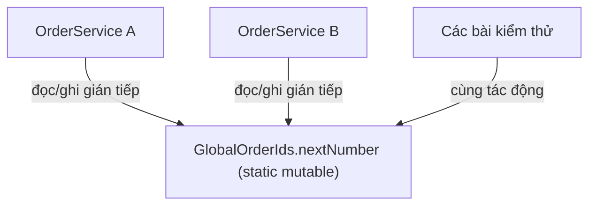
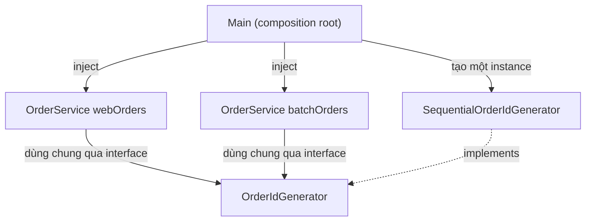

# Biến toàn cục, thành viên `static` và trạng thái dùng chung

> **Chương:** Mô hình phụ thuộc  
> **Phạm vi:** Nhận diện phụ thuộc ẩn do biến toàn cục, thành viên `static` và trạng thái dùng chung; tổ chức lại bằng Dependency Injection (DI), constructor injection và composition root trong Java thuần.

## 1. Mục tiêu học tập

Sau bài này, bạn có thể:

1. Phân biệt một thành viên `static` với một biến cục bộ, biến của đối tượng và trạng thái được chia sẻ.
2. Giải thích vì sao một lời gọi tưởng như tiện lợi đến trạng thái toàn cục lại có thể tạo **phụ thuộc ẩn**.
3. Nhận biết tác động của trạng thái dùng chung có thể thay đổi đến kiểm thử, tính đồng thời và vòng đời.
4. Chọn trường hợp dùng `static` hợp lý; phân biệt `static final` với tính bất biến thật sự.
5. Thay một phụ thuộc vào trạng thái `static` bằng **constructor injection**, lắp ghép tại **composition root**, rồi kiểm thử bằng Java thuần.
6. Giải thích khi nào nên dùng một instance dùng chung, khi nào cần instance riêng theo request hoặc theo tác vụ.

## 2. Ba khái niệm dễ bị nhầm

### 2.1. Biến toàn cục trong Java là gì?

Trong một số ngôn ngữ, *biến toàn cục* là biến có thể được truy cập từ nhiều vị trí trong chương trình. **Java không có biến tự do ở cấp file** theo nghĩa như biến toàn cục trong C. Tuy vậy, một trường `static` có phạm vi truy cập rộng, đặc biệt là `public static`, có thể đóng vai trò **trạng thái toàn cục trên thực tế**.

Ví dụ:

```java
final class AppSettings {
    // Trường static thuộc về lớp, không thuộc riêng một AppSettings instance.
    static String currentRegion = "VN";
}

final class ShippingService {
    String calculateRegion() {
        return AppSettings.currentRegion;
    }
}
```

`ShippingService` không khai báo phụ thuộc qua constructor nhưng vẫn dựa vào `AppSettings.currentRegion`. Nếu bất kỳ phần nào khác thay đổi giá trị này, kết quả của `calculateRegion()` cũng thay đổi.

> Chính xác hơn, trường `static` gắn với một `Class` đã được nạp (thông thường mỗi class loader có bản riêng). Trong cách hiểu thực hành của một ứng dụng Java thông thường, hãy coi trường `static` có thể được truy cập rộng là một dạng trạng thái toàn cục trong phạm vi tương ứng.

### 2.2. Thành viên `static` có đồng nghĩa với trạng thái dùng chung không?

Không. `static` cho biết thành viên gắn với lớp, nhưng **không cho biết nó có thể thay đổi hay không**.

| Ví dụ | Có `static`? | Có trạng thái thay đổi dùng chung? | Nhận xét |
| --- | --- | --- | --- |
| `static final int MAX_RETRIES = 3;` | Có | Không | Hằng số đơn giản, thường không tạo vấn đề về phụ thuộc ẩn. |
| `static int nextId = 0;` | Có | Có | Nhiều nơi đọc/ghi một bộ đếm. |
| `static final AtomicLong COUNTER = new AtomicLong();` | Có | Có | `final` cố định *tham chiếu*, nhưng giá trị bộ đếm vẫn thay đổi. |
| `static String normalize(String value)` | Có | Không, nếu hàm thuần | Một hàm tính toán không dùng trạng thái chung thường phù hợp dưới dạng `static`. |
| `private final List<String> names` | Không | Tùy cách chia sẻ đối tượng | Danh sách vẫn có thể bị sửa, và nhiều nơi dùng cùng instance vẫn chia sẻ trạng thái. |

Chú ý đặc biệt đến hai trường hợp:

```java
import java.util.ArrayList;
import java.util.List;
import java.util.Map;

final class Examples {
    // final giữ nguyên tham chiếu; nội dung List vẫn có thể thay đổi.
    static final List<String> EVENTS = new ArrayList<>();

    // Map.of tạo một map không cho phép sửa qua các thao tác cập nhật.
    static final Map<String, String> DEFAULT_HEADERS =
            Map.of("Accept", "application/json");
}
```

Đừng suy luận rằng cứ có `final` là dữ liệu bất biến. Cũng đừng suy luận rằng mọi phương thức `static` đều nguy hiểm.

### 2.3. Trạng thái dùng chung không nhất thiết là `static`

Trạng thái dùng chung (*shared state*) là dữ liệu được **nhiều nơi cùng quan sát hoặc có thể sửa đổi** thông qua một tham chiếu chung. Ví dụ:

```java
final class Cart {
    int itemCount;
}

Cart sameCart = new Cart();
Cart firstReference = sameCart;
Cart secondReference = sameCart;
firstReference.itemCount++;

// secondReference.itemCount cũng bằng 1.
```

Đây là hai tham chiếu đến **cùng một đối tượng**, dù không dùng `static`. Trong Dependency Injection, một instance được composition root truyền vào hai service cũng là trạng thái dùng chung nếu instance đó có dữ liệu thay đổi.

## 3. Khi trạng thái toàn cục trở thành phụ thuộc ẩn

Giả sử một ứng dụng tạo mã đơn hàng bằng bộ đếm. Cách viết ban đầu:

```java
final class GlobalOrderIds {
    static long nextNumber = 0;

    static String nextId() {
        return "ORD-" + (++nextNumber);
    }
}

final class OrderService {
    String createOrder(String buyer) {
        return GlobalOrderIds.nextId() + ":" + buyer;
    }
}
```

Chữ ký `OrderService` không cho thấy service cần một bộ cấp mã đơn hàng. Thực tế, nó phụ thuộc vào:

- Lớp `GlobalOrderIds` có mặt và sử dụng được.
- Giá trị `nextNumber` tại thời điểm được gọi.
- Việc những phần khác trong ứng dụng có đang dùng hoặc sửa bộ đếm ấy hay không.
- Cách bộ đếm hoạt động khi nhiều luồng gọi đồng thời.

Đó là **phụ thuộc ẩn**: điều kiện quyết định kết quả nằm ngoài những đầu vào và dependency được khai báo của đối tượng.

### 3.1. Kiểm thử bị ảnh hưởng bởi lịch sử chạy

Hãy hình dung hai bài kiểm thử độc lập đều tạo `new OrderService()` và đều kỳ vọng đơn hàng đầu tiên có mã `ORD-1`. Bài đầu gọi `GlobalOrderIds.nextId()` thì bài sau có thể nhận `ORD-2`. Kết quả phụ thuộc **thứ tự chạy test**, trạng thái còn sót từ test trước và những lời gọi trong cùng tiến trình.

Việc thêm một hàm `reset()` để đặt lại bộ đếm chỉ xử lý triệu chứng trong ví dụ nhỏ. Reset có thể ảnh hưởng đến code khác cùng dùng bộ đếm, đặc biệt khi các bài test chạy song song.

### 3.2. Kết quả có thể không an toàn khi có nhiều luồng

Biểu thức `++nextNumber` là thao tác gồm nhiều bước đọc, tăng, ghi. Nếu nhiều luồng cùng gọi, có thể xảy ra **race condition**: hai luồng đọc cùng giá trị cũ rồi ghi đè, dẫn đến mã trùng hoặc mất lượt tăng.

Thay bằng `AtomicLong.incrementAndGet()` làm phép tăng bộ đếm nguyên tử, nhưng **chỉ giải quyết một phần vấn đề đồng thời**. Nó không khiến dependency trở nên tường minh, không cô lập trạng thái giữa test và không tự giải quyết chính sách cấp mã duy nhất trên nhiều tiến trình hoặc sau khi ứng dụng khởi động lại.

### 3.3. Vòng đời và quyền sở hữu mơ hồ

Nếu `static` giữ HTTP client, kết nối, cache hoặc executor, cần xác định ai tạo và ai đóng tài nguyên. Khi nhiều phần có thể truy cập toàn cục, trách nhiệm cấu hình, thay thế và dọn dẹp trở nên khó theo dõi.

Một vấn đề tương tự xảy ra với cấu hình thay đổi theo request: nếu đặt `currentTenantId` hoặc `currentUserId` trong trường `static` dùng chung, nhiều request có thể đọc nhầm dữ liệu của nhau. Đây là lỗi cả về tính đúng đắn lẫn ranh giới dữ liệu.

### 3.4. Sơ đồ phụ thuộc trước khi cải tiến



Sơ đồ cho thấy một đối tượng `OrderService` được tạo mới **không có nghĩa** bộ đếm cũng được tạo mới. Phần dùng chung nằm sau lời gọi `static`.

## 4. Chuyển sang Dependency Injection trong Java thuần

Mục tiêu của DI là **tách việc sử dụng phụ thuộc khỏi việc chọn, tạo và lắp ghép đối tượng phụ thuộc**. Ta khai báo khả năng cấp mã như một dependency, cung cấp bằng constructor, và quyết định phạm vi chia sẻ tại composition root.

### 4.1. Ví dụ chạy được: constructor injection

Tạo file `Main.java`:

```java
import java.util.Objects;
import java.util.concurrent.atomic.AtomicLong;

interface OrderIdGenerator {
    String nextId();
}

final class SequentialOrderIdGenerator implements OrderIdGenerator {
    private final AtomicLong nextNumber = new AtomicLong(0);

    @Override
    public String nextId() {
        return "ORD-" + nextNumber.incrementAndGet();
    }
}

final class OrderService {
    private final OrderIdGenerator idGenerator;

    OrderService(OrderIdGenerator idGenerator) {
        this.idGenerator = Objects.requireNonNull(idGenerator, "idGenerator");
    }

    String createOrder(String buyer) {
        return idGenerator.nextId() + ":" + buyer;
    }
}

public class Main {
    public static void main(String[] args) {
        // Composition root: lựa chọn và lắp ghép phụ thuộc.
        OrderIdGenerator sharedIds = new SequentialOrderIdGenerator();

        // Hai service chủ động chia sẻ cùng một generator.
        OrderService webOrders = new OrderService(sharedIds);
        OrderService batchOrders = new OrderService(sharedIds);

        System.out.println(webOrders.createOrder("Lan"));
        System.out.println(batchOrders.createOrder("Minh"));
    }
}
```

Chạy:

```bash
javac Main.java
java Main
```

Kết quả:

```text
ORD-1:Lan
ORD-2:Minh
```

Điểm thay đổi:

1. `OrderService` công khai dependency `OrderIdGenerator` trong constructor.
2. `SequentialOrderIdGenerator` giữ bộ đếm trong **trạng thái instance**, không phải trường `static`.
3. `Main` quyết định dùng chung một instance cho hai service. Khi cần, composition root có thể tạo instance riêng cho từng nhóm công việc.
4. `AtomicLong` bảo vệ phép tăng trong phạm vi **một instance** khi nhiều luồng sử dụng instance đó.

Lưu ý phạm vi ví dụ: generator này chỉ minh họa DI và bộ đếm trong bộ nhớ. **Không dùng để bảo đảm mã đơn hàng duy nhất cho hệ thống phân tán hoặc qua các lần khởi động lại**; yêu cầu đó thường cần cơ chế định danh hoặc lưu trữ bền vững khác.



Trạng thái dùng chung vẫn tồn tại, nhưng **được lựa chọn và biểu diễn rõ ràng trong bước lắp ghép**. Đây là sự khác biệt quan trọng giữa chia sẻ có chủ đích qua DI và truy cập trạng thái toàn cục ở mọi nơi.

### 4.2. Kiểm thử độc lập, không đụng đến trạng thái toàn cục

Giữ file `Main.java` phía trên; tạo thêm `OrderServiceTest.java` trong cùng thư mục:

```java
final class RecordingOrderIdGenerator implements OrderIdGenerator {
    int callCount;

    @Override
    public String nextId() {
        callCount++;
        return "TEST-123";
    }
}

public class OrderServiceTest {
    public static void main(String[] args) {
        RecordingOrderIdGenerator fake = new RecordingOrderIdGenerator();
        OrderService service = new OrderService(fake);

        String result = service.createOrder("An");

        if (!"TEST-123:An".equals(result) || fake.callCount != 1) {
            throw new AssertionError("OrderService sử dụng generator sai");
        }

        System.out.println("PASS");
    }
}
```

```bash
javac Main.java OrderServiceTest.java
java OrderServiceTest
```

Kết quả: `PASS`.

Mỗi test có thể tự tạo một fake mới, tự quyết định kết quả trả về, và kiểm tra số lần gọi. Test không cần reset `GlobalOrderIds`, không dùng network hoặc DI container. Đây là ví dụ về **test isolation** nhờ dependency được truyền vào tường minh; nó chưa kiểm thử tính duy nhất của mã trong hệ thống sản xuất.

### 4.3. Có phải luôn cần interface?

Không. Một constructor như `ReportService(PdfRenderer renderer)` vẫn là constructor injection nếu `PdfRenderer` được truyền từ bên ngoài. Interface `OrderIdGenerator` có ích trong ví dụ vì giúp tách quy tắc nghiệp vụ khỏi cơ chế phát sinh mã và thay bằng fake khi test. **Đừng tạo interface cho mọi lớp chỉ để loại bỏ từ khóa `new`.**

## 5. Chọn scope và vòng đời cho dữ liệu dùng chung

Một khi việc lắp ghép tập trung tại composition root, ứng dụng cần quyết định **instance nào sống bao lâu và được chia sẻ với ai**.

| Chính sách | Ví dụ | Điều cần lưu ý |
| --- | --- | --- |
| **Ứng dụng / dùng chung** | HTTP client được thiết kế để chia sẻ, immutable configuration, generator đồng bộ thích hợp | Kiểm tra thread safety, trạng thái thay đổi và kế hoạch đóng tài nguyên. |
| **Theo request / đơn vị công việc** | Request context, transaction context, dữ liệu người dùng hiện tại | Không giữ trực tiếp trong đối tượng dùng chung sống lâu hơn request. |
| **Tạo mới theo nhu cầu** | Bộ xử lý có trạng thái riêng cho một tác vụ | Mỗi instance có trạng thái riêng; nếu có phối hợp trạng thái, phải thiết kế rõ. |

Ví dụ: nếu thay đoạn composition root ở mục 4 bằng:

```java
OrderService webOrders =
        new OrderService(new SequentialOrderIdGenerator());
OrderService batchOrders =
        new OrderService(new SequentialOrderIdGenerator());
```

thì cả hai service đều có generator khởi đầu từ 0, nên **đều có thể tạo `ORD-1`**. Đây không phải lỗi của DI: chính sách tạo instance đã thay đổi. Điều đúng hay sai phụ thuộc yêu cầu nghiệp vụ. DI cho phép diễn đạt quyết định đó tường minh và xem xét tại một nơi.

### 5.1. Chia sẻ một đối tượng không tự tạo ra thread safety

Khi hai service cùng dùng một instance, cần xem xét dữ liệu bên trong có thể thay đổi đồng thời hay không. Các khái niệm khác nhau:

- `synchronized` hoặc `Lock` kiểm soát vùng thao tác đồng thời.
- `AtomicLong` hỗ trợ thao tác nguyên tử cho một giá trị nhất định.
- `volatile` hỗ trợ khả năng nhìn thấy thay đổi giữa luồng theo các quy tắc bộ nhớ Java, **không khiến phép `++` trở thành nguyên tử**.
- Thiết kế bất biến giảm các đường thay đổi trạng thái và thường đơn giản hơn để chia sẻ.

DI không thay cho các cơ chế đồng bộ. Tương tự, dùng `static` không mặc nhiên gây race condition nếu dữ liệu thực sự bất biến.

### 5.2. Chủ sở hữu tài nguyên và thời điểm đóng

Với dependency giữ file handle, connection pool hoặc executor, bên tạo và quản lý vòng đời của đối tượng cần quy định việc đóng. Trong Java thuần, composition root có thể dùng `try-with-resources` nếu đối tượng được sở hữu ở đó và triển khai `AutoCloseable`; hoặc có một bước shutdown rõ ràng.

Tránh để một service không sở hữu tài nguyên tự ý đóng dependency đang được nhiều service khác dùng chung. Ngược lại, đừng giữ dependency chỉ hợp lệ trong một request làm trường của singleton dùng toàn ứng dụng.

## 6. Khi nào `static` vẫn là lựa chọn tốt?

DI là công cụ tổ chức **collaborator** và vòng đời, không phải lý do để loại bỏ mọi thành viên `static`.

### 6.1. Hằng số, hàm thuần và factory không có trạng thái ẩn

```java
import java.util.Locale;

final class TextRules {
    static final int MAX_TITLE_LENGTH = 120;

    private TextRules() {
    }

    static String normalizeTitle(String input) {
        return input.strip().toLowerCase(Locale.ROOT);
    }
}
```

`normalizeTitle` chỉ phụ thuộc vào đầu vào, không đọc cấu hình hay sửa dữ liệu toàn cục. Việc gọi nó từ lớp nghiệp vụ không tạo vấn đề về trạng thái dùng chung giống `GlobalOrderIds`.

Một **factory method `static`** cũng có thể phù hợp nếu nhiệm vụ của nó là tạo một đối tượng theo tham số tường minh. Đánh giá mức độ phụ thuộc dựa vào **hành vi**, không chỉ dựa vào cú pháp.

### 6.2. Những gì nên cân nhắc chuyển thành dependency

Các giá trị có thể gây biến đổi hoặc cần điều khiển trong test thường là ứng viên tốt để inject:

- Thời gian hiện tại: gọi thẳng `Instant.now()` khiến test phụ thuộc đồng hồ hệ thống; có thể inject `java.time.Clock`.
- Bộ sinh số ngẫu nhiên: nếu cần kết quả kiểm thử tái lập hoặc có chính sách tạo seed, truyền bộ sinh thích hợp.
- Trình gửi thông báo, HTTP client, repository, cache có trạng thái và tài nguyên: truyền collaborator với scope rõ ràng.
- Cấu hình theo môi trường/tenant: cung cấp giá trị hoặc đối tượng cấu hình qua ranh giới phù hợp, tránh một trường `static` có thể bị thay đổi tùy tiện.

Ví dụ với thời gian:

```java
import java.time.Clock;
import java.time.Instant;
import java.util.Objects;

final class InvoiceService {
    private final Clock clock;

    InvoiceService(Clock clock) {
        this.clock = Objects.requireNonNull(clock);
    }

    Instant issuedAt() {
        return Instant.now(clock);
    }
}

// Composition root trong ứng dụng thật:
// InvoiceService invoiceService = new InvoiceService(Clock.systemUTC());
//
// Trong test có thể truyền Clock.fixed(instant, zone) để cố định thời gian.
```

Ví dụ này thể hiện một loại phụ thuộc ẩn khác: **môi trường thực thi** (đồng hồ), dù không nhất thiết được lưu trong biến `static` do ứng dụng tự định nghĩa.

## 7. Phân biệt DI, singleton và service locator

Ba cách tiếp cận có thể xuất hiện cùng lúc nhưng không đồng nghĩa:

| Cách dùng | Đặc điểm |
| --- | --- |
| **DI + một instance dùng chung** | Composition root tạo một đối tượng và truyền cùng tham chiếu vào các client; dependency được công khai tại constructor. |
| **Singleton với `SomeService.getInstance()`** | Client tự truy cập đối tượng từ điểm truy cập chung; thời điểm và chính sách khởi tạo có thể bị che giấu. |
| **Service locator, ví dụ `Registry.get(Foo.class)`** | Client tự tra cứu dependency trong một registry; constructor thường không biểu lộ hết những gì client cần. |

Trong mô hình **Inversion of Control (IoC)**, việc lắp ghép được chuyển ra khỏi lớp sử dụng. Constructor injection là một kỹ thuật hiện thực IoC. **Dependency Inversion Principle (DIP)** lại là nguyên lý để phần nghiệp vụ cấp cao dựa vào các abstraction phù hợp thay vì bám vào chi tiết hạ tầng. DI, IoC và DIP có quan hệ nhưng không thể dùng tên này thay tên kia.

Một **DI container** có thể quản lý scope kiểu singleton, request hay transient. Singleton do container quản lý vẫn có thể được inject tường minh; nó khác với việc client tự gọi một `static getInstance()` ở mọi nơi. Trước khi cần container, bạn đã có thể thực hiện các quyết định tương tự bằng Java thuần.

### 7.1. `ThreadLocal` có thay thế được dependency theo request không?

`ThreadLocal` gắn dữ liệu với một luồng, không tự động gắn nó với toàn bộ vòng đời của một request. Trong thread pool, luồng được tái sử dụng; dữ liệu không dọn dẹp đúng cách có thể ảnh hưởng công việc sau. Với xử lý bất đồng bộ, một request có thể chuyển qua nhiều luồng.

Vì vậy, đừng dùng `ThreadLocal` như giải pháp mặc định để che giấu `currentUser` hoặc `currentTenant`. Nên truyền request context theo cách phù hợp với luồng thực thi và quản lý vòng đời rõ ràng.

## 8. Cách đánh giá và cải tiến code đang dùng trạng thái toàn cục

Khi gặp một trường `static` hoặc một singleton, hãy kiểm tra lần lượt:

1. **Nó có thể thay đổi không?** Phân biệt hằng số và giá trị bất biến thật sự với tham chiếu `final` trỏ đến đối tượng có thể sửa.
2. **Ai đang đọc/ghi nó?** Nếu nhiều lớp nghiệp vụ truy cập thẳng một mutable global, đó là dấu hiệu coupling qua trạng thái ẩn.
3. **Phạm vi chia sẻ thực sự cần là gì?** Toàn ứng dụng, mỗi request, mỗi tác vụ hay mỗi bài test?
4. **Nó có chứa tài nguyên hoặc ngữ cảnh nhạy với vòng đời không?** Xác định ai tạo, ai đóng, có bao giờ một dependency ngắn hạn bị lưu trong đối tượng dài hạn không.
5. **Có cần thay thế trong kiểm thử không?** Nếu cần, hãy truyền abstraction hoặc đối tượng phù hợp bằng constructor và tạo fake trong test.

Với hệ thống cũ, có thể cải tiến theo từng ranh giới. Chẳng hạn, trước mắt tạo một adapter bọc lời gọi API `static` của thư viện cũ, rồi inject adapter vào lớp nghiệp vụ. Phần còn lại có thể chuyển dần mà không phải thay toàn bộ ứng dụng cùng lúc.

Tránh một phản ứng ngược: đưa mọi phép toán đơn giản, DTO hoặc hằng số thành bean/service phải inject. Điều đó tạo thêm cấu hình và độ phức tạp mà không cải thiện sự cô lập phụ thuộc.

## 9. Bài tập tự luyện

**Bài 1 — Nhận diện.** Với các trường sau, hãy chỉ ra trường nào chắc chắn có trạng thái thay đổi dùng chung:

```java
static final int PORT = 8080;
static final java.util.concurrent.atomic.AtomicInteger ACTIVE = new java.util.concurrent.atomic.AtomicInteger();
static final java.util.List<String> NAMES = new java.util.ArrayList<>();
```

**Bài 2 — Chọn scope.** Một lớp `RequestContext` chứa `tenantId` và thông tin người dùng hiện tại. Một lớp `ApiClient` có thể chia sẻ an toàn giữa các luồng. Bạn sẽ cấp scope nào cho từng đối tượng? Vì sao không nên gán `RequestContext` vào trường `static` dùng chung?

**Bài 3 — Refactor.** Một `PaymentService` đọc `GlobalConfig.currency` và gọi `GlobalPaymentGateway.charge(...)`. Hãy đề xuất constructor nhận những dependency nào; phần nào nên tạo ở composition root; phần nào có thể dùng fake trong test.

**Bài 4 — Lý giải.** Trong mục 4, nếu tạo một `SequentialOrderIdGenerator` mới cho mỗi `OrderService`, kết quả có khác khi dùng một instance chia sẻ không? `AtomicLong` có bảo đảm mã không trùng giữa hai instance hoặc giữa hai máy chủ không?

### Gợi ý đối chiếu

1. `ACTIVE` và `NAMES` có thể thay đổi dù tham chiếu là `final`; `PORT` là hằng số nguyên.
2. `RequestContext` thường theo request hoặc đơn vị công việc; `ApiClient` có thể dùng chung nếu thư viện cho phép và vòng đời được quản lý. Đặt ngữ cảnh người dùng vào biến `static` có thể khiến request này đọc dữ liệu request khác.
3. Có thể inject một `PaymentGateway` và một đối tượng cấu hình/giá trị currency phù hợp với phạm vi nghiệp vụ; composition root chọn adapter thật; test truyền fake gateway. Quyết định scope của currency phụ thuộc việc nó là cấu hình toàn ứng dụng, theo tenant hay theo giao dịch.
4. Hai generator độc lập đều bắt đầu từ số 0 nên có thể cùng sinh `ORD-1`. `AtomicLong` chỉ đảm bảo thao tác tăng nguyên tử **trong chính instance đó**.

## 10. Ghi nhớ

**Vấn đề không nằm ở từ khóa `static` mà nằm ở việc phụ thuộc và trạng thái thay đổi bị ẩn sau một điểm truy cập dùng chung.** Dữ liệu bất biến và hàm thuần `static` thường phù hợp; mutable global, registry hoặc singleton bị truy cập trực tiếp khắp nghiệp vụ dễ làm test phụ thuộc lẫn nhau và làm mờ scope, vòng đời. Constructor injection và composition root giúp chỉ rõ lớp cần gì, nơi nào tạo dependency, ai được dùng chung và ai chịu trách nhiệm quản lý tài nguyên. Từ nền tảng Java thuần đó, bạn có thể mở rộng sang DI container khi số lượng đối tượng và chính sách vòng đời phức tạp hơn.
