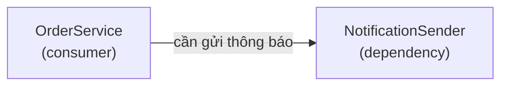
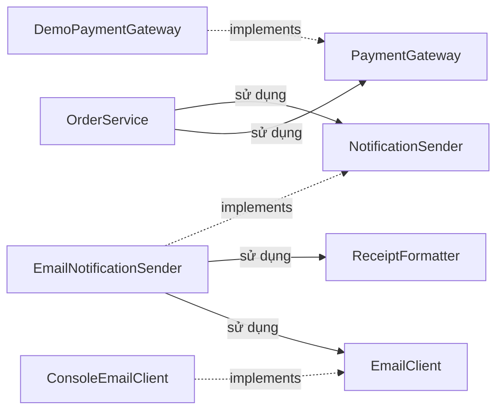
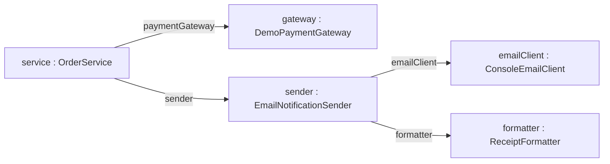
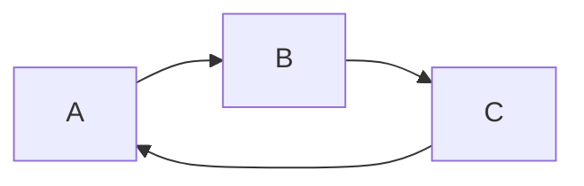

# Vẽ đồ thị phụ thuộc để xác định nơi tạo và nơi sử dụng đối tượng

## Mục tiêu học tập

Sau bài học này, bạn có thể:

- Vẽ một **đồ thị phụ thuộc (dependency graph)** từ constructor, field và các lời gọi trong mã Java.
- Phân biệt **lớp/kiểu phụ thuộc** với **đối tượng cụ thể đang được sử dụng** khi chương trình chạy.
- Đọc đồ thị để trả lời: *Ai cần ai? Ai tạo ai? Phụ thuộc được truyền qua đâu?*
- Xác định **composition root** để lắp ghép các đối tượng bằng **constructor injection**, không cần DI container.
- Phát hiện các trường hợp dễ gây khó kiểm thử: consumer tự tạo collaborator, phụ thuộc bị ẩn, vòng phụ thuộc và chia sẻ instance ngoài ý muốn.

Trong phạm vi **Dependency Injection (DI)** và **Inversion of Control (IoC)**, đồ thị phụ thuộc giúp ta nhìn thấy cấu trúc kết nối các đối tượng trước khi quyết định cách khởi tạo, chia sẻ hay thay chúng trong kiểm thử.

## 1. Đồ thị phụ thuộc biểu diễn điều gì?

Một đồ thị gồm **đỉnh (node)** và **cạnh có hướng (directed edge)**:

- **Đỉnh**: một kiểu/lớp ở mức thiết kế, hoặc một *instance* cụ thể ở thời điểm chạy.
- **Cạnh `A → B`**: theo quy ước của bài này, **A là consumer và cần/sử dụng B** để hoàn thành trách nhiệm của A. Mũi tên đi **từ đối tượng sử dụng sang phụ thuộc**, không mô tả thứ tự thực thi.

Ví dụ, nếu `OrderService` giữ một `NotificationSender` và gọi `sender.notifyPaid(...)`, ta vẽ:



Đồ thị trên cho biết **quan hệ sử dụng**, nhưng **chưa cho biết ai gọi `new`**. Hai câu hỏi này phải được khảo sát riêng:

| Câu hỏi | Dấu hiệu cần tìm trong mã |
| --- | --- |
| **Ai sử dụng phụ thuộc?** | Kiểu tham số constructor, field được lưu giữ, đối tượng được gọi phương thức, tham số được truyền để cộng tác. |
| **Ai tạo phụ thuộc?** | Biểu thức `new`, factory method, mã cấu hình/khởi tạo, hoặc cơ chế tạo đối tượng của DI container. |
| **Ai đưa phụ thuộc tới consumer?** | Lời gọi constructor, phương thức setter, tham số phương thức hay mã lắp ghép. |

Một lớp vừa có thể là **consumer** của đối tượng khác, vừa là **provider** cung cấp hành vi cho đối tượng phía trên. Ví dụ, `EmailNotificationSender` cung cấp chức năng thông báo cho `OrderService`, đồng thời lại cần một `EmailClient` để gửi email. Các vai trò này phụ thuộc vào **cạnh đang xét**, không phải nhãn cố định gắn với tên lớp.

## 2. Bài toán xuyên suốt: xử lý thanh toán đơn hàng

Giả sử ứng dụng cần nhận yêu cầu thanh toán và gửi email xác nhận khi thanh toán thành công. Để tập trung vào đồ thị đối tượng, ví dụ dùng **cổng thanh toán giả lập** và **email in ra console**; không kết nối dịch vụ bên ngoài.

Ta có các thành phần:

| Thành phần | Công việc | Cần phụ thuộc nào? |
| --- | --- | --- |
| `OrderService` | Điều phối thanh toán, gửi xác nhận nếu thành công | `PaymentGateway`, `NotificationSender` |
| `DemoPaymentGateway` | Giả lập thanh toán thành công | Không có collaborator cần tiêm |
| `EmailNotificationSender` | Tạo nội dung rồi gửi thông báo | `EmailClient`, `ReceiptFormatter` |
| `ConsoleEmailClient` | Giả lập gửi email bằng console | Không có collaborator cần tiêm |
| `ReceiptFormatter` | Định dạng nội dung xác nhận | Không có collaborator cần tiêm |
| `Main` | Khởi tạo, lựa chọn implementation và lắp ghép | Dùng các đối tượng trong quá trình khởi động |

`PaymentGateway`, `NotificationSender`, `EmailClient` là **interface** diễn tả khả năng cần dùng. Các tên `DemoPaymentGateway`, `EmailNotificationSender`, `ConsoleEmailClient` là **lớp triển khai**. Interface không được tạo bằng `new` trực tiếp; tại thời điểm chạy, consumer giữ tham chiếu tới một instance của lớp triển khai.

### Mã Java chạy độc lập

Lưu chương trình sau vào tệp `Main.java`:

```java
import java.util.Objects;

interface PaymentGateway {
    boolean charge(String orderId, long amountVnd);
}

interface NotificationSender {
    void notifyPaid(String recipient, String orderId);
}

interface EmailClient {
    void send(String recipient, String subject, String body);
}

// Chỉ giả lập thanh toán, không phát sinh giao dịch thật.
final class DemoPaymentGateway implements PaymentGateway {
    @Override
    public boolean charge(String orderId, long amountVnd) {
        System.out.printf("[DEMO] Thanh toán %d VND cho %s%n", amountVnd, orderId);
        return true;
    }
}

// Chỉ giả lập email, không gọi máy chủ gửi thư.
final class ConsoleEmailClient implements EmailClient {
    @Override
    public void send(String recipient, String subject, String body) {
        System.out.printf("[DEMO] Email đến %s | %s | %s%n",
                recipient, subject, body);
    }
}

final class ReceiptFormatter {
    String format(String orderId) {
        return "Đơn " + orderId + " đã thanh toán.";
    }
}

// Vừa cung cấp hành vi cho OrderService, vừa dùng hai phụ thuộc riêng.
final class EmailNotificationSender implements NotificationSender {
    private final EmailClient emailClient;
    private final ReceiptFormatter formatter;

    EmailNotificationSender(EmailClient emailClient, ReceiptFormatter formatter) {
        this.emailClient = Objects.requireNonNull(emailClient, "emailClient");
        this.formatter = Objects.requireNonNull(formatter, "formatter");
    }

    @Override
    public void notifyPaid(String recipient, String orderId) {
        emailClient.send(recipient, "Xác nhận đơn " + orderId,
                formatter.format(orderId));
    }
}

final class OrderService {
    private final PaymentGateway paymentGateway;
    private final NotificationSender sender;

    OrderService(PaymentGateway paymentGateway, NotificationSender sender) {
        this.paymentGateway = Objects.requireNonNull(paymentGateway, "paymentGateway");
        this.sender = Objects.requireNonNull(sender, "sender");
    }

    boolean payOrder(String orderId, String recipient, long amountVnd) {
        if (amountVnd <= 0) {
            throw new IllegalArgumentException("amountVnd must be positive");
        }

        boolean paid = paymentGateway.charge(orderId, amountVnd);
        if (paid) {
            sender.notifyPaid(recipient, orderId);
        }
        return paid;
    }
}

// Composition root của chương trình Java độc lập.
public class Main {
    public static void main(String[] args) {
        PaymentGateway gateway = new DemoPaymentGateway();
        EmailClient emailClient = new ConsoleEmailClient();
        ReceiptFormatter formatter = new ReceiptFormatter();

        NotificationSender sender = new EmailNotificationSender(emailClient, formatter);
        OrderService service = new OrderService(gateway, sender);

        boolean paid = service.payOrder("DH-101", "khach@example.com", 250_000);
        System.out.println("Kết quả thanh toán: " + paid);
    }
}
```

Biên dịch và chạy bằng JDK:

```bash
javac -encoding UTF-8 Main.java
java Main
```

Kết quả dự kiến (biểu diễn rút gọn, theo đúng thứ tự lời gọi):

```text
[DEMO] Thanh toán 250000 VND cho DH-101
[DEMO] Email đến khach@example.com | Xác nhận đơn DH-101 | Đơn DH-101 đã thanh toán.
Kết quả thanh toán: true
```

## 3. Vẽ đồ thị phụ thuộc từ mã theo từng bước

### Bước 1: Chọn cấp độ của đỉnh

Trước tiên chọn một trong hai loại đồ thị, tránh trộn lẫn:

1. **Đồ thị phụ thuộc theo kiểu (type-level graph)**: mỗi đỉnh là **lớp/interface**, dùng để xem consumer được viết dựa trên *hợp đồng* nào.
2. **Đồ thị đối tượng lúc chạy (runtime object graph)**: mỗi đỉnh là **một instance**, dùng để xem *đối tượng thực tế nào* được nối với đối tượng nào.

Hai đồ thị liên quan với nhau nhưng trả lời những câu hỏi khác nhau. Một kiểu có thể có nhiều instance; ví dụ hai `OrderService` dùng cùng một `EmailClient`, hoặc dùng hai instance `EmailClient` riêng biệt.

### Bước 2: Lấy cạnh từ constructor và field

Đọc từng lớp để tìm **điều mà đối tượng cần từ bên ngoài**:

```java
OrderService(PaymentGateway paymentGateway, NotificationSender sender)
EmailNotificationSender(EmailClient emailClient, ReceiptFormatter formatter)
```

Sau đó đối chiếu với những trường được lưu và gọi trong phương thức:

- `OrderService → PaymentGateway`: dùng `paymentGateway.charge(...)`.
- `OrderService → NotificationSender`: dùng `sender.notifyPaid(...)`.
- `EmailNotificationSender → EmailClient`: dùng `emailClient.send(...)`.
- `EmailNotificationSender → ReceiptFormatter`: dùng `formatter.format(...)`.

Đây là **bốn cạnh phụ thuộc trực tiếp** của ví dụ. `OrderService` cũng **phụ thuộc gián tiếp** vào `EmailClient` thông qua `NotificationSender` và implementation được ghép lúc chạy, nhưng không có field `EmailClient` và cũng không cần biết cách gửi email cụ thể.

### Bước 3: Vẽ đồ thị theo kiểu



**Cách đọc hình:** mũi tên **liền** là quan hệ sử dụng/phụ thuộc; mũi tên **nét đứt** chỉ quan hệ một lớp *implements* interface. Nét đứt **không phải** cạnh gọi phương thức hoặc cạnh tạo đối tượng. `ReceiptFormatter` là một lớp cụ thể vì ví dụ chưa cần nhiều cách định dạng.

Đồ thị kiểu cho thấy `OrderService` không phụ thuộc trực tiếp vào `DemoPaymentGateway` hay `EmailNotificationSender`; nó chỉ biết hai interface `PaymentGateway`, `NotificationSender`. Đây là cơ sở để thay implementation mà không sửa consumer.

### Bước 4: Tìm `new` và xác định nơi tạo

Trong chương trình trên, cả năm lệnh `new` đều nằm tại `Main.main(...)`:

| Instance được tạo | Biểu thức tạo | Được truyền đến / được dùng bởi |
| --- | --- | --- |
| `gateway` | `new DemoPaymentGateway()` | `OrderService` qua constructor |
| `emailClient` | `new ConsoleEmailClient()` | `EmailNotificationSender` qua constructor |
| `formatter` | `new ReceiptFormatter()` | `EmailNotificationSender` qua constructor |
| `sender` | `new EmailNotificationSender(emailClient, formatter)` | `OrderService` qua constructor |
| `service` | `new OrderService(gateway, sender)` | `Main` gọi `service.payOrder(...)` |

Vì thế **`Main` là nơi tạo và lắp ghép (composition root)**. `OrderService` và `EmailNotificationSender` **sử dụng** các phụ thuộc đã được truyền vào, không chịu trách nhiệm chọn hay tạo chúng.

Lưu ý rằng lời gọi `new` của `Main` và việc `OrderService` gọi `paymentGateway.charge(...)` là **hai loại quan hệ khác nhau**. Không thể đọc vị trí tạo đối tượng chỉ từ mũi tên phụ thuộc theo kiểu; cần xem **mã lắp ghép** hoặc chú thích cạnh tạo riêng.

### Bước 5: Vẽ đồ thị giữa các instance lúc chạy

Ở đây, mỗi đỉnh được đặt theo tên **biến instance** trong `Main` và kiểu thực tế sau dấu `:`:



Đồ thị này thể hiện **tham chiếu được giữ lại** trong các trường đối tượng sau khi constructor hoàn tất. Nó không vẽ `Main` thành một phụ thuộc của mọi instance: `Main` tạo và kết nối chúng, còn các đối tượng trên không giữ tham chiếu ngược về `Main`.

**Đọc từ trái qua phải:** `service` dùng `gateway` và `sender`; `sender` dùng `emailClient` và `formatter`. Chỉ cần đi theo các cạnh từ `service`, ta biết những thành phần nào tham gia hỗ trợ chức năng thanh toán và gửi thông báo. Nếu thay `ConsoleEmailClient` bằng một client khác, đồ thị các kiểu phụ thuộc **không đổi**, nhưng đỉnh instance tương ứng trong đồ thị chạy **đổi**.

## 4. Vì sao vẽ đồ thị giúp tách tạo khỏi sử dụng?

Xét phiên bản rút gọn mà consumer tự khởi tạo sender:

```java
final class BadOrderService {
    private final NotificationSender sender = new EmailNotificationSender(
            new ConsoleEmailClient(), new ReceiptFormatter());

    void confirm(String email, String orderId) {
        sender.notifyPaid(email, orderId);
    }
}
```

Trong phiên bản này, **nơi tạo** `EmailNotificationSender` và hai phụ thuộc con nằm **ngay trong `BadOrderService`**. Lớp này phải quyết định sử dụng cách gửi email cụ thể, nên khó thay sender khi kiểm thử. Quan hệ sử dụng vẫn là `BadOrderService → NotificationSender`, nhưng **quyền quyết định implementation và việc khởi tạo** đã bị giữ bên trong consumer.

Với constructor injection trong phiên bản đầy đủ, đồ thị sử dụng vẫn có cạnh `OrderService → NotificationSender`, song **nơi tạo chuyển về `Main`**:

```java
NotificationSender sender = new EmailNotificationSender(emailClient, formatter);
OrderService service = new OrderService(gateway, sender);
```

Đó là điểm quan trọng của **Dependency Injection**: consumer nhận từ bên ngoài một phụ thuộc đã được chuẩn bị. Nó cũng minh họa một cách áp dụng **Inversion of Control**: phần điều khiển lựa chọn và lắp ghép cộng tác viên được đưa ra khỏi consumer.

Không phải mọi biểu thức `new` đều cần đẩy ra composition root. Việc tạo một giá trị dữ liệu ngắn hạn, chẳng hạn `new OrderReceipt(...)` để trả về kết quả, khác với việc tự tạo một **collaborator** có trách nhiệm gửi email, truy cập dữ liệu hay gọi API. Khi phân tích đồ thị DI, hãy tập trung vào **các dịch vụ/cộng tác viên mà lớp cần để làm việc**, thay vì coi tất cả object đều là phụ thuộc phải tiêm.

## 5. Dùng đồ thị để quyết định thứ tự lắp ghép

Trong đồ thị instance ở mục 3, `gateway`, `emailClient` và `formatter` không cần cộng tác viên nào khác, nên có thể được tạo trước. Tiếp đó mới tạo `sender` từ `emailClient` và `formatter`; cuối cùng tạo `service` từ `gateway` và `sender`.

Đây là **thứ tự lắp ghép từ các đỉnh lá về consumer cấp cao**, tương ứng với code trong `Main`:

```text
Bước 1: tạo gateway, emailClient, formatter
Bước 2: tạo sender(emailClient, formatter)
Bước 3: tạo service(gateway, sender)
Bước 4: gọi service.payOrder(...)
```

Nếu một dependency lại cần `OrderService` ngay trong constructor, có thể xuất hiện **vòng phụ thuộc**:



Ví dụ, để tạo `A` phải có `B`, để tạo `B` phải có `C`, và để tạo `C` lại cần `A` đã được tạo. Với constructor injection thuần túy và các phụ thuộc bắt buộc phải có ngay, vòng này không thể lắp ghép trực tiếp theo thứ tự thông thường. Hãy xem lại cách phân chia trách nhiệm hoặc ranh giới các thành phần, thay vì cố giấu vòng phụ thuộc bằng một chuỗi `new` khó kiểm soát.

## 6. Dùng đồ thị để kiểm thử bằng Java thuần

Đồ thị cho biết muốn kiểm tra `OrderService`, ta có thể thay các instance ở **cạnh rìa của đồ thị**: thay `PaymentGateway` bằng một gateway luôn thành công và thay `EmailClient` bằng đối tượng ghi nhận lời gọi. Không cần sửa `OrderService` hoặc `EmailNotificationSender`.

Lưu đoạn sau trong `GraphCheck.java`, cùng thư mục với `Main.java`:

```java
public class GraphCheck {
    static final class ApprovedGateway implements PaymentGateway {
        int calls;

        @Override
        public boolean charge(String orderId, long amountVnd) {
            calls++;
            return true;
        }
    }

    static final class RecordingEmailClient implements EmailClient {
        int sends;
        String lastRecipient;

        @Override
        public void send(String recipient, String subject, String body) {
            sends++;
            lastRecipient = recipient;
        }
    }

    public static void main(String[] args) {
        ApprovedGateway gateway = new ApprovedGateway();
        RecordingEmailClient emailClient = new RecordingEmailClient();
        ReceiptFormatter formatter = new ReceiptFormatter();

        NotificationSender sender = new EmailNotificationSender(emailClient, formatter);
        OrderService service = new OrderService(gateway, sender);

        boolean paid = service.payOrder("DH-TEST", "test@example.com", 10_000);
        if (!paid || gateway.calls != 1 || emailClient.sends != 1
                || !"test@example.com".equals(emailClient.lastRecipient)) {
            throw new AssertionError("Sai kết quả hoặc sai lời gọi tới phụ thuộc");
        }

        System.out.println("PASS: các phụ thuộc được gọi đúng");
    }
}
```

Chạy:

```bash
javac -encoding UTF-8 Main.java GraphCheck.java
java GraphCheck
```

Đồ thị trong bài kiểm tra vẫn có **cùng cấu trúc cạnh** `service → gateway`, `service → sender`, `sender → emailClient` và `sender → formatter`. Chỉ khác các đỉnh thực tế `gateway : ApprovedGateway` và `emailClient : RecordingEmailClient`. Constructor injection làm phép thay này rõ ràng và kiểm soát được.

## 7. Đồ thị còn cho thấy scope và vòng đời

Giả sử hai consumer được tạo với cùng một sender:

```java
NotificationSender sharedSender = new EmailNotificationSender(emailClient, formatter);
OrderService first = new OrderService(gateway, sharedSender);
OrderService second = new OrderService(gateway, sharedSender);
```

Đồ thị instance khi đó có **hai đỉnh** `first`, `second`, nhưng **một đỉnh** `sharedSender`; hai cạnh cùng trỏ đến một đối tượng. Nếu tạo hai `EmailNotificationSender` khác nhau, đồ thị phải vẽ **hai đỉnh sender riêng**, ngay cả khi chúng cùng có kiểu `EmailNotificationSender`.

Việc **dùng chung instance** không tự động đồng nghĩa với scope `singleton` do DI container quản lý. Trong Java thuần, chính mã tạo và giữ tham chiếu quyết định cách chia sẻ, còn thời điểm thu hồi bộ nhớ phụ thuộc vào khả năng truy cập đối tượng và cơ chế garbage collection. Đối với đối tượng giữ tài nguyên như kết nối mạng, cần thiết kế bước đóng tài nguyên phù hợp; DI tự nó không bảo đảm đóng kết nối.

Khi mở rộng sang DI container, đồ thị vẫn hữu ích: container có thể tự dựng những cạnh phụ thuộc đã khai báo, còn cấu hình scope quyết định mỗi cạnh nhận **instance dùng chung** hay **instance mới**.

## 8. Quy trình nhanh khi đọc một codebase

1. **Khoanh phạm vi:** chọn một luồng nghiệp vụ cụ thể, chẳng hạn `payOrder(...)`.
2. **Liệt kê consumer:** bắt đầu từ class điều phối, ghi lại các collaborator được lấy qua constructor, field hoặc tham số phương thức.
3. **Vẽ mũi tên:** theo quy ước `consumer → dependency`; nếu cần, ghi tên field hoặc interface trên cạnh.
4. **Lần theo từng phụ thuộc:** xem implementation của nó còn cần những collaborator nào; tiếp tục tới các đỉnh lá.
5. **Tìm nơi tạo và ghép:** tìm `new`/factory/configuration và vị trí gọi constructor; ghi **creator** bên cạnh từng đỉnh hoặc trong bảng riêng.
6. **Kiểm tra đồ thị:** đánh dấu cạnh phụ thuộc vào lớp cụ thể, vòng phụ thuộc, phụ thuộc bị `new` ẩn trong consumer và instance bị chia sẻ không chủ đích.
7. **Thử thay một đỉnh lá:** truyền implementation giả từ composition root rồi kiểm thử xem những consumer khác có cần sửa hay không.

Đây là quy trình thao tác được cả trên giấy, trong Markdown bằng Mermaid, hoặc trong công cụ vẽ sơ đồ. Dù dùng công cụ nào, điều quan trọng là **giữ nhất quán chiều mũi tên** và phân biệt **cạnh sử dụng** với **hành động tạo/lắp ghép**.

### Các lỗi đọc đồ thị thường gặp

| Nhầm lẫn | Cách sửa |
| --- | --- |
| Vẽ `PaymentGateway → OrderService` vì gateway được gọi trước | Dùng quy ước `OrderService → PaymentGateway`: consumer phụ thuộc vào gateway, không phải thứ tự gọi. |
| Xem `NotificationSender` là instance thực tế | Đây là interface. Instance có thể là `EmailNotificationSender` hoặc implementation khác. |
| Tưởng nơi có cạnh sử dụng cũng là nơi gọi `new` | Tra cứu mã khởi tạo riêng. Trong ví dụ, `Main` tạo sender, `OrderService` sử dụng sender. |
| Vẽ chung các instance chỉ vì chúng có cùng kiểu | Hai lệnh `new` tạo hai instance riêng; cần hai đỉnh nếu đang vẽ object graph. |
| Cho rằng DI đòi hỏi framework hay annotation | `new OrderService(gateway, sender)` đã là constructor injection bằng Java thuần. |
| Vẽ mọi biến cục bộ như phụ thuộc DI | Xác định biến nào là collaborator cung cấp hành vi; dữ liệu ngắn hạn không nhất thiết phải tiêm. |

## 9. Bài tập tự kiểm tra

Cho đoạn mã sau (giả sử các lớp đã được định nghĩa như ở trên):

```java
EmailClient email = new ConsoleEmailClient();
ReceiptFormatter formatter = new ReceiptFormatter();
NotificationSender senderA = new EmailNotificationSender(email, formatter);
NotificationSender senderB = new EmailNotificationSender(email, formatter);
```

Hãy thử trả lời:

1. Có bao nhiêu instance `EmailNotificationSender`? Có bao nhiêu instance `EmailClient`?
2. Cạnh nào xuất hiện **hai lần từ hai consumer khác nhau đến cùng một instance**?
3. Nếu muốn `senderB` chỉ ghi nhận email để kiểm thử, nên thay dependency ở đâu?
4. Nếu đưa bốn dòng này vào constructor của `OrderService`, điều gì thay đổi về **nơi tạo** và khả năng thay provider?

**Đáp án gợi ý:** (1) Có hai instance sender và một instance email client. (2) Cả `senderA` và `senderB` đều trỏ đến cùng `email`; chúng cũng cùng trỏ đến `formatter`. (3) Tạo một `RecordingEmailClient` và truyền nó riêng vào constructor của `senderB`. (4) `OrderService` tự quyết định cách tạo sender và các phụ thuộc con; đẩy công đoạn này về composition root và truyền sender qua constructor sẽ dễ thay hơn.

Một đồ thị phụ thuộc rõ ràng phải cho phép người đọc chỉ ra **đối tượng cần chức năng**, **đối tượng thực hiện chức năng**, **nơi khởi tạo** và **đường đi đưa phụ thuộc đến consumer**. Nắm được bốn điều đó là nền tảng để tổ chức constructor injection, composition root, scope, vòng đời và kiểm thử bằng DI trước khi học đến DI container.
