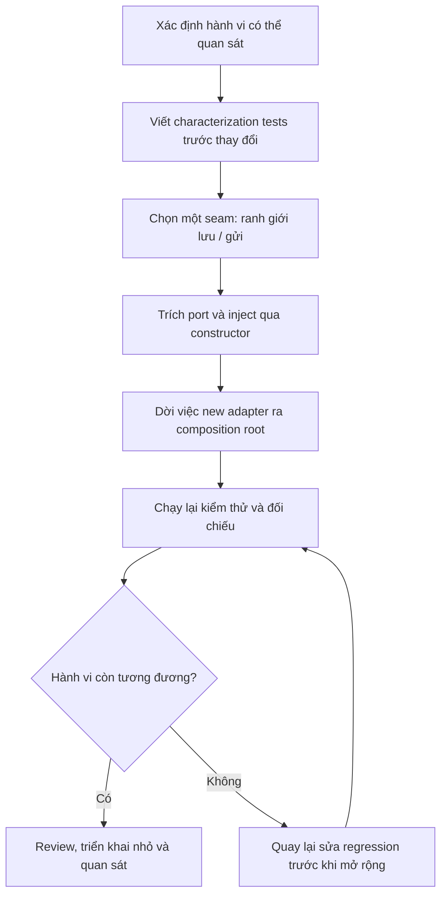

# Chọn ranh giới thay đổi và bổ sung kiểm thử bảo vệ hành vi hiện có

Trong chương **Refactor sang DI** của module **Dependency Injection**, mục tiêu không phải thay tất cả lệnh `new` bằng một DI container càng nhanh càng tốt. Mục tiêu là **tách việc sử dụng dependency khỏi việc tạo và lắp ghép**, trong khi hệ thống tiếp tục đáp ứng những hợp đồng mà người dùng và các thành phần khác đang dựa vào.

Một bản refactor thành công có thể thay đổi constructor, cấu trúc class, cách triển khai adapter và vị trí đặt **composition root** nhưng **không vô tình thay đổi hành vi quan sát được**. Vì vậy, trước khi áp dụng **Dependency Injection (DI)** và **Inversion of Control (IoC)** vào mã cũ, ta cần làm hai việc: **chọn một ranh giới thay đổi đủ nhỏ, có thể kiểm soát** và **bổ sung kiểm thử mô tả hành vi hiện có**.

Trọng tâm bài học là dùng **Java thuần** để minh họa cách bảo vệ hành vi bằng characterization tests, sau đó chuyển dần sang constructor injection. DI container chỉ là bước mở rộng để tự động hóa việc lắp ghép; nó không phải điều kiện để bắt đầu refactor.

Sau bài này, bạn có thể:

- Nhận diện dependency bị tạo cứng trong mã và chọn **seam/ranh giới** có ích để thay thế chúng.
- Phân biệt **characterization test** bảo vệ hành vi hiện hữu với test kiểm chứng **đặc tả mong muốn**.
- Xác định các khía cạnh cần giữ: đầu ra, exception, tác dụng phụ, thứ tự thao tác quan trọng, trạng thái và quyền sở hữu tài nguyên.
- Refactor từng bước từ `new ConcreteDependency()` trong consumer sang **constructor injection** và **composition root**.
- Tạo test bằng fake/stub/recording double, đối chiếu với kết quả cũ mà không phải dựng DI container.
- Nhận diện thay đổi làm lệch scope, lifecycle, transaction hoặc hợp đồng tương thích và quyết định khi nào cần integration test.

## 1. Thế nào là “không đổi hành vi” khi refactor?

Theo nghĩa thực hành, **refactoring** thay đổi **cấu trúc bên trong** để mã dễ bảo trì, mở rộng hoặc kiểm thử hơn, trong khi bảo toàn những hành vi bên ngoài đã được chọn làm hợp đồng của thay đổi đó.

Ví dụ, service cũ có thể:

1. Nhận mã đặt chỗ và số ngày thuê.
2. Từ chối mã rỗng hoặc số ngày ngoài khoảng được hỗ trợ.
3. Tính số tiền theo quy tắc đang dùng.
4. **Lưu** đặt chỗ trước khi **gửi xác nhận**.
5. Trả thông tin đặt chỗ hoặc truyền lỗi ra caller khi một bước thất bại.

Khi chuyển sang DI, ta được phép thay cách tạo repository và notification sender, nhưng nếu đổi thứ tự gửi–lưu, đổi thông báo lỗi hoặc đổi số tiền một cách không chủ đích thì đó **không còn chỉ là refactor cấu trúc**.

Những thứ có thể cần bảo vệ:

| Nhóm hành vi | Quan sát thực tế | Rủi ro khi đưa DI vào |
| --- | --- | --- |
| **Kết quả trả về** | Mã đặt chỗ, số tiền, trạng thái | Thay quy tắc tính giá hoặc default configuration |
| **Validation** | Đầu vào nào bị từ chối, loại exception/status code | Đổi thứ tự kiểm tra, làm thay đổi lỗi trả về |
| **Tác dụng phụ** | Dòng dữ liệu đã lưu, event đã phát, thông báo đã gửi | Mất lời gọi hoặc gọi trùng khi lắp adapter mới |
| **Thứ tự có ngữ nghĩa** | Lưu trước, gửi xác nhận sau | Gửi thành công dù chưa lưu được |
| **Xử lý lỗi** | Lỗi nào được giữ, bao nhiêu lần retry, đã ghi gì trước khi lỗi | Nuốt exception hoặc retry một thao tác có side effect |
| **Cấu hình** | Endpoint, timeout, chính sách mặc định | DI root chọn nhầm implementation hoặc giá trị |
| **Scope và trạng thái** | Instance dùng riêng hay dùng chung qua request/job | Chia sẻ mutable state gây lỗi đồng thời |
| **Vòng đời tài nguyên** | Ai mở, đóng pool/client và khi nào | Đóng quá sớm, double-close hoặc rò tài nguyên |

Không phải mọi chi tiết implementation đều là một hợp đồng cần khóa cứng. Tên phương thức private, số lần gọi helper thuần nội bộ hoặc cách chia class thường **không** nên thành assertion nếu consumer không phụ thuộc vào chúng.

### “Hành vi hiện có” không đồng nghĩa “hành vi chắc chắn đúng”

**Characterization test** ghi lại *hệ thống hiện đang làm gì*, kể cả những điểm chưa hoàn hảo. Nó đặc biệt hữu ích khi tài liệu yêu cầu chưa đầy đủ. Tuy nhiên, nếu phát hiện một lỗi cũ, không nên mặc định bảo vệ lỗi ấy mãi mãi:

- Ghi nhận hiện trạng và xác định hệ quả đối với caller.
- Phân biệt **bước refactor giữ hành vi** với **bước sửa lỗi/đổi quy tắc nghiệp vụ**.
- Khi sửa lỗi, thêm test cho **hành vi mới được phê duyệt** và thay đổi kỳ vọng một cách có chủ đích.

Làm cả hai thay đổi trong cùng một commit lớn khiến regression rất khó được nhận diện.

## 2. Chọn ranh giới thay đổi: bắt đầu ở đâu?

Một hệ thống cũ thường trộn nhiều loại trách nhiệm:

```text
HTTP handler / CLI command
    -> OrderService
        -> new JdbcOrderRepository(...)
        -> new MailClient(...)
        -> System.getenv(...)
        -> LocalDateTime.now()
        -> kiểm tra nghiệp vụ
```

Không cần kéo toàn bộ chuỗi thành một kiến trúc nhiều lớp trong lần đầu. Nên tìm một **seam**: vị trí có thể thay implementation hoặc thay cách tạo dependency mà **ít chạm vào thuật toán nghiệp vụ nhất**.

Một ranh giới phù hợp thường là **điểm consumer đang tự tạo một collaborator gây I/O hoặc phụ thuộc môi trường**:

```java
// Trước:
final class BookingService {
    private final JdbcBookingStore store = new JdbcBookingStore();
}

// Sau: cùng nhu cầu lưu, nhưng implementation do caller chọn.
final class BookingService {
    private final BookingStore store;

    BookingService(BookingStore store) {
        this.store = java.util.Objects.requireNonNull(store);
    }
}
```

Ở bước này, ta chỉ chuyển **trách nhiệm chọn và tạo adapter** ra bên ngoài. Quy tắc nghiệp vụ vẫn ở `BookingService` và có thể tiếp tục gọi `store.save(...)` như trước.

### Tiêu chí chọn seam

| Tiêu chí | Câu hỏi nên hỏi | Ý nghĩa |
| --- | --- | --- |
| **Có thể quan sát?** | Có một API, response, log nghiệp vụ hoặc trạng thái lưu trữ để so sánh trước–sau không? | Có bằng chứng chống regression |
| **Phạm vi thay đổi nhỏ?** | Có thể chỉ chỉnh một consumer và một vùng bootstrap không? | Dễ review, dễ rollback |
| **Hợp đồng rõ?** | Consumer cần hành vi gì, không phải tên SDK nào? | Có thể tạo port hướng consumer |
| **Chi phí kiểm thử thấp?** | Có thể dùng fake thay database, email, đồng hồ không? | Unit test nhanh và ổn định |
| **Ownership xác định?** | Ai tạo/đóng pool, client, executor? | Tránh đổi ngầm vòng đời |
| **Không tạo chu trình?** | Port và adapter có phụ thuộc ngược lẫn nhau không? | Đồ thị đối tượng dễ lắp ghép |
| **Khả năng rollout?** | Có thể triển khai và kiểm chứng từng phần không? | Hạn chế rủi ro |

**Không phải mọi `new` đều cần được inject.** Tạo một `Money`, `BookingId` hoặc object dữ liệu thuần, không giữ tài nguyên và không phải cộng tác viên có thể thay thế, thường là hành vi bình thường của nghiệp vụ. Trích interface cho mọi class nhỏ có thể làm mã cồng kềnh mà không cải thiện testability.

## 3. Bắt đầu bằng characterization tests ở bề mặt đang quan sát được

Khi consumer cũ còn tự tạo dependency, có thể chưa dễ inject fake. Đừng vì thế mà **bỏ qua bước kiểm thử trước thay đổi**. Hãy kiểm thử qua bề mặt đang có, ví dụ:

- API public của service/CLI/web handler.
- Kết quả trả về và exception.
- Dòng dữ liệu được ghi trong database test hoặc repository in-memory đã có sẵn.
- Thông điệp đẩy vào test queue/sandbox hoặc sự kiện đã được hệ thống ghi nhận.
- Các tác dụng phụ có thể quan sát thông qua giao diện public hiện hữu.

Nếu chỉ có tích hợp thật mới cho thấy hành vi, có thể cần **một vài integration test** trước khi trích interface. Sau khi tạo được seam, bổ sung unit test nhanh bằng fake để kiểm tra nhiều nhánh hơn.

### Chọn bộ ca kiểm thử tối thiểu

Với luồng xác nhận booking, một ma trận có ích là:

| Ca | Đầu vào / điều kiện | Kết quả kỳ vọng đang quan sát | Tác dụng phụ cần bảo vệ |
| --- | --- | --- | --- |
| Hợp lệ | Mã `B-01`, thuê 2 ngày | Receipt với đúng giá | Lưu đúng một lần, rồi gửi xác nhận |
| Mã rỗng | `" "` | Lỗi validation cùng loại/thông điệp theo hợp đồng | Không ghi, không gửi |
| Số ngày dưới giới hạn | `0` | Từ chối | Không ghi, không gửi |
| Số ngày vượt giới hạn | `31` nếu giới hạn hiện tại là 30 | Từ chối | Không ghi, không gửi |
| Lưu thất bại | Repository báo lỗi | Lỗi lưu được báo theo chính sách | Không gửi xác nhận thành công |
| Thông báo thất bại | Sender báo lỗi sau khi lưu | Hành vi hiện hành được ghi rõ | Phải xác định đã lưu hay chưa, retry có gây trùng không |

Nên có cả **test đặc trưng cho lỗi biên** vì thay đổi cách lắp ghép rất dễ thay đổi thứ tự gọi dependency. Chẳng hạn, gửi email trước khi ghi DB có thể khiến người dùng nhận xác nhận cho booking chưa tồn tại.

### Đừng tạo một “bản sao thuật toán” trong test

Một test tốt nên dựa vào **đầu ra hoặc sự kiện đã quan sát**, cộng các giá trị kỳ vọng độc lập. Nếu test gọi lại chính hàm tính giá đang được refactor để tính **expected value**, test có thể không phát hiện cùng một lỗi trong cả hai phía.

Có thể dùng **golden master / snapshot** để đối chiếu đầu ra lớn, nhưng cần lọc những dữ liệu phi tất định như timestamp, ID ngẫu nhiên hoặc thứ tự không có ý nghĩa. Chụp toàn bộ JSON/log một cách máy móc dễ tạo bộ test “đỏ” vì chi tiết không thuộc hợp đồng.

## 4. Một quy trình refactor nhỏ, có điểm dừng rõ

Giả sử service cũ dùng repository và sender cụ thể. Thay vì làm một cuộc “đại phẫu DI”:



Chi tiết từng bước:

1. **Đóng băng ranh giới bên ngoài** của một lát cắt: giữ chữ ký `book(...)`, kiểu trả về và những hành vi đã chọn làm hợp đồng.
2. **Ghi test nền** ở mức thấp nhất mà mã cũ cho phép. Ưu tiên ca thành công, validation và các side effect quan trọng.
3. **Trích một port do consumer làm chủ**, chẳng hạn `BookingStore` và `ConfirmationSender`; không đưa toàn bộ API JDBC/SMTP vào port nếu nghiệp vụ không cần.
4. **Giữ nguyên implementation hiện có** bên dưới adapter mới hoặc cho implementation cũ triển khai port. Tránh đồng thời viết lại truy vấn SQL, protocol gửi mail và thuật toán tính giá.
5. **Đưa phép tạo về composition root**, truyền dependency qua constructor. Trong giai đoạn chuyển tiếp, có thể giữ một adapter tương thích/overload tại điểm biên nếu nhiều caller chưa kịp cập nhật, nhưng phải có kế hoạch bỏ nó.
6. **Chạy lại cùng test** và bổ sung test trực tiếp cho SUT bằng fake. Khi có khác biệt, phân loại là regression hay thay đổi nghiệp vụ có chủ đích.
7. **Di chuyển sang seam tiếp theo** sau khi lớp đang xét đã ổn định; không tạo một global service locator để giải quyết nhanh hàng chục lớp cùng lúc.

Để rollback đơn giản, từng bước nên là thay đổi nhỏ có thể build/deploy độc lập. Nếu API bên ngoài phải thay, tách bước thích ứng tương thích với caller ra khỏi bước refactor nội bộ.

## 5. Ví dụ Java 17: đối chiếu dịch vụ cũ và dịch vụ dùng DI

Ví dụ mô phỏng một service đặt xe. Bản **legacy** tự tạo repository và sender; bản **refactored** nhận hai port qua constructor. Cả hai vẫn dùng cùng quy tắc tính phí: `150_000` đơn vị nhỏ nhất mỗi ngày, số ngày hợp lệ trong khoảng `1..30`, **lưu trước khi gửi xác nhận**.

Để thấy được side effect trong ví dụ không có database hay SMTP, hai adapter cũ ghi vào một `AuditTrail`, và dịch vụ có hàm `auditTrail()` đại diện cho một **giao diện quan sát hiện có**. Trong hệ thống thật, phép quan sát có thể đến từ bảng dữ liệu, test queue, response hoặc API tra cứu. **Không cần thêm getter vào mã production chỉ để lộ field private** nếu có thể kiểm tra hành vi qua một ranh giới công khai khác.

Lưu toàn bộ mã sau vào `RefactoringBoundaryDemo.java` (Java 17 trở lên):

```java
import java.util.ArrayList;
import java.util.List;
import java.util.Objects;

public class RefactoringBoundaryDemo {
    record BookingReceipt(
            String bookingId, int days, long totalCents) { }

    interface BookingStore {
        void save(BookingReceipt receipt);
    }

    interface ConfirmationSender {
        void confirmed(String bookingId);
    }

    // Trợ giúp quan sát side effect trong demo tuần tự.
    static final class AuditTrail {
        private final List<String> events = new ArrayList<>();

        void record(String event) {
            events.add(event);
        }

        List<String> snapshot() {
            return List.copyOf(events);
        }
    }

    static final class InMemoryBookingStore implements BookingStore {
        private final AuditTrail audit;

        InMemoryBookingStore(AuditTrail audit) {
            this.audit = Objects.requireNonNull(audit);
        }

        @Override
        public void save(BookingReceipt receipt) {
            audit.record("save:" + receipt.bookingId());
        }
    }

    static final class RecordingSender implements ConfirmationSender {
        private final AuditTrail audit;

        RecordingSender(AuditTrail audit) {
            this.audit = Objects.requireNonNull(audit);
        }

        @Override
        public void confirmed(String bookingId) {
            audit.record("notify:" + bookingId);
        }
    }

    // BEFORE: consumer quyết định và tự tạo các collaborator.
    static final class LegacyBookingService {
        private final AuditTrail audit = new AuditTrail();
        private final BookingStore store = new InMemoryBookingStore(audit);
        private final ConfirmationSender sender = new RecordingSender(audit);

        BookingReceipt book(String bookingId, int days) {
            if (bookingId == null || bookingId.isBlank()) {
                throw new IllegalArgumentException("booking id required");
            }
            if (days < 1 || days > 30) {
                throw new IllegalArgumentException("days must be 1..30");
            }

            BookingReceipt receipt = new BookingReceipt(
                    bookingId, days, 150_000L * days);
            store.save(receipt);
            sender.confirmed(bookingId);
            return receipt;
        }

        List<String> auditTrail() {
            return audit.snapshot();
        }
    }

    // AFTER: consumer chỉ giữ và sử dụng các port được inject.
    static final class BookingService {
        private final BookingStore store;
        private final ConfirmationSender sender;

        BookingService(BookingStore store, ConfirmationSender sender) {
            this.store = Objects.requireNonNull(store, "store");
            this.sender = Objects.requireNonNull(sender, "sender");
        }

        // Giữ nguyên chữ ký, quy tắc và thứ tự tác dụng phụ.
        BookingReceipt book(String bookingId, int days) {
            if (bookingId == null || bookingId.isBlank()) {
                throw new IllegalArgumentException("booking id required");
            }
            if (days < 1 || days > 30) {
                throw new IllegalArgumentException("days must be 1..30");
            }

            BookingReceipt receipt = new BookingReceipt(
                    bookingId, days, 150_000L * days);
            store.save(receipt);
            sender.confirmed(bookingId);
            return receipt;
        }
    }

    static void check(boolean condition, String message) {
        if (!condition) {
            throw new AssertionError(message);
        }
    }

    static void expectInvalid(Runnable action, String message) {
        try {
            action.run();
        } catch (IllegalArgumentException expected) {
            check(message.equals(expected.getMessage()),
                    "Wrong validation message");
            return;
        }
        throw new AssertionError("Expected validation rejection");
    }

    // 1. Characterization test: khóa hành vi đã quan sát ở bản cũ.
    static void testLegacyBaseline() {
        LegacyBookingService legacy = new LegacyBookingService();
        BookingReceipt result = legacy.book("B-01", 2);

        check(result.equals(
                new BookingReceipt("B-01", 2, 300_000L)),
                "Legacy price/result changed");
        check(legacy.auditTrail().equals(
                List.of("save:B-01", "notify:B-01")),
                "Legacy side effects or order changed");
    }

    // 2. So sánh cả kết quả và chuỗi sự kiện trước-sau.
    static void testRefactoredParity() {
        LegacyBookingService legacy = new LegacyBookingService();

        AuditTrail audit = new AuditTrail();
        BookingService refactored = new BookingService(
                new InMemoryBookingStore(audit),
                new RecordingSender(audit));

        BookingReceipt before = legacy.book("B-02", 3);
        BookingReceipt after = refactored.book("B-02", 3);

        check(after.equals(before), "Return value differs");
        check(after.totalCents() == 450_000L, "Unexpected price");
        check(audit.snapshot().equals(legacy.auditTrail()),
                "Side effects differ from baseline");
    }

    // 3. Giữ cả loại lỗi, thông điệp và không phát sinh I/O.
    static void testValidationParity() {
        LegacyBookingService legacy = new LegacyBookingService();
        AuditTrail audit = new AuditTrail();
        BookingService refactored = new BookingService(
                new InMemoryBookingStore(audit),
                new RecordingSender(audit));

        expectInvalid(
                () -> legacy.book(" ", 2), "booking id required");
        expectInvalid(
                () -> refactored.book(" ", 2), "booking id required");
        expectInvalid(
                () -> legacy.book("B-03", 0), "days must be 1..30");
        expectInvalid(
                () -> refactored.book("B-03", 0), "days must be 1..30");
        expectInvalid(
                () -> legacy.book("B-03", 31), "days must be 1..30");
        expectInvalid(
                () -> refactored.book("B-03", 31), "days must be 1..30");

        check(legacy.auditTrail().isEmpty()
                        && audit.snapshot().isEmpty(),
                "Invalid input must not produce side effects");
    }

    // 4. Test mới: giả lập lỗi lưu, kiểm tra không gửi xác nhận.
    static void testFailedSaveDoesNotNotify() {
        List<String> calls = new ArrayList<>();
        BookingStore failingStore = receipt -> {
            calls.add("save");
            throw new IllegalStateException("storage unavailable");
        };
        ConfirmationSender sender = id -> calls.add("notify");
        BookingService refactored =
                new BookingService(failingStore, sender);

        boolean failed = false;
        try {
            refactored.book("B-04", 1);
        } catch (IllegalStateException expected) {
            failed = "storage unavailable".equals(expected.getMessage());
        }

        check(failed, "Expected storage failure");
        check(calls.equals(List.of("save")),
                "Notification must not run if save failed");
    }

    // 5. Hai composition roots không vô tình chia sẻ mutable state.
    static void testIsolatedGraphs() {
        AuditTrail leftAudit = new AuditTrail();
        AuditTrail rightAudit = new AuditTrail();
        BookingService left = new BookingService(
                new InMemoryBookingStore(leftAudit),
                new RecordingSender(leftAudit));
        BookingService right = new BookingService(
                new InMemoryBookingStore(rightAudit),
                new RecordingSender(rightAudit));

        left.book("LEFT", 1);
        right.book("RIGHT", 1);

        check(leftAudit.snapshot().equals(
                List.of("save:LEFT", "notify:LEFT")),
                "Left graph contains wrong events");
        check(rightAudit.snapshot().equals(
                List.of("save:RIGHT", "notify:RIGHT")),
                "Right graph contains wrong events");
    }

    public static void main(String[] args) {
        testLegacyBaseline();
        testRefactoredParity();
        testValidationParity();
        testFailedSaveDoesNotNotify();
        testIsolatedGraphs();
        System.out.println("PASS: 5 refactoring safety tests");
    }
}
```

Biên dịch và chạy:

```bash
javac RefactoringBoundaryDemo.java
java RefactoringBoundaryDemo
```

Kết quả dự kiến:

```text
PASS: 5 refactoring safety tests
```

### Đọc kết quả theo mục tiêu refactor

**Test 1 — Baseline:** Không chỉ kiểm tra kết quả tính tiền; còn khóa **thứ tự** `save` trước `notify`. Đây là phép quan sát qua giao diện mô phỏng hiện có. Test có kỳ vọng `300_000` độc lập với code tính tiền, giúp tránh việc cả phiên bản cũ và mới cùng chứa một lỗi nhưng vẫn so sánh bằng nhau.

**Test 2 — Parity:** Cùng một đầu vào phải cho cùng `BookingReceipt` và cùng chuỗi sự kiện. Hai service có cách tạo dependency khác nhau nhưng logic chính được giữ nguyên.

**Test 3 — Validation:** Đầu vào sai bị từ chối cùng cách, không tạo dữ liệu lưu hoặc thông báo. Thông điệp exception được kiểm tra ở đây vì giả sử caller hiện đang phụ thuộc vào nó; nếu hợp đồng chỉ yêu cầu loại lỗi, có thể tránh khóa chi tiết thông điệp để giảm test giòn.

**Test 4 — Lỗi hạ tầng:** Khi đã có constructor injection, ta dễ tạo một `BookingStore` cố tình thất bại. Test này bảo vệ invariant **không gửi xác nhận sau khi lưu lỗi**. Nó **không thay thế** test tích hợp của adapter JDBC thật.

**Test 5 — Tách graph:** Hai tổ hợp fake/store/sender độc lập không chia sẻ danh sách mutable. Đây là điểm quan trọng khi refactor có nguy cơ vô tình chuyển dependency thành singleton hoặc static global.

Ví dụ cố ý **không** đổi chiến lược tính phí, cập nhật database hoặc kết nối mạng. `ArrayList` và `AuditTrail` chỉ phù hợp kiểm thử tuần tự; production với request đồng thời cần quyết định thread-safety và transaction riêng. Mục tiêu là nhìn thấy một **refactor cấu trúc được bảo vệ bằng kiểm thử**, không phải một hệ thống đặt xe hoàn chỉnh.

## 6. Trích port đúng ranh giới, đừng sao chép nguyên API hạ tầng

Khi chọn seam, hãy để **consumer nói nó cần gì**, không để implementation cũ ép consumer mang theo chi tiết kỹ thuật.

Ví dụ tốt:

```java
interface BookingStore {
    void save(BookingReceipt receipt);
}
```

Một adapter JDBC có thể triển khai `save` bằng SQL, còn fake trong unit test ghi receipt vào list. Nếu thay bằng:

```java
// Phản mẫu: API port làm lộ JDBC và quyền sở hữu Connection.
interface BookingStore {
    java.sql.ResultSet execute(
            java.sql.Connection connection, String sql)
            throws java.sql.SQLException;
}
```

thì dù `BookingStore` là interface, mã nghiệp vụ vẫn biết cấu trúc lưu trữ và transaction ở mức JDBC. Điều đó khiến việc thay adapter và dựng fake phức tạp hơn.

### Không vội làm interface quá rộng

Nếu service chỉ cần `save`, không nhất thiết inject một interface quản lý cả đặt xe, phân quyền, thanh toán, email, xuất báo cáo và backup. Ranh giới tốt thường là **hành vi gắn với nhu cầu consumer**, đủ hẹp để có thể tạo fake đáng tin và đủ rõ về các đảm bảo nghiệp vụ.

Tuy nhiên, chia nhỏ quá mức cũng có chi phí. Một thao tác cần tính nguyên tử trên nhiều bước có thể đòi hỏi **hợp đồng cấp cao hơn** như `BookingCommitter.tryReserveAndSave(...)`, thay vì tách rồi giả định kiểm tra–lưu là một transaction.

## 7. Chuyển phép tạo dependency về composition root mà không làm đổi scope

**Trước refactor**, `LegacyBookingService` tự tạo store và sender. **Sau refactor**, một nơi bên ngoài tạo các implementation:

```java
// Composition root bằng Java thuần:
AuditTrail audit = new AuditTrail();
BookingStore store = new InMemoryBookingStore(audit);
ConfirmationSender sender = new RecordingSender(audit);
BookingService service = new BookingService(store, sender);

BookingReceipt result = service.book("B-05", 2);
```

Đây là một ví dụ cấu trúc có thể đặt bên trong `RefactoringBoundaryDemo`, nơi các kiểu nested đã được khai báo. Trong chương trình thật, root có thể tạo `JdbcBookingStore` và `EmailConfirmationSender` thay cho adapter in-memory; logic của `BookingService` không đổi.

Di chuyển phép tạo ra root **không tự bảo đảm cùng vòng đời**. Cần xem xét:

| Trước refactor | Sau refactor cần giữ hoặc quyết định rõ |
| --- | --- |
| Mỗi `LegacyBookingService` có store/sender riêng | Root có tạo cặp dependency riêng cho mỗi service hay chuyển thành singleton dùng chung? |
| Mỗi lần gọi method có một resource ngắn hạn | Root không được inject resource ngắn hạn vào singleton rồi giữ mãi |
| Adapter tự đóng JDBC connection sau một thao tác | Phải bảo toàn ranh giới transaction và `try-with-resources` |
| HTTP client/pool được tạo một lần | Nếu root sở hữu client/pool, root chịu trách nhiệm shutdown khi hết request/job |
| Logger, Clock, random source tự truy cập môi trường | Có thể inject để test được, nhưng phải giữ ngữ nghĩa mặc định trong production |

**Cảnh báo scope mismatch:** một singleton service giữ một `Connection` hoặc request context được tạo cho request đầu tiên có thể hoạt động đúng trong test đơn luồng nhưng sai khi chạy web. Nếu cần connection theo transaction, inject repository/factory dài hạn rồi mượn connection tại ranh giới thao tác. Nếu một component đang được dùng chung, cần đánh giá mutable state và tính an toàn đa luồng của tất cả dependency phía dưới.

## 8. Những chỗ khó refactor: static, constructor lớn và hạ tầng nằm sâu

Trong mã cũ, không phải lúc nào seam cũng nằm ở field `new`. Có thể gặp:

**Static call truy cập môi trường**

```java
// Trước:
Instant createdAt = Instant.now();

// Sau: cùng hành vi production, điều khiển được thời gian trong test.
Instant createdAt = Instant.now(clock);
```

Composition root inject `Clock.systemUTC()`, còn test inject `Clock.fixed(...)`. Cần giữ ý nghĩa múi giờ và thời điểm chụp thời gian; đừng đồng thời thay quy tắc xử lý ngày/giờ của nghiệp vụ.

**SDK hoặc network call ngay trong use case**

Định nghĩa một port theo ngữ nghĩa của ứng dụng, viết adapter bao SDK và đặt việc cấu hình client ở root. Giữ nguyên cách chuyển đổi dữ liệu và lỗi đã được quan sát trước khi cân nhắc đổi retry/timeout. Với nhà cung cấp bên ngoài, thêm contract test để xác nhận adapter không hiểu sai response thật.

**Constructor quá nhiều tham số**

Đừng ngay lập tức giấu mọi dependency vào một `ServiceRegistry` hoặc “god context” chỉ để constructor ngắn hơn. Constructor nhiều tham số có thể cho thấy class đang có quá nhiều trách nhiệm. Hãy xác định nhóm hành vi cohesive, trích service nhỏ hơn khi thực sự cần và tiến hành theo các bước được bảo vệ bằng test.

**Không dễ tạo legacy object trong unit test**

Nếu production code chỉ khởi động qua web server hoặc batch job, test ở mức **entry point đang có** trước; rồi tạo seam dần dần. Tránh bắt buộc hệ thống cũ phải lập tức biến thành thiết kế hoàn hảo trước khi có bất kỳ lưới an toàn nào.

## 9. Phạm vi kiểm thử: điều gì cần unit, điều gì cần integration?

Sau khi đưa DI vào, unit test thường tăng tính rõ ràng và tốc độ. Nhưng không có nghĩa một fake chứng minh adapter thật hoạt động đúng.

| Câu hỏi | Loại kiểm thử phù hợp | Ví dụ |
| --- | --- | --- |
| Quy tắc tính phí và validation có đổi không? | Unit/characterization test | `book("B-01", 2)` trả đúng receipt |
| Lưu phải xảy ra trước thông báo? | Unit test với recording doubles | `["save:B-01", "notify:B-01"]` |
| Nếu repository ném lỗi, có gửi nhầm xác nhận không? | Unit test với failing fake | Chỉ thấy lời gọi `save` |
| Adapter JDBC có bind tham số và ghi đúng schema không? | Integration/contract test | DB thử nghiệm, rollback và constraint |
| DI root chọn đúng implementation và cấu hình không? | Composition/integration test | Resolve service trong bootstrap hoặc container |
| Vòng đời pool và executor dừng đúng không? | Lifecycle integration test | Đợi in-flight tasks, sau đó đóng |
| HTTP response/status code của caller có giữ nguyên không? | API characterization/integration test | Response trước–sau cùng đầu vào |
| Hệ thống gửi event/email một lần theo hợp đồng không? | Integration hoặc end-to-end phù hợp | Queue/sandbox và idempotency key |

Chỉ có test trong `RefactoringBoundaryDemo` chưa chứng minh hệ thống production không đổi vì ví dụ không tích hợp DB/email thật. Khi áp dụng vào dự án thực, baseline cần **phủ các ranh giới thực sự đang phục vụ người dùng** và giữ những integration test quan trọng.

### Test nào nên viết trước, test nào viết sau?

1. **Trước seam:** test theo bề mặt có thể quan sát của hệ thống cũ, dù phải chạy tích hợp.
2. **Ngay khi có port:** unit test consumer bằng fake/spy cho các nhánh quan trọng.
3. **Khi chuyển implementation:** contract test adapter thật để chắc port mới giữ ngữ nghĩa.
4. **Khi đưa wiring về root/container:** integration test cấu hình, scope, lifecycle.
5. **Sau deploy:** quan sát số lượng lỗi, latency, dữ liệu ghi và event phát, so với baseline vận hành.

Đây không phải yêu cầu bắt đầu mọi refactor bằng test end-to-end rất chậm. Tùy chi phí, hãy chọn **bộ test tối thiểu đủ đáng tin** rồi mở rộng khả năng cách ly khi seam xuất hiện.

## 10. Cẩn thận khi “giữ hành vi” có liên quan tới transaction

Thứ tự hai lời gọi:

```java
store.save(receipt);
sender.confirmed(receipt.bookingId());
```

chưa tự bảo đảm **tính nguyên tử**. Nếu lưu thành công nhưng gửi thông báo thất bại, booking có thể đã tồn tại. Nếu retry toàn bộ lời gọi, có nguy cơ lưu hoặc gửi trùng.

Một refactor sang DI có thể bảo toàn thứ tự mà vẫn làm thay đổi transaction vì chuyển `Connection` hoặc transaction manager sang scope khác. Cần làm rõ trước khi sửa:

- Unit of work bắt đầu và kết thúc ở đâu?
- Ai commit/rollback?
- Sender có đồng bộ hay đưa message vào queue?
- Nếu thao tác có thể được retry, có idempotency key không?
- Có ranh giới nguyên tử nào ở DB hay broker không?

Nếu hiện trạng đã có sự cố “lưu xong nhưng gửi thất bại”, hãy **ghi nhận đặc tính ấy** trước. Việc thêm outbox hoặc thay giao thức giao dịch là một **thay đổi hành vi và kiến trúc đáng kể**, nên được làm và kiểm thử như một bước riêng sau khi cấu trúc DI đã ổn định.

## 11. Refactor tăng dần khi nhiều caller đang dùng class cũ

Trong một dự án lớn, `BookingService` có thể được gọi từ web controller, CLI command và background worker. Nếu đổi constructor ngay, hàng chục nơi tạo class có thể phải sửa cùng lúc.

Một phương án chuyển đổi có kiểm soát:

1. **Khoanh phạm vi caller:** liệt kê các điểm tạo service, cách cấu hình và scope hiện tại. Chỉ kiểm tra những nơi liên quan tới lát cắt được chọn.
2. **Trích constructor nhận port** và cập nhật một composition root trước.
3. **Đưa các caller còn lại sang root/factory** từng bước, cùng dùng hợp đồng mới.
4. **Giữ đường tương thích ở ranh giới** trong thời gian chuyển tiếp nếu bắt buộc, kèm test đối chiếu.
5. **Loại bỏ đường tạo cũ** khi không còn caller và kiểm thử đã bảo vệ đầy đủ.

Trong giai đoạn chuyển tiếp, tránh tạo một “default constructor” cho mọi use case rồi bắt service tự truy cập global container. Mô hình này dễ giữ coupling ẩn và khiến unit test vẫn phải thiết lập trạng thái toàn cục.

**Không cần chuyển ngay sang Spring/CDI để kết thúc bước này.** Một composition root Java thuần gọi `new Adapter(...)` và `new Service(port)` là đủ để thực hành đúng DI; dùng container khi số lượng binding, scope hoặc tích hợp framework khiến việc lắp thủ công trở nên khó bảo trì.

## 12. Checklist review và quyết định chấp nhận refactor

Trước khi xem một lát cắt refactor là hoàn tất, hãy đối chiếu:

| Nhóm | Câu hỏi quyết định |
| --- | --- |
| **Ranh giới** | Có chỉ rõ consumer, port, adapter và composition root chịu thay đổi không? |
| **Test nền** | Đã có test về kết quả, validation, side effect và lỗi quan trọng trước khi sửa chưa? |
| **Hành vi** | Có giá trị kỳ vọng độc lập và so sánh trước–sau, thay vì chỉ cho hai phiên bản gọi chung một helper không? |
| **Dependency** | Consumer đã ngừng tự tạo I/O collaborator và không gọi service locator toàn cục chưa? |
| **Tương thích** | Chữ ký public, exception/status và chính sách mặc định còn tương thích không? |
| **Scope** | Có vô tình biến per-request instance thành singleton hoặc ngược lại không? |
| **Ownership** | Ai đóng pool/client/connection và thứ tự shutdown có còn đúng không? |
| **Đồng thời** | Đã cân nhắc thread-safety khi chia sẻ instance qua request/job chưa? |
| **Tích hợp** | Adapter thật và cấu hình root/container đã có test tương ứng chưa? |
| **Rollout** | Có thể rollback, theo dõi metric và phân biệt lỗi refactor với lỗi hệ thống ngoài không? |

**Chỉ “code biên dịch được” chưa đủ.** Một wiring sai vẫn có thể tạo đúng kiểu object nhưng chọn sai adapter hoặc scope. Ngược lại, một số test unit xanh chưa đủ chứng minh hạ tầng thật đã được ghép đúng. Các loại kiểm thử cần bổ sung cho nhau theo ranh giới trách nhiệm.

## 13. Phản mẫu thường gặp

| Phản mẫu | Hậu quả | Cách sửa |
| --- | --- | --- |
| Refactor toàn bộ hệ thống trong một commit lớn | Không biết thay đổi nào gây regression | Chia theo seam nhỏ, có test và điểm dừng |
| Đưa DI vào đồng thời sửa thuật toán giá | Test đối chiếu khó phân biệt loại thay đổi | Tách refactor cấu trúc khỏi thay đổi nghiệp vụ |
| Tạo interface cho tất cả class có `new` | Abstraction rỗng, khó đọc mã | Ưu tiên boundary với I/O, môi trường, chính sách thay thế |
| Di chuyển `new` nhưng consumer vẫn tự gọi `GlobalContainer.get` | Phụ thuộc bị giấu, không thực sự constructor-inject | Inject port/factory cụ thể từ root |
| Unit test chỉ kiểm tra return, bỏ qua side effect | Không phát hiện gửi thông báo trước khi lưu | Dùng recording fake cho các tương tác có ý nghĩa |
| Test assertion theo mọi chi tiết nội bộ | Test vỡ khi chỉ đổi cấu trúc | Bảo vệ hợp đồng quan sát thay vì implementation |
| Dùng fake để thay thế hoàn toàn integration test | Bỏ sót DB schema, credentials, HTTP mapping | Giữ contract/integration test ở ranh giới hạ tầng |
| Biến adapter dùng riêng thành singleton mà không xét mutable state | Lỗi concurrent access hoặc rò dữ liệu request | Giữ/thiết kế lại scope và thread-safety có chủ đích |
| Đổi `SQLException` thành lỗi khác mà không có chính sách | Caller nhận lỗi không tương thích | Ghi nhận và kiểm thử hợp đồng lỗi tại ranh giới |
| Đóng resource tại service chỉ vì nó được inject | Đóng nhầm dependency được chia sẻ | Xác định owner và quản lý lifecycle ở root/adapter |

## 14. Bài tập thực hành

### Bài tập 1 — Xác định ranh giới trước khi sửa

Cho một `PaymentService` đang tạo `new JdbcPaymentRepository()`, `new HttpBankClient()` và đọc `System.getenv`. Hãy đề xuất **một** seam nên trích trước. Ghi rõ các hành vi quan sát cần có test trước khi sửa, ba ranh giới nào có thể tạm giữ nguyên, và vì sao không nên đổi đồng thời transaction lẫn adapter HTTP.

### Bài tập 2 — Tạo test nền độc lập

Chạy `RefactoringBoundaryDemo.java`. Trong `testLegacyBaseline`, bổ sung ca thuê 1 ngày và 30 ngày với expected value được viết trực tiếp từ hợp đồng đang quan sát. Thêm kiểm tra validation cho `bookingId == null`. Không lấy expected value bằng cách gọi lại `book` của phiên bản mới.

### Bài tập 3 — Làm sai thứ tự để chứng minh test có ích

Tạm đổi `BookingService.book` để gọi `sender.confirmed` **trước** `store.save`. Quan sát test nào phải báo lỗi. Khôi phục thứ tự cũ và giải thích vì sao test này bảo vệ hành vi nghiệp vụ thay vì chi tiết private implementation.

### Bài tập 4 — Đổi adapter bằng fake

Viết một `BookingStore` lưu `BookingReceipt` trong `List` và một `ConfirmationSender` ghi nhận ID. Dựng `BookingService` trực tiếp bằng constructor injection, kiểm tra không cần database/SMTP, rồi thử fake store ném lỗi và xác minh sender không nhận lời gọi.

### Bài tập 5 — Scope và vòng đời

Giả sử repository thật sử dụng JDBC connection pool và ứng dụng chạy web đa luồng. Vẽ graph sau refactor, đánh dấu pool theo application scope, connection theo transaction và request data theo request scope. Nêu rõ ai trả connection, ai đóng pool và thứ tự shutdown phù hợp.

### Bài tập 6 — Phân loại một thay đổi phát hiện được

Giả sử characterization test cho thấy khi gửi thông báo lỗi, booking vẫn đã được lưu. Bạn muốn dùng outbox để bảo đảm xử lý lại. Hãy tách thành **hai kế hoạch**: (a) refactor cấu trúc để inject `BookingStore`/`ConfirmationSender`, (b) thay đổi workflow với outbox và hợp đồng retry. Mỗi kế hoạch cần nhóm test nào?

## 15. Câu hỏi tự kiểm tra

1. Vì sao cần có characterization test **trước** khi trích dependency khỏi mã cũ?
2. “Seam” khác việc tạo thêm interface cho mọi class như thế nào?
3. Khi chuyển từ `new JdbcStore()` sang constructor injection, điều gì phải thay ở consumer và composition root?
4. Vì sao chỉ so sánh return value có thể bỏ sót regression về thứ tự side effect?
5. Khi không thể inject fake vào legacy code, có thể kiểm thử ở ranh giới nào trước?
6. DI có tự bảo đảm cùng scope, thread-safety hoặc transaction giữa hai phiên bản không?
7. Khi nào nên đánh dấu sự khác biệt là **regression**, khi nào là **thay đổi hành vi được phê duyệt**?
8. Test unit trực tiếp với fake còn thiếu bằng chứng gì về adapter hạ tầng và cấu hình container?

**Chọn ranh giới thay đổi nhỏ và bổ sung kiểm thử hành vi hiện có** là cách giảm rủi ro khi refactor sang Dependency Injection. Đầu tiên quan sát và ghi lại hợp đồng đang được sử dụng; tiếp theo chọn seam nơi mã nghiệp vụ đang tự tạo dependency; sau đó trích port, chuyển việc tạo về composition root và inject qua constructor. Các test trước–sau cho thấy cấu trúc được cải thiện **mà hành vi quan trọng không vô tình thay đổi**. Khi đã làm chủ quy trình này bằng Java thuần, việc đưa DI container vào chỉ là thay đổi cách đăng ký và phân giải object graph, không phải lý do để bỏ qua characterization, scope hay kiểm thử tích hợp.
