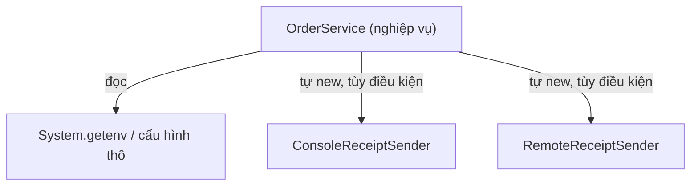
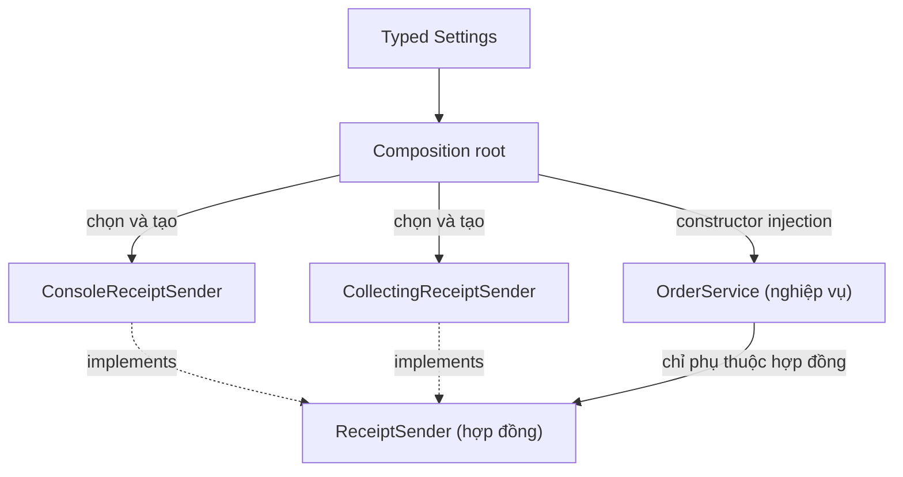

# Di chuyển việc lựa chọn triển khai tới điểm lắp ghép

Trong một ứng dụng Java đã tồn tại, nhiều lớp nghiệp vụ không chỉ **sử dụng** dependency mà còn **tự quyết định sẽ dùng triển khai nào**. Một service có thể đọc biến môi trường, kiểm tra cờ chế độ, gọi `new JdbcRepository(...)` hoặc lấy `EmailSender` từ registry toàn cục. Khi muốn kiểm thử nghiệp vụ, thay database hay chuyển dịch vụ thông báo, ta phải sửa ngay trong lớp đang xử lý use case.

Một bước refactor quan trọng để áp dụng **Dependency Injection (DI)** là **chuyển quyết định chọn implementation từ consumer về composition root (điểm lắp ghép)**. Consumer tuyên bố những khả năng nó cần qua constructor; nơi khởi động ứng dụng đọc cấu hình, chọn adapter, tạo object graph và cung cấp dependency phù hợp.

Bài học thuộc chương **Refactor sang DI** của module **DEPENDENCY_INJECTION**. Trọng tâm không chỉ là “thêm interface và constructor”, mà là **chuyển quyền quyết định từng bước, bảo toàn hành vi nghiệp vụ, xác định điều kiện lựa chọn và kiểm thử wiring**. Ta thực hành bằng Java thuần, có xét scope, vòng đời và đường chuyển tiếp trước khi sử dụng DI container.

## 1. Kết quả cần đạt

Sau bài này, bạn có thể:

- Nhận diện những vị trí một lớp đang tự chọn implementation: `new` adapter, `if` theo cấu hình, `System.getenv()`, factory toàn cục, service locator hoặc static singleton.
- Phân biệt **lựa chọn triển khai** với **quyết định nghiệp vụ**; biết điều kiện nào nên rời khỏi service và điều kiện nào phải ở lại.
- Refactor một ca sử dụng từ **tự tạo/tự chọn dependency** sang **constructor injection**, không thay đổi kết quả nghiệp vụ mong muốn.
- Tạo composition root đọc cấu hình có kiểu, từ chối cấu hình không hợp lệ và lắp object graph theo lựa chọn rõ ràng.
- Dùng characterization test, unit test với test double và wiring test để kiểm tra từng bước chuyển đổi.
- Đánh giá tác động lên scope, quyền sở hữu tài nguyên, thời điểm kích hoạt side effect và khả năng triển khai dần trong codebase cũ.

## 2. Hiểu chính xác điều gì đang được di chuyển

Hãy phân biệt hai câu hỏi:

1. **Lớp nghiệp vụ cần làm gì?** Ví dụ lưu đơn hàng hợp lệ, yêu cầu gửi biên nhận và trả kết quả cho caller.
2. **Ứng dụng sẽ dùng đối tượng cụ thể nào để làm việc đó?** Ví dụ repository JDBC hay in-memory; sender in console hay qua API bên ngoài; client nào được tạo, chia sẻ và đóng.

Câu thứ nhất thuộc **chính sách nghiệp vụ và luồng use case**. Câu thứ hai thường thuộc **cấu hình/lắp ghép**. DI hữu ích khi hai trách nhiệm này được phân định rõ.

| Loại quyết định | Ví dụ | Nơi thường phù hợp |
| --- | --- | --- |
| Kiểm tra đơn hàng có hợp lệ không | Số tiền không âm, mã đơn không rỗng | Domain/application service |
| Khi nào lưu đơn và khi nào yêu cầu gửi biên nhận | Lưu trước, thông báo sau | Use case / application service |
| Dùng `JdbcOrderStore` hay `InMemoryOrderStore` | Theo môi trường triển khai đã được xác thực | Composition root |
| Dùng `ConsoleReceiptSender` hay adapter giao tiếp hệ thống ngoài | Theo cấu hình khởi động hợp lệ | Composition root |
| Khách hàng có được hưởng ưu đãi theo từng đơn không | Theo dữ liệu và chính sách của đơn hàng | Chính sách nghiệp vụ/strategy selector |
| Tạo một client cho toàn ứng dụng hay một session theo request | Theo hợp đồng lifetime và thread-safety | Root, request factory, lifecycle manager |
| Retry khi dịch vụ bên ngoài thất bại | Theo hợp đồng adapter/use case và tính idempotent | Adapter/chính sách lỗi phù hợp, **không tự động** tại root |

**Đừng đưa mọi `if` sang composition root.** Nếu mỗi đơn hàng có luật chọn đơn vị vận chuyển hoặc mức thuế riêng, việc lựa chọn đó có thể là **quy tắc nghiệp vụ lúc chạy**. Root có thể tiêm một `ShippingPolicySelector`, nhưng không nên tự phân xử từng đơn hàng bằng dữ liệu request.

### 2.1. Hướng phụ thuộc trước và sau

Trước refactor, consumer tự chọn:



Sau refactor, selection ở root:



Sơ đồ biểu diễn ý định thiết kế, không có nghĩa root phải tạo **đồng thời** cả hai sender. Trong mã ở mục 7, root chỉ tạo **một** implementation theo cấu hình.

## 3. Nhận diện điểm lựa chọn ẩn trong code cũ

Không phải mọi lời gọi `new` là mùi thiết kế. Một use case có thể hoàn toàn hợp lý khi tạo entity/value object. Điều cần kiểm tra là các câu lệnh quyết định **collaborator hạ tầng hoặc chính sách triển khai**.

| Dấu hiệu trong code | Câu hỏi cần đặt | Rủi ro thường gặp |
| --- | --- | --- |
| `new JdbcOrderStore(url)` trong `OrderService` | Vì sao service cần biết JDBC và URL? | Coupling công nghệ, test phải chạy database |
| `System.getenv("NOTIFY_MODE")` trong phương thức nghiệp vụ | Cấu hình có bị đọc lại mỗi lần gọi không? | Kết quả không dự đoán, khó kiểm thử |
| `if ("remote".equals(mode)) new ApiSender(...)` | Điều kiện chọn là cấu hình startup hay rule theo request? | Trộn cấu hình với nghiệp vụ |
| `GlobalContainer.get(ReceiptSender.class)` | Constructor có còn thể hiện đủ dependency không? | Service locator, dependency ẩn |
| `SenderFactory.getDefault()` gọi từ consumer | Factory có thực sự được tiêm hay là registry toàn cục? | Chỉ đổi tên sự phụ thuộc, chưa đảo quyền lắp |
| `static final Sender INSTANCE = ...` | Ai quyết định mode, scope và đóng resource? | Trạng thái toàn cục, test ảnh hưởng nhau |
| `catch (...) { sender = new NoOpSender(); }` | Fallback này có được nghiệp vụ cho phép không? | Im lặng bỏ qua thông báo quan trọng |

**Tiêu chí chính:** nếu thay một adapter bằng implementation khác **bắt buộc sửa lớp nghiệp vụ**, rất có thể việc lựa chọn đang nằm sai chỗ.

Tuy nhiên, cũng có trường hợp một service cố ý triển khai **chiến lược chọn theo dữ liệu nghiệp vụ**. Khi đó nó nên phụ thuộc một tập strategy/hợp đồng được inject, không trực tiếp tạo adapter và đọc biến môi trường.

## 4. Phản ví dụ: lựa chọn và khởi tạo nằm trong use case

Xét cách viết cũ sau đây. Đây là **mã phác họa để phân tích**, không phải file Java độc lập; `OrderStore`, `Order` và các lớp adapter là những API giả định:

```java
final class LegacyOrderService {
    private final OrderStore store = new JdbcOrderStore(
            System.getenv("ORDER_DB_URL"));

    Order place(String id, long amountCents, String email) {
        Order order = new Order(id, amountCents, email);
        store.saveNew(order);

        String mode = System.getenv("RECEIPT_MODE");
        ReceiptSender sender;
        if ("remote".equals(mode)) {
            sender = new RemoteReceiptSender(
                    System.getenv("RECEIPT_ENDPOINT"));
        } else {
            sender = new ConsoleReceiptSender();
        }
        sender.request(order);
        return order;
    }
}
```

Có **hai điểm lựa chọn** đang nằm trong service:

- Chọn `JdbcOrderStore`, đọc URL và tạo repository khi tạo service.
- Chọn sender theo biến môi trường, đọc endpoint và tạo sender **ở mỗi lần đặt đơn**.

Hệ quả:

1. **Không thể unit test logic đặt đơn một cách độc lập** mà không chạm cơ sở dữ liệu hoặc thay đổi môi trường.
2. **Sai cấu hình bị che khuất:** `RECEIPT_MODE=remtoe` (gõ nhầm) bị xem như console; người vận hành tưởng dùng remote nhưng ứng dụng chạy cách khác.
3. **Vòng đời không rõ:** `RemoteReceiptSender` có thể sở hữu HTTP client/thread nhưng được tạo mỗi request và không có ai đóng.
4. **Một lần sửa lựa chọn triển khai lan vào nghiệp vụ:** thêm provider mới phải sửa `LegacyOrderService`, mặc dù quy tắc đặt đơn không đổi.
5. **Mã có thể tạo tác dụng phụ quá sớm:** nếu constructor của `JdbcOrderStore` kết nối thật, việc tạo service đã mở resource trước khi toàn graph sẵn sàng.

Lời giải **không phải** chỉ đặt `new RemoteReceiptSender(...)` vào một static helper rồi để service gọi helper ấy. Nếu consumer vẫn gọi cơ chế chọn toàn cục, nó vẫn biết **phải đi tìm hoặc tạo dependency** thay vì được cung cấp từ ngoài.

## 5. Mục tiêu của refactor: thay đổi cấu trúc, giữ hợp đồng hành vi

Trước khi sửa, hãy mô tả **hành vi quan sát được**:

- Đầu vào không hợp lệ phải bị từ chối theo quy tắc nào?
- Khi hợp lệ, đơn được lưu **một lần** như thế nào?
- Biên nhận được yêu cầu gửi vào thời điểm nào?
- Nếu lưu thất bại, có được gửi biên nhận không?
- Nếu gửi biên nhận thất bại sau khi lưu, kết quả và trạng thái là gì?
- Các mode đang có hiện được chọn theo điều kiện nào, kể cả default không tường minh?

Sau đó xác định **điều gì được phép đổi trong refactor**:

| Phần | Mục tiêu khi refactor |
| --- | --- |
| Kết quả nghiệp vụ | Giữ nguyên theo hợp đồng đã được xác nhận |
| Trình tự hiệu ứng phụ có ý nghĩa | Giữ nguyên hoặc thay đổi có chủ đích và được kiểm thử |
| Cơ chế lựa chọn triển khai | Chuyển sang root/configuration |
| Chỗ đọc cấu hình | Tập trung ở bootstrap, parse/validate trước khi tạo graph |
| Chữ ký constructor của consumer | Bộc lộ dependency bắt buộc |
| Điểm tạo/đóng client, repository, sender | Thu về nơi sở hữu lifecycle rõ |
| Cách chạy unit test | Có thể tạo service bằng fake/spy mà không mở hạ tầng thật |

**Characterization test** là những bài test mô tả hành vi hệ thống cũ **thực sự đang có**. Chúng đặc biệt hữu ích khi code legacy thiếu tài liệu. Nhưng cần phân biệt **hành vi đang có** với **hành vi cần giữ**: một fallback sai, lỗ hổng bảo mật hay lỗi dùng chung dữ liệu request không phải điều cần bảo tồn vĩnh viễn. Nếu refactor đồng thời sửa lỗi, hãy tách rõ thay đổi hành vi để review và rollback được.

### 5.1. Khi legacy không có test và không dễ khởi động

Có thể bắt đầu từ những ca hẹp, không gây side effect thật:

1. Ghi lại input/output của một đường xử lý tiêu biểu.
2. Thêm một seam (điểm có thể thay thế dependency) bằng constructor hoặc factory **được truyền từ ngoài**, trong phạm vi nhỏ.
3. Đưa fake repository và recording sender vào unit test.
4. Xác minh đường thành công và các đường lỗi quan trọng.
5. Sau khi có “lưới an toàn”, chuyển selection ra root.

Đừng đợi đến khi có thể kiểm thử cả hệ thống mới refactor một ca sử dụng. Nhưng nếu thao tác có tiền, dữ liệu cá nhân hoặc side effect lớn, cần ưu tiên phạm vi an toàn, dữ liệu thử và review kỹ điều kiện lỗi.

## 6. Refactor theo từng thay đổi nhỏ

Giả sử cần rút lựa chọn sender ra khỏi `LegacyOrderService`. Một lộ trình ít rủi ro:

### Bước 1 — Xác định hợp đồng mà service thực sự cần

Thay vì để service biết API của HTTP client hay SMTP, định nghĩa một cổng đơn giản:

```java
interface ReceiptSender {
    void request(Order order);
}
```

Điều này thể hiện đúng nhu cầu: **yêu cầu gửi biên nhận cho đơn đã được tạo**. Không buộc service biết kết nối TCP, endpoint, header hay nội dung cấu hình.

**Không nên sao chép nguyên API của adapter vào interface**. Nếu `ReceiptSender` trả về kiểu riêng của một SDK, service vẫn bị phụ thuộc hạ tầng dù đã có interface.

### Bước 2 — Di chuyển việc tạo implementation ra khỏi consumer

Thay vì:

```java
// Cách cũ: chọn từ config ngay bên trong phương thức nghiệp vụ.
ReceiptSender sender = "remote".equals(System.getenv("RECEIPT_MODE"))
        ? new RemoteReceiptSender(endpoint)
        : new ConsoleReceiptSender();
sender.request(order);
```

Đưa sender vào constructor:

```java
final class OrderService {
    private final OrderStore store;
    private final ReceiptSender receipts;

    OrderService(OrderStore store, ReceiptSender receipts) {
        this.store = java.util.Objects.requireNonNull(store);
        this.receipts = java.util.Objects.requireNonNull(receipts);
    }

    Order place(String id, long amountCents, String email) {
        Order order = new Order(id, amountCents, email);
        store.saveNew(order);
        receipts.request(order);
        return order;
    }
}
```

Đây là **phác họa phần service**, chưa có đủ khai báo để chạy riêng. Điểm mấu chốt: `OrderService` **không còn biết** `RECEIPT_MODE`, `RemoteReceiptSender` hay `ConsoleReceiptSender`. Nó chỉ biết hợp đồng.

### Bước 3 — Chuyển cấu hình và điều kiện sang root

Ở nơi khởi động ứng dụng:

```java
// Phác họa wiring: Settings đã được parse/validate trước đó.
ReceiptSender receipts;
switch (settings.receiptMode()) {
    case CONSOLE:
        receipts = new ConsoleReceiptSender();
        break;
    case REMOTE:
        receipts = new RemoteReceiptSender(settings.remoteEndpoint());
        break;
    default:
        throw new IllegalArgumentException("unsupported receipt mode");
}
OrderService orders = new OrderService(store, receipts);
```

**Composition root được phép biết các lớp cụ thể và dùng `new`.** Nó là nơi ứng dụng chủ động chọn phương án chạy. Trong mục 7 sẽ có một chương trình đầy đủ không cần các lớp giả định ở trên.

### Bước 4 — Đưa cả dependency còn lại vào ranh giới lắp ghép

Nếu service vẫn tự tạo `JdbcOrderStore`, refactor mới hoàn thành **một phần**. Hãy tiếp tục chuyển repository sang constructor và để root hoặc factory thích hợp tạo repository.

Không nhất thiết chuyển **mọi** đối tượng được tạo bằng `new` ra root. Entity và value object nghiệp vụ vẫn có thể tạo bên trong use case; những resource có lifetime theo request có thể được tạo **đúng lúc** bởi factory được tiêm.

### Bước 5 — Bảo vệ việc lựa chọn bằng config có kiểu và test

Root chỉ nên nhận một cấu hình đã được hiểu và kiểm tra, chẳng hạn `ReceiptMode.CONSOLE` hoặc `ReceiptMode.COLLECT`, thay vì chuỗi thô không xác định. **Không có mode mặc định an toàn** thì phải bắt buộc cấu hình; nếu có default, chỉ dùng khi không chỉ định và default được phép.

Tiếp đó tách bài test thành hai phần:

- **Unit test consumer:** truyền fake/store và spy/sender để kiểm tra quy tắc.
- **Wiring test root:** từng cấu hình hợp lệ chọn đúng implementation; giá trị sai bị từ chối trước khi sử dụng service.

### Bước 6 — Xác nhận ownership và bỏ cơ chế cũ

Sau khi tất cả caller dùng một root/factory được xác định, loại bỏ các đường gọi `System.getenv()`, default constructor hoặc service locator còn sót **bên trong nghiệp vụ**. Nếu cần giữ API tương thích trong giai đoạn chuyển đổi, đặt adapter chuyển tiếp ở **bootstrap boundary**; tránh giữ hai nguồn quyết định cùng tồn tại lâu dài.

## 7. Ví dụ Java thuần hoàn chỉnh

Để tập trung đúng vào **di chuyển nơi lựa chọn**, ví dụ dùng hai sender thay thế:

- `ConsoleReceiptSender`: in yêu cầu biên nhận ra console.
- `CollectingReceiptSender`: lưu yêu cầu biên nhận vào danh sách trong bộ nhớ để quan sát.

Cả hai đều là **adapter minh họa**, không gửi email hoặc thanh toán thật. Chương trình tạo một `InMemoryOrderStore` dùng chung trong mỗi graph, xác thực cấu hình một lần rồi tiêm dependency qua constructor.

Lưu toàn bộ mã vào **`Main.java`** và sử dụng **JDK 11 trở lên**.

```java
import java.util.ArrayList;
import java.util.LinkedHashMap;
import java.util.List;
import java.util.Map;
import java.util.Objects;
import java.util.Optional;

public class Main {
    enum ReceiptMode {
        CONSOLE, COLLECT
    }

    // Cấu hình đã kiểm tra: chỉ có hai mode hợp lệ.
    static final class Settings {
        final ReceiptMode receiptMode;

        Settings(ReceiptMode receiptMode) {
            this.receiptMode = Objects.requireNonNull(
                    receiptMode, "receiptMode");
        }

        static Settings parse(String[] args) {
            Objects.requireNonNull(args, "args");
            if (args.length == 0) {
                // Default chỉ phục vụ bài tập console.
                return new Settings(ReceiptMode.CONSOLE);
            }
            if (args.length != 1 || args[0] == null
                    || !args[0].startsWith("--receipt=")) {
                throw new IllegalArgumentException(
                        "Usage: java Main [--receipt=console|collect]");
            }

            String value = args[0].substring("--receipt=".length());
            switch (value) {
                case "console":
                    return new Settings(ReceiptMode.CONSOLE);
                case "collect":
                    return new Settings(ReceiptMode.COLLECT);
                default:
                    // Có tham số nhưng sai: KHÔNG tự quay về default.
                    throw new IllegalArgumentException(
                            "Unknown receipt mode: " + value);
            }
        }
    }

    // Value object của nghiệp vụ.
    static final class Order {
        final String id;
        final long amountCents;
        final String email;

        Order(String id, long amountCents, String email) {
            this.id = Objects.requireNonNull(id, "id");
            this.email = Objects.requireNonNull(email, "email");
            if (id.isBlank() || email.isBlank() || amountCents < 0) {
                throw new IllegalArgumentException("invalid order");
            }
            this.amountCents = amountCents;
        }
    }

    // Các hợp đồng mà service cần.
    interface OrderStore {
        void saveNew(Order order);
    }

    interface ReceiptSender {
        void request(Order order);
    }

    // Consumer: KHÔNG có lựa chọn implementation hoặc đọc môi trường.
    static final class OrderService {
        private final OrderStore store;
        private final ReceiptSender receipts;

        OrderService(OrderStore store, ReceiptSender receipts) {
            this.store = Objects.requireNonNull(store, "store");
            this.receipts = Objects.requireNonNull(receipts, "receipts");
        }

        Order place(String id, long amountCents, String email) {
            Order order = new Order(id, amountCents, email);
            store.saveNew(order);
            receipts.request(order);
            return order;
        }
    }

    // Adapter lưu trong bộ nhớ: không mô phỏng database thật.
    static final class InMemoryOrderStore implements OrderStore {
        private final Map<String, Order> orders = new LinkedHashMap<>();

        @Override
        public void saveNew(Order order) {
            Objects.requireNonNull(order, "order");
            if (orders.putIfAbsent(order.id, order) != null) {
                throw new IllegalArgumentException("duplicate order ID");
            }
        }

        Optional<Order> find(String id) {
            return Optional.ofNullable(orders.get(id));
        }

        int count() {
            return orders.size();
        }
    }

    static final class ConsoleReceiptSender implements ReceiptSender {
        @Override
        public void request(Order order) {
            System.out.println("Receipt requested for " + order.id);
        }
    }

    // Adapter thay thế có chủ đích cho demo.
    static final class CollectingReceiptSender implements ReceiptSender {
        final List<String> requestedIds = new ArrayList<>();

        @Override
        public void request(Order order) {
            requestedIds.add(order.id);
            System.out.println("Receipt collected for " + order.id);
        }
    }

    // Test double ghi nhận mà không in console.
    static final class RecordingReceiptSender implements ReceiptSender {
        final List<String> requestedIds = new ArrayList<>();

        @Override
        public void request(Order order) {
            requestedIds.add(order.id);
        }
    }

    // Các điểm vào và handle root cần khi chạy.
    static final class Application {
        final OrderService orders;
        final InMemoryOrderStore store;
        final ReceiptSender receipts;

        Application(
                OrderService orders,
                InMemoryOrderStore store,
                ReceiptSender receipts) {
            this.orders = Objects.requireNonNull(orders, "orders");
            this.store = Objects.requireNonNull(store, "store");
            this.receipts = Objects.requireNonNull(receipts, "receipts");
        }
    }

    // COMPOSITION ROOT: nơi DUY NHẤT chọn sender cụ thể.
    static Application compose(Settings settings) {
        Objects.requireNonNull(settings, "settings");
        InMemoryOrderStore store = new InMemoryOrderStore();

        ReceiptSender sender;
        switch (settings.receiptMode) {
            case CONSOLE:
                sender = new ConsoleReceiptSender();
                break;
            case COLLECT:
                sender = new CollectingReceiptSender();
                break;
            default:
                throw new IllegalArgumentException(
                        "No wiring for requested receipt mode");
        }

        OrderService orders = new OrderService(store, sender);
        return new Application(orders, store, sender);
    }

    static void expectInvalidSettings(String[] args) {
        boolean rejected = false;
        try {
            Settings.parse(args);
        } catch (IllegalArgumentException expected) {
            rejected = true;
        }
        if (!rejected) {
            throw new AssertionError("invalid settings were accepted");
        }
    }

    static void verifyServiceWithoutBootstrap() {
        // Unit test: SUT không cần Settings hay compose().
        InMemoryOrderStore fake = new InMemoryOrderStore();
        RecordingReceiptSender spy = new RecordingReceiptSender();
        OrderService sut = new OrderService(fake, spy);

        Order created = sut.place("TEST-1", 5_000, "test@example.test");
        if (created.amountCents != 5_000
                || fake.find("TEST-1").isEmpty()
                || !spy.requestedIds.equals(List.of("TEST-1"))) {
            throw new AssertionError("business behavior changed");
        }

        // Lỗi validation: không tạo hiệu ứng phụ mới.
        boolean invalidRejected = false;
        try {
            sut.place("TEST-BAD", -1, "test@example.test");
        } catch (IllegalArgumentException expected) {
            invalidRejected = true;
        }
        if (!invalidRejected || fake.count() != 1
                || spy.requestedIds.size() != 1) {
            throw new AssertionError("invalid order reached adapters");
        }

        // Lỗi lưu: không gửi biên nhận.
        OrderStore failingStore = order -> {
            throw new IllegalStateException("storage unavailable");
        };
        RecordingReceiptSender afterFailure =
                new RecordingReceiptSender();
        OrderService failingSut = new OrderService(
                failingStore, afterFailure);
        boolean saveFailed = false;
        try {
            failingSut.place("TEST-2", 100, "test@example.test");
        } catch (IllegalStateException expected) {
            saveFailed = true;
        }
        if (!saveFailed || !afterFailure.requestedIds.isEmpty()) {
            throw new AssertionError("receipt requested after save failed");
        }
    }

    static void verifySelection() {
        // Wiring test: đúng implementation cho từng mode.
        Application standard =
                compose(Settings.parse(new String[] {"--receipt=console"}));
        Application collected =
                compose(Settings.parse(new String[] {"--receipt=collect"}));

        if (!(standard.receipts instanceof ConsoleReceiptSender)
                || !(collected.receipts instanceof CollectingReceiptSender)) {
            throw new AssertionError("wrong implementation selected");
        }
        if (Settings.parse(new String[0]).receiptMode
                != ReceiptMode.CONSOLE) {
            throw new AssertionError("wrong documented default");
        }
        expectInvalidSettings(new String[] {"--receipt=unknown"});
        expectInvalidSettings(new String[] {"--receipt="});
        expectInvalidSettings(new String[] {
                "--receipt=console", "--receipt=collect"});
    }

    public static void main(String[] args) {
        Settings settings = Settings.parse(args);
        Application app = compose(settings);

        Order issued = app.orders.place(
                "ORD-1", 12_000, "learner@example.test");
        if (!app.store.find(issued.id).isPresent()) {
            throw new AssertionError("order was not saved");
        }

        verifyServiceWithoutBootstrap();
        verifySelection();
        System.out.println("Plain Java verification: PASS");
    }
}
```

### 7.1. Chạy chương trình

Biên dịch và chạy với mặc định đã công bố:

```bash
javac -encoding UTF-8 Main.java
java Main
```

Kết quả dự kiến:

```text
Receipt requested for ORD-1
Plain Java verification: PASS
```

Thay implementation từ dòng lệnh, **không sửa `OrderService`**:

```bash
java Main --receipt=collect
```

Kết quả:

```text
Receipt collected for ORD-1
Plain Java verification: PASS
```

Với cấu hình không được hỗ trợ:

```bash
java Main --receipt=unknown
```

`Settings.parse(...)` ném `IllegalArgumentException` cùng thông báo `Unknown receipt mode: unknown`. Ứng dụng **không âm thầm chọn console** khi người dùng đã cố ý yêu cầu một mode khác nhưng gõ sai.

### 7.2. Điều gì đã thay đổi so với mã cũ?

| Khía cạnh | Trước refactor | Sau refactor |
| --- | --- | --- |
| Nơi đọc chế độ | Trong use case | `Settings.parse(...)` ở bootstrap |
| Nơi biết class cụ thể | `LegacyOrderService` | `compose(Settings)` |
| Cách cung cấp sender | `new` từ trong service | Constructor injection qua `ReceiptSender` |
| Cách cung cấp store | Service tự tạo JDBC adapter | Root tạo `OrderStore` và tiêm |
| Kiểm tra config sai | Có thể bị coi là default | Fail fast ở bước parse |
| Cách unit test nghiệp vụ | Phải điều khiển hạ tầng/cấu hình | Tạo `OrderService(fake, spy)` trực tiếp |
| Cách test lựa chọn | Dễ bị trộn với test use case | `verifySelection()` độc lập |
| Nơi quyết định scope | Ngầm ở các lời gọi `new` | Root hoặc factory có chủ đích |

Trong ví dụ, store và sender được tạo **một lần cho mỗi Application graph**. Điều này **không đồng nghĩa** mọi repository hay sender đều phải singleton trong production. Nếu implementation thật có trạng thái request hoặc không thread-safe, phải tổ chức lifetime khác hoặc dùng factory phù hợp.

### 7.3. Câu hỏi khó: cả hai adapter có thực sự tương đương?

`ConsoleReceiptSender` in ra console và `CollectingReceiptSender` lưu ID trong bộ nhớ. Cả hai đều chỉ **nhận yêu cầu biên nhận** theo hợp đồng đơn giản của bài tập; chúng **không phải** hai hệ thống gửi email production tương đương về độ tin cậy.

Với hệ thống thật, hợp đồng phải làm rõ sender có bảo đảm gì: đã gửi email, đã nhận yêu cầu, đã ghi vào queue bền vững hay chỉ ghi log? Không thể chọn một adapter giả lập làm fallback cho adapter bắt buộc mà vẫn tuyên bố “biên nhận đã được gửi”. Root cần bảo đảm **chọn implementation được phép trong từng môi trường**.

## 8. Kiểm thử theo lớp để bảo vệ refactor

Để chuyển trách nhiệm mà không bỏ sót hành vi, tách ít nhất ba loại kiểm thử:

| Loại kiểm thử | Trả lời câu hỏi gì? | Ví dụ |
| --- | --- | --- |
| **Characterization / regression** | Hệ thống trước khi sửa đã có hành vi quan sát được nào cần giữ? | Đầu vào hợp lệ lưu đơn trước khi yêu cầu gửi biên nhận |
| **Unit test consumer** | Khi được cấp collaborator, service giữ đúng quy tắc nghiệp vụ chứ? | `OrderService(fakeStore, recordingSender)` |
| **Composition / wiring test** | Root có cung cấp đúng implementation với từng config hợp lệ không? | `console → ConsoleReceiptSender`; `collect → CollectingReceiptSender` |
| **Contract test adapter** | Những implementation có giữ cùng hợp đồng hành vi không? | Lưu ID trùng phải xử lý như đã quy định |
| **Integration test** | Adapter và cấu hình thật có hoạt động không? | JDBC schema, SMTP/API authentication, timeout |
| **Lifecycle test** | Resource có được start, dùng và close đúng thời điểm không? | Không leak connection khi lắp ghép hoặc startup lỗi |

**Unit test không thay wiring test.** Nếu tất cả unit test tạo `OrderService(fake, spy)` đều xanh nhưng root dùng sai adapter cho production, hệ thống vẫn lỗi. Ngược lại, root chọn đúng adapter cũng không chứng minh quy tắc đặt đơn và xử lý lỗi đã đúng.

### 8.1. Ma trận test tối thiểu cho ví dụ

| Kịch bản | Kỳ vọng |
| --- | --- |
| Không có option | `CONSOLE`, root tạo `ConsoleReceiptSender` |
| `--receipt=console` | Chọn console rõ ràng |
| `--receipt=collect` | Chọn adapter collecting |
| `--receipt=unknown` | Báo lỗi cấu hình, không fallback |
| Hai option cùng lúc | Báo lỗi cú pháp, không chọn ngẫu nhiên |
| Đơn hợp lệ | Fake store có dữ liệu, sender được gọi đúng đơn |
| Giá trị âm | Không lưu, không yêu cầu biên nhận |
| Store ném lỗi | Không gửi biên nhận |
| Sender ném lỗi sau khi lưu | Xem chính sách lỗi/trạng thái; không giả định rollback |
| Adapter mới thay adapter cũ | Giữ hợp đồng về dữ liệu, lỗi và side effect |

Trong `Main.java`, `verifyServiceWithoutBootstrap()` kiểm tra ba tình huống quan trọng đầu ra nghiệp vụ, input sai và lỗi lưu. `verifySelection()` kiểm tra điều kiện lựa chọn. Một dự án thật nên bổ sung các trường hợp còn thiếu và kiểm thử adapter thật theo mức rủi ro.

### 8.2. Đừng làm test giòn vì kiểm tra chi tiết triển khai

Unit test cần tập trung vào **hành vi có ý nghĩa**: đơn được lưu, biên nhận được yêu cầu, đầu vào không hợp lệ không có side effect. Không cần assert mỗi helper nội bộ được gọi bao nhiêu lần hoặc cấu trúc `switch` ở root ra sao.

Wiring test có thể kiểm tra **kiểu instance cụ thể** vì đối tượng kiểm thử chính là **quy tắc chọn implementation**. Điều đó khác với unit test của business service, nơi việc chỉ biết hợp đồng là ưu điểm.

## 9. Phân biệt lựa chọn lúc khởi động và lựa chọn cho từng request

Một lỗi refactor khác là mang mọi nhánh lựa chọn ra composition root, kể cả những nhánh chỉ có ý nghĩa khi có dữ liệu request.

**Ví dụ lựa chọn lúc khởi động:**

```text
if deployment_mode == "production":
    use RemoteReceiptSender
else if deployment_mode == "local-demo":
    use ConsoleReceiptSender
else:
    fail startup
```

Ở đây nguồn quyết định là **cấu hình của bản chạy ứng dụng**. Root là nơi phù hợp.

**Ví dụ lựa chọn theo nghiệp vụ của từng đơn:**

```java
// Phác họa mô hình, không phải chương trình độc lập.
final class ReceiptRoutingPolicy {
    private final ReceiptSender regular;
    private final ReceiptSender premium;

    ReceiptRoutingPolicy(
            ReceiptSender regular, ReceiptSender premium) {
        this.regular = regular;
        this.premium = premium;
    }

    void requestFor(Order order) {
        ReceiptSender chosen = order.isPremium()
                ? premium : regular;
        chosen.request(order);
    }
}
```

Ở đây root tạo và tiêm **cả hai collaborator**, còn việc chọn theo trạng thái `isPremium()` là một **chính sách nghiệp vụ**. Mục đích refactor là chuyển **chi tiết tạo/lắp ghép** ra root, không chuyển toàn bộ chính sách quyết định từ domain ra bootstrap.

Nếu một feature flag được thay đổi **động**, một lựa chọn cố định trong root lúc startup có thể không đáp ứng yêu cầu. Cần xác định liệu flag quyết định lúc khởi động, được đọc theo từng request hay phải chuyển object graph lúc chạy. Không nên để business service tự gọi service locator để “cập nhật dependency” cho tiện.

## 10. Di chuyển dần trong codebase lớn

Không cần thay toàn bộ ứng dụng bằng một pull request. Một chiến lược thực tế là refactor **từng ca sử dụng và từng dependency**:

1. **Vẽ một object graph tối thiểu** của luồng đang sửa. Xác định service nào tạo adapter nào, đọc cấu hình ở đâu.
2. **Giữ nguyên entry point hiện tại** (HTTP route, CLI, job) để hạn chế thay đổi giao diện bên ngoài.
3. **Tạo abstraction tại consumer** cho dependency cần tách. Chỉ đưa vào contract những hành vi use case thực sự cần.
4. **Cho constructor nhận collaborator**, rồi chuyển logic tạo adapter sang bootstrap hiện có.
5. **Thêm test seam** để có thể tiêm fake/spy trực tiếp vào service, kiểm tra kết quả.
6. **Chuyển những caller còn lại** sang một điểm lắp ghép chung hoặc các root tương ứng entry point.
7. **Xóa đường lựa chọn cũ** trong nghiệp vụ sau khi được bảo vệ bằng kiểm thử và cấu hình chạy thật.
8. **Tiếp tục với dependency kế tiếp**, đồng thời theo dõi scope và resource ownership.

Trong giai đoạn chuyển tiếp, có thể tồn tại hai cách khởi tạo. Nhưng cần tránh để **hai nơi cùng quyết định implementation** dựa vào hai nguồn cấu hình khác nhau. Có thể đặt một lớp tương thích trong **bootstrap** chuyển API khởi tạo cũ sang hàm compose mới, rồi loại bỏ nó khi các caller đã chuyển.

### 10.1. Khi dùng nhiều entry point

Ứng dụng có thể khởi động bằng web server, batch job và CLI. Mỗi entry point có thể có **composition root riêng** hoặc gọi chung một hàm lắp graph. Điều cần thống nhất là **quy tắc chọn adapter và nguồn cấu hình**, không nhất thiết bắt mọi thứ vào một file `Main.java`.

Ví dụ, batch job và web server có thể dùng chung `OrderService` và `OrderStore` nhưng khác adapter vào. Sự khác biệt thuộc ranh giới host; business service không nên phải biết nó đang chạy từ CLI hay HTTP.

### 10.2. Một bước refactor có thể có mục tiêu nhỏ

Không phải lúc nào cũng cần tạo interface cho mọi collaborator. Nếu dependency là một class immutable không trạng thái, không có chi tiết hạ tầng và không cần thay thế, tiêm class cụ thể có thể hợp lý. Đích chính là tách **chọn/lắp ghép hạ tầng và chính sách triển khai** ra khỏi logic nghiệp vụ, không tăng số lượng class.

Tương tự, nếu service có constructor dài sau khi tách, đó có thể là **tín hiệu cần xem lại trách nhiệm** chứ không phải lý do gom toàn bộ collaborator vào một `DependenciesBag` để che giấu vấn đề.

## 11. Cấu hình an toàn: mặc định, thay thế và fail fast

Khi di chuyển selection về root, các tình huống cấu hình vốn ẩn sẽ xuất hiện rõ. Cần quyết định trước:

| Trường hợp | Chính sách phù hợp |
| --- | --- |
| Người dùng không chỉ định option và có default được phép | Dùng default đã công bố |
| Option được chỉ định nhưng không hợp lệ | Báo lỗi, không âm thầm dùng default |
| Production thiếu endpoint/database URL bắt buộc | Không tạo adapter giả hoặc chạy bằng in-memory nếu chưa được phép |
| Hai implementation đều đủ điều kiện | Có thứ tự ưu tiên/qualifier rõ, hoặc báo cấu hình mơ hồ |
| Adapter được chọn không khởi động được | Xử lý startup failure và cleanup; không mặc nhiên fallback |
| Replacement thay đổi hợp đồng hành vi | Từ chối thay thế hoặc sửa adapter để đáp ứng contract |
| Cấu hình chứa credential | Không log giá trị; chỉ cấp cho adapter cần dùng |

Ví dụ trong bài cho phép mode `console` mặc định **chỉ vì đây là bài thực hành**. Trong production, một thông báo bắt buộc không được xem là “đã gửi” chỉ vì adapter ghi console. Việc chọn fallback phải là **quyết định sản phẩm và độ tin cậy**, không phải tác dụng phụ của một nhánh `else`.

Đối tượng cấu hình có kiểu như `Settings` giúp loại bỏ chuỗi thô khỏi business service. Với kết nối thực, nên có typed config cho `URI`, `Duration`, retry policy và secret reference, kiểm tra đầy đủ trước khi lắp graph.

## 12. Scope và ownership sau khi chuyển selection

Refactor khiến root kiểm soát được **thời điểm tạo instance**. Điều đó mở ra cơ hội sửa những vấn đề lifetime đang ẩn:

| Resource / dependency | Ví dụ phạm vi | Chủ sở hữu cần xem |
| --- | --- | --- |
| Client HTTP được thiết kế thread-safe | Có thể dùng chung toàn ứng dụng | Root/host tạo và đóng khi shutdown |
| Connection pool | Thường sống lâu | Root/container quản lý pool, không phải mỗi request |
| Connection/transaction mượn từ pool | Một request hoặc unit of work | Request handler/factory, trả lease khi xong |
| Request context | Một request | Không giữ trong singleton hoặc callback chạy quá request |
| Sender có timer/background worker | Phụ thuộc lifecycle adapter | Start/stop rõ, cleanup khi startup dở dang |
| Value object `Order` | Một thao tác nghiệp vụ | Không cần lifecycle giả tạo nếu không sở hữu tài nguyên |

**Không áp dụng quy tắc “đưa mọi `new` về root”.** Root thường tạo phần graph dùng lâu; phần graph theo request có thể do factory/provider được inject tạo **đúng thời điểm**.

### 12.1. Refactor không tự giải quyết captive dependency

Nếu root tạo `OrderService` dạng singleton nhưng tiêm một `RequestSession` thực của request đầu tiên vào constructor, service sẽ giữ session quá lifetime. Constructor injection làm quan hệ rõ hơn, nhưng không tự biến nó thành đúng.

Giải pháp thường là **truyền dữ liệu theo lời gọi**, dùng factory cho resource ngắn hạn, hoặc tạo service cùng scope request. Khi dùng DI container, cần hiểu cách provider/scoped proxy resolve target và ai đóng nó.

### 12.2. Tạo đối tượng khác với kích hoạt side effect

Một adapter có thể mở socket, đăng ký listener hoặc khởi chạy thread ngay trong constructor. Chỉ chuyển lời gọi `new` từ service sang root **chưa đủ** nếu việc lắp graph vô tình kích hoạt hệ thống quá sớm.

Khi thích hợp, phân biệt:

```text
1. Đọc/kiểm tra cấu hình
2. Tạo adapter và lắp graph
3. Bắt đầu kết nối/subscribe/start theo thứ tự đã kiểm tra
4. Đánh dấu sẵn sàng nhận việc
5. Ngừng nhận việc, hoàn tất/hủy tác vụ
6. Đóng tài nguyên theo quyền sở hữu
```

Nếu bước 3 thất bại giữa chừng, host/root phải giải phóng những phần đã tạo/kích hoạt; component chịu trách nhiệm cleanup phần khởi động dở dang của chính nó. DI container có lifecycle hooks nhưng vẫn cần chính sách rõ.

## 13. Những giải pháp tưởng như đã chuyển selection nhưng chưa đúng

### 13.1. Đổi tên `new` thành static factory toàn cục

```java
// Anti-pattern: service vẫn tự đi tìm implementation.
final class OrderService {
    void place(Order order) {
        ReceiptSender sender = SenderFactory.getConfiguredSender();
        sender.request(order);
    }
}
```

Nếu `SenderFactory` đọc môi trường, registry hoặc global state, **quyền lựa chọn vẫn do consumer kích hoạt** trong luồng nghiệp vụ. Việc đó làm ẩn dependency thay vì làm rõ nó. Factory phù hợp hơn khi **được inject** và có nhiệm vụ tạo instance ngắn hạn theo một hợp đồng cụ thể.

### 13.2. Constructor mặc định bên trong service vẫn tự chọn

```java
// Hành vi lắp ghép cũ vẫn lọt vào business class.
OrderService() {
    this(new JdbcOrderStore(...), new RemoteReceiptSender(...));
}
```

Một constructor “tiện lợi” như vậy có thể duy trì coupling và khiến code production tiếp tục dùng đường tạo cũ. Nếu cần tương thích tạm thời, tốt hơn là có **một factory ở ranh giới bootstrap** tạo service với dependency phù hợp và chuyển caller dần sang constructor nhận dependency tường minh.

### 13.3. Tiêm cả cấu hình và mọi adapter để service tự chọn

```java
// Mã phác họa: selection vẫn nằm trong service.
OrderService(
        AppSettings settings,
        ConsoleReceiptSender console,
        RemoteReceiptSender remote) {
    this.sender = settings.isRemote() ? remote : console;
}
```

Nếu đây là **cấu hình ổn định khi khởi động**, root nên chọn một implementation rồi tiêm qua `ReceiptSender`. Nhưng nếu có **quy tắc chọn theo từng đơn hàng**, hãy đặt vào một selector nghiệp vụ có tên và contract rõ, rồi tiêm selector vào use case.

### 13.4. Gom dependency vào một “bag”

```java
OrderService(AppDependencies dependencies) {
    this.store = dependencies.store();
    this.receipts = dependencies.sender();
}
```

Cách này có thể thuận tiện trong một builder/configuration module, nhưng nếu business service nhận cả một bag chứa hàng chục dependency không liên quan, chữ ký constructor không còn nói rõ lớp thực sự cần gì. Hãy tiêm **những collaborator cần thiết**; constructor quá dài là dấu hiệu cần đánh giá cohesion, không phải chỉ vấn đề số lượng tham số.

## 14. Kiểm tra tương thích hành vi của các implementation

Một contract tốt không chỉ là cùng kiểu Java:

```java
interface ReceiptSender {
    void request(Order order);
}
```

Khi thay implementation, cần trả lời:

- `request` có nghĩa là **đã gửi thật**, **đã đưa vào queue** hay **đã ghi nhận yêu cầu**?
- Khi không gửi được, nó **ném lỗi**, trả trạng thái hay thử lại?
- Có thể xảy ra gửi trùng khi retry không? Có idempotency key không?
- Có yêu cầu cùng thứ tự với việc lưu đơn không?
- Nếu chạy nhiều thread, implementation có an toàn để chia sẻ không?
- Ai đóng client và tài nguyên nền nếu adapter mới có lifecycle?

Nếu một adapter cũ ném lỗi khi gửi thất bại nhưng adapter mới im lặng bỏ qua, việc thay qua cùng interface có thể **làm đổi hợp đồng nghiệp vụ**. Unit test với spy/fake không tự chứng minh adapter production tuân cùng contract; cần contract test và integration test.

### 14.1. Tình huống lưu thành công nhưng gửi biên nhận thất bại

Trong chương trình ở mục 7, `store.saveNew(order)` chạy trước `receipts.request(order)`. Nếu sender ném exception, đơn đã lưu **không tự biến mất**. Đây là vấn đề nhất quán của nhiều side effect.

Refactor DI **không tạo transaction phân tán**. Hệ thống thật có thể cần transactional outbox, retry với idempotency, trạng thái “chờ gửi”, hoặc quy trình bù trừ theo yêu cầu. Tránh thay đổi ngầm cách xử lý lỗi của use case chỉ vì đưa việc chọn adapter ra root.

## 15. Bài thực hành: tự mở rộng ví dụ

**Bài A — thêm triển khai thử nghiệm:** tạo `SilentReceiptSender`, chỉ cho phép nó trong chế độ demo tường minh, không làm fallback production. Cần sửa những nơi nào?

**Gợi ý:** Thêm implementation của `ReceiptSender`, mở rộng `ReceiptMode` và `compose(Settings)`, rồi thêm wiring test. Không sửa `OrderService`. Phải ghi rõ ý nghĩa “silent”: không gửi biên nhận thật.

**Bài B — thay in-memory store bằng JDBC:** thiết kế `JdbcOrderStore implements OrderStore` và chuyển lựa chọn repository sang root. Use case phải import những kiểu JDBC nào?

**Gợi ý:** Không cần import lớp JDBC; adapter chịu trách nhiệm mapping, connection/transaction. Root tạo và cung cấp repository qua hợp đồng. Kiểm thử adapter thật với database phù hợp.

**Bài C — thêm cấu hình sai:** nhập `--receipt=collec`. Có nên dùng console để ứng dụng vẫn chạy không?

**Gợi ý:** Không. Đây là **cấu hình đã được chỉ định nhưng sai**, khác với “không chỉ định”. Phát hiện sớm và báo lỗi giúp tránh chạy sai mode.

**Bài D — thêm lựa chọn theo dữ liệu đơn:** khách hàng trong chương trình ưu đãi cần một sender khác. Điều kiện này nên nằm ở `compose(Settings)` hay trong một policy có thông tin về đơn hàng?

**Gợi ý:** Nếu quyết định thay đổi theo từng đơn hàng, nên có một selector/policy nghiệp vụ được inject. Root chỉ lắp các implementation và policy; không chọn cho từng request ở bootstrap.

**Bài E — sender có HTTP client cần đóng:** root tạo client dùng chung và sender dựa trên client. Ai quản lý `close()`, và khi nào?

**Gợi ý:** Root/host sở hữu client dùng chung và đóng khi đã ngừng nhận việc, các tác vụ liên quan kết thúc hoặc được xử lý theo chính sách shutdown. Không đóng client sau mỗi lời gọi của service.

## 16. Tự kiểm tra

**Tình huống 1.** `InvoiceService` đọc `System.getenv("STORAGE")` trong mỗi lần xuất hóa đơn để chọn `JdbcInvoiceRepository` hoặc `FileInvoiceRepository`. Refactor nhỏ nhất giúp tách lựa chọn là gì?

**Gợi ý:** Định nghĩa `InvoiceRepository` theo nhu cầu service, tiêm qua constructor; chuyển việc đọc và kiểm tra `STORAGE`, tạo implementation cụ thể về composition root. Kiểm thử độc lập service và wiring.

**Tình huống 2.** Sau khi chuyển selection ra root, service vẫn gọi `GlobalContainer.get(NotificationSender.class)` để gửi thông báo. Đã hoàn thành refactor chưa?

**Gợi ý:** Chưa. Dependency gửi thông báo vẫn bị tra cứu ẩn trong nghiệp vụ. Hãy tiêm `NotificationSender` tường minh hoặc một factory có hợp đồng nếu thực sự cần instance theo thao tác.

**Tình huống 3.** Root nhận một `mode` không hợp lệ và dùng default để “ứng dụng không bị crash”. Khi nào điều này gây rủi ro?

**Gợi ý:** Khi mode sai làm ứng dụng chọn một behavior không được yêu cầu, đặc biệt với gửi email, thanh toán hoặc lưu dữ liệu. Default chỉ nên dùng khi không chỉ định và được phép; giá trị sai nên fail fast.

**Tình huống 4.** `OrderService` vẫn kiểm tra số tiền âm, nhưng không còn biết loại repository/sender. Điều kiện số tiền âm có cần chuyển sang root không?

**Gợi ý:** Không. Đây là invariant nghiệp vụ, phải được xác minh khi xử lý đơn hàng. Root chỉ nên chọn và cung cấp dependency.

**Tình huống 5.** Một nhà phát triển muốn tiêm provider vào singleton rồi gọi `provider.get()` đúng một lần trong constructor, lưu session của request đầu tiên vào field. Vấn đề còn không?

**Gợi ý:** Có thể vẫn là **captive dependency**. Provider chỉ hữu ích khi resolve được thực hiện đúng ngữ cảnh và target không bị giữ quá lifetime; cần xem lại scope và ownership.

**Tình huống 6.** Một unit test với fake repository xanh nhưng root chọn nhầm repository production. Cần bổ sung loại kiểm thử nào?

**Gợi ý:** **Composition/wiring test** cho từng cấu hình khởi động. Nếu adapter thật có database/HTTP, thêm integration test tương ứng.

**Tình huống 7.** Trước refactor, sender được tạo một lần mỗi request. Sau refactor, root tạo một sender cho cả ứng dụng. Đây chỉ là thay đổi cú pháp?

**Gợi ý:** Không. Đây là thay đổi **vòng đời/scope** có thể tác động đến trạng thái, đồng thời, connection và cleanup. Cần xác minh hợp đồng của adapter trước khi chia sẻ instance hoặc chuyển sang factory theo request.

**Tình huống 8.** Hai implementation có cùng interface nhưng một cái ghi thông báo thật vào queue bền vững, cái còn lại chỉ in console. Có thể thay tự do trong production không?

**Gợi ý:** Không nếu use case yêu cầu giao nhận bền vững. Hai implementation không có cùng bảo đảm hành vi; phải giới hạn môi trường sử dụng hoặc định nghĩa abstraction/hợp đồng chính xác hơn.

## 17. Ghi nhớ

- **Mục tiêu refactor:** consumer **sử dụng hợp đồng**, composition root **lựa chọn và tạo implementation**, thay vì service vừa dùng vừa tự quyết định chi tiết hạ tầng.
- **Chuyển selection chứ không chuyển mọi quy tắc:** những nhánh theo cấu hình khởi động thuộc root; điều kiện theo dữ liệu nghiệp vụ thuộc policy/use case phù hợp.
- **Constructor injection** làm dependency bắt buộc hiện rõ; một service locator hoặc static factory toàn cục không đem lại cùng tính tường minh.
- **Refactor an toàn cần bảo vệ hành vi:** characterization test trước, unit test nghiệp vụ và wiring test sau, integration test cho adapter thật.
- **Cấu hình sai phải được xử lý có chủ đích.** Không tự rơi về default khi người vận hành đã yêu cầu mode khác nhưng nhập sai.
- **Scope và ownership có thể thay đổi khi dời nơi tạo đối tượng.** Cần kiểm tra sharing, thread-safety, tài nguyên cần đóng và thời điểm activation.
- **DI container giúp tự động hóa wiring, không tự sửa coupling hoặc bảo đảm nghiệp vụ đúng.** Nắm chắc việc chuyển selection trong Java thuần giúp dùng container có kiểm soát.

Khi chuẩn bị thay một adapter trong code legacy, hãy hỏi: **“Lớp này cần khả năng gì, vì sao chính nó đang chọn implementation, và có thể chuyển quyết định đó về root mà không làm đổi hợp đồng nghiệp vụ không?”** Trả lời rõ ba câu hỏi này là bước đầu của một cuộc refactor sang DI có thể kiểm chứng được.
