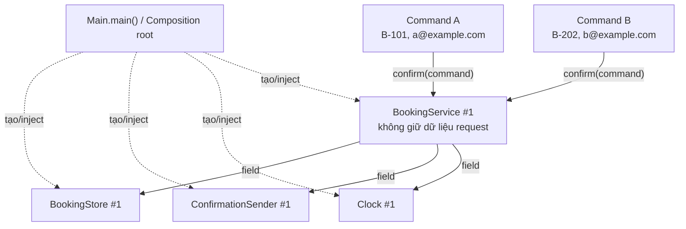

# Tách dữ liệu của lần gọi khỏi phụ thuộc sống cùng đối tượng

## 1. Refactor sang DI không chỉ là chuyển `new` vào constructor

Khi chuyển một hệ thống sang **Dependency Injection (DI)**, bước quen thuộc là bỏ việc tự tạo repository hoặc client trong service và truyền chúng qua constructor:

```java
BookingStore store = new InMemoryBookingStore();
ConfirmationSender sender = new ConsoleConfirmationSender();
BookingService service = new BookingService(store, sender);
```

Nhưng một lỗi thiết kế khác dễ tồn tại ngay cả sau bước này: **đưa dữ liệu thay đổi theo từng lời gọi vào constructor hoặc field sống lâu của service**.

Một ứng dụng có thể giữ `BookingService` suốt thời gian chạy. Trong khi đó, mỗi yêu cầu xác nhận có `bookingId`, địa chỉ nhận thông báo và `requestId` riêng. Nếu lưu những giá trị này trong một service dùng chung, yêu cầu sau có nguy cơ sử dụng nhầm dữ liệu của yêu cầu trước. Khi nhiều luồng hoặc công việc bất đồng bộ cùng sử dụng service, hậu quả còn khó phát hiện hơn.

**Bài học thuộc chương “Refactor sang DI” của module DEPENDENCY_INJECTION**. Mục tiêu của module là học **Dependency Injection và Inversion of Control (IoC)** để tách việc sử dụng phụ thuộc khỏi quá trình tạo, lắp ghép đối tượng; thực hành **constructor injection, composition root, scope/vòng đời và kiểm thử bằng Java thuần** trước khi dùng DI container.

> **Nguyên tắc:** Đưa vào constructor những **cộng tác viên/cấu hình ổn định theo vòng đời của object**; đưa vào tham số method hoặc command những **giá trị thuộc về một lần thực hiện**. Đừng dùng DI để kéo dài vòng đời của dữ liệu đáng lẽ chỉ sống trong một request.

Cần hiểu đây là **phân biệt theo vai trò và vòng đời**, không phải luật “mọi chuỗi đều vào method, mọi object đều vào constructor”. Một `Clock` là object được cấp qua constructor; một `ConfirmationCommand` cũng là object nhưng là dữ liệu cho một lời gọi.

## 2. Hai trục cần phân biệt: “đây là gì?” và “sống bao lâu?”

Ta cần trả lời **hai câu hỏi riêng** cho mỗi giá trị:

1. Nó là **collaborator/dependency** mà service cần để làm việc, hay là **dữ liệu của nghiệp vụ hiện tại**?
2. Nó hợp lệ trong **toàn bộ vòng đời service**, một scope hẹp như request, hay chỉ một lời gọi?

| Giá trị | Vai trò | Nơi thường phù hợp | Lý do |
| --- | --- | --- | --- |
| `BookingStore` | Cộng tác viên: thực hiện thao tác lưu | Constructor của service | Service cần khả năng lưu trong nhiều lời gọi. |
| `ConfirmationSender` | Cộng tác viên: gửi thông báo | Constructor | Implementation do composition root chọn và quản lý. |
| `Clock` | Cộng tác viên cung cấp thời gian | Constructor | Cho phép kiểm thử thời gian bằng `Clock.fixed(...)`. |
| `bookingId` | Dữ liệu một lần xác nhận | Tham số method / `ConfirmationCommand` | Thay đổi ở từng yêu cầu. |
| `recipient` | Dữ liệu đích nhận của lần gửi | Tham số method / command | Không nên bị lưu lại trong service dùng chung. |
| `requestId` | Dữ liệu tương quan của lần xử lý | Tham số method / command | Dùng để theo dõi yêu cầu, không phải cấu hình cố định. |
| `Instant createdAt` | Giá trị thời điểm của một thao tác | Biến cục bộ / command / kết quả | Khác với `Clock`, đây là một mốc thời gian cụ thể. |
| `apiEndpoint`, `timeout` cố định của adapter | Cấu hình của dependency trong một môi trường | Adapter constructor/configuration | Thường ổn định trong vòng đời adapter. |
| `tenantId` | Phụ thuộc vào mô hình tenancy | Thường là command/context theo request | Nếu service dùng chung nhiều tenant thì tuyệt đối không giữ “tenant hiện tại” trong field mutable. |
| `Transaction` hoặc `RequestContext` | Dữ liệu/resource sống trong scope | Request/transaction scope được quản lý | Không giữ trong singleton sau khi scope kết thúc. |

### Không đánh đồng kiểu dữ liệu với vai trò

`String apiEndpoint` là cấu hình sống cùng adapter; `String bookingId` là dữ liệu một lời gọi. `BookingStore` là object cộng tác; `ConfirmationCommand` là object dữ liệu. Việc quyết định đưa một giá trị vào constructor cần dựa trên **thời điểm giá trị sẵn có, mức ổn định và trách nhiệm sở hữu**, chứ không dựa vào `String` hay `class`.

### Có ngoại lệ hợp lệ

Nếu thiết kế cố ý tạo **một object xử lý riêng cho một request**, constructor của object request-scoped có thể nhận request data, miễn là vòng đời được giới hạn đúng và không bị dùng lại. Ví dụ, một `BookingConfirmationJob` bất biến có thể giữ `bookingId` của một công việc duy nhất.

Trong bài này, `BookingService` được thiết kế **sử dụng lại qua nhiều lời gọi**, nên dữ liệu request phải được truyền tới method. Không nên áp dụng máy móc “constructor không bao giờ được chứa dữ liệu” cho mọi loại object.

## 3. Anti-pattern: service có field “yêu cầu hiện tại”

Một kiểu mã cũ thường gặp:

```java
// Phản ví dụ: service dùng chung nhưng giữ state của từng request.
final class LegacyBookingService {
    private final BookingStore store;
    private final ConfirmationSender sender;

    private String currentBookingId;
    private String currentRecipient;

    LegacyBookingService(BookingStore store, ConfirmationSender sender) {
        this.store = store;
        this.sender = sender;
    }

    void setRequest(String bookingId, String recipient) {
        currentBookingId = bookingId;
        currentRecipient = recipient;
    }

    void confirmCurrent() {
        store.confirmFirstTime(currentBookingId);
        // Gửi theo currentRecipient; request khác có thể vừa sửa field.
    }
}
```

Đây là **phản ví dụ minh họa**, không phải phần của chương trình chạy đầy đủ ở mục 6. Dù hai dependency đã được inject qua constructor, việc đưa `currentBookingId` và `currentRecipient` vào field khiến service phụ thuộc vào **thứ tự gọi** và **trạng thái còn sót**:

- Quên gọi `setRequest(...)` khiến hành vi phụ thuộc dữ liệu cũ hoặc `null`.
- Gọi `setRequest(...)` cho yêu cầu B trước `confirmCurrent()` của A khiến A có thể xử lý dữ liệu B.
- Một instance singleton có thể xử lý nhiều request đồng thời; state của chúng **ghi đè lẫn nhau**.
- Unit test phải chuẩn bị object bằng nhiều thao tác, dễ bỏ qua trạng thái không hợp lệ.
- Di chuyển công việc sang thread khác làm thời điểm đọc field khó kiểm soát.

### Interleaving gây trộn dữ liệu

Giả sử service được dùng chung giữa hai thread:

| Thời điểm | Thread A | Thread B | Field trên shared service |
| --- | --- | --- | --- |
| T1 | `setRequest("B-101", "a@example.com")` | | `B-101`, `a@example.com` |
| T2 | | `setRequest("B-202", "b@example.com")` | `B-202`, `b@example.com` |
| T3 | `confirmCurrent()` | | A có thể đọc giá trị của B |
| T4 | | `confirmCurrent()` | B cũng đọc giá trị của B |

Kết quả có thể là **xác nhận sai đặt chỗ, gửi đến sai người nhận hoặc ghi nhận sai request**. Thêm `volatile` vào hai field không giải quyết việc chúng có thể bị thay đổi bởi lời gọi khác; nó không khiến bộ hai giá trị trở thành một “yêu cầu nguyên tử”.

### Một biến thể khác: inject dữ liệu request vào singleton

```java
// Cũng là phản ví dụ nếu BookingService sống qua nhiều request.
new BookingService(store, sender, "B-101", "a@example.com");
```

Nếu mỗi lần xác nhận phải tạo `BookingService` mới, ta đã trộn **chi phí tạo cộng tác viên** với **dữ liệu của ca sử dụng**. Nếu lại dùng chung instance này, dữ liệu của request đầu tiên sẽ bị “đóng băng” trong service. Cả hai đều làm ranh giới khó hiểu.

## 4. Đích refactor: dependency cố định, dữ liệu được truyền theo lời gọi

Một thiết kế rõ ràng hơn:

```java
final class BookingService {
    private final BookingStore store;
    private final ConfirmationSender sender;
    private final java.time.Clock clock;

    BookingService(
            BookingStore store,
            ConfirmationSender sender,
            java.time.Clock clock) {
        this.store = java.util.Objects.requireNonNull(store);
        this.sender = java.util.Objects.requireNonNull(sender);
        this.clock = java.util.Objects.requireNonNull(clock);
    }

    boolean confirm(ConfirmationCommand command) {
        // Kiểm tra command và thực hiện nghiệp vụ.
        // Không có field currentBookingId/currentRecipient.
        return false; // Chỉ là khung cấu trúc, xem ví dụ chạy ở mục 6.
    }
}
```

Đây là **đoạn khung để nhìn ranh giới API**. Mã chạy hoàn chỉnh ở mục 6 sẽ triển khai phương thức `confirm` thật.

Cấu trúc mới tách rõ:

- **Constructor:** service cần các khả năng `BookingStore`, `ConfirmationSender` và `Clock` trong suốt thời gian sống.
- **Method:** lần xác nhận hiện tại cung cấp `ConfirmationCommand` chứa `bookingId`, `recipient` và `requestId`.
- **Biến cục bộ:** kết quả `firstConfirmation` và thời điểm thực hiện chỉ tồn tại trong lời gọi đang chạy.
- **Composition root:** tạo các adapter và cấp cho constructor; không đưa request data vào cấu hình khởi động.
- **Controller/consumer:** nhận dữ liệu của từng request, kiểm tra quyền/đầu vào rồi gọi `service.confirm(command)`.



Hai command được **truyền vào các lời gọi riêng**. Chúng không trở thành field mutable trên `BookingService`. Service có thể được dùng nhiều lần mà không yêu cầu lệnh “reset request” trước khi nhận yêu cầu mới.

## 5. Khi nào dùng nhiều tham số, khi nào tạo command object?

Với một method chỉ có hai giá trị rõ nghĩa, cách viết này có thể đủ tốt:

```java
boolean confirm(String bookingId, String recipient);
```

Khi luồng nghiệp vụ còn cần `requestId`, thông tin ngữ cảnh hoặc nhiều tùy chọn liên quan, một **command/value object** giúp gom những dữ liệu thuộc cùng một yêu cầu:

```java
boolean confirm(ConfirmationCommand command);
```

Command nên:

1. **Bất biến sau khi được tạo**: dùng field `final` và không có setter trong ví dụ Java 11.
2. **Được kiểm tra hợp lệ sớm**: không cho phép ID/đích nhận rỗng nếu đó là yêu cầu của API.
3. **Có ý nghĩa nghiệp vụ**: không đơn thuần là một `Map<String, Object>` chứa dữ liệu tùy tiện.
4. **Không chứa dependency sống lâu**: không nhét `ConnectionPool` hay `HttpClient` vào command để rồi gọi đó là request data.
5. **Không mặc định là đối tượng bí mật có thể log toàn bộ**: địa chỉ nhận, token hay dữ liệu cá nhân cần được xử lý theo chính sách bảo mật.

`ConfirmationCommand` là **dữ liệu**; `BookingStore` là **dependency**. Cả hai đều có thể là object Java, nhưng vai trò của chúng khác nhau. Không nhất thiết dùng `record` trong bài này để giữ khả năng biên dịch với JDK 11; record là cú pháp Java mới hơn.

### Vì sao `Clock` vào constructor còn `Instant` ở method?

`Clock` là **nguồn thời gian được cấp**. Nó giúp service hỏi “bây giờ là lúc nào?” và cho phép test dùng `Clock.fixed(...)`. `Instant.now(clock)` là **giá trị của một lần thực hiện**; lưu giá trị ấy trong field của service sẽ khiến mọi yêu cầu có thể dùng cùng thời điểm cũ.

Tương tự, adapter notification có thể được giữ lâu và dùng chung khi an toàn; **nội dung thông báo** phải được tạo mới từ dữ liệu của từng yêu cầu.

## 6. Ví dụ Java thuần đầy đủ: refactor trước khi dùng DI container

Chương trình sau có một `BookingService` sử dụng lại giữa nhiều lần xác nhận. Nó nhận ba dependency từ composition root nhưng **không lưu `bookingId`, `recipient` hay `requestId` ở field của service**.

Repository của ví dụ dùng `ConcurrentHashMap.newKeySet()` để thực hiện một thao tác “xác nhận lần đầu” theo ID một cách nguyên tử **trong cùng instance set của một JVM**. Đây là một đơn giản hóa để minh họa và giúp bài test đồng thời ở mục 8 có ý nghĩa; nó không thay thế database, transaction hay chính sách xác nhận thực tế.

Lưu toàn bộ mã vào **`Main.java`**, chạy với **JDK 11 trở lên**:

```java
import java.time.Clock;
import java.time.Instant;
import java.time.ZoneOffset;
import java.util.Objects;
import java.util.Set;
import java.util.concurrent.ConcurrentHashMap;

public class Main {
    private static String requiredText(String value, String name) {
        if (value == null || value.isBlank()) {
            throw new IllegalArgumentException(name + " không được rỗng");
        }
        return value;
    }

    // Một command cho MỘT lần gọi, không phải singleton dependency.
    static final class ConfirmationCommand {
        final String bookingId;
        final String recipient;
        final String requestId;

        ConfirmationCommand(
                String bookingId, String recipient, String requestId) {
            this.bookingId = requiredText(bookingId, "bookingId");
            this.recipient = requiredText(recipient, "recipient");
            this.requestId = requiredText(requestId, "requestId");
        }
    }

    // Dữ liệu gửi đi được tạo từ từng command.
    static final class ConfirmationMessage {
        final String bookingId;
        final String recipient;
        final String requestId;
        final Instant confirmedAt;

        ConfirmationMessage(
                String bookingId,
                String recipient,
                String requestId,
                Instant confirmedAt) {
            this.bookingId = Objects.requireNonNull(bookingId);
            this.recipient = Objects.requireNonNull(recipient);
            this.requestId = Objects.requireNonNull(requestId);
            this.confirmedAt = Objects.requireNonNull(confirmedAt);
        }
    }

    // Cộng tác viên sống theo vòng đời của service/adapter.
    interface BookingStore {
        boolean confirmFirstTime(String bookingId);
    }

    interface ConfirmationSender {
        void send(ConfirmationMessage message);
    }

    static final class BookingService {
        private final BookingStore store;
        private final ConfirmationSender sender;
        private final Clock clock;

        BookingService(BookingStore store,
                       ConfirmationSender sender,
                       Clock clock) {
            this.store = Objects.requireNonNull(store, "store");
            this.sender = Objects.requireNonNull(sender, "sender");
            this.clock = Objects.requireNonNull(clock, "clock");
        }

        boolean confirm(ConfirmationCommand command) {
            Objects.requireNonNull(command, "command");

            // Biến cục bộ: mỗi lời gọi có trạng thái thực thi riêng.
            boolean changed = store.confirmFirstTime(command.bookingId);
            if (!changed) {
                return false;
            }

            Instant confirmedAt = Instant.now(clock);
            ConfirmationMessage message = new ConfirmationMessage(
                    command.bookingId,
                    command.recipient,
                    command.requestId,
                    confirmedAt);
            sender.send(message);
            return true;
        }
    }

    static final class InMemoryBookingStore implements BookingStore {
        private final Set<String> confirmedIds =
                ConcurrentHashMap.newKeySet();

        @Override
        public boolean confirmFirstTime(String bookingId) {
            return confirmedIds.add(
                    requiredText(bookingId, "bookingId"));
        }

        boolean isConfirmed(String bookingId) {
            return confirmedIds.contains(bookingId);
        }
    }

    static final class ConsoleConfirmationSender
            implements ConfirmationSender {
        @Override
        public void send(ConfirmationMessage message) {
            System.out.println(
                    "Gửi " + message.bookingId
                    + " tới " + message.recipient
                    + " [request=" + message.requestId
                    + ", at=" + message.confirmedAt + "]");
        }
    }

    public static void main(String[] args) {
        // COMPOSITION ROOT: chọn implementation và cấp dependency.
        InMemoryBookingStore store = new InMemoryBookingStore();
        ConfirmationSender sender = new ConsoleConfirmationSender();
        Clock clock = Clock.fixed(
                Instant.parse("2026-01-02T03:04:05Z"), ZoneOffset.UTC);
        BookingService service = new BookingService(store, sender, clock);

        // Request data không đi vào constructor của service.
        ConfirmationCommand first = new ConfirmationCommand(
                "B-101", "a@example.com", "REQ-A");
        ConfirmationCommand second = new ConfirmationCommand(
                "B-202", "b@example.com", "REQ-B");

        System.out.println("B-101 lần đầu? " + service.confirm(first));
        System.out.println("B-202 lần đầu? " + service.confirm(second));
        System.out.println("B-101 xác nhận lặp? "
                + service.confirm(first));
        System.out.println("Store có B-202? "
                + store.isConfirmed("B-202"));
    }
}
```

Biên dịch và chạy:

```bash
javac -encoding UTF-8 Main.java
java Main
```

Kết quả dự kiến:

```text
Gửi B-101 tới a@example.com [request=REQ-A, at=2026-01-02T03:04:05Z]
B-101 lần đầu? true
Gửi B-202 tới b@example.com [request=REQ-B, at=2026-01-02T03:04:05Z]
B-202 lần đầu? true
B-101 xác nhận lặp? false
Store có B-202? true
```

### Quan sát ranh giới trách nhiệm

| Thành phần | Được tạo khi nào? | Dữ liệu giữ lại |
| --- | --- | --- |
| `InMemoryBookingStore` | Một lần tại bootstrap | Tập ID đã xác nhận; đây là state của adapter. |
| `ConsoleConfirmationSender` | Một lần tại bootstrap | Không giữ recipient của request. |
| `Clock.fixed(...)` | Một lần tại bootstrap | Nguồn thời gian ổn định phục vụ demo/test. |
| `BookingService` | Một lần tại bootstrap | Ba tham chiếu dependency `final`, **không có currentRequest**. |
| `ConfirmationCommand` | Mỗi yêu cầu | Booking ID, recipient, request ID của yêu cầu đó. |
| `ConfirmationMessage` | Khi xác nhận lần đầu thành công | Thông tin của chính yêu cầu được gửi. |

`Clock.fixed` chủ động cho ra cùng thời điểm ở mọi lần gọi để có output ổn định. Trong sản phẩm thật, composition root thường cấp `Clock.systemUTC()` hoặc một clock thích hợp. Điều quan trọng là **thời gian được lấy trong method từ nguồn thời gian**, chứ không lưu “thời gian của yêu cầu đầu” trong service.

### Giới hạn của ví dụ

- `InMemoryBookingStore` chỉ lưu một tập ID, không kiểm tra bản ghi có tồn tại trong database hoặc quyền xác nhận của người gọi.
- `requiredText` chỉ từ chối chuỗi rỗng/trắng; nó chưa phải kiểm tra địa chỉ email, danh tính người gửi hay quyền truy cập.
- Nếu `store.confirmFirstTime` thành công nhưng `sender.send` thất bại, trạng thái đã thay đổi còn thông báo chưa được gửi. Cần chính sách transaction, outbox, retry và idempotency phù hợp trong hệ thống thật.
- Thread safety của repository đơn giản **không tự chứng minh** notifier thật, client thật hoặc toàn bộ workflow an toàn đa luồng/phân tán.

Điều chương trình muốn chứng minh là **DI cấp cộng tác viên ổn định, còn method nhận dữ liệu riêng cho từng lần thực hiện**.

## 7. Unit test Java thuần: mỗi lời gọi dùng đúng command của nó

Một lợi ích của refactor là test không phải gọi các setter “chuẩn bị yêu cầu hiện tại” rồi mới chạy nghiệp vụ. Ta tạo service với fake collaborator và gửi từng command tường minh.

Thêm class `BookingServiceTest` sau dấu `}` đóng class `Main` trong **cùng tệp `Main.java`** ở mục 6:

```java
class BookingServiceTest {
    static final class RecordingStore implements Main.BookingStore {
        final java.util.Set<String> confirmed =
                new java.util.HashSet<>();
        final java.util.List<String> calls =
                new java.util.ArrayList<>();

        @Override
        public boolean confirmFirstTime(String bookingId) {
            calls.add(bookingId);
            return confirmed.add(bookingId);
        }
    }

    static final class RecordingSender implements Main.ConfirmationSender {
        final java.util.List<Main.ConfirmationMessage> messages =
                new java.util.ArrayList<>();

        @Override
        public void send(Main.ConfirmationMessage message) {
            messages.add(message);
        }
    }

    private static void check(boolean condition, String message) {
        if (!condition) {
            throw new AssertionError(message);
        }
    }

    public static void main(String[] args) {
        RecordingStore store = new RecordingStore();
        RecordingSender sender = new RecordingSender();
        java.time.Instant fixed =
                java.time.Instant.parse("2026-01-02T03:04:05Z");

        Main.BookingService service = new Main.BookingService(
                store,
                sender,
                java.time.Clock.fixed(
                        fixed, java.time.ZoneOffset.UTC));

        Main.ConfirmationCommand a = new Main.ConfirmationCommand(
                "B-101", "alice@example.com", "REQ-1");
        Main.ConfirmationCommand b = new Main.ConfirmationCommand(
                "B-202", "bob@example.com", "REQ-2");

        check(service.confirm(a), "A phải được xác nhận lần đầu");
        check(service.confirm(b), "B phải được xác nhận lần đầu");
        check(!service.confirm(a), "A xác nhận lặp phải trả false");

        check(store.calls.equals(java.util.List.of(
                "B-101", "B-202", "B-101")), "Store nhận sai ID");
        check(sender.messages.size() == 2,
                "Phải gửi đúng hai thông báo");

        Main.ConfirmationMessage first = sender.messages.get(0);
        Main.ConfirmationMessage second = sender.messages.get(1);

        check("B-101".equals(first.bookingId)
                        && "alice@example.com".equals(first.recipient)
                        && "REQ-1".equals(first.requestId)
                        && fixed.equals(first.confirmedAt),
                "Thông báo A bị trộn dữ liệu");
        check("B-202".equals(second.bookingId)
                        && "bob@example.com".equals(second.recipient)
                        && "REQ-2".equals(second.requestId)
                        && fixed.equals(second.confirmedAt),
                "Thông báo B bị trộn dữ liệu");

        boolean rejected = false;
        try {
            new Main.ConfirmationCommand(
                    "   ", "bob@example.com", "REQ-3");
        } catch (IllegalArgumentException expected) {
            rejected = true;
        }
        check(rejected, "Command sai phải bị từ chối sớm");

        // Constructor vẫn phải khai báo dependency bắt buộc.
        boolean missingDependencyRejected = false;
        try {
            new Main.BookingService(null, sender,
                    java.time.Clock.systemUTC());
        } catch (NullPointerException expected) {
            missingDependencyRejected = true;
        }
        check(missingDependencyRejected,
                "Không được chấp nhận thiếu BookingStore");

        System.out.println("PASS: per-call data tách khỏi dependency");
    }
}
```

Chạy:

```bash
javac -encoding UTF-8 Main.java
java BookingServiceTest
```

Kết quả dự kiến:

```text
PASS: per-call data tách khỏi dependency
```

Bài test xác nhận:

1. **Cùng một service** xử lý hai command mang dữ liệu khác nhau.
2. Store nhận **đúng booking ID theo thứ tự từng lời gọi**.
3. Thông báo cho A và B giữ đúng cặp `bookingId / recipient / requestId`, không lấy giá trị cũ.
4. Xác nhận lặp không phát sinh thông báo thứ ba theo hợp đồng đơn giản của ví dụ.
5. Dữ liệu command không hợp lệ bị từ chối khi tạo; dependency bắt buộc bị thiếu bị từ chối ở constructor.

Đây là **unit test tuần tự** dùng fake chưa được thiết kế để chia sẻ đa luồng. Nó chứng minh ranh giới dữ liệu của những trường hợp trên, **không** tự chứng minh toàn bộ hệ thống an toàn luồng hoặc chịu lỗi ngoại vi.

## 8. Khi nhiều luồng cùng sử dụng service: kiểm tra cách ly dữ liệu

Bỏ field chứa request data giúp loại bỏ một nguồn race condition, nhưng **không tự bảo đảm mọi dependency đều thread-safe**. Ta vẫn cần chọn implementation phù hợp khi nhiều thread dùng chung.

Ví dụ `InMemoryBookingStore` của mục 6 dùng một concurrent set. Nếu muốn kiểm tra tình huống nhiều request với ID và người nhận khác nhau, thêm class sau **bên ngoài `Main`** ở cuối tệp `Main.java`:

```java
class PerCallConcurrencyTest {
    static final class ConcurrentSender
            implements Main.ConfirmationSender {
        final java.util.Queue<Main.ConfirmationMessage> messages =
                new java.util.concurrent.ConcurrentLinkedQueue<>();

        @Override
        public void send(Main.ConfirmationMessage message) {
            messages.add(message);
        }
    }

    public static void main(String[] args) throws Exception {
        Main.InMemoryBookingStore store =
                new Main.InMemoryBookingStore();
        ConcurrentSender sender = new ConcurrentSender();
        Main.BookingService service = new Main.BookingService(
                store, sender, java.time.Clock.systemUTC());

        java.util.concurrent.ExecutorService executor =
                java.util.concurrent.Executors.newFixedThreadPool(6);
        java.util.concurrent.CountDownLatch start =
                new java.util.concurrent.CountDownLatch(1);
        java.util.List<java.util.concurrent.Future<Boolean>> futures =
                new java.util.ArrayList<>();

        final int requestCount = 30;

        try {
            for (int i = 0; i < requestCount; i++) {
                final int index = i;
                futures.add(executor.submit(() -> {
                    start.await();
                    return service.confirm(new Main.ConfirmationCommand(
                            "B-" + index,
                            "user" + index + "@example.com",
                            "REQ-" + index));
                }));
            }

            start.countDown();

            for (java.util.concurrent.Future<Boolean> future : futures) {
                if (!future.get(10,
                        java.util.concurrent.TimeUnit.SECONDS)) {
                    throw new AssertionError(
                            "Mỗi ID riêng phải xác nhận lần đầu");
                }
            }
        } finally {
            start.countDown();
            executor.shutdownNow();
            executor.awaitTermination(
                    5, java.util.concurrent.TimeUnit.SECONDS);
        }

        java.util.Map<String, Main.ConfirmationMessage> byId =
                new java.util.HashMap<>();
        for (Main.ConfirmationMessage message : sender.messages) {
            if (byId.put(message.bookingId, message) != null) {
                throw new AssertionError("Thông báo trùng ID");
            }
        }

        if (byId.size() != requestCount) {
            throw new AssertionError("Thiếu thông báo: " + byId.size());
        }
        for (int i = 0; i < requestCount; i++) {
            Main.ConfirmationMessage message = byId.get("B-" + i);
            if (message == null
                    || !("user" + i + "@example.com")
                            .equals(message.recipient)
                    || !("REQ-" + i).equals(message.requestId)) {
                throw new AssertionError(
                        "Dữ liệu hai request bị trộn ở ID B-" + i);
            }
        }

        System.out.println("PASS: dữ liệu 30 lời gọi không bị trộn");
    }
}
```

Chạy:

```bash
javac -encoding UTF-8 Main.java
java PerCallConcurrencyTest
```

Kết quả dự kiến:

```text
PASS: dữ liệu 30 lời gọi không bị trộn
```

Bài test **không dựa vào thứ tự thông báo** vì các task có thể hoàn tất theo lịch chạy khác nhau. Thay vào đó, test so sánh dữ liệu theo `bookingId`. Đây là cách kiểm tra thiết thực cho lỗi “recipient của request A đi cùng booking ID của B”.

**Giới hạn:** chỉ một số lịch chạy được thực thi; test không chứng minh mọi interleaving, timeout, hạ tầng nhiều process hoặc an toàn của notifier thật. Nền tảng bảo đảm là thiết kế không giữ request data ở shared field, contract đồng thời của concurrent set/queue và phân tích các bất biến liên quan.

## 9. Quy trình refactor theo bước nhỏ, không đổi tất cả trong một lần

Với codebase đã có người dùng, nên tách công việc thành các bước có thể kiểm chứng:

| Bước | Thay đổi | Cách kiểm chứng |
| --- | --- | --- |
| **1. Chốt hành vi hiện tại** | Liệt kê input, output, lỗi và tác dụng phụ của luồng hiện có. | Viết characterization test cho các ca thành công/thất bại quan trọng. |
| **2. Phân loại dữ liệu** | Đánh dấu field nào là dependency ổn định, field nào là dữ liệu từng request. | Lập bảng constructor/method/scope như mục 2. |
| **3. Tạo command hoặc tham số tường minh** | Đưa `bookingId`, recipient, requestId vào `confirm(...)`. | Test hai lời gọi liên tiếp dùng cùng service nhưng dữ liệu khác. |
| **4. Xóa state chuyển tiếp trên service** | Bỏ `setRequest(...)` và các field `current...`. | Test không còn cần thứ tự “set trước, confirm sau”. |
| **5. Trích xuất hợp đồng phụ thuộc** | Service nhận `BookingStore` và `ConfirmationSender` qua constructor. | Unit test bằng fake, không khởi động database/mail client. |
| **6. Dời `new` sang composition root** | Bootstrap tạo adapter và cấp chúng cho service. | Soát graph và thử thay implementation ở bootstrap. |
| **7. Giữ nguyên quy tắc nghiệp vụ** | Chỉ đổi cách nhận dữ liệu và dependency, tránh vô tình đổi điều kiện xác nhận. | Chạy characterization test với kết quả dự kiến đã ghi nhận. |
| **8. Kiểm tra scope & concurrency** | Không giữ context request trong singleton; chọn adapter thread-safe phù hợp. | Test nhiều lời gọi, bổ sung concurrency/contract test. |
| **9. Kiểm tra async/lifecycle** | Truyền request command vào task; quản lý executor và resource đúng owner. | Test task chạy trễ, lỗi, timeout và shutdown theo yêu cầu. |

**Không nhất thiết phải tạo interface cho mọi class** trong bước 5. Chỉ trích xuất abstraction khi đó là một ranh giới có ý nghĩa hoặc khả năng thay thế được consumer sử dụng. `Clock` của JDK đã là abstraction phù hợp cho nhiều nhu cầu thời gian; không cần tạo `MyClock` chỉ để chứng minh DI.

### Một bước chuyển tiếp có chủ đích

Khi API cũ còn nhiều caller, có thể giữ một adapter tương thích tạm thời:

```java
// Minh họa tại biên chuyển đổi, không phải API khuyến khích lâu dài.
final class LegacyConfirmationFacade {
    private final BookingService service;

    LegacyConfirmationFacade(BookingService service) {
        this.service = service;
    }

    boolean confirm(
            String bookingId, String recipient, String requestId) {
        return service.confirm(
                new ConfirmationCommand(bookingId, recipient, requestId));
    }
}
```

Các tên kiểu ở đây dựa trên các loại đã trình bày nhưng được viết ngắn cho dễ đọc; khi đưa ra ngoài class `Main` của ví dụ cần dùng tên lồng tương ứng, chẳng hạn `Main.BookingService`. Điểm cần nhớ: **facade chuyển dữ liệu vào mỗi lời gọi**, không tái tạo cơ chế `setRequest` giữ state qua hai method. Nên đánh dấu API cũ cần loại bỏ và chỉ giữ trong giai đoạn chuyển đổi có kiểm soát.

## 10. Đừng nhầm dữ liệu request với scope của dependency

DI container có thể hỗ trợ các scope như singleton, request hay prototype, nhưng scope **không tự sửa việc lựa chọn sai ranh giới dữ liệu**.

### Trường hợp A — Service dùng chung, command mỗi lời gọi

```text
Application scope:
    BookingService #1
       -> BookingStore #1
       -> ConfirmationSender #1
       -> Clock #1

Request A:
    ConfirmationCommand A -> BookingService #1.confirm(A)

Request B:
    ConfirmationCommand B -> BookingService #1.confirm(B)
```

Đây là thiết kế trong ví dụ Java. Nó có thể phù hợp khi service không giữ state request và những dependency dùng chung được thiết kế theo yêu cầu đồng thời.

### Trường hợp B — Mỗi request có service riêng

Có thể tạo `BookingService` theo request khi framework hoặc thiết kế yêu cầu. Nhưng nếu service **không có state request**, tạo mới mỗi lần thường không mang lại lợi ích tự thân. Hơn nữa, các service request-scoped vẫn có thể chia sẻ database, cache hoặc client; vì vậy **không tự bảo đảm** mọi thao tác an toàn.

### Trường hợp C — Đưa request data vào singleton qua provider/proxy

Một số framework hỗ trợ scoped proxy để singleton tra được object theo request đang hoạt động. Cơ chế này có thể hữu ích nếu integration thật sự cần context scope. Nhưng:

- Một reference proxy sống lâu **không làm dữ liệu request trở thành cấu hình ổn định**.
- Lời gọi ngoài request scope có thể thất bại vì không có context.
- Chuyển thread hoặc xử lý nền không nhất thiết mang theo scope/`ThreadLocal`.
- Một object giữ sai reference tới target request sau khi request kết thúc vẫn có vấn đề về vòng đời.

Đối với dữ liệu đầu vào cần thiết của một ca sử dụng như `bookingId`, ưu tiên truyền tường minh qua command/method thường dễ hiểu và dễ kiểm thử hơn việc giấu chúng trong scoped lookup.

## 11. Bất đồng bộ: capture command của chính task

Một lỗi sau khi refactor nửa vời là đẩy lời gọi sang background nhưng để task đọc lại field của service:

```java
// Phản ví dụ: currentCommand là field mutable trên shared service.
executor.submit(() -> process(currentCommand));
```

Task có thể chạy **sau khi field đã được request khác cập nhật**. Khi đó code ngoài trông như đang xử lý yêu cầu A nhưng bên trong đọc command B.

Thay bằng việc tạo một giá trị command riêng rồi capture nó:

```java
// Minh họa trong một method đã có executor và service:
ConfirmationCommand command = new ConfirmationCommand(
        bookingId, recipient, requestId);

java.util.concurrent.CompletableFuture<Boolean> future =
        java.util.concurrent.CompletableFuture.supplyAsync(
                () -> service.confirm(command), executor);
```

`ConfirmationCommand` trong bài là immutable theo field, nên task giữ dữ liệu của lần gọi tương ứng. Đây chỉ là **minh họa sử dụng** các kiểu đã có; nếu đặt ngoài `Main` cần dùng tên `Main.ConfirmationCommand` cho kiểu lồng. `executor` phải được cung cấp và quản lý bởi owner ở bootstrap/lifecycle; ví dụ không yêu cầu tạo executor mới cho mọi request.

### Những điều DI không làm hộ ở async

- Không tự truyền `ThreadLocal`, transaction context, security context hoặc request scope qua thread khác.
- Không kéo dài quyền sử dụng file/socket/session chỉ vì task còn giữ reference.
- Không tự quyết định timeout, cancellation, retry hoặc cách gửi lỗi từ background về caller.
- Không tự đảm bảo gửi thông báo đúng một lần khi task thất bại rồi được retry.

Nếu task chạy sau khi request kết thúc, hãy truyền **dữ liệu tối thiểu, đã được kiểm tra quyền, phù hợp với công việc nền** và thiết kế lifecycle riêng. Đừng đưa nguyên request object, connection/transaction đang đóng hoặc dữ liệu nhạy cảm không cần thiết vào queue chỉ vì dễ capture.

### Dữ liệu của một request không phải là quyền truy cập

Việc đưa `tenantId` hoặc `userId` vào command không thay thế bước **xác thực và kiểm tra ủy quyền**. Trong hệ thống nhiều tenant, store cũng cần hợp đồng và cơ chế truy cập đúng ranh giới. Không nên cho rằng chỉ vì command bất biến thì dữ liệu luôn đáng tin hoặc không thể bị truy cập chéo tenant.

## 12. Khi cần chọn adapter theo dữ liệu của từng lần gọi

Giả sử yêu cầu A gửi email, yêu cầu B gửi SMS. `ConfirmationSender` có thể không phải một implementation cố định nếu dữ liệu request chọn kênh.

Có hai cách phân vai:

1. **Chiến lược cố định theo môi trường:** composition root inject một `ConfirmationSender` phù hợp với deployment; method vẫn nhận recipient và nội dung từng yêu cầu.
2. **Chiến lược thay đổi theo request:** composition root inject **selector/factory** có hợp đồng rõ; method nhận `channel` trong command và chọn strategy khi xử lý.

Không nên sửa thành:

```java
final class BookingService {
    private String currentChannel; // Sai khi service dùng chung.
    private String currentRecipient;
    // ...
}
```

Thay vào đó, thêm `channel` vào dữ liệu command và cấp một selector ổn định qua constructor:

```java
// Mẫu thiết kế độc lập, không thuộc Main.java ở mục 6.
interface SenderSelector {
    ConfirmationSender forChannel(Channel channel);
}

final class MultiChannelBookingService {
    private final SenderSelector senderSelector;

    MultiChannelBookingService(SenderSelector senderSelector) {
        this.senderSelector =
                java.util.Objects.requireNonNull(senderSelector);
    }

    void send(ConfirmationCommand command, Channel channel) {
        ConfirmationSender sender = senderSelector.forChannel(channel);
        // Tạo message từ command và gửi qua sender.
    }
}
```

`Channel` ở đây là enum giả định do ứng dụng định nghĩa. Khi dùng nhiều kênh, nên cân nhắc gom `channel` vào command nếu đó là một phần bản chất của request. Đừng tạo một service locator toàn cục `Object get(String)` để mọi class tự lấy dependency bất kỳ.

Selector được inject là **collaborator lâu dài**; `channel` và `recipient` là **dữ liệu của từng lời gọi**. Cả hai vẫn được biểu diễn qua API công khai và có thể kiểm thử bằng Java thuần.

## 13. Các lỗi thường gặp trong refactor

| Cách làm | Vì sao chưa đúng? | Cải thiện |
| --- | --- | --- |
| Chuyển repository sang constructor nhưng giữ `currentBookingId` trong field. | Có DI nhưng vẫn chia sẻ state của request. | Truyền booking ID qua method/command. |
| Cho `BookingService` nhận `bookingId` trong constructor rồi dùng singleton. | Giữ dữ liệu của một lời gọi suốt vòng đời object. | Constructor chỉ cấp collaborator ổn định; method nhận dữ liệu thay đổi. |
| Tạo service mới cho mỗi request chỉ để thay recipient. | Trộn lifecycle service với dữ liệu request và thêm chi phí lắp ghép không cần thiết. | Dùng command tường minh, trừ khi request-scoped service thật sự có lý do. |
| Đưa mọi tham số vào constructor vì “constructor injection là tốt”. | Phân biệt sai dependency với input. | Phân loại theo vai trò và thời điểm có giá trị. |
| Lưu request vào `static`/global singleton. | Nhiều request có thể đọc/ghi đè dữ liệu của nhau. | Không dùng global mutable state cho request input. |
| Dùng `ThreadLocal` thay tham số ở mọi nơi. | Async/thread pool có thể đổi thread hoặc giữ context cũ. | Truyền command rõ ràng; dùng propagation đúng scope khi thật sự cần. |
| Đặt `volatile` cho từng field request. | Không tạo tính nhất quán nguyên tử giữa các field. | Không lưu dữ liệu của các lời gọi khác nhau ở shared object. |
| Service không giữ state nhưng store dùng `HashMap` không đồng bộ. | Ranh giới request đúng nhưng dependency vẫn có thể race. | Kiểm tra toàn object graph; chọn adapter/scope đúng. |
| Command chứa `HttpClient` hoặc `DataSource`. | Đưa dependency/lifecycle vào dữ liệu một lần gọi. | Cấp collaborator qua constructor/factory, chỉ giữ dữ liệu cần thiết trong command. |
| Request ID được đặt vào cấu hình startup. | Mọi yêu cầu có thể dùng cùng ID, mất tính tương quan. | Sinh/nhận request ID ở biên từng request theo chính sách. |
| Thay đổi nghiệp vụ, DI và cơ chế retry cùng một lần. | Khó biết lỗi do refactor hay đổi chính sách. | Đổi từng bước, giữ characterization/contract test. |
| Nghĩ unit test tuần tự chứng minh thread safety. | Race có thể chỉ xuất hiện khi đồng thời. | Test nhiều lời gọi và kiểm tra các bảo đảm của implementation. |
| Dùng `Clock.fixed` trong production mà không chủ đích. | Mọi sự kiện có cùng thời điểm, sai vận hành. | Composition root production cấp clock phù hợp, test dùng fixed clock. |
| Nghĩ request command tự kiểm tra quyền. | Dữ liệu đầu vào vẫn có thể không đáng tin cậy. | Validate và authorize tại ranh giới application thích hợp. |
| Nghĩ DI giải quyết việc lưu thành công nhưng gửi thông báo lỗi. | Hai tác dụng phụ có thể không nguyên tử. | Thiết kế outbox/transaction/retry/idempotency riêng. |

## 14. Checklist khi review một service sau refactor

Khi đọc một class đã được chuyển sang DI, hãy trả lời được:

1. **Dependency nào là bắt buộc trong suốt vòng đời service?** Chúng có xuất hiện trong constructor không?
2. **Field nào đang giữ giá trị của một request?** Có field `current...`, `last...` hay cache dữ liệu cá nhân không?
3. **Mỗi lời gọi nhận đủ input không?** Caller có cần gọi setter hoặc reset state trước khi invoke không?
4. **Giá trị nào nên nằm trong command immutable?** Có bất biến hoặc điều kiện đầu vào cần kiểm tra ngay lúc tạo không?
5. **Có nhầm giá trị thời điểm với nguồn thời gian không?** `Instant` thuộc lần gọi, `Clock` có thể là collaborator được inject.
6. **Composition root có đang quyết định implementation không?** Service có tự `new` JDBC/HTTP client hoặc đọc cấu hình toàn cục để chọn adapter không?
7. **Có thể dùng cùng một service cho hai request khác nhau không?** Kết quả có được xác định chỉ từ command và trạng thái dependency hợp lệ không?
8. **Có thể tạo fake dependency và test Java thuần không?** Test có phải chạy container chỉ để thay request ID không?
9. **Nếu nhiều thread gọi đồng thời, object graph có an toàn không?** Không chỉ riêng service, mà cả repository/notifier/cache.
10. **Nếu có async, command có được capture đúng và resource còn hợp lệ không?**
11. **Tenant, quyền và dữ liệu nhạy cảm có được xử lý phù hợp không?**
12. **Có tác dụng phụ nhiều bước cần transaction/outbox/retry không?** Refactor DI không che được vấn đề đó.

## 15. Bài tập và gợi ý tự đối chiếu

### Bài 1 — Phân loại dữ liệu và dependency

Một `PaymentService` dùng `PaymentGateway`, `Clock`, `orderId`, `paymentAmount`, `requestId` và `PaymentPolicy` không thay đổi trong vòng đời service. Hãy chọn giá trị nào vào constructor, giá trị nào vào `PaymentCommand`. Vì sao một object kiểu `PaymentCommand` không tự trở thành dependency chỉ vì nó là class?

### Bài 2 — Sửa thứ tự gọi nguy hiểm

Đoạn mã cũ có `setRequest(String bookingId, String email)` rồi `process()` trên một singleton. Hãy thiết kế lại thành `process(ConfirmationCommand command)` và mô tả đường di chuyển dữ liệu từ controller tới service, repository và notification adapter.

### Bài 3 — Tìm race

Hai thread dùng chung service có field `currentRecipient`. Thread A gán `a@example.com`, thread B gán `b@example.com`, rồi A gửi. Việc thêm `volatile` có bảo đảm A gửi cho `a@example.com` không? Vì sao sửa thiết kế để dùng biến cục bộ và command riêng tốt hơn?

### Bài 4 — Giữ nguyên hợp đồng khi đổi adapter

Thay `InMemoryBookingStore` bằng một `JdbcBookingStore` (không cần viết SQL trong bài) và `ConsoleConfirmationSender` bằng adapter email thật. Class nào phải thay đổi nếu constructor của `BookingService` chỉ nhận `BookingStore` và `ConfirmationSender`? Thế còn những test cần kiểm tra behavior của adapter JDBC?

### Bài 5 — Kiểm thử dữ liệu không trộn

Dùng `BookingServiceTest` ở mục 7 làm mẫu. Hãy thêm request C với mã `B-303`, recipient khác và request ID khác. Kiểm tra danh sách thông báo cho A/B/C theo đúng thông tin từng command và kiểm tra rằng xác nhận lặp không gửi thêm.

### Bài 6 — Bất đồng bộ sau khi request kết thúc

Một request khởi tạo task gửi biên nhận nhưng tác vụ chỉ chạy sau khi request HTTP kết thúc. Có nên để task giữ nguyên `HttpServletRequest`, transaction hay session của request không? Hãy đề xuất command immutable chứa các giá trị đã được kiểm tra cần thiết và nơi quản lý executor/lifetime.

### Bài 7 — Ranh giới của DI

Trong ví dụ `BookingService.confirm`, store trả `true` nhưng `sender.send(...)` ném lỗi. Có thể kết luận xác nhận thất bại hoàn toàn không? Việc chuyển `recipient` vào command đã giải quyết lỗi này chưa? Cần thiết kế thêm gì nếu muốn giao thông báo đáng tin cậy?

### Gợi ý tự đối chiếu

- **Bài 1:** `PaymentGateway`, `Clock` và `PaymentPolicy` ổn định là collaborator; `orderId`, `paymentAmount`, `requestId` là dữ liệu một thao tác, phù hợp trong command.
- **Bài 2:** controller tạo/nhận command cho đúng request rồi gọi `service.process(command)`; service chuyển thông tin cụ thể đến các collaborator qua method, không lưu “request hiện tại” ở field.
- **Bài 3:** `volatile` giúp một số bảo đảm visibility nhưng không khiến giá trị của A không bị B ghi đè. Giữ input trong command riêng và biến cục bộ loại bỏ loại trộn dữ liệu này.
- **Bài 4:** thay implementation và wiring ở composition root/configuration, giữ API của service nếu contract không đổi; adapter mới cần contract/integration test riêng.
- **Bài 5:** có ba thông báo với đúng cặp booking/recipient/requestId; gọi xác nhận lặp cho một ID không phát sinh thông báo thứ tư theo hợp đồng ví dụ.
- **Bài 6:** không kéo theo resource request-scoped đã hết vòng đời; capture dữ liệu bất biến cần thiết, kiểm tra quyền tại biên phù hợp và quản lý executor ở lifecycle owner.
- **Bài 7:** store có thể đã thay đổi dù gửi lỗi; DI và command không làm hai tác dụng phụ thành giao dịch. Cần chính sách outbox, retry/idempotency, xử lý lỗi và quan sát vận hành.

**Ghi nhớ:** refactor sang DI không dừng ở việc chuyển các lệnh `new` ra composition root. Một thiết kế tốt còn tách **cộng tác viên tồn tại cùng service** khỏi **dữ liệu của một lần gọi**, thể hiện điều đó bằng constructor và API method/command rõ ràng. Cách tổ chức này giảm trạng thái ẩn, giúp kiểm thử bằng Java thuần, hạn chế trộn dữ liệu khi đồng thời hoặc bất đồng bộ và tạo nền tảng rõ ràng để về sau dùng DI container quản lý graph, scope và lifecycle.
