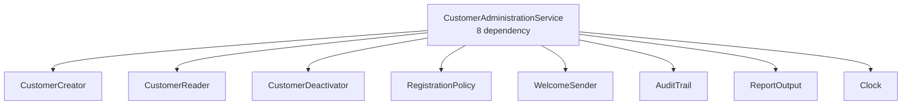
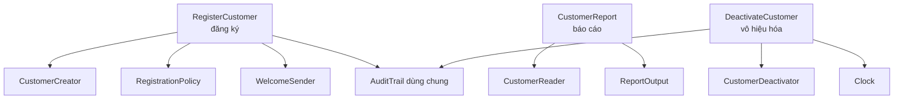
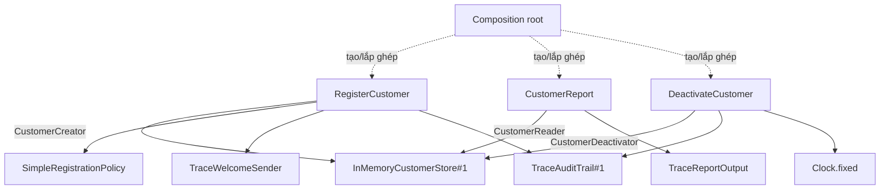
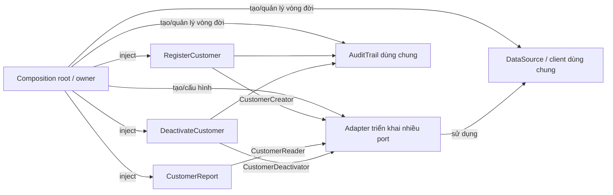

# Tách lớp có quá nhiều phụ thuộc theo trách nhiệm thực tế

Khi bắt đầu áp dụng **Dependency Injection (DI)**, một lớp từng tự tạo hàng loạt cộng tác viên bằng `new` sẽ phải khai báo chúng trong constructor. Đây là bước tiến vì dependency trở nên tường minh và có thể thay thế khi kiểm thử. Nhưng một constructor dài đôi khi còn bộc lộ **vấn đề thiết kế có từ trước**: lớp đang gánh nhiều trách nhiệm không thật sự thuộc về cùng một đơn vị.

Ví dụ, một `CustomerAdministrationService` vừa đăng ký khách hàng, xuất báo cáo, vô hiệu hóa tài khoản, gửi thư và ghi audit. Sau khi chuyển sang constructor injection, lớp này có thể nhận tám dependency. Giải pháp không nên chỉ là gói tám dependency vào một `Dependencies` hoặc `ServiceLocator` để constructor trông ngắn hơn. Cần hỏi: **những hành vi nào thay đổi vì cùng một lý do, sử dụng cùng nhóm cộng tác viên, và nên được đặt cạnh nhau?**

Bài học **“Tách lớp có quá nhiều phụ thuộc theo trách nhiệm thực tế”** thuộc chương **Refactor sang DI** của module **DEPENDENCY_INJECTION**. Ta sẽ thực hành cách nhận diện trách nhiệm, tách thành các dịch vụ gắn với use case, giữ nguyên hợp đồng và hành vi, lắp ghép ở **composition root**, kiểm thử bằng Java thuần, rồi mới tính đến DI container.

## 1. Constructor quá nhiều dependency là tín hiệu, không phải bản án

Giả sử một constructor nhận tám tham số:

```java
// Minh họa hình dạng API cũ; chưa phải ví dụ chạy độc lập.
CustomerAdministrationService(
        CustomerCreator creator,
        CustomerReader reader,
        CustomerDeactivator deactivator,
        RegistrationPolicy registrationPolicy,
        WelcomeSender welcomeSender,
        AuditTrail auditTrail,
        ReportOutput reportOutput,
        java.time.Clock clock
) {
    // Gán các dependency vào field...
}
```

Có thể thấy code **khó đọc và khó khởi tạo**, nhưng không thể kết luận lớp sai chỉ từ con số tám. Một lớp composition root hoặc một bộ điều phối có trách nhiệm thống nhất có thể cần nhiều cộng tác viên hợp lệ. Ngược lại, một lớp chỉ nhận ba dependency vẫn có thể vi phạm nguyên tắc thiết kế nếu trộn ba nghiệp vụ không liên quan.

**Đếm dependency là bước tìm dấu hiệu; không phải tiêu chí duy nhất để quyết định tách lớp.**

Những tín hiệu đáng chú ý hơn:

- Các phương thức **sử dụng các tập dependency gần như tách biệt**.
- Các hành vi thay đổi theo những yêu cầu kinh doanh hoặc lịch phát hành khác nhau.
- Unit test cho một phương thức luôn phải dựng nhiều fake không liên quan.
- Đổi một kênh xuất báo cáo khiến phải sửa hoặc deploy lại cả lớp đăng ký.
- Quyền truy cập hoặc scope của các dependency khác nhau rõ rệt.
- Lớp vừa điều phối workflow, vừa tự xây SQL, tạo HTTP client, định dạng file và quản lý tài nguyên.
- Constructor phình to qua từng tính năng mà không thể giải thích được ranh giới trách nhiệm chung.

### 1.1. “Một trách nhiệm” nghĩa là gì?

Trong thực hành, **Single Responsibility Principle (SRP)** nên được hiểu thông qua **lý do thay đổi** và **khả năng duy trì một hành vi thống nhất**, không phải “mỗi lớp chỉ có một phương thức”.

Ví dụ:

| Nhóm hành vi | Lý do thay đổi chủ yếu | Dependency cần dùng |
| --- | --- | --- |
| Đăng ký khách hàng | Chính sách đăng ký, thông báo chào mừng, lưu tài khoản | `CustomerCreator`, `RegistrationPolicy`, `WelcomeSender`, `AuditTrail` |
| Lập báo cáo khách hàng | Nhu cầu xuất dữ liệu và format báo cáo | `CustomerReader`, `ReportOutput` |
| Vô hiệu hóa tài khoản | Quy tắc đóng tài khoản, thời điểm và audit | `CustomerDeactivator`, `Clock`, `AuditTrail` |

Từ bảng này, ba nhóm có **mục tiêu và tác nhân thay đổi tương đối độc lập**, dù chúng cùng liên quan đến “khách hàng”. Việc chúng dùng chung một đối tượng lưu trữ hoặc cùng ghi audit không buộc phải đặt chung trong một lớp.

### 1.2. Tại sao DI làm vấn đề hiện rõ hơn?

Trước DI, code có thể che dependency bên trong phương thức:

```java
void generateReport() {
    var repository = new JdbcCustomerRepository(...);
    var writer = new CsvReportWriter(...);
    // ...
}
```

Sau DI, constructor buộc ta nhìn thấy `CustomerReader` và `ReportOutput`. Đây là một lợi ích của DI: **dependency được đưa lên bề mặt API**. Nếu danh sách ấy không còn phản ánh một trách nhiệm thống nhất, đó là lúc đánh giá lại thiết kế thay vì che nó đi.

## 2. Vẽ “bản đồ dependency theo hành vi” trước khi sửa mã

Một cách thực dụng để xác định ranh giới tách lớp là lập **ma trận phương thức × dependency**. Dấu ✓ nghĩa là phương thức trực tiếp cần khả năng tương ứng.

| Phương thức trong lớp lớn | Creator | Reader | Deactivator | Policy | Welcome | Audit | Report | Clock |
| --- | --- | --- | --- | --- | --- | --- | --- | --- |
| `register(id, email)` | ✓ | | | ✓ | ✓ | ✓ | | |
| `generateReport()` | | ✓ | | | | | ✓ | |
| `deactivate(id)` | | | ✓ | | | ✓ | | ✓ |

Ma trận cho thấy ba cụm khá rõ. Đây là bằng chứng hữu ích để đặt câu hỏi “có nên tách không?”, chưa phải thuật toán tự động kết luận. Phải xem thêm **bất biến dữ liệu, transaction boundary, quyền sở hữu tài nguyên và những yêu cầu thay đổi cùng nhau**.

Có thể chuyển thành sơ đồ:



**Ranh giới dự kiến sau refactor:**



Sau khi tách, **cả ba dịch vụ có thể vẫn dùng chung một adapter lưu dữ liệu**, chỉ là mỗi dịch vụ biết một **cổng giao tiếp hẹp** theo nhu cầu. Composition root chịu trách nhiệm cấp cùng adapter cho các port thích hợp.

## 3. Những câu hỏi giúp tìm ranh giới trách nhiệm thực tế

Trước khi tách một lớp, hãy trả lời các câu hỏi sau:

1. **Ai yêu cầu tính năng thay đổi?** Nhóm nghiệp vụ đăng ký, nhóm báo cáo hay người vận hành tài khoản?
2. **Phần code nào thường thay đổi cùng nhau?** Nếu thay báo cáo mà không liên quan đăng ký, đó là một tín hiệu chia tách.
3. **Các phương thức cùng duy trì bất biến nào?** Nếu một bất biến giao dịch bắt buộc cần được giữ nguyên tử, không nên tách tùy tiện làm mất transaction boundary.
4. **Dependency nào chỉ phục vụ một nhóm hành vi?** Đây là ứng viên tốt để chuyển sang constructor của lớp mới.
5. **Dependency nào thật sự là tài nguyên dùng chung?** Ví dụ một repository adapter hoặc audit sink: root có thể chia sẻ instance mà không buộc các use case phải chung một class.
6. **Đối tượng có trạng thái riêng không?** Không nên biến một session request thành singleton dùng chung chỉ để tiện inject.
7. **API public hiện được ai sử dụng?** Có cần giữ facade tương thích trong giai đoạn chuyển tiếp không?
8. **Kiểm thử hiện có bảo vệ hành vi quan trọng nào?** Cần giữ các phép thử đặc trưng trước khi di chuyển code.

Tách theo động từ nhỏ một cách máy móc (mỗi phương thức một class) cũng có thể gây quá mức phân mảnh. Đơn vị hợp lý thường là **use case có mục tiêu rõ**, nhóm nghiệp vụ có tính gắn kết hoặc một cộng tác viên kỹ thuật chuyên trách, tùy bối cảnh.

## 4. Trước refactor: một service nhận quá nhiều dependency

Hình dạng của một lớp lớn có thể như sau. Để làm rõ vấn đề, đoạn này chỉ liệt kê constructor và ba hành vi; các kiểu/cổng sẽ được định nghĩa đầy đủ trong ví dụ sau.

```java
// Mô hình BEFORE, giản lược để phân tích:
final class CustomerAdministrationService {
    private final CustomerCreator creator;
    private final CustomerReader reader;
    private final CustomerDeactivator deactivator;
    private final RegistrationPolicy policy;
    private final WelcomeSender welcome;
    private final AuditTrail audit;
    private final ReportOutput report;
    private final java.time.Clock clock;

    CustomerAdministrationService(
            CustomerCreator creator,
            CustomerReader reader,
            CustomerDeactivator deactivator,
            RegistrationPolicy policy,
            WelcomeSender welcome,
            AuditTrail audit,
            ReportOutput report,
            java.time.Clock clock) {
        this.creator = creator;
        this.reader = reader;
        this.deactivator = deactivator;
        this.policy = policy;
        this.welcome = welcome;
        this.audit = audit;
        this.report = report;
        this.clock = clock;
    }

    // register() chỉ dùng creator, policy, welcome, audit.
    // generateReport() chỉ dùng reader, report.
    // deactivate() chỉ dùng deactivator, audit, clock.
}
```

Các điều bất lợi:

- Một consumer chỉ cần báo cáo vẫn phải tạo hoặc lấy đủ tám dependency để dựng `CustomerAdministrationService`.
- Một thay đổi hạ tầng gửi thư có thể buộc đường test báo cáo phải điều chỉnh khởi tạo dù báo cáo không sử dụng nó.
- Khi service được dùng ở scope dài, nó có thể giữ cả dependency chỉ cần cho workflow ngắn hơn.
- Ranh giới giữa đăng ký, báo cáo và vô hiệu hóa bị mờ; khó review “vì sao thay đổi phương thức này lại ảnh hưởng phương thức kia?”.

Điều tích cực đã đạt được là **constructor injection giúp nhìn thấy vấn đề**. Hướng sửa tiếp theo không phải xóa constructor injection, mà là **chọn lại trách nhiệm của từng class**.

## 5. Sau refactor: Java thuần với ba use case rõ ràng

Tạo file `RefactorResponsibilitiesDemo.java`. Ví dụ được thiết kế tự chạy bằng **JDK 11 trở lên**, không cần DI container, database hay dịch vụ ngoài.

Để tránh tạo một lớp lưu trữ cho mỗi thao tác, `InMemoryCustomerStore` triển khai ba port hẹp:

- `CustomerCreator`: lưu khách hàng mới.
- `CustomerReader`: đọc danh sách để làm báo cáo.
- `CustomerDeactivator`: vô hiệu hóa khách hàng theo ID.

Như vậy, các use case **phụ thuộc vào đúng khả năng cần thiết**, còn composition root vẫn có thể dùng chung **một instance store**.

```java
import java.time.Clock;
import java.time.Instant;
import java.time.ZoneOffset;
import java.util.ArrayList;
import java.util.LinkedHashMap;
import java.util.List;
import java.util.Map;
import java.util.Objects;

public class RefactorResponsibilitiesDemo {

    // Value object bất biến trong ví dụ.
    static final class Customer {
        private final String id;
        private final String email;
        private final boolean active;

        Customer(String id, String email) {
            this(id, email, true);
        }

        private Customer(String id, String email, boolean active) {
            this.id = Objects.requireNonNull(id, "id");
            this.email = Objects.requireNonNull(email, "email");
            this.active = active;
        }

        String id() {
            return id;
        }

        String email() {
            return email;
        }

        boolean isActive() {
            return active;
        }

        Customer deactivated() {
            return new Customer(id, email, false);
        }
    }

    // Port được chia theo khả năng mà consumer cần.
    interface CustomerCreator {
        void create(Customer customer);
    }

    interface CustomerReader {
        List<Customer> listAll();
    }

    interface CustomerDeactivator {
        void deactivate(String id);
    }

    interface RegistrationPolicy {
        void validate(String email);
    }

    interface WelcomeSender {
        void send(Customer customer);
    }

    interface AuditTrail {
        void append(String event);
    }

    interface ReportOutput {
        void write(List<Customer> customers);
    }

    // Adapter dữ liệu: một instance có thể đáp ứng nhiều port.
    // Demo này sử dụng tuần tự, không an toàn cho ghi đồng thời.
    static final class InMemoryCustomerStore
            implements CustomerCreator, CustomerReader, CustomerDeactivator {

        private final Map<String, Customer> customers =
                new LinkedHashMap<>();

        @Override
        public void create(Customer customer) {
            Objects.requireNonNull(customer, "customer");

            if (customers.putIfAbsent(customer.id(), customer) != null) {
                throw new IllegalArgumentException(
                        "Duplicate customer ID: " + customer.id());
            }
        }

        @Override
        public List<Customer> listAll() {
            return List.copyOf(customers.values());
        }

        @Override
        public void deactivate(String id) {
            Customer existing = customers.get(id);
            if (existing == null) {
                throw new IllegalArgumentException(
                        "Unknown customer: " + id);
            }
            customers.put(id, existing.deactivated());
        }
    }

    static final class SimpleRegistrationPolicy
            implements RegistrationPolicy {

        @Override
        public void validate(String email) {
            if (email == null || email.isBlank()
                    || !email.contains("@")) {
                throw new IllegalArgumentException(
                        "Invalid customer email");
            }
        }
    }

    // Các adapter ghi trace để có thể quan sát hành vi.
    static final class TraceWelcomeSender implements WelcomeSender {
        private final List<String> trace;

        TraceWelcomeSender(List<String> trace) {
            this.trace = Objects.requireNonNull(trace);
        }

        @Override
        public void send(Customer customer) {
            trace.add("welcome:" + customer.id());
        }
    }

    static final class TraceAuditTrail implements AuditTrail {
        private final List<String> trace;

        TraceAuditTrail(List<String> trace) {
            this.trace = Objects.requireNonNull(trace);
        }

        @Override
        public void append(String event) {
            trace.add("audit:" + event);
        }
    }

    static final class TraceReportOutput implements ReportOutput {
        private final List<String> trace;

        TraceReportOutput(List<String> trace) {
            this.trace = Objects.requireNonNull(trace);
        }

        @Override
        public void write(List<Customer> customers) {
            trace.add("report-count:" + customers.size());
        }
    }

    // Trách nhiệm 1: đăng ký khách hàng.
    static final class RegisterCustomer {
        private final CustomerCreator creator;
        private final RegistrationPolicy policy;
        private final WelcomeSender welcome;
        private final AuditTrail audit;

        RegisterCustomer(
                CustomerCreator creator,
                RegistrationPolicy policy,
                WelcomeSender welcome,
                AuditTrail audit) {
            this.creator = Objects.requireNonNull(creator);
            this.policy = Objects.requireNonNull(policy);
            this.welcome = Objects.requireNonNull(welcome);
            this.audit = Objects.requireNonNull(audit);
        }

        Customer register(String id, String email) {
            if (id == null || id.isBlank()) {
                throw new IllegalArgumentException("Invalid customer ID");
            }

            policy.validate(email);
            Customer customer = new Customer(id, email);

            creator.create(customer);
            audit.append("REGISTERED:" + id);
            welcome.send(customer);

            return customer;
        }
    }

    // Trách nhiệm 2: tạo báo cáo, không biết cách đăng ký/gửi thư.
    static final class CustomerReport {
        private final CustomerReader reader;
        private final ReportOutput output;

        CustomerReport(CustomerReader reader, ReportOutput output) {
            this.reader = Objects.requireNonNull(reader);
            this.output = Objects.requireNonNull(output);
        }

        int generate() {
            List<Customer> customers = reader.listAll();
            output.write(customers);
            return customers.size();
        }
    }

    // Trách nhiệm 3: vô hiệu hóa và ghi audit cùng thời điểm.
    static final class DeactivateCustomer {
        private final CustomerDeactivator deactivator;
        private final AuditTrail audit;
        private final Clock clock;

        DeactivateCustomer(
                CustomerDeactivator deactivator,
                AuditTrail audit,
                Clock clock) {
            this.deactivator = Objects.requireNonNull(deactivator);
            this.audit = Objects.requireNonNull(audit);
            this.clock = Objects.requireNonNull(clock);
        }

        void deactivate(String id) {
            if (id == null || id.isBlank()) {
                throw new IllegalArgumentException("Invalid customer ID");
            }

            deactivator.deactivate(id);
            audit.append(
                    "DEACTIVATED:" + id + ":" + clock.instant());
        }
    }

    public static void main(String[] args) {
        // COMPOSITION ROOT: tạo hạ tầng, rồi lắp các use case.
        List<String> trace = new ArrayList<>();
        InMemoryCustomerStore store = new InMemoryCustomerStore();
        AuditTrail audit = new TraceAuditTrail(trace);

        RegisterCustomer registration = new RegisterCustomer(
                store, new SimpleRegistrationPolicy(),
                new TraceWelcomeSender(trace), audit);

        CustomerReport reporting = new CustomerReport(
                store, new TraceReportOutput(trace));

        DeactivateCustomer deactivation = new DeactivateCustomer(
                store, audit,
                Clock.fixed(
                        Instant.parse("2024-01-01T00:00:00Z"),
                        ZoneOffset.UTC));

        // Các use case dùng chung dữ liệu qua đúng một store instance.
        registration.register("C-001", "reader@example.test");
        int count = reporting.generate();
        deactivation.deactivate("C-001");

        if (count != 1
                || store.listAll().get(0).isActive()) {
            throw new AssertionError("Incorrect customer state");
        }

        System.out.println(trace);
    }
}
```

Biên dịch và chạy:

```bash
javac RefactorResponsibilitiesDemo.java
java RefactorResponsibilitiesDemo
```

Kết quả dự kiến:

```text
[audit:REGISTERED:C-001, welcome:C-001, report-count:1, audit:DEACTIVATED:C-001:2024-01-01T00:00:00Z]
```

### 5.1. Thực sự đã tách điều gì?

**`RegisterCustomer`** biết chính sách đăng ký, tạo khách hàng, audit và thông báo chào mừng. Nó không biết cách tạo báo cáo hoặc thời gian vô hiệu hóa.

**`CustomerReport`** biết đọc dữ liệu và gửi kết quả đến đầu ra báo cáo. Nó không nhận `WelcomeSender`, `RegistrationPolicy` hay `Clock`.

**`DeactivateCustomer`** biết thay đổi trạng thái và ghi lại sự kiện kèm thời điểm. Nó không nhận `ReportOutput` hoặc `WelcomeSender`.

Mỗi constructor hiện mô tả rõ **năng lực mà trách nhiệm tương ứng cần**. Không có dependency nào phải được truyền chỉ vì lớp “quản lý khách hàng” được dùng chung cho mọi tính năng.

### 5.2. Vì sao cùng một store có thể triển khai ba interface?

`InMemoryCustomerStore` triển khai cả `CustomerCreator`, `CustomerReader` và `CustomerDeactivator` vì **một implementation hạ tầng** cần có đủ thao tác trên cùng dữ liệu. Nhưng mỗi use case chỉ nhìn thấy một interface nhỏ theo quyền sử dụng cần thiết.

Điều này thể hiện hai nguyên tắc:

- **Interface Segregation**: consumer không buộc phải phụ thuộc vào các phương thức không dùng.
- **Dependency Inversion**: mã use case phụ thuộc vào hợp đồng, còn adapter cụ thể thực thi các hợp đồng ấy.

Một adapter triển khai nhiều port không tự trở thành “God Object” nếu các thao tác đều thuộc một trách nhiệm hạ tầng có tính gắn kết, ví dụ quản lý dữ liệu khách hàng. Ngược lại, nếu adapter dần chứa cả gửi thư, format báo cáo và xử lý thanh toán, đó lại là một dấu hiệu cần đánh giá.

### 5.3. Composition root đảm bảo chia sẻ đúng một instance

```java
InMemoryCustomerStore store = new InMemoryCustomerStore();

RegisterCustomer registration =
        new RegisterCustomer(store, policy, welcome, audit);

CustomerReport reporting =
        new CustomerReport(store, reportOutput);

DeactivateCustomer deactivation =
        new DeactivateCustomer(store, audit, clock);
```

*Đoạn trên minh họa sơ đồ wiring; các biến `policy`, `welcome`, `audit`, `reportOutput` và `clock` được chuẩn bị trước tại root.*

Ba constructor nhận các **kiểu interface khác nhau**, nhưng root truyền **cùng một instance store**. Java không tạo bản sao object khi đưa nó qua tham số constructor. Vì vậy, báo cáo có thể thấy khách hàng do use case đăng ký vừa lưu, và use case vô hiệu hóa thay đổi cùng tập dữ liệu.

Nếu root vô tình tạo ba `new InMemoryCustomerStore()` độc lập, code vẫn biên dịch nhưng báo cáo sẽ không thấy dữ liệu đăng ký. Đây là **lỗi wiring**, cần kiểm thử riêng sau khi refactor.

## 6. So sánh đồ thị trước và sau khi tách

Trước refactor, một consumer muốn gọi `generateReport` phải biết hoặc dựng đủ tất cả dependency của lớp lớn, dù chỉ hai dependency thực sự tham gia.

Sau refactor:



Nét đứt thể hiện root khởi tạo/lắp ghép; nét liền thể hiện quan hệ dependency. `Store#1` và `Audit#1` được dùng chung; điều này không bị mất chỉ vì các trách nhiệm nghiệp vụ đã tách thành class khác nhau.

| Khía cạnh | Trước | Sau |
| --- | --- | --- |
| Lớp chứa logic | Một lớp với ba nhóm nghiệp vụ | Ba use case có mục tiêu rõ |
| Constructor | Tám dependency | 4, 2, 3 dependency theo nhu cầu thực |
| Đổi format báo cáo | Chạm vào lớp có cả đăng ký/vô hiệu hóa | Tập trung vào `CustomerReport` và `ReportOutput` |
| Test đăng ký | Phải dựng nhiều dependency không liên quan | Chỉ fake các port của đăng ký |
| Chia sẻ dữ liệu | Có thể dùng một store | Vẫn dùng được cùng một store qua ba port |
| Chọn adapter thật/fake | Có thể bị phân tán | Tập trung tại composition root |
| Vòng đời tài nguyên | Dễ bị lẫn với use case không dùng | Có thể xác định owner ở root theo resource |

Số dependency **không cần luôn giảm trên toàn hệ thống**: `AuditTrail` xuất hiện trong constructor của hai lớp khác nhau, nên số cạnh tham chiếu sau refactor thậm chí có thể nhiều hơn. Mục tiêu là tăng **độ gắn kết** và giảm **phụ thuộc không cần thiết của từng trách nhiệm**, không phải chỉ giảm số dòng hoặc tổng số tham số.

## 7. Kiểm thử để chứng minh refactor không đổi hành vi

Refactor có nghĩa là **cải thiện cấu trúc mà không cố ý thay đổi hành vi quan sát được**. Vì vậy, trước khi di chuyển code cần có **characterization tests**: các phép thử ghi nhận hành vi hiện tại quan trọng, kể cả thứ tự gọi và cách lỗi lan truyền. Sau đó, test đơn vị mới xác minh từng use case trong thiết kế đã tách.

Tạo file `RefactorResponsibilitiesTest.java` cùng thư mục với `RefactorResponsibilitiesDemo.java`:

```java
import java.time.Clock;
import java.time.Instant;
import java.time.ZoneOffset;
import java.util.ArrayList;
import java.util.List;

public class RefactorResponsibilitiesTest {

    private static void check(boolean ok, String message) {
        if (!ok) {
            throw new AssertionError(message);
        }
    }

    static void testRegistrationOnlyUsesItsPorts() {
        List<String> calls = new ArrayList<>();

        RefactorResponsibilitiesDemo.CustomerCreator creator =
                customer -> calls.add("save:" + customer.id());

        RefactorResponsibilitiesDemo.RegistrationPolicy policy =
                email -> calls.add("validate:" + email);

        RefactorResponsibilitiesDemo.AuditTrail audit =
                event -> calls.add("audit:" + event);

        RefactorResponsibilitiesDemo.WelcomeSender welcome =
                customer -> calls.add("welcome:" + customer.id());

        var service = new RefactorResponsibilitiesDemo.RegisterCustomer(
                creator, policy, welcome, audit);

        var result = service.register("C-101", "test@example.test");

        check("C-101".equals(result.id()), "Wrong customer");
        check(calls.equals(List.of(
                        "validate:test@example.test",
                        "save:C-101",
                        "audit:REGISTERED:C-101",
                        "welcome:C-101")),
                "Wrong registration sequence: " + calls);
    }

    static void testNoWelcomeAfterSaveFailure() {
        List<String> calls = new ArrayList<>();

        RefactorResponsibilitiesDemo.CustomerCreator failingCreator =
                customer -> {
                    calls.add("save-failed");
                    throw new IllegalStateException("Storage failed");
                };

        var service = new RefactorResponsibilitiesDemo.RegisterCustomer(
                failingCreator,
                email -> calls.add("validate"),
                customer -> calls.add("unexpected-welcome"),
                event -> calls.add("unexpected-audit"));

        boolean failed = false;
        try {
            service.register("C-102", "test@example.test");
        } catch (IllegalStateException expected) {
            failed = true;
        }

        check(failed, "Expected save failure");
        check(calls.equals(List.of("validate", "save-failed")),
                "Later ports must not be called after save failure");
    }

    static void testReportHasOnlyReadAndOutputPorts() {
        List<String> calls = new ArrayList<>();

        RefactorResponsibilitiesDemo.CustomerReader reader = () -> {
            calls.add("read");
            return List.of(
                    new RefactorResponsibilitiesDemo.Customer(
                            "C-201", "reader@example.test"));
        };

        RefactorResponsibilitiesDemo.ReportOutput output =
                customers -> calls.add("write:" + customers.size());

        var service = new RefactorResponsibilitiesDemo.CustomerReport(
                reader, output);

        check(service.generate() == 1, "Wrong report count");
        check(calls.equals(List.of("read", "write:1")),
                "Wrong report sequence");
    }

    static void testDeactivationHasFixedTime() {
        List<String> calls = new ArrayList<>();

        RefactorResponsibilitiesDemo.CustomerDeactivator deactivator =
                id -> calls.add("deactivate:" + id);

        RefactorResponsibilitiesDemo.AuditTrail audit =
                event -> calls.add("audit:" + event);

        Clock clock = Clock.fixed(
                Instant.parse("2025-02-03T04:05:06Z"),
                ZoneOffset.UTC);

        var service = new RefactorResponsibilitiesDemo.DeactivateCustomer(
                deactivator, audit, clock);

        service.deactivate("C-301");

        check(calls.equals(List.of(
                        "deactivate:C-301",
                        "audit:DEACTIVATED:C-301:2025-02-03T04:05:06Z")),
                "Wrong deactivation sequence: " + calls);
    }

    static void testSharedStoreWiring() {
        var store = new RefactorResponsibilitiesDemo.InMemoryCustomerStore();
        List<String> trace = new ArrayList<>();

        var registration = new RefactorResponsibilitiesDemo.RegisterCustomer(
                store,
                new RefactorResponsibilitiesDemo.SimpleRegistrationPolicy(),
                new RefactorResponsibilitiesDemo.TraceWelcomeSender(trace),
                new RefactorResponsibilitiesDemo.TraceAuditTrail(trace));

        var reporting = new RefactorResponsibilitiesDemo.CustomerReport(
                store,
                new RefactorResponsibilitiesDemo.TraceReportOutput(trace));

        var deactivation = new RefactorResponsibilitiesDemo.DeactivateCustomer(
                store,
                new RefactorResponsibilitiesDemo.TraceAuditTrail(trace),
                Clock.fixed(
                        Instant.parse("2025-01-01T00:00:00Z"),
                        ZoneOffset.UTC));

        registration.register("C-401", "shared@example.test");
        check(reporting.generate() == 1,
                "Report must see the registered customer");
        deactivation.deactivate("C-401");

        check(!store.listAll().get(0).isActive(),
                "Deactivation must update the shared store");
        check(trace.contains("report-count:1"),
                "Report output not called");
    }

    public static void main(String[] args) {
        testRegistrationOnlyUsesItsPorts();
        testNoWelcomeAfterSaveFailure();
        testReportHasOnlyReadAndOutputPorts();
        testDeactivationHasFixedTime();
        testSharedStoreWiring();
        System.out.println("PASS: split responsibilities and wiring");
    }
}
```

Chạy:

```bash
javac RefactorResponsibilitiesDemo.java RefactorResponsibilitiesTest.java
java RefactorResponsibilitiesTest
```

Kết quả dự kiến:

```text
PASS: split responsibilities and wiring
```

### 7.1. Kiểm tra đúng ranh giới trách nhiệm

Các phép thử phản ánh sự độc lập mới:

- Test đăng ký chỉ cần fake `CustomerCreator`, `RegistrationPolicy`, `AuditTrail` và `WelcomeSender`.
- Test báo cáo chỉ cần fake `CustomerReader` và `ReportOutput`.
- Test vô hiệu hóa inject `Clock.fixed` để kết quả xác định; không cần giờ hệ thống thật.
- Test wiring dùng cùng `InMemoryCustomerStore` cho cả ba port, bảo vệ hành vi chia sẻ dữ liệu sau khi chuyển từ một lớp sang nhiều lớp.

Nếu phải thay một fake gửi thư mỗi lần sửa test báo cáo, việc tách trách nhiệm vẫn chưa thực sự hiệu quả.

### 7.2. Test thất bại phải bảo vệ thứ tự và tác dụng phụ

`testNoWelcomeAfterSaveFailure` xác minh nếu lưu khách hàng thất bại, hệ thống không tiếp tục audit hay gửi thư. Điều này quan trọng vì một refactor có thể vô tình chuyển các lời gọi sang sai thứ tự.

Tuy nhiên, test ấy **không** chứng minh tính nguyên tử trong mọi trường hợp. Trong ví dụ, sau khi `creator.create(customer)` thành công, nếu `audit.append` hoặc `welcome.send` ném lỗi, khách hàng đã được lưu nhưng bước tiếp theo chưa chắc hoàn tất. Đây là giới hạn của workflow mẫu, **không tự được DI sửa chữa**.

Với hệ thống thật, cần xem xét transaction boundary, idempotency, cơ chế retry, outbox hoặc chính sách bù trừ; refactor phải bảo toàn hoặc cải thiện nhất quán theo một thay đổi nghiệp vụ đã được kiểm chứng riêng.

## 8. Refactor an toàn theo các bước nhỏ

Một quy trình tránh “big bang rewrite” có thể gồm tám bước.

### Bước 1 — Chụp lại hành vi hiện tại

Viết characterization tests cho:

- Kết quả thành công của từng use case.
- Các lỗi dự kiến và ngoại lệ hạ tầng.
- Thứ tự tương tác có tác dụng phụ.
- Dữ liệu được chia sẻ giữa các đường đi.
- Scope và vòng đời resource nếu đã có trong lớp cũ.

Nếu code hiện tại có lỗi, cần phân biệt **hành vi đang tồn tại** với **hành vi mong muốn**. Không phải mọi lỗi cũ đều cần giữ mãi; nhưng thay đổi nghiệp vụ nên được xử lý rõ thay vì vô tình trộn vào refactor.

### Bước 2 — Lập ma trận phương thức × dependency

Đừng chỉ đếm constructor parameters. Xem từng phương thức cần khả năng gì và lý do thay đổi tương ứng. Chọn các cụm có mức gắn kết cao, ít phụ thuộc qua lại, có thể biểu diễn thành use case hoặc collaborator chuyên trách.

### Bước 3 — Xác định hợp đồng/port hẹp

Ví dụ tách `CustomerCreator`, `CustomerReader` và `CustomerDeactivator`. Không phải lúc nào cũng cần tạo ba interface mới: nếu consumer thực sự cần toàn bộ hợp đồng và việc chia nhỏ làm tăng phức tạp vô ích, có thể giữ interface hiện tại.

Mục tiêu là **consumer chỉ biết năng lực mình cần**, không phải tăng số interface bằng mọi giá.

### Bước 4 — Trích xuất một trách nhiệm trước

Bắt đầu từ `CustomerReport` vì nó chỉ dùng hai dependency và ít tương tác với workflow ghi. Chuyển logic xuất báo cáo cùng test tương ứng sang lớp mới, nhưng giữ lại các trách nhiệm khác ở lớp cũ. Sau đó mới tiếp tục đăng ký và vô hiệu hóa.

Ở dự án lớn, trình tự cụ thể cần dựa trên rủi ro, mức độ phụ thuộc và độ phủ test. Ưu tiên phần có thể kiểm chứng độc lập.

### Bước 5 — Giữ API cũ tạm thời nếu cần

Nếu nhiều caller đã sử dụng `CustomerAdministrationService`, có thể tạo một **facade chuyển tiếp**:

```java
// API tương thích, minh họa; các lớp mới đã được tạo ở composition root.
final class CustomerAdministrationFacade {
    private final RegisterCustomer registration;
    private final CustomerReport reporting;
    private final DeactivateCustomer deactivation;

    CustomerAdministrationFacade(
            RegisterCustomer registration,
            CustomerReport reporting,
            DeactivateCustomer deactivation) {
        this.registration = java.util.Objects.requireNonNull(registration);
        this.reporting = java.util.Objects.requireNonNull(reporting);
        this.deactivation = java.util.Objects.requireNonNull(deactivation);
    }

    Customer register(String id, String email) {
        return registration.register(id, email);
    }

    int generateReport() {
        return reporting.generate();
    }

    void deactivate(String id) {
        deactivation.deactivate(id);
    }
}
```

*Đoạn facade dùng các tên kiểu từ ví dụ chạy độc lập; trong dự án thực cần khai báo/import chúng ở package thích hợp hoặc đặt đoạn code trong lớp chứa các kiểu đó.*

Facade này **không giữ trực tiếp tám adapter** và không tự quyết định luồng nghiệp vụ mới; nó chỉ chuyển tiếp API cũ sang các service đã có. Đây là một công cụ **tương thích có kế hoạch loại bỏ**, không phải lý do giữ “God Service” mãi mãi. Nếu facade bắt đầu chứa logic nghiệp vụ phức tạp hoặc tra cứu tùy ý mọi dependency, cần xem lại.

### Bước 6 — Đổi composition root sang đồ thị mới

Root tạo adapter nền, truyền các port vào đúng service và quyết định instance nào được dùng chung. Tránh để các use case mới tự `new` database client hoặc truy cập container từ bên trong.

### Bước 7 — Chạy kiểm thử theo tầng

Chạy characterization tests, unit test của từng use case, wiring test của composition root và integration test của adapter thật nếu có. Kiểm tra lỗi scope hoặc cấu hình không được phép mà unit test với fake khó phát hiện.

### Bước 8 — Di chuyển caller và dọn đường cũ

Chuyển những nơi chỉ cần báo cáo sang dùng `CustomerReport`, nơi chỉ đăng ký sang `RegisterCustomer`. Khi không còn caller phụ thuộc facade cũ, mới xóa lớp chuyển tiếp. Đảm bảo có đường rollback hoặc khả năng so sánh hành vi nếu thay đổi lớn.

**Điểm mấu chốt:** refactor diễn ra **theo từng lát chức năng có test**, thay vì di chuyển toàn bộ code rồi mới phát hiện hệ thống không còn hoạt động.

## 9. Những cách “giảm số dependency” nhưng không giải quyết vấn đề

### 9.1. Dependency bag / parameter object chỉ để che constructor

```java
final class Dependencies {
    CustomerCreator creator;
    CustomerReader reader;
    CustomerDeactivator deactivator;
    RegistrationPolicy policy;
    WelcomeSender welcome;
    AuditTrail audit;
    ReportOutput report;
    java.time.Clock clock;
}

final class CustomerAdministrationService {
    CustomerAdministrationService(Dependencies all) {
        // Vẫn giữ mọi trách nhiệm; chỉ đổi hình thức API.
    }
}
```

Số tham số giảm từ tám xuống một, nhưng service vẫn phụ thuộc vào tám khả năng. Thậm chí `Dependencies` còn dễ trở thành “túi đồ nghề” mà mỗi phương thức tùy tiện lấy thứ mình muốn, khiến dependency bị ẩn sau một object lớn.

**Khi nào parameter object có ý nghĩa?** Khi các giá trị tạo thành **một khái niệm nhất quán** (ví dụ `RetryPolicy` gồm max attempts, backoff, timeout) và được sử dụng cùng nhau. Không nên gói các dịch vụ không liên quan chỉ để đẹp chữ ký constructor.

### 9.2. Service locator hoặc container được truyền khắp nơi

```java
final class CoupledService {
    private final Container container;

    CoupledService(Container container) {
        this.container = container;
    }

    void generateReport() {
        CustomerReader reader =
                container.get(CustomerReader.class);
        // ...
    }
}
```

Cách này chuyển dependency từ constructor sang **tra cứu lúc chạy**. Chữ ký `CoupledService(Container)` không còn cho biết nó cần `CustomerReader`, nên việc dựng test và phát hiện thiếu binding trở nên khó hơn.

Không cần cấm mọi hình thức provider/factory: nếu nghiệp vụ **thực sự cần tạo đối tượng theo thao tác**, có thể inject một `ReportSessionFactory` có hợp đồng cụ thể. Đó là khác với một locator tổng quát có quyền lấy mọi thứ từ container.

### 9.3. Facade chỉ đổi tên God Service

Một lớp `CustomerFacade` chứa mọi quy tắc đăng ký, báo cáo, vô hiệu hóa rồi trả dữ liệu cho những lớp mỏng gọi nó **chưa thực sự tách trách nhiệm**. Hành vi và lý do thay đổi vẫn tập trung một nơi.

Facade có ích khi:

- Nó là **entry point ổn định** ở ranh giới hệ thống;
- Nó **ủy quyền** cho các use case có trách nhiệm thật;
- Nó không tự giữ các adapter hạ tầng không cần thiết;
- Có cơ chế kiểm tra và kế hoạch giảm dần vai trò chuyển tiếp.

### 9.4. “Mỗi phương thức một lớp” không có chủ đích

Nếu ba phương thức cùng duy trì một bất biến nghiệp vụ khó tách, việc chia chúng thành ba lớp có thể khiến bất biến bị phân tán và khó kiểm soát. Không nên theo đuổi số dependency nhỏ nhất bằng cách tăng số lớp vô hạn.

Đơn vị tách nên phản ánh **hành vi và lý do thay đổi thực sự**, không chỉ số lượng phương thức.

### 9.5. Gộp toàn bộ hạ tầng vào một interface quá rộng

```java
interface CustomerEverything {
    void create(Customer customer);
    java.util.List<Customer> listAll();
    void deactivate(String id);
    void sendWelcome(Customer customer);
    void exportReport();
    void writeAudit(String event);
}
```

Một port quá rộng khiến consumer nhận quyền và phụ thuộc nhiều hơn mức cần thiết. Hơn nữa, implementation của port có thể bị buộc gánh cả lưu dữ liệu, gửi thư và báo cáo, lặp lại vấn đề ban đầu ở tầng interface.

## 10. Giữ transaction boundary và invariant khi tách service

Đây là điểm khó nhất khi refactor hệ thống thật: **ranh giới trách nhiệm không nhất thiết trùng ranh giới transaction**.

Trong ví dụ:

```text
RegisterCustomer.register
    → policy.validate
    → creator.create
    → audit.append
    → welcome.send
```

Nếu `creator.create` hoàn tất, nhưng `welcome.send` thất bại, ta đã có khách hàng được lưu mà chưa gửi được thư chào mừng. Khi mọi thứ còn nằm trong một class lớn, vấn đề này vẫn tồn tại; di chuyển code thành ba service không tự giải quyết.

Để giữ bất biến:

- Xác định rõ thao tác nào phải **nguyên tử**.
- Không tách các bước phải cùng tham gia một transaction mà không thiết kế người điều phối transaction.
- Đối với thông báo bên ngoài, cân nhắc transactional outbox hoặc workflow retry có idempotency thay vì giả định email nằm trong transaction database.
- Khi di chuyển code, giữ thứ tự và lỗi theo hợp đồng hiện tại; thay đổi chính sách cần test và quyết định nghiệp vụ riêng.
- Nếu lớp mới chỉ có nhiệm vụ **điều phối một use case thống nhất**, việc nó nhận nhiều cộng tác viên có thể là hoàn toàn hợp lý.

Ví dụ `RegisterCustomer` có bốn dependency không phải do refactor chưa thành công. Bốn khả năng ấy cùng phục vụ **một workflow đăng ký**. Chỉ khi hành vi ngày càng mở rộng khiến nó phải xử lý xuất báo cáo, đối soát thanh toán hoặc batch maintenance không liên quan, mới cần xem xét tách tiếp.

## 11. Scope và vòng đời có thể đổi khi tách lớp

Một lớp lớn có thể đang là singleton trong ứng dụng cũ. Khi tách, có khả năng:

- `RegisterCustomer` và `CustomerReport` là service dùng chung, không giữ trạng thái request.
- Một `CustomerReader` có thể là adapter đọc dùng chung qua connection pool.
- Một transaction/session cụ thể chỉ được dùng trong một thao tác rồi đóng.
- `AuditTrail` là một client dùng chung; root chịu trách nhiệm đóng khi các consumer kết thúc.
- Các fake trong test nên được tạo mới theo test để không để lọt trạng thái qua case khác.

Sơ đồ trách nhiệm:



**Refactor không được tự ý chuyển quyền sở hữu tài nguyên** từ root sang consumer. Việc truyền cùng adapter cho ba use case không cho phép một use case gọi `close()` rồi khiến hai use case khác giữ tham chiếu đến resource đã đóng.

Trong ví dụ Java thuần, `InMemoryCustomerStore` không giữ tài nguyên cần đóng. Nếu chuyển thành JDBC, cần thiết kế DataSource/connection pool và transaction scope theo hợp đồng cụ thể. Đừng để một singleton service giữ session chỉ hợp lệ trong một request (**captive dependency**).

Đồng thời, `LinkedHashMap` của adapter demo không thread-safe; không nên đem nguyên xi vào server đa luồng rồi dùng một instance chung. Nếu sản phẩm dùng nhiều request song song, phải lựa chọn implementation và cơ chế đồng bộ phù hợp.

## 12. Cần test điều gì khi constructor giảm số dependency?

| Mục tiêu | Kiểm tra phù hợp | Lỗi dễ bỏ sót |
| --- | --- | --- |
| **Tách đúng trách nhiệm** | Ma trận dependency và test riêng use case | Service mới vẫn nhận port không dùng |
| **Hành vi giữ nguyên** | Characterization test và trace thứ tự gọi | Đổi thứ tự gửi thư/lưu dữ liệu |
| **Không tạo dependency ẩn** | Rà service locator và `new` của hạ tầng trong use case | Constructor ngắn nhưng phụ thuộc bị giấu |
| **Wiring chính xác** | Dựng graph từ root, kiểm tra adapter/instance | Tạo nhiều store độc lập |
| **Scope hợp lệ** | Kiểm tra tài nguyên dùng chung và request-scoped | Dùng resource đã đóng hoặc state rò giữa request |
| **Lỗi được bảo toàn** | Fake ném lỗi, assert bước tiếp theo không chạy | Lỗi lưu bị nuốt rồi gửi thư sai |
| **Adapter thật phù hợp port** | Contract/integration test | Fake đúng, JDBC mapping sai |
| **Không cần DI container để test** | Unit test Java thuần cấp fake trực tiếp | Test phụ thuộc bootstrap toàn hệ thống |
| **Tương thích API khi chuyển tiếp** | Test facade và caller hiện tại | Bỏ sót endpoint/job đang dùng lớp cũ |

### Cần đo chất lượng sau refactor ra sao?

Không chỉ nhìn vào số tham số. Hãy xem:

- Có thể đọc tên lớp và hiểu **mục tiêu nghiệp vụ** của nó không?
- Một sửa đổi báo cáo có còn đụng vào test đăng ký không?
- Unit test có thể dựng dịch vụ cần kiểm tra **không phải cấp dummy dependency**?
- Các port dùng để giao tiếp với hạ tầng có còn đúng ngôn ngữ nghiệp vụ?
- Một người đọc composition root có thể xác định adapter và quyền sở hữu resource không?
- Các biến thể cấu hình production/test có được kiểm tra riêng không?
- Có giữ được kết quả, thứ tự tương tác, lỗi và tính nhất quán nghiệp vụ không?

Nếu các câu trả lời tốt hơn sau refactor, đó là tín hiệu thành công có ý nghĩa hơn việc “từ 8 tham số xuống 2 tham số”.

## 13. Bài tập thực hành

**Bài 1 — Phân tích constructor.** Một `OrderService` nhận `PaymentGateway`, `OrderRepository`, `InventoryPort`, `EmailSender`, `ReportExporter`, `Clock` và `AuditSink`. Hãy lập bảng xem phương thức `placeOrder`, `generateMonthlyReport` và `cancelOrder` thực sự cần những port nào. Đề xuất các nhóm trách nhiệm trước khi quyết định tạo class mới.

**Bài 2 — Phát hiện refactor giả.** Một lập trình viên tạo `AllDependencies` chứa tám field và đổi constructor thành `CustomerAdministrationService(AllDependencies deps)`. Vì sao cách này giảm số tham số nhưng không giảm coupling theo trách nhiệm? Khi nào một parameter object được coi là hợp lệ?

**Bài 3 — Phân quyền theo interface.** Trong ví dụ `RefactorResponsibilitiesDemo`, thay `CustomerReader` của `CustomerReport` bằng `CustomerCreator`. Phần báo cáo sẽ thiếu khả năng gì? Giải thích lợi ích của việc consumer nhận đúng port hẹp.

**Bài 4 — Lỗi wiring.** Thay composition root để mỗi use case nhận một `new InMemoryCustomerStore()`. Test nào sẽ thất bại? Giải thích vì sao cùng kiểu interface không có nghĩa chúng dùng chung trạng thái.

**Bài 5 — Kiểm thử lỗi.** Tạo `WelcomeSender` ném `IllegalStateException` sau khi `creator.create` đã thành công. Quan sát trạng thái store và đề xuất chính sách retry/idempotency hoặc outbox. Chỉ rõ bước nào là **refactor cấu trúc**, bước nào là **thay đổi nghiệp vụ**.

**Bài 6 — Facade chuyển tiếp.** Viết lớp có ba phương thức public cũ nhưng chỉ ủy quyền cho `RegisterCustomer`, `CustomerReport` và `DeactivateCustomer`. Viết test đảm bảo caller cũ vẫn nhận kết quả như trước; sau đó lên kế hoạch di chuyển từng caller sang use case trực tiếp.

**Bài 7 — Scope.** Giả sử `CustomerReader` mới dùng một JDBC connection chỉ tồn tại trong request. Có nên inject trực tiếp nó vào singleton `CustomerReport` không? Đề xuất factory/provider hoặc cách quản lý transaction/request scope phù hợp, đồng thời xác định ai đóng kết nối.

**Bài 8 — Phản biện việc tách.** Một lớp chuyên trách xử lý duy nhất workflow `placeOrder` cần sáu port có quan hệ thực sự trong giao dịch. Có nên tách thành sáu lớp chỉ để mỗi constructor ngắn hơn? Phân tích dựa trên lý do thay đổi và transaction boundary thay vì số tham số.

## 14. Checklist trước khi hoàn thành refactor

Trước khi coi việc tách lớp là thành công, hãy xác minh:

- [ ] Có ma trận phương thức–dependency và lý do thay đổi rõ ràng.
- [ ] Mỗi service mới có mục tiêu/use case dễ hiểu.
- [ ] Không che các dependency sau service locator hoặc một dependency bag rộng.
- [ ] Các port hẹp phản ánh nhu cầu của consumer, không rò rỉ API hạ tầng.
- [ ] Composition root lắp đúng adapter, dùng chung đúng instance và xác định ownership.
- [ ] Characterization tests bảo toàn hành vi và thứ tự tác dụng phụ.
- [ ] Unit test của mỗi use case chỉ cần những fake thuộc trách nhiệm đó.
- [ ] Wiring test phát hiện việc tạo nhầm nhiều store/client.
- [ ] Transaction boundary, lỗi và idempotency được đánh giá trước khi di chuyển side effect.
- [ ] Scope và vòng đời resource không bị thay đổi ngoài chủ đích.
- [ ] API cũ được giữ tương thích tạm thời hoặc có kế hoạch chuyển caller.
- [ ] Các test adapter thật được bổ sung khi thay hạ tầng.

Danh sách này là gợi ý review, không phải yêu cầu tạo thêm framework hoặc một tầng abstraction cho từng dòng mã.

## 15. Ghi nhớ

**Một lớp có nhiều dependency không tự động là thiết kế sai; vấn đề nằm ở việc các dependency đó có cùng phục vụ một trách nhiệm gắn kết hay không.** Constructor injection giúp ta nhìn thấy quan hệ phụ thuộc, còn ma trận phương thức–dependency và phân tích **lý do thay đổi** giúp tìm ranh giới refactor thực tế.

Khi tách lớp, hãy chuyển hành vi thành những use case rõ ràng, cấp đúng các port cần thiết qua constructor, và để **composition root** quản lý adapter, scope và vòng đời. Đừng chỉ giấu một constructor dài sau parameter object, facade hoặc service locator. Quan trọng nhất, refactor phải được kiểm chứng bằng **Java thuần** với characterization tests, unit tests và wiring tests, đồng thời giữ vững các bất biến về dữ liệu, lỗi và transaction. **DI container** có thể tự động hóa việc lắp ghép về sau, nhưng không thay thế quá trình xác định trách nhiệm và bảo toàn hành vi.
