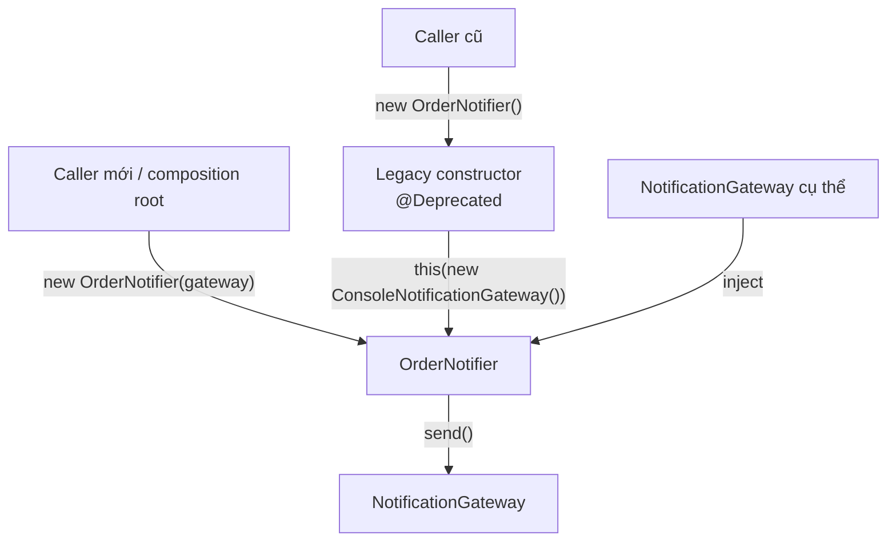

# Giữ tương thích API trong quá trình chuyển đổi

> **Chương:** Refactor sang DI  
> **Phạm vi:** Dependency Injection (DI), Inversion of Control (IoC), constructor injection, composition root, scope và vòng đời trong Java thuần. Trọng tâm là **chuyển dần cách tạo dependency mà không vô tình phá vỡ mã đang sử dụng API cũ**, trước khi cân nhắc DI container.

## 1. Mục tiêu học tập

Sau bài này, bạn có thể:

1. Phân biệt **tương thích mã nguồn**, **tương thích nhị phân** và **tương thích hành vi** khi refactor một API Java sang DI.
2. Nhận ra thay constructor không tham số bằng constructor nhận dependency có thể gây lỗi biên dịch cho caller cũ và `NoSuchMethodError` cho caller đã biên dịch từ trước.
3. Tạo **đường chuyển tiếp** bằng constructor overload hoặc adapter để caller cũ vẫn chạy, trong khi caller mới dùng constructor injection.
4. Đưa lựa chọn implementation cụ thể về **composition root**, tránh biến đường tương thích thành Service Locator hoặc phụ thuộc toàn cục mới.
5. Kiểm thử cả **API cũ** lẫn **đường DI mới** bằng Java thuần, bao gồm một phép thử dùng binary client cũ mà không biên dịch lại.
6. Đánh giá giới hạn của tương thích trong các tình huống có tài nguyên cần đóng, scope, lỗi, đồng thời và DI container.
7. Xây dựng một lộ trình chuyển đổi có thể triển khai từng bước, đo được và có khả năng quay lại khi cần.

## 2. Vì sao refactor sang DI có thể phá hợp đồng với caller?

Giả sử một lớp `OrderNotifier` đang được nhiều ứng dụng sử dụng. Trước đây người dùng chỉ cần:

```java
OrderNotifier notifier = new OrderNotifier();
String result = notifier.confirm("ORD-101");
```

Sau khi học DI, lập trình viên thay lớp bằng phiên bản chỉ có constructor:

```java
// PHẢN VÍ DỤ: thay thẳng constructor cũ bằng constructor mới.
public OrderNotifier(NotificationGateway gateway) {
    this.gateway = gateway;
}
```

Thiết kế mới **có lợi** vì phụ thuộc `NotificationGateway` được công bố rõ. Nhưng caller cũ đang gọi `new OrderNotifier()` không còn biên dịch được, trong khi binary đã biên dịch với constructor cũ có thể không chạy được với class mới.

Vấn đề không nằm ở DI. Vấn đề là ta đã thay đổi **API công khai** cùng lúc với thay đổi **cách lắp ghép bên trong**.

**Mục tiêu hợp lý khi chuyển đổi từng bước:** Giữ nguyên các cam kết đã có đối với caller cũ trong một giai đoạn, đồng thời mở thêm một đường sử dụng API rõ ràng theo DI. Sau đó di chuyển caller dần về đường mới và chỉ xóa đường cũ theo chính sách phiên bản đã thông báo.

## 3. Ba lớp tương thích cần đánh giá riêng

| Dạng tương thích | Câu hỏi chính | Một lỗi có thể gặp |
| --- | --- | --- |
| **Source compatibility** (mã nguồn) | Mã Java của caller cũ có thể biên dịch lại với API mới không? | `new OrderNotifier()` không còn constructor phù hợp. |
| **Binary compatibility** (nhị phân) | Class/JAR caller đã biên dịch trước đó có liên kết và chạy với library mới không, **không cần biên dịch lại**? | JVM không tìm thấy constructor `OrderNotifier.<init>()` và ném `NoSuchMethodError`. |
| **Behavioral compatibility** (hành vi) | Cùng lời gọi hợp lệ có giữ ý nghĩa kết quả, tác dụng phụ và quy tắc lỗi đã cam kết không? | Caller vẫn chạy nhưng thông báo bị gửi hai lần hoặc validation thay đổi. |

Một thay đổi có thể đạt **source compatibility** mà không duy trì hành vi, hoặc chạy được trên JVM nhưng phá giả định của caller. Vì vậy, chỉ nhìn vào chữ ký hoặc chỉ chạy unit test mới là chưa đủ.

### 3.1. Tương thích nhị phân trong Java không chỉ là tên class

Ở mức JVM, constructor và method được liên kết bằng **tên, kiểu tham số và các thông tin chữ ký nhị phân tương ứng**. Một constructor không tham số `OrderNotifier()` khác với `OrderNotifier(NotificationGateway)`. Constructor mới không thể thay thế constructor cũ cho bytecode đã biên dịch.

Với method, việc thay đổi kiểu tham số, kiểu trả về, tính `static`/instance hoặc mức truy cập có thể làm caller cũ không liên kết hoặc không gọi theo cách mong muốn. Không nên xem việc lớp mới “trông giống” lớp cũ là bằng chứng nhị phân tương thích.

### 3.2. Tương thích hành vi bao gồm nhiều hơn giá trị trả về

Ví dụ một `confirm(orderId)` đã cam kết:

- Từ chối `null` và chuỗi rỗng bằng `IllegalArgumentException`.
- Với mã đơn hợp lệ, gửi **một** thông báo chứa đúng mã đơn.
- Trả về chuỗi xác nhận có định dạng đã công bố.

Sau refactor, nếu constructor cũ tự động chuyển qua adapter thật có retry hoặc gửi nhiều thông báo, kết quả `String` có thể giống trước nhưng **hành vi vẫn thay đổi**. Cần kiểm luôn side effect, exception, thứ tự tương đối khi contract yêu cầu và quyền sở hữu tài nguyên.

> **Nguyên tắc:** Tách hai câu hỏi: “**API cũ còn tồn tại không?**” và “**API cũ còn mang đúng ý nghĩa không?**”. Chúng cần các phép thử khác nhau.

## 4. Ví dụ trước refactor: lớp tự thực hiện lựa chọn hạ tầng

Đây là API cũ, đơn giản để minh họa. Tạo file `legacy/OrderNotifier.java`:

```java
public final class OrderNotifier {
    public OrderNotifier() {
        // Caller không cần cung cấp dependency.
    }

    public String confirm(String orderId) {
        if (orderId == null || orderId.trim().isEmpty()) {
            throw new IllegalArgumentException("orderId is required");
        }
        System.out.println("SEND " + orderId + ": confirmed");
        return "CONFIRMED:" + orderId;
    }
}
```

Tạo caller cũ ở `legacy-client/LegacyClient.java`:

```java
public class LegacyClient {
    public static void main(String[] args) {
        OrderNotifier notifier = new OrderNotifier();
        System.out.println(notifier.confirm("ORD-LEGACY"));
    }
}
```

Ví dụ sử dụng **default package** để tập trung vào tương thích chữ ký. Trong dự án thực, cần giữ nguyên tên package, quyền truy cập của class và method, cách đóng gói JAR và các hợp đồng mà caller đang phụ thuộc.

API cũ hoạt động nhưng khó thay thế cách gửi thông báo trong test vì `System.out.println(...)` nằm ngay trong nghiệp vụ. Nếu sau này cần gửi qua HTTP client, gắn hẳn một adapter cụ thể vào service sẽ tăng coupling. Ta muốn tách trách nhiệm gửi qua interface mà **không buộc caller cũ sửa ngay**.

## 5. Refactor an toàn hơn: thêm đường DI, giữ đường cũ

Một bước chuyển tiếp thông dụng là:

1. Giới thiệu một **hợp đồng** `NotificationGateway` để service chỉ cần khả năng gửi.
2. Thêm constructor `OrderNotifier(NotificationGateway)` cho caller mới và unit test.
3. **Giữ lại** constructor `OrderNotifier()` đang công khai; để nó gọi lại constructor mới với adapter mặc định mô phỏng **đúng hành vi trước đây**.
4. Đánh dấu đường cũ `@Deprecated` và hướng dẫn caller chuyển sang composition root.
5. Không dùng một registry toàn cục chỉ để giải quyết bài toán tương thích.

### 5.1. File `NotificationGateway.java`

```java
// Hợp đồng dùng bởi service và test.
public interface NotificationGateway {
    void send(String orderId, String message);
}

// Adapter mặc định cho giai đoạn tương thích.
// Không phải client mạng; không có tài nguyên cần đóng.
final class ConsoleNotificationGateway implements NotificationGateway {
    @Override
    public void send(String orderId, String message) {
        System.out.println("SEND " + orderId + ": " + message);
    }
}
```

### 5.2. File `OrderNotifier.java` phiên bản mới

```java
import java.util.Objects;

public final class OrderNotifier {
    private final NotificationGateway gateway;

    /**
     * @deprecated Caller mới nên truyền NotificationGateway bằng
     * constructor injection ở composition root.
     */
    @Deprecated
    public OrderNotifier() {
        // Bridge tương thích: tạo đúng adapter mặc định trước đây.
        this(new ConsoleNotificationGateway());
    }

    public OrderNotifier(NotificationGateway gateway) {
        this.gateway = Objects.requireNonNull(gateway, "gateway");
    }

    public String confirm(String orderId) {
        if (orderId == null || orderId.trim().isEmpty()) {
            throw new IllegalArgumentException("orderId is required");
        }
        gateway.send(orderId, "confirmed");
        return "CONFIRMED:" + orderId;
    }
}
```

Đường mới dùng **constructor injection**: `OrderNotifier(NotificationGateway)` yêu cầu caller cung cấp dependency. `OrderNotifier` giữ tham chiếu `final` và không phụ thuộc vào API của một DI container.

Đường cũ `OrderNotifier()` vẫn tồn tại và gọi `this(new ConsoleNotificationGateway())`. Kỹ thuật này thường được gọi là **delegating constructor** hoặc **compatibility bridge**. Nó bảo đảm mọi lời gọi cuối cùng đều dùng **cùng logic nghiệp vụ** ở `confirm(...)`; tránh có hai bản sao thuật toán dễ lệch nhau.

**Tại sao vẫn có `new` bên trong lớp này?** Trong giai đoạn chuyển tiếp, đó là một **ngoại lệ có chủ đích để giữ API cũ**, không phải chuẩn thiết kế mà caller mới nên làm theo. Khi tất cả caller đã chuyển sang DI và chính sách phiên bản cho phép, có thể loại bỏ đường legacy. Không nên lấy constructor cũ làm nơi bổ sung thêm nhiều dependency hạ tầng mới.

### 5.3. File `Main.java`: đường sử dụng mới tại composition root

```java
public class Main {
    public static void main(String[] args) {
        // Đường mới: root chọn implementation cụ thể.
        NotificationGateway gateway = new ConsoleNotificationGateway();
        OrderNotifier modern = new OrderNotifier(gateway);
        System.out.println(modern.confirm("ORD-NEW"));

        // Đường cũ: còn hoạt động trong giai đoạn chuyển tiếp.
        OrderNotifier legacy = new OrderNotifier();
        System.out.println(legacy.confirm("ORD-OLD"));
    }
}
```

Biên dịch và chạy **phiên bản mới** bằng JDK:

```bash
javac -encoding UTF-8 NotificationGateway.java OrderNotifier.java Main.java
java Main
```

Kết quả mong đợi:

```text
SEND ORD-NEW: confirmed
CONFIRMED:ORD-NEW
SEND ORD-OLD: confirmed
CONFIRMED:ORD-OLD
```

Hai đường gọi dùng chung `confirm(...)` và cùng quy tắc validation. Với caller mới, `Main` (composition root) có thể thay gateway bằng fake, adapter HTTP hoặc lớp decorator phù hợp, mà không sửa code nghiệp vụ.



Sơ đồ nhấn mạnh **hai đường tạo** nhưng chỉ **một phần thực thi nghiệp vụ**. Một bridge tốt nên nhỏ, đơn giản và có kế hoạch loại bỏ, không phát triển thành bộ tra cứu dependency tổng quát.

## 6. Kiểm thử bằng Java thuần: caller cũ và caller mới

Không cần Spring, Guice hoặc mock framework để kiểm logic của `OrderNotifier`. Ta tạo fake triển khai đúng interface và kiểm các lời gọi quan sát được.

Giữ ba file phiên bản mới ở mục 5, rồi tạo file `OrderNotifierTest.java`:

```java
import java.util.ArrayList;
import java.util.List;

final class RecordingGateway implements NotificationGateway {
    final List<String> calls = new ArrayList<>();

    @Override
    public void send(String orderId, String message) {
        calls.add(orderId + "|" + message);
    }
}

public class OrderNotifierTest {
    public static void main(String[] args) {
        // Đường constructor injection: test hoàn toàn không gọi hạ tầng.
        RecordingGateway fake = new RecordingGateway();
        OrderNotifier modern = new OrderNotifier(fake);

        String result = modern.confirm("ORD-TEST");
        check("CONFIRMED:ORD-TEST".equals(result), "Wrong return value");
        check(fake.calls.size() == 1, "Must send exactly once");
        check("ORD-TEST|confirmed".equals(fake.calls.get(0)),
                "Wrong gateway arguments");

        boolean invalidRejected = false;
        try {
            modern.confirm("  ");
        } catch (IllegalArgumentException expected) {
            invalidRejected = true;
        }
        check(invalidRejected, "Blank orderId must be rejected");
        check(fake.calls.size() == 1,
                "Invalid input must not cause an extra send");

        boolean nullDependencyRejected = false;
        try {
            new OrderNotifier(null);
        } catch (NullPointerException expected) {
            nullDependencyRejected = true;
        }
        check(nullDependencyRejected,
                "DI constructor must reject missing dependency");

        // Đường API cũ: constructor không tham số vẫn tồn tại.
        OrderNotifier legacy = new OrderNotifier();
        check("CONFIRMED:ORD-LEGACY".equals(
                legacy.confirm("ORD-LEGACY")),
                "Legacy behavior must be preserved");

        System.out.println("PASS");
    }

    private static void check(boolean condition, String message) {
        if (!condition) {
            throw new AssertionError(message);
        }
    }
}
```

```bash
javac -encoding UTF-8 NotificationGateway.java OrderNotifier.java OrderNotifierTest.java
java OrderNotifierTest
```

Kết quả có một dòng demo từ constructor legacy, tiếp theo là `PASS`:

```text
SEND ORD-LEGACY: confirmed
PASS
```

Test này phát hiện lỗi hành vi của **đường DI mới** và lỗi cơ bản nếu **constructor cũ bị xóa** khi biên dịch mã nguồn test. Nhưng **nó chưa đủ để kết luận tương thích nhị phân**, vì chúng ta vừa biên dịch test cùng API mới.

### 6.1. Kiểm tra đúng sự khác biệt giữa source và binary compatibility

Để xác minh binary compatibility, phải giữ một **caller đã biên dịch với API cũ** rồi chạy caller đó với **phiên bản library mới**, không biên dịch lại caller.

Giả sử cấu trúc bài tập có `legacy/OrderNotifier.java`, `legacy-client/LegacyClient.java` ở mục 4, và `NotificationGateway.java`, `OrderNotifier.java` mới ở thư mục làm việc hiện tại.

Trên Linux/macOS hoặc shell hỗ trợ cú pháp tương đương:

```bash
mkdir -p build/old-api build/client build/new-api

# 1. Biên dịch phiên bản API cũ.
javac -encoding UTF-8 -d build/old-api legacy/OrderNotifier.java

# 2. Biên dịch caller theo API cũ; giữ nguyên class đã sinh.
javac -encoding UTF-8 -cp build/old-api -d build/client \
  legacy-client/LegacyClient.java

# 3. Biên dịch library mới, KHÔNG biên dịch lại LegacyClient.
javac -encoding UTF-8 -d build/new-api \
  NotificationGateway.java OrderNotifier.java

# 4. Dùng OrderNotifier mới để chạy LegacyClient cũ.
java -cp build/new-api:build/client LegacyClient
```

Trên Windows, dấu phân cách classpath là `;` thay vì `:`. Khi dùng PowerShell, có thể viết lệnh cuối:

```powershell
java -cp "build/new-api;build/client" LegacyClient
```

Kết quả mong đợi:

```text
SEND ORD-LEGACY: confirmed
CONFIRMED:ORD-LEGACY
```

Phép thử này quan trọng vì giữ nguyên **bytecode của `LegacyClient`**, qua đó kiểm khả năng liên kết của constructor và method đã công bố. Nếu xóa constructor cũ khỏi `OrderNotifier` mới, caller nhị phân sẽ không còn tìm được `<init>()` và có thể gặp `NoSuchMethodError`.

Để đánh giá **source compatibility**, hãy biên dịch lại `LegacyClient.java` với API mới. Để đánh giá **behavioral compatibility**, bổ sung assertion hoặc golden tests cho output, ngoại lệ, tác dụng phụ và các trường hợp biên mà API đã cam kết.

> **Giới hạn của ví dụ:** Đây là ví dụ không package và không dùng dependency ngoài. Với JAR thật, cần kiểm cả package name, classloader, dependency transitives, module boundary và môi trường runtime mà ứng dụng thực tế sử dụng.

## 7. Bản đồ những thay đổi API dễ gây đứt gãy

| Thay đổi khi refactor sang DI | Nguy cơ đối với caller cũ | Hướng chuyển tiếp |
| --- | --- | --- |
| Xóa constructor `public Service()` và chỉ giữ `Service(Dependency)` | Source fail; binary có thể `NoSuchMethodError` | **Giữ constructor cũ**, delegate đến đường mới, đánh dấu deprecated. |
| Đổi `public void process(...)` thành method có tham số dependency bắt buộc | Caller phải đổi code; descriptor thay đổi | Giữ overload cũ và chuyển tiếp sang method mới, nếu có thể bảo toàn hành vi. |
| Đổi kiểu trả về hoặc tên method | Có thể phá source/binary compatibility và hành vi | Thêm API mới; giữ API cũ làm adapter trong giai đoạn chuyển tiếp. |
| Đổi method `static` thành instance method hoặc ngược lại | Bytecode cũ không gọi cùng cơ chế | Giữ đường gọi cũ qua facade tạm thời hoặc lên kế hoạch thay đổi lớn. |
| Đổi mức truy cập từ `public` sang package-private/private | Caller ngoài package không còn dùng được | Duy trì mức truy cập cũ trong giai đoạn tương thích. |
| Thay exception được báo ra | Caller có thể xử lý sai; thay checked exception cũng ảnh hưởng source | Giữ hợp đồng lỗi cũ hoặc chuyển đổi lỗi ở adapter. |
| Thay adapter mặc định trong constructor cũ | Có thể thay side effect, độ trễ, retry hoặc tài nguyên | Duy trì default cũ và đo hành vi ở test; thay default chỉ theo kế hoạch rõ. |
| Thêm các constructor overload có cùng số tham số | Có thể khiến lời gọi truyền `null` hoặc method reference trở nên mơ hồ | Xem xét signature/đặt tên factory method rõ, thử biên dịch caller thực tế. |
| Biến một service stateless thành singleton giữ state request | Lỗi concurrency/tenant isolation dù API không đổi | Giữ dependency dùng chung an toàn; dữ liệu request truyền theo lời gọi. |
| Biến `new` nội bộ thành resource cần `close()` | Không rõ owner; có thể rò rỉ hoặc đóng sớm | Thiết kế ownership/lifecycle trước, tránh bridge tạo resource không có nơi giải phóng. |

**Không phải mọi thay đổi đều phá cả ba loại tương thích.** Ví dụ thêm một overload mới thường giúp giữ caller cũ, nhưng có thể làm mã nguồn với `null`/method reference bị mơ hồ ở một số tình huống. Cần thử trên nhóm caller thực tế, không kết luận chỉ từ một ví dụ đơn giản.

## 8. Ba chiến lược chuyển đổi API thường dùng

### 8.1. Thêm constructor DI và giữ constructor tương thích

Đây là cách đã dùng:

```java
@Deprecated
public OrderNotifier() {
    this(new ConsoleNotificationGateway());
}

public OrderNotifier(NotificationGateway gateway) {
    this.gateway = java.util.Objects.requireNonNull(gateway);
}
```

Phù hợp khi:

- API cũ có hành vi mặc định rõ ràng.
- Adapter mặc định có thể được tạo an toàn, không cần bí mật, kết nối hoặc resource chưa có owner.
- Cần caller cũ tiếp tục hoạt động mà không phụ thuộc vào container.

Điểm yếu: lớp vẫn giữ hiểu biết về adapter mặc định trong thời gian chuyển đổi. Đừng để bridge này trở thành chỗ phát triển logic hạ tầng mới.

### 8.2. Giữ facade công khai, chuyển xử lý sang core được inject

Nếu API cũ có nhiều constructor, nhiều method hoặc định dạng dữ liệu phải duy trì, có thể giữ một **facade/adapter** với chữ ký cũ; facade ủy quyền cho thành phần core đã được tách dependency.

```text
Caller cũ
    |
    v
LegacyOrderFacade --(delegate)--> OrderUseCase --> NotificationGateway
                                           ^
                                           |
                           Composition root/DI wiring
```

Facade giữ trách nhiệm **tương thích API**; core thực hiện nghiệp vụ. Đây có thể là lựa chọn tốt hơn việc nhồi quá nhiều đường legacy vào class mới.

Hạn chế là facade cần một cách xây delegate hợp lệ, có vòng đời rõ. Nếu facade do caller ngoài hệ thống tự `new`, nó không thể mặc nhiên được container tiêm dependency. Phải thiết kế đường tạo hoặc hỗ trợ caller dần chuyển sang factory do application cung cấp.

### 8.3. Giữ API cũ, cung cấp thêm static factory có tên rõ

Khi một overload dễ gây nhập nhằng hoặc cần mô tả cách tạo:

```java
// Ví dụ ý tưởng bên trong class OrderNotifier.
public static OrderNotifier withGateway(NotificationGateway gateway) {
    return new OrderNotifier(gateway);
}
```

Static factory `withGateway(...)` có thể tạo API diễn đạt rõ, không xung đột với tên constructor khác. Tuy nhiên, nó **không thay thế** khả năng giữ constructor cũ cho caller đã biên dịch. Nếu thêm factory, vẫn cần giữ các entry point legacy trong thời gian cam kết tương thích.

## 9. Khi đường tương thích bắt đầu gây hại

Constructor bridge có vẻ đơn giản khi adapter chỉ in console. Nhưng nếu default cũ phải tạo HTTP client, executor hoặc connection pool thì câu hỏi **ai đóng** trở nên quan trọng:

```java
// PHẢN VÍ DỤ về ownership: client giả định cần shutdown.
@Deprecated
public OrderService() {
    this(new HttpGateway(new PooledHttpClient()));
}
```

Nếu caller cũ không có phương thức đóng hay lifecycle hook, tài nguyên mới có thể bị mở mà không ai giải phóng. Ngược lại, nếu service tự đóng client sau mỗi lời gọi, nó có thể làm hỏng thiết kế khi client được inject và **dùng chung**.

Trước khi duy trì một bridge kiểu này, hãy quyết định:

1. **Default cũ có thực sự cần resource cần đóng không?** Nếu không, giữ adapter mặc định nhẹ hơn.
2. **Ai sở hữu tài nguyên của đường legacy?** Một facade `AutoCloseable` có thể cần thiết, nhưng thêm cơ chế đóng mới không đảm bảo caller cũ sẽ gọi.
3. **Đường DI mới có được inject resource dùng chung không?** Nếu có, service thường chỉ là borrower và không tự đóng.
4. **Có nên di chuyển caller cũ qua factory/entry point ở cấp ứng dụng sớm hơn?** Điều này thường tốt hơn tạo một pool riêng mỗi lần `new`.
5. **Nếu không thể giữ ngữ nghĩa cũ an toàn, thay đổi có cần coi là breaking change có kế hoạch không?** Không nên hứa tương thích tuyệt đối rồi lén thay đổi ownership.

### 9.1. Scope và concurrency là một phần của hành vi cần giữ

Một refactor có thể đổi từ “mỗi caller giữ instance riêng” sang “một singleton do container inject”. Nếu lớp chứa `currentUser`, bộ đếm không đồng bộ hoặc session mutable, chuyển đổi này có thể gây lẫn dữ liệu giữa request dù tất cả chữ ký API đều giữ nguyên.

Giải pháp không phải chỉ thêm `synchronized` vào mọi method. Hãy phân tách:

- **Collaborator được dùng chung** có contract thread-safe phù hợp.
- **Dữ liệu request/user** đi qua tham số hoặc context đúng scope.
- **Resource theo thao tác** được mở và đóng trong đơn vị công việc.
- **Tài nguyên application scope** có một owner chịu trách nhiệm shutdown sau khi mọi consumer dừng.

### 9.2. Gắn API cũ vào Service Locator toàn cục là một ngõ cụt

Để làm constructor không tham số “thông minh”, đôi khi có mã:

```java
// PHẢN VÍ DỤ: dấu hiệu Service Locator toàn cục.
public OrderNotifier() {
    this(GlobalContainer.resolve(NotificationGateway.class));
}
```

Nó giữ chữ ký nhưng tạo **dependency ẩn** vào việc container toàn cục đã được khởi tạo, thứ tự startup và trạng thái test. Test có thể chạy đơn lẻ nhưng lỗi khi chạy song song hoặc khi class được dùng ngoài ứng dụng chính.

Nếu phải làm cầu nối với framework, hãy giữ nó tại **boundary/facade riêng**, mô tả contract và thời điểm cấu hình. Với caller mới, ưu tiên truyền gateway tường minh hoặc dùng một factory có kiểu kết quả hẹp, thay vì buộc mọi service tra cứu toàn container.

## 10. DI container có giúp giữ tương thích API tự động không?

**Không.** Container có thể tạo `OrderNotifier` bằng constructor được chọn và inject `NotificationGateway`, nhưng không tự biến một constructor đã bị xóa thành constructor còn tồn tại trong JAR. Caller gọi `new OrderNotifier()` không đi qua container; nếu constructor đó không còn, source/binary compatibility vẫn bị phá.

Trong Spring, có thể định nghĩa một bean `OrderNotifier` bằng Java configuration:

```java
// Minh họa, cần Spring và các class đã định nghĩa trong ví dụ.
@Bean
OrderNotifier orderNotifier(NotificationGateway gateway) {
    return new OrderNotifier(gateway);
}
```

Điều đó có ích cho **caller do container quản lý**. Nhưng nó không tự sửa mã của thư viện ngoài đang gọi `new OrderNotifier()`, không tự đăng ký mọi instance tạo bằng `new` và không tự giải quyết ownership của những resource nằm ngoài container.

**Thứ tự an toàn:** Làm cho lớp hỗ trợ constructor injection và có test Java thuần trước; sau đó thay **composition root/wiring** bằng cấu hình container nếu hệ thống thật sự cần. Hợp đồng công khai và quy tắc vòng đời vẫn là quyết định của ứng dụng.

## 11. Một kế hoạch chuyển đổi tăng dần

Một kế hoạch thực tế nên có các mốc kiểm chứng, thay vì đổi toàn bộ module trong một commit:

| Giai đoạn | Thay đổi | Điều kiện để đi tiếp |
| --- | --- | --- |
| **0. Ghi nhận baseline** | Thống kê các caller dùng constructor/method cũ và hành vi đã cam kết. | Có test cho API cũ và kết quả quan sát được. |
| **1. Tách hợp đồng** | Giới thiệu interface nhỏ cho dependency; chưa xóa public API. | Code cũ vẫn biên dịch/chạy, hành vi giữ nguyên. |
| **2. Thêm đường DI** | Thêm constructor nhận dependency; logic nghiệp vụ dùng một đường chung. | Unit test với fake và validation đều đạt. |
| **3. Giữ bridge cũ** | Constructor/method cũ delegate, có `@Deprecated` và tài liệu di chuyển. | Source test và binary test với caller cũ đạt. |
| **4. Chuyển wiring** | Composition root chọn implementation, scope và owner. | Smoke/integration test về wiring/lifecycle đạt. |
| **5. Di chuyển caller** | Chuyển dần caller nội bộ, nâng cấp caller ngoài qua release. | Có thống kê hoặc xác nhận mức sử dụng API deprecated. |
| **6. Quyết định loại bỏ** | Chỉ xóa API cũ khi chính sách phiên bản/tương thích cho phép. | Release notes, kế hoạch migration và test phù hợp. |

Với ứng dụng chỉ có caller nội bộ và triển khai đồng bộ một lần, có thể chuyển nhanh hơn. Với thư viện công khai hoặc nhiều phiên bản service cùng tồn tại, **giai đoạn bridge và binary test** quan trọng hơn.

### 11.1. Theo dõi đường legacy có còn được dùng không

`@Deprecated` chỉ phát cảnh báo và cung cấp tín hiệu cho người đọc/tool; nó không đo việc một constructor được gọi trong production. Muốn biết mức sử dụng, có thể dùng phân tích mã nguồn, tìm references, kiểm thử caller hoặc telemetry **phù hợp chính sách riêng tư và hiệu năng**.

Không nên log dữ liệu nhạy cảm hoặc tạo side effect mới trong constructor chỉ để theo dõi migration. Nếu API thư viện được sử dụng từ môi trường không kiểm soát, có thể không biết chắc mọi caller đã rời đường cũ; khi đó quyết định loại bỏ cần tuân theo chính sách phiên bản.

### 11.2. Giữ rollback đủ đơn giản

Một refactor an toàn có thể được triển khai theo bước nhỏ, tách riêng:

- Thay đổi **cấu trúc dependency** (interface, constructor overload).
- Thay đổi **composition root**.
- Thay đổi **hành vi adapter** (HTTP, retry, cache).

Nếu gộp cả ba cùng lúc, một lỗi xảy ra sẽ khó biết do API, do wiring hay do adapter mới. Giữ adapter mặc định đúng hành vi cũ ở giai đoạn đầu giúp khoanh vùng rủi ro.

## 12. Checklist kiểm thử trước khi phát hành

### 12.1. API và bytecode

- Constructor/method công khai cũ còn nguyên chữ ký, quyền truy cập và package theo cam kết không?
- Caller cũ có biên dịch lại được với library mới không?
- Caller binary cũ có chạy với library mới **mà không được biên dịch lại** không?
- Có xung đột overload, `null` ambiguity, thay đổi generic erasure hoặc thay đổi kiểu trả về không?
- Nếu dùng reflection, ServiceLoader, serialization hoặc framework integration, các ranh giới đó đã được kiểm thử thích hợp chưa?

### 12.2. Hành vi và contract

- Đầu vào hợp lệ/không hợp lệ giữ đúng ý nghĩa?
- Số lần gọi dependency, kết quả trả về, side effect và exception có đúng như trước?
- Adapter mặc định của đường legacy có hành vi tương đương?
- Các triển khai mới có tuân thủ cùng hợp đồng nghiệp vụ không, không chỉ cùng kiểu Java?

### 12.3. DI, scope và tài nguyên

- Dependency bắt buộc được kiểm tra khi xây đối tượng, không phụ thuộc một registry ẩn?
- Composition root có quyết định concrete implementation và cấu hình?
- Singleton dùng chung có giữ dữ liệu request không; dependency có thread-safe không?
- Ai sở hữu resource cần đóng; ai đóng sau cùng; có đường lỗi hoặc async chưa dọn không?
- Test có tách **unit test Java thuần** khỏi **integration/wiring test với container** không?

## 13. Sai lầm thường gặp khi giữ tương thích

**Sai lầm 1 — Xóa constructor cũ vì “đã dùng DI”.** DI không tự bù cho API bị xóa. Nếu đã cam kết tương thích, giữ constructor cũ trong giai đoạn bridge.

**Sai lầm 2 — Giữ constructor nhưng đổi ngữ nghĩa.** Caller cũ vẫn tạo được object, nhưng adapter mặc định hoặc ngoại lệ thay đổi. Phải kiểm tra behavioral compatibility.

**Sai lầm 3 — Có hai nhánh nghiệp vụ song song.** Constructor cũ dùng thuật toán A, constructor DI dùng thuật toán B. Sau vài lần sửa, chúng lệch nhau. Hãy delegate về cùng implementation.

**Sai lầm 4 — Bridge thành container locator.** Constructor cũ `resolve` từ global container; test và caller ngoài framework phụ thuộc trạng thái toàn cục. Ưu tiên bridge nhỏ và explicit wiring.

**Sai lầm 5 — Đổi scope mà không kiểm tra state.** Tạo singleton từ một lớp cũ chứa mutable per-user state có thể gây race và rò dữ liệu.

**Sai lầm 6 — Quên ai đóng dependency.** Constructor DI có thể nhận client dùng chung, nhưng code vẫn tự `close()` sau mỗi lời gọi như khi tự sở hữu client. Cần phân biệt owner/borrower.

**Sai lầm 7 — Tin test mới chứng minh binary compatibility.** Biên dịch mọi thứ từ đầu chỉ chứng minh một phần source compatibility. Phải chạy bytecode caller cũ với binary library mới.

**Sai lầm 8 — Bỏ `@Deprecated` mà không có kế hoạch.** API cũ tồn tại mãi, người dùng mới tiếp tục gọi, không có lịch di chuyển. Cần tài liệu và chính sách phiên bản rõ.

**Sai lầm 9 — Dùng thêm provider để giấu quá nhiều dependency.** Truyền `ServiceProvider.get(Class<T>)` vào service chỉ chuyển coupling sang một Service Locator ẩn, không giải quyết thiết kế.

## 14. Bài tập tự luyện

**Bài 1 — Tương thích nhị phân:** Một thư viện trước đây có `public ReportService()`. Phiên bản mới chỉ còn `public ReportService(ReportRepository)`. Caller đã biên dịch theo bản cũ có thể gặp lỗi gì khi chạy với library mới? Vì sao biên dịch lại test mới không phát hiện được đầy đủ?

**Bài 2 — Thiết kế bridge:** Viết phác thảo `@Deprecated public ReportService()` delegate đến constructor `ReportService(ReportRepository repo)`. Nêu điều kiện để bridge không tạo ra resource leak hoặc dependency toàn cục.

**Bài 3 — Behavioral compatibility:** API cũ gửi một email và trả `"OK"`. Sau refactor, gateway mới tự retry tối đa ba lần khi timeout. Chỉ kiểm kết quả `"OK"` đã đủ chưa? Cần xác minh điều gì về việc gửi trùng, ngoại lệ và side effect?

**Bài 4 — Source và binary test:** Giải thích tại sao phải có **hai build output riêng** cho caller cũ và library mới trong quy trình mục 6.1. Điều gì xảy ra nếu vô tình biên dịch lại caller trước khi chạy test?

**Bài 5 — Scope:** Một service trước đây được mỗi request `new` riêng, nay chuyển thành singleton của container. Service giữ `currentUserId` trong field. API vẫn giống cũ; vấn đề nào có thể xuất hiện và giải pháp nào phù hợp?

**Bài 6 — Có nên bỏ API legacy ngay?** Một team đã di chuyển hết caller trong một repository nhưng có hai ứng dụng ngoài sử dụng JAR cũ. Nên kiểm tra điều gì trước khi xóa constructor deprecated?

**Bài 7 — Đường DI:** Trong `OrderNotifierTest`, tại sao test với `RecordingGateway` nhanh và cô lập hơn test phụ thuộc adapter thực? Nó chứng minh điều gì và không chứng minh điều gì?

**Gợi ý đối chiếu:**

1. Có thể gặp `NoSuchMethodError` khi JVM tìm constructor không tham số đã bị loại bỏ; compile test mới không dùng bytecode của caller cũ.
2. Constructor cũ gọi `this(new LegacyRepository())` nếu adapter mặc định an toàn và giữ hành vi; không tạo connection/pool mà không có owner, không lấy dependency từ global locator.
3. Chưa đủ: cần kiểm số lần gửi, idempotency/deduplication, cách báo lỗi và các tác dụng phụ đã hứa.
4. Caller phải được biên dịch với **API cũ**; runtime dùng **library mới**. Biên dịch lại caller làm mất giá trị phép thử liên kết nhị phân.
5. Shared mutable state gây lẫn dữ liệu/race; service stateless theo request, truyền user context qua tham số hoặc scope phù hợp.
6. Xem cam kết tương thích, mức sử dụng của hai ứng dụng, lịch nâng cấp, phiên bản phát hành và cơ chế thông báo migration.
7. Fake ghi nhận lời gọi mà không cần mạng, container hay credential; unit test chứng minh logic consumer, còn adapter thật và wiring cần integration test.

## 15. Ghi nhớ

**Chuyển sang Dependency Injection không bắt buộc phá API công khai ngay lập tức.** Thay vì xóa constructor cũ, có thể **thêm constructor injection** cho caller mới, giữ **compatibility bridge** nhỏ cho caller cũ và dồn nghiệp vụ về một implementation. Composition root dần tiếp quản việc chọn, tạo và lắp ghép dependency.

Muốn nói “giữ tương thích”, hãy kiểm **cả mã nguồn, bytecode đã biên dịch và hành vi**; đồng thời rà soát scope, owner/borrower và lifecycle. Java thuần đủ để xác minh những nguyên tắc nền tảng này trước khi dùng DI container. Khi đã di chuyển caller và có quyết định phiên bản rõ ràng, mới cân nhắc loại bỏ đường legacy.
