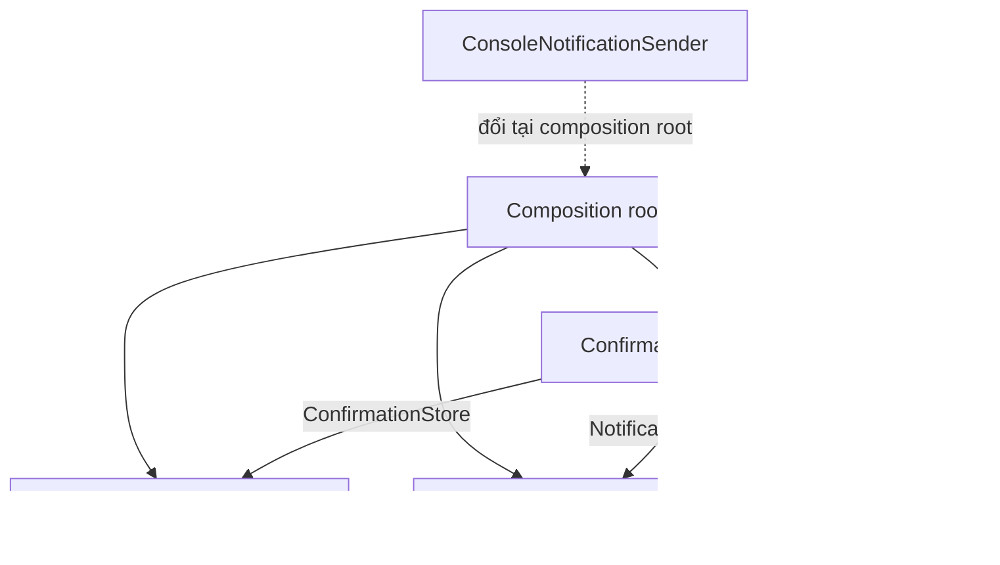

# Đánh giá sau refactor bằng khả năng đọc, thay thế và kiểm thử

Một đợt **refactor sang Dependency Injection (DI)** không thành công chỉ vì chúng ta đã thêm constructor, interface hoặc annotation `@Inject`. Nếu sau khi sửa, người đọc vẫn không biết service đang phụ thuộc vào thành phần nào, thay adapter phải sửa trực tiếp nghiệp vụ, hoặc mỗi unit test vẫn phải khởi động framework và database, thì **lợi ích thiết kế chưa được chứng minh**.

Để đánh giá một đợt refactor, cần quan sát những thay đổi cụ thể: **mã có dễ đọc hơn không, phụ thuộc có thật sự thay thế được không, và có thể kiểm thử hành vi bằng Java thuần hay không?** Đồng thời, những hành vi nghiệp vụ đang đúng phải được giữ nguyên, trừ khi có yêu cầu thay đổi chức năng riêng.

Bài thuộc chương **Refactor sang DI** của module **DEPENDENCY_INJECTION**. Ta dùng **constructor injection**, **composition root** và **Inversion of Control (IoC)** để tách *việc sử dụng dependency* khỏi *việc tạo/lắp ghép dependency*, kiểm tra quyết định về scope và vòng đời, rồi lập một bộ tiêu chí nghiệm thu trước khi nghĩ đến DI container.

## 1. Mục tiêu refactor: thay cấu trúc, không âm thầm thay nghiệp vụ

Giả sử một service xác nhận đặt chỗ cần:

- Lấy thời điểm xác nhận.
- Lưu xác nhận.
- Gửi yêu cầu thông báo sau khi lưu thành công.

Ở thiết kế cũ, service tự gọi `new` cho một lớp lưu trữ, một lớp gửi thông báo và sử dụng `Instant.now()`. Service vừa xử lý nghiệp vụ vừa quyết định dùng hạ tầng nào.

Trong refactor sang DI, ta kỳ vọng:

1. Service khai báo rõ **những khả năng nó cần**, thường qua tham số constructor.
2. Composition root chọn implementation, tạo object graph và truyền các instance vào service.
3. Một thay đổi adapter không buộc sửa thuật toán xác nhận đặt chỗ.
4. Bài test có thể cấp fake/in-memory adapter và `Clock.fixed(...)` mà không dùng database hoặc khởi động container.
5. Đầu vào, kết quả, thứ tự hiệu ứng và quy tắc lỗi của chức năng **vẫn theo hợp đồng đã thống nhất**.

Trong ngữ cảnh này, refactor **không đồng nghĩa với viết lại kiến trúc từ đầu**. Nên tạo một đường chuyển đổi nhỏ, giữ hành vi quan sát được và xác định những thay đổi chức năng nào phải được tách sang yêu cầu khác.

### 1.1. Không đánh giá bằng số lượng interface

Một cách đo sai là: “trước có 2 interface, sau có 12 interface nên DI tốt hơn”. Interface chỉ hữu ích khi giúp:

- Đặt hợp đồng đúng ở nơi consumer cần.
- Làm rõ khả năng thay thế implementation hoặc test double.
- Giữ các chi tiết lưu trữ/network/framework ra khỏi logic nghiệp vụ.

Nếu mỗi lớp được tạo một interface một-một nhưng không có ranh giới hay nhu cầu thay thế, tổng số file và mức gián tiếp có thể tăng mà không đem lại lợi ích. **Mục tiêu là giảm coupling có hại, không tối đa hóa số tầng trừu tượng.**

## 2. Ba trục đánh giá: đọc được, thay được, test được

| Trục | Câu hỏi chính | Bằng chứng mạnh | Dấu hiệu chưa đạt |
| --- | --- | --- | --- |
| **Khả năng đọc (readability)** | Người mới có thể lần theo các dependency bắt buộc và nơi lựa chọn implementation? | Constructor nêu đúng khả năng, composition root tập trung việc lắp ghép, tên hợp đồng có ý nghĩa | Service gọi `new` hạ tầng, đọc cấu hình ở nhiều nơi hoặc lấy phụ thuộc qua global registry |
| **Khả năng thay thế (replaceability)** | Đổi adapter hoặc môi trường thử nghiệm mà không sửa code nghiệp vụ? | Cùng một service làm việc với hai triển khai/fake được cấp từ ngoài | Phải sửa `if`, cast, class cụ thể hoặc dùng reflection bên trong service |
| **Khả năng kiểm thử (testability)** | Test luật nghiệp vụ bằng Java thuần, có kiểm soát thời gian và lỗi? | `new Service(fake, fixedClock)`; kiểm tra happy path và failure path độc lập | Unit test cần database, network, framework context, `Thread.sleep` hoặc phụ thuộc môi trường |

Ba trục liên quan nhưng **không đồng nghĩa**. Một graph rất dễ đọc vẫn có thể khó thay thế nếu consumer nhận concrete class. Một service nhận interface dễ mock nhưng vẫn khó hiểu nếu mọi dependency được lấy ngầm từ service locator. Một suite unit test xanh chưa chứng minh composition root production đã lắp đúng các adapter.

### 2.1. Đánh giá từ nhiệm vụ thực tế, không chỉ từ cảm nhận

Thay vì hỏi chung “code sạch hơn chưa?”, hãy thực hiện ba nhiệm vụ kiểm chứng:

1. **Đọc:** Từ constructor của service, chỉ ra các dependency trực tiếp, mục đích từng dependency và nơi chúng được tạo tại bootstrap.
2. **Thay:** Thay sender từ bản ghi trong bộ nhớ sang bản in console **chỉ tại điểm lắp ghép**, không sửa service.
3. **Test:** Chạy quy tắc “lưu trước khi gửi” và “không gửi nếu lưu thất bại” bằng fake trong một chương trình Java độc lập.

Nếu không làm được một nhiệm vụ, ghi lại điểm vướng cụ thể. Đây là **đầu vào hành động được** cho vòng cải tiến tiếp theo, tốt hơn việc tự chấm một con số “clean code” không có định nghĩa.

## 3. Trước refactor: phụ thuộc cụ thể bị ẩn trong nghiệp vụ

Đoạn mã sau minh họa **anti-pattern**, không phải một tệp có thể biên dịch độc lập (các adapter chưa được định nghĩa ở đoạn này):

```java
final class LegacyBookingService {
    void confirm(String bookingId) {
        // Service tự chọn nơi lưu và nơi gửi.
        LegacyDbStore store = new LegacyDbStore();
        LegacyEmailClient email = new LegacyEmailClient();

        store.save(bookingId, java.time.Instant.now());
        email.sendConfirmed(bookingId);
    }
}
```

Có nhiều vấn đề khi đánh giá theo ba trục:

- **Đọc:** constructor trống không cho biết service cần DB và email; chỉ khi đọc thân method mới thấy các phụ thuộc.
- **Thay:** test muốn lưu vào bộ nhớ hoặc gửi vào fake phải sửa thân `confirm(...)`, gắn hook tạm, hoặc dùng kỹ thuật can thiệp nặng.
- **Test:** `Instant.now()` khiến mốc thời gian khó tái lập; các constructor có thể mở kết nối DB hoặc network ngay khi test chạy.
- **Vòng đời:** nếu mỗi lời gọi tạo một client thật, còn phải quyết định ai đóng connection, có dùng pool không và khi nào cleanup.
- **Lắp ghép:** quy tắc tạo adapter nằm rải rác trong code nghiệp vụ thay vì tại composition root.

Không phải mọi lệnh `new` đều xấu. Việc tạo **giá trị nghiệp vụ** nhỏ như `new Confirmation(...)` bên trong service có thể hoàn toàn hợp lý. Vấn đề là service tự chọn **dependency hạ tầng có thể thay thế hoặc cần quản lý scope**, không phải lệnh `new` như một cú pháp.

## 4. Sau refactor: hợp đồng ở consumer và lắp ghép ở composition root

Ta tách hai khả năng:

```java
interface ConfirmationStore {
    void save(Confirmation confirmation);
}

interface NotificationSender {
    void send(Confirmation confirmation);
}
```

`Confirmation` là dữ liệu của ứng dụng. Service sử dụng hai interface này, cùng `Clock` có sẵn trong JDK. Composition root tạo triển khai và tiêm qua constructor.



**IoC** xuất hiện ở chỗ service không điều khiển việc tạo dependency nữa. **DI** là thao tác truyền object từ bên ngoài vào constructor. Chúng không đòi hỏi Spring hay container; đối với một graph nhỏ, `main()` là composition root hợp lệ.

### 4.1. Ví dụ Java 11 tự chứa

Lưu mã sau vào **`RefactorEvaluationExample.java`**. Nó không cần thư viện ngoài:

```java
import java.time.Clock;
import java.time.Instant;
import java.time.ZoneOffset;
import java.util.ArrayList;
import java.util.HashMap;
import java.util.List;
import java.util.Map;
import java.util.Objects;

public final class RefactorEvaluationExample {
    private RefactorEvaluationExample() {}

    public interface ConfirmationStore {
        void save(Confirmation confirmation);
    }

    public interface NotificationSender {
        void send(Confirmation confirmation);
    }

    public static final class Confirmation {
        private final String bookingId;
        private final Instant confirmedAt;

        public Confirmation(String bookingId, Instant confirmedAt) {
            this.bookingId = Objects.requireNonNull(bookingId, "bookingId");
            this.confirmedAt =
                Objects.requireNonNull(confirmedAt, "confirmedAt");
        }

        public String bookingId() {
            return bookingId;
        }

        public Instant confirmedAt() {
            return confirmedAt;
        }
    }

    public static final class ConfirmationService {
        private final ConfirmationStore store;
        private final NotificationSender sender;
        private final Clock clock;

        public ConfirmationService(
                ConfirmationStore store,
                NotificationSender sender,
                Clock clock) {
            this.store = Objects.requireNonNull(store, "store");
            this.sender = Objects.requireNonNull(sender, "sender");
            this.clock = Objects.requireNonNull(clock, "clock");
        }

        public Confirmation confirm(String bookingId) {
            if (bookingId == null || bookingId.trim().isEmpty()) {
                throw new IllegalArgumentException(
                    "bookingId must not be blank");
            }

            Confirmation confirmation =
                new Confirmation(bookingId, clock.instant());
            store.save(confirmation);
            sender.send(confirmation);
            return confirmation;
        }
    }

    public static final class InMemoryConfirmationStore
            implements ConfirmationStore {
        private final Map<String, Confirmation> byId = new HashMap<>();

        @Override
        public void save(Confirmation confirmation) {
            byId.put(confirmation.bookingId(), confirmation);
        }

        public Confirmation find(String bookingId) {
            return byId.get(bookingId);
        }
    }

    public static final class RecordingNotificationSender
            implements NotificationSender {
        private final List<String> sentIds = new ArrayList<>();

        @Override
        public void send(Confirmation confirmation) {
            sentIds.add(confirmation.bookingId());
        }

        public List<String> sentIds() {
            return List.copyOf(sentIds);
        }
    }

    public static final class ConsoleNotificationSender
            implements NotificationSender {
        @Override
        public void send(Confirmation confirmation) {
            System.out.println(
                "Notification requested for " + confirmation.bookingId());
        }
    }

    // Chỉ lộ các entry point hữu ích để quan sát demo.
    public static final class DemoGraph {
        public final ConfirmationService service;
        public final InMemoryConfirmationStore store;

        private DemoGraph(
                ConfirmationService service,
                InMemoryConfirmationStore store) {
            this.service = service;
            this.store = store;
        }
    }

    // Một composition root nhỏ: chọn store, tiêm sender và clock.
    public static DemoGraph compose(
            NotificationSender sender, Clock clock) {
        Objects.requireNonNull(sender, "sender");
        Objects.requireNonNull(clock, "clock");
        InMemoryConfirmationStore store = new InMemoryConfirmationStore();
        ConfirmationService service =
            new ConfirmationService(store, sender, clock);
        return new DemoGraph(service, store);
    }

    public static void main(String[] args) {
        Clock fixed = Clock.fixed(
            Instant.parse("2026-01-10T10:15:30Z"), ZoneOffset.UTC);
        RecordingNotificationSender sender =
            new RecordingNotificationSender();
        DemoGraph graph = compose(sender, fixed);

        graph.service.confirm("BK-101");
        System.out.println("Stored at: "
            + graph.store.find("BK-101").confirmedAt());
        System.out.println("Sent: " + sender.sentIds());
    }
}
```

Biên dịch và chạy:

```bash
javac RefactorEvaluationExample.java
java RefactorEvaluationExample
```

Kết quả dự kiến:

```text
Stored at: 2026-01-10T10:15:30Z
Sent: [BK-101]
```

### 4.2. Đọc lại kiến trúc sau refactor

Chỉ cần nhìn constructor của `ConfirmationService`, ta thấy ba nhu cầu: lưu xác nhận, thông báo và thời gian. Không có quyết định `memory`, `console`, địa chỉ server hay framework cụ thể trong service.

Trong `compose(...)`, ta thấy service được cấp **đúng instance store mà graph giữ để quan sát**, cùng sender và clock caller cung cấp. Vì vậy có thể lần theo “ai tạo? ai cấp? ai dùng?” mà không cần tìm khắp codebase.

Thay vì `RecordingNotificationSender`, composition root có thể cấp:

```java
RefactorEvaluationExample.DemoGraph graph =
    RefactorEvaluationExample.compose(
        new RefactorEvaluationExample.ConsoleNotificationSender(),
        java.time.Clock.systemUTC());
```

Đây là **phương án lắp ghép khác**, không phải sửa `ConfirmationService`. Mã nghiệp vụ tiếp tục gọi `NotificationSender.send(...)`. Việc thay thế thuận lợi vì hai adapter có cùng hợp đồng; hệ thống thật còn cần contract test cho các bảo đảm quan trọng như lỗi, idempotency và delivery guarantee nếu chúng thuộc giao diện.

### 4.3. Không sửa nhầm thứ tự hiệu ứng

Mẫu sau giữ thứ tự **lưu trước, gửi sau**. Nếu store ném exception, sender không được gọi. Nếu sender thất bại sau khi lưu thành công, ví dụ không tự rollback dữ liệu đã lưu. Đó là một **giới hạn nghiệp vụ hiện hữu của thiết kế đồng bộ minh họa**, không phải điều DI có thể tự khắc phục.

Nếu sản phẩm cần tính nhất quán bền vững giữa lưu và thông báo, có thể phải thiết kế transaction/outbox, retry và idempotency riêng. Tránh lồng thay đổi hành vi nghiệp vụ ấy vào một commit được mô tả là “chỉ refactor DI”.

## 5. Đánh giá khả năng đọc: làm rõ dependency graph và ownership

Sau refactor, hãy đưa mã cho một người chưa tham gia sửa và yêu cầu trả lời:

1. `ConfirmationService` có những dependency bắt buộc nào?
2. Adapter nào được chọn trong chương trình chạy thật? Tìm việc chọn đó ở đâu?
3. Ai tạo `Clock` và có thể thay bằng đồng hồ cố định trong test không?
4. Hai service khác nhau có dùng chung store, pool hoặc sender không? Thông tin này nằm ở composition root hay bị ẩn trong global state?
5. Nếu sender có `close()`, **ai là owner** và lúc nào resource được đóng?

Một refactor tốt giúp người đọc tìm câu trả lời từ **constructor, tên interface và composition root**; không đòi đọc những phương thức sâu bên trong nghiệp vụ để phát hiện service tự tạo adapter nào.

### 5.1. Những dấu hiệu đọc được

| Dấu hiệu tích cực | Dấu hiệu cần xem lại |
| --- | --- |
| Constructor liệt kê dependency quan trọng, bắt buộc | Constructor rỗng nhưng code gọi service locator hoặc `System.getenv()` |
| Interface đặt tên theo khả năng mà consumer cần | Interface có hàng chục method không liên quan tới consumer |
| Composition root tập trung lựa chọn adapter | Quy tắc chọn bằng `if/else` rải nhiều service |
| Lệnh tạo hạ tầng xuất hiện ở bootstrap/factory | Service nghiệp vụ trực tiếp `new DbClient()` |
| Scope và ownership có thể truy vết | Consumer tự `close()` client dùng chung hoặc phụ thuộc sống ngắn bị giữ lâu |
| Lỗi thiếu dependency lộ sớm tại constructor/wiring | `null` bị đẩy sâu đến lúc request chạy mới gây lỗi |

Không nhất thiết phải gom mọi thứ vào **một phương thức `main()` khổng lồ**. Khi graph lớn, composition root có thể gọi các hàm/module lắp ghép nhỏ theo nhóm trách nhiệm, miễn những quy tắc tạo/chọn vẫn nằm ở ranh giới cấu hình. Đọc được là **có điểm lần theo**, không phải “toàn bộ code ở một tệp”.

### 5.2. Đừng nhầm số lớp giảm với độ dễ đọc tăng

Một refactor có thể thêm hai interface và một class bootstrap, tức **nhiều file hơn**, nhưng làm rõ các mối nối và giảm kiến thức mà consumer phải nắm. Ngược lại, tạo một `ApplicationDependencies` chứa 40 service rồi truyền cho mọi consumer có thể giảm số tham số constructor nhưng khiến dependency thật bị che.

Không nên thay constructor injection rõ ràng bằng một **service locator trá hình** chỉ để constructor ngắn hơn.

## 6. Đánh giá khả năng thay thế: đổi thành phần mà không đổi thuật toán

Khả năng thay thế có thể được kiểm tra theo **thử nghiệm thay đổi có giới hạn**:

**Thử nghiệm A — thay sender.** Composition root cấp `RecordingNotificationSender` thay cho `ConsoleNotificationSender`. Không đổi code `ConfirmationService.confirm(...)`; bản ghi vẫn được lưu và sender thử nghiệm quan sát được mã.

**Thử nghiệm B — thay store.** Dùng `ConfirmationStore` giả để ghi lại dữ liệu và thứ tự gọi; không sửa service. Trong ứng dụng thật có thể đổi adapter in-memory sang JDBC khi cả hai tuân theo hợp đồng.

**Thử nghiệm C — thay nguồn thời gian.** Cấp `Clock.fixed(...)`; mọi phép kiểm tra có kết quả ổn định và không cần sửa nơi service tạo `Confirmation`.

| Thành phần cần thay | Nếu thiết kế DI đạt | Dấu hiệu chưa đạt |
| --- | --- | --- |
| Store bộ nhớ ↔ adapter database | Đổi wiring và cấu hình adapter, giữ logic nghiệp vụ | Phải thay câu lệnh SQL/`new` trong service |
| Sender console ↔ email/test fake | Đổi implementation được cấp | Service biết class cụ thể, cast hoặc chọn adapter bằng switch |
| `Clock.systemUTC()` ↔ `Clock.fixed(...)` | Thay dependency ở constructor | Service gọi `Instant.now()` rải rác |
| Cấu hình môi trường | Parse/validate ở bootstrap, cấp giá trị phù hợp | Service tự đọc file/env trong mỗi lời gọi |
| Scope của client/pool | Chỉnh factory/composition root, thử lại lifecycle | Service tự tạo/đóng client trong mỗi nghiệp vụ |

**Giới hạn quan trọng:** chỉ vì hai class cùng implements một interface không có nghĩa chúng **tương đương về hành vi**. Chẳng hạn store fake không bảo đảm transaction, uniqueness hoặc bền vững; email adapter thật có lỗi mạng và khả năng gửi trùng. Thay thế đúng cần kiểm tra **hợp đồng ngữ nghĩa**, nhất là failure behavior, idempotency và quyền sở hữu tài nguyên.

### 6.1. Khi nào nên truyền factory thay vì instance?

Nếu service chỉ cần **một sender ổn định**, tiêm `NotificationSender` trực tiếp thường đủ. Nếu mỗi request cần một connection/transaction riêng, composition root có thể cấp factory hoặc provider với hợp đồng vòng đời rõ ràng.

Không nên đổi mọi `T` thành `Supplier<T>` với lý do “dễ thay hơn”. Supplier chỉ là **khả năng lấy đối tượng**; nó không tự bảo đảm tạo mới, dùng chung hay cleanup. Một factory hữu ích khi consumer thật sự cần quyết định **thời điểm lấy hoặc tạo dependency**.

## 7. Đánh giá khả năng kiểm thử: Java thuần, test double và đường lỗi

Một bằng chứng mạnh của refactor là **test nghiệp vụ không cần khởi động framework**. Test tạo `ConfirmationService` thật và cấp collaborator giả bằng interface. Ta xác minh dữ liệu, thứ tự hiệu ứng, nhánh lỗi và tính cô lập giữa các graph.

Tạo tệp **`RefactorEvaluationCheck.java`** cùng thư mục với ví dụ ở phần 4:

```java
import java.time.Clock;
import java.time.Instant;
import java.time.ZoneOffset;
import java.util.ArrayList;
import java.util.Arrays;
import java.util.List;
import java.util.concurrent.atomic.AtomicInteger;

public final class RefactorEvaluationCheck {
    private static final Instant FIXED_INSTANT =
        Instant.parse("2026-01-10T10:15:30Z");
    private static final Clock FIXED_CLOCK =
        Clock.fixed(FIXED_INSTANT, ZoneOffset.UTC);

    private static void check(boolean condition, String message) {
        if (!condition) {
            throw new AssertionError(message);
        }
    }

    private static void injectedGraphUsesExpectedCollaborators() {
        RefactorEvaluationExample.RecordingNotificationSender sender =
            new RefactorEvaluationExample.RecordingNotificationSender();
        RefactorEvaluationExample.DemoGraph graph =
            RefactorEvaluationExample.compose(sender, FIXED_CLOCK);

        RefactorEvaluationExample.Confirmation result =
            graph.service.confirm("BK-201");

        check(graph.store.find("BK-201") == result,
              "Service must use store from the composed graph");
        check(FIXED_INSTANT.equals(result.confirmedAt()),
              "Service must use injected clock");
        check(sender.sentIds().equals(List.of("BK-201")),
              "Service must use injected sender");
    }

    private static void senderCanBeReplacedWithoutEditingService() {
        List<String> observed = new ArrayList<>();
        RefactorEvaluationExample.ConfirmationStore store =
            confirmation -> {};
        RefactorEvaluationExample.NotificationSender replacement =
            confirmation -> observed.add("fake:" + confirmation.bookingId());
        RefactorEvaluationExample.ConfirmationService service =
            new RefactorEvaluationExample.ConfirmationService(
                store, replacement, FIXED_CLOCK);

        service.confirm("BK-202");
        check(observed.equals(List.of("fake:BK-202")),
              "Replacement sender should work with unchanged service");
    }

    private static void invalidInputHasNoSideEffects() {
        AtomicInteger calls = new AtomicInteger();
        RefactorEvaluationExample.ConfirmationService service =
            new RefactorEvaluationExample.ConfirmationService(
                confirmation -> calls.incrementAndGet(),
                confirmation -> calls.incrementAndGet(),
                FIXED_CLOCK);

        boolean rejected = false;
        try {
            service.confirm("  ");
        } catch (IllegalArgumentException expected) {
            rejected = true;
        }
        check(rejected && calls.get() == 0,
              "Invalid input must not call store or sender");
    }

    private static void missingDependencyFailsImmediately() {
        boolean rejected = false;
        try {
            new RefactorEvaluationExample.ConfirmationService(
                null, confirmation -> {}, FIXED_CLOCK);
        } catch (NullPointerException expected) {
            rejected = "store".equals(expected.getMessage());
        }
        check(rejected, "Missing store must fail in constructor");
    }

    private static void saveMustPrecedeSend() {
        List<String> events = new ArrayList<>();
        RefactorEvaluationExample.ConfirmationStore store =
            confirmation -> events.add("save");
        RefactorEvaluationExample.NotificationSender sender =
            confirmation -> events.add("send");
        RefactorEvaluationExample.ConfirmationService service =
            new RefactorEvaluationExample.ConfirmationService(
                store, sender, FIXED_CLOCK);

        service.confirm("BK-203");
        check(events.equals(Arrays.asList("save", "send")),
              "Expected save before notification");
    }

    private static void saveFailurePreventsSend() {
        AtomicInteger sentCount = new AtomicInteger();
        RefactorEvaluationExample.ConfirmationStore failingStore =
            confirmation -> {
                throw new IllegalStateException("Storage unavailable");
            };
        RefactorEvaluationExample.ConfirmationService service =
            new RefactorEvaluationExample.ConfirmationService(
                failingStore,
                confirmation -> sentCount.incrementAndGet(),
                FIXED_CLOCK);

        boolean failed = false;
        try {
            service.confirm("BK-204");
        } catch (IllegalStateException expected) {
            failed = "Storage unavailable".equals(expected.getMessage());
        }
        check(failed && sentCount.get() == 0,
              "Storage failure must stop the notification");
    }

    private static void senderFailureRemainsObservable() {
        List<RefactorEvaluationExample.Confirmation> stored =
            new ArrayList<>();
        RefactorEvaluationExample.ConfirmationService service =
            new RefactorEvaluationExample.ConfirmationService(
                stored::add,
                confirmation -> {
                    throw new IllegalStateException("Sender unavailable");
                },
                FIXED_CLOCK);

        boolean failed = false;
        try {
            service.confirm("BK-205");
        } catch (IllegalStateException expected) {
            failed = "Sender unavailable".equals(expected.getMessage());
        }
        check(failed && stored.size() == 1,
              "Sender failure must be visible after a successful save");
    }

    private static void graphsHaveIndependentInMemoryState() {
        RefactorEvaluationExample.NotificationSender silent =
            confirmation -> {};
        RefactorEvaluationExample.DemoGraph first =
            RefactorEvaluationExample.compose(silent, FIXED_CLOCK);
        RefactorEvaluationExample.DemoGraph second =
            RefactorEvaluationExample.compose(silent, FIXED_CLOCK);

        first.service.confirm("BK-206");
        check(first.service != second.service,
              "Separate graphs should have separate service instances");
        check(first.store != second.store,
              "Separate graphs should have separate store instances");
        check(first.store.find("BK-206") != null,
              "First graph must store confirmation");
        check(second.store.find("BK-206") == null,
              "Second graph must not inherit in-memory state");
    }

    public static void main(String[] args) {
        injectedGraphUsesExpectedCollaborators();
        senderCanBeReplacedWithoutEditingService();
        invalidInputHasNoSideEffects();
        missingDependencyFailsImmediately();
        saveMustPrecedeSend();
        saveFailurePreventsSend();
        senderFailureRemainsObservable();
        graphsHaveIndependentInMemoryState();
        System.out.println("PASS: 8 refactor-to-DI checks");
    }
}
```

Biên dịch và chạy độc lập với container:

```bash
javac RefactorEvaluationExample.java RefactorEvaluationCheck.java
java RefactorEvaluationCheck
```

Nếu các điều kiện đều đạt, chương trình in:

```text
PASS: 8 refactor-to-DI checks
```

Các phép `check(...)` ném `AssertionError` khi vi phạm nên không phụ thuộc cờ `-ea`. Mỗi test tự tạo service/fixture cần thiết, không cần `@SpringBootTest`, CDI context, Guice injector, network hay database.

### 7.1. Mỗi test đóng vai trò bằng chứng nào?

| Phép kiểm | Đặc tính được xác nhận |
| --- | --- |
| `injectedGraphUsesExpectedCollaborators` | Composition root nhỏ nối đúng store, sender và clock |
| `senderCanBeReplacedWithoutEditingService` | Có thể đổi adapter qua constructor mà không đổi service |
| `invalidInputHasNoSideEffects` | Luật đầu vào được kiểm tra trước khi tạo tác dụng phụ |
| `missingDependencyFailsImmediately` | Dependency bắt buộc được công bố và kiểm tra sớm |
| `saveMustPrecedeSend` | Thứ tự nghiệp vụ được giữ sau refactor |
| `saveFailurePreventsSend` | Lỗi lưu không dẫn tới yêu cầu gửi |
| `senderFailureRemainsObservable` | Lỗi gửi được phản ánh; không ngầm tuyên bố đã hoàn tất toàn bộ |
| `graphsHaveIndependentInMemoryState` | Cách compose tạo các instance/store riêng theo chính sách ví dụ |

**Giới hạn của kết luận:** một fake không chứng minh JDBC adapter có SQL đúng, sender thật giao thư thành công hoặc một shared client an toàn với nhiều luồng. Các trường hợp đó cần **contract test** hoặc **integration test** phù hợp. Bộ test cũng chưa xác minh DI container production đã chọn đúng bean/binding; nếu dùng container, cần smoke test riêng với cấu hình thực tế liên quan.

## 8. Kiểm chứng refactor không làm lệch hợp đồng cũ

**Dễ test hơn** và **không làm hỏng hành vi cũ** là hai yêu cầu riêng. Trước refactor, hãy ghi lại những hành vi phải giữ:

| Hợp đồng cần giữ | Cách làm bằng chứng |
| --- | --- |
| Định dạng đầu vào hợp lệ/không hợp lệ | Các ca đặc trưng và ca biên; kiểm tra lỗi phù hợp |
| Giá trị đầu ra | Đối chiếu kết quả của cùng dữ liệu, dùng thời gian cố định nếu được |
| Thứ tự tác dụng phụ | Fake ghi nhận `save → send` |
| Hành vi khi store thất bại | Không gửi và báo lỗi phù hợp |
| Hành vi khi sender thất bại | Không nuốt lỗi; xác định rõ trạng thái lưu đã xảy ra |
| Cách tạo/chia sẻ instance | Kiểm tra tại composition root và theo scope |
| Quyền sở hữu tài nguyên | Xác định ai tạo/đóng và tác động đến consumer khác |
| Cấu hình môi trường | Kiểm tra mode/qualifier/endpoint được áp dụng đúng khi lắp graph |

Trước khi sửa, nếu code cũ còn hoạt động, có thể viết một số **characterization tests** để ghi nhận hành vi thực tế, nhất là các nhánh dễ thay đổi. Nhưng không nên “đóng băng” một bug đã biết như một yêu cầu vĩnh viễn: bug đó phải được phân loại và điều chỉnh bằng một thay đổi chức năng có chủ đích.

Sau refactor, chạy cùng ca kiểm tra ở mức phù hợp. Một số kết quả như thứ tự gọi hoặc exception type có thể là một phần hợp đồng; những chi tiết nội bộ không được client quan sát thường không nên bị test khóa cứng, tránh làm refactor hợp lệ trở nên khó khăn.

### 8.1. Chia refactor thành các lát cắt nhỏ

Một lộ trình giảm rủi ro:

1. Chọn một service có tác dụng phụ rõ ràng và xác định đầu ra, lỗi, thứ tự cần giữ.
2. Tách một ranh giới hạ tầng thành interface/constructor parameter; chưa cần đổi implementation thật.
3. Đưa lệnh tạo adapter về composition root hoặc factory.
4. Viết unit test Java thuần với fake cho service đã tách.
5. Chạy regression/integration test để kiểm tra adapter thật vẫn được lắp và dùng đúng.
6. Chuyển dependency tiếp theo; lặp lại cho đến khi service không còn tự tạo hạ tầng không cần thiết.
7. Khi graph lớn, nhóm công việc lắp ghép trong các hàm/module theo trách nhiệm.

Cách này dễ đọc diff và xác định lỗi hơn việc đồng thời thay toàn bộ architecture, cơ sở dữ liệu, thứ tự xử lý và framework.

## 9. Scope và vòng đời là một phần tiêu chí nghiệm thu

Sửa constructor nhưng **quản lý sai scope** vẫn có thể làm ứng dụng kém hơn trước:

| Quyết định | Câu hỏi khi nghiệm thu |
| --- | --- |
| Một instance dùng chung | Consumer nào được phép dùng cùng state? Adapter có thread-safe không? |
| Một instance cho mỗi request/job | Ai tạo và ai đóng? Có bị giữ lại trong singleton không? |
| Client/pool sống lâu | Có vô tình tạo lại trong mỗi lời gọi service không? |
| Resource được tiêm từ bên ngoài | Consumer có tự ý `close()` resource không thuộc quyền sở hữu không? |
| Factory/provider | Có tạo mới thật hay chỉ trả một instance có sẵn? Scope và cleanup được mô tả rõ không? |
| Tác vụ bất đồng bộ | Có giữ request context/transaction quá vòng đời hoặc lộ state giữa tác vụ không? |

Trong ví dụ phần 4, `InMemoryConfirmationStore` dùng `HashMap` và `RecordingNotificationSender` dùng `ArrayList` để minh họa luồng tuần tự. **Không tự kết luận chúng an toàn khi nhiều thread gọi đồng thời**. Nếu graph được chia sẻ trong ứng dụng xử lý HTTP song song, phải kiểm tra hoặc thay adapter/đồng bộ thích hợp.

Với tài nguyên `AutoCloseable`, composition root hoặc owner cần chịu trách nhiệm cleanup theo hợp đồng. Service nhận một dependency để sử dụng **không mặc nhiên nhận quyền đóng**. Unit test có thể xác minh fake không bị đóng sớm, còn integration test xác minh resource thật được release đúng khi shutdown.

## 10. Khi có DI container: thêm kiểm tra wiring, không thay toàn bộ unit test

Sau khi DI thủ công đã rõ, ứng dụng có thể chọn Spring, Jakarta CDI, Guice hoặc DI container khác. Việc chuyển sang container **không xóa** các bằng chứng sau refactor:

- Các unit test `new ConfirmationService(fake, fixedClock)` tiếp tục kiểm tra quy tắc nghiệp vụ.
- Những hợp đồng `ConfirmationStore`, `NotificationSender` vẫn diễn đạt nhu cầu consumer.
- Composition root được chuyển thành bean/binding/module configuration theo framework.

Nhưng cần bổ sung **container smoke test** để xác minh:

1. Đúng bean/binding đã được đăng ký.
2. Không thiếu hoặc mơ hồ khi có nhiều implementation.
3. Cấu hình/qualifier chọn đúng adapter theo môi trường.
4. Scope và lifetime đúng đối với instance mutable hoặc shared resource.
5. Các producer/factory/cleanup hook hoạt động theo runtime thật.

Một suite unit test xanh **không chứng minh** DI container production khởi động thành công. Ngược lại, một container test khởi động thành công **không chứng minh** mọi quy tắc nghiệp vụ đúng. Hai cấp kiểm thử phục vụ hai trách nhiệm khác nhau.

## 11. Phiếu đánh giá sau refactor

Thay vì tuyên bố chủ quan “refactor thành công”, hãy ghi bằng chứng có thể xem lại trong review. Có thể dùng bảng sau làm **checklist**, không phải thang điểm khoa học:

| Tiêu chí nghiệm thu | Cách kiểm chứng | Kết quả mong đợi |
| --- | --- | --- |
| **Dependency hiển thị** | Xem constructor và sơ đồ graph | Nêu được dependency bắt buộc mà không dò global lookup |
| **Composition root tìm được** | Tìm điểm tạo adapter và service | Quy tắc chọn implementation tập trung tại bootstrap/factory |
| **Đổi adapter không sửa nghiệp vụ** | Chạy `RecordingNotificationSender` rồi đổi sang fake/console | Không đổi `ConfirmationService.confirm(...)` |
| **Thời gian test xác định** | Thay `Clock.systemUTC()` bằng `Clock.fixed(...)` | Assertion không phụ thuộc thời điểm chạy |
| **Unit test độc lập framework** | Biên dịch/chạy `RefactorEvaluationCheck` | Không cần DB, HTTP hoặc khởi động container |
| **Đường lỗi có test** | Cho store/sender ném exception | Thấy rõ nguyên tắc thứ tự và propagation |
| **Scope đúng** | Tạo hai graph và quan sát instance/state | Không chia sẻ state ngoài chủ đích |
| **Hành vi trước/sau phù hợp** | Regression/characterization test | Không lệch hợp đồng đã xác nhận |
| **Resource có owner** | Rà soát `close()`, shutdown, transaction | Không đóng sớm hoặc rò resource |
| **Production wiring được kiểm tra** | Container/adapter integration smoke test nếu áp dụng | Đúng implementation, config và lifecycle |

Nếu muốn tổng hợp ngắn cho một pull request, có thể dùng mức **Đạt / Cần bổ sung / Chưa xác minh** cho từng tiêu chí. **Chưa xác minh** không đồng nghĩa **thất bại**, nhưng phải nêu rõ bước còn thiếu (ví dụ chưa chạy với database thật hoặc chưa thử shutdown). Không biến checklist thành phép cộng điểm che một lỗi nghiêm trọng như lộ dữ liệu hoặc đóng sai transaction.

### 11.1. Ví dụ ghi chú review có bằng chứng

```text
READABILITY
  Đạt: Constructor của ConfirmationService nêu 3 dependency.
  Đạt: Việc chọn sender nằm tại compose(...).

REPLACEABILITY
  Đạt: Thay NotificationSender bằng lambda fake không sửa service.
  Cần xác minh: JDBC adapter mới tuân thủ contract lỗi/lưu trữ.

TESTABILITY
  Đạt: 8 bài kiểm tra nghiệp vụ/wiring nhỏ chạy bằng Java thuần.
  Chưa xác minh: Smoke test cấu hình production trong DI container.

BEHAVIOR / LIFECYCLE
  Đạt: save trước send, lỗi save chặn send.
  Cần xác minh: Cleanup và thread safety của adapter production.
```

Những dòng trên là **mẫu cách ghi kết quả từ ví dụ**, không phải kết quả chạy công cụ trong bài. Review thực tế phải cập nhật theo mã, test output và môi trường đã thực sự xác minh.

## 12. Các sai lầm thường gặp khi đánh giá

**“Tất cả dependency đều có interface, vậy là đạt.”** Interface không có ích nếu consumer vẫn gọi service locator, sử dụng concrete type qua cast hoặc phụ thuộc trạng thái global. Hãy thử thay adapter để có bằng chứng.

**“Code ngắn hơn nên dễ đọc hơn.”** Constructor ít tham số hơn có thể chỉ vì đưa mọi dependency vào một `AppContext` khổng lồ. Đánh giá khả năng lần theo dependency thật, không đếm dòng.

**“Có thể mock nên test tốt.”** Mock mọi tương tác nội bộ có thể làm test quá ràng buộc vào implementation. Ưu tiên kiểm tra hành vi và những thứ tự có ý nghĩa nghiệp vụ. Thử các đường lỗi, không chỉ happy path.

**“Chạy được khi `new Service(...)` nghĩa là production sẽ chạy.”** Unit test không phân giải bean/qualifier production. Cần kiểm thử composition thực tế khi thay wiring.

**“Refactor DI tự xử lý thread safety và resource ownership.”** Không. Cùng một singleton mutable vẫn có thể bị data race; một client dùng chung vẫn có thể bị consumer đóng nhầm. Phải quản lý scope và lifecycle theo hợp đồng.

**“Factory/provider luôn tạo mới.”** Một provider có thể trả cùng singleton nhiều lần. Kiểm tra bản sắc instance, quyền sở hữu và thời điểm tạo dựa trên contract, không dựa tên API.

**“Trước/sau trả cùng một giá trị là đủ.”** Hai phiên bản có thể trả cùng dữ liệu nhưng khác thứ tự gửi/lưu, gọi adapter hai lần hoặc gây side effect khi đầu vào sai. Các bất biến quan sát được cần được kiểm tra rõ.

**“Muốn refactor phải chuyển sang framework ngay.”** DI thủ công đã đủ để tách việc tạo khỏi sử dụng. DI container chỉ nên được thêm khi mức độ phức tạp lắp ghép/scope khiến tự động hóa có giá trị rõ ràng.

## 13. Bài tập: nghiệm thu một PR chuyển sang DI

Một pull request thay đoạn:

```java
final class PaymentService {
    void pay(String orderId) {
        PaymentGateway gateway = new CardGateway();
        gateway.charge(orderId);
    }
}
```

bằng:

```java
final class PaymentService {
    private final PaymentGateway gateway;

    PaymentService(PaymentGateway gateway) {
        this.gateway = java.util.Objects.requireNonNull(gateway);
    }

    void pay(String orderId) {
        gateway.charge(orderId);
    }
}
```

Đây là hai **đoạn mã minh họa**, chưa bao gồm định nghĩa `PaymentGateway` và `CardGateway`. Hãy tự đánh giá:

1. Constructor mới giúp đọc những dependency nào? Còn dependency bị ẩn ở đâu không?
2. Nếu muốn dùng `FakePaymentGateway` trong unit test, bạn cần sửa `PaymentService` nữa không?
3. Thành phần nào phải tạo `CardGateway` trong production và ai sở hữu client/connection mà gateway dùng?
4. Nếu `CardGateway.charge(...)` ném exception, hành vi có còn được giữ như trước không?
5. Nếu gateway gắn với transaction theo request, truyền một instance vào singleton service có phù hợp không?
6. Test nào kiểm tra logic `PaymentService` bằng Java thuần, test nào phải chạy với gateway thật hoặc DI container?
7. Có cần thêm interface khác hoặc factory không, hay một `PaymentGateway` được cấp là đủ?

Một hướng trả lời: refactor làm rõ dependency bắt buộc và cho phép thay bằng fake trong constructor; composition root/container phải cấp đúng gateway. Unit test kiểm tra việc gọi `charge` và lỗi; integration test kiểm tra binding hoặc giao thức thanh toán thật trong môi trường thử nghiệm. Quyết định scope và quyền đóng vẫn cần tách riêng. Nếu các yêu cầu này đều được chứng minh bằng bằng chứng phù hợp, PR có cơ sở để được coi là **cải thiện thiết kế** thay vì chỉ đổi cú pháp.

**Ghi nhớ:** Thành công của refactor sang DI được thể hiện bằng **khả năng đọc đồ thị, khả năng thay thế dependency tại điểm lắp ghép và khả năng kiểm thử nghiệp vụ độc lập với framework**. Constructor injection và composition root tạo ranh giới cần thiết; các kiểm tra về hành vi, scope, vòng đời và wiring giúp xác nhận ranh giới ấy thực sự có ích. Đánh giá dựa trên **tác vụ và bằng chứng cụ thể**, không chỉ số lượng interface, annotation hay dòng code đã thay đổi.
