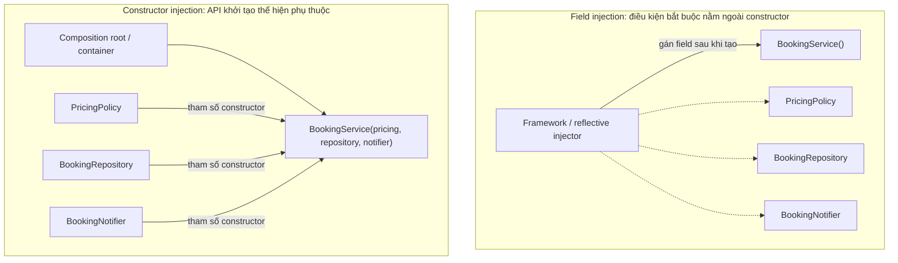
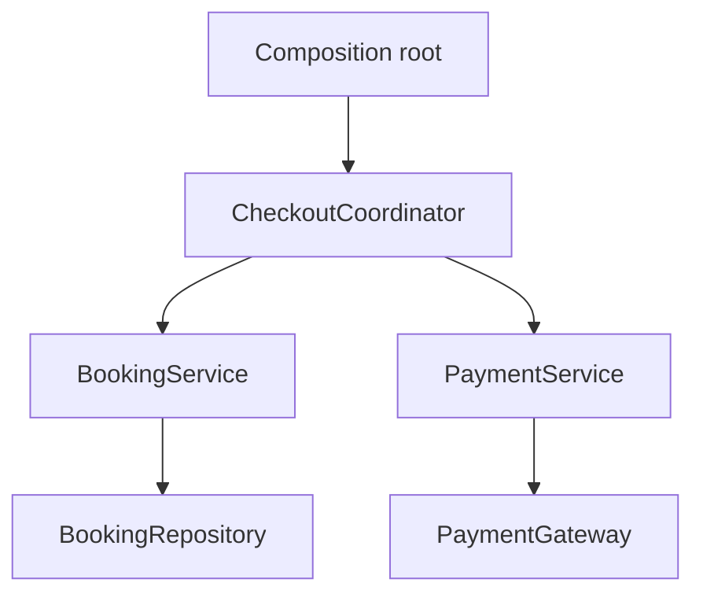

# Field injection làm phụ thuộc bắt buộc không thể hiện qua API khởi tạo

Trong chương **Lỗi thiết kế** của module **Dependency Injection (DI)**, một sai lầm dễ gặp là dùng **field injection** cho những cộng tác viên mà đối tượng **bắt buộc phải có mới có thể hoạt động đúng**. Service có thể khai báo một constructor không tham số, trong khi các dependency quan trọng chỉ xuất hiện dưới dạng field được framework gán giá trị sau khi tạo instance. Người đọc API khởi tạo không biết rằng service không thể dùng an toàn nếu chưa được tiêm đủ.

**Field injection vẫn là một hình thức dependency injection.** Vấn đề không phải cứ có annotation trên field là IoC biến mất, và cũng không phải một DI container luôn để field chưa được tiêm. Container được cấu hình đúng thường có cơ chế phát hiện dependency bắt buộc bị thiếu trước khi công bố bean. Vấn đề thiết kế là **hợp đồng khởi tạo của class không nói rõ những gì nó cần**, khiến một instance có thể được tạo bằng Java thuần ở trạng thái chưa sẵn sàng, khó bảo toàn bất biến và khó kiểm thử độc lập.

Đối với dependency bắt buộc, ưu tiên **constructor injection**: class nhận toàn bộ cộng tác viên cần thiết tại thời điểm tạo, giữ trong field phù hợp (thường là `private final`), kiểm tra đầu vào và có thể được dùng ngay sau khi constructor hoàn tất. **Composition root** — viết tay bằng Java thuần hoặc được biểu diễn bằng cấu hình DI container — có trách nhiệm cấp các dependency đó.

Sau bài học, bạn sẽ có thể:

- Nhìn vào constructor và nhận ra dependency bắt buộc có được biểu đạt bằng API khởi tạo hay không.
- Phân biệt field, constructor và setter/method injection theo **thời điểm thiết lập bất biến**.
- Chứng minh vì sao field injection làm unit test phải phụ thuộc container, reflection hoặc gán field thủ công.
- Nhận diện các lỗi như partial initialization, dependency ẩn, vòng phụ thuộc và sai scope.
- Refactor từng bước sang constructor injection, không làm thay đổi hành vi nghiệp vụ.
- Chạy thử một ví dụ **Java 11 thuần**: field injection giả lập gây lỗi muộn sau side effect; constructor injection báo thiếu dependency sớm; test bằng fake không cần framework.
- Hiểu khi nào field/method injection có thể là quyết định được cân nhắc, thay vì áp dụng quy tắc cứng nhắc.

## 1. API khởi tạo là một phần của hợp đồng đối tượng

Giả sử hệ thống thuê xe có `BookingService` với ba yêu cầu bắt buộc:

1. `PricingPolicy` để tính giá.
2. `BookingRepository` để lưu booking.
3. `BookingNotifier` để gửi xác nhận sau khi lưu.

Nếu thiếu một trong ba, service không thực hiện đầy đủ use case theo hợp đồng. Một thiết kế với field injection có thể trông như sau:

```java
// Minh họa Spring; cần dependency/import tương ứng trong ứng dụng thật.
@Service
public class BookingService {
    @Autowired
    private PricingPolicy pricing;

    @Autowired
    private BookingRepository repository;

    @Autowired
    private BookingNotifier notifier;

    public Booking book(String id, int days) {
        long total = pricing.quote(days);
        Booking booking = new Booking(id, days, total);
        repository.save(booking);
        notifier.confirmed(booking);
        return booking;
    }
}
```

Nhìn từ Java thuần, class này có thể được tạo bằng `new BookingService()` nếu không có constructor khác được khai báo. Nhưng lời gọi `book(...)` phụ thuộc việc một cơ chế bên ngoài **đã gán xong ba field**. Chữ ký `BookingService()` không thể hiện điều đó.

Một phiên bản dùng constructor injection nói thẳng yêu cầu:

```java
// Ví dụ cấu trúc; các kiểu cộng tác viên được định nghĩa ở ứng dụng.
public final class BookingService {
    private final PricingPolicy pricing;
    private final BookingRepository repository;
    private final BookingNotifier notifier;

    public BookingService(
            PricingPolicy pricing,
            BookingRepository repository,
            BookingNotifier notifier) {
        this.pricing = Objects.requireNonNull(pricing, "pricing");
        this.repository = Objects.requireNonNull(repository, "repository");
        this.notifier = Objects.requireNonNull(notifier, "notifier");
    }

    // Phương thức book(...) không cần biết ai tạo các dependency.
}
```

Đây là hai thiết kế **thay thế nhau**, không phải hai class cùng tên cần đặt chung trong một file. Phần 5 cung cấp chương trình Java 11 tự chứa với tên khác nhau và kiểm chứng hành vi.

Từ chữ ký mới, IDE, compiler, người gọi và bài test đều thấy rằng **muốn tạo `BookingService` phải cấp ba tham số**. `Objects.requireNonNull` còn giúp phát hiện giá trị `null` ngay tại điểm xây dựng, thay vì đến khi một luồng nghiệp vụ tình cờ sử dụng field đó.

### 1.1. So sánh điều mà người dùng class có thể nhìn thấy

| Tiêu chí | Field injection | Constructor injection |
| --- | --- | --- |
| Dependency bắt buộc nằm ở đâu? | Field và annotation hoặc cấu hình injection | Danh sách tham số constructor |
| Có thể gọi constructor mà không cung cấp dependency? | Thường có, khi class có constructor mặc định | Không, nếu chỉ có constructor yêu cầu đủ tham số |
| Thời điểm instance sẵn sàng | Sau khi container/cơ chế tiêm hoàn tất | Ngay sau khi constructor hợp lệ hoàn tất |
| Khả năng dùng `private final` cho dependency | Field injection thông thường không thuận tiện cho field `final` | Tự nhiên, gán một lần trong constructor |
| Kiểm thử Java thuần bằng `new` | Phải gán field, dùng reflection hoặc chạy container | Cấp fake/stub ngay trong constructor |
| Nhận diện dependency trong code review | Phải xem field, annotation và cấu hình | Chỉ cần bắt đầu từ chữ ký constructor |
| Phụ thuộc vào cơ chế framework để khởi tạo đủ | Thường cao nếu class chỉ khai báo field injection | Thấp đối với phần nghiệp vụ |
| Dependency thay đổi khi object đang sống | Về mặt cấu trúc có thể bị gán lại nếu field mutable | Có thể giữ tham chiếu ổn định qua `final` |

**Không suy ra rằng constructor injection loại bỏ mọi lỗi.** Người gọi vẫn có thể cấp nhầm implementation, tạo sai scope, hoặc cấp một adapter có hành vi lỗi. Constructor chỉ làm rõ và kiểm tra **điều kiện đầu vào của object**, còn composition root/test phải đảm bảo **đồ thị lắp ghép** và hành vi nghiệp vụ đúng.

## 2. Field injection che các điều kiện bắt buộc như thế nào?

### 2.1. Một đối tượng có thể được tạo khi chưa hợp lệ

Với field injection, quá trình khởi tạo thường có dạng khái niệm:

```text
Tạo instance bằng constructor
      -> các field dependency chưa được thiết lập
      -> framework tìm và gán dependency
      -> chạy các bước khởi tạo/lifecycle liên quan
      -> công bố bean sẵn sàng cho consumer
```

Framework được cấu hình đúng có thể đảm bảo consumer chỉ nhận bean sau các bước cần thiết. Tuy nhiên, **constructor của class không tự đảm bảo điều đó**. Trong Java thuần, `new BookingService()` tạo một object thiếu ba dependency. Trong unit test hoặc một đoạn code bên ngoài container, rủi ro này xuất hiện ngay.

Với constructor injection:

```text
Composition root có PricingPolicy, BookingRepository, BookingNotifier
      -> new BookingService(pricing, repository, notifier)
      -> constructor kiểm tra và gán field
      -> object hoàn tất khởi tạo
      -> consumer dùng object
```

Nếu dependency bắt buộc bị thiếu, điểm thất bại nằm **gần nguyên nhân**: nơi gọi constructor. Class không tồn tại như một đối tượng đã khởi tạo bình thường nhưng thiếu dependency chỉ vì bỏ quên bước injection.

### 2.2. Lỗi có thể xuất hiện sau khi một side effect đã xảy ra

Giả sử field `pricing` và `repository` đã được gán, còn `notifier` vẫn là `null`. Khi gọi `book(...)`:

1. Tính giá thành công.
2. Lưu booking thành công.
3. Gọi `notifier.confirmed(...)` và gặp `NullPointerException`.

Đây là một dạng **phát hiện lỗi muộn**: đã có side effect lưu dữ liệu nhưng yêu cầu không hoàn tất. Điều này không có nghĩa constructor injection tự giải quyết giao dịch phân tán hoặc rollback; nó chỉ giúp **tránh đưa một service thiếu dependency bắt buộc vào trạng thái sẵn sàng ngay từ đầu**.

Trong production, Spring có thể từ chối tạo bean khi một `@Autowired` bắt buộc không có ứng viên. Kịch bản trên đặc biệt hữu ích để nhìn thấy vấn đề của **API Java thuần và các cách khởi tạo/tiêm không đầy đủ**, không nên khẳng định đây là kết quả tất yếu của mọi container.

### 2.3. Phụ thuộc ẩn khiến thay đổi khó nhìn thấy

Khi bổ sung yêu cầu `AuditSink` vào service field-injected, constructor vẫn có vẻ không đổi:

```java
// Chỉ minh họa sự thay đổi API bị che khuất:
@Autowired
private AuditSink auditSink;
```

Những nơi tự gọi `new BookingService()` vẫn biên dịch như cũ, nhưng có thể bắt đầu lỗi khi gặp nhánh audit. Với constructor injection, thêm tham số `AuditSink auditSink` khiến các call site tạo service phải xem xét và cập nhật. **Compiler giúp chỉ ra phạm vi thay đổi** ngay khi code được biên dịch.

Trong framework, việc thêm một dependency bắt buộc cũng có thể khiến kiểm tra context fail khi startup. Tuy nhiên, test Java thuần chỉ có lợi ích tương đương nếu dependency được biểu diễn bằng constructor.

## 3. Đây là vấn đề của Dependency Injection, không chỉ của annotation

Field injection có thể dùng `@Autowired` của Spring, `@Inject` của Jakarta hoặc một cơ chế riêng. Thông điệp chung là **mã ngoài constructor gán một dependency vào field**.

**Constructor injection** diễn đạt một quy tắc mạnh: "*Không có các cộng tác viên này thì không tạo được instance dùng được*". Đây là một cách bảo vệ **invariant** của object. Invariant là điều kiện phải luôn đúng tại các thời điểm object được phép sử dụng, chẳng hạn các dependency bắt buộc không được `null`.

Một số điểm cần phân biệt:

- **IoC** nói rằng điều phối vòng tạo và gọi được giao cho phía ngoài object; field injection và constructor injection đều có thể tham gia IoC.
- **DI** nói rằng dependency được cung cấp từ ngoài, không để consumer tự tìm hoặc tạo tùy tiện.
- **Composition root** là nơi cấu hình và lắp ghép dependency. Với Java thuần, nó gọi constructor; với container, nó có thể được biểu diễn bằng bean definitions và cơ chế đăng ký.
- **DIP** (Dependency Inversion Principle) bàn về hướng phụ thuộc giữa abstraction và implementation. Một service dùng constructor để nhận JDBC class cụ thể vẫn có thể bị buộc chặt vào hạ tầng; một service dùng field injection qua interface vẫn có thể theo hướng DIP. **Kiểu injection** và **hướng phụ thuộc** là hai quyết định liên quan nhưng không đồng nhất.
- **Bất biến tham chiếu** qua `final` khác với **bất biến của object được tham chiếu**. `private final BookingRepository repository` không chứng minh repository thread-safe hoặc không giữ trạng thái mutable.

Do đó, mục tiêu không phải đổi annotation một cách máy móc, mà là **thể hiện đúng contract khởi tạo và trách nhiệm lắp ghép**.

## 4. Sơ đồ: từ phụ thuộc ẩn sang đồ thị thấy ngay tại constructor



Đây là sơ đồ **khả năng quan sát hợp đồng khởi tạo**, không phải kết luận rằng field injection bắt buộc sai ở mọi tình huống. Framework có thể dựng và kiểm tra đồ thị field injection, nhưng **người gọi constructor bằng Java thuần không có được sự đảm bảo tương đương**.

## 5. Ví dụ Java 11 thuần: phát hiện lỗi muộn và lỗi sớm

Ví dụ sử dụng **một file `FieldInjectionPitfallDemo.java`**, biên dịch và chạy với Java 11 trở lên, **không cần Spring, CDI, JUnit hoặc thư viện ngoài**.

Chương trình mô phỏng chính vấn đề của field injection bằng cách để các field ở trạng thái có thể được gán sau khi khởi tạo. Đây là **mô phỏng để giảng giải**, không phải một DI container. Trong container thật, framework sử dụng metadata và cơ chế injection riêng; ví dụ không cần reflection để chỉ ra rủi ro của API khởi tạo.

```bash
javac FieldInjectionPitfallDemo.java
java FieldInjectionPitfallDemo
```

```java
import java.util.ArrayList;
import java.util.HashMap;
import java.util.List;
import java.util.Map;
import java.util.Objects;

public final class FieldInjectionPitfallDemo {
    // 1. Dữ liệu và những hợp đồng nghiệp vụ.
    static final class Booking {
        final String id;
        final int days;
        final long total;

        Booking(String id, int days, long total) {
            if (id == null || id.isBlank() || days < 1 || total <= 0) {
                throw new IllegalArgumentException("Invalid booking");
            }
            this.id = id;
            this.days = days;
            this.total = total;
        }
    }

    interface PricingPolicy {
        long quote(int days);
    }

    static final class WeeklyPricing implements PricingPolicy {
        private final long dailyRate;

        WeeklyPricing(long dailyRate) {
            if (dailyRate <= 0) {
                throw new IllegalArgumentException("Invalid daily rate");
            }
            this.dailyRate = dailyRate;
        }

        @Override
        public long quote(int days) {
            if (days < 1) {
                throw new IllegalArgumentException("Invalid days");
            }
            long gross = Math.multiplyExact(dailyRate, days);
            return days >= 7 ? gross - gross / 10 : gross;
        }
    }

    interface BookingRepository {
        void save(Booking booking);
        Booking find(String bookingId);
        int count();
    }

    static final class InMemoryBookingRepository
            implements BookingRepository {
        private final Map<String, Booking> bookings = new HashMap<>();

        @Override
        public void save(Booking booking) {
            Objects.requireNonNull(booking);
            if (bookings.putIfAbsent(booking.id, booking) != null) {
                throw new IllegalArgumentException("Duplicate booking ID");
            }
        }

        @Override
        public Booking find(String bookingId) {
            return bookings.get(bookingId);
        }

        @Override
        public int count() {
            return bookings.size();
        }
    }

    @FunctionalInterface
    interface BookingNotifier {
        void confirmed(Booking booking);
    }

    // 2. Anti-pattern: phụ thuộc bắt buộc không xuất hiện trong constructor.
    // Field được để package-private chỉ để mô phỏng một lần tiêm không đầy đủ.
    // Trong ứng dụng field-injected thật, chúng thường là private + annotation.
    static final class FieldInjectedBookingService {
        PricingPolicy pricing;
        BookingRepository repository;
        BookingNotifier notifier;

        // Java tự cung cấp constructor không tham số.
        Booking book(String id, int days) {
            if (id == null || id.isBlank() || days < 1) {
                throw new IllegalArgumentException("Invalid request");
            }
            Booking booking = new Booking(id, days, pricing.quote(days));
            repository.save(booking);
            notifier.confirmed(booking);
            return booking;
        }
    }

    // 3. Thiết kế tốt hơn: phụ thuộc bắt buộc được kiểm tra lúc khởi tạo.
    static final class ConstructorInjectedBookingService {
        private final PricingPolicy pricing;
        private final BookingRepository repository;
        private final BookingNotifier notifier;

        ConstructorInjectedBookingService(
                PricingPolicy pricing,
                BookingRepository repository,
                BookingNotifier notifier) {
            this.pricing = Objects.requireNonNull(pricing, "pricing");
            this.repository =
                    Objects.requireNonNull(repository, "repository");
            this.notifier = Objects.requireNonNull(notifier, "notifier");
        }

        Booking book(String id, int days) {
            if (id == null || id.isBlank() || days < 1) {
                throw new IllegalArgumentException("Invalid request");
            }
            Booking booking = new Booking(id, days, pricing.quote(days));
            repository.save(booking);
            notifier.confirmed(booking);
            return booking;
        }
    }

    // 4. Composition root tạo và nối các instance cần thiết.
    static final class AppGraph {
        final ConstructorInjectedBookingService bookings;
        final InMemoryBookingRepository repository;

        AppGraph(ConstructorInjectedBookingService bookings,
                 InMemoryBookingRepository repository) {
            this.bookings = Objects.requireNonNull(bookings);
            this.repository = Objects.requireNonNull(repository);
        }
    }

    static AppGraph compose() {
        PricingPolicy pricing = new WeeklyPricing(200_000L);
        InMemoryBookingRepository repository =
                new InMemoryBookingRepository();
        BookingNotifier notifier =
                booking -> System.out.println("Da xac nhan: " + booking.id);
        ConstructorInjectedBookingService bookings =
                new ConstructorInjectedBookingService(
                        pricing, repository, notifier);
        return new AppGraph(bookings, repository);
    }

    // 5. Kiểm chứng vấn đề: đối tượng thiếu notifier vẫn tạo được.
    static void demonstratePartialFieldInjection() {
        InMemoryBookingRepository repository =
                new InMemoryBookingRepository();
        FieldInjectedBookingService legacy =
                new FieldInjectedBookingService();
        legacy.pricing = new WeeklyPricing(100_000L);
        legacy.repository = repository;
        // legacy.notifier bị bỏ quên: vẫn null.

        try {
            legacy.book("LEG-001", 2);
            throw new AssertionError("Expected missing notifier failure");
        } catch (NullPointerException expected) {
            // Đã ghi dữ liệu trước khi lỗi trên notifier bị phát hiện.
            if (repository.count() != 1
                    || repository.find("LEG-001") == null) {
                throw new AssertionError("Unexpected partial side effect");
            }
        }
        System.out.println("Field injection: loi muon sau khi luu");
    }

    // 6. Với constructor, lỗi được phát hiện trước khi gọi use case.
    static void demonstrateConstructorFailFast() {
        InMemoryBookingRepository repository =
                new InMemoryBookingRepository();
        try {
            new ConstructorInjectedBookingService(
                    new WeeklyPricing(100_000L), repository, null);
            throw new AssertionError("Expected constructor failure");
        } catch (NullPointerException expected) {
            if (!"notifier".equals(expected.getMessage())
                    || repository.count() != 0) {
                throw new AssertionError("Wrong failure point");
            }
        }
        System.out.println("Constructor injection: loi ngay khi tao");
    }

    // 7. Kiểm thử service thật qua constructor, chỉ fake ở biên thông báo.
    static void testWithoutContainer() {
        InMemoryBookingRepository repository =
                new InMemoryBookingRepository();
        List<Booking> notifications = new ArrayList<>();
        BookingNotifier fakeNotifier = notifications::add;
        PricingPolicy policy = new WeeklyPricing(100_000L);
        ConstructorInjectedBookingService service =
                new ConstructorInjectedBookingService(
                        policy, repository, fakeNotifier);

        Booking booking = service.book("TEST-01", 2);
        if (booking.total != 200_000L
                || repository.find("TEST-01") != booking
                || notifications.size() != 1
                || notifications.get(0) != booking) {
            throw new AssertionError("Unexpected booking flow");
        }

        try {
            service.book("BAD-DAYS", 0);
            throw new AssertionError("Expected invalid request");
        } catch (IllegalArgumentException expected) {
            // Invalid input không được lưu hoặc thông báo.
        }
        if (repository.count() != 1 || notifications.size() != 1) {
            throw new AssertionError("Invalid request caused a side effect");
        }
        System.out.println("Kiem thu Java thuan: PASS");
    }

    public static void main(String[] args) {
        demonstratePartialFieldInjection();
        demonstrateConstructorFailFast();

        AppGraph graph = compose();
        Booking booking = graph.bookings.book("BK-001", 7);
        if (booking.total != 1_260_000L
                || graph.repository.find("BK-001") != booking) {
            throw new AssertionError("Wrong production wiring");
        }
        System.out.println("Tong tien: " + booking.total + " VND");
        testWithoutContainer();
    }
}
```

Kết quả dự kiến:

```text
Field injection: loi muon sau khi luu
Constructor injection: loi ngay khi tao
Da xac nhan: BK-001
Tong tien: 1260000 VND
Kiem thu Java thuan: PASS
```

Với đơn giá `200_000` VND/ngày, 7 ngày có giá gốc `1_400_000` VND; giảm 10% còn **1_260_000 VND**. Ở bài test riêng, 2 ngày với đơn giá `100_000` VND cho kết quả **200_000 VND**.

### 5.1. Kết quả nào thực sự được chứng minh?

| Kiểm tra | Quan sát | Kết luận |
| --- | --- | --- |
| `new FieldInjectedBookingService()` rồi gán thiếu field | Instance được tạo, lỗi chỉ xuất hiện khi gọi notifier | Constructor không biểu đạt đủ điều kiện sử dụng |
| `new ConstructorInjectedBookingService(..., null)` | `Objects.requireNonNull` ném lỗi ngay | Điều kiện bắt buộc được xác nhận ở boundary khởi tạo |
| `compose()` | Tạo policy, repository, notifier rồi truyền vào constructor | Composition root chịu trách nhiệm nối các thành phần |
| `testWithoutContainer()` | Dùng repository bộ nhớ và fake notifier | Consumer có thể kiểm thử độc lập, không cần khởi động framework |
| Input `days = 0` | Lỗi xảy ra trước khi ghi hoặc thông báo | Kiểm tra nghiệp vụ vẫn cần nằm trong use case |

**Giới hạn của ví dụ:** đoạn field injection trong Java thuần chỉ **mô phỏng việc gán field không đầy đủ**; nó không khẳng định Spring luôn cho phép bean có `@Autowired` bắt buộc chưa được cấp chạy bình thường. Ví dụ cũng **không kiểm tra tính nguyên tử giữa database và notification**. Một notifier thực tế có thể lỗi sau khi lưu dù mọi dependency đã được cấp đầy đủ; cần transaction/outbox/retry/idempotency theo yêu cầu nghiệp vụ.

### 5.2. Những gì không nên sửa bằng cách thêm `new` vào service

Nếu gặp lỗi thiếu dependency, đừng làm như sau:

```java
// Anti-pattern: consumer tự quyết định công nghệ hạ tầng.
// private final BookingRepository repository =
//         new JdbcBookingRepository(...);
```

Mục tiêu của DI là **tách nơi sử dụng khỏi nơi tạo**. Constructor injection không yêu cầu service tự tìm implementation. Người gọi hoặc container mới lựa chọn repository phù hợp với môi trường.

## 6. Khi chuyển sang Spring hoặc CDI

Trong Spring, một constructor duy nhất của bean được quản lý thường có thể được dùng cho constructor injection **không cần gắn `@Autowired` trên constructor**. Ví dụ sau là **cấu hình minh họa**; nó cần dependency Spring và các type top-level tương ứng trong project, **không** nằm trong file `FieldInjectionPitfallDemo.java` ở phần 5:

```java
@Service
public final class BookingService {
    private final PricingPolicy pricing;
    private final BookingRepository repository;
    private final BookingNotifier notifier;

    public BookingService(
            PricingPolicy pricing,
            BookingRepository repository,
            BookingNotifier notifier) {
        this.pricing = Objects.requireNonNull(pricing);
        this.repository = Objects.requireNonNull(repository);
        this.notifier = Objects.requireNonNull(notifier);
    }
}
```

Để Spring có thể tạo bean này, composition root/framework configuration phải có các bean phù hợp cho `PricingPolicy`, `BookingRepository` và `BookingNotifier`. Chỉ chuyển field thành constructor **không tự đăng ký** implementation.

Nếu có nhiều implementation `PricingPolicy`, cần quyết định ứng viên bằng qualifier, cấu hình hoặc selector phù hợp. Nếu bean bị tạo ngoài Spring, constructor vẫn yêu cầu dependency đầy đủ; đó là ưu điểm cho test Java thuần.

Với CDI/Jakarta, dùng `@Inject` trên constructor theo quy tắc của container tương ứng. Cú pháp, constructor requirements, bean discovery và lifecycle khác Spring; không suy đoán khả năng autowire chỉ từ annotation. Các nguyên tắc **dependency bắt buộc hiện trong API khởi tạo** vẫn áp dụng.

### 6.1. Container có thể bắt lỗi field injection, vậy tại sao vẫn ưu tiên constructor?

Một container cấu hình đúng có thể:

- Phát hiện field injection bắt buộc không có binding khi khởi tạo bean.
- Kiểm tra một số vòng phụ thuộc hoặc scope theo cơ chế framework.
- Thiết lập các field trước khi giao bean hoàn tất cho consumer.

Nhưng những bảo đảm đó thuộc **quy trình khởi tạo của container**, không nằm trong **hợp đồng constructor của class**. Unit test dùng `new`, chương trình command-line hoặc một module khác có thể không đi qua container. Constructor injection làm điều kiện bắt buộc có giá trị ở cả **môi trường có và không có framework**.

### 6.2. Không dùng service locator để thay field injection

Phương án này không giải quyết đúng vấn đề:

```java
// Anti-pattern minh họa:
// class BookingService {
//     private final BookingRepository repository =
//             GlobalContainer.get(BookingRepository.class);
// }
```

Đưa việc tìm dependency vào trong consumer chỉ chuyển phụ thuộc ẩn từ field injection thành **service locator**. Chữ ký constructor vẫn không nói rõ cần repository nào, test phải có registry hoặc mock global state, còn mã nghiệp vụ phụ thuộc cách tổ chức container. Hãy để **composition root** cấp dependency qua constructor.

## 7. Constructor injection có thay thế mọi kiểu injection không?

Không. Chọn hình thức injection theo ý nghĩa của phụ thuộc:

| Hình thức | Khi phù hợp | Rủi ro cần kiểm soát |
| --- | --- | --- |
| **Constructor injection** | Dependency **bắt buộc**, ổn định trong vòng đời đối tượng | Constructor quá nhiều tham số có thể là tín hiệu class ôm nhiều trách nhiệm |
| **Setter/method injection** | Có một tùy chọn thực sự có thể thay đổi sau khi tạo hoặc một giai đoạn cấu hình có hợp đồng rõ | Trạng thái "đã tạo nhưng chưa cấu hình"; cần quy định thời điểm gọi và thread-safety |
| **Field injection** | Một số integration/legacy/framework-controlled case có ràng buộc đặc thù | API khởi tạo ẩn dependency; khó test độc lập và khó dùng `final` |
| **Factory/provider injection** | Consumer thật sự cần tạo instance theo request, transaction hoặc tham số runtime | Không để factory lan khắp nơi hoặc biến thành service locator |
| **Method parameter** | Dữ liệu chỉ cần trong **một lần gọi**, không phải dependency cố định của object | Tránh lưu request state vào field của singleton |

Một dependency là **tùy chọn thật sự** khi class có thể hoạt động có nghĩa mà không cần nó, với hành vi mặc định đã được định nghĩa. Không nên chỉ chuyển annotation sang `required = false` hoặc gắn `@Nullable` để làm ứng dụng khởi động, rồi mặc nhiên cho rằng dependency bắt buộc đã trở thành tùy chọn.

### 7.1. Optional nên được thể hiện có chủ đích

Giả sử audit có thể tắt trong môi trường local. Một lựa chọn là dùng **Null Object** cho `AuditSink`:

```java
interface AuditSink {
    void record(String action);
}

final class NoOpAuditSink implements AuditSink {
    @Override
    public void record(String action) {
        // Không làm gì, được lựa chọn có chủ đích ở composition root.
    }
}
```

Sau đó `BookingService` vẫn nhận `AuditSink` qua constructor. Điều đó tránh việc service phải liên tục kiểm tra `audit != null`. Nhưng nếu audit là yêu cầu pháp lý/nghiệp vụ bắt buộc, **không được dùng NoOp** chỉ để che lỗi cấu hình.

Một lựa chọn khác là `Optional<AuditSink>` hay một cờ cấu hình phù hợp, khi sự vắng mặt là một trạng thái nghiệp vụ rõ ràng. Đừng trộn "dependency thiếu do cấu hình lỗi" với "tính năng được chủ động tắt".

### 7.2. Constructor quá dài là tín hiệu cần phân tích, không phải lý do quay lại field injection

Một constructor có mười lăm tham số là khó đọc. Tuy nhiên, đổi toàn bộ tham số thành field injection chỉ **che đi** sự phức tạp. Cần hỏi:

- Service có đang gánh nhiều use case hoặc nhiều trách nhiệm khác nhau?
- Có cần tách coordinator và các thành phần nghiệp vụ con?
- Các tham số có phải dependency thật, hay chỉ là dữ liệu theo từng request nên chuyển vào method?
- Có thể nhóm các giá trị **có cùng ý nghĩa nghiệp vụ** thành một kiểu cấu hình bất biến hợp lý không?

Không nên tạo một `GlobalDependencies` chứa mọi service chỉ để rút ngắn danh sách tham số: nó có thể trở thành **service locator có kiểu** và làm mất khả năng quan sát dependency thực.

## 8. Vòng phụ thuộc và trạng thái chưa khởi tạo

Field/setter injection đôi khi được dùng để "giải" một vòng constructor:

```text
BookingService  -> PaymentService
PaymentService  -> BookingService
```

Nếu cả hai constructor yêu cầu nhau, lắp ghép trực tiếp bằng `new` không có thứ tự tạo đầy đủ. Một container có thể hỗ trợ một số cơ chế lắp ghép trễ, proxy hoặc cho phép tham chiếu vòng trong vài trường hợp, nhưng **không có nghĩa vòng trách nhiệm đã hợp lý**.

Điều cần phân tích là ai **sở hữu workflow**. Ví dụ:



Một `CheckoutCoordinator` điều phối các bước tạo booking và thanh toán, còn `BookingService` và `PaymentService` chỉ giữ trách nhiệm của mình. Constructor injection khiến vòng có thể được phát hiện rõ hơn trong đồ thị; giải pháp đúng là **xem lại hướng phụ thuộc**, không nhất thiết đổi loại injection.

### 8.1. Field injection và đối tượng được công bố trước khi sẵn sàng

Với hệ thống có nhiều thread hoặc callback khởi tạo, **công bố `this` quá sớm** có thể cho code khác nhìn thấy trạng thái chưa hoàn tất. Đây là nguy cơ chung khi thiết kế object mutable có các pha khởi tạo; **không nên quy kết mọi bean field-injected đều bị công bố sai** vì container có thể đảm bảo thứ tự init.

Constructor injection và `final` giúp xây dựng object ổn định hơn, nhưng vẫn phải tránh leak `this` từ constructor, đăng ký listener quá sớm hoặc khởi động thread khi invariant chưa được thiết lập. Java Memory Model và framework lifecycle là những vấn đề khác với việc chỉ có annotation trên field.

## 9. Scope và ownership không tự đúng chỉ vì đổi sang constructor

Trong thực tế một `BookingService` có thể là singleton, còn session/transaction thì chỉ sống theo một request. Nếu constructor của singleton nhận **một instance transaction-scoped cụ thể** và giữ trong field `final`, service vẫn có nguy cơ dùng session sau khi request kết thúc hoặc giữa nhiều request.

| Thành phần | Scope gợi ý | Cách lắp ghép cần cân nhắc |
| --- | --- | --- |
| `PricingPolicy` bất biến | Có thể dùng chung | Inject trực tiếp qua constructor |
| `BookingService` không giữ dữ liệu request | Có thể dùng chung | Các dependency cũng phải an toàn theo scope tương ứng |
| `BookingRepository` dùng connection pool | Theo runtime ứng dụng nếu adapter thread-safe | Inject adapter dài hạn; mượn connection theo transaction |
| `JobSession`/transaction | Theo một request hoặc task | Worker/use case mở và đóng trong đúng scope |
| `JobSessionFactory` | Có thể dùng chung | Inject factory vào đúng thành phần cần mở session |
| `ExecutorService` | Theo runtime | Composition root/runtime sở hữu shutdown |
| `HttpClient`/connection pool | Theo runtime hoặc module sở hữu | Không để consumer tự đóng sau một request |

**`final` chỉ ổn định tham chiếu**, không tự bảo vệ dữ liệu mutable bên trong adapter hoặc bảo đảm thread-safety. Phải phân biệt **lifetime của consumer** với **lifetime của dependency**. Khi request kết thúc mà công việc nền còn chạy, không nên chuyển một object request-scoped đã được mở sẵn sang background task; worker cần factory tạo scope của riêng nó.

### 9.1. Ai có quyền đóng tài nguyên?

Với DI thủ công, composition root thường sở hữu connection pool, executor và network client. Consumer được cấp dependency để sử dụng không nhất thiết có quyền gọi `close()`. Nếu container quản lý tài nguyên, destroy hook và scope cần được cấu hình theo hợp đồng framework.

Việc chuyển từ field injection sang constructor injection **không tự động quản lý tài nguyên**. Khi refactor, hãy giữ nguyên hoặc cải thiện đường khởi động/shutdown và kiểm tra những nơi đã từng mặc định rằng dependency luôn là singleton.

## 10. Refactor từ field injection sang constructor injection có kiểm soát

Không nhất thiết thay đổi toàn bộ dự án trong một commit. Một quy trình thực tế:

1. **Xác định dependency thật sự bắt buộc.** Đọc field, annotation, phương thức sử dụng và điều kiện cấu hình. Phân loại dependency cố định, tùy chọn và dữ liệu theo lần gọi.
2. **Giữ nguyên hợp đồng nghiệp vụ.** Không thay database, công thức giá hoặc cơ chế gửi email cùng lúc nếu mục tiêu là đổi kiểu injection.
3. **Thêm constructor nhận các dependency bắt buộc.** Kiểm tra `null`/invariant phù hợp và lưu trong `private final` khi vòng đời ổn định.
4. **Bỏ field injection ở những field đã chuyển.** Không dùng đồng thời constructor và annotation gán lại cùng một field nếu không có lý do kỹ thuật.
5. **Cập nhật composition root/cấu hình container.** Đảm bảo có đủ bean/instance, đúng qualifier, scope và ownership. Với Spring, một constructor duy nhất trong managed bean thường đủ cho autowiring.
6. **Sửa các chỗ tự tạo service bằng Java thuần.** Compiler sẽ chỉ ra call site chưa cung cấp tham số; dùng fake hoặc adapter phù hợp thay cho registry toàn cục.
7. **Kiểm thử hành vi trước/sau.** Dùng cùng tình huống thành công, input sai và lỗi I/O. Thêm kiểm tra khởi tạo container cho cấu hình thật.
8. **Xem lại vòng phụ thuộc và lifecycle.** Nếu chuyển field sang constructor làm lộ một vòng, phân lại trách nhiệm thay vì bật lazy/setter chỉ để tránh lỗi.

### 10.1. Một phép chuyển cụ thể

Trước:

```java
// Đoạn Spring minh họa; cần import và class thực tế.
@Service
class ReservationService {
    @Autowired
    private ReservationRepository repository;

    @Autowired
    private ReservationNotifier notifier;

    void reserve(Reservation reservation) {
        repository.save(reservation);
        notifier.created(reservation);
    }
}
```

Sau:

```java
@Service
class ReservationService {
    private final ReservationRepository repository;
    private final ReservationNotifier notifier;

    ReservationService(
            ReservationRepository repository,
            ReservationNotifier notifier) {
        this.repository = Objects.requireNonNull(repository);
        this.notifier = Objects.requireNonNull(notifier);
    }

    void reserve(Reservation reservation) {
        repository.save(reservation);
        notifier.created(reservation);
    }
}
```

**Hành vi `reserve(...)` không đổi**. Thay đổi nằm ở **hợp đồng khởi tạo**. Khi sử dụng Spring, các bean cho `ReservationRepository` và `ReservationNotifier` vẫn cần được đăng ký. Khi dùng Java thuần, test có thể tạo service với repository fake và notifier fake ngay tại constructor.

Lưu ý tên class trước/sau là hai phiên bản thay thế; không đặt chung trong một file với cùng tên. Đoạn mã không tự bảo đảm database và notification có một transaction chung; đây là chủ đề riêng về tính nhất quán I/O.

## 11. Kiểm thử không phụ thuộc container: cái được và giới hạn

Với constructor injection, một test có thể tập trung vào use case:

```java
// Dạng ý tưởng: dùng các interface trong project thực.
List<Booking> notified = new ArrayList<>();
BookingRepository repository = new InMemoryBookingRepository();
BookingNotifier notifier = notified::add;
BookingService service =
        new BookingService(new WeeklyPricing(...), repository, notifier);

// Gọi service và kiểm tra kết quả, trạng thái lưu, thông báo.
```

Trong file tự chạy ở phần 5, `testWithoutContainer()` đã thực hiện tương đương với loại test này. Không cần mock tất cả class: chính sách giá thuần có thể dùng class thật; fake thường cần ở biên I/O hoặc nơi phải điều khiển lỗi.

Với field injection, một test thuần thường phải:

- Gán field nếu visibility cho phép — dễ bỏ quên hoặc làm lộ field không nên công khai.
- Dùng reflection/test utility để đặt field private — test bị gắn chặt với tên field và chi tiết triển khai.
- Khởi động Spring/CDI context chỉ để tiêm vài dependency — test trở thành kiểm tra cấu hình/lifecycle, thường chậm và khó cô lập hơn.

**Kiểm thử bằng container không phải xấu.** Ta vẫn cần context/integration test để xác nhận các bean được đăng ký đúng, qualifier không mơ hồ, scope phù hợp và lifecycle thật hoạt động. Chỉ không nên bắt một test thuật toán đơn giản phải khởi tạo toàn bộ framework khi constructor injection cho phép test thuần.

### 11.1. Những gì phải kiểm tra sau khi refactor

| Cấp kiểm thử | Kỳ vọng |
| --- | --- |
| Constructor test | Truyền `null` cho dependency bắt buộc bị từ chối sớm |
| Unit test use case | Đầu vào hợp lệ cho kết quả đúng; đầu vào sai không gây side effect |
| Failure-path test | Repository/notifier lỗi được xử lý theo hợp đồng |
| Wiring test | Composition root hoặc DI container cấp đủ dependency và chọn đúng implementation |
| Scope/lifecycle test | Service dùng chung không giữ nhầm session request; tài nguyên được đóng đúng chủ |
| Integration test | Database/client hoạt động với transaction, retry và timeout thực tế |

Một test "constructor không nhận null" **không thay thế** test hành vi nghiệp vụ. Một test context khởi động thành công **không chứng minh** booking được lưu và thông báo chính xác. Hãy giữ phạm vi khẳng định của từng loại test rõ ràng.

## 12. Những phản biện thường gặp

### "Field injection ít code hơn."

Nó rút ngắn constructor nhưng chuyển chi phí sang cấu hình ẩn, test setup và lifecycle. Với một lớp chỉ có vài dependency bắt buộc, constructor rõ ràng thường đem lại lợi ích đọc hiểu và kiểm soát cao hơn. Có thể dùng khả năng sinh constructor của IDE hoặc các công cụ build phù hợp, nhưng **đừng để công cụ che mất hợp đồng thật**.

### "Framework vẫn tự tiêm, sao cần constructor?"

Vì yêu cầu của class nên có hiệu lực **không phụ thuộc việc ai tạo object**. Một class nghiệp vụ có thể được dùng trong unit test, CLI, batch job hoặc được lắp ghép bằng một container khác. Constructor injection giảm lệ thuộc vào chi tiết khởi tạo bằng reflection/annotation.

### "Tôi cần mock dependency, field injection cũng làm được."

Đúng — reflection hoặc test framework có thể gán field. Nhưng khả năng làm được không đồng nghĩa đó là API tốt. Constructor cho phép đưa fake vào bằng cơ chế Java bình thường, không cần quyền truy cập đặc biệt và không khiến test phụ thuộc tên field.

### "Bắt buộc phải dùng interface cho mọi dependency?"

Không. Nếu `PriceCalculator` là một class thuần, ổn định và không có nhu cầu thay implementation, có thể inject trực tiếp class đó. Port/interface hữu ích ở ranh giới hạ tầng hoặc chỗ cần đa hình có ý nghĩa. **DI không đồng nghĩa tạo interface cho tất cả class**.

### "Constructor quá nhiều tham số là lỗi của constructor injection."

Thường đó là tín hiệu cần xem lại **quá nhiều trách nhiệm hoặc phụ thuộc**. Field injection che số lượng dependency chứ không làm class đơn giản hơn. Hãy đánh giá cách tách use case, policy, coordinator và module.

### "Đổi sang constructor sẽ khiến vòng phụ thuộc không dựng được."

Đó là cơ hội nhìn ra vòng mà trước đó bị che. Xem lại ranh giới trách nhiệm, dùng một coordinator hợp lý hoặc tách một thành phần chung. Không tự động chuyển sang provider/lazy chỉ để đối phó thông báo lỗi container.

### "Field injection luôn không an toàn hoặc luôn bị null trong Spring."

Không chính xác. Container được cấu hình đúng có thể inject và xác thực field trước khi bean được sử dụng. Lý do ưu tiên constructor là **hợp đồng khởi tạo minh bạch, invariant dễ giữ và test độc lập**, không phải một tuyên bố sai rằng mọi framework luôn thất bại với field injection.

## 13. Bài tập tự đánh giá

**Bài 1 — API khởi tạo.** Class `PaymentService` có `@Autowired private PaymentGateway gateway` nhưng không khai báo constructor. Có thể biết class này bắt buộc có `PaymentGateway` chỉ bằng cách nhìn lời gọi `new PaymentService()` không?

*Gợi ý:* Không. Constructor mặc định không thể hiện gateway; phải đọc field/annotation và dựa vào container hoặc cơ chế tiêm khác.

**Bài 2 — Lỗi muộn.** `BookingService` có ba field injected. Hai field được gán, một field notifier còn `null`. Service lưu booking rồi gọi notifier. Có thể xảy ra điều gì?

*Gợi ý:* Có thể lưu thành công trước khi ném `NullPointerException`. Constructor injection với validation không cho phép tạo service thiếu notifier; nhưng vẫn phải xử lý lỗi I/O và tính nhất quán riêng.

**Bài 3 — Chuyển sang constructor.** Viết constructor cho `EmailService` cần `EmailClient` và `RetryPolicy`. Nên đặt field như thế nào?

*Gợi ý:* `private final EmailClient client` và `private final RetryPolicy retryPolicy`, gán bằng `Objects.requireNonNull` trong constructor. Composition root cấp implementation phù hợp.

**Bài 4 — Khi phụ thuộc tùy chọn.** `AuditSink` có thể vắng mặt theo yêu cầu nghiệp vụ. Cần chuyển field bắt buộc thành `@Autowired(required=false)` để hết lỗi không?

*Gợi ý:* Trước tiên xác định hành vi khi không audit. Có thể chọn `NoOpAuditSink` ở composition root hoặc biểu diễn tùy chọn rõ. Không che một lỗi thiếu audit bắt buộc bằng annotation.

**Bài 5 — Vòng phụ thuộc.** `OrderService` cần `PaymentService`, trong khi `PaymentService` cần lại `OrderService`. Dùng field injection cho một phía có phải hướng giải quyết trách nhiệm tốt nhất không?

*Gợi ý:* Không nhất thiết. Xem hai service có cùng điều phối checkout không; trích xuất coordinator hoặc thành phần dùng chung nếu phù hợp.

**Bài 6 — Scope.** Một singleton có constructor nhận một `RequestSession` đã được tạo ở request đầu tiên. Vì mọi field đều `final`, có thể dùng instance đó trong các request sau không?

*Gợi ý:* Không được kết luận như vậy. Session có scope ngắn và có thể không còn hợp lệ. Cần factory/scoped provider phù hợp; không chia sẻ session đã hết vòng đời.

**Bài 7 — Kiểm thử.** Bạn muốn unit test thuật toán tính phí của `BookingService` nhưng service có private fields được `@Autowired`. Tại sao constructor injection có lợi?

*Gợi ý:* Test có thể `new` service với policy thật và fake repository/notifier mà không cần reflection hoặc khởi tạo Spring context.

**Bài 8 — Lỗi cấu hình thật.** Sau khi refactor, Spring báo có hai bean `PricingPolicy`. Constructor injection có tạo ra vấn đề đó không?

*Gợi ý:* Không. Đó là vấn đề lựa chọn implementation/qualifier trong đồ thị đăng ký. Cần một lựa chọn có chủ đích hoặc selector nghiệp vụ; field injection cũng có thể gặp cùng sự mơ hồ.

**Bài 9 — Quyền đóng.** Một repository được inject qua constructor dùng connection pool chung. Repository có được gọi `pool.close()` sau mỗi lần `save` không?

*Gợi ý:* Không nếu nó chỉ mượn pool; runtime/container sở hữu pool. Repository có thể đóng logical connection/lease theo mỗi thao tác để trả về pool, theo hợp đồng API.

## 14. Checklist khi review field injection

- Những field nào là **dependency bắt buộc** để class hoạt động đúng?
- Có thể tạo object bằng constructor mặc định nhưng **chưa đủ dependency** không?
- Dependency bắt buộc đã được biểu diễn trong **constructor có kiểu rõ ràng** chưa?
- Constructor có kiểm tra `null`/bất biến thích hợp, lưu vào field `private final` khi phù hợp chưa?
- Mã nghiệp vụ có tránh gọi container/service locator hoặc tự `new` adapter hạ tầng không?
- Một constructor dài có đang bộc lộ class quá nhiều trách nhiệm cần tách không?
- Dependency nào thật sự tùy chọn, và hành vi khi vắng mặt đã được thiết kế rõ chưa?
- Có vòng constructor nào cho thấy ranh giới giữa các service chưa hợp lý không?
- Scope của singleton, request/session và tài nguyên dài hạn có phù hợp với consumer không?
- Composition root hoặc cấu hình container có đăng ký đủ dependency, xử lý qualifier và ownership chưa?
- Unit test có thể tạo service **bằng Java thuần** với fake/adapter phù hợp mà không dùng reflection không?
- Các test startup/container và integration test có kiểm tra wiring, scope và vòng đời thực tế không?

**Field injection làm phụ thuộc bắt buộc khó nhìn thấy từ API khởi tạo, dù framework có thể hỗ trợ nó đúng cách.** Khi một cộng tác viên là điều kiện để object tồn tại hợp lệ, hãy thể hiện bằng **constructor injection** và kiểm tra ngay lúc tạo. **Composition root** vẫn chọn implementation và quản lý vòng đời; service chỉ dùng các dependency được cấp. Cách tổ chức này làm rõ **DI và IoC**, giúp kiểm thử bằng Java thuần và phát hiện lỗi lắp ghép sớm hơn trước khi mở rộng sang DI container.
