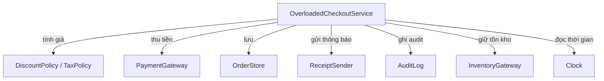
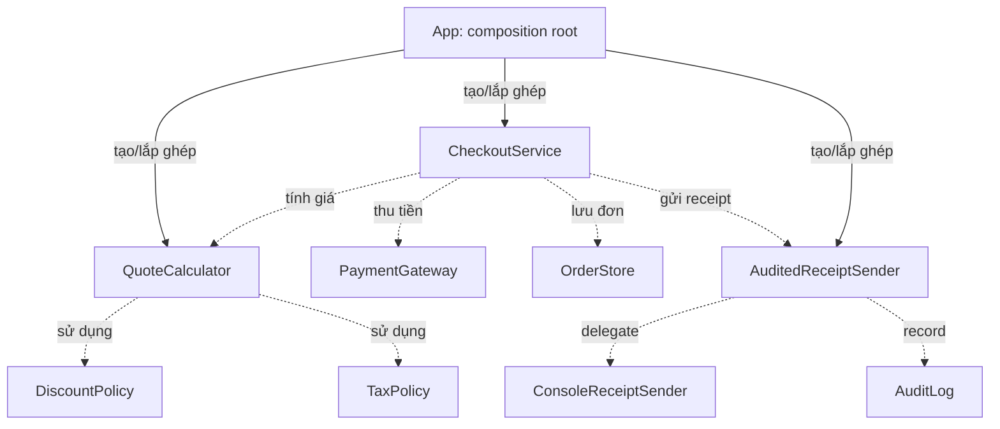

# Constructor quá nhiều tham số và lớp gánh quá nhiều trách nhiệm

## 1. Vấn đề thật sự không phải là một con số

Trong **Dependency Injection (DI)**, constructor injection làm các dependency bắt buộc xuất hiện rõ trong chữ ký của lớp. Đây là ưu điểm lớn: khi nhìn vào `new CheckoutService(...)`, ta biết đối tượng cần những cộng tác viên nào để hoạt động. Nhưng chính sự minh bạch ấy đôi khi cho thấy một vấn đề: constructor nhận quá nhiều thứ không liên quan, vì lớp đang đảm nhận quá nhiều trách nhiệm.

Xét một dịch vụ đặt hàng có constructor như sau:

```java
// Đoạn code minh họa dấu hiệu thiết kế, không phải chương trình độc lập.
CheckoutService(
        OrderStore orders,
        DiscountPolicy discounts,
        TaxPolicy taxes,
        PaymentGateway payments,
        ReceiptSender receipts,
        AuditLog audit,
        InventoryGateway inventory,
        Clock clock) {
    // ...
}
```

Tám tham số **không tự động chứng minh** thiết kế sai. Một lớp orchestration có thể cần phối hợp nhiều use case một cách chính đáng. Ngược lại, một lớp chỉ có ba tham số vẫn có thể ôm nhiều việc, nếu các tham số ấy là những “siêu service” làm đủ thứ.

**Câu hỏi quan trọng:** tại sao lớp phải biết từng dependency đó, những thay đổi nghiệp vụ nào buộc ta sửa lớp, và liệu có thể tách các phần hành vi có tính gắn kết (*cohesion*) cao thành những thành phần nhỏ hơn không?

Đây là bài trong chương **Lỗi thiết kế** của module **Dependency Injection**, tập trung vào **Inversion of Control (IoC)**, constructor injection và composition root. Ta sẽ nhận diện mùi thiết kế, thực hành cải tiến bằng **Java thuần**, giữ khả năng kiểm thử độc lập, rồi xem xét scope và vòng đời trước khi mở rộng sang DI container.

Sau bài này, bạn có thể:

1. Đánh giá một constructor dài mà không dựa vào ngưỡng tham số cứng nhắc.
2. Phân biệt **độ phức tạp của việc lắp ghép** với **lớp có quá nhiều trách nhiệm**.
3. Nhận ra các cách “làm ngắn constructor” nhưng giấu dependency, như service locator, `Dependencies` object tổng hợp hoặc builder dùng sai chỗ.
4. Refactor theo trách nhiệm, giữ constructor rõ ràng và một composition root dễ kiểm tra.
5. Dùng test double để bảo toàn hành vi trong quá trình tách lớp, quản lý đúng ownership/scope cho dependency.

## 2. Constructor injection làm lộ vấn đề thay vì gây ra vấn đề

DI giải quyết việc **ai tạo và cung cấp dependency**. Nó không bảo đảm lớp sử dụng dependency có trách nhiệm hợp lý. Constructor injection có thể biến một thiết kế nhiều phụ thuộc ẩn thành một chữ ký dài:

```java
// Trước: dependency bị ẩn dưới các lời gọi new và lookup.
final class HiddenCheckoutService {
    private final PaymentGateway payments = new RealPaymentGateway();
    private final AuditLog audit = ServiceLocator.auditLog();
    // ...
}
```

Đoạn code trên là phác thảo, không biên dịch độc lập vì chưa định nghĩa các lớp hạ tầng. Dù constructor rỗng, service vẫn phụ thuộc hạ tầng thanh toán và audit. Sau khi đưa dependency lên constructor, sự phụ thuộc đó **trở nên nhìn thấy được**, giúp phát hiện vùng thiết kế cần cải thiện.

**Không nên “sửa” một constructor dài bằng cách đưa dependency trở lại `new`, static getter hay service locator.** Cách ấy chỉ dời sự phức tạp ra khỏi chữ ký công khai và khiến unit test phải chuẩn bị hạ tầng thật hoặc dùng thủ thuật reflection/static mocking.

### 2.1. Tách hai loại độ phức tạp

| Loại độ phức tạp | Biểu hiện | Nơi nên xử lý |
| --- | --- | --- |
| **Composition complexity** | Hệ thống có nhiều bean, adapter, factory và cấu hình khác nhau | Composition root, module lắp ghép, factory hoặc DI container |
| **Responsibility complexity** | Một lớp vừa tính giá, thu tiền, gửi email, truy vấn DB, tạo file và ghi audit | Thiết kế trách nhiệm của lớp/use case |
| **Configuration complexity** | Nhiều timeout, retry, endpoint, cờ tính năng cùng được truyền bằng giá trị rời rạc | Cấu hình có tên, value object phù hợp, validation |
| **Lifecycle complexity** | Một lớp giữ resource có scope khác nhau, tự mở/đóng nhiều client | Ownership, scope và các ranh giới vòng đời |

Một DI container có thể giảm chi phí **lắp ghép** nhưng không tự chữa **lớp ôm quá nhiều trách nhiệm**. Ngược lại, việc tách một lớp có thể khiến composition root có thêm một vài dòng `new`; điều đó hoàn toàn chấp nhận được nếu đồ thị phụ thuộc rõ hơn và dễ kiểm thử hơn.

## 3. Nhận diện constructor dài cần xem xét

Đừng bắt đầu bằng câu hỏi “bao nhiêu tham số là quá nhiều?”; hãy nhìn vào tác động của danh sách tham số:

| Dấu hiệu | Điều cần điều tra |
| --- | --- |
| Có nhiều dependency thuộc các mảng nghiệp vụ khác nhau | Class có đang vi phạm nguyên tắc một lý do thay đổi (SRP) không? |
| Test một nhánh nhỏ phải dựng nhiều mock không liên quan | Dependency nào chỉ phục vụ những phần trách nhiệm khác? |
| Thêm tính năng mới thường phải sửa constructor và nhiều test cũ | Class có đang là điểm tập trung các thay đổi không? |
| Constructor chứa nhiều `boolean`, số và chuỗi ít ngữ nghĩa | Có nên tạo value object cấu hình có tên thay vì thêm tham số rời rạc? |
| Dùng cùng một dependency ở mọi bước và các dependency khác chỉ ở một bước | Có thể trích xuất cộng tác viên có trách nhiệm riêng không? |
| Nhiều overload/builder chỉ để tạo các tổ hợp hợp lệ khác nhau | Invariant của object có rõ không? Có phải đang gộp nhiều chế độ sử dụng? |
| Lớp vừa lắp ghép adapter vừa điều hành nghiệp vụ | Có thể đưa việc chọn/tạo adapter về composition root không? |
| Constructor nhận cả singleton, stream, transaction/request context | Scope có tương thích và ownership có rõ không? |

Một số **heuristic** (chẳng hạn từ 6–8 dependency trở lên thì review) có thể dùng để tạo tín hiệu trong code review, nhưng **không phải luật cứng**. Các mẫu như application orchestrator hoặc bộ cấu hình có những nhu cầu thật sự khác nhau. Quan trọng là đánh giá bằng **cohesion, lý do thay đổi, khả năng kiểm thử và vòng đời**, không chạy theo một con số.

### 3.1. Single Responsibility Principle không có nghĩa “mỗi lớp một phương thức”

**Single Responsibility Principle (SRP)** gợi ý một module nên có một lý do thay đổi có ý nghĩa, thường gắn với một nhóm tác nhân hoặc quyết định nghiệp vụ. Một `QuoteCalculator` có thể có nhiều phương thức để tính giá và kiểm tra quy tắc liên quan mà vẫn gắn kết tốt. Ngược lại, một `CheckoutService` chỉ có một phương thức `checkout` vẫn có thể vi phạm SRP nếu bên trong vừa triển khai công thức thuế, quản lý retry HTTP, định dạng email và ghi file.

Tách lớp theo **trách nhiệm thay đổi cùng nhau** tốt hơn tách cứng theo số phương thức hoặc số dòng.

## 4. Ví dụ trước refactor: mọi thứ nằm trong checkout

Giả sử phiên bản đầu tiên vừa tính giảm giá/thuế, vừa chọn gateway, gửi receipt và ghi audit. Dù dùng constructor injection, class có thể trở thành điểm tập trung của nhiều thay đổi:

```java
// Phác thảo thiết kế cũ, các kiểu interface không được định nghĩa ở đây.
final class OverloadedCheckoutService {
    private final DiscountPolicy discounts;
    private final TaxPolicy taxes;
    private final PaymentGateway payments;
    private final OrderStore orders;
    private final ReceiptSender receipts;
    private final AuditLog audit;
    private final InventoryGateway inventory;
    private final Clock clock;

    OverloadedCheckoutService(
            DiscountPolicy discounts,
            TaxPolicy taxes,
            PaymentGateway payments,
            OrderStore orders,
            ReceiptSender receipts,
            AuditLog audit,
            InventoryGateway inventory,
            Clock clock) {
        this.discounts = discounts;
        this.taxes = taxes;
        this.payments = payments;
        this.orders = orders;
        this.receipts = receipts;
        this.audit = audit;
        this.inventory = inventory;
        this.clock = clock;
    }

    // checkout(...) vừa tính giá, kiểm tra tồn kho, thanh toán,
    // lưu đơn, gửi receipt, ghi audit và xử lý thời điểm.
}
```

Danh sách trên đáng xem xét vì nhiều **lý do thay đổi độc lập** đang hội tụ:

- Đổi công thức giảm giá hoặc cách làm tròn thuế.
- Thay logic tồn kho hoặc quyền giữ hàng.
- Thay giao thức thanh toán/retry/idempotency.
- Đổi định dạng/kênh gửi receipt.
- Đổi cơ chế audit/quan sát.
- Đổi cách ghi đơn hoặc timestamp.

Nếu mọi thay đổi đều sửa `OverloadedCheckoutService`, review khó tập trung và regression test dễ phình to. Việc service có tám trường `final` không giải quyết gánh nặng về trách nhiệm.

### 4.1. Bản đồ trách nhiệm trước khi tách



Đây là sơ đồ **mùi thiết kế**: nó giúp đặt câu hỏi chứ chưa phải bằng chứng bắt buộc phải tách tất cả thành các service nhỏ. Ví dụ, nếu việc giữ tồn kho luôn phải phối hợp với thanh toán theo một giao thức nhất quán, ta cần định nghĩa ranh giới transaction/process phù hợp thay vì tách tùy tiện.

## 5. Refactor theo trách nhiệm: giảm coupling, không giấu nó

Ta chọn một phạm vi học tập nhỏ nhưng đủ thực tế:

1. **`QuoteCalculator`** thực hiện quy tắc giảm giá và thuế, không gửi thanh toán.
2. **`CheckoutService`** điều phối các bước tính tổng, charge, lưu đơn, gửi receipt. Nó không chứa công thức giá hoặc mã audit.
3. **`AuditedReceiptSender`** bọc một `ReceiptSender` và ghi audit khi gửi thành công. Việc quan sát này có trách nhiệm riêng, dùng cùng hợp đồng gửi receipt.
4. **Composition root** tạo tất cả instance, chọn chính sách giảm giá/thuế và inject lớp bọc ngoài cùng.

Chúng ta cố ý **không** tạo một class mới chỉ để bọc riêng `PaymentGateway` và `OrderStore`, vì với ví dụ nhỏ điều đó có thể chỉ làm tăng số lớp trung gian. Sau refactor, `CheckoutService` còn bốn dependency: mỗi dependency có vai trò rõ ràng trong quy trình checkout.



Trong cách này, **đồ thị đối tượng có thể không ít node hơn**, nhưng **mỗi node chứa trách nhiệm rõ hơn**. Đó là dấu hiệu refactor tốt hơn là chỉ giảm tham số bằng mọi giá.

## 6. Mã hoàn chỉnh sau refactor (Java thuần)

Ví dụ sau mô phỏng thanh toán bằng cách in ra console, không thực hiện giao dịch thật. Dùng tiền ở đơn vị **cent** với kiểu `long` để tránh lỗi biểu diễn của `double` trong ví dụ. Quy tắc tính thuế/giảm giá ở đây cố ý đơn giản và không đại diện cho luật thuế thực tế.

Tạo file **`App.java`** (JDK 11 trở lên):

```java
import java.util.Objects;

// 1. Hợp đồng cho chính sách giá.
interface DiscountPolicy {
    long discountCents(long subtotalCents);
}

interface TaxPolicy {
    long taxCents(long amountAfterDiscountCents);
}

// 2. Thành phần chuyên trách tính giá.
final class QuoteCalculator {
    private final DiscountPolicy discounts;
    private final TaxPolicy taxes;

    QuoteCalculator(DiscountPolicy discounts, TaxPolicy taxes) {
        this.discounts = Objects.requireNonNull(discounts, "discounts");
        this.taxes = Objects.requireNonNull(taxes, "taxes");
    }

    long totalCents(long subtotalCents) {
        if (subtotalCents < 0) {
            throw new IllegalArgumentException("subtotal must be >= 0");
        }
        long discount = discounts.discountCents(subtotalCents);
        if (discount < 0 || discount > subtotalCents) {
            throw new IllegalStateException("invalid discount");
        }
        long discounted = Math.subtractExact(subtotalCents, discount);
        long tax = taxes.taxCents(discounted);
        if (tax < 0) {
            throw new IllegalStateException("negative tax");
        }
        return Math.addExact(discounted, tax);
    }
}

// 3. Các cổng hạ tầng mà checkout sử dụng.
interface PaymentGateway {
    void charge(String orderId, long amountCents);
}

interface OrderStore {
    void save(String orderId, long amountCents);
}

interface ReceiptSender {
    void send(String orderId, long amountCents);
}

interface AuditLog {
    void record(String event);
}

// 4. Decorator chỉ chịu trách nhiệm quan sát việc gửi receipt.
final class AuditedReceiptSender implements ReceiptSender {
    private final ReceiptSender delegate;
    private final AuditLog audit;

    AuditedReceiptSender(ReceiptSender delegate, AuditLog audit) {
        this.delegate = Objects.requireNonNull(delegate, "delegate");
        this.audit = Objects.requireNonNull(audit, "audit");
    }

    @Override
    public void send(String orderId, long amountCents) {
        delegate.send(orderId, amountCents);
        audit.record("receipt.sent:" + orderId);
    }
}

// 5. Orchestrator chỉ điều phối các bước của một use case.
final class CheckoutService {
    private final QuoteCalculator quotes;
    private final PaymentGateway payments;
    private final OrderStore orders;
    private final ReceiptSender receipts;

    CheckoutService(
            QuoteCalculator quotes,
            PaymentGateway payments,
            OrderStore orders,
            ReceiptSender receipts) {
        this.quotes = Objects.requireNonNull(quotes, "quotes");
        this.payments = Objects.requireNonNull(payments, "payments");
        this.orders = Objects.requireNonNull(orders, "orders");
        this.receipts = Objects.requireNonNull(receipts, "receipts");
    }

    long checkout(String orderId, long subtotalCents) {
        if (orderId == null || orderId.isBlank()) {
            throw new IllegalArgumentException("orderId is blank");
        }

        // Mã giá thay đổi độc lập với quy trình này.
        long due = quotes.totalCents(subtotalCents);

        // Đây chỉ là quy trình minh họa, chưa có giao dịch phân tán.
        payments.charge(orderId, due);
        orders.save(orderId, due);
        receipts.send(orderId, due);
        return due;
    }
}

final class ConsoleReceiptSender implements ReceiptSender {
    @Override
    public void send(String orderId, long amountCents) {
        System.out.println("RECEIPT " + orderId + ": " + amountCents);
    }
}

public final class App {
    public static void main(String[] args) {
        // Composition root: chọn chính sách và hiện thực hạ tầng.
        DiscountPolicy discount = subtotal -> subtotal / 10; // 10%
        TaxPolicy tax = discounted -> discounted / 20;       // 5%
        QuoteCalculator quotes = new QuoteCalculator(discount, tax);

        PaymentGateway gateway = (orderId, cents) ->
            System.out.println("CHARGE " + orderId + ": " + cents);
        OrderStore store = (orderId, cents) ->
            System.out.println("SAVE " + orderId + ": " + cents);
        AuditLog audit = event ->
            System.out.println("AUDIT " + event);

        ReceiptSender receipts = new AuditedReceiptSender(
            new ConsoleReceiptSender(), audit);

        CheckoutService checkout =
            new CheckoutService(quotes, gateway, store, receipts);
        long due = checkout.checkout("O-100", 10_000);
        System.out.println("TOTAL " + due);
    }
}
```

Biên dịch và chạy:

```bash
javac App.java
java App
```

Kết quả minh họa:

```text
CHARGE O-100: 9450
SAVE O-100: 9450
RECEIPT O-100: 9450
AUDIT receipt.sent:O-100
TOTAL 9450
```

Phép tính là **10.000 − 1.000 giảm giá = 9.000**, sau đó **5% của 9.000 = 450 thuế**, tổng **9.450 cent**. Tham số của `CheckoutService` còn bốn đối tượng thay vì danh sách bảy/tám cộng tác viên chi tiết của bản phác thảo cũ.

### 6.1. Vì sao đây không chỉ là bọc bớt tham số?

`QuoteCalculator` là một abstraction có nội dung nghiệp vụ thực: nó kiểm tra các quy tắc tiền tệ và thực hiện phép tính. Nếu cần đổi công thức giảm giá/thuế, người bảo trì tập trung ở chính sách giá hoặc calculator; `CheckoutService` không cần biết chi tiết.

`AuditedReceiptSender` có **cùng contract** với `ReceiptSender`; nó thêm một hành vi quan sát cho thao tác gửi receipt. Nếu không muốn audit, root có thể inject trực tiếp `ConsoleReceiptSender`. Đây là **Decorator** được lắp bằng DI, không phải một container “chứa tất cả dependency” vô nghĩa.

`CheckoutService` vẫn điều phối một quy trình có nhiều bước. Điều đó có thể hợp lý vì các bước thuộc cùng use case checkout. Nếu tương lai phát sinh nhiều biến thể quy trình, yêu cầu retry hay ranh giới transaction phức tạp, ta tiếp tục xem lại thiết kế dựa trên **lý do thay đổi thực tế** chứ không mặc định tách thêm mọi lệnh thành một service.

### 6.2. Giới hạn nghiệp vụ của ví dụ thanh toán

Ví dụ trên **không có giao dịch nguyên tử** bao trùm việc charge qua gateway, lưu đơn và gửi receipt. Nếu `payments.charge` thành công nhưng `orders.save` thất bại, hệ thống có thể đã thu tiền mà chưa lưu đơn. Nếu `receipts.send` thất bại sau khi lưu, việc retry toàn bộ `checkout` có thể thu tiền hai lần.

Đây là vấn đề **consistency và idempotency** của quy trình thanh toán, không phải lỗi được DI tự giải quyết. Hệ thống thực cần thiết kế khóa idempotency, trạng thái đơn, outbox/event hoặc cơ chế bù trừ phù hợp. **Đừng tăng số lượng lớp chỉ để che một ranh giới giao dịch chưa được giải quyết.**

Ngoài ra, `AuditedReceiptSender` gọi `audit.record` sau khi gửi receipt. Nếu audit ném exception thì caller có thể nhận lỗi **dù receipt đã được gửi thành công**. Chính sách “audit bắt buộc” hay “telemetry best effort” cần được xác định rõ theo contract; ví dụ chỉ minh họa cách tách trách nhiệm, chưa cung cấp bảo đảm delivery chính thức.

## 7. Unit test tập trung sau khi tách trách nhiệm

Constructor injection giúp test có thể tạo đúng thành phần cần kiểm tra bằng fake hoặc lambda, không dựng cả ứng dụng hay DI container. Quan trọng hơn, sau refactor có thể test **công thức giá** riêng và **thứ tự điều phối** riêng.

Tạo file **`AppTest.java`** cạnh `App.java`:

```java
import java.util.ArrayList;
import java.util.List;

public final class AppTest {
    public static void main(String[] args) {
        testQuoteCalculation();
        testCheckoutWorkflow();
        testFailedPaymentSkipsLaterSteps();
        testInvalidOrderSkipsDependencies();
        System.out.println("PASS");
    }

    static void testQuoteCalculation() {
        QuoteCalculator quotes = new QuoteCalculator(
            subtotal -> subtotal / 10,
            discounted -> discounted / 20);

        check(quotes.totalCents(10_000) == 9_450,
              "incorrect total for discount and tax");
        check(quotes.totalCents(0) == 0, "zero subtotal");

        QuoteCalculator invalidDiscount = new QuoteCalculator(
            subtotal -> subtotal + 1, discounted -> 0);
        boolean invalidRejected = false;
        try {
            invalidDiscount.totalCents(100);
        } catch (IllegalStateException expected) {
            invalidRejected = true;
        }
        check(invalidRejected, "invalid discount not rejected");
    }

    static void testCheckoutWorkflow() {
        List<String> calls = new ArrayList<>();

        // Giá được kiểm tra riêng; workflow test dùng quy tắc rất đơn giản.
        QuoteCalculator quotes = new QuoteCalculator(
            subtotal -> 100,
            discounted -> 50);
        PaymentGateway payment = (id, cents) ->
            calls.add("charge:" + id + ":" + cents);
        OrderStore store = (id, cents) ->
            calls.add("save:" + id + ":" + cents);
        ReceiptSender core = (id, cents) ->
            calls.add("receipt:" + id + ":" + cents);
        AuditLog audit = event -> calls.add("audit:" + event);

        CheckoutService checkout = new CheckoutService(
            quotes, payment, store, new AuditedReceiptSender(core, audit));
        long total = checkout.checkout("O-test", 1_000);

        check(total == 950, "incorrect checkout total");
        check(calls.equals(List.of(
            "charge:O-test:950",
            "save:O-test:950",
            "receipt:O-test:950",
            "audit:receipt.sent:O-test")),
            "unexpected workflow calls: " + calls);
    }

    static void testFailedPaymentSkipsLaterSteps() {
        List<String> calls = new ArrayList<>();
        QuoteCalculator quotes = new QuoteCalculator(
            subtotal -> 0, discounted -> 0);
        PaymentGateway failingPayment = (id, cents) -> {
            calls.add("charge");
            throw new IllegalStateException("declined");
        };
        OrderStore store = (id, cents) -> calls.add("save");
        ReceiptSender receipts = (id, cents) -> calls.add("receipt");
        CheckoutService checkout = new CheckoutService(
            quotes, failingPayment, store, receipts);

        try {
            checkout.checkout("O-failed", 500);
            throw new AssertionError("expected payment failure");
        } catch (IllegalStateException expected) {
            check("declined".equals(expected.getMessage()),
                  "wrong failure");
        }
        check(calls.equals(List.of("charge")),
              "later steps ran after failure: " + calls);
    }

    static void testInvalidOrderSkipsDependencies() {
        List<String> calls = new ArrayList<>();
        QuoteCalculator quotes = new QuoteCalculator(
            subtotal -> 0, discounted -> 0);
        CheckoutService checkout = new CheckoutService(
            quotes,
            (id, cents) -> calls.add("charge"),
            (id, cents) -> calls.add("save"),
            (id, cents) -> calls.add("receipt"));

        try {
            checkout.checkout(" ", 100);
            throw new AssertionError("expected validation failure");
        } catch (IllegalArgumentException expected) {
            // Đúng: không gọi dependency khi ID không hợp lệ.
        }
        check(calls.isEmpty(), "invalid input triggered side effects");
    }

    private static void check(boolean condition, String message) {
        if (!condition) {
            throw new AssertionError(message);
        }
    }
}
```

Biên dịch và chạy:

```bash
javac App.java AppTest.java
java AppTest
```

Kết quả mong đợi:

```text
PASS
```

Test không cần database, mock framework hoặc DI container. Cùng constructor của `CheckoutService` được dùng tại composition root và trong test. Test `QuoteCalculator` xác minh **quy tắc tính**; test `CheckoutService` xác minh **phối hợp phụ thuộc**; hai mục tiêu không bị lẫn vào nhau.

**Giới hạn:** Các test trên chỉ kiểm tra logic Java thuần, không chứng minh thanh toán thực tế an toàn khi mạng timeout hay DB lỗi giữa chừng. Điều đó cần integration test và thiết kế idempotency/transaction riêng.

## 8. Những cách sửa giả làm constructor ngắn

Một số kỹ thuật nhìn bề ngoài làm danh sách tham số ngắn đi nhưng thực chất che dependency.

### 8.1. “God Dependencies” object

```java
// Phác thảo anti-pattern.
final class AllDependencies {
    OrderStore orders;
    PaymentGateway payments;
    ReceiptSender receipts;
    DiscountPolicy discounts;
    TaxPolicy taxes;
    AuditLog audit;
    // ... thêm mọi thứ ứng dụng có
}

final class CheckoutService {
    CheckoutService(AllDependencies everything) {
        // service có thể tìm bất kỳ dependency nào trong "everything"
    }
}
```

Constructor chỉ còn một tham số nhưng **độ phụ thuộc thực tế không giảm**. Test vẫn phải biết object `AllDependencies` có những trường nào, các lớp có thể truy cập hạ tầng không cần thiết và việc thêm dependency mới không còn khiến constructor bộc lộ thay đổi trách nhiệm.

Đây khác với **parameter object có nghĩa**, chẳng hạn `RetryOptions(maxAttempts, timeout)`: những cấu hình ấy cùng diễn đạt một khái niệm có invariant và có thể được validate như một đơn vị.

### 8.2. Service locator

```java
// Phác thảo anti-pattern.
final class CheckoutService {
    void checkout(String id) {
        PaymentGateway payment = GlobalServices.get(PaymentGateway.class);
        // ...
    }
}
```

Lớp phụ thuộc container/registry toàn cục mà constructor không hề công khai. Unit test khó thay riêng một collaborator, và lỗi binding có thể chỉ xuất hiện khi chạy nhánh nghiệp vụ. **DI container không đồng nghĩa với việc consumer tự gọi container để tìm dependency**.

### 8.3. Builder cho mọi service

```java
// Không nhất thiết tốt hơn chỉ vì không có constructor nhiều tham số:
new CheckoutServiceBuilder()
    .orders(orders)
    .payment(payments)
    .tax(tax)
    .discount(discount)
    .audit(audit)
    .receipt(receipts)
    .build();
```

Đây là phác thảo cách gọi. Builder hữu ích khi xây **value object cấu hình có nhiều trường tùy chọn** hoặc khi thứ tự nhiều giá trị cùng kiểu dễ gây nhầm lẫn. Nhưng nếu sáu đối tượng trên phản ánh sáu trách nhiệm không liên quan, builder chỉ di chuyển danh sách tham số sang dạng gọi nối tiếp. Hơn nữa, builder phải kiểm tra trường bắt buộc trước `build` để tránh tạo object chưa hợp lệ.

### 8.4. Optional dependency và `null`

Một constructor chứa nhiều tham số nullable có thể khiến test truyền `null` hàng loạt:

```java
// Khó hiểu: null có nghĩa gì với từng tham số?
new CheckoutService(repo, payment, null, null, null, true);
```

Khi một khả năng thật sự tùy chọn, cân nhắc chọn **Null Object** có ý nghĩa (`NoOpAuditLog` nếu được phép), một cấu hình được định nghĩa rõ hoặc tách các chế độ nghiệp vụ có hợp đồng khác nhau. Không nên tự động coi `null` là “tắt tính năng” cho mọi dependency bắt buộc; nó có thể che lỗi lắp ghép.

## 9. Khi nào nên giữ constructor dài?

Không phải mọi danh sách dài đều cần tách lớp ngay. Hãy cân nhắc giữ nếu:

- Các tham số đều phục vụ **một lý do thay đổi thống nhất** và được dùng thường xuyên trong hành vi chính.
- Các cộng tác viên có vòng đời và vai trò rõ, không làm service phụ thuộc hạ tầng cụ thể quá mức.
- Việc chia nhỏ chỉ tạo các lớp ủy quyền một dòng, làm tăng độ gián tiếp mà không tạo abstraction có ý nghĩa.
- Unit test vẫn cô lập được hành vi quan trọng và các thay đổi không làm test cũ liên tục sửa theo.

Ngược lại, cần ưu tiên refactor khi lớp thường bị sửa vì những lý do **độc lập**, vừa xử lý nghiệp vụ vừa biết chi tiết tạo kết nối/file/gateway, hoặc test mỗi quy tắc phải mô phỏng gần như toàn bộ ứng dụng.

**Đánh giá theo thay đổi thực tế:** một orchestration service có 5–6 dependency rõ ràng có thể tốt hơn một “manager” có 2 dependency nhưng mỗi dependency là một object truy cập toàn bộ hệ thống.

## 10. Refactor dần trong dự án đang chạy

Không nhất thiết viết lại toàn bộ lớp nhiều trách nhiệm trong một pull request. Một quy trình có kiểm soát:

1. **Đo hiện trạng:** liệt kê mỗi dependency, phương thức nào dùng nó và vì sao thay đổi. Phân biệt dependency với dữ liệu theo lời gọi, tùy chọn cấu hình và resource cần quản lý vòng đời.
2. **Bảo vệ hành vi hiện có:** thêm unit test hoặc characterization test cho luồng xử lý, lỗi và kết quả nghiệp vụ quan trọng.
3. **Xác định cụm hành vi cohesive:** ví dụ tính giảm giá/thuế có invariant riêng nên có thể gom vào `QuoteCalculator`.
4. **Trích xuất abstraction vừa đủ:** di chuyển logic, inject cộng tác viên cần thiết vào thành phần mới. Tránh tạo interface cho mọi class nếu không cần thay thế hoặc tạo seam kiểm thử.
5. **Lắp ghép tại composition root:** root quyết định hiện thực và thứ tự tạo; consumer cấp cao nhận collaborator mới qua constructor. Trong refactor chuyển tiếp, có thể giữ lớp façade/use case ngoài cùng để bảo toàn API công khai.
6. **Chạy lại test và xem hành vi:** kiểm tra thứ tự thao tác, exception, idempotency và resource cleanup, không chỉ kiểm tra code biên dịch.
7. **Xóa dependency không còn dùng:** tránh giữ constructor tham số cũ hoặc các wrapper tạm mãi mãi sau khi refactor.

### 10.1. Ma trận “dependency nào được dùng ở đâu?”

Trước khi tách, một bảng nhỏ có thể gợi ý ranh giới:

| Bước nghiệp vụ | Discount | Tax | Payment | Store | Receipt | Audit |
| --- | --- | --- | --- | --- | --- | --- |
| Tính tổng | Có | Có | Không | Không | Không | Không |
| Thu tiền | Không | Không | Có | Không | Không | Không |
| Lưu đơn | Không | Không | Không | Có | Không | Không |
| Gửi/xác nhận | Không | Không | Không | Không | Có | Có |

Trong ví dụ, **Discount và Tax** được dùng cùng nhau trong bước tính giá, tạo một nhóm có nghĩa. **Receipt và Audit** cùng tham gia quá trình gửi/xác nhận, nên Decorator phù hợp. **Payment và Store** vẫn là hai cổng riêng trong orchestration; không có lý do đủ mạnh để gộp hai cổng đó chỉ nhằm giảm số tham số.

Đây không phải thuật toán tự động phát hiện SRP; cần kết hợp hiểu biết domain, consistency boundary và thực tế thay đổi của sản phẩm.

## 11. Quan hệ giữa constructor dài, scope và tài nguyên

Một constructor dài còn có thể che một vấn đề khác: **lớp đang nhận các resource thuộc vòng đời khác nhau**.

Giả sử `CheckoutService` được tạo một lần khi ứng dụng chạy, nhưng constructor lại nhận một `Connection` cụ thể của request hoặc một `InputStream` đọc cho một giao dịch:

```java
// Thiết kế nguy hiểm khi CheckoutService là singleton:
final class BadCheckoutService {
    private final java.io.InputStream requestBody;

    BadCheckoutService(java.io.InputStream requestBody) {
        this.requestBody = requestBody;
    }
}
```

Stream có thể đã đóng sau request đầu tiên, nhưng singleton vẫn giữ tham chiếu. Đây là lỗi **captive dependency / scope mismatch**. Rút constructor từ tám tham số xuống một không chữa được lỗi này.

Phân biệt rõ:

- **Dependency sống dài:** `PaymentGateway`, `OrderStore`, `QuoteCalculator` có thể được root tạo và inject vào service trong scope ứng dụng nếu implementation cho phép dùng chung.
- **Dữ liệu một lần gọi:** `orderId` và `subtotalCents` nên truyền vào `checkout(...)`.
- **Resource sống ngắn:** stream, transaction hoặc connection có thể cần factory/provider hoặc được truyền tại ranh giới thao tác với hợp đồng ownership rõ.

Ví dụ factory cho stream theo thao tác:

```java
interface InputFactory {
    java.io.InputStream open() throws java.io.IOException;
}

final class UploadImporter {
    private final InputFactory inputs;

    UploadImporter(InputFactory inputs) {
        this.inputs = java.util.Objects.requireNonNull(inputs);
    }

    long countBytes() throws java.io.IOException {
        // Factory được inject; stream mới thuộc thao tác này.
        try (java.io.InputStream in = inputs.open()) {
            long count = 0;
            while (in.read() != -1) {
                count++;
            }
            return count;
        }
    }
}
```

**Không tự đóng dependency dùng chung chỉ vì nó được inject.** Composition root hoặc owner được chỉ định đóng tài nguyên sống dài khi mọi consumer đã ngừng sử dụng. Với `InputFactory`, hợp đồng `open()` trong ví dụ quy định **bên gọi sở hữu stream trả về**, vì vậy `try-with-resources` nằm ngay ở thao tác. DI container sau này hỗ trợ scope/lifecycle, nhưng không tự sửa việc sử dụng resource đã hết hạn hoặc đóng hai lần.

### 11.1. Singleton không đồng nghĩa với thread-safe

Sau refactor, các thành phần như `QuoteCalculator` chứa hai trường `final`. Việc ấy giúp tránh thay lại tham chiếu, nhưng không tự bảo đảm các implementation `DiscountPolicy`, `TaxPolicy` hoặc `PaymentGateway` an toàn khi dùng đồng thời. Nếu composition root chia sẻ một instance giữa nhiều request, phải xem trạng thái mutable, luồng thực thi và hợp đồng concurrency.

Ngược lại, không nên giấu state theo request vào trường của singleton để bớt tham số `checkout(...)`. Đó là cách tạo race giữa các request và có thể làm lộ dữ liệu giữa luồng.

## 12. Thẩm định thiết kế qua thay đổi nghiệp vụ

Giả sử nhóm sản phẩm đưa ra bốn yêu cầu:

| Yêu cầu | Thành phần nên xem xét đầu tiên | Vì sao? |
| --- | --- | --- |
| Tăng giảm giá từ 10% lên một quy tắc theo hạng thành viên | `DiscountPolicy` hoặc cấu hình chọn strategy | Công thức riêng của pricing |
| Chuyển từ console receipt sang email | `ReceiptSender` implementation và composition root | Không cần sửa tính giá hoặc workflow |
| Ghi thêm sự kiện quan sát sau khi gửi receipt | `AuditedReceiptSender` / `AuditLog` | Trách nhiệm quan sát tại ranh giới gửi |
| Thanh toán bị timeout, cần chống thu trùng | `PaymentGateway` + quy trình checkout/idempotency | Tác động consistency và trạng thái xử lý, không chỉ đổi adapter |

Nếu thay đổi thứ nhất yêu cầu sửa cả `CheckoutService` lẫn ba test không liên quan, vẫn có thể còn coupling sai. Ngược lại, yêu cầu thứ tư **có thể cần** sửa orchestrator, vì idempotency liên quan thứ tự và trạng thái của toàn use case. Refactor tốt không có nghĩa “từ nay orchestrator không bao giờ thay đổi”.

## 13. Bảng lỗi thiết kế và cách nhận biết

| Mùi thiết kế | Tác động | Hướng xử lý |
| --- | --- | --- |
| Constructor có nhiều dependency thuộc những lý do thay đổi độc lập | Class dễ thành điểm tập trung thay đổi | Phân tích trách nhiệm; trích xuất cộng tác viên cohesive |
| Cố giảm số tham số bằng `AllDependencies` | Che dependency, giảm khả năng đọc và test | Giữ dependency cụ thể trong constructor |
| Service dùng service locator hoặc tự `new` adapter | Khó test, phụ thuộc chi tiết hạ tầng | Constructor injection và composition root |
| Builder chỉ bọc một class quá tải | Không giải quyết trách nhiệm | Xem lại SRP trước khi chọn cú pháp tạo |
| Trộn nhiều flag nullable với dependency bắt buộc | Object dễ khởi tạo thiếu, khó hiểu API | Value object cấu hình có nghĩa; validate invariant |
| Test một nhánh phải mock mọi dependency | Class có thể đang làm quá nhiều việc | Tách logic theo use case/bước nghiệp vụ |
| Tách quá mức thành nhiều wrapper một dòng | Tăng độ gián tiếp, khó truy vết | Chỉ tạo abstraction có hành vi và ranh giới rõ |
| Trộn singleton với connection/request context | Use-after-close, rò trạng thái | Factory/provider hoặc parameter theo thao tác |
| Consumer đóng tài nguyên được inject và dùng chung | Double close, consumer khác bị lỗi | Xác định ownership tại root hoặc contract |
| Tạo một mega-facade để “chỉ còn một dependency” | Facade thành God Object | Chỉ dùng façade khi nó cung cấp một contract cohesive |
| Bọc thanh toán, lưu DB và gửi email mà không xét failure | Có thể double charge hoặc trạng thái mâu thuẫn | Thiết kế consistency, idempotency, transaction riêng |

## 14. Bài tập thực hành

**Bài 1 — Đếm trách nhiệm, không đếm tham số.** Một `InvoiceService` nhận `InvoiceRepository`, `TaxPolicy`, `PdfRenderer`, `MailSender` và `Clock`. Nó tính thuế, tạo PDF, gửi email và cập nhật trạng thái. Hãy nêu ít nhất ba lý do thay đổi khác nhau và đề xuất ranh giới trích xuất.

*Gợi ý:* tách phần tính hóa đơn/thuế, tạo tài liệu và gửi thông báo nếu chúng có hợp đồng riêng; orchestrator vẫn có thể phối hợp một use case phát hành hóa đơn.

**Bài 2 — Chọn giữa parameter object và God Dependencies.** So sánh `RetryOptions(maxAttempts, timeoutMillis)` với `AllServices(repository, gateway, logger, clock, sender)`. Tại sao một cái có thể hữu ích còn cái kia che phụ thuộc?

*Gợi ý:* `RetryOptions` là một khái niệm cấu hình cohesive với invariant; `AllServices` là túi chứa các cộng tác viên không liên quan.

**Bài 3 — Tìm chỗ dành cho dữ liệu theo thao tác.** `ReportService` có constructor nhận repository, file path của từng báo cáo, ID người dùng và một clock. Những tham số nào có thể nên chuyển sang `generate(context, reportPath)` và vì sao?

*Gợi ý:* repository và clock thường ổn định theo service; đường dẫn báo cáo và user ID thay đổi từng lời gọi. Xác thực actor/context theo ranh giới tin cậy.

**Bài 4 — Refactor và kiểm thử.** Dùng mẫu `CheckoutService` ở mục 6, thêm một `FixedFeeTaxPolicy` và một fake `PaymentGateway`. Viết test chứng minh chỉ đổi chính sách thuế mà không sửa `CheckoutService`.

*Gợi ý:* inject implementation mới vào `QuoteCalculator`; test gọi `totalCents` với input cố định, sau đó test workflow vẫn gọi payment với tổng được tính.

**Bài 5 — Nhận diện vấn đề consistency.** Trong `CheckoutService.checkout`, thanh toán thành công nhưng lưu đơn thất bại. Việc tách `QuoteCalculator` có giải quyết lỗi này chưa? Cần thiết kế gì bổ sung?

*Gợi ý:* chưa. Đây là vấn đề giao dịch xuyên các ranh giới và idempotency; cần định nghĩa trạng thái, retry và bảo đảm theo yêu cầu nghiệp vụ.

**Bài 6 — Resource theo request.** Một singleton `ImageService` nhận một `InputStream` trong constructor rồi xử lý nhiều lần. Hãy đề xuất lại API, chủ sở hữu resource và cách test.

*Gợi ý:* stream thuộc một thao tác; inject factory tạo stream hoặc truyền stream theo phương thức với hợp đồng đóng tường minh. Test bằng `ByteArrayInputStream`.

**Bài 7 — Có cần tách tiếp?** Một orchestration service chỉ nhận bốn collaborator và mỗi collaborator có một trách nhiệm ổn định. Test đơn vị đã độc lập. Đồng nghiệp muốn tạo thêm hai lớp wrapper chỉ để giảm bốn tham số xuống hai. Bạn sẽ hỏi điều gì trước khi đồng ý?

*Gợi ý:* hai wrapper đại diện khái niệm nghiệp vụ nào, giảm lý do thay đổi gì, tạo contract mới nào và có giảm coupling thực chất không?

## 15. Checklist code review

1. **Constructor có công khai đúng dependency bắt buộc?** Có dependency ẩn trong `new`, static getter hoặc service locator?
2. **Nhóm dependency có cùng lý do thay đổi không?** Có thể chỉ ra trách nhiệm chính của mỗi cộng tác viên?
3. **Lớp có đang chứa nhiều workflow không liên quan?** Có bước nào nên thành component có contract riêng?
4. **Có đang giảm tham số bằng “túi dependency” không?** Object mới có invariant hoặc ý nghĩa domain thật không?
5. **Dữ liệu theo request có bị đưa vào constructor singleton không?** Cần chuyển sang tham số phương thức?
6. **Constructor có kiểm tra invariant nhưng tránh I/O/side effect?** Có dễ tạo trong unit test?
7. **Composition root đã sở hữu việc lắp ghép?** Service nghiệp vụ có tự chọn implementation hoặc đọc biến môi trường?
8. **Scope/ownership có tương thích?** Có resource ngắn hạn hoặc dùng chung bị giữ/đóng sai?
9. **Test có thể tập trung vào từng quy tắc?** Có cần dựng hàng chục mock cho một phép tính đơn giản?
10. **Sau refactor có còn bảo toàn consistency và exception semantics?** Có risk thu trùng, mất thông báo hoặc che lỗi?

## 16. Ghi nhớ

**Một constructor dài là tín hiệu để xem xét thiết kế, không phải bản án.** Constructor injection không tạo ra trách nhiệm thừa; nó làm **dependency trở nên hiển nhiên**. Nếu một lớp vừa tính giá, thao tác hạ tầng, gửi thông báo và xử lý nhiều chính sách không liên quan, hãy xem lại ranh giới trách nhiệm thay vì đưa dependency vào service locator, `AllDependencies` hoặc builder cho đẹp chữ ký.

Refactor tốt tách **hành vi có tính gắn kết**, để mỗi component công khai dependency cần thiết và có thể được kiểm thử bằng Java thuần. **Composition root** vẫn chịu trách nhiệm chọn và lắp ghép các hiện thực; có thể chấp nhận nhiều dòng wiring hơn để đổi lấy code nghiệp vụ rõ ràng. Cuối cùng, đừng quên **scope, ownership, exception và tính nhất quán giao dịch**: DI container có thể tự động hóa việc tạo/lắp ghép, nhưng không thể thay thế các quyết định thiết kế cốt lõi ấy.
