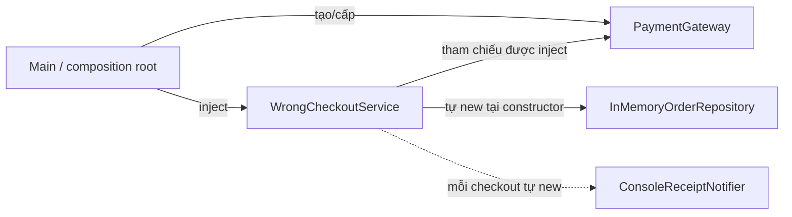
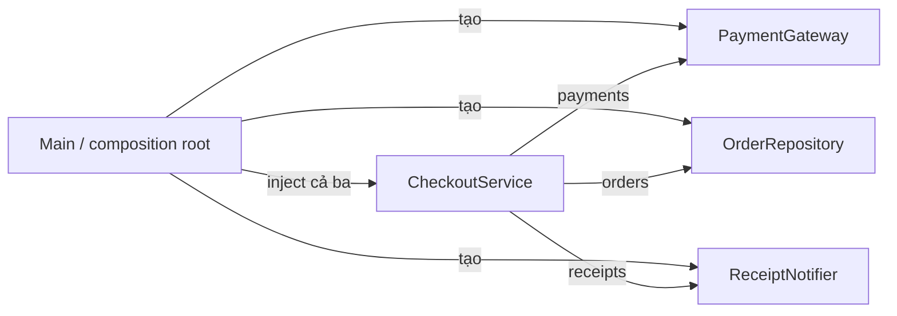

# Đối tượng tự tạo phụ thuộc bên trong dù đã có cơ chế DI

## Mục tiêu học tập

Sau bài này, bạn có thể:

- Phát hiện trường hợp một lớp **đã dùng Dependency Injection (DI) nhưng vẫn tự tạo collaborator** bằng `new` trong constructor, field initializer hoặc phương thức nghiệp vụ.
- Phân biệt việc tự tạo **dependency có hành vi/tài nguyên** với việc tạo **dữ liệu/value object** phục vụ một lần xử lý; không áp dụng máy móc quy tắc “cấm mọi `new`”.
- Giải thích tác hại của dependency bị che giấu đối với **thay thế implementation, kiểm thử, cấu hình, scope và quyền sở hữu tài nguyên**.
- Sửa lỗi bằng **constructor injection**, **composition root**, interface có hợp đồng rõ hoặc **factory hẹp** cho dependency cần tạo theo từng thao tác.
- Nhận diện giới hạn của DI container: một instance do ứng dụng tự tạo không mặc nhiên được framework tiêm phụ thuộc, áp dụng proxy hoặc gọi lifecycle hook.
- Kiểm thử bằng **Java thuần** để chứng minh lớp nghiệp vụ thật sự sử dụng dependency đã được tiêm thay vì tự tạo implementation khác.

Bài thuộc chương **Lỗi thiết kế** của mô-đun **Dependency Injection (DI) và Inversion of Control (IoC)**. DI là cách tách việc *sử dụng* một phụ thuộc khỏi việc *tạo và lắp ghép* nó. Constructor injection, composition root và quản lý scope/vòng đời là các công cụ để hiện thực điều đó bằng Java thuần trước khi mở rộng sang DI container. Một sai lầm phổ biến là **chỉ tiêm một phần** rồi vẫn để lớp nghiệp vụ tự tạo các collaborator khác. Khi đó giao diện lớp có vẻ “đã áp dụng DI”, nhưng quan hệ phụ thuộc thực tế vẫn bị khóa cứng.

## 1. Tình huống: đã inject thanh toán nhưng vẫn tự tạo nơi gửi biên nhận

Giả sử ứng dụng có luồng xử lý một đơn hàng:

1. Gọi cổng thanh toán.
2. Ghi trạng thái đã thanh toán.
3. Gửi biên nhận.

Đoạn mã sau là **phản ví dụ**. Các interface và class sẽ được định nghĩa đầy đủ ở mục 4:

```java
// Phản ví dụ rút gọn, không dùng như chương trình chạy độc lập.
final class WrongCheckoutService {
    private final PaymentGateway payments;
    private final OrderRepository orders;

    WrongCheckoutService(PaymentGateway payments) {
        this.payments = payments;                  // Có injection.
        this.orders = new InMemoryOrderRepository(); // Nhưng tự tạo repository!
    }

    boolean checkout(OrderRequest order) {
        if (!payments.charge(order)) {
            return false;
        }

        orders.markPaid(order);
        ReceiptNotifier receipts =
                new ConsoleReceiptNotifier();       // Lại tự tạo collaborator!
        receipts.notifyPaid(order);
        return true;
    }
}
```

Người đọc chỉ nhìn constructor `WrongCheckoutService(PaymentGateway payments)` sẽ tưởng service có **một dependency bắt buộc**. Thực tế nó còn dùng `OrderRepository` và `ReceiptNotifier`. Đáng chú ý hơn, lựa chọn `InMemoryOrderRepository` và `ConsoleReceiptNotifier` đã bị **đóng đinh trong mã nghiệp vụ**.

Hãy đặt câu hỏi: nếu triển khai thật cần `DatabaseOrderRepository` và `EmailReceiptNotifier`, sửa ở đâu? Nếu muốn kiểm thử checkout nhưng không ghi repository thật hoặc gửi console, có thay hai collaborator này được không? Nếu một notifier giữ kết nối cần đóng, ai quản lý nó?

Đây là vấn đề **không phải vì chữ `new` tự nó sai**, mà vì **mã sử dụng collaborator đồng thời tự quyết định cách tạo collaborator đó**.

### Mức độ phụ thuộc bị che giấu

| Điểm quan sát | Người đọc có thể tưởng | Thực tế trong phản ví dụ |
| --- | --- | --- |
| Constructor | Chỉ cần `PaymentGateway` | Còn cần một repository và notifier cụ thể |
| Kiểm thử | Có thể thay các dependency bằng fake | Không thể tiêm fake repository/notifier qua API hiện tại |
| Cấu hình | Composition root chọn môi trường | Service tự chọn bộ nhớ và console bất kể cấu hình |
| Thay implementation | Đổi tại nơi lắp ghép | Phải sửa mã của service |
| Scope | Nơi lắp ghép quản lý vòng đời | Repository sinh trong constructor; notifier sinh mỗi lần checkout |
| Cleanup | Nơi sở hữu tài nguyên quản lý đóng | Không có hợp đồng ai đóng notifier được tự tạo |

**Dấu hiệu quan trọng:** một class có constructor nhận một interface **chưa chứng minh** nó đã áp dụng DI nhất quán. Cần kiểm tra toàn bộ **collaborator** nó sử dụng, kể cả những instance tạo ở field initializer, constructor, phương thức nghiệp vụ và static accessor.

## 2. Quan sát đồ thị đối tượng sẽ thấy vấn đề

Quy ước `A → B` nghĩa là **A dùng B**.

### Đồ thị sau khi khởi tạo của thiết kế sai



Ở đây, `Main` chỉ kiểm soát một cạnh `WrongCheckoutService → PaymentGateway`. Hai cạnh còn lại **bị chính service xây bên trong**. Việc thay cấu hình tại `Main` không làm mất đi những lệnh `new` này.

### Đồ thị sau khi sửa bằng constructor injection



Lúc này **nơi tạo và nơi sử dụng** đã tách nhau. `CheckoutService` nhận những khả năng cần dùng, còn `Main` chọn implementation và nối chúng. Một điểm quan trọng của IoC chính là service **không tự kiểm soát việc tạo các collaborator** mà nó cần.

Nhờ đồ thị rõ ràng, ta có thể đọc constructor để biết **đầy đủ dependency bắt buộc**; thay một instance cụ thể ở composition root mà không thay mã nghiệp vụ.

## 3. Phân biệt các loại `new` trước khi refactor

Không nên sửa lỗi bằng cách đưa **mọi** đối tượng vào DI container. Có những `new` đúng và cần thiết:

| Đối tượng được tạo | Thường có cần inject không? | Lý do |
| --- | --- | --- |
| `new OrderRequest(...)` | **Không**, nếu chỉ là DTO theo một lời gọi | Chứa dữ liệu runtime; không phải collaborator cấu hình/lifecycle dài |
| `new Money(...)` / `new Address(...)` | **Không**, nếu là value object | Đại diện giá trị; chủ đích là tạo bản thân giá trị mới |
| `new CheckoutResult(...)` | **Không**, nếu là kết quả nghiệp vụ | Do xử lý tạo ra để trả caller |
| `new DemoPaymentGateway()` trong `Main` | **Có thể phù hợp** | Composition root có trách nhiệm chọn implementation và tạo dependency |
| `new DatabaseOrderRepository(...)` trong `CheckoutService` | **Thường nên tránh** | Service tự quyết định hạ tầng và vòng đời collaborator |
| `new SmtpClient(...)` mỗi lần `checkout` | **Thường nên tránh** | Khóa cứng cấu hình và có thể mở kết nối lặp lại, thiếu cleanup |
| `new ReportSession(...)` trong factory chuyên trách | **Có thể phù hợp** | Factory có hợp đồng hẹp chịu trách nhiệm tạo tài nguyên theo thao tác |
| `new InternalFormatHelper()` | **Cần xét bối cảnh** | Nếu helper thuần, không cấu hình và không là điểm biến thiên, tự tạo có thể đơn giản hơn DI |

**Tiêu chí tốt hơn “cấm `new`”:** nếu object là một **collaborator thực hiện hành vi**, là điểm cần thay thế/kiểm thử hoặc sở hữu tài nguyên, hãy xem xét đưa quyết định tạo nó ra **composition root hoặc factory chuyên trách**. Nếu object là **dữ liệu được tạo theo logic nghiệp vụ**, việc tự tạo thường hoàn toàn bình thường.

Tương tự, không phải cứ tạo interface cho một class là cải thiện được DI: interface có ý nghĩa khi nó biểu diễn một **hợp đồng mà consumer cần** và giúp tách trách nhiệm/implementation. Tạo hàng loạt interface một-đối-một không có nhu cầu thay thế có thể làm kiến trúc khó đọc hơn.

## 4. Java thuần hoàn chỉnh: sửa thiết kế từ nơi lắp ghép

Ví dụ sử dụng repository trong bộ nhớ, thanh toán giả lập và gửi biên nhận ra console. Nó không chuyển tiền hay gửi thông báo thật. Tất cả dependency nghiệp vụ của `CheckoutService` đều hiển thị trong constructor.

Lưu toàn bộ vào **`Main.java`** (JDK 8 trở lên):

```java
import java.util.HashMap;
import java.util.Map;
import java.util.Objects;

// DTO cho một lần checkout, không phải service cần DI container tạo.
final class OrderRequest {
    final String orderId;
    final String recipient;
    final long amountVnd;

    OrderRequest(String orderId, String recipient, long amountVnd) {
        this.orderId = requiredText(orderId, "orderId");
        this.recipient = requiredText(recipient, "recipient");
        if (amountVnd <= 0) {
            throw new IllegalArgumentException("amountVnd phải dương");
        }
        this.amountVnd = amountVnd;
    }

    static String requiredText(String value, String name) {
        Objects.requireNonNull(value, name);
        if (value.trim().isEmpty()) {
            throw new IllegalArgumentException(name + " không được rỗng");
        }
        return value;
    }
}

// Các hợp đồng mà CheckoutService cần sử dụng.
interface PaymentGateway {
    boolean charge(OrderRequest request);
}

interface OrderRepository {
    void markPaid(OrderRequest request);
}

interface ReceiptNotifier {
    void notifyPaid(OrderRequest request);
}

// Dữ liệu kết quả của một lần xử lý.
final class CheckoutResult {
    final boolean paid;
    final String status;

    private CheckoutResult(boolean paid, String status) {
        this.paid = paid;
        this.status = Objects.requireNonNull(status, "status");
    }

    static CheckoutResult paid() {
        return new CheckoutResult(true, "PAID");
    }

    static CheckoutResult declined() {
        return new CheckoutResult(false, "PAYMENT_DECLINED");
    }
}

// Consumer chỉ biết hợp đồng, không tự tạo repository hay notifier.
final class CheckoutService {
    private final PaymentGateway payments;
    private final OrderRepository orders;
    private final ReceiptNotifier receipts;

    CheckoutService(PaymentGateway payments,
                    OrderRepository orders,
                    ReceiptNotifier receipts) {
        this.payments = Objects.requireNonNull(payments, "payments");
        this.orders = Objects.requireNonNull(orders, "orders");
        this.receipts = Objects.requireNonNull(receipts, "receipts");
    }

    CheckoutResult checkout(OrderRequest request) {
        Objects.requireNonNull(request, "request");

        if (!payments.charge(request)) {
            return CheckoutResult.declined();
        }

        orders.markPaid(request);
        receipts.notifyPaid(request);
        return CheckoutResult.paid();
    }
}

// Provider giả lập, không gọi ngân hàng.
final class DemoPaymentGateway implements PaymentGateway {
    @Override
    public boolean charge(OrderRequest request) {
        System.out.println("[DEMO] Charge " + request.amountVnd
                + " VND cho " + request.orderId);
        return true;
    }
}

// Provider giả lập, không dùng database.
final class InMemoryOrderRepository implements OrderRepository {
    private final Map<String, Boolean> paid = new HashMap<>();

    @Override
    public void markPaid(OrderRequest request) {
        paid.put(request.orderId, true);
        System.out.println("[DEMO] Mark PAID " + request.orderId);
    }

    boolean isPaid(String orderId) {
        return Boolean.TRUE.equals(paid.get(orderId));
    }
}

// Provider giả lập, không gửi email thật.
final class ConsoleReceiptNotifier implements ReceiptNotifier {
    @Override
    public void notifyPaid(OrderRequest request) {
        System.out.println("[DEMO] Receipt " + request.orderId
                + " -> " + request.recipient);
    }
}

// Composition root: quyết định implementation rồi lắp ghép đồ thị.
public class Main {
    public static void main(String[] args) {
        PaymentGateway payments = new DemoPaymentGateway();
        InMemoryOrderRepository orders = new InMemoryOrderRepository();
        ReceiptNotifier receipts = new ConsoleReceiptNotifier();

        CheckoutService checkout =
                new CheckoutService(payments, orders, receipts);

        // Dữ liệu theo request được tạo tại nơi xử lý.
        OrderRequest request =
                new OrderRequest("DH-003", "khach@example.com", 125_000L);
        CheckoutResult result = checkout.checkout(request);

        System.out.println("Kết quả: " + result.status);
        System.out.println("Repository PAID: "
                + orders.isPaid(request.orderId));
    }
}
```

Chạy:

```bash
javac -encoding UTF-8 Main.java
java Main
```

Kết quả dự kiến:

```text
[DEMO] Charge 125000 VND cho DH-003
[DEMO] Mark PAID DH-003
[DEMO] Receipt DH-003 -> khach@example.com
Kết quả: PAID
Repository PAID: true
```

### Đọc mã theo vai trò tạo và sử dụng

| Thành phần | Ai tạo/cấp? | Ai sử dụng? | Ghi chú |
| --- | --- | --- | --- |
| `DemoPaymentGateway` | `Main` | `CheckoutService` qua `PaymentGateway` | Dễ thay bằng adapter khác hoặc fake |
| `InMemoryOrderRepository` | `Main` | `CheckoutService` qua `OrderRepository` | Nơi lắp ghép có thể biết implementation cụ thể |
| `ConsoleReceiptNotifier` | `Main` | `CheckoutService` qua `ReceiptNotifier` | Không còn lệnh `new` bên trong nghiệp vụ |
| `CheckoutService` | `Main` | `Main` gọi `checkout(...)` | Giữ ba collaborator bắt buộc trong field `final` |
| `OrderRequest` | Caller tại thời điểm xử lý | `CheckoutService` | Đối tượng dữ liệu ngắn hạn, không cần container |
| `CheckoutResult` | `CheckoutService` tạo thông qua factory method tĩnh | Caller nhận kết quả | Dữ liệu kết quả do logic nghiệp vụ sinh ra |

**Tạo `CheckoutResult` mới trong service hoàn toàn không vi phạm DI**: nó không quyết định provider hạ tầng và không mở tài nguyên dùng chung. Ngược lại, việc tự tạo `ConsoleReceiptNotifier` trước đây là quyết định chọn một collaborator có thể thay thế, nên cần được đưa ra ngoài.

### Điều gì được cải thiện?

Constructor giờ tuyên bố rõ:

```java
CheckoutService(PaymentGateway payments,
                OrderRepository orders,
                ReceiptNotifier receipts)
```

Nếu thiếu một dependency bắt buộc, `Objects.requireNonNull(...)` báo lỗi ngay khi tạo service. Nếu môi trường dùng gateway/notification khác, chỉ cần thay object ở `Main`. Nếu muốn kiểm thử, đưa fake vào constructor mà không cần thay mã `CheckoutService`.

**Giới hạn nghiệp vụ của demo:** sau khi thanh toán thành công, lỗi ở `markPaid(...)` hoặc `notifyPaid(...)` có thể để lại tác dụng phụ một phần. DI không tự tạo transaction phân tán, idempotency hay quy trình retry an toàn. Trong hệ thống thật phải thiết kế riêng chính sách giao dịch, trạng thái và bù trừ.

## 5. Kiểm thử để phát hiện việc tự tạo collaborator còn sót

Một dấu hiệu thực tế của dependency bị ẩn là: **test truyền fake nhưng vẫn thấy tác dụng phụ của implementation thật**. Chẳng hạn, fake notifier được truyền vào nhưng service vẫn tự `new ConsoleReceiptNotifier()` bên trong `checkout(...)`, nên test không quan sát được sự kiện gửi từ fake.

Với service đã sửa, có thể dùng ba fake ghi dấu theo thứ tự. Tạo **`CheckoutServiceCheck.java`** cạnh `Main.java`:

```java
import java.util.ArrayList;
import java.util.Arrays;
import java.util.List;

public class CheckoutServiceCheck {
    static final class FakePayment implements PaymentGateway {
        final List<String> events;
        boolean approve = true;
        int calls;

        FakePayment(List<String> events) {
            this.events = events;
        }

        @Override
        public boolean charge(OrderRequest request) {
            calls++;
            events.add("charge:" + request.orderId);
            return approve;
        }
    }

    static final class FakeOrders implements OrderRepository {
        final List<String> events;
        int marks;

        FakeOrders(List<String> events) {
            this.events = events;
        }

        @Override
        public void markPaid(OrderRequest request) {
            marks++;
            events.add("markPaid:" + request.orderId);
        }
    }

    static final class FakeReceipts implements ReceiptNotifier {
        final List<String> events;
        int sends;

        FakeReceipts(List<String> events) {
            this.events = events;
        }

        @Override
        public void notifyPaid(OrderRequest request) {
            sends++;
            events.add("receipt:" + request.orderId);
        }
    }

    public static void main(String[] args) {
        List<String> events = new ArrayList<>();
        FakePayment payment = new FakePayment(events);
        FakeOrders orders = new FakeOrders(events);
        FakeReceipts receipts = new FakeReceipts(events);

        // Không khởi động framework hoặc container.
        CheckoutService service =
                new CheckoutService(payment, orders, receipts);

        OrderRequest first =
                new OrderRequest("TEST-01", "a@example.com", 70_000L);
        CheckoutResult paid = service.checkout(first);

        if (!paid.paid || !"PAID".equals(paid.status)
                || payment.calls != 1 || orders.marks != 1
                || receipts.sends != 1
                || !events.equals(Arrays.asList(
                        "charge:TEST-01",
                        "markPaid:TEST-01",
                        "receipt:TEST-01"))) {
            throw new AssertionError("Sai luồng khi thanh toán thành công");
        }

        // Đường từ chối: repository/notifier không được gọi.
        payment.approve = false;
        events.clear();
        OrderRequest second =
                new OrderRequest("TEST-02", "b@example.com", 80_000L);
        CheckoutResult declined = service.checkout(second);

        if (declined.paid || !"PAYMENT_DECLINED".equals(declined.status)
                || payment.calls != 2 || orders.marks != 1
                || receipts.sends != 1
                || !events.equals(Arrays.asList("charge:TEST-02"))) {
            throw new AssertionError("Sai nhánh từ chối thanh toán");
        }

        // Không cho thiếu dependency bắt buộc khi dựng service.
        try {
            new CheckoutService(payment, orders, null);
            throw new AssertionError("Phải phát hiện notifier bị thiếu");
        } catch (NullPointerException expected) {
            // Đúng: constructor từ chối đồ thị không hợp lệ.
        }

        System.out.println("PASS: mọi collaborator đều được inject");
    }
}
```

Chạy:

```bash
javac -encoding UTF-8 Main.java CheckoutServiceCheck.java
java CheckoutServiceCheck
```

Test xác nhận cả **thứ tự tác động**, **đường dừng khi thanh toán thất bại** và việc **không cần dependency hạ tầng thật**. Một lần tạo ba fake là đủ; không cần mô phỏng container, mở database hay dịch vụ thanh toán.

Điểm kiểm thử cần được hiểu chính xác: test này phát hiện những tác dụng phụ **đã được quan sát qua fake**. Nó không thể chứng minh tuyệt đối toàn codebase không còn `new` ẩn, hoặc không còn tác dụng phụ ngoài test. Khi review vẫn cần đọc code và kiểm tra các ranh giới hạ tầng.

## 6. Các biến thể cùng lỗi thiết kế

### 6.1. Field initializer tự tạo dependency

```java
// Phản ví dụ rút gọn:
class WrongService {
    private final ReceiptNotifier receipts =
            new ConsoleReceiptNotifier();
}
```

Không có tham số constructor nào cho phép thay implementation. Ngay cả khi các dependency khác đã được tiêm, field `receipts` vẫn khóa cứng vào notifier console. Hãy đưa collaborator bắt buộc vào constructor:

```java
class BetterService {
    private final ReceiptNotifier receipts;

    BetterService(ReceiptNotifier receipts) {
        this.receipts = java.util.Objects.requireNonNull(receipts);
    }
}
```

### 6.2. Constructor nhận dependency nhưng tự thay bằng object mới

```java
// Phản ví dụ, dùng cùng các hợp đồng của bài:
class IgnoresInjectedNotifier {
    private final ReceiptNotifier receipts;

    IgnoresInjectedNotifier(ReceiptNotifier injected) {
        this.receipts = new ConsoleReceiptNotifier(); // Bỏ qua injected!
    }
}
```

Lỗi này nguy hiểm vì API có vẻ được thiết kế để inject, nhưng implementation lại không dùng đối tượng caller cấp. Trong code review, cần kiểm tra **giá trị tham số thực sự đi vào field nào**; không chỉ thấy tên interface xuất hiện trong constructor là kết luận đã áp dụng DI.

### 6.3. Tiêm một phần rồi tạo phần còn lại trong method

```java
// Phản ví dụ:
class PartiallyInjectedService {
    private final PaymentGateway payments;

    PartiallyInjectedService(PaymentGateway payments) {
        this.payments = payments;
    }

    void afterPayment(OrderRequest request) {
        new ConsoleReceiptNotifier().notifyPaid(request);
    }
}
```

Đây chính là lỗi cốt lõi của bài. Việc gọi `new` trong method còn khiến **mỗi lời gọi** tạo thêm notifier mà không có quy tắc scope/cleanup rõ, có thể làm tăng chi phí nếu thay console bằng client mạng.

### 6.4. Tiêm repository rồi tự tạo client bên trong adapter

Không phải mọi thứ trong adapter đều phải inject, nhưng nếu adapter tự tạo một `HttpClient` hoặc database connection có cấu hình/đóng tài nguyên riêng, cần cân nhắc đưa việc chọn và sở hữu client về composition root hoặc một factory cụ thể:

```java
// Phác thảo ý tưởng cải tiến, không phải chương trình chạy độc lập.
final class HttpReceiptNotifier implements ReceiptNotifier {
    private final ReceiptHttpClient client;

    HttpReceiptNotifier(ReceiptHttpClient client) {
        this.client = client;
    }

    @Override
    public void notifyPaid(OrderRequest request) {
        client.submit(request);
    }
}
```

Nếu muốn dùng client thật, cần định nghĩa `ReceiptHttpClient` và adapter phù hợp; ví dụ chỉ làm rõ hướng phụ thuộc. **Adapter hạ tầng** có thể sở hữu chi tiết tạo DTO/request HTTP ngắn hạn. Việc tiêm client có ý nghĩa khi nó là dependency có cấu hình, cần chia sẻ, thay thế hay quản lý tài nguyên.

### 6.5. Dùng static singleton thay `new` trực tiếp

```java
// Cũng là phụ thuộc bị ẩn nếu business code truy cập kiểu này:
// GlobalServices.paymentGateway().charge(request);
```

Đổi `new` thành một static accessor không giải quyết việc tách nơi tạo và nơi sử dụng. Dependency vẫn không hiển thị trong constructor và service có thể phụ thuộc vào trạng thái toàn cục. Đây là biến thể **Service Locator**, cần cân nhắc refactor về injection.

### 6.6. Tiêm container rồi `resolve(...)` trong service

```java
// Phản ví dụ minh họa, Container là API giả định.
class LocatorCheckoutService {
    private final Container container;

    LocatorCheckoutService(Container container) {
        this.container = container;
    }

    void checkout(OrderRequest request) {
        PaymentGateway gateway = container.resolve(PaymentGateway.class);
        gateway.charge(request);
    }
}
```

Một constructor nhận container **không đồng nghĩa** các dependency nghiệp vụ đã được DI đúng cách. Nó chỉ tiêm một **bộ tra cứu tổng quát**, còn dependency thật vẫn được tìm trong thân method. Container nên ở **composition root**, để service nhận trực tiếp hợp đồng như `PaymentGateway`.

## 7. Khi thực sự cần tạo dependency mới theo từng thao tác

Có tình huống không thể tiêm **một instance cố định** vào service: ví dụ mỗi lần xuất báo cáo cần một session có trạng thái riêng và phải đóng sau khi dùng. Giải pháp không phải tự tạo concrete class trong service, cũng không phải truyền cả DI container. Hãy tiêm **factory có mục đích hẹp**.

```java
interface ReportSession extends AutoCloseable {
    void write(String line);

    @Override
    void close();
}

interface ReportSessionFactory {
    ReportSession open(String reportId);
}

final class ReportService {
    private final ReportSessionFactory sessions;

    ReportService(ReportSessionFactory sessions) {
        this.sessions = java.util.Objects.requireNonNull(sessions, "sessions");
    }

    void export(String reportId, String content) {
        try (ReportSession session = sessions.open(reportId)) {
            session.write(content);
        }
    }
}
```

Đây là một đoạn API **độc lập** với `Main.java` ở mục 4. Factory quyết định cách tạo session, còn `ReportService` chỉ biết hợp đồng `open`, `write` và `close`. Dữ liệu runtime `reportId` được chuyển vào method `open(reportId)`, không nằm trong cấu hình khởi động.

**Phân biệt với Service Locator:** `ReportSessionFactory.open(reportId)` cấp **một khả năng cụ thể**; một API `Container.resolve(Class<T>)` có thể cung cấp tùy ý mọi loại service. Nếu đặt tên `UniversalFactory` nhưng vẫn cho resolve bất kỳ class nào, chỉ là đổi tên locator.

Factory có thể trả **instance mới** hoặc handle lấy từ pool tùy hợp đồng. Tên `open` không tự bảo đảm tạo mới. Quyền đóng cũng phải rõ: trong ví dụ, service sở hữu session cho một lần export và đóng bằng `try-with-resources`; nó **không được** tự đóng client dùng chung mà factory đang sử dụng ở phía dưới.

### Thời điểm nào cần tiêm factory?

| Yêu cầu | Thiết kế thường phù hợp |
| --- | --- |
| Một repository không trạng thái dùng lâu | Tiêm trực tiếp `OrderRepository` qua constructor |
| Một HTTP client được cấu hình và dùng chung | Tiêm client/adapter có scope và owner rõ |
| Một phiên xử lý mới cho mỗi request | Tiêm factory/provider có hợp đồng về scope và cleanup |
| Một DTO được sinh từ đầu vào method | Tạo trực tiếp bằng `new` trong method là bình thường |
| Chọn policy theo dữ liệu từng đơn | Tiêm policy có hợp đồng riêng; dữ liệu theo request đi qua tham số |
| Khởi tạo một helper thuần, chỉ nội bộ | Có thể tự tạo nếu không làm ẩn điểm biến thiên hoặc tài nguyên đáng kể |

Không dùng factory chỉ để né việc khai báo dependency trong constructor. Nếu class có quá nhiều collaborator bắt buộc, hãy xem lại **trách nhiệm** của class thay vì tạo một `Dependencies` hoặc factory tổng quát che hết chúng.

## 8. Scope, vòng đời và lỗi khó thấy khi tự tạo

Một lý do lớn để quản lý collaborator từ composition root là **vòng đời được chủ đích**:

| Thành phần | Nếu tự tạo trong consumer | Nếu được lắp ghép rõ |
| --- | --- | --- |
| Database connection/pool | Có thể tạo quá nhiều pool hoặc không đóng | Owner tạo pool dùng chung, quản lý shutdown |
| HTTP client | Mỗi request có thể tạo client mới và gây lãng phí | Adapter nhận client có cấu hình timeout và reuse phù hợp |
| Repository có state | Mỗi instance có cache/bộ nhớ riêng ngoài dự định | Scope được chọn theo nhu cầu và được truyền minh bạch |
| Executor | Service có thể tự tạo thread pool nhưng không đóng | Composition root quản lý executor; service chỉ dùng interface |
| Session theo request | Service sống lâu có thể giữ nhầm session đã hết hạn | Factory tạo theo thao tác, caller đóng đúng mốc |

**Tạo cùng class mới không có nghĩa cùng trạng thái.** Hai `InMemoryOrderRepository` sẽ giữ **hai map độc lập**. Nếu checkout tự tạo repository A trong constructor còn màn hình tra cứu đơn sử dụng repository B được tạo ở `Main`, màn hình có thể không thấy trạng thái mà checkout vừa ghi. Đây là lỗi về **danh tính và chia sẻ instance**, không chỉ là lỗi chọn sai class.

Ngược lại, **dùng chung một instance** cũng chưa chắc đúng: một service singleton giữ `currentUser` trong field mutable có thể làm lẫn dữ liệu của các request đồng thời. DI không tự tạo thread safety. Cần chọn scope và cách truyền dữ liệu rõ ràng, đưa `OrderRequest` vào **tham số phương thức** thay vì lưu trạng thái request trong dependency dùng chung.

### Trách nhiệm đóng tài nguyên

Giả sử `PaymentGateway` được tạo tại `Main` và dùng chung cho nhiều service. `CheckoutService` nhận nó qua constructor thường **không nên gọi `close()`** sau từng checkout, trừ khi contract quy định rõ chuyển quyền sở hữu. Mã tạo/điều phối vòng đời ở composition root hoặc container phải chịu trách nhiệm shutdown.

Nếu một implementation tự tạo client ngay trong consumer, quyền sở hữu trở nên mơ hồ: consumer có phải đóng? Đóng ở thời điểm nào? Có task bất đồng bộ nào còn dùng client không? Các câu hỏi này thường bị bỏ sót vì đoạn `new` trông rất nhỏ.

Khi thao tác bất đồng bộ trả `CompletionStage`, **thời điểm method trả về không nhất thiết là lúc tài nguyên đã dùng xong**. Nếu một session được mở cho tác vụ, phải giữ đến **mốc hoàn thành sử dụng thực tế** rồi đóng trên cả đường thành công và lỗi. Tạo tài nguyên trong worker và dùng `try-with-resources` ở worker có thể phù hợp cho thao tác đồng bộ chạy nền; với API async thật sự, phải gắn cleanup vào completion phù hợp. Đừng giải quyết bằng cách chuyển client hạ tầng thành một field dùng chung không rõ ownership.

## 9. DI container không tự sửa một lệnh `new` sai chỗ

Khi chuyển sang framework DI, cần phân biệt **đối tượng do container quản lý** với **đối tượng ứng dụng tự tạo**.

Ví dụ minh họa theo mô hình Spring:

```java
// Ví dụ minh họa Spring, cần thư viện/framework tương ứng.
@org.springframework.stereotype.Service
class CheckoutBean {
    private final PaymentGateway payments;
    private final ReceiptNotifier receipts;

    CheckoutBean(PaymentGateway payments, ReceiptNotifier receipts) {
        this.payments = payments;
        this.receipts = receipts;
    }
}
```

Khi class trên được component scan/đăng ký và container tạo bean, Spring có thể giải quyết constructor theo cấu hình. Nhưng nếu chính ứng dụng **tự gọi**:

```java
// Phác thảo ở nơi ứng dụng đã có hai dependency:
// CheckoutBean manual = new CheckoutBean(payment, receipts);
```

thì `manual` **không tự nhiên trở thành bean** chỉ vì class có annotation. Nó không tự nhận các hook hoặc proxy framework dành cho bean được quản lý.

Ngược lại, một method `@Bean` có thể **gọi `new` một cách hoàn toàn hợp lệ**:

```java
// Mã ý tưởng Spring; cách đăng ký cần đặt đúng ngữ cảnh framework.
@org.springframework.context.annotation.Configuration
class CheckoutConfiguration {
    @org.springframework.context.annotation.Bean
    CheckoutService checkoutService(
            PaymentGateway payments,
            OrderRepository orders,
            ReceiptNotifier receipts) {
        return new CheckoutService(payments, orders, receipts);
    }
}
```

Ở đây, **container gọi factory method và quản lý object được trả về** theo bean definition. Lệnh `new` nằm ở nơi được giao trách nhiệm lắp ghép, không nằm trong `CheckoutService.checkout(...)`. Chỉ nhìn sự xuất hiện của `new` không đủ để kết luận DI được áp dụng sai hay đúng; phải xem **ai tạo, ai giữ và ai sử dụng instance**.

### Lưu ý thêm về proxy và lifecycle

Framework có thể cung cấp transaction proxy, validation interceptor, cache hoặc lifecycle callback cho **bean được quản lý đúng cách**. Một service tự `new` trực tiếp từ trong mã khác thường **bỏ qua** đường cấp proxy và callback của container. Ví dụ, kỳ vọng `@Transactional` hoạt động trên một object tự tạo có thể thất bại nếu cơ chế transaction được cấu hình theo proxy và lời gọi không đi qua proxy.

Vì vậy, hai câu hỏi cần tách:

1. **Đối tượng này có phải collaborator do container quản lý không?**
2. **Lớp nghiệp vụ có còn tự tạo những collaborator đáng lẽ cần được inject không?**

Ngay cả khi `CheckoutService` là một bean được quản lý, việc nó tự tạo `ConsoleReceiptNotifier` trong method vẫn là lỗi thiết kế khi notifier cần được cấu hình/thay thế/quản lý. DI container **không xóa được dependency bị che giấu** nếu mã nghiệp vụ tự quyết định tạo nó.

## 10. Quy trình sửa code đang “DI nửa vời”

Khi review một service đã có annotation hoặc constructor injection, hãy thực hiện theo thứ tự:

1. **Tìm mọi điểm tạo collaborator**: field initializer, constructor, method, static accessor, lệnh `new` client/repository, `getInstance()` và service locator.
2. **Phân loại object được tạo**: DTO/value object, helper thuần hay collaborator có cấu hình, hành vi hoặc tài nguyên?
3. **Xác định hợp đồng cần dùng**: service cần `charge`, `markPaid`, `notifyPaid` hay cần toàn bộ container? Ưu tiên interface hẹp theo hành vi thực.
4. **Dời collaborator ổn định vào constructor**: làm chúng thành tham số bắt buộc và kiểm tra tính hợp lệ ngay khi tạo service.
5. **Dời quyết định chọn implementation về composition root**: tạo adapter/client/repository ở đúng ranh giới, inject chúng vào service.
6. **Xử lý collaborator ngắn hạn bằng factory hẹp**: nếu mỗi request cần session riêng, tiêm factory và ghi rõ vòng đời/cleanup thay vì tự tạo client trong business method.
7. **Kiểm tra graph sau refactor**: consumer còn cạnh nào tới concrete implementation/locator bị ẩn không? Các instance nào được chia sẻ?
8. **Kiểm thử với fake**: xác nhận mọi hành vi đi qua dependency đã tiêm; thử cả nhánh thành công, thất bại và thiếu dependency.
9. **Kiểm tra scope/ownership**: ai tạo và đóng các resource thật? Có làm lẫn state request hoặc bị lệ thuộc lifecycle của framework không?
10. **Kiểm thử lắp ghép trong framework riêng**: sau khi unit test Java thuần qua, xác nhận bean registration, qualifier, proxy, scope và cleanup nếu hệ thống có container.

### Khi nào không cần refactor?

Không nhất thiết phải sửa `new` nếu class được tạo là **value object**, đối tượng kết quả, một DTO cho mỗi request hoặc một helper thuần hoàn toàn nội bộ. Cũng không cần tạo interface chỉ vì có một class. Mục tiêu là giảm **coupling sai chỗ** và làm rõ quyền tạo/sử dụng, không phải tối đa hóa số constructor parameter hay số abstraction.

Ngược lại, nếu có **nhiều constructor parameter bất thường**, đừng chữa bằng cách bọc tất cả vào một `Container` rồi tra cứu trong service. Đó có thể là dấu hiệu service đang gánh quá nhiều trách nhiệm. Hãy cân nhắc tách thành các thành phần có hành vi cụ thể, với một workflow điều phối rõ ràng.

## 11. Những ngộ nhận thường gặp

| Ngộ nhận | Cách hiểu đúng |
| --- | --- |
| “Lớp đã nhận một dependency qua constructor thì coi như DI đầy đủ.” | Cần kiểm tra toàn bộ collaborator; một số vẫn có thể bị tự tạo bên trong. |
| “Đã có Spring/Guice thì mọi `new` đều được inject tự động.” | Object tự tạo không mặc nhiên do container quản lý, kể cả khi class có annotation. |
| “Cấm dùng `new` ở mọi nơi mới là DI đúng.” | `new` DTO, entity, value object và ở composition root/factory có thể hoàn toàn phù hợp. |
| “Chuyển `new` sang static singleton là đã giải quyết.” | Static registry/locator vẫn có thể tạo dependency ẩn và state toàn cục. |
| “Cứ truyền container vào constructor thì sẽ dễ kiểm thử.” | Service vẫn phụ thuộc API resolve và registry, thay vì nhận trực tiếp hợp đồng nghiệp vụ. |
| “Mỗi lần `new Repository` sẽ dùng chung dữ liệu.” | Mỗi object có state riêng trừ khi implementation cố ý chia sẻ tài nguyên bên ngoài. |
| “Factory luôn phải trả instance mới.” | Cần hợp đồng; factory có thể dùng pool hoặc cấp instance theo scope. |
| “Inject một client dùng chung thì service được quyền đóng sau mỗi lời gọi.” | Quyền sở hữu phải được xác định; consumer thường không tự đóng resource dùng chung. |
| “Unit test qua fake nghĩa là container sản xuất đã cấu hình đúng.” | Test nghiệp vụ và test wiring/framework giải quyết các câu hỏi khác nhau. |
| “Mục tiêu DI là không viết logic tạo object ở đâu cả.” | Việc tạo vẫn phải xảy ra; DI **tập trung quyết định lắp ghép đúng chỗ**. |

## 12. Bài tập vận dụng

Xem class sau:

```java
class TicketService {
    private final TicketRepository tickets;
    private final EmailClient client = new EmailClient();

    TicketService(TicketRepository tickets) {
        this.tickets = tickets;
    }

    void issue(TicketRequest request) {
        Ticket ticket = new Ticket(request);
        tickets.save(ticket);
        client.send(ticket.recipient(), "Đã phát hành vé");
    }
}
```

Đây là **đoạn mã giả định**, trong đó `TicketRepository`, `EmailClient`, `TicketRequest` và `Ticket` là các kiểu minh họa chưa được định nghĩa. Hãy tự phân tích:

1. **Lệnh `new` nào đáng nghi nhất?** Vì sao việc tạo `Ticket` khác với việc tạo `EmailClient`?
2. Nếu môi trường production dùng SMTP còn test dùng fake, nên sửa constructor của `TicketService` ra sao?
3. Ai nên tạo và quản lý vòng đời của `EmailClient` nếu nó giữ kết nối dùng chung?
4. Nếu mỗi lần phát vé cần một phiên email riêng, nên tiêm client cố định hay một factory có hợp đồng cấp phiên?
5. Nếu `tickets.save(ticket)` thành công nhưng gửi email thất bại, DI đã tự bảo đảm giao dịch toàn bộ hay chưa?

**Gợi ý đáp án:**

1. `new EmailClient()` là điểm đáng nghi vì chọn implementation/tài nguyên hạ tầng ngay trong consumer. `new Ticket(request)` thường là tạo **entity/value theo dữ liệu nghiệp vụ**, không phải collaborator phải inject.
2. Định nghĩa một interface như `TicketNotifier`/`EmailGateway` với hành vi cần dùng, tiêm qua constructor cùng `TicketRepository`; composition root chọn implementation thực hoặc fake.
3. Composition root hoặc DI container tạo/cấp client theo scope và chịu trách nhiệm cleanup khi hết vòng đời sở hữu; service chỉ sử dụng hợp đồng được cấp.
4. Tiêm một factory hẹp cấp session theo lần thao tác, với trách nhiệm đóng phiên rõ. Không tự tạo client mạng trong mỗi method theo cách che giấu cấu hình.
5. Chưa. Việc lưu vé và gửi email là hai tác dụng phụ có thể thất bại riêng. Cần thiết kế trạng thái, retry an toàn/idempotency hoặc outbox tùy yêu cầu.

**Kết luận:** Một ứng dụng **có DI container** hoặc một class **đã inject một phần dependency** vẫn có thể gặp lỗi thiết kế nếu lớp nghiệp vụ **tự tạo collaborator khác trong field, constructor hoặc method**. Hãy phân biệt đối tượng dữ liệu với dependency có hành vi/tài nguyên, đưa quyết định tạo và chọn implementation về **composition root hoặc factory có hợp đồng hẹp**, rồi để consumer nhận những khả năng cần thiết qua constructor. Như vậy việc thay thế, kiểm thử bằng Java thuần, quản lý scope và vòng đời mới thật sự minh bạch, kể cả trước khi sử dụng framework DI.
