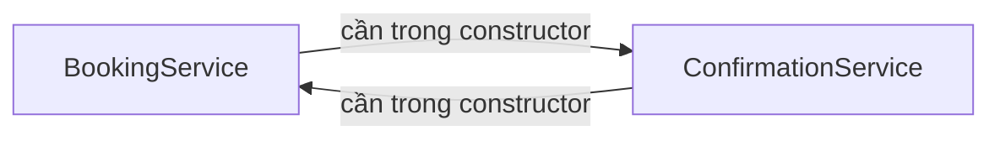
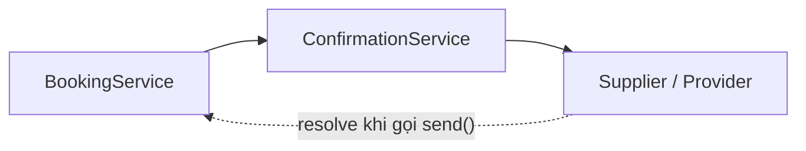
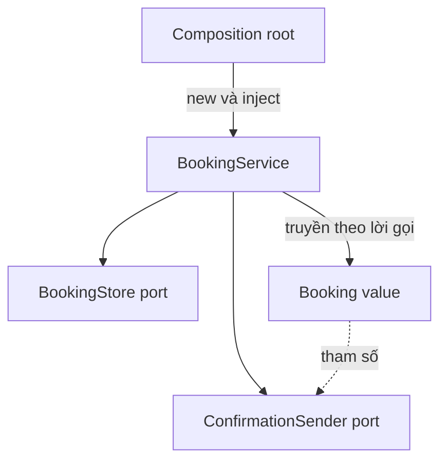
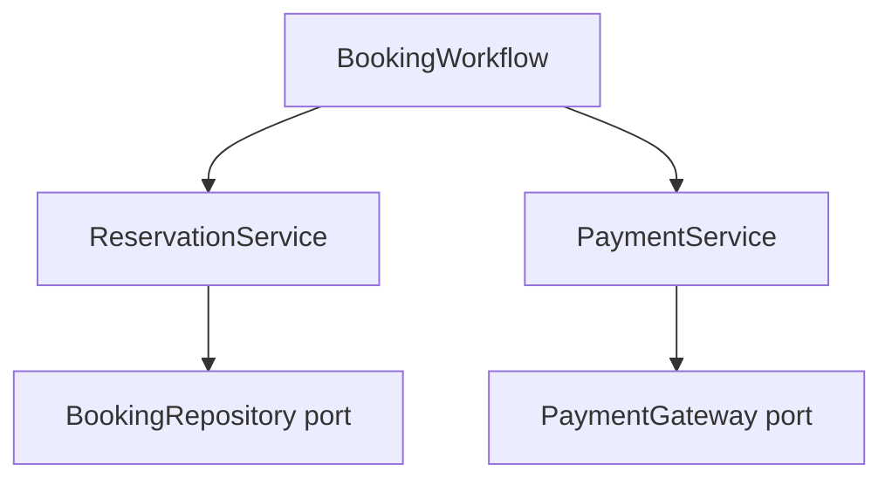
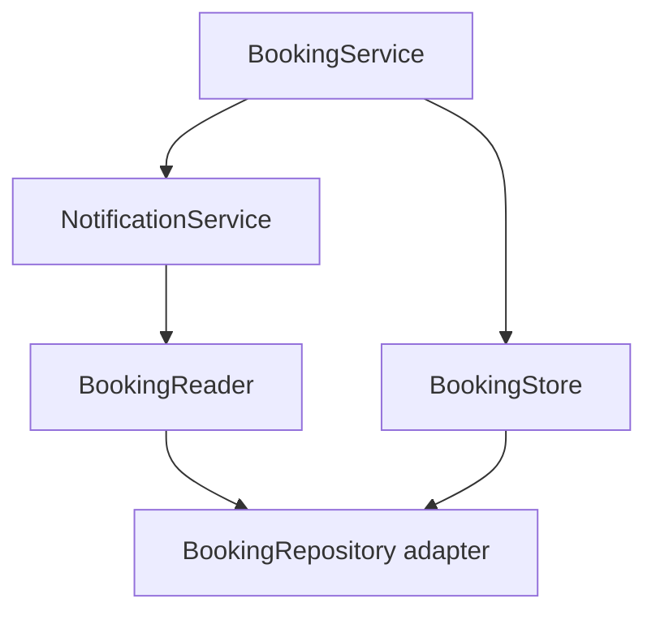
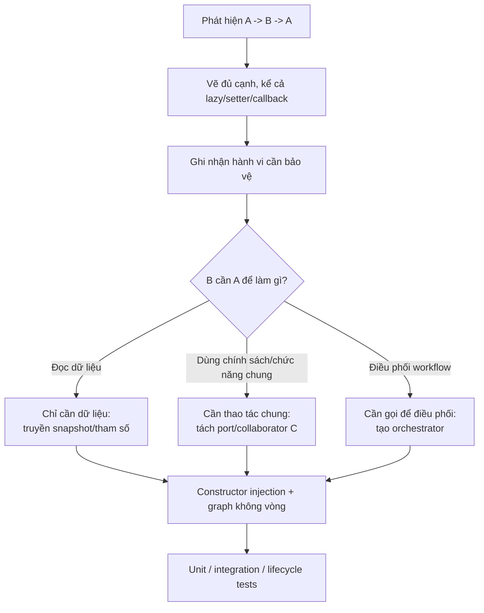

# Phụ thuộc vòng được che bằng lazy hoặc setter nhưng chưa giải quyết thiết kế

Trong chương **Lỗi thiết kế** của module **Dependency Injection (DI)**, có một tình huống dễ gây hiểu lầm: hai thành phần cần tham chiếu đến nhau; ứng dụng không dựng được object graph bằng constructor injection, nên người viết chuyển một cạnh sang **lazy provider** hoặc **setter injection**. Chương trình có thể khởi động trở lại, nhưng quan hệ phụ thuộc vòng chưa chắc đã biến mất.

**Dependency Injection** và **Inversion of Control (IoC)** tách việc *sử dụng dependency* khỏi việc *tạo, chọn và lắp ghép dependency*. Lợi ích lớn của **constructor injection** là làm lộ những dependency bắt buộc ngay ở chữ ký constructor. Khi một đồ thị không thể dựng vì vòng phụ thuộc, đó có thể là **tín hiệu về ranh giới trách nhiệm**, không chỉ là một trở ngại cần vượt qua để container chạy được.

Bài này phân tích vì sao **lazy/provider và setter đôi khi chỉ trì hoãn việc giải quyết vòng phụ thuộc**, cách phân biệt lỗi khởi tạo với vòng gọi lúc chạy, và cách refactor thành đồ thị có hướng rõ ràng. Ví dụ dùng **Java thuần** để quan sát trước khi xét đến các tính năng của DI container.

Sau bài học, bạn có thể:

- Vẽ và phân biệt **vòng phụ thuộc giữa thành phần**, **vòng trong object graph** và **vòng gọi phương thức lúc chạy**.
- Giải thích vì sao hai constructor bắt buộc tham chiếu lẫn nhau không thể được cấp bằng cách tạo thông thường.
- Nhận ra lazy provider, scoped proxy hoặc setter có thể làm mất lỗi startup nhưng không tự xóa quan hệ thiết kế.
- Phân tích các rủi ro *partially initialized object*, lỗi thời điểm resolve, đệ quy, khả năng kiểm thử, scope mismatch và shutdown.
- Áp dụng các cách phá vòng: chuyển dữ liệu qua tham số, tách một collaborator chung, đưa thứ tự điều phối lên orchestrator, dùng port/event khi đúng nhu cầu.
- Viết test Java thuần để bảo vệ hành vi khi thay thiết kế, thay vì chỉ kiểm tra “container tạo được bean”.

## 1. Nhận diện vòng phụ thuộc trước khi sửa cách inject

Giả sử ứng dụng đặt chỗ có:

- `BookingService`: tạo và quản lý booking.
- `ConfirmationService`: gửi xác nhận booking.

Thiết kế ban đầu:

```java
final class BookingService {
    private final ConfirmationService confirmation;

    BookingService(ConfirmationService confirmation) {
        this.confirmation = confirmation;
    }
}

final class ConfirmationService {
    private final BookingService bookings;

    ConfirmationService(BookingService bookings) {
        this.bookings = bookings;
    }
}
```

Quan hệ constructor là:



Không thể dựng hai đối tượng này bằng hai lệnh `new` thông thường mà cả hai constructor đều nhận **instance hoàn chỉnh** của đối tượng còn lại:

```java
// Cần có ConfirmationService để tạo BookingService.
// Nhưng cần có BookingService để tạo ConfirmationService.
// Đây không phải lời giải:
// new BookingService(new ConfirmationService(???));
```

Một DI container cũng phải xử lý cùng một ràng buộc. Container có thể **phát hiện chu trình và báo lỗi**, hoặc một số container/framework có cơ chế tham chiếu sớm, proxy, lazy resolution hay setter để tạo object theo nhiều giai đoạn. Nhưng **khả năng dựng thành công không chứng minh phân chia trách nhiệm đã hợp lý**.

### Ba loại “vòng” không được đánh đồng

| Loại vòng | Ví dụ | Điều đáng quan tâm |
| --- | --- | --- |
| **Vòng phụ thuộc mã nguồn/thành phần** | A gọi API của B, B lại biết và cần API của A | Hai thành phần ràng buộc trách nhiệm, khó thay đổi và test độc lập |
| **Vòng tạo object** | Constructor A cần instance B hoàn chỉnh, constructor B cần instance A hoàn chỉnh | Không thể dựng trực tiếp bằng constructor injection thuần |
| **Vòng gọi runtime** | `A.run() -> B.run() -> A.run() -> ...` | Có thể gây đệ quy vô hạn, `StackOverflowError` hoặc hành vi reentrant sai |

Một vòng **giữa các thành phần** không nhất thiết gây đệ quy vô hạn. Ví dụ, B gọi phương thức tra cứu thuần của A rồi dừng. Tuy nhiên, dù không tràn stack, cấu trúc A–B–A vẫn có thể che giấu trách nhiệm trùng lặp và khiến scope/lifecycle khó quản lý.

Ngược lại, hai class không có vòng constructor vẫn có thể gọi nhau đệ quy thông qua callback, listener hoặc message. Do đó, **xóa lỗi cycle lúc startup** và **giải quyết vòng trách nhiệm** là hai mục tiêu khác nhau.

## 2. Lazy/provider đã thay đổi điều gì?

Một cách “vá” phổ biến là biến một phụ thuộc bắt buộc thành một **supplier**:

```java
import java.util.function.Supplier;

final class ConfirmationService {
    private final Supplier<BookingService> bookings;

    ConfirmationService(Supplier<BookingService> bookings) {
        this.bookings = bookings;
    }

    void send(String bookingId) {
        BookingService service = bookings.get();
        // Dùng service để tra cứu chi tiết booking.
    }
}
```

Tại thời điểm xây `ConfirmationService`, ta chỉ cần cấp một `Supplier<BookingService>`, chưa cần có `BookingService`. Nhờ vậy, lỗi vòng **tạo object trực tiếp** có thể được trì hoãn hoặc tránh tại khởi tạo.

Nhưng khi `send` được gọi, `ConfirmationService` **vẫn yêu cầu `BookingService`**. Cạnh phụ thuộc trong thiết kế chưa được loại bỏ; nó chỉ được **đi qua một lớp gián tiếp**.



Điều quan trọng:

1. **Lazy chỉ thay thời điểm resolve.** Lỗi thiếu registration hoặc lỗi scope có thể chuyển từ lúc startup sang lúc nhận request/job đầu tiên.
2. **Provider không bảo đảm tạo mới.** `get()` có thể trả singleton, proxy, instance theo request hoặc tạo mới mỗi lần — tùy hợp đồng và cấu hình.
3. **Không có gì buộc một provider phải trả instance hợp lệ.** Nếu resolve quá sớm hoặc ngoài scope yêu cầu, có thể gặp lỗi lúc chạy.
4. **Truy cập chéo vẫn còn.** Nếu B phải truy cập A để hoàn thành trách nhiệm của B, cần hỏi liệu B có đang mang quá nhiều trách nhiệm hoặc thiếu dữ liệu đầu vào.
5. **Lazy không ngăn đệ quy gọi phương thức.** Nếu A gọi B rồi B gọi lại đúng thao tác của A, việc giải quyết instance thành công chỉ khiến đường gọi nguy hiểm thực sự chạy được.

Lazy injection có **ứng dụng hợp lệ** — ví dụ trì hoãn tạo một resource đắt tiền, chỉ resolve dependency tùy chọn hoặc lấy dependency đúng scope ở thời điểm sử dụng. Nhưng **dùng lazy chỉ để giấu cycle mà không xem lại thiết kế** là phản mẫu của bài này.

## 3. Setter injection có thể tạo ra trạng thái chưa hoàn chỉnh

Một cách khác là tạo object trước, sau đó **nối tham chiếu bằng setter**:

```java
final class BookingService {
    private ConfirmationService confirmation;

    void setConfirmation(ConfirmationService confirmation) {
        this.confirmation = confirmation;
    }

    void book(String id) {
        confirmation.send(id); // Nếu chưa gọi setter: NullPointerException.
    }
}

final class ConfirmationService {
    private BookingService bookings;

    void setBookings(BookingService bookings) {
        this.bookings = bookings;
    }

    void send(String id) {
        // Có thể gọi ngược vào bookings.
    }
}

// Hai pha:
BookingService bookings = new BookingService();
ConfirmationService confirmations = new ConfirmationService();
bookings.setConfirmation(confirmations);
confirmations.setBookings(bookings);
```

Đây là mã cấu trúc minh họa lỗi thiết kế, không phải ví dụ khuyến nghị. Nó có thể tạo ra hai instance liên kết vòng, nhưng đồng thời tạo một **khoảng thời gian nguy hiểm** giữa lúc constructor hoàn tất và lúc mọi setter được gọi.

Nếu một constructor, callback khởi tạo, event listener hoặc thread khác dùng đối tượng trong khoảng này, dependency bắt buộc có thể còn `null`. Dù thêm `Objects.requireNonNull` trong setter, **trạng thái trước khi setter chạy vẫn chưa đầy đủ**.

| Cách inject | Điều có thể cải thiện | Điều không tự được giải quyết |
| --- | --- | --- |
| **Constructor injection** | Phụ thuộc bắt buộc hiện rõ, field có thể `final`, dễ dựng fake để test | Vòng constructor sẽ bị lộ ra thay vì tự biến mất |
| **Setter injection** | Có thể cấu hình sau khi tạo, phù hợp với một số tùy chọn thật sự không bắt buộc | Đối tượng có thể được dùng trước khi cấu hình xong; vòng trách nhiệm còn |
| **Lazy/provider** | Có thể dời việc lấy dependency tới lúc dùng; tránh tạo eager object | Có thể lỗi lúc chạy, giấu back-edge và gây scope mismatch |
| **Proxy container** | Có thể trì hoãn/chuyển tiếp lời gọi theo scope | Không thay đổi việc hai dịch vụ đang biết hoặc gọi lẫn nhau |

Một số container có hỗ trợ giải quyết một số vòng qua setter hoặc proxy, một số cấu hình không cho phép. Không nên suy ra **mọi container** hoặc **mọi phiên bản** framework chấp nhận dạng cycle nào đó. Ngay cả khi hỗ trợ, việc khởi tạo nhiều pha, gọi đồng thời, callback lifecycle và kiểm thử vẫn cần được xem xét.

## 4. Vì sao “chạy được” chưa chắc là thiết kế đúng?

Việc che vòng bằng setter/lazy thường tạo ra một hoặc nhiều hệ quả:

**Phụ thuộc khó nhìn thấy:** chữ ký constructor của B không còn nói thẳng B cần A để thực hiện công việc. Người đọc thấy `Supplier<BookingService>` hoặc setter được gọi ở nơi xa, khó biết quan hệ thiết kế thực sự.

**Lỗi bị chuyển thời điểm:** trước đây ứng dụng báo circular dependency khi khởi động. Sau khi thêm lazy, lỗi thiếu scope, thiếu cấu hình hoặc resolve lại chính mình có thể xuất hiện ở một request hiếm vào thời điểm production đang chịu tải.

**Khó kiểm thử độc lập:** muốn kiểm thử B có thể phải tạo A; muốn tạo A lại phải tạo B. Test dùng fake có thể cần các thủ thuật `AtomicReference`, biến mutable hoặc setter nhiều pha giống production, thay vì tạo mỗi component với dependency rõ ràng.

**Nguy cơ runtime call loop:** một listener, callback hoặc “tra cứu thêm” có thể gọi ngược vào phương thức ban đầu, dẫn đến đệ quy không có điểm dừng. Nếu qua network/queue, vòng còn có thể tạo event storm thay vì stack overflow.

**Scope/lifecycle thiếu rõ:** một singleton có thể giữ provider trỏ tới dependency theo request. Nếu provider được resolve ngoài request context, việc gọi có thể thất bại; nếu instance ngắn hạn bị cache sai, dữ liệu có thể bị rò sang request khác. Resource đóng theo thứ tự nào cũng khó suy luận khi các component sở hữu lẫn nhau.

**Càng khó thay đổi hệ thống:** hai team chỉnh hai service sẽ phải hiểu và phối hợp các callback hai chiều. Refactor một bên dễ phá logic của bên còn lại dù interface vẫn biên dịch.

Vì vậy, tiêu chí refactor không nên chỉ là **“container khởi động xanh”** mà cần là **“phụ thuộc có một hướng hợp lý, scope rõ và test độc lập hơn”**.

## 5. Ví dụ Java 17: một vòng lazy có thể hoạt động nhưng vẫn bất ổn

Ví dụ sau mô phỏng tình huống:

- `LegacyBookingService` quản lý danh sách booking và gọi `LegacyConfirmationService`.
- `LegacyConfirmationService` muốn biết email của booking nên **gọi ngược** vào `LegacyBookingService` qua một `Supplier`.
- Composition root phải dùng `AtomicReference` làm “ô giữ chỗ” rồi lắp hai service theo thứ tự đặc biệt.

Chú ý: ví dụ này **không** ném `StackOverflowError` khi hoạt động đúng, vì phương thức tra cứu `find` không gọi lại notification. Đây chính là điểm dễ gây nhầm: **vòng phụ thuộc thiết kế có thể tồn tại mà không đệ quy vô hạn**.

### 5.1. Một phiên bản tốt hơn: truyền dữ liệu cần thiết thay vì gọi ngược

Sau refactor, `BookingService` tạo `Booking` rồi truyền **đối tượng giá trị đó** cho `ConfirmationSender`. Sender không cần biết toàn bộ `BookingService`. Các dependency trở thành:



Đây là **đồ thị không có cạnh quay ngược**: mỗi dependency phục vụ một trách nhiệm, còn dữ liệu thuộc từng booking đi qua tham số, không bị lưu vào singleton hoặc resolve từ một service khác.

### 5.2. Chương trình minh họa và kiểm thử bằng Java thuần

Lưu nội dung sau thành `CircularDependencyDesignDemo.java` (Java 17 trở lên):

```java
import java.util.ArrayList;
import java.util.HashMap;
import java.util.List;
import java.util.Map;
import java.util.Objects;
import java.util.concurrent.atomic.AtomicReference;
import java.util.function.Supplier;

public class CircularDependencyDesignDemo {
    record Booking(String id, String email) {
        Booking {
            if (id == null || id.isBlank()
                    || email == null || email.isBlank()) {
                throw new IllegalArgumentException(
                        "id and email must not be blank");
            }
        }
    }

    static void check(boolean condition, String message) {
        if (!condition) {
            throw new AssertionError(message);
        }
    }

    // -------- BEFORE: dependency cycle được che qua Supplier --------

    static final class LegacyBookingService {
        private final LegacyConfirmationService confirmations;
        private final Map<String, Booking> bookings = new HashMap<>();
        private final List<String> events;

        LegacyBookingService(
                LegacyConfirmationService confirmations,
                List<String> events) {
            this.confirmations =
                    Objects.requireNonNull(confirmations, "confirmations");
            this.events = Objects.requireNonNull(events, "events");
        }

        Booking book(String id, String email) {
            Booking booking = new Booking(id, email);
            bookings.put(id, booking);
            events.add("save:" + id);
            confirmations.send(id);
            return booking;
        }

        Booking find(String id) {
            return bookings.get(id);
        }
    }

    static final class LegacyConfirmationService {
        private final Supplier<LegacyBookingService> bookingProvider;
        private final List<String> events;

        LegacyConfirmationService(
                Supplier<LegacyBookingService> bookingProvider,
                List<String> events) {
            this.bookingProvider = Objects.requireNonNull(
                    bookingProvider, "bookingProvider");
            this.events = Objects.requireNonNull(events, "events");
        }

        void send(String id) {
            // Đến thời điểm chạy mới lấy lại BookingService.
            LegacyBookingService bookingService =
                    Objects.requireNonNull(
                            bookingProvider.get(),
                            "BookingService not wired");
            Booking booking = bookingService.find(id);
            if (booking == null) {
                throw new IllegalArgumentException(
                        "Unknown booking: " + id);
            }
            events.add("notify:" + id + ":" + booking.email());
        }
    }

    // -------- AFTER: port một chiều + dữ liệu qua tham số --------

    @FunctionalInterface
    interface BookingStore {
        void save(Booking booking);
    }

    @FunctionalInterface
    interface ConfirmationSender {
        void send(Booking booking);
    }

    static final class BookingService {
        private final BookingStore store;
        private final ConfirmationSender confirmations;

        BookingService(
                BookingStore store,
                ConfirmationSender confirmations) {
            this.store = Objects.requireNonNull(store, "store");
            this.confirmations = Objects.requireNonNull(
                    confirmations, "confirmations");
        }

        Booking book(String id, String email) {
            Booking booking = new Booking(id, email);
            store.save(booking);
            confirmations.send(booking);
            return booking;
        }
    }

    static void testLazyCycleAndInitializationHazard() {
        List<String> legacyEvents = new ArrayList<>();
        AtomicReference<LegacyBookingService> slot =
                new AtomicReference<>();

        LegacyConfirmationService confirmations =
                new LegacyConfirmationService(() -> {
                    LegacyBookingService service = slot.get();
                    if (service == null) {
                        throw new IllegalStateException(
                                "BookingService not wired");
                    }
                    return service;
                }, legacyEvents);

        // Provider đã được cấp, nhưng graph CHƯA sẵn sàng.
        boolean earlyFailure = false;
        try {
            confirmations.send("B-01");
        } catch (IllegalStateException expected) {
            earlyFailure = "BookingService not wired".equals(
                    expected.getMessage());
        }
        check(earlyFailure && legacyEvents.isEmpty(),
                "Early resolution should reveal incomplete wiring");

        LegacyBookingService bookings =
                new LegacyBookingService(confirmations, legacyEvents);
        slot.set(bookings); // Hoàn tất lắp graph vòng bằng tay.

        Booking result = bookings.book(
                "B-01", "alice@example.invalid");
        check(result.equals(
                new Booking("B-01", "alice@example.invalid")),
                "Unexpected legacy result");
        check(legacyEvents.equals(List.of(
                "save:B-01", "notify:B-01:alice@example.invalid")),
                "Wrong legacy events");
    }

    static void testRefactorPreservesBehavior() {
        List<String> events = new ArrayList<>();
        List<Booking> stored = new ArrayList<>();

        // Test/composition root tạo hai port giả, rồi inject trực tiếp.
        BookingStore store = booking -> {
            stored.add(booking);
            events.add("save:" + booking.id());
        };
        ConfirmationSender sender = booking -> events.add(
                "notify:" + booking.id() + ":" + booking.email());
        BookingService service = new BookingService(store, sender);

        Booking result = service.book(
                "B-01", "alice@example.invalid");

        check(stored.equals(List.of(result)),
                "Expected one stored booking");
        check(events.equals(List.of(
                "save:B-01", "notify:B-01:alice@example.invalid")),
                "The refactor changed observable event order");
    }

    static void testFailedStoreDoesNotSend() {
        List<String> events = new ArrayList<>();
        BookingService service = new BookingService(
                booking -> {
                    events.add("save");
                    throw new IllegalStateException("Storage failed");
                },
                booking -> events.add("notify"));

        boolean failed = false;
        try {
            service.book("B-02", "bob@example.invalid");
        } catch (IllegalStateException expected) {
            failed = "Storage failed".equals(expected.getMessage());
        }
        check(failed, "Storage exception should propagate");
        check(events.equals(List.of("save")),
                "Notification must not run after storage failure");
    }

    static void testInvalidInputDoesNotCallDependencies() {
        List<String> events = new ArrayList<>();
        BookingService service = new BookingService(
                booking -> events.add("save"),
                booking -> events.add("notify"));

        boolean rejected = false;
        try {
            service.book(" ", "carol@example.invalid");
        } catch (IllegalArgumentException expected) {
            rejected = true;
        }
        check(rejected && events.isEmpty(),
                "Input validation must run before dependencies");
    }

    public static void main(String[] args) {
        testLazyCycleAndInitializationHazard();
        testRefactorPreservesBehavior();
        testFailedStoreDoesNotSend();
        testInvalidInputDoesNotCallDependencies();
        System.out.println("PASS: 4 circular-dependency design checks");
    }
}
```

Biên dịch và chạy:

```bash
javac CircularDependencyDesignDemo.java
java CircularDependencyDesignDemo
```

Kết quả dự kiến:

```text
PASS: 4 circular-dependency design checks
```

**Điểm cần quan sát:**

1. `LegacyConfirmationService` chỉ nhận `Supplier<LegacyBookingService>`, vì thế nó được tạo trước khi `LegacyBookingService` tồn tại. Nhưng gọi `send` quá sớm vẫn thất bại. Lazy đã **dời** yêu cầu dependency chứ chưa bỏ nó.
2. `AtomicReference` trong mã khởi tạo chỉ là **thủ thuật giữ chỗ phục vụ minh họa**. Nó không có lợi ích kiến trúc cho use case và khiến thứ tự lắp graph trở nên bắt buộc.
3. Bản cũ gọi qua chuỗi `LegacyBookingService -> LegacyConfirmationService -> LegacyBookingService.find`. Vòng dừng được vì `find` không quay lại `send`. Nếu một thay đổi trong tương lai khiến `find` gọi notification, tình huống có thể trở thành vòng gọi runtime.
4. Bản mới tạo `Booking` một lần rồi truyền cho `ConfirmationSender`, không còn lý do để sender gọi ngược vào service. Các test bảo vệ **kết quả, thứ tự lưu–gửi, xử lý lỗi và validation**.
5. Bản mới dùng port do ứng dụng định nghĩa và constructor injection. Test có thể tạo `BookingService` với hai lambda; không cần provider vòng, setter nhiều pha hoặc DI container.

**Giới hạn ví dụ:** Hai bản chỉ mô phỏng hành vi ghi/gửi bằng list, không giao tiếp database hoặc email thật. Một thao tác lưu thành công rồi gửi thất bại vẫn có rủi ro cần giải quyết bằng transaction/outbox hoặc workflow thích hợp; **việc xóa vòng phụ thuộc không tự tạo tính nguyên tử**. `ArrayList`, `HashMap` và các fake chỉ được dùng tuần tự trong demo.

## 6. Cách phá vòng 1: chuyển dữ liệu thay vì truyền cả service

Đây thường là cách đơn giản nhất khi B chỉ gọi A để **lấy dữ liệu mà A đã có**:

**Trước:**

```java
final class ConfirmationService {
    private final Supplier<BookingService> bookings;

    void send(String id) {
        Booking booking = bookings.get().find(id);
        // Dùng booking.email() để gửi.
    }
}
```

**Sau:**

```java
interface ConfirmationSender {
    void send(Booking booking);
}

// Trong BookingService:
Booking booking = new Booking(id, email);
store.save(booking);
sender.send(booking);
```

Hai đoạn trên là **mã minh họa cấu trúc**, với `Booking` được định nghĩa trong chương trình hoàn chỉnh ở phần 5. Điểm chính là `ConfirmationSender` không cần đọc lại trạng thái từ `BookingService` khi chính caller đang nắm dữ liệu đó.

Ưu điểm: **giảm số cạnh phụ thuộc**, test đơn giản, tránh truy vấn lại và không buộc sender biết API của service. Tuy nhiên, **không truyền đối tượng mutable chia sẻ** nếu sender có thể giữ hoặc thay đổi nó ngoài phạm vi an toàn. Trong ví dụ, `Booking` là record chỉ chứa `String`, nên dễ chia sẻ như một snapshot giá trị.

## 7. Cách phá vòng 2: đưa thứ tự điều phối lên một orchestrator

Nếu A cần B để làm bước thứ hai, còn B cần A để yêu cầu bước đầu tiên, có thể cả hai đang cố đảm nhiệm vai trò điều phối.

Giả sử:

```text
BookingService -> PaymentService
PaymentService -> BookingService
```

Thay vì hai service gọi lẫn nhau, tạo một thành phần điều phối ở tầng ứng dụng:



`BookingWorkflow` quyết định thứ tự:

```java
// Pseudocode: các hợp đồng được giả định tồn tại.
final class BookingWorkflow {
    private final ReservationService reservations;
    private final PaymentService payments;

    BookingWorkflow(
            ReservationService reservations, PaymentService payments) {
        this.reservations = reservations;
        this.payments = payments;
    }

    Receipt handle(BookingCommand command) {
        Reservation reservation = reservations.reserve(command);
        PaymentResult payment = payments.charge(
                reservation.id(), command.paymentDetails());
        return reservations.confirm(reservation, payment);
    }
}
```

Ví dụ trên là cấu trúc giải thích, không tự định nghĩa các class miền `ReservationService`, `PaymentService` hay `Receipt`. Trong thực tế, quy trình đặt giữ chỗ và thanh toán còn cần xử lý hủy, hoàn tiền, idempotency, lỗi một phần và transaction. **Thêm orchestrator không tự bảo đảm giao dịch phân tán an toàn**, nhưng nó làm rõ nơi chịu trách nhiệm quản lý workflow.

Một dấu hiệu tốt: hai service con không còn phải biết hoặc resolve lẫn nhau. Composition root tạo repository/gateway, tạo hai service, rồi inject vào coordinator.

## 8. Cách phá vòng 3: tách một dependency chung

Đôi khi A cần B và B cần A vì cả hai cùng sử dụng một **nguồn dữ liệu hoặc chính sách chưa được tách ra**.

Ví dụ:

```text
BookingService -> NotificationService
NotificationService -> BookingService (để lấy Booking)
```

Có thể thay cạnh `NotificationService -> BookingService` bằng việc inject một `BookingReader` độc lập được triển khai bởi repository:



`BookingReader` là **port chỉ đọc** cung cấp dữ liệu mà notification thực sự cần, không phải facade giữ nguyên toàn bộ API của `BookingService`. Lưu ý một repository adapter có thể triển khai cả port ghi và đọc mà vẫn được **một owner** quản lý nếu dùng chung.

Nhưng cần cân nhắc độ nhất quán: ngay sau khi ghi, một kho dữ liệu đọc theo kiểu eventually consistent có thể chưa nhìn thấy booking. Nếu caller đã có dữ liệu cần dùng, **truyền giá trị qua tham số** (cách 1) có thể đơn giản và ít phụ thuộc hơn.

Một biến thể khác là tách **chính sách chung** thành service/đối tượng bất biến `C` mà cả A và B cùng dùng:

```text
Trước: A <-> B
Sau:   A -> C <- B
```

Cần kiểm tra xem C có thật sự là một trách nhiệm riêng có ý nghĩa, không phải “god service” để giấu cycle.

## 9. Cách phá vòng 4: sự kiện và xử lý bất đồng bộ — không phải phép màu

Một thành phần có thể **phát sự kiện** thay vì gọi trực tiếp thành phần khác:

```text
BookingService --(BookingConfirmed event)--> EventPublisher
                                              |
                                              v
                                   NotificationHandler
```

Mô hình này hữu ích khi:

- Booking không cần biết có bao nhiêu consumer xử lý sự kiện.
- Gửi thông báo không cần chặn hoàn tất tác vụ đặt chỗ, theo hợp đồng nghiệp vụ.
- Có cơ chế lưu bền vững sự kiện, retry và idempotency phù hợp.

Nhưng event **không tự xóa vòng ở cấp hệ thống**: handler A có thể phát event B, handler B lại phát event A, tạo **event loop**. Những câu hỏi mới xuất hiện: sự kiện có đến ít nhất một lần hay đúng một lần theo hợp đồng, thứ tự xử lý ra sao, retry có tạo trùng không, và ai chịu trách nhiệm khi event không xử lý được?

Nếu cần phát event **cùng giao dịch** với việc lưu booking, có thể cần một mẫu như transactional outbox. Đó là **quyết định kiến trúc riêng**, không phải thay một lời gọi trực tiếp bằng event rồi mặc định dữ liệu sẽ nhất quán.

**Không chọn event chỉ để làm container hết báo circular dependency.** Hãy chọn khi tính bất đồng bộ, ghép lỏng và ngữ nghĩa nhất quán thực sự phù hợp với yêu cầu.

## 10. Khi nào lazy/setter vẫn là lựa chọn hợp lý?

Không phải mọi lần dùng `Supplier<T>` hay setter đều là lỗi.

| Trường hợp | Có thể hợp lý nếu... | Dấu hiệu cần xem lại |
| --- | --- | --- |
| **Lazy initialization** | Resource tốn kém, ít được dùng; không có dependency quay ngược và có chính sách lỗi rõ | Chỉ thêm lazy sau khi container báo A–B–A |
| **Factory/provider** | Cần instance mới mỗi job/request, hợp đồng cấp và đóng rõ | Singleton giữ provider chỉ để gọi ngược vào chính singleton |
| **Optional setter** | Dependency thực sự tùy chọn và object có hành vi hợp lệ trước khi set | Dependency luôn phải có để mọi phương thức làm việc |
| **Callback/listener** | Quan hệ sự kiện rõ, có quy tắc không reentrant/retry và ownership | Callback lại gọi thao tác phát event, dẫn tới lặp |
| **Framework proxy** | Cần lazy/scoped dispatch theo tài liệu của framework và đã test lifecycle | Proxy được dùng để bỏ qua một cảnh báo thiết kế mà không phân tích |
| **Hai pha khởi tạo đặc thù** | Một giao thức kỹ thuật thực sự bắt buộc và có trạng thái “not ready” được kiểm soát | Object bị công bố cho thread khác trước khi hoàn tất wiring |

Nếu bất khả kháng phải giữ vòng trong giai đoạn chuyển tiếp, hãy **ghi rõ lý do**, điểm resolve, scope, thứ tự khởi tạo và **kế hoạch loại bỏ vòng**. Bổ sung test để phát hiện gọi sớm, vòng gọi runtime và đóng tài nguyên sai. Đừng mô tả workaround là giải pháp đã hoàn tất.

## 11. Mối liên hệ với scope, lifecycle và ownership

Vòng phụ thuộc có thể đặc biệt nguy hiểm khi một cạnh đi qua scope ngắn hạn:

```text
Singleton A -> Provider<RequestScoped B>
RequestScoped B -> Singleton A
```

Nếu A gọi `provider.get()` **ngoài request context**, container có thể không có instance B hợp lệ để cấp. Nếu A vô tình **cache B** trong field, một instance request có thể bị sử dụng qua nhiều request hoặc sau khi vòng đời request đã kết thúc.

Tương tự, hai đối tượng `AutoCloseable` giữ tham chiếu và tự đóng lẫn nhau có thể gây double-close, lỗi shutdown hoặc đóng resource vẫn còn được dùng. Dùng setter để tạo vòng không làm rõ **ai là owner cuối cùng**.

Khi phân tích một vòng có tài nguyên, hãy hỏi:

1. A và B được tạo ở **scope** nào? Có dùng chung trên nhiều thread không?
2. Bằng cách nào một dependency được resolve: constructor, lazy provider, proxy hay setter?
3. Ai có quyền gọi `close()`? Có hai owner cùng đóng một resource không?
4. Ai dừng tiếp nhận request/job mới trước khi resource bị đóng?
5. Nếu khởi tạo thất bại sau khi chỉ một phần graph đã được tạo, ai cleanup?
6. Một callback trong quá trình `close()` có thể gọi ngược tới một component đã đóng không?

Một **composition root** tốt tạo dependency theo thứ tự rõ, cấp chúng qua constructor và đóng những tài nguyên nó sở hữu theo lifecycle. Một graph không vòng thường giúp các quyết định này dễ suy luận hơn. DI container có thể hỗ trợ lifecycle, nhưng nó không tự suy ra ownership nghiệp vụ.

## 12. Kiểm thử để chứng minh đã giải quyết thiết kế

**Chỉ kiểm tra “container start OK” là chưa đủ.** Nên có:

| Cấp test | Cần chứng minh | Kỹ thuật |
| --- | --- | --- |
| **Unit test của A** | A không cần tạo B thật và có thể chạy với fake port | `new A(fakeDependency)` |
| **Unit test của B** | B không cần tạo hoặc resolve A để hoàn thành trách nhiệm | `new B(fakeDataOrPort)` |
| **Behavior parity** | Refactor không đổi output, validation và thứ tự side effect có ý nghĩa | Recording fake, expected value độc lập |
| **Validation** | Không có đường chạy gọi dependency khi input sai | Fake ném `AssertionError` nếu bị gọi |
| **Failure path** | Nếu lưu thất bại thì không gửi thông báo theo hợp đồng | Failing store và spy sender |
| **Composition test** | Các binding/constructor vẫn dựng được object graph dự kiến | Bootstrap thủ công hoặc DI container |
| **Lifecycle test** | Resource đóng đúng một owner sau khi việc đang chạy hoàn thành | Fake `AutoCloseable`, integration test |
| **Concurrency/reentrancy test** | Không rò trạng thái, không tạo vòng gọi khi đồng thời/callback | Kịch bản có kiểm soát, timeout và quan sát sự kiện |

Trong `CircularDependencyDesignDemo.java`, test `testLazyCycleAndInitializationHazard` **chứng minh workaround có trạng thái chưa sẵn sàng**; ba test còn lại kiểm tra mã sau refactor, bao gồm thứ tự lưu–gửi và việc không gửi nếu lưu lỗi.

Khi kiểm thử code thật, cũng nên **kiểm tra dependency graph tĩnh hoặc cấu hình lắp ghép** để phát hiện chu trình. Một thuật toán DFS trên đồ thị có hướng có thể phát hiện cạnh quay về node đang được duyệt; một số container/build tool cũng có chức năng validate riêng. Tuy vậy, kiểm tra graph không thay thế test behavior khi chương trình có callback, sự kiện hoặc proxy runtime.

## 13. Quy trình refactor một vòng phụ thuộc

Có thể dùng quy trình sau để tránh đổi quá nhiều thứ cùng lúc:

1. **Vẽ graph hiện tại:** ghi A, B, constructor, setter, provider, callback và các lời gọi ngược. Đừng vẽ thiếu cạnh chỉ vì nó nằm sau `Supplier.get()`.
2. **Ghi lý do cho từng cạnh:** A cần dữ liệu, cần chính sách, cần thực hiện side effect hay cần điều phối? Đặt câu hỏi tương tự cho B.
3. **Bảo vệ hành vi đang dùng:** test thành công, lỗi, thứ tự tương tác và tác dụng phụ. Phân biệt hành vi cần giữ với bug muốn sửa riêng.
4. **Chọn cách phá vòng nhỏ nhất:** thường là truyền dữ liệu, tách port đọc, tách chính sách chung hoặc đưa workflow lên một coordinator.
5. **Chuyển về constructor injection:** để dependency bắt buộc được thể hiện rõ. Đưa lựa chọn implementation về composition root.
6. **Gỡ lazy/setter chỉ dùng để vá vòng:** kiểm tra không còn back-edge qua container lookup, callback hoặc provider.
7. **Kiểm tra scope và lifecycle:** không vô tình chia sẻ mutable state, không giữ resource request trong singleton, không double-close.
8. **Chạy lại test và quan sát:** nếu hành vi thay đổi, xác định đây là regression hay thay đổi đã được phê duyệt.



Không cần chọn mô hình phức tạp nhất ngay từ đầu. Nếu chỉ thiếu một tham số `Booking` trong notification, việc truyền đúng `Booking` có thể **xóa cạnh quay ngược** với ít thay đổi hơn cả event bus hoặc framework proxy.

## 14. Những ngộ nhận phổ biến

| Ngộ nhận | Cách hiểu đúng |
| --- | --- |
| “Thêm `@Lazy` rồi ứng dụng chạy là đã sửa vòng.” | Chỉ có thể dời việc resolve; back-edge giữa trách nhiệm có thể còn nguyên. |
| “Setter injection linh hoạt nên phù hợp cho mọi vòng phụ thuộc.” | Setter có thể để object ở trạng thái thiếu dependency bắt buộc; dùng khi ý nghĩa tùy chọn/hai pha thực sự phù hợp. |
| “Vòng dependency luôn gây `StackOverflowError`.” | Vòng trong graph không đồng nghĩa vòng gọi vô hạn; vẫn có rủi ro thiết kế và lifecycle. |
| “Không có vòng constructor nghĩa là không còn cycle.” | Provider, callback, proxy, event và service locator có thể tạo cạnh gián tiếp. |
| “Provider luôn trả object mới.” | Tùy scope và hợp đồng; có thể trả cùng singleton hoặc một scoped proxy. |
| “Đưa A và B vào interface là hết vòng.” | Đổi kiểu concrete thành interface không loại bỏ cạnh A→B→A nếu hai bên vẫn cần nhau. |
| “Event bus luôn phá coupling.” | Có thể giảm phụ thuộc trực tiếp nhưng tạo cycle sự kiện, retry và consistency mới. |
| “DI container sẽ tự xử lý mọi vòng hợp lệ.” | Khả năng hỗ trợ cycle/proxy phụ thuộc framework, version, cấu hình và kiểu injection. |
| “Object tạo được thì dùng đồng thời và shutdown an toàn.” | Cần kiểm tra scope, thread-safety và ownership riêng. |

## 15. Bài tập thực hành

### Bài tập 1 — Vẽ cả cạnh lazy

Cho `ReportService -> AuditService` và `AuditService -> Supplier<ReportService>`. Vẽ **đồ thị phụ thuộc thiết kế** và **thứ tự tạo object** khác nhau. Giải thích vì sao không thể xem cạnh thông qua `Supplier.get()` là “đã biến mất”.

### Bài tập 2 — Đối chiếu constructor và setter

Thiết kế hai class `A` và `B` có setter hai chiều. Thử gọi một phương thức cần dependency ngay sau khi tạo `A` nhưng trước khi gọi setter. Nêu lỗi có thể xảy ra, rồi đề xuất constructor injection sau khi bỏ vòng trách nhiệm.

### Bài tập 3 — Bảo vệ hành vi khi phá vòng

Chạy `CircularDependencyDesignDemo.java`, sau đó bổ sung test kiểm tra email khác và booking ID khác. Đảm bảo bản mới vẫn tạo cùng chuỗi `save` rồi `notify` và không cần truy cập ngược vào `BookingService`.

### Bài tập 4 — Phân biệt runtime recursion và graph cycle

Trong thiết kế cũ, `LegacyConfirmationService.send` gọi `LegacyBookingService.find` và kết thúc. Giải thích vì sao không có đệ quy vô hạn. Sau đó mô tả điều gì xảy ra nếu `find` lại gọi `confirmations.send` trước khi trả về.

### Bài tập 5 — Tách orchestrator

Một `PaymentService` cần `OrderService` để kiểm tra trạng thái; `OrderService` cần `PaymentService` để thu tiền. Hãy đề xuất một `CheckoutWorkflow` nhận các port độc lập. Vẽ đồ thị trước/sau, chỉ ra test nào cần bảo vệ thứ tự thao tác và các trường hợp lỗi.

### Bài tập 6 — Scope và request

Giả sử A là singleton còn B là request-scoped và được A lấy qua provider. Nếu A gọi provider từ một background worker không có HTTP request context, điều gì có thể xảy ra? Nếu A cache B vào field, vì sao có nguy cơ rò trạng thái? Đề xuất cách truyền context/khởi tạo job scope thích hợp.

### Bài tập 7 — Khi nào event thật sự cần thiết?

Thay `ConfirmationSender.send` trực tiếp bằng một sự kiện `BookingCreated`. Mô tả ràng buộc về thứ tự, retry, khả năng gửi trùng, lưu event cùng giao dịch và cơ chế chống event loop. So sánh với giải pháp chỉ truyền `Booking` vào sender và giải thích khi nào giải pháp đơn giản hơn đã đủ.

## 16. Câu hỏi tự kiểm tra

1. Vì sao A(B) và B(A) là vấn đề với constructor injection của hai instance thông thường?
2. `Supplier<B>` giúp trì hoãn điều gì và **không** giải quyết điều gì?
3. Vì sao setter hai pha có thể tạo object ở trạng thái chưa sẵn sàng?
4. Vòng phụ thuộc trong object graph có nhất thiết gây đệ quy vô hạn không?
5. Khi B chỉ cần dữ liệu mà A đã tạo, cách phá vòng đơn giản nhất thường là gì?
6. Khi A và B cùng muốn điều phối workflow, nên cân nhắc thành phần nào?
7. Việc tạo interface cho A/B có tự xóa mối quan hệ hai chiều không?
8. Nếu dùng event, những vòng gọi nào có thể chuyển thành vòng sự kiện?
9. Vì sao phải kiểm tra scope, ownership và shutdown dù container đã tạo graph thành công?
10. Loại kiểm thử nào cho thấy thiết kế mới thật sự dễ tạo SUT bằng Java thuần?

**Kết luận:** Lazy/provider và setter có thể là công cụ phù hợp trong hoàn cảnh riêng, nhưng **không phải lời giải mặc định cho vòng phụ thuộc**. Khi chỉ dùng chúng để làm lỗi circular dependency biến mất, ta có thể đã đổi lỗi từ **khởi động** sang **thời điểm chạy**, đồng thời giữ nguyên quan hệ thiết kế khó kiểm soát. Cách sửa bền vững là tìm lý do thực sự của mỗi cạnh phụ thuộc, **tách trách nhiệm hoặc truyền đúng dữ liệu/port**, đưa phần điều phối lên thành phần thích hợp, rồi dùng constructor injection và composition root để lắp một graph rõ ràng. Kiểm chứng bằng Java thuần trước giúp phát hiện vấn đề mà việc container báo “startup thành công” không thể chứng minh.
