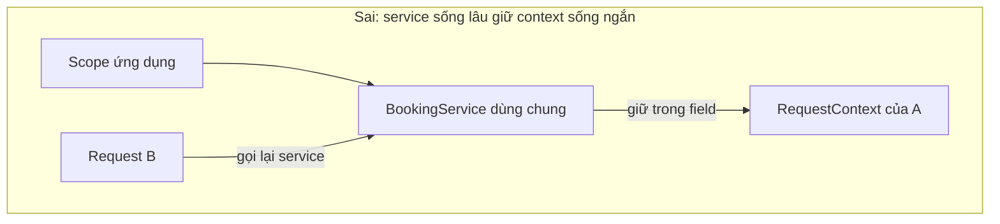
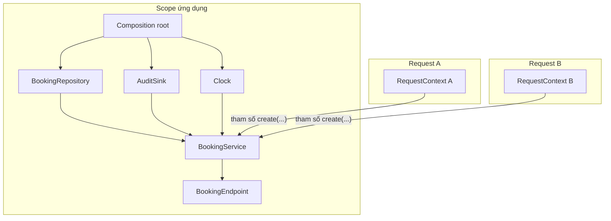
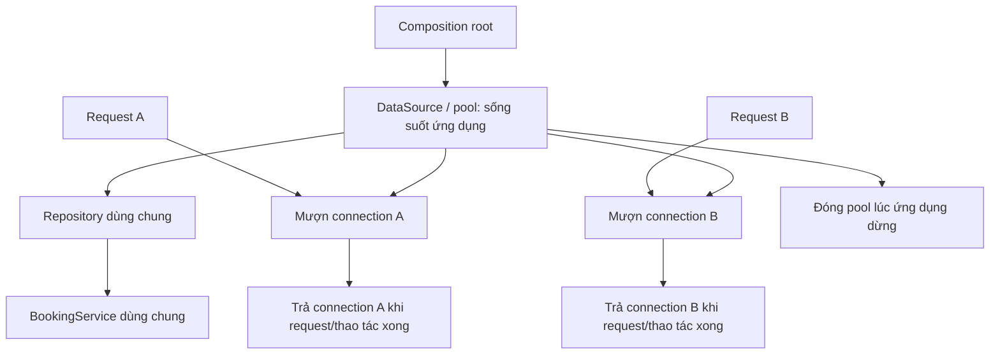

# Đối tượng sống lâu giữ trạng thái của yêu cầu sống ngắn

**Dependency Injection (DI)** giúp một service nhận các cộng tác viên từ bên ngoài qua constructor, thay vì tự tạo hoặc tìm chúng. Nhưng một đồ thị phụ thuộc có thể được lắp ghép đúng về **kiểu** mà vẫn sai về **vòng đời**: một đối tượng tồn tại suốt ứng dụng lại giữ tham chiếu đến trạng thái chỉ hợp lệ trong một request.

Ví dụ, `BookingService` được tạo một lần khi ứng dụng khởi động. Nếu nó giữ trường `currentUser` hoặc một `RequestSession` của request đầu tiên, các request sau có thể dùng nhầm danh tính, dữ liệu hoặc tài nguyên đã đóng. Khi nhiều request chạy đồng thời, chúng còn có thể ghi đè trạng thái của nhau. Lỗi này thường được gọi là **captive dependency** khi một thành phần sống lâu giữ một phụ thuộc có vòng đời ngắn hơn.

Bài thuộc chương **Lỗi thiết kế** trong nội dung **Dependency Injection và Inversion of Control (IoC)**. Ta sẽ nhận diện sự chênh lệch vòng đời, phân tích nguyên nhân, sửa bằng việc truyền dữ liệu theo lời gọi hoặc dùng đúng scope, thực hành constructor injection và composition root bằng Java thuần, rồi xem những giới hạn khi chuyển sang DI container hay xử lý bất đồng bộ.

## 1. Đường phụ thuộc có thể hợp lệ về kiểu nhưng sai về vòng đời

Giả sử có ba thành phần:

- `BookingService`: xử lý nghiệp vụ tạo booking, được tái sử dụng trong suốt quá trình chạy.
- `BookingRepository`: nơi lưu booking, có thể được chia sẻ nếu implementation đáp ứng yêu cầu đồng thời.
- `RequestContext`: chứa request ID và actor ID cho **một** yêu cầu cụ thể.

Hai cách lắp ghép có vẻ tương tự nhưng mang ý nghĩa khác nhau:

```java
// Sai khi service dùng chung giữ context của một request:
BookingService service = new BookingService(repository, requestContext);

// Đúng nếu service nhận phụ thuộc ổn định, còn context theo từng lời gọi:
BookingService service = new BookingService(repository, auditSink, clock);
service.create(requestContext, "BK-001");
```

Các dòng này là **phác thảo hai phương án API**, không phải hai lời gọi cùng biên dịch với một class; phần 5 sẽ định nghĩa class cho phương án đúng.

Vấn đề không phải `RequestContext` có field hay không, hoặc nó có là `final` không. Vấn đề là **ý nghĩa của dữ liệu chỉ thuộc về một request**, trong khi service có thể được dùng qua nhiều request.



Request A hoàn tất không đồng nghĩa `RequestContext A` tự biến mất. Miễn là service còn giữ tham chiếu, object có thể tiếp tục được giữ trong bộ nhớ. Nếu context sở hữu một session, transaction hay handle đã hết hạn, tham chiếu đó còn trở thành **tài nguyên không còn hợp lệ để sử dụng**.

## 2. Scope, trạng thái và ownership không phải cùng một thứ

| Khái niệm | Câu hỏi cần trả lời | Ví dụ |
| --- | --- | --- |
| **Scope** | Ai được nhận cùng một instance? | Cả ứng dụng dùng một `BookingService`; mỗi request có context riêng |
| **Lifetime** | Instance hoặc tài nguyên hợp lệ từ lúc nào đến lúc nào? | `RequestSession` chỉ hợp lệ trước khi request kết thúc |
| **State ownership** | Dữ liệu thuộc về ứng dụng, người dùng, tenant hay một request? | `actorId` của request A không phải thuộc tính của singleton service |
| **Resource ownership** | Ai tạo, mượn và đóng tài nguyên? | Request mượn connection; pool được đóng khi ứng dụng dừng |
| **Concurrency** | Nhiều luồng có thể dùng instance cùng lúc không? | Hai request gọi một service singleton đồng thời |

Không phải mọi đối tượng sống lâu đều không được giữ trạng thái. Một cache ứng dụng, registry bất biến hoặc connection pool có thể được dùng chung nếu có quy tắc đồng bộ và quyền truy cập phù hợp. Ngược lại, **dữ liệu request vẫn là dữ liệu request ngay cả khi object chứa nó bất biến**.

Một cách nhận diện nhanh:

> Nếu một object vẫn tồn tại sau khi request kết thúc, nó có còn lý do hợp lệ để giữ tham chiếu đến object của request đó không?

Nếu câu trả lời là “không” hoặc “chỉ vì code dễ viết hơn”, hãy xem lại nơi truyền, giữ và giải phóng tham chiếu.

## 3. Hai lỗi điển hình

### 3.1. Trường `currentRequest` bị các request ghi đè

```java
// Anti-pattern minh họa; các kiểu nghiệp vụ xuất hiện trong ví dụ phần 5.
final class UnsafeBookingService {
    private final BookingRepository repository;
    private RequestContext currentRequest;

    UnsafeBookingService(BookingRepository repository) {
        this.repository = repository;
    }

    void setRequest(RequestContext request) {
        this.currentRequest = request;
    }

    Booking create(String id) {
        Booking booking = new Booking(
            id, currentRequest.actorId(), java.time.Instant.now());
        repository.save(booking);
        return booking;
    }
}
```

Giả sử hai request đi qua cùng service:

```text
Request A: setRequest(req-A, alice)
Request B: setRequest(req-B, bob)
Request A: create("BK-A")
            -> có thể ghi owner = bob, không phải alice
```

Một lệnh `synchronized` hoặc một trường `volatile` **không giải quyết ý nghĩa sở hữu dữ liệu**. `volatile` chỉ hỗ trợ quy tắc nhìn thấy của giá trị trường trong mô hình bộ nhớ Java, không biến một trường chung thành giá trị riêng cho từng request. Khóa đồng bộ có thể ngăn một vài xen kẽ lệnh khi được dùng đúng, nhưng việc dùng singleton để giữ `currentRequest` vẫn làm API phụ thuộc thứ tự gọi và khó dùng đúng.

### 3.2. Service giữ một phụ thuộc request-scoped đã hết hạn

Xét một `RequestSession` chỉ dùng được trong khoảng xử lý yêu cầu:

```java
// Minh họa rủi ro vòng đời, không phải lớp trong chương trình chạy phần 5.
final class UnsafeReportService {
    private final RequestSession session;

    UnsafeReportService(RequestSession session) {
        this.session = session;
    }

    Report load() {
        return session.queryReport();
    }
}
```

Nếu `UnsafeReportService` sống suốt ứng dụng mà `session` đã đóng khi request đầu kết thúc, lần gọi tiếp theo có thể lỗi kiểu *session closed* hoặc dùng nhầm ngữ cảnh request. Dù `session` là trường `final`, Java vẫn cho phép giữ tham chiếu đến object đã hết hạn; `final` không quản lý lifecycle.

Các triệu chứng thực tế có thể gồm **dùng sai người dùng**, dữ liệu lẫn giữa tenant/request, truy cập tài nguyên sau khi đóng và giữ bộ nhớ lâu hơn dự định. Nếu context chứa dữ liệu nhạy cảm, việc giữ lại cũng có thể tạo rủi ro riêng tư.

## 4. Quy tắc sửa: cái gì ổn định thì inject, cái gì thuộc request thì truyền theo request

Một thiết kế an toàn thường có hai ranh giới:

1. **Constructor của service:** nhận repository, client, clock, policy hoặc cộng tác viên **có vòng đời và khả năng chia sẻ phù hợp**.
2. **Phương thức nghiệp vụ:** nhận request ID, actor ID, dữ liệu yêu cầu và ngữ cảnh chỉ thuộc về **lần gọi hiện tại**.



`RequestContext` không nằm trong trường của `BookingService`. Service có thể xử lý nhiều request song song **nếu các cộng tác viên được chia sẻ hỗ trợ điều đó** và bản thân service không giữ state thay đổi theo request.

Đây không phải quy tắc “mọi service phải singleton”. Nếu một service thật sự có trạng thái chỉ thuộc request, tạo service theo request cũng là phương án hợp lệ. Điều cần bảo đảm là **không có đối tượng sống lâu hơn giữ nhầm instance request-scoped**.

## 5. Ví dụ chạy được bằng Java thuần

Ta xây dựng ứng dụng có hai yêu cầu tạo booking. `BookingService` dùng chung repository, audit sink và clock; mỗi lời gọi tạo một `RequestContext` mới. Không có DI container: `main(...)` là **composition root**, thể hiện rõ quy tắc tạo và lắp ghép.

Tạo file `RequestScopeLeakDemo.java`:

```java
import java.time.Clock;
import java.time.Instant;
import java.util.Objects;
import java.util.concurrent.ConcurrentHashMap;

final class RequestContext {
    private final String requestId;
    private final String actorId;

    RequestContext(String requestId, String actorId) {
        this.requestId = requireText(requestId, "requestId");
        this.actorId = requireText(actorId, "actorId");
    }

    String requestId() {
        return requestId;
    }

    String actorId() {
        return actorId;
    }

    private static String requireText(String text, String field) {
        if (text == null || text.trim().isEmpty()) {
            throw new IllegalArgumentException(field + " khong duoc rong");
        }
        return text.trim();
    }
}

final class Booking {
    private final String id;
    private final String ownerId;
    private final Instant createdAt;

    Booking(String id, String ownerId, Instant createdAt) {
        if (id == null || !id.matches("[A-Za-z0-9-]+")) {
            throw new IllegalArgumentException("bookingId khong hop le");
        }
        this.id = id;
        this.ownerId = Objects.requireNonNull(ownerId, "ownerId");
        this.createdAt = Objects.requireNonNull(createdAt, "createdAt");
    }

    String id() {
        return id;
    }

    String ownerId() {
        return ownerId;
    }

    Instant createdAt() {
        return createdAt;
    }
}

interface BookingRepository {
    void save(Booking booking);
    Booking find(String bookingId);
}

final class InMemoryBookingRepository implements BookingRepository {
    private final ConcurrentHashMap<String, Booking> bookings =
        new ConcurrentHashMap<>();

    @Override
    public void save(Booking booking) {
        Objects.requireNonNull(booking, "booking");
        if (bookings.putIfAbsent(booking.id(), booking) != null) {
            throw new IllegalStateException("Booking da ton tai");
        }
    }

    @Override
    public Booking find(String bookingId) {
        return bookings.get(bookingId);
    }
}

interface AuditSink {
    void recorded(RequestContext context, Booking booking);
}

final class ConsoleAuditSink implements AuditSink {
    @Override
    public void recorded(RequestContext context, Booking booking) {
        System.out.println("AUDIT request=" + context.requestId()
            + " actor=" + context.actorId()
            + " booking=" + booking.id());
    }
}

final class BookingService {
    private final BookingRepository repository;
    private final AuditSink audit;
    private final Clock clock;

    BookingService(BookingRepository repository, AuditSink audit, Clock clock) {
        this.repository = Objects.requireNonNull(repository, "repository");
        this.audit = Objects.requireNonNull(audit, "audit");
        this.clock = Objects.requireNonNull(clock, "clock");
    }

    Booking create(RequestContext context, String bookingId) {
        Objects.requireNonNull(context, "context");
        Booking booking = new Booking(
            bookingId, context.actorId(), clock.instant());
        repository.save(booking);
        audit.recorded(context, booking);
        return booking;
    }
}

final class BookingEndpoint {
    private final BookingService service;

    BookingEndpoint(BookingService service) {
        this.service = Objects.requireNonNull(service, "service");
    }

    Booking handleCreate(String requestId, String actorId, String bookingId) {
        // Context moi cho moi request, khong giu vao field endpoint/service.
        RequestContext context = new RequestContext(requestId, actorId);
        return service.create(context, bookingId);
    }
}

public class RequestScopeLeakDemo {
    public static void main(String[] args) {
        // Composition root: cac dependency dung chung duoc tao mot lan.
        BookingRepository repository = new InMemoryBookingRepository();
        AuditSink audit = new ConsoleAuditSink();
        Clock clock = Clock.systemUTC();
        BookingService service = new BookingService(repository, audit, clock);
        BookingEndpoint endpoint = new BookingEndpoint(service);

        Booking first = endpoint.handleCreate("req-A", "alice", "BK-A");
        Booking second = endpoint.handleCreate("req-B", "bob", "BK-B");

        System.out.println("CREATED " + first.id()
            + " owner=" + first.ownerId());
        System.out.println("CREATED " + second.id()
            + " owner=" + second.ownerId());
    }
}
```

Biên dịch, chạy với JDK 8 trở lên:

```bash
javac RequestScopeLeakDemo.java
java RequestScopeLeakDemo
```

Kết quả mong đợi:

```text
AUDIT request=req-A actor=alice booking=BK-A
AUDIT request=req-B actor=bob booking=BK-B
CREATED BK-A owner=alice
CREATED BK-B owner=bob
```

`BookingService` được tạo **một lần**. Dù vậy, dữ liệu của request A không trở thành thuộc tính của service. Request B truyền `RequestContext` riêng, nên không phụ thuộc vào việc A đã gọi service trước đó.

`ConcurrentHashMap` và `putIfAbsent` được dùng để minh họa repository có thể nhận các thao tác lưu đơn lẻ đồng thời. Điều đó **không đảm bảo tự động** các quy trình nghiệp vụ gồm nhiều bước có tính nguyên tử hoặc nhất quán. Phần kiểm thử tiếp theo chỉ xác nhận các hành vi cụ thể được nêu, không thay cho toàn bộ kiểm thử concurrency/integration của ứng dụng.

## 6. Kiểm thử xuyên request và chạy song song

Lỗi giữ trạng thái request thường chỉ lộ ra khi có **ít nhất hai** request hoặc khi lịch thực thi thay đổi. Vì vậy, test chỉ tạo một booking có thể bỏ sót lỗi.

Ta sẽ kiểm tra:

1. Hai request liên tiếp đi qua **cùng service** nhưng giữ đúng `ownerId` và request ID.
2. Hai fixture độc lập không vô tình chia sẻ repository/audit.
3. Hai request chạy song song không ghi nhầm danh tính vào booking hay audit.
4. Dữ liệu request không hợp lệ bị từ chối trước khi lưu.

Tạo file `RequestScopeLeakDemoTest.java` cùng thư mục:

```java
import java.time.Clock;
import java.time.Instant;
import java.time.ZoneOffset;
import java.util.List;
import java.util.concurrent.CopyOnWriteArrayList;
import java.util.concurrent.CountDownLatch;
import java.util.concurrent.ExecutorService;
import java.util.concurrent.Executors;
import java.util.concurrent.Future;
import java.util.concurrent.TimeUnit;

public class RequestScopeLeakDemoTest {
    static final class RecordingAuditSink implements AuditSink {
        final List<String> events = new CopyOnWriteArrayList<>();

        @Override
        public void recorded(RequestContext context, Booking booking) {
            events.add(context.requestId() + ":" + context.actorId()
                + ":" + booking.id());
        }
    }

    static final class Fixture {
        final InMemoryBookingRepository repository =
            new InMemoryBookingRepository();
        final RecordingAuditSink audit = new RecordingAuditSink();
        final Clock clock = Clock.fixed(
            Instant.parse("2026-01-01T00:00:00Z"), ZoneOffset.UTC);
        final BookingService service =
            new BookingService(repository, audit, clock);
        final BookingEndpoint endpoint = new BookingEndpoint(service);
    }

    public static void main(String[] args) throws Exception {
        testSequentialRequestsStaySeparate();
        testFixturesDoNotShareState();
        testParallelRequestsStaySeparate();
        testInvalidRequestIsRejected();
        System.out.println("RequestScopeLeakDemoTest PASSED");
    }

    static void testSequentialRequestsStaySeparate() {
        Fixture f = new Fixture();
        Booking first = f.endpoint.handleCreate("r-A", "alice", "BK-A");
        Booking second = f.endpoint.handleCreate("r-B", "bob", "BK-B");

        check("alice".equals(first.ownerId()), "Owner cua A bi sai");
        check("bob".equals(second.ownerId()), "Owner cua B bi sai");
        check(f.repository.find("BK-A") == first, "Kho luu A sai");
        check(f.repository.find("BK-B") == second, "Kho luu B sai");
        check(f.audit.events.contains("r-A:alice:BK-A"), "Audit A sai");
        check(f.audit.events.contains("r-B:bob:BK-B"), "Audit B sai");
        check(f.audit.events.size() == 2, "Phai co hai su kien");
    }

    static void testFixturesDoNotShareState() {
        Fixture a = new Fixture();
        Fixture b = new Fixture();

        a.endpoint.handleCreate("r-1", "alice", "BK-SAME");
        check(b.repository.find("BK-SAME") == null,
            "Fixture B khong duoc thay booking cua A");
        check(b.audit.events.isEmpty(),
            "Fixture B khong duoc nhan audit cua A");

        b.endpoint.handleCreate("r-2", "bob", "BK-SAME");
        check("alice".equals(a.repository.find("BK-SAME").ownerId()),
            "Du lieu A bi ghi de");
        check("bob".equals(b.repository.find("BK-SAME").ownerId()),
            "Du lieu B khong doc lap");
    }

    static void testParallelRequestsStaySeparate() throws Exception {
        Fixture f = new Fixture();
        ExecutorService executor = Executors.newFixedThreadPool(2);
        CountDownLatch start = new CountDownLatch(1);
        try {
            Future<Booking> futureA = executor.submit(() -> {
                start.await();
                return f.endpoint.handleCreate("r-A", "alice", "BK-P1");
            });
            Future<Booking> futureB = executor.submit(() -> {
                start.await();
                return f.endpoint.handleCreate("r-B", "bob", "BK-P2");
            });
            start.countDown();

            Booking a = futureA.get(5, TimeUnit.SECONDS);
            Booking b = futureB.get(5, TimeUnit.SECONDS);
            check("alice".equals(a.ownerId()), "Sai actor o request A");
            check("bob".equals(b.ownerId()), "Sai actor o request B");
            check(f.audit.events.contains("r-A:alice:BK-P1"), "Audit A sai");
            check(f.audit.events.contains("r-B:bob:BK-P2"), "Audit B sai");
            check(f.audit.events.size() == 2, "Sai so luong audit");
        } finally {
            executor.shutdownNow(); // Test so huu pool nen phai don dep.
        }
    }

    static void testInvalidRequestIsRejected() {
        Fixture f = new Fixture();
        boolean rejected = false;
        try {
            f.endpoint.handleCreate("r-empty", " ", "BK-INVALID");
        } catch (IllegalArgumentException expected) {
            rejected = true;
        }
        check(rejected, "Actor ID rong phai bi tu choi");
        check(f.repository.find("BK-INVALID") == null,
            "Khong duoc luu booking khong hop le");
        check(f.audit.events.isEmpty(),
            "Khong duoc audit booking khong hop le");
    }

    static void check(boolean condition, String message) {
        if (!condition) {
            throw new AssertionError(message);
        }
    }
}
```

Biên dịch và chạy:

```bash
javac RequestScopeLeakDemo.java RequestScopeLeakDemoTest.java
java RequestScopeLeakDemoTest
```

Kết quả mong đợi:

```text
RequestScopeLeakDemoTest PASSED
```

`Fixture` tạo repository, audit và service mới cho mỗi phép kiểm thử, nên không giữ dữ liệu từ test trước. `Clock.fixed(...)` loại bỏ sự phụ thuộc vào thời gian thực. `RecordingAuditSink` lưu sự kiện trong `CopyOnWriteArrayList`, phù hợp với quy mô ghi nhỏ của test này; test song song **không giả định thứ tự** hai sự kiện.

Test song song không phải bằng chứng tuyệt đối rằng mọi hành vi tương lai sẽ thread-safe. Nó kiểm tra đúng những cạnh tranh cụ thể đang được thiết kế. Khi thêm state mutable, transaction hoặc adapter khác, phải đánh giá concurrency và đồng bộ lại theo hợp đồng thực tế.

## 7. Vì sao `synchronized`, `volatile` và `ThreadLocal` thường không phải cách sửa chính?

### `synchronized`

Khóa có thể ngăn hai luồng cùng sửa một vùng dữ liệu nếu toàn bộ chuỗi thao tác được bảo vệ đúng. Nhưng giữ `currentRequest` trên singleton vẫn tạo phụ thuộc vào chu kỳ `setRequest(...) → create(...)`; một caller quên set hoặc gọi sai thứ tự vẫn có thể dùng context cũ. Hơn nữa, khóa toàn bộ nghiệp vụ có thể làm các request phải chờ nhau.

### `volatile`

`volatile RequestContext currentRequest` cải thiện một số bảo đảm visibility, nhưng **không cung cấp giá trị riêng cho từng request** và không gộp nhiều thao tác thành một giao dịch nguyên tử. Một luồng vẫn có thể thấy context mới do luồng khác ghi.

### `ThreadLocal`

`ThreadLocal<RequestContext>` lưu dữ liệu theo **luồng**, không theo **request**. Khi server dùng thread pool, một luồng có thể xử lý nhiều request nối tiếp; nếu quên `remove()` trong `finally`, context có thể tồn tại sang request tiếp theo. Trong xử lý bất đồng bộ, công việc có thể chuyển sang một luồng khác, nên `ThreadLocal` không tự bảo đảm context theo đúng request.

```java
// Mẫu minh họa khi bắt buộc dùng ThreadLocal; không thay ví dụ phần 5.
try {
    REQUEST_CONTEXT.set(context);
    handleRequest();
} finally {
    REQUEST_CONTEXT.remove();
}
```

Mẫu này chỉ cho thấy **yêu cầu cleanup**, chưa giải quyết việc truyền context qua executor hoặc tác vụ bất đồng bộ. Khi có thể, truyền context hoặc dữ liệu cần thiết **tường minh qua tham số** thường dễ hiểu và dễ kiểm thử hơn.

## 8. Captive dependency trong DI container

Với Java thuần, lỗi thường nhìn thấy ngay tại constructor:

```java
// Sai về mặt scope nếu service sống suốt ứng dụng còn session theo request:
ApplicationService service = new ApplicationService(requestSession);
```

Trong DI container, lỗi có thể được che bởi cách resolve các bean:

```text
Application-scoped Service
  -> Request-scoped Session
```

Một số container từ chối quan hệ này trong một số tình huống; một số hỗ trợ **scoped proxy**, **provider** hoặc cơ chế resolve theo ngữ cảnh. Điều quan trọng không chỉ là annotation nào xuất hiện, mà là **đối tượng thực tế được inject và được lấy tại thời điểm nào**.

Hai tình huống khác nhau:

1. **Capture:** container hoặc mã bootstrap lấy **một instance request-scoped cụ thể** rồi để singleton giữ nó. Khi request kết thúc, singleton vẫn còn tham chiếu cũ; đây là captive dependency.
2. **Resolve theo scope hiện hành:** singleton giữ một proxy/provider; mỗi lần dùng, cơ chế đó tìm đúng dependency trong request hiện tại. Cách này chỉ an toàn nếu framework hỗ trợ, scope đang hoạt động và caller không giữ instance đã lấy vượt quá vòng đời cho phép.

```java
// Phác thảo ý tưởng (không sử dụng API container cụ thể).
final class ReportService {
    private final java.util.function.Supplier<RequestSession> sessions;

    ReportService(java.util.function.Supplier<RequestSession> sessions) {
        this.sessions = sessions;
    }

    Report run() {
        RequestSession session = sessions.get();
        return session.queryReport();
    }
}
```

**`Supplier` không tự tạo request scope.** Nó chỉ là một hợp đồng để lấy đối tượng. Caller phải bảo đảm implementation của supplier lấy đúng session thuộc ngữ cảnh hiện hành và session vẫn hợp lệ trong suốt lời gọi. Nếu supplier chỉ đóng trên một instance cũ (`() -> oldSession`), lỗi captive dependency vẫn còn.

Không có một quy tắc chung áp dụng cho mọi Spring, Jakarta CDI hay Guice setup. Cần đọc đúng cơ chế scope/proxy/provider của framework và viết test wiring/lifecycle theo cấu hình thật.

## 9. Công việc bất đồng bộ: không mang theo tài nguyên sống ngắn tùy tiện

Một lỗi khác xảy ra khi request tạo tác vụ nền:

```java
// Rủi ro: callback giữ request-scoped session sau khi request kết thúc.
executor.submit(() -> {
    requestSession.writeAudit("BK-001");
});
// Request kết thúc và session có thể bị đóng trước khi lambda chạy.
```

Lambda **capture tham chiếu** tới `requestSession`; chuyển sang thread khác không kéo dài thời gian hợp lệ của tài nguyên. Khi callback chạy sau lúc session đóng, nó có thể thất bại hoặc sử dụng ngữ cảnh không còn đúng.

Nếu tác vụ nền chỉ cần thông tin đơn giản, hãy **trích xuất dữ liệu bất biến cần thiết** tại ranh giới request và để worker sở hữu các dependency lâu dài của nó:

```java
// Phác thảo: chỉ truyền dữ liệu cần thiết cho tác vụ.
final class AuditCommand {
    final String bookingId;
    final String actorId;

    AuditCommand(String bookingId, String actorId) {
        this.bookingId = java.util.Objects.requireNonNull(bookingId);
        this.actorId = java.util.Objects.requireNonNull(actorId);
    }
}

AuditCommand command = new AuditCommand(bookingId, context.actorId());
executor.submit(() -> auditWorker.record(command));
```

`auditWorker` có thể nhận repository/client phù hợp qua constructor và xử lý với tài nguyên thuộc scope riêng của tác vụ. Khi cần bảo đảm tác vụ không mất nếu tiến trình dừng, một hàng đợi bền vững hoặc outbox có thể cần thiết; việc chuyển `AuditCommand` sang executor trong bộ nhớ **không tự tạo độ bền hoặc cơ chế retry**.

Không nên sao chép toàn bộ `RequestContext` chứa token, session, dữ liệu nhạy cảm hoặc object mutable vào một hàng đợi chỉ để tiện truyền tham số. Hãy chọn **trường dữ liệu tối thiểu, được phép lưu giữ**, với chính sách bảo mật và thời hạn lưu phù hợp.

## 10. Tài nguyên dùng chung và tài nguyên của một request

Xét repository cần connection pool:



Pool có thể được chia sẻ nếu implementation hỗ trợ; **connection/transaction đang mượn** phải có phạm vi hợp lệ rõ ràng. Không nên inject một connection đang mượn vào singleton service rồi giữ mãi. Cũng không nên để một service tự đóng pool sau mỗi request: pool có thể còn được các service khác dùng.

Trong Java thuần, pattern quen thuộc cho tài nguyên của một thao tác:

```java
// Mẫu JDBC minh họa, không thuộc file RequestScopeLeakDemo.java.
try (java.sql.Connection connection = dataSource.getConnection()) {
    // Sử dụng connection và transaction phù hợp trong thao tác hiện tại.
} // Theo hợp đồng pool, close() thường trả connection về pool.
```

`dataSource` ở ví dụ được giả định đã được cấu hình và sở hữu ở scope ứng dụng. Nếu request thực hiện nhiều thao tác trong một transaction, phải thiết kế ranh giới transaction phù hợp, không đơn giản mở/đóng connection tùy tiện ở từng phương thức khiến tính nhất quán bị phá vỡ.

## 11. Phân biệt giữ dữ liệu lịch sử hợp lệ với giữ context sai

Không phải cứ dữ liệu bắt nguồn từ request và được lưu lâu hơn request là lỗi.

Ví dụ, `Booking` mang `ownerId` từ request A và được repository lưu lâu dài; đây là **dữ liệu nghiệp vụ** phải tồn tại sau request. Vấn đề là giữ **cả đối tượng request context** — có thể chứa session, claims, token và tài nguyên tạm — trong một singleton không có lý do hợp lệ.

| Trường hợp | Có thể hợp lệ? | Điều kiện |
| --- | --- | --- |
| Lưu `ownerId` của booking trong record dữ liệu | Có | Đây là thuộc tính nghiệp vụ được phép lưu |
| Giữ `RequestContext` trong trường singleton để dùng lần sau | Thường không | Request sau có context khác; có nguy cơ sai danh tính |
| Lưu bản sao một số dữ liệu request vào lệnh xử lý nền | Có thể | Chỉ các trường cần thiết, bất biến và được phép lưu, có thời hạn |
| Giữ `HttpServletRequest` hoặc `RequestSession` trong singleton | Không phù hợp | Tài nguyên/ngữ cảnh chỉ hợp lệ trong request |
| Dùng request-scoped provider tại thời điểm có request | Có thể | Cơ chế resolve đúng scope và không giữ instance sau khi kết thúc |
| Chia sẻ repository thread-safe giữa nhiều request | Có thể | Phù hợp trạng thái, quyền truy cập, concurrency và ownership |

Một **snapshot dữ liệu nghiệp vụ** không đồng nghĩa một reference sống tới toàn bộ đối tượng request. Sự khác biệt này giúp thiết kế vừa cho phép lưu lịch sử đúng yêu cầu, vừa tránh mang theo những phụ thuộc chỉ hợp lệ trong thời gian ngắn.

## 12. Dấu hiệu trong code review và khi điều tra lỗi

Hãy tìm các mẫu:

```java
// 1. Singleton mutable field:
private RequestContext currentRequest;

// 2. Dữ liệu request được gán vào field có vòng đời dài:
this.currentActorId = context.actorId();

// 3. Factory/provider được gọi một lần rồi cache instance request:
this.session = requestSessionProvider.get();

// 4. Callback bất đồng bộ capture session/request handle:
executor.submit(() -> use(requestSession));
```

Đây là **các đoạn cảnh báo để nhận diện**, không phải một file Java độc lập.

Khi gặp lỗi “chỉ xảy ra khi có tải” hoặc “dùng sai tenant/user”, nên lần theo:

1. Object nào được tạo một lần khi khởi động, object nào được tạo cho mỗi request?
2. Trường nào của object sống lâu được cập nhật bằng dữ liệu request?
3. Một dependency request-scoped có được lưu trong trường của singleton hay closure bất đồng bộ không?
4. Đường đi thực tế có qua proxy/provider lấy dependency đúng request không?
5. Bên nào sở hữu việc đóng session/connection và khi nào nó được đóng?
6. Test hiện tại có hai request dùng **cùng service** hay mỗi test chỉ tạo một service mới?

Một unit test chỉ có một request có thể không phát hiện lỗi. Một test dùng chung service cho hai request liên tiếp hoặc song song có thể bộc lộ sai lệch identity. Nếu lỗi liên quan tới container proxy hoặc session, cần thêm integration/wiring test bằng môi trường framework thực tế.

## 13. Các hướng sửa và giới hạn

| Hướng sửa | Khi phù hợp | Điều phải giữ đúng |
| --- | --- | --- |
| **Truyền context qua tham số phương thức** | Service stateless, cần dữ liệu request ở mỗi lời gọi | Không lưu context vào trường dùng chung |
| **Tạo service theo request** | Service thật sự có state thuộc request | Không để singleton giữ service sau khi request kết thúc |
| **Inject provider/proxy đúng scope** | Framework hỗ trợ resolve động theo request | Lấy trong scope hợp lệ, không cache instance sống ngắn |
| **Đưa dữ liệu cần thiết vào command/value object** | Xử lý nền hoặc qua queue | Chỉ giữ dữ liệu cho phép lưu, không capture session/handle |
| **Tách pool dùng chung khỏi handle ngắn hạn** | Có DB, file hoặc client có tài nguyên | Composition root sở hữu pool, thao tác sở hữu handle |
| **Thiết kế lại trách nhiệm** | Class vừa là singleton service vừa giữ quá nhiều state request | Tách ranh giới nghiệp vụ và trạng thái request |

Không có giải pháp nào chỉ bằng cách gắn `final`, `synchronized`, `volatile` hoặc một annotation scope tùy tiện. Hãy bắt đầu bằng câu hỏi: **trạng thái này thuộc về ai và phải tồn tại đến lúc nào?**

## 14. Checklist tránh lỗi “sống lâu giữ sống ngắn”

1. **Xác định lifetime của service**: ứng dụng, request, session hay một lần tạo?
2. **Đánh dấu dữ liệu request**: actor, request ID, tenant, token, transaction, session, connection.
3. **Rà constructor và field**: service sống lâu có giữ object request-scoped không?
4. **Đánh giá concurrency**: hai request có thể dùng cùng instance đồng thời không; có field mutable nào bị ghi đè không?
5. **Ưu tiên method parameter** cho dữ liệu chỉ cần trong một lời gọi.
6. **Nếu dùng provider/proxy**, xác nhận hành vi resolve và context thực tế của DI container.
7. **Nếu chạy async**, không capture tài nguyên request đã hoặc sắp đóng; tạo command dữ liệu phù hợp.
8. **Xác định ownership** của pool, handle, transaction và đối tượng cần `close()`.
9. **Kiểm thử liên tiếp và song song** với nhiều actor/tenant qua cùng một service.
10. **Kiểm tra log/tracing theo request** để phát hiện việc ID và danh tính bị trộn, nhưng tránh ghi bí mật.

## 15. Bài tập tự luyện

**Bài 1 — Chẩn đoán lỗi:** `PaymentService` là singleton và có trường `currentCustomerId` được setter cập nhật trước khi gọi `charge(...)`. Hãy đưa ra lịch xen kẽ hai request gây tính tiền sai khách hàng, rồi đổi API để `charge(customerId, payment)` nhận dữ liệu theo lời gọi.

**Bài 2 — Captive dependency:** `ReportService` ứng dụng giữ `RequestSession` được tạo cho request đầu tiên. Session đóng sau response. Vì sao lời gọi request thứ hai có thể lỗi dù trường `session` là `final`? Hãy đề xuất cách dùng connection/session trong đúng phạm vi hoặc provider theo scope.

**Bài 3 — Tự viết test:** Bổ sung `RequestScopeLeakDemoTest` với request thứ ba `carol`. Cả ba đi qua cùng `BookingEndpoint`, nhưng mỗi booking phải giữ đúng owner. Không tạo service mới cho từng request trong bài này.

**Bài 4 — Dùng chung và cô lập:** Tạo hai `Fixture` khác nhau, mỗi fixture dùng repository riêng, rồi tạo cùng ID booking ở cả hai. Vì sao chúng không xung đột? Nếu dùng chung một DB thật, cần cơ chế cô lập dữ liệu nào?

**Bài 5 — ThreadLocal:** Một HTTP server dùng thread pool và lưu actor trong `ThreadLocal` nhưng không `remove()`. Hãy mô tả cách actor từ request A có thể bị đọc nhầm ở request B và viết cấu trúc `try/finally` dọn ThreadLocal. Giải thích vì sao async executor vẫn cần truyền context đúng cách.

**Bài 6 — Async:** Handler gửi lambda dùng `RequestSession` vào executor và trả response ngay. Hãy tách một `AuditCommand` bất biến chứa thông tin tối thiểu rồi để worker lấy tài nguyên riêng; nêu cách kiểm soát retry nếu nhiệm vụ phải được thực hiện chắc chắn.

**Bài 7 — Scope trong container:** Một bean application-scoped nhận dependency request-scoped qua proxy. Hãy tìm quy tắc của framework đang dùng và thiết kế test xác minh proxy resolve đúng instance theo request, đồng thời lỗi rõ khi gọi ngoài request scope.

**Điểm cần ghi nhớ:** DI giúp một object nhận phụ thuộc từ ngoài, nhưng **không tự bảo đảm phạm vi sống của các object phù hợp nhau**. Đối tượng dùng chung có thể giữ dependency ổn định; dữ liệu, session và transaction của từng request phải nằm trong ranh giới sống ngắn tương ứng. Constructor injection, composition root, truyền tham số rõ ràng, quản lý ownership và kiểm thử nhiều request là nền tảng để tránh rò rỉ trạng thái trước khi sử dụng DI container.
