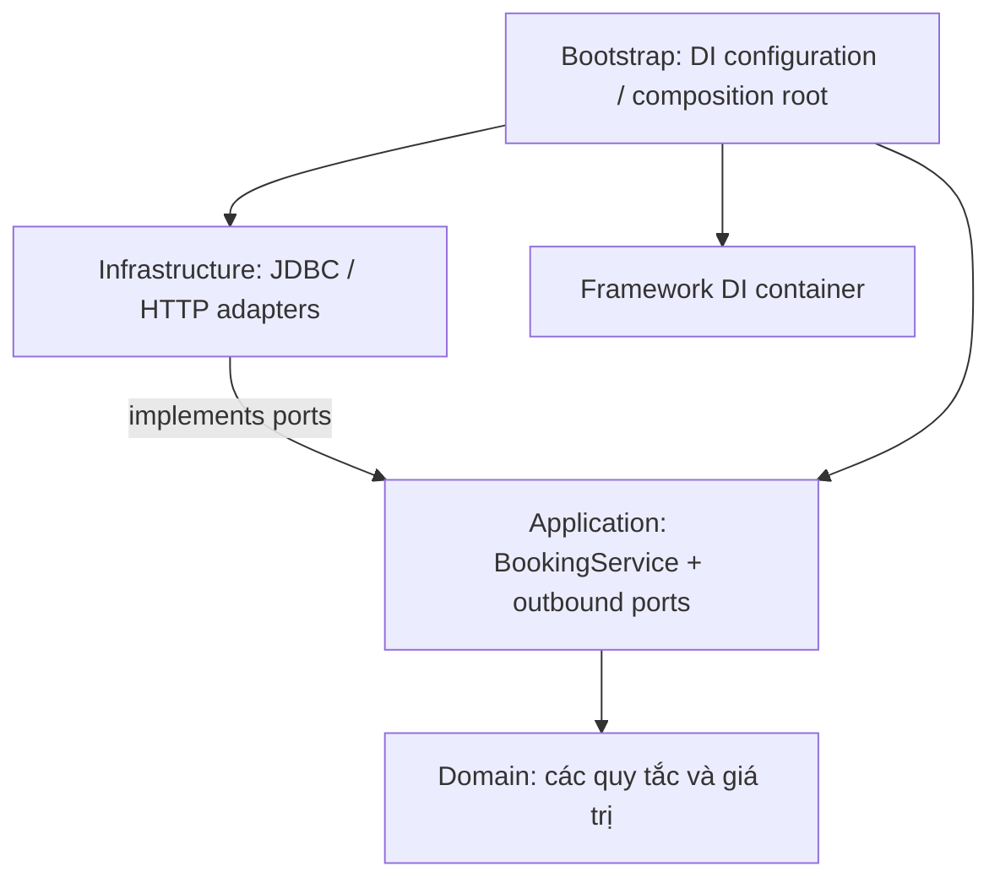

# Đưa annotation và API container vào quá sâu trong nghiệp vụ

## 1. Lỗi thiết kế nằm ở ranh giới, không nằm ở dấu `@`

Khi chuyển một ứng dụng Java sang Dependency Injection (DI), ta dễ bắt đầu từ việc thêm các annotation như `@Component`, `@Service`, `@Autowired`, `@Transactional` hoặc truyền `ApplicationContext` vào các lớp nghiệp vụ. Ứng dụng có thể chạy được và container có thể cấp đủ dependency, nhưng điều đó **chưa chứng minh ranh giới giữa nghiệp vụ và framework đã phù hợp**.

Ví dụ, một service cần lưu xác nhận đặt chỗ. Cách tổ chức tốt cho phép ta phát biểu: “Service cần một hợp đồng `BookingStore` có khả năng xác nhận đặt chỗ”. Cách tổ chức khó bảo trì lại buộc service phát biểu: “Service phải lấy bean tên `jdbcBookingStore` từ Spring, hoặc gọi trực tiếp `BeanFactory` để tạo repository”. Ở cách thứ hai, **quyết định hạ tầng và cơ chế lắp ghép đã chảy ngược vào mã sử dụng nghiệp vụ**.

Bài này thuộc chương **Lỗi thiết kế** trong module **DEPENDENCY_INJECTION**. Mục tiêu của module là học **Dependency Injection và Inversion of Control (IoC)** để tách *việc sử dụng dependency* khỏi *việc tạo và lắp ghép object*, thực hành **constructor injection, composition root, quản lý scope/vòng đời và kiểm thử bằng Java thuần** trước khi mở rộng sang DI container.

> **Nguyên tắc chính:** Application/domain nên định nghĩa hành vi và hợp đồng cần dùng. Framework và container có trách nhiệm *tìm, tạo, chọn, bao bọc, inject và quản lý vòng đời* các thành phần theo cấu hình. Đừng biến API container thành công cụ tra cứu dependency tùy ý trong mọi phương thức nghiệp vụ.

Điều này **không có nghĩa mọi annotation trong ứng dụng đều sai**. Cần phân biệt annotation giúp đăng ký một lớp với **hành vi trực tiếp phụ thuộc container**, và cân nhắc ranh giới phù hợp với quy mô hệ thống.

## 2. Bốn loại phụ thuộc dễ bị trộn lẫn

| Loại | Ví dụ | Nơi nên quyết định |
| --- | --- | --- |
| **Hợp đồng nghiệp vụ** | `BookingStore.markConfirmed(id)`, `NotificationPort.send(...)` | Domain/application theo nhu cầu của consumer. |
| **Chi tiết hạ tầng** | JDBC, SMTP, queue client, SDK thanh toán | Adapter hạ tầng triển khai hợp đồng. |
| **Cơ chế DI/container** | `ApplicationContext.getBean(...)`, `BeanFactory`, phạm vi component scan | Bootstrap/composition root, cấu hình hoặc adapter tích hợp. |
| **Chính sách ứng dụng** | Khi nào xác nhận, xử lý lỗi trùng, ai được gửi thông báo | Domain/application; cơ chế thực thi có thể cần hạ tầng hỗ trợ. |

**Hợp đồng nghiệp vụ** và **cách tìm ra implementation** là hai mối quan tâm khác nhau. DI container có thể giải quyết câu hỏi “bean nào được truyền vào constructor?”; nó **không tự thiết kế** interface `BookingStore` theo nhu cầu use case.

Một sơ đồ phụ thuộc mã nguồn có mục tiêu rõ ràng:



Mũi tên ở đây diễn đạt **phụ thuộc mã nguồn/biết kiểu** theo kiến trúc đề xuất; một cuộc gọi runtime vẫn có thể đi từ `BookingService` qua port đến adapter. Framework có thể quản lý object graph mà **mã nghiệp vụ không cần import một container API cụ thể**.

Trong hệ thống nhỏ, các lớp có thể cùng module Java. Dù vậy, giữ ranh giới **trách nhiệm và import** rõ vẫn giúp tránh coupling không cần thiết.

## 3. Anti-pattern nặng: service tự lấy bean từ container

Một cách viết thường gặp trong Spring:

```java
// Phản ví dụ, chỉ minh họa: cần Spring Framework để biên dịch.
@org.springframework.stereotype.Service
class BookingService {
    private final org.springframework.context.ApplicationContext context;

    BookingService(
            org.springframework.context.ApplicationContext context) {
        this.context = context;
    }

    void confirm(String bookingId, String recipient, String channel) {
        BookingStore store = context.getBean(
                "jdbcBookingStore", BookingStore.class);
        NotificationPort sender = context.getBean(
                channel + "NotificationPort", NotificationPort.class);
        store.markConfirmed(bookingId);
        sender.sendConfirmed(
                bookingId, recipient, java.time.Instant.now());
    }
}
```

Lỗi này thường được gọi là **Service Locator anti-pattern** khi một consumer chủ động tra cứu các cộng tác viên tùy ý từ nơi đăng ký toàn cục/container.

### Các dependency bị ẩn ở đâu?

Chữ ký constructor cho thấy class chỉ cần `ApplicationContext`, nhưng thực tế nó còn cần:

- Một bean `BookingStore` đúng tên và đúng hợp đồng;
- Các bean `NotificationPort` tương ứng từng giá trị `channel`;
- Quy tắc ánh xạ chuỗi đầu vào sang tên bean;
- Scope và vòng đời đúng cho các bean được lấy ra.

Những nhu cầu đó **không được diễn đạt thành các tham số constructor cụ thể**. Đổi tên bean hoặc đổi DI framework có thể làm class nghiệp vụ phải sửa. Một unit test độc lập sẽ khó cấp fake nếu phải tạo/mô phỏng cả cơ chế container.

### Những lỗi vận hành dễ phát sinh

1. **Lỗi xuất hiện muộn:** tên bean sai chỉ được phát hiện khi một nhánh nghiệp vụ hiếm gặp chạy.
2. **Khó kiểm soát scope:** mỗi lần gọi `getBean` có thể trả cùng object hoặc object khác tùy đăng ký; consumer dễ giả định sai.
3. **Cơ chế chọn implementation bị phân tán:** các lớp nghiệp vụ khác tự xây chuỗi tên bean theo cách riêng.
4. **Coupling với framework:** chữ ký và logic use case phụ thuộc trực tiếp `ApplicationContext`.
5. **Dữ liệu không tin cậy tác động tới wiring:** nếu `channel` đến từ request, không nên dùng nó như một tên bean tùy ý. Cần validate, authorize và ánh xạ có kiểu rõ ràng.

**Lưu ý:** API `ApplicationContext` có vị trí hợp lý trong cấu hình, bootstrap hoặc một integration adapter. Sai lầm ở đây là để **use case** tự quyết định bean nào tồn tại và được lấy ra từ container.

## 4. Annotation thụ động và thao tác container chủ động khác nhau

Không nên kết luận rằng hai đoạn sau có mức coupling giống nhau:

```java
// Mức coupling tương đối nhẹ: annotation đánh dấu vai trò đăng ký.
@org.springframework.stereotype.Service
class BookingService {
    private final BookingStore store;

    BookingService(BookingStore store) {
        this.store = store;
    }
}
```

và:

```java
// Coupling mạnh hơn: nghiệp vụ gọi API container lúc thực thi.
class BookingService {
    private final org.springframework.beans.factory.BeanFactory factory;

    BookingService(org.springframework.beans.factory.BeanFactory factory) {
        this.factory = factory;
    }

    void confirm(String bookingId) {
        BookingStore store = factory.getBean(BookingStore.class);
        store.markConfirmed(bookingId);
    }
}
```

Cả hai đoạn là **minh họa Spring**, không phải code có thể dùng với `javac` thuần.

Ở đoạn đầu, annotation làm lớp phải biết thư viện Spring khi biên dịch, nhưng **hành vi nghiệp vụ vẫn có thể được thử trực tiếp** bằng `new BookingService(fakeStore)` nếu constructor đủ rõ. Ở đoạn sau, **logic thực thi** bị ràng buộc vào cơ chế container: nếu không có `BeanFactory`, service không tự biết lấy collaborator nào.

| Cách dùng | Phụ thuộc framework khi biên dịch? | Hành vi nghiệp vụ cần container lúc chạy? | Đánh giá |
| --- | --- | --- | --- |
| `@Service` trên class có constructor rõ | Có | Thường không khi tạo class trực tiếp | Có thể chấp nhận ở nhiều ứng dụng; cân nhắc yêu cầu độc lập framework. |
| `@Autowired` trên constructor có kiểu rõ | Có | Không nhất thiết khi dựng object thủ công | Metadata cho container; có thể bỏ ở constructor duy nhất trong Spring thường dùng. |
| `@Autowired` trên field private, không có constructor cấp dependency | Có | Cần cơ chế injection khác để khởi tạo đầy đủ | Khó bảo đảm object hợp lệ nếu dùng ngoài container; nên cân nhắc constructor injection. |
| `ApplicationContext.getBean(...)` ngay trong use case | Có | Có, ở nhánh tra cứu | Dấu hiệu mạnh của service locator/coupling lắp ghép. |
| `@Bean`/`@Configuration` trong module bootstrap | Có | Container thực hiện wiring | Vị trí phù hợp cho chi tiết registration. |
| `@Transactional` ở ranh giới application service | Có | Cần transaction advice/framework nếu muốn có hiệu lực | Đánh đổi thực tế, cần hiểu semantics và test đường proxy. |

**Không có quy tắc “tất cả annotation ở tầng application đều bị cấm”.** Có đội ngũ ưu tiên lớp nghiệp vụ framework-neutral để tái sử dụng và unit test độc lập; có đội ngũ chọn dùng một số annotation để giảm mã cấu hình. Điều cần đánh giá là **cơ chế framework có quyết định chính sách nghiệp vụ và lấn vào API của các use case hay không**.

## 5. Lỗi thứ hai: các hợp đồng mang API hạ tầng vào lõi

Ngay cả khi **không** truyền container vào service, ta vẫn có thể thiết kế abstraction sai:

```java
// Phản ví dụ: framework và công nghệ lưu trữ rò vào port.
interface BookingStore {
    java.sql.ResultSet executeQuery(String sql) throws java.sql.SQLException;
}
```

`BookingService` dùng interface này sẽ phải biết SQL, `ResultSet`, cách đóng statement/result và các chi tiết ngoại lệ JDBC. Tạo nhiều implementation khác nhau để inject không tự xóa coupling đó.

Thay bằng **một hợp đồng có ngữ nghĩa nghiệp vụ**:

```java
interface BookingStore {
    boolean markConfirmed(String bookingId);
}
```

Ngữ nghĩa ví dụ: `true` chỉ khi ID được xác nhận lần đầu; `false` nếu ID đã xác nhận. Adapter `JdbcBookingStore`, `InMemoryBookingStore` hoặc một adapter khác tự chuyển lời gọi thành cơ chế tương ứng.

Hợp đồng thật cần quy định thêm điều kiện đầu vào, ID không tồn tại, transaction, thứ tự lỗi và yêu cầu nhất quán nếu consumer phụ thuộc vào chúng. Điều quan trọng là **không yêu cầu consumer import một thư viện chỉ vì adapter sử dụng nó**.

### Quyền sở hữu abstraction

Nếu use case cần khả năng xác nhận, hãy để **application/domain phù hợp sở hữu port**, còn adapter bên ngoài `implements` port đó. Đừng bắt use case import `infrastructure.persistence.JdbcRepository` chỉ vì một công nghệ đã có sẵn interface.

Tuy nhiên, **không cần tự bọc mọi API chuẩn Java**. Chẳng hạn `java.time.Clock` đã là một abstraction phù hợp để inject nguồn thời gian; tạo `MyApplicationClock` chỉ để “hoàn toàn không import bên ngoài” có thể tăng phức tạp mà không thêm ranh giới hữu ích.

## 6. Ví dụ Java 11 hoàn chỉnh: nghiệp vụ không import container

Phần này dùng **Java thuần**, không yêu cầu Spring hay bất kỳ DI container nào. Nó giữ đúng ba lớp trách nhiệm:

- **Application:** `BookingService` nhận `BookingStore` và `NotificationPort` qua constructor. `BookingCommand` mang dữ liệu một lời gọi.
- **Adapter:** `InMemoryBookingStore` và `ConsoleNotificationAdapter` triển khai hợp đồng. Không có annotation nào quyết định nghiệp vụ.
- **Composition root:** `Main.main()` tạo adapter, truyền vào service và quản lý việc sử dụng object.

Chương trình dùng tập concurrent chỉ để minh họa điều kiện “xác nhận lần đầu” trong **một instance cùng JVM**. Đây không phải database production hoặc bảo đảm giao thông báo chính xác một lần.

Lưu toàn bộ mã sau thành **`Main.java`**:

```java
import java.time.Clock;
import java.time.Instant;
import java.time.ZoneOffset;
import java.util.Objects;
import java.util.Set;
import java.util.concurrent.ConcurrentHashMap;

public class Main {
    // Dữ liệu của một lời gọi, không phải dependency của singleton.
    static final class BookingCommand {
        final String bookingId;
        final String recipient;

        BookingCommand(String bookingId, String recipient) {
            if (bookingId == null || bookingId.isBlank()) {
                throw new IllegalArgumentException("bookingId không hợp lệ");
            }
            if (recipient == null || recipient.isBlank()) {
                throw new IllegalArgumentException("recipient không hợp lệ");
            }
            this.bookingId = bookingId;
            this.recipient = recipient;
        }
    }

    // Application-owned ports: không có API container hoặc JDBC.
    interface BookingStore {
        boolean markConfirmed(String bookingId);
    }

    interface NotificationPort {
        void sendConfirmed(
                String bookingId, String recipient, Instant confirmedAt);
    }

    // Use case: chỉ giữ hợp đồng và Clock trong constructor.
    static final class BookingService {
        private final BookingStore store;
        private final NotificationPort notifier;
        private final Clock clock;

        BookingService(
                BookingStore store, NotificationPort notifier, Clock clock) {
            this.store = Objects.requireNonNull(store, "store");
            this.notifier = Objects.requireNonNull(notifier, "notifier");
            this.clock = Objects.requireNonNull(clock, "clock");
        }

        boolean confirm(BookingCommand command) {
            Objects.requireNonNull(command, "command");

            boolean changed = store.markConfirmed(command.bookingId);
            if (changed) {
                notifier.sendConfirmed(
                        command.bookingId,
                        command.recipient,
                        Instant.now(clock));
            }
            return changed;
        }
    }

    // Một adapter mẫu, không phải hệ thống lưu trữ production.
    static final class InMemoryBookingStore implements BookingStore {
        private final Set<String> confirmed =
                ConcurrentHashMap.newKeySet();

        @Override
        public boolean markConfirmed(String bookingId) {
            return confirmed.add(bookingId);
        }

        boolean isConfirmed(String bookingId) {
            return confirmed.contains(bookingId);
        }
    }

    static final class ConsoleNotificationAdapter
            implements NotificationPort {
        @Override
        public void sendConfirmed(
                String bookingId, String recipient, Instant confirmedAt) {
            System.out.println(
                    "Thông báo " + bookingId
                    + " tới " + recipient
                    + " lúc " + confirmedAt);
        }
    }

    public static void main(String[] args) {
        // COMPOSITION ROOT: biết implementation, không nằm trong service.
        InMemoryBookingStore store = new InMemoryBookingStore();
        NotificationPort notifier = new ConsoleNotificationAdapter();
        Clock clock = Clock.fixed(
                Instant.parse("2026-01-02T03:04:05Z"), ZoneOffset.UTC);

        BookingService service =
                new BookingService(store, notifier, clock);

        boolean first = service.confirm(new BookingCommand(
                "B-101", "a@example.com"));
        boolean repeated = service.confirm(new BookingCommand(
                "B-101", "a@example.com"));

        System.out.println("Xác nhận lần đầu? " + first);
        System.out.println("Xác nhận lặp? " + repeated);
        System.out.println("Store có B-101? " + store.isConfirmed("B-101"));
    }
}
```

Biên dịch và chạy với JDK 11 trở lên:

```bash
javac -encoding UTF-8 Main.java
java Main
```

Kết quả **dự kiến**:

```text
Thông báo B-101 tới a@example.com lúc 2026-01-02T03:04:05Z
Xác nhận lần đầu? true
Xác nhận lặp? false
Store có B-101? true
```

Không có `@Component`, `@Autowired`, `ApplicationContext` hoặc `BeanFactory` trong `BookingService`. **Điều kiện nghiệp vụ và hợp đồng không phụ thuộc cách tạo object.** Khi muốn dùng framework, ta chỉ cần thay phần bootstrap/wiring theo cấu hình thích hợp.

### Vì sao `Clock` cũng được inject?

`Clock` là nguồn thời gian ổn định cho service. Giá trị `Instant.now(clock)` được lấy **trong mỗi lần gọi**, không được lưu thành “thời gian yêu cầu hiện tại” trên shared field. Trong test có thể dùng `Clock.fixed(...)` để kết quả xác định; khi triển khai thực có thể dùng `Clock.systemUTC()`.

### Giới hạn cần nói rõ

`InMemoryBookingStore` chỉ theo dõi ID đã xác nhận; nó chưa kiểm tra booking có tồn tại, không có cơ sở dữ liệu bền vững, và không quản lý thông báo sau khi lỗi. Nếu repository xác nhận thành công nhưng adapter gửi lỗi, dữ liệu có thể đã đổi. **DI không biến nhiều side effect thành một transaction**; trường hợp thật cần chính sách retry, idempotency, outbox hoặc giao dịch/điều phối thích hợp.

## 7. Fake test: không cần khởi động context để kiểm tra use case

Một bài test tốt cho `BookingService` không cần biết Spring quét package nào hoặc bean `BookingStore` có tên gì. Thêm class sau **ngoài class `Main`** vào cuối tệp `Main.java` của mục 6:

```java
class BookingServiceTest {
    static final class RecordingStore implements Main.BookingStore {
        final java.util.Set<String> ids = new java.util.HashSet<>();
        final java.util.List<String> calls = new java.util.ArrayList<>();

        @Override
        public boolean markConfirmed(String bookingId) {
            calls.add(bookingId);
            return ids.add(bookingId);
        }
    }

    static final class RecordingNotifier implements Main.NotificationPort {
        final java.util.List<String> calls = new java.util.ArrayList<>();

        @Override
        public void sendConfirmed(
                String bookingId, String recipient,
                java.time.Instant confirmedAt) {
            calls.add(bookingId + "|" + recipient + "|" + confirmedAt);
        }
    }

    private static void require(boolean condition, String message) {
        if (!condition) {
            throw new AssertionError(message);
        }
    }

    public static void main(String[] args) {
        RecordingStore store = new RecordingStore();
        RecordingNotifier notifier = new RecordingNotifier();
        java.time.Instant instant =
                java.time.Instant.parse("2026-01-02T03:04:05Z");

        Main.BookingService service = new Main.BookingService(
                store, notifier,
                java.time.Clock.fixed(
                        instant, java.time.ZoneOffset.UTC));

        require(service.confirm(new Main.BookingCommand(
                "B-201", "a@example.com")), "Lần đầu phải đổi trạng thái");
        require(service.confirm(new Main.BookingCommand(
                "B-202", "b@example.com")), "ID mới phải thành công");
        require(!service.confirm(new Main.BookingCommand(
                "B-201", "a@example.com")), "Lần lặp phải trả false");

        require(store.calls.equals(java.util.List.of(
                "B-201", "B-202", "B-201")), "Store nhận sai ID");
        require(notifier.calls.equals(java.util.List.of(
                "B-201|a@example.com|" + instant,
                "B-202|b@example.com|" + instant)),
                "Notification bị gửi lặp hoặc trộn dữ liệu");

        boolean invalidRejected = false;
        try {
            new Main.BookingCommand("", "a@example.com");
        } catch (IllegalArgumentException expected) {
            invalidRejected = true;
        }
        require(invalidRejected, "Dữ liệu không hợp lệ phải bị từ chối");

        boolean dependencyRejected = false;
        try {
            new Main.BookingService(
                    null, notifier, java.time.Clock.systemUTC());
        } catch (NullPointerException expected) {
            dependencyRejected = true;
        }
        require(dependencyRejected, "Dependency bắt buộc không được null");

        System.out.println("PASS: nghiệp vụ độc lập API container");
    }
}
```

Chạy:

```bash
javac -encoding UTF-8 Main.java
java BookingServiceTest
```

Kết quả dự kiến:

```text
PASS: nghiệp vụ độc lập API container
```

Bài test chứng minh service dùng đúng hợp đồng trong những scenario nêu trên, **không** chứng minh adapter JDBC/SMTP thực tế hoạt động hay container registration/lifecycle được cấu hình đúng. Những mục đó cần kiểm thử riêng ở ranh giới integration/wiring.

**Fake** và **constructor injection** cho phép kiểm tra chính sách nghiệp vụ không cần khởi động container. Tránh biến mọi unit test thành test `ApplicationContext` chỉ vì lớp nghiệp vụ tự gọi `getBean`.

## 8. Đưa DI container trở lại đúng ranh giới: composition root

Khi chuyển chương trình sang Spring, có thể giữ lớp service và port như Java thuần rồi khai báo wiring trong cấu hình:

```java
// MẪU MINH HỌA SPRING, không dán vào Main.java thuần ở mục 6.
// Các class BookingService, BookingStore, NotificationPort và adapter
// là các class public/package phù hợp trong một dự án Spring thật.
@org.springframework.context.annotation.Configuration
public class BookingConfiguration {

    @org.springframework.context.annotation.Bean
    BookingStore bookingStore() {
        return new InMemoryBookingStore();
    }

    @org.springframework.context.annotation.Bean
    NotificationPort notificationPort() {
        return new ConsoleNotificationAdapter();
    }

    @org.springframework.context.annotation.Bean
    java.time.Clock clock() {
        return java.time.Clock.systemUTC();
    }

    @org.springframework.context.annotation.Bean
    BookingService bookingService(
            BookingStore store,
            NotificationPort notifier,
            java.time.Clock clock) {
        return new BookingService(store, notifier, clock);
    }
}
```

Đây là các **mẫu tệp riêng của dự án Spring**, không phải tệp `Main.java` độc lập để biên dịch với JDK. Điểm cần thấy: mã `BookingService` và các port **không phải gọi** `ApplicationContext` hoặc biết cách framework phát hiện các bean.

Nếu dùng component scanning và đánh dấu `@Component` cho adapter, cũng có thể hoạt động. Hãy tránh **đăng ký cùng một implementation hai lần ngoài chủ đích**, dẫn tới nhiều bean tương thích hoặc vòng đời không như mong đợi. Điều này là **quyết định cấu hình** nên được kiểm tra riêng.

### “Framework ở biên” có phải cấm mọi `@Service`?

Không. Trong ứng dụng Spring quy mô vừa/nhỏ, đặt `@Service` trên application service có thể là lựa chọn thực dụng. Nó tạo **phụ thuộc compile-time** vào Spring annotation, nhưng service vẫn có thể độc lập ở **hành vi** nếu chỉ nhận port qua constructor và không gọi container.

Khi hệ thống có yêu cầu framework-neutral mạnh, nhiều adapter công nghệ hoặc module lõi dùng chung, ta có thể đặt toàn bộ annotation đăng ký vào cấu hình `@Bean`. Đây là **đánh đổi giữa mức độc lập và lượng mã cấu hình**, không phải sự phân chia “đúng tuyệt đối/sai tuyệt đối”.

## 9. Trường hợp khó: chọn implementation theo dữ liệu của request

Một lý do thường được đưa ra để biện minh `getBean(...)` trong nghiệp vụ là: “Mỗi request có thể chọn email hoặc SMS, nên tôi cần lấy bean động”.

Điều này không bắt buộc. Có thể inject **một selector/factory có hợp đồng hẹp**:

```java
// Mã phác họa Java thuần, không ghép vào Main.java ở mục 6.
enum Channel {
    EMAIL, SMS
}

interface NotificationStrategy {
    void send(String bookingId, String recipient);
}

interface NotificationStrategySelector {
    NotificationStrategy forChannel(Channel channel);
}

final class MultiChannelBookingService {
    private final NotificationStrategySelector selector;

    MultiChannelBookingService(NotificationStrategySelector selector) {
        this.selector = java.util.Objects.requireNonNull(selector);
    }

    void notifyOne(Channel channel, String id, String recipient) {
        NotificationStrategy strategy = selector.forChannel(channel);
        strategy.send(id, recipient);
    }
}
```

Tại bootstrap, selector có thể nhận một `Map<Channel, NotificationStrategy>` với các adapter được cấu hình sẵn. Mỗi request chỉ truyền **giá trị `Channel`**, không tự dựng tên bean. Nếu dùng DI container để lắp danh sách strategy hoặc tạo prototype theo request, chi tiết đó thuộc **selector adapter/factory implementation** hoặc configuration, không phải nằm rải rác trong tất cả use case.

Điều cần kiểm tra:

- Một channel không được hỗ trợ phải có **ngữ nghĩa lỗi rõ ràng**, không tự fallback sang kênh khác mà khách hàng không đồng ý.
- Kênh được đăng ký **không đồng nghĩa người dùng có quyền sử dụng**. Authorization/policy phải được xét trước tác dụng phụ.
- Nếu mỗi lần lựa chọn tạo resource mới, factory cần hợp đồng về **ai đóng resource**.
- Selector nên là **abstraction theo mục đích cụ thể**, không trở thành “container mini” kiểu `Object get(String type)` để bất kỳ consumer nào truy cập mọi bean.

## 10. Transaction, security và validation: ranh giới cần xét theo trách nhiệm

Một số annotation framework **tác động tới semantics**, không chỉ đăng ký component. Ví dụ `@Transactional`, annotation bảo mật phương thức và các annotation validation. Không nên áp dụng luật “không dùng annotation nghiệp vụ” một cách máy móc nếu điều đó làm mất tính đúng đắn của transaction hoặc quyền truy cập.

### 10.1. `@Transactional` tại application service

Khi một use case cần nhiều thao tác lưu trữ nằm trong cùng transaction, đặt transaction boundary ở tầng application service là lựa chọn phổ biến. Annotation Spring có thể là một cách thể hiện boundary đó.

Tuy nhiên cần hiểu:

1. **Chính sách** “những thao tác nào phải nguyên tử” thuộc về yêu cầu ứng dụng.
2. **Cơ chế** transaction manager, proxy/interceptor và database nằm ở tích hợp framework/hạ tầng.
3. Unit test bằng `new Service(fake)` **không chạy transaction interceptor của Spring**.
4. Với proxy-based AOP, lời gọi từ target qua `this.otherMethod()` có thể **không đi qua proxy**, nên annotation ở `otherMethod` không nhất thiết có hiệu lực.
5. Lời gọi ngoài thread/transaction scope hoặc qua async boundary không tự kế thừa giao dịch hiện tại.

Nếu yêu cầu giữ lõi framework-neutral, có thể đặt giao dịch trong một **application-facing unit-of-work abstraction**, decorator hoặc adapter điều phối ở ngoài service. Nhưng không phải dự án nào cũng cần thêm lớp trung gian đó; nên cân nhắc độ phức tạp và kiểm thử integration.

### 10.2. Bảo mật và kiểm tra quyền

Annotation bảo mật ở controller/method có thể là một **vòng bảo vệ bổ sung**, nhưng các bất biến quyền truy cập quan trọng không nên chỉ đúng khi lời gọi tình cờ đi qua proxy. Unit test gọi thẳng method có thể bỏ qua advice. Nếu authorization là một quy tắc nghiệp vụ cốt lõi, hãy diễn đạt và kiểm thử nó bằng một policy/port rõ, đồng thời test cơ chế chặn ở biên HTTP/container.

Không “chuyển” một `SecurityContextHolder` thành phụ thuộc toàn cục ẩn trong domain chỉ để lấy user ID. Ở biên đã xác thực, truyền identity/context phù hợp và kiểm tra quyền theo hợp đồng ứng dụng.

### 10.3. Validation

Validation annotation trên DTO ở biên HTTP có thể hợp lý. Nhưng không nên giả định rằng **mọi caller** của use case đều đi qua cùng bộ kiểm tra ở controller. Nếu một bất biến bắt buộc cho mọi đường gọi, hãy bảo vệ nó trong command/value object hoặc service, hoặc có một cơ chế validation chung rõ ràng, có test ngoài framework.

**Phân biệt:** điều kiện “chuỗi đầu vào không được rỗng” có thể được bảo vệ bằng Java thuần trong `BookingCommand`; một annotation web cụ thể không phải nguồn bảo đảm duy nhất cho toàn bộ ứng dụng.

## 11. API container len vào lõi qua scope, provider và lifecycle

Ngoài `ApplicationContext`, còn những chỗ dễ kéo framework vào sai tầng:

| Dấu hiệu | Rủi ro | Đề xuất |
| --- | --- | --- |
| `ObjectProvider<T>` trong domain service để tạo object theo yêu cầu | Use case lệ thuộc Spring provider và cách lookup. | Nếu nghiệp vụ cần tạo một loại object theo điều kiện, định nghĩa typed factory/port; adapter dùng provider phía ngoài khi thật sự cần. |
| `BeanFactory` được truyền qua nhiều lớp | Dependency ẩn, nhiều class tự quyết định wiring. | Giữ việc lắp ghép ở root/configuration. |
| Service tự gọi `context.close()` | Đóng cả container trong một request, gây lỗi các consumer khác. | Owner của ứng dụng quản lý shutdown. |
| Use case nhận trực tiếp request-scoped proxy nhưng chạy trong background | Không có active scope hoặc sử dụng sai context. | Truyền command dữ liệu riêng cho task, quản lý lifetime tường minh. |
| Domain dùng `@PostConstruct` để chạy nghiệp vụ/IO lớn | Khó phân biệt khởi tạo object với chạy business side effects; lỗi có thể phát sinh ở startup. | Đặt startup orchestration tại bootstrap/lifecycle nơi có chính sách rõ. |
| Domain dùng `@PreDestroy` để đóng shared pool | Không rõ ai thực sự sở hữu pool; có thể đóng quá sớm hoặc double close. | Để owner của scope hoặc adapter sở hữu close thực hiện. |
| Use case yêu cầu kiểu `EntityManager`/`Session` của ORM | Buộc chính sách nghiệp vụ biết công nghệ persistence. | Định nghĩa port có ngữ nghĩa ứng dụng, adapter chuyển đổi. |

### Constructor injection và lazy/scoped proxy

Container có thể inject **proxy** có kiểu đúng vào constructor nhưng target thực sự chỉ được tạo khi sử dụng hoặc được tìm theo request scope. **Tham chiếu không null không chứng minh target đã được tạo, transaction context tồn tại hay backend khỏe**. Khi thiết kế lỗi và readiness, cần phân biệt:

- Container đã tìm được bean/đã cấp proxy.
- Target đã được khởi tạo trong scope hợp lệ.
- Tài nguyên ngoài đã kết nối/được kiểm tra sẵn sàng.
- Một thao tác nghiệp vụ thật đã thành công.

Đưa `ObjectProvider` vào mọi use case không giải quyết những khác biệt đó. Khi cần tính lazy hoặc request scope, hãy thiết kế hợp đồng/lifecycle rõ và test dưới đúng cấu hình.

## 12. Không được biến phạm vi DI thành quyền sở hữu tài nguyên

Một `BookingService` có thể được container tạo như singleton và nhận một `NotificationClient` được chia sẻ. **Consumer không phải owner chỉ vì nó có field trỏ tới client**.

Vấn đề thường gặp:

```java
// Phản ví dụ: service đóng client được các service khác dùng chung.
void confirm(BookingCommand command) {
    try {
        client.send(command.bookingId);
    } finally {
        client.close();
    }
}
```

Nếu client thuộc application scope, đóng nó trong một request có thể làm tất cả request sau thất bại. Ngược lại, nếu một factory được gọi theo request mở resource mới rồi trả về, cần có hợp đồng xác định **caller hay factory** chịu trách nhiệm đóng.

Khi khởi tạo graph thất bại giữa chừng, composition root/container chỉ có thể dọn những resource đã được bàn giao hoặc đăng ký vòng đời. Một constructor/factory mở file hoặc socket rồi ném exception **trước khi trả object** vẫn phải tự dọn phần mở nội bộ. Không nên cho rằng thêm `@Component` tự bảo đảm cleanup mọi tình huống.

Việc dùng đúng scope, owner và thứ tự đóng resource vẫn quan trọng dù có DI container hay không. Với tác vụ nền, executor/queue client cũng phải được đóng khi không còn người sử dụng, theo chính sách shutdown của ứng dụng.

## 13. Chiến lược refactor theo bước nhỏ, không cần bỏ framework

Nếu mã hiện tại đã chứa nhiều annotation và container API, không nhất thiết phải “xóa sạch” framework một lần. Một lộ trình thực tế:

1. **Ghi lại hành vi đang hoạt động.** Dùng characterization test cho các ca thành công, lỗi và tác dụng phụ trước khi sửa architecture.
2. **Liệt kê mọi lời gọi API container từ use case.** Tìm `getBean`, `ApplicationContext`, `BeanFactory`, provider lookup và tên bean viết cứng.
3. **Ghi rõ dependency thật.** Consumer cần lưu, gửi, kiểm tra quyền hay lấy thời gian? Định nghĩa port hẹp có nghĩa theo nhu cầu đó.
4. **Đổi lookup động sang typed dependency.** Nếu chỉ một repository, truyền `BookingStore` trực tiếp qua constructor. Nếu có nhiều chiến lược theo request, truyền một `NotificationStrategySelector` có kiểu rõ.
5. **Tách dữ liệu của lần gọi khỏi dependency.** Đưa `bookingId`, `recipient`, `tenantId` phù hợp vào command/method thay vì field mutable hoặc container lookup.
6. **Đặt lựa chọn implementation ở bootstrap.** Dùng Java configuration, `@Bean`, component scanning có kiểm soát hoặc factory adapter.
7. **Giữ cơ chế cross-cutting cần thiết.** Nếu có transaction/security advice, xác định boundary mới và test đường proxy thật; đừng vô tình loại bỏ bảo đảm.
8. **Xem scope/lifecycle.** Dependency dùng chung có an toàn luồng? Resource được đóng ở owner nào? Lazy target có được tạo đúng lúc?
9. **Kiểm tra thay implementation.** Dùng fake để test use case, contract test cho các adapter và wiring test cho cấu hình framework.
10. **Chỉ xóa annotation thụ động khi có lợi ích rõ.** Nếu `@Service` ở tầng application không gây vấn đề dự kiến và chi phí chuyển đổi lớn, có thể giữ trong giai đoạn đầu.

Mục tiêu không phải đếm xem còn bao nhiêu dấu `@` trong codebase. Mục tiêu là **khả năng hiểu hợp đồng mà lớp nghiệp vụ cần, cô lập những quyết định hạ tầng và kiểm thử chính sách ứng dụng khi không có container**.

### Bảng chọn điểm bắt đầu

| Nếu đang thấy | Refactor ưu tiên | Phép kiểm tra phù hợp |
| --- | --- | --- |
| `context.getBean(...)` trong `confirm(...)` | Constructor injection/typed selector. | Unit test use case không cần context. |
| `@Autowired` trên field với constructor mặc định | Constructor thể hiện dependency bắt buộc. | Tạo service bằng `new(...fake...)`. |
| `@Qualifier("jdbc...")` nằm ở nhiều service | Chọn adapter trong configuration. | Đổi implementation mà không sửa service. |
| `@Transactional` bị mất hiệu lực sau refactor | Xem đường gọi proxy và transaction boundary. | Integration test với transaction manager thật. |
| Request-scoped context bị dùng sau async hop | Truyền command/value object đã xác thực, quản lý lifetime. | Test task chạy muộn và sai scope. |
| Service tự đóng client được inject | Xác định owner của resource. | Lifecycle/shutdown test. |

## 14. Unit test khác wiring/integration test thế nào?

Unit test Java thuần ở mục 7 kiểm tra **chính sách nghiệp vụ và tương tác qua port**. Nó không chạy bean scan, profile, transaction proxy hoặc scope của container.

| Câu hỏi | Kiểm thử thích hợp |
| --- | --- |
| `BookingService` gọi `markConfirmed` đúng ID và không gửi trùng? | Unit test dùng fake/recording dependency. |
| Adapter JDBC có đúng semantics, lỗi và transaction? | Contract/integration test với database kiểm soát. |
| Spring quét đúng package, đăng ký đúng bean? | Context/wiring test. |
| `@Qualifier`/`@Primary`/profile chọn đúng implementation? | Wiring/configuration test. |
| Transaction/security advice có hiệu lực trên lời gọi thực? | Integration test đi qua proxy/interceptor thật. |
| Resource của bean/adapter được đóng đúng scope khi shutdown? | Lifecycle/integration test. |
| Dữ liệu request không lẫn giữa hai tác vụ đồng thời? | Test đồng thời và đánh giá contract của các dependency dùng chung. |

Một vòng refactor chỉ an toàn khi test không **bỏ mất những bảo đảm framework từng cung cấp**. Ví dụ, thay `@Transactional` bằng service Java thuần không tự giữ transaction; nếu bỏ annotation, cần cung cấp cơ chế transaction khác hoặc chấp nhận thay đổi hành vi có chủ đích.

Ngược lại, không cần khởi động toàn bộ application context để kiểm tra một nhánh xác nhận lặp nếu service nhận fake trực tiếp. **Tách test giúp biết lỗi thuộc nghiệp vụ, adapter hay wiring**, thay vì tất cả trở thành “Spring test hỏng”.

## 15. Sai lầm khi “giảm phụ thuộc framework”

Đôi khi việc muốn làm lõi thuần Java lại dẫn đến thiết kế phức tạp không cần thiết.

| Cách làm cực đoan | Vì sao có thể không tốt? | Cân bằng phù hợp |
| --- | --- | --- |
| Bắt mọi object đều phải có interface riêng. | Tăng số file, không rõ ranh giới thực tế, khó điều hướng. | Chỉ tạo abstraction có nghĩa với consumer hoặc khả năng thay thế cần thiết. |
| Cấm mọi annotation kể cả ở biên framework. | Có thể phải tự triển khai lại transaction, validation hoặc lifecycle. | Cho phép framework ở adapter/bootstrap và dùng annotation ở nơi có trách nhiệm. |
| Tạo một “DI framework tự viết” để né Spring. | Service locator/registry mới vẫn che dependency và phải tự xử lý scope. | Ưu tiên composition root rõ ràng hoặc container có sẵn. |
| Bọc `Clock`, `List`, `Optional` và mọi API JDK qua port riêng. | Không thêm ích lợi tương xứng với sự phức tạp. | Dùng JDK abstraction thích hợp. |
| Tạo selector trả `Object` với tên bean là chuỗi. | Chỉ đổi tên service locator, vẫn thiếu type safety. | Dùng typed factory/selector theo nhu cầu. |
| Cắt bỏ `@Transactional` mà không thiết kế transaction boundary. | Mất bảo đảm nguyên tử trước đó. | Xác định và kiểm thử lại semantics giao dịch. |
| Giấu mọi lỗi hạ tầng dưới một `RuntimeException` chung. | Consumer không phân biệt lỗi nghiệp vụ và lỗi tạm thời; khó xử lý. | Định nghĩa hợp đồng lỗi có chủ đích và adapter mapping. |

**Tính độc lập framework có giá trị khi nó bảo vệ ranh giới thay đổi**, không phải khi nó khiến hệ thống phải duy trì vô số wrapper chỉ để giảm số import.

## 16. Bài tập thực hành

### Bài 1 — Phân loại mức coupling

Cho ba service:

```java
// A: có annotation nhưng dependency rõ.
@Service
class A {
    A(BookingStore store) { /* ... */ }
}

// B: không có @Service nhưng lookup bean lúc chạy.
class B {
    B(ApplicationContext ctx) { /* ... */ }
    void run() {
        // ctx.getBean(...)
    }
}

// C: không biết container, dùng port Java.
class C {
    C(BookingStore store) { /* ... */ }
}
```

Đoạn này chỉ là phác họa, các annotation và tên kiểu phụ thuộc ngữ cảnh Spring. Hãy xếp mức độ gắn với cơ chế container, giải thích vì sao **A không nhất thiết kém C về test logic**, và vì sao B dễ che dependency thực.

### Bài 2 — Xóa service locator khỏi use case

Một `PaymentService` đang dùng `applicationContext.getBean("stripeGateway")` để thanh toán. Hãy đề xuất `PaymentGateway` do application sở hữu, `StripePaymentAdapter` ở infrastructure và cấu hình chọn adapter. Nếu hệ thống cần nhiều nhà cung cấp theo từng giao dịch, hãy đổi thiết kế như thế nào mà vẫn tránh service locator tổng quát?

### Bài 3 — Một framework annotation nên nằm ở đâu?

Xem xét các annotation: `@Component` ở adapter, `@Service` ở application service, `@Transactional` cho một use case nhiều bước, `@Entity` ở domain model, `@RestController` ở HTTP adapter. Cái nào thường hợp lý ở biên? Trường hợp nào thể hiện đánh đổi về coupling với framework? Khi nào nên chấp nhận đánh đổi đó?

### Bài 4 — Tách unit test và integration test

Từ `BookingServiceTest` ở mục 7, hãy liệt kê hai điều nó chứng minh và ba điều **chưa** chứng minh. Sau đó đề xuất test riêng để phát hiện profile production inject nhầm `InMemoryBookingStore` hoặc transaction advice không chạy do self-invocation.

### Bài 5 — Request-scope và background task

Một singleton service nhận `RequestContext` proxy; sau đó nó đẩy task sang executor để gửi email sau khi HTTP request kết thúc. Điều gì có thể xảy ra khi task gọi proxy? Hãy đề xuất command chứa dữ liệu cần thiết, kiểm tra quyền ở biên và owner quản lý executor/notification client.

### Bài 6 — Constructor hợp lệ nhưng nghiệp vụ sai

Một service có constructor rõ ràng:

```java
BookingService(BookingStore store, NotificationPort port)
```

nhưng `BookingStore` trả `ResultSet` hoặc `NotificationPort` yêu cầu truyền `SmtpSession` vào method. Vì sao kiến trúc vẫn có coupling? Sửa chữ ký port thế nào để consumer chỉ yêu cầu hành vi mang nghĩa nghiệp vụ?

### Bài 7 — Quyền sở hữu resource

Một `NotificationClient` dùng chung được Spring quản lý. Service gọi `client.close()` sau mỗi lần gửi. Hãy chỉ ra lỗi ownership, cơ chế shutdown nên thuộc về ai và cần kiểm tra điều gì nếu factory mở socket rồi ném lỗi trước khi trả instance?

### Gợi ý tự đối chiếu

- **Bài 1:** B phụ thuộc mạnh vào hành vi container lúc chạy; A có compile-time coupling với annotation nhưng vẫn có constructor rõ; C có khả năng thuần Java cao nhất trong ba ví dụ.
- **Bài 2:** `PaymentService` nhận `PaymentGateway` hoặc typed `PaymentGatewaySelector`; adapter biết Stripe; bootstrap/container chọn implementation. Không cho request tự cung cấp bean name tùy ý.
- **Bài 3:** HTTP adapter và infrastructure thích hợp chứa annotation tích hợp; `@Service`, `@Transactional` và `@Entity` liên quan quyết định kiến trúc với các mức đánh đổi khác nhau. Không có luật chung bắt buộc cho mọi dự án.
- **Bài 4:** unit test kiểm tra port calls và xử lý dữ liệu/input; không xác nhận component scan, adapter thật hay proxy transaction. Cần wiring test và integration test qua transaction manager/proxy.
- **Bài 5:** có thể không còn active request scope; task cần command bất biến đã được xác thực/ủy quyền theo yêu cầu và resource sống đủ lâu, không giữ request object đã hết vòng đời.
- **Bài 6:** interface chỉ che kiểu triển khai, nhưng vẫn lộ API kỹ thuật; đổi sang method như `markConfirmed(id)` và `sendConfirmed(id, recipient, instant)` với lỗi có nghĩa.
- **Bài 7:** service là consumer không phải owner của shared client; lifecycle manager/container hoặc adapter owner đóng khi shutdown; factory phải tự dọn resource nội bộ chưa bàn giao nếu khởi tạo thất bại.

**Ghi nhớ:** một DI framework có thể giúp đăng ký, tạo, chọn và quản lý vòng đời object, nhưng nó không thay thế trách nhiệm **thiết kế hợp đồng và ranh giới nghiệp vụ**. Annotation đánh dấu thành phần không tự làm kiến trúc xấu; vấn đề nghiêm trọng hơn là để `ApplicationContext`, `BeanFactory`, tên bean, scope API hoặc chi tiết hạ tầng tràn vào logic use case. Hãy giữ dependency rõ trong constructor, dữ liệu từng lời gọi trong method/command, chọn implementation ở composition root, và kiểm thử tách biệt nghiệp vụ với wiring/proxy/lifecycle.
