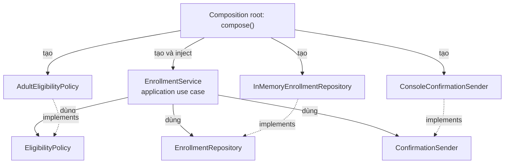

# Cho rằng dùng DI tự động làm hệ thống tuân thủ mọi nguyên lý thiết kế

Một ứng dụng Java có thể sử dụng `@Inject`, constructor injection hoặc một DI container để cung cấp mọi dependency, nhưng vẫn có **lớp ôm quá nhiều trách nhiệm**, **hợp đồng trừu tượng kém**, **triển khai không thể thay thế nhau**, **phụ thuộc vòng**, **tài nguyên bị giữ sai vòng đời** hoặc **kiểm thử phụ thuộc chi tiết triển khai**. DI làm rõ và thay đổi **cách cung cấp cộng tác viên**; nó không tự đánh giá chất lượng kiến trúc hoặc tính đúng đắn của nghiệp vụ.

Ngộ nhận cần tránh trong chương **Lỗi thiết kế** là:

> “Đã dùng Dependency Injection thì mặc nhiên đã tuân thủ SOLID và các nguyên lý thiết kế tốt.”

Điều này **không đúng**. Một hệ thống có thể áp dụng DI rất thành thạo nhưng vẫn vi phạm **Single Responsibility Principle (SRP)**, **Open/Closed Principle (OCP)**, **Liskov Substitution Principle (LSP)**, **Interface Segregation Principle (ISP)**, **Dependency Inversion Principle (DIP)** hoặc các nguyên tắc quản lý trạng thái, tài nguyên và quyền sở hữu.

Bài thuộc module **DEPENDENCY_INJECTION**: học **DI và Inversion of Control (IoC)** để tách việc **sử dụng** dependency khỏi việc **tạo và lắp ghép** đối tượng; thực hành constructor injection, composition root, scope, vòng đời và kiểm thử bằng **Java thuần** trước khi chuyển sang DI container. Trọng tâm của bài này là **đánh giá thiết kế một cách độc lập**, không xem sự xuất hiện của interface, annotation hoặc framework như một chứng nhận chất lượng.

## 1. Kết quả cần đạt

Sau bài học, bạn có thể:

- Nêu chính xác **DI giải quyết vấn đề gì**, điều gì **không** được DI bảo đảm và cách DI liên hệ với IoC, DIP.
- Nhận diện một lớp dùng constructor injection **đúng cú pháp** nhưng vẫn thiếu cohesion, phụ thuộc sai abstraction hoặc dùng trạng thái không an toàn.
- Phân tích riêng SRP, OCP, LSP, ISP và DIP trên một object graph có DI.
- Giải thích vì sao một interface không tự động là **hợp đồng tốt**, và vì sao hai class cùng implements interface vẫn có thể **không thay thế được nhau về hành vi**.
- Thiết kế một use case nhỏ với các port phù hợp, composition root rõ ràng và kiểm thử **state-based** lẫn **interaction-based** bằng Java thuần.
- Xác định những bằng chứng bổ sung cần có: contract test, wiring test, integration test, kiểm tra vòng đời và xử lý lỗi.
- Sử dụng checklist review để phát hiện **ngộ nhận “đã inject thì đã đúng thiết kế”** trong hệ thống thực tế.

## 2. DI là cơ chế lắp ghép, không phải bộ kiểm định kiến trúc

**Dependency Injection (DI)** là kỹ thuật cung cấp dependency cho một đối tượng từ **bên ngoài**, thay vì để đối tượng tự tạo hoặc tự tra cứu dependency ấy. Trong Java thuần, constructor injection có thể đơn giản như:

```java
final class EnrollmentService {
    private final EnrollmentRepository repository;

    EnrollmentService(EnrollmentRepository repository) {
        this.repository =
                java.util.Objects.requireNonNull(repository, "repository");
    }
}
```

Một **composition root** tạo implementation và lắp chúng vào consumer:

```java
// Mã minh họa cấu trúc: các kiểu còn lại do ứng dụng định nghĩa.
EnrollmentRepository repository = new JdbcEnrollmentRepository(dataSource);
EnrollmentService service = new EnrollmentService(repository);
```

DI giúp:

- **Bộc lộ dependency bắt buộc** trong API constructor, dễ nhìn object graph.
- **Thay cộng tác viên** trong unit test bằng fake, stub hoặc spy mà không khởi động toàn bộ hạ tầng.
- **Tập trung lựa chọn implementation** tại composition root, tránh để nghiệp vụ tự đọc cấu hình hoặc gọi `new` adapter.
- **Quản lý việc chia sẻ và vòng đời** ở ranh giới lắp ghép nếu root/host được thiết kế đầy đủ.

Nhưng riêng DI **không thể quyết định** một lớp có bao nhiêu trách nhiệm là hợp lý, interface nào nên được tách, chính sách nào thuộc domain, một adapter có giữ contract hay không, transaction có đúng không hoặc shutdown có giải phóng tài nguyên đầy đủ không.

### 2.1. Ba lớp đánh giá cần tách

| Lớp đánh giá | Câu hỏi | DI có tự trả lời không? |
| --- | --- | --- |
| **Cung cấp dependency** | Ai tạo `repository` và truyền vào `service`? | **Có thể** giải quyết bằng constructor injection và root |
| **Thiết kế hợp đồng/trách nhiệm** | Service có đang làm quá nhiều việc? Port có biểu diễn đúng nhu cầu nghiệp vụ? | **Không**; cần phân tích SRP, ISP, DIP, cohesion |
| **Hành vi/vận hành** | Hai adapter có tương đương? Có race condition, rollback, rò tài nguyên không? | **Không**; cần hợp đồng, test và chính sách lifecycle |

Ngay cả container có thể phát hiện **thiếu binding**, **circular dependency** hoặc **xung đột scope** trong một số trường hợp, nó vẫn không chứng minh object graph tuân thủ toàn bộ nguyên lý thiết kế. Khả năng phát hiện còn **phụ thuộc framework, phiên bản và cấu hình**.

### 2.2. Phân biệt DI, IoC và DIP

- **DI**: cách cấp cộng tác viên từ bên ngoài; constructor injection là ví dụ.
- **IoC**: khái niệm rộng hơn về việc điều khiển khởi tạo hoặc luồng xử lý được chuyển khỏi đối tượng. DI là một kỹ thuật để thực hiện IoC trong quản lý dependency.
- **DIP**: nguyên lý về **hướng phụ thuộc mã nguồn**: phần chính sách cấp cao không nên buộc phụ thuộc chi tiết hạ tầng; các bên nên dựa vào abstraction phù hợp.

Có thể thực hiện DI **mà không thực hiện DIP tốt**, ví dụ:

```java
// Vẫn là constructor injection, nhưng consumer biết lớp JDBC cụ thể.
final class EnrollmentService {
    private final JdbcEnrollmentRepository repository;

    EnrollmentService(JdbcEnrollmentRepository repository) {
        this.repository = repository;
    }
}
```

Đoạn mã này không tự động sai trong mọi ngữ cảnh: một class cụ thể ổn định, không chứa ranh giới công nghệ có thể là dependency hợp lý. Nhưng nếu mục tiêu là giữ use case độc lập JDBC để thay adapter và unit test, thì dependency hướng về `JdbcEnrollmentRepository` là **coupling** cần xem lại. **Có tiêm từ ngoài** không làm biến mất coupling đó.

## 3. DI và các nguyên lý SOLID: những câu hỏi khác nhau

| Nguyên lý | Câu hỏi đánh giá | Vì sao DI chưa đủ? |
| --- | --- | --- |
| **SRP — Single Responsibility** | Một module/class có một nhóm trách nhiệm gắn với một tác nhân/lý do thay đổi rõ không? | Tiêm nhiều dependency không ngăn một lớp ôm giá, quyền truy cập, xuất báo cáo, gửi email và batch |
| **OCP — Open/Closed** | Có thể thêm biến thể hành vi chủ yếu qua extension ở ranh giới đúng thay vì sửa nhiều consumer không? | Root có thể chọn implementation, nhưng business service vẫn có thể có `switch` theo class cụ thể |
| **LSP — Liskov Substitution** | Một implementation thay thế có giữ tiền điều kiện, hậu điều kiện và hành vi mà consumer dựa vào không? | Compiler/container chỉ kiểm tra một phần kiểu; không kiểm tra đúng ngữ nghĩa |
| **ISP — Interface Segregation** | Consumer chỉ phụ thuộc khả năng nó thật sự sử dụng không? | Tiêm một interface “khổng lồ” vẫn buộc consumer biết quá nhiều |
| **DIP — Dependency Inversion** | Policy cấp cao phụ thuộc abstraction do nhu cầu của nó dẫn dắt hay chi tiết bên ngoài? | Constructor injection có thể tiêm thẳng lớp hạ tầng hoặc một interface rò SQL/SDK |

Các nguyên lý này là **công cụ đánh giá theo ngữ cảnh**, không phải bộ luật máy móc. Một phương thức `new` để tạo value object không tự động vi phạm DI/DIP; một root cần thêm một nhánh chọn implementation khi có adapter mới không tự động vi phạm OCP; một lớp có nhiều phương thức vẫn có thể tuân SRP nếu chúng cùng phục vụ một trách nhiệm gắn kết.

## 4. Phản ví dụ: tiêm đủ dependency nhưng vẫn là một “God Service”

Xét một hệ thống đăng ký học. Một service nhận toàn bộ thành phần qua constructor, trông có vẻ “đúng DI”:

```java
// Mã phác họa kiến trúc, không phải chương trình độc lập.
final class RegistrationManager {
    RegistrationManager(
            JdbcEnrollmentRepository repository,
            SmtpGateway smtp,
            PdfReportGenerator reports,
            DiscountTable discounts,
            RoleChecker roles,
            AuditClient audit,
            UsageMetrics metrics,
            CsvExporter exporter) {
        // Lưu tất cả làm field...
    }

    void enroll(...) { /* kiểm tra, định giá, lưu và gửi thông báo */ }
    void exportMonthlyCsv(...) { /* tổng hợp và xuất báo cáo */ }
    void regeneratePdf(...) { /* xử lý tài liệu */ }
    void manageRoles(...) { /* phân quyền người dùng */ }
    void recalculateDiscounts(...) { /* quản lý khuyến mại */ }
}
```

Về mặt **cung cấp dependency**, đây có thể là constructor injection hợp lệ. Nhưng service có nhiều lý do độc lập để thay đổi: chính sách đăng ký, điều kiện giảm giá, format CSV/PDF, quyền truy cập, thống kê và tích hợp email. Constructor dài là **tín hiệu đáng điều tra**, không phải bằng chứng tự thân rằng SRP bị vi phạm; nội dung trách nhiệm mới là điều phải đánh giá.

Các vấn đề khác vẫn tồn tại:

- **DIP:** consumer phụ thuộc trực tiếp `JdbcEnrollmentRepository` và `SmtpGateway`, nên việc thay công nghệ có thể buộc sửa lớp nghiệp vụ.
- **ISP:** nếu `AuditClient` hoặc `CsvExporter` là interface rộng với nhiều phương thức không dùng, service bị kéo theo hợp đồng không cần thiết.
- **OCP:** nếu `enroll()` chứa chuỗi `if (gateway instanceof ...)`, thêm provider mới vẫn phải sửa logic nghiệp vụ.
- **LSP:** một implementation của `SmtpGateway` có thể âm thầm nuốt lỗi dù caller dựa vào exception để xác định kết quả.
- **Vòng đời:** singleton manager có thể giữ một session theo request, hoặc tự đóng client chung mà các service khác còn sử dụng.

Thêm `@Inject` cho constructor này **không sửa** bất kỳ vấn đề nào ở trên. DI container chỉ cung cấp những object đã được cấu hình; nó không xác định hộ ranh giới trách nhiệm.

### 4.1. Hướng tách theo trách nhiệm thực

Một phương án có thể phân công:

| Thành phần | Trách nhiệm chính |
| --- | --- |
| `EnrollmentService` | Điều phối tạo đăng ký hợp lệ |
| `EligibilityPolicy` | Xác định ai được đăng ký theo quy tắc nghiệp vụ |
| `EnrollmentRepository` | Lưu đăng ký theo hợp đồng ứng dụng |
| `ConfirmationSender` | Yêu cầu gửi xác nhận theo ngữ nghĩa đã thống nhất |
| `EnrollmentReportService` | Tổng hợp dữ liệu báo cáo |
| `ReportExporter` | Chuyển báo cáo sang format/đầu ra cụ thể |
| `AuthorizationPolicy` | Quyết định quyền truy cập theo chính sách phù hợp |

Đây là **cách tổ chức tham khảo**, không phải yêu cầu phải tạo đúng bảy interface/class. Nếu logic quá đơn giản, chia nhỏ quá mức có thể chỉ làm tăng độ phức tạp. Hãy đặt trách nhiệm theo **những lý do thay đổi có ý nghĩa**, rồi dùng DI để lắp chúng lại.

## 5. DIP không có nghĩa “chỉ cần thêm interface”

Giả sử một developer tạo interface `EnrollmentStorage` nhưng đưa thẳng kiểu JDBC vào hợp đồng:

```java
// Mã minh họa anti-pattern; khai báo phụ thuộc API JDBC.
interface EnrollmentStorage {
    java.sql.ResultSet query(String sql)
            throws java.sql.SQLException;
}
```

Mặc dù consumer nhận interface qua constructor, nó vẫn cần biết SQL, `ResultSet`, ngoại lệ JDBC và cách đóng tài nguyên hạ tầng. Abstraction này không phản ánh nhu cầu của use case; nó chỉ **đổi tên một lớp wrapper quanh JDBC**.

Một port sát nhu cầu hơn:

```java
interface EnrollmentRepository {
    void saveNew(Enrollment enrollment);
}
```

`EnrollmentService` muốn **lưu một đăng ký mới**, không muốn thực thi SQL tùy ý. Adapter JDBC có thể implement `saveNew(...)` bằng SQL, còn adapter in-memory dùng `Map`. Hợp đồng không tự áp đặt công nghệ.

Nhưng một interface nhỏ vẫn cần **ngữ nghĩa**. Ví dụ `saveNew` có từ chối ID trùng không? Lưu đồng bộ hay chỉ xếp hàng? Lỗi nào được báo? Nếu không quy định, hai implementation có thể cho ra hành vi khác nhau.

### 5.1. Abstraction nên phản ánh nhu cầu của bên sử dụng

Một cách review:

1. Viết các thao tác mà use case thật sự cần, không bắt đầu từ danh sách phương thức của SDK.
2. Dùng kiểu domain/application khi phù hợp, thay vì trả về kiểu kết nối, cursor hoặc HTTP response của thư viện.
3. Nêu quy tắc lỗi và hậu điều kiện mà consumer dựa vào.
4. Kiểm tra một adapter thay thế có thể đáp ứng cùng contract không.
5. Giữ chi tiết mapping, I/O và resource ownership ở adapter/host thích hợp.

Đôi khi **không cần interface**: một collaborator thuần, bất biến, ổn định và không tạo coupling hạ tầng có thể được tiêm bằng lớp cụ thể. DIP không đồng nghĩa “mỗi class có một interface cùng tên”.

## 6. SRP không được chứng minh bằng số constructor hoặc số interface

**SRP** được hiểu tốt hơn qua **trách nhiệm và lý do thay đổi**, không phải đếm số phương thức. Ví dụ một application service có thể cần repository, policy và sender để thực hiện **một use case**; ba dependency không tự biến nó thành “God Service”.

Ngược lại, một class nhận **một** dependency `ApplicationFacade` nhưng facade ấy cung cấp truy cập đến toàn bộ database, email, báo cáo và quản trị cũng có thể che giấu vấn đề trách nhiệm. Gộp dependency vào một `DependenciesBag` chỉ để constructor ngắn hơn **không sửa** cohesion.

### 6.1. Những câu hỏi SRP nên đặt

- Khi quy tắc **đủ điều kiện đăng ký** thay đổi, lớp nào cần sửa?
- Khi đổi từ JDBC sang API lưu trữ khác, có phải sửa use case không?
- Khi đổi mẫu email, có cần sửa policy kiểm tra điều kiện học viên không?
- Khi xuất thêm định dạng báo cáo, có phải sửa luồng đăng ký không?
- Một test thất bại vì thay đổi công nghệ có buộc sửa nhiều test nghiệp vụ không?

Nếu nhiều tác nhân/lý do thay đổi độc lập luôn đụng vào cùng một lớp, cân nhắc chia tách trách nhiệm. Nhưng nếu các phép kiểm tra và bước lưu đều phục vụ cùng use case, đừng tách chỉ để “mỗi lớp một dòng code”.

## 7. OCP không có nghĩa không được sửa composition root

**Open/Closed Principle** hướng tới khả năng mở rộng hành vi qua các điểm biến thiên phù hợp, hạn chế sửa những phần đã ổn định không cần thiết.

Một thiết kế dùng DI vẫn có thể kém OCP:

```java
// Mã phác họa: service vẫn biết toàn bộ implementation.
void sendConfirmation(ConfirmationSender sender, Enrollment e) {
    if (sender instanceof SmtpConfirmationSender) {
        // xử lý SMTP riêng...
    } else if (sender instanceof ApiConfirmationSender) {
        // xử lý HTTP API riêng...
    }
}
```

Ở đây việc tiêm interface không có tác dụng tách biến thể nếu consumer tiếp tục phân nhánh theo **kiểu cụ thể**.

Một hướng tốt hơn là mỗi adapter giữ cùng hợp đồng:

```java
interface ConfirmationSender {
    void requestConfirmation(Enrollment enrollment);
}
```

Service chỉ gọi `sender.requestConfirmation(enrollment)`. Thêm adapter có thể chỉ cần:

1. Viết implementation mới đúng contract.
2. Cấu hình/đăng ký nó tại composition root.
3. Bổ sung contract, wiring và integration test.

Việc **thay đổi composition root** để chọn adapter mới thường là **thay đổi có chủ đích tại điểm biến thiên**, không phải dấu hiệu OCP đã thất bại. Không cần tự xây dựng plugin engine hoặc reflection phức tạp chỉ để tránh sửa một nhánh cấu hình minh bạch.

**Lưu ý:** một quyết định về ưu đãi theo học viên, quyền truy cập hoặc trạng thái khóa học có thể là chính sách nghiệp vụ động, không phải lựa chọn implementation tại bootstrap. Root nên lắp các policy/strategy; logic chọn theo từng request nên nằm ở nơi sở hữu quy tắc nghiệp vụ.

## 8. LSP: hai lớp cùng implements interface vẫn có thể không thay thế được nhau

Giả sử contract của `EnrollmentRepository.saveNew` là:

> Nếu ID chưa có, lưu một đăng ký mới; nếu ID đã tồn tại, báo lỗi và không ghi đè dữ liệu cũ.

Một adapter trong bộ nhớ dùng `putIfAbsent`, adapter JDBC dùng unique constraint và chuyển lỗi phù hợp. Cả hai có thể giữ contract.

Một implementation khác có thể:

```java
// Mã phác họa vi phạm ngữ nghĩa đã nêu.
final class OverwritingEnrollmentRepository
        implements EnrollmentRepository {
    public void saveNew(Enrollment e) {
        // UPSERT: ghi đè cả bản ghi có cùng ID.
        // Cùng chữ ký, nhưng vi phạm hợp đồng "save NEW".
    }
}
```

Java compiler thấy method hợp lệ. DI container có thể inject object thành công. Nhưng use case đang dựa vào việc **ID trùng bị từ chối**, và implementation mới phá bảo đảm đó.

Ví dụ khác: `ConfirmationSender` có contract “ném lỗi khi không thể tiếp nhận yêu cầu gửi”; một adapter im lặng log rồi trả thành công dù thao tác bị bỏ qua sẽ làm caller tin sai trạng thái.

**LSP nói về khả năng thay thế theo hành vi**, không chỉ quan hệ `implements`. Khi viết port, cần nghĩ đến:

- **Tiền điều kiện:** implementation không tự đòi thêm điều kiện mà contract không có.
- **Hậu điều kiện:** kết quả, trạng thái và side effect phù hợp lời hứa của port.
- **Bất biến:** dữ liệu không rơi vào trạng thái trái với quy tắc mà consumer tin.
- **Ngữ nghĩa lỗi:** exception, kết quả hoặc retry có ý nghĩa nhất quán giữa các implementation.

Test double cũng cần tuân những phần contract mà test dựa vào. Một fake “quá dễ dãi” không phải bằng chứng adapter thật đúng.

## 9. ISP: tiêm một interface lớn vẫn tạo coupling không cần thiết

Một interface tổng hợp có thể trông như:

```java
// Mã khái niệm: quá nhiều nhu cầu không liên quan.
interface SchoolPlatformGateway {
    void saveEnrollment(Enrollment enrollment);
    void sendEmail(String address, String message);
    byte[] exportPdf(String courseCode);
    void revokeUserRole(String userId);
    void updateBilling(String accountId);
}
```

Nếu `EnrollmentService` chỉ cần `saveEnrollment` và `sendEmail`, việc nhận toàn bộ `SchoolPlatformGateway` khiến nó biết một abstraction quá rộng, có thêm lý do thay đổi và khó viết test double gọn.

Nên cân nhắc tách theo khả năng bên sử dụng:

```java
interface EnrollmentRepository {
    void saveNew(Enrollment enrollment);
}

interface ConfirmationSender {
    void requestConfirmation(Enrollment enrollment);
}
```

**ISP không bắt mọi phương thức phải có một interface riêng.** Một port có vài thao tác cùng trách nhiệm, như `findById`, `saveNew` và `updateStatus`, có thể hoàn toàn hợp lý. Tiêu chí là **consumer không bị buộc phụ thuộc những khả năng nó không dùng**, cùng với mức cohesion phù hợp.

## 10. Ví dụ Java thuần: DI đúng chỗ, nguyên lý được kiểm chứng riêng

Ta triển khai một ca sử dụng **đăng ký khóa học**. Application service phải tạo đăng ký hợp lệ, kiểm tra điều kiện tuổi, lưu đăng ký và yêu cầu gửi xác nhận.

Các trách nhiệm được phân chia:

- `Enrollment`: dữ liệu đăng ký và bất biến cấu trúc cơ bản.
- `EligibilityPolicy`: chính sách đủ điều kiện, có thể thay theo sản phẩm.
- `EnrollmentRepository`: hợp đồng lưu đăng ký mới, từ chối ID trùng.
- `ConfirmationSender`: hợp đồng yêu cầu tạo xác nhận, không rò chi tiết email/SDK.
- `EnrollmentService`: điều phối **một use case**.
- `compose()`: chọn và lắp graph từ các implementation cụ thể.

**Ranh giới của ví dụ:** các adapter hoạt động **trong bộ nhớ hoặc console**, không gửi email, không kết nối database, không bảo đảm transaction xuyên hệ thống và không hỗ trợ nhiều thread. Quy tắc tuổi **18** chỉ là giả định giảng dạy, không đại diện chính sách tuyển sinh thực tế.

### 10.1. Chương trình `Main.java` đầy đủ

Lưu toàn bộ mã sau vào tệp **`Main.java`**:

```java
import java.util.ArrayList;
import java.util.LinkedHashMap;
import java.util.List;
import java.util.Map;
import java.util.Objects;
import java.util.Optional;

public class Main {
    // Command của use case, không chứa kiểu HTTP hoặc JDBC.
    static final class EnrollmentRequest {
        final String id;
        final String learner;
        final int age;
        final String courseCode;

        EnrollmentRequest(
                String id, String learner, int age, String courseCode) {
            this.id = id;
            this.learner = learner;
            this.age = age;
            this.courseCode = courseCode;
        }
    }

    // Domain value: kiểm tra tính hợp lệ cấu trúc.
    static final class Enrollment {
        final String id;
        final String learner;
        final int age;
        final String courseCode;

        Enrollment(EnrollmentRequest request) {
            Objects.requireNonNull(request, "request");
            this.id = requireText(request.id, "id");
            this.learner = requireText(request.learner, "learner");
            this.courseCode =
                    requireText(request.courseCode, "courseCode");
            if (request.age < 0) {
                throw new IllegalArgumentException("age cannot be negative");
            }
            this.age = request.age;
        }

        private static String requireText(String value, String name) {
            if (value == null || value.isBlank()) {
                throw new IllegalArgumentException(name + " is required");
            }
            return value;
        }
    }

    // Policy riêng; use case không tự quyết định implementation.
    interface EligibilityPolicy {
        void ensureEligible(Enrollment enrollment);
    }

    static final class AdultEligibilityPolicy
            implements EligibilityPolicy {
        @Override
        public void ensureEligible(Enrollment enrollment) {
            if (enrollment.age < 18) {
                throw new IllegalArgumentException(
                        "learner must be at least 18");
            }
        }
    }

    // Outbound ports: diễn đạt nhu cầu, không rò JDBC/SMTP.
    interface EnrollmentRepository {
        // Bản ghi có ID trùng phải bị từ chối, không ghi đè.
        void saveNew(Enrollment enrollment);
    }

    interface ConfirmationSender {
        // Yêu cầu xác nhận; không hứa đã gửi email thật.
        void requestConfirmation(Enrollment enrollment);
    }

    // Application service điều phối một use case.
    static final class EnrollmentService {
        private final EligibilityPolicy eligibility;
        private final EnrollmentRepository repository;
        private final ConfirmationSender confirmations;

        EnrollmentService(
                EligibilityPolicy eligibility,
                EnrollmentRepository repository,
                ConfirmationSender confirmations) {
            this.eligibility =
                    Objects.requireNonNull(eligibility, "eligibility");
            this.repository =
                    Objects.requireNonNull(repository, "repository");
            this.confirmations =
                    Objects.requireNonNull(confirmations, "confirmations");
        }

        String enroll(EnrollmentRequest request) {
            Enrollment enrollment = new Enrollment(request);
            eligibility.ensureEligible(enrollment);
            repository.saveNew(enrollment);
            confirmations.requestConfirmation(enrollment);
            return enrollment.id;
        }
    }

    // Fake: có trạng thái và quy tắc ID trùng.
    static final class InMemoryEnrollmentRepository
            implements EnrollmentRepository {
        private final Map<String, Enrollment> records =
                new LinkedHashMap<>();

        @Override
        public void saveNew(Enrollment enrollment) {
            Objects.requireNonNull(enrollment, "enrollment");
            if (records.putIfAbsent(enrollment.id, enrollment) != null) {
                throw new IllegalArgumentException(
                        "duplicate enrollment ID");
            }
        }

        Optional<Enrollment> find(String id) {
            return Optional.ofNullable(records.get(id));
        }

        int count() {
            return records.size();
        }
    }

    // Adapter console cho minh họa: không gửi email thật.
    static final class ConsoleConfirmationSender
            implements ConfirmationSender {
        @Override
        public void requestConfirmation(Enrollment enrollment) {
            System.out.println(
                    "Confirmation requested for " + enrollment.id);
        }
    }

    // Spy: ghi lại yêu cầu, không có side effect ngoài test.
    static final class RecordingConfirmationSender
            implements ConfirmationSender {
        final List<String> requestedIds = new ArrayList<>();

        @Override
        public void requestConfirmation(Enrollment enrollment) {
            requestedIds.add(enrollment.id);
        }
    }

    // Một object graph cụ thể dành cho ứng dụng demo.
    static final class Application {
        final EnrollmentService enrollments;
        final InMemoryEnrollmentRepository repository;

        Application(
                EnrollmentService enrollments,
                InMemoryEnrollmentRepository repository) {
            this.enrollments =
                    Objects.requireNonNull(enrollments, "enrollments");
            this.repository =
                    Objects.requireNonNull(repository, "repository");
        }
    }

    // COMPOSITION ROOT: nơi biết class cụ thể và chọn dependency.
    static Application compose() {
        EligibilityPolicy policy = new AdultEligibilityPolicy();
        InMemoryEnrollmentRepository repository =
                new InMemoryEnrollmentRepository();
        ConfirmationSender sender = new ConsoleConfirmationSender();

        EnrollmentService service = new EnrollmentService(
                policy, repository, sender);
        return new Application(service, repository);
    }

    // Kiểm thử Java thuần, độc lập với graph application.
    static void runChecks() {
        InMemoryEnrollmentRepository fake =
                new InMemoryEnrollmentRepository();
        RecordingConfirmationSender spy =
                new RecordingConfirmationSender();
        EnrollmentService sut = new EnrollmentService(
                new AdultEligibilityPolicy(), fake, spy);

        // Happy path: kết quả, trạng thái và output port.
        String id = sut.enroll(new EnrollmentRequest(
                "TEST-1", "Minh", 20, "JAVA-101"));
        if (!"TEST-1".equals(id)
                || fake.find("TEST-1").isEmpty()
                || !spy.requestedIds.equals(List.of("TEST-1"))) {
            throw new AssertionError("incorrect enrollment behavior");
        }

        // Chính sách tuổi: từ chối TRƯỚC khi lưu và thông báo.
        boolean minorRejected = false;
        try {
            sut.enroll(new EnrollmentRequest(
                    "TEST-YOUNG", "Binh", 17, "JAVA-101"));
        } catch (IllegalArgumentException expected) {
            minorRejected = true;
        }
        if (!minorRejected
                || fake.count() != 1
                || spy.requestedIds.size() != 1) {
            throw new AssertionError("ineligible request reached adapters");
        }

        // Contract repository: không ghi đè ID trùng.
        boolean duplicateRejected = false;
        try {
            sut.enroll(new EnrollmentRequest(
                    "TEST-1", "Other", 24, "JAVA-101"));
        } catch (IllegalArgumentException expected) {
            duplicateRejected = true;
        }
        if (!duplicateRejected
                || fake.count() != 1
                || spy.requestedIds.size() != 1
                || !"Minh".equals(fake.find("TEST-1").get().learner)) {
            throw new AssertionError("duplicate handling violated contract");
        }

        // Dependency lỗi lúc lưu: không được gửi xác nhận.
        EnrollmentRepository failingStore = enrollment -> {
            throw new IllegalStateException("storage unavailable");
        };
        RecordingConfirmationSender afterFailure =
                new RecordingConfirmationSender();
        EnrollmentService failingSut = new EnrollmentService(
                new AdultEligibilityPolicy(),
                failingStore,
                afterFailure);
        boolean saveFailed = false;
        try {
            failingSut.enroll(new EnrollmentRequest(
                    "TEST-2", "Hoa", 21, "JAVA-101"));
        } catch (IllegalStateException expected) {
            saveFailed = true;
        }
        if (!saveFailed || !afterFailure.requestedIds.isEmpty()) {
            throw new AssertionError("confirmation after save failure");
        }
    }

    public static void main(String[] args) {
        Application app = compose();
        String id = app.enrollments.enroll(
                new EnrollmentRequest(
                        "REG-1", "Lan", 20, "JAVA-101"));
        if (app.repository.find(id).isEmpty()) {
            throw new AssertionError("enrollment was not saved");
        }
        System.out.println("Enrollment accepted: " + id);

        runChecks();
        System.out.println("Plain Java checks: PASS");
    }
}
```

### 10.2. Biên dịch và chạy

Với **JDK 11 trở lên**:

```bash
javac -encoding UTF-8 Main.java
java Main
```

Kết quả dự kiến:

```text
Confirmation requested for REG-1
Enrollment accepted: REG-1
Plain Java checks: PASS
```

Chương trình minh họa bốn điều cần **kiểm tra riêng**, thay vì chỉ thấy constructor injection rồi kết luận thiết kế hoàn hảo:

1. **DI:** `EnrollmentService` nhận ba collaborator từ constructor; nó không tự tạo adapter.
2. **SRP/cohesion:** service chỉ điều phối **một use case**; kiểm tra điều kiện tuổi được gói ở `EligibilityPolicy`; lưu và thông báo là các port khác nhau.
3. **DIP/ISP:** use case phụ thuộc các abstraction nhỏ gắn với nhu cầu của mình, không import JDBC, SMTP hoặc interface tổng hợp không liên quan.
4. **LSP/hợp đồng:** fake repository từ chối ID trùng, không âm thầm ghi đè; đây là một invariant **được kiểm thử**, không được compiler suy luận.

**Quan trọng:** ví dụ chỉ mô phỏng một tình huống thuận lợi. Không có transaction thật, quyền truy cập, gửi email thật hoặc tính nhất quán phân tán; việc các bài test này xanh **không chứng minh** toàn bộ yêu cầu production đã được đáp ứng.

### 10.3. Đọc object graph



Một đồ thị rõ ràng mới chỉ chứng minh quan hệ cấu trúc. Muốn chứng minh lớp hợp lý về trách nhiệm và adapter tuân hợp đồng, cần **đọc ngữ nghĩa và kiểm thử các hành vi quan trọng**. Constructor injection giúp làm điều này dễ hơn, nhưng không thay việc phân tích.

## 11. Test dễ viết không đồng nghĩa thiết kế luôn đúng

Một lớp nhận mọi thứ qua constructor có thể rất dễ đưa mock vào, nhưng nếu mỗi test phải cấu hình mười mock và verify hàng chục lời gọi nội bộ, đó có thể là dấu hiệu:

- Một lớp chịu trách nhiệm quá rộng.
- Hợp đồng giữa các lớp quá vụn hoặc quá chatty.
- Test bị ràng buộc vào **chi tiết thực thi**, không phải kết quả nghiệp vụ.
- Những collaborator thực sự thuộc cùng một use case hoặc bounded context chưa được tổ chức rõ.

### 11.1. Chọn đúng loại test double

| Nhu cầu | Loại double phù hợp | Điều cần quan sát |
| --- | --- | --- |
| Cộng tác viên không được dùng trong nhánh lỗi | **Dummy** có guard nếu bị gọi | Không xảy ra side effect sau input sai |
| Giả lập nguồn dữ liệu trả một giá trị cố định | **Stub** | Kết quả của SUT với dữ liệu kiểm soát được |
| Repository đơn giản có lưu/đọc trong bộ nhớ | **Fake** | Trạng thái sau thao tác |
| Ghi lại yêu cầu gửi thông báo | **Spy** | Đã yêu cầu những thông báo nào |
| Xác minh một tương tác bắt buộc theo kỳ vọng | **Mock** | Số lần gọi, đối số hoặc thứ tự khi hợp đồng yêu cầu |

Trong ví dụ, fake repository và spy sender cho phép xác minh cả **trạng thái** và **tương tác có ý nghĩa**. Nhưng unit test không thay việc xác minh các implementation thật bằng **contract test** và **integration test**.

### 11.2. Những lớp kiểm thử bổ sung

| Loại kiểm thử | Chứng minh điều gì | Ví dụ |
| --- | --- | --- |
| **Domain/policy test** | Quy tắc nghiệp vụ đúng ở ranh giới dữ liệu | Tuổi 17 bị từ chối, tuổi 18 được phép |
| **Use case unit test** | Đơn hợp lệ được lưu và yêu cầu gửi xác nhận | Fake repository, spy sender |
| **Contract test adapter** | Mọi repository giữ quy tắc ID trùng và ngữ nghĩa lỗi | Chạy cùng bộ test trên in-memory và JDBC adapter |
| **Wiring/composition test** | Root chọn đúng implementation, tạo đúng số instance | Cấu hình sản phẩm chọn đúng adapter |
| **Integration test** | Kết nối, SQL mapping, transaction, network, auth | Adapter làm việc với hệ thống ngoài được kiểm soát |
| **Lifecycle test** | Không dùng resource đã đóng, shutdown đúng thứ tự | Server/listener/pool được tạo và dừng an toàn |

Không nên chỉ đo **số lượng test** hoặc coverage để kết luận đã tuân thủ SOLID. Test tốt cần phản ánh **hợp đồng và rủi ro thực tế**.

## 12. DI không tự giải quyết scope, trạng thái và ownership

Một lỗi đặc biệt khó phát hiện là **captive dependency**: đối tượng sống lâu giữ dependency chỉ hợp lệ trong phạm vi ngắn hơn.

```java
// Mã minh họa vấn đề lifetime, không phải chương trình độc lập.
final class SharedEnrollmentService {
    private final RequestSession session;

    SharedEnrollmentService(RequestSession session) {
        this.session = session;
    }

    void enroll(...) {
        session.save(...);
    }
}
```

Nếu `SharedEnrollmentService` dùng chung suốt vòng đời ứng dụng nhưng `RequestSession` chỉ còn hợp lệ cho request đầu tiên, **constructor injection vẫn thực hiện đúng về cú pháp**, nhưng service có thể dùng session đã đóng hoặc giữ dữ liệu request trước.

Các rủi ro khác:

| Rủi ro | Vì sao DI không tự bảo vệ? | Hướng cần xem |
| --- | --- | --- |
| Singleton có trạng thái mutable theo người dùng | Container có thể chia sẻ một instance cho nhiều thread | Thiết kế stateless hoặc scope phù hợp, kiểm tra thread-safety |
| Dùng `Transaction` sau khi request đóng | Trường `final` vẫn giữ tham chiếu đã hết hiệu lực | Tạo resource đúng đơn vị công việc, không giữ vượt lifetime |
| Service đóng shared HTTP client sau mỗi lời gọi | Được inject không đồng nghĩa có **quyền sở hữu** để close | Root/host quản lý shared resource |
| Factory mở connection nhưng không ai close | Constructor injection không tự thu hồi tài nguyên | Contract ownership, `try-with-resources` hoặc lifecycle rõ |
| Constructor kích hoạt listener sớm | Tạo object có thể gây side effect trước khi graph sẵn sàng | Tách construction với activation/start khi thích hợp |
| Hai adapter sửa chung state không đồng bộ | Cùng implements interface không làm code thread-safe | API thread-safe, đồng bộ hoặc tránh chia sẻ state |
| Startup một phần thất bại | Container không tự hiểu mọi rollback/cleanup bên ngoài | Stop/close theo thứ tự, xử lý lỗi khởi động dở dang |

### 12.1. Java thuần cho resource ngắn hạn

Một thiết kế có thể dùng factory được tiêm vào handler, tạo session mỗi đơn vị công việc:

```java
// Mã phác họa: UnitOfWorkFactory/UnitOfWork do ứng dụng định nghĩa.
void handle(EnrollmentRequest request) {
    try (UnitOfWork unit = unitFactory.open()) {
        enrollmentWorkflow.process(request, unit);
        unit.commit();
    }
}
```

Ở đây cần hiểu **hợp đồng thực tế** của `commit`, `close` và rollback, không mặc định mọi `AutoCloseable` tự rollback transaction. Với một tác vụ bất đồng bộ, không được giữ session của request trong callback chạy sau khi request kết thúc; hãy chuyển dữ liệu thích hợp và tạo tài nguyên theo lifetime của task.

### 12.2. DI container không đồng nghĩa “ready”

Một bean được tạo/inject thành công có thể chưa mở kết nối hoặc chưa đăng ký listener. Ngược lại, nếu constructor mở socket ngay, graph có thể chưa hoàn tất mà hoạt động đã bắt đầu. Cần phân biệt:

```text
Configuration validated
  -> Object graph constructed
  -> Required resources activated
  -> Readiness checked
  -> Requests accepted
  -> Graceful shutdown
  -> Resources closed by owners
```

Đó là một **trình tự tư duy**, không phải API bắt buộc của mọi framework. Một chương trình batch đơn giản có thể không cần listener hay readiness endpoint; một server chạy lâu phải có chính sách vận hành phù hợp.

## 13. DI cũng không tự xử lý nhất quán giao dịch

Trong `EnrollmentService.enroll(...)`:

```text
1. Kiểm tra dữ liệu và điều kiện học viên
2. repository.saveNew(enrollment)
3. confirmations.requestConfirmation(enrollment)
4. Trả ID
```

Nếu bước 2 thành công nhưng bước 3 ném lỗi, dữ liệu có thể **đã được lưu**, còn caller nhận exception. Việc service chỉ phụ thuộc hai interface khác nhau **không tạo transaction xuyên database và hệ thống thông báo**.

Phương án tùy yêu cầu có thể bao gồm:

- Lưu một bản ghi **outbox** cùng giao dịch tạo đăng ký, worker gửi thông báo sau.
- Trả về trạng thái **đã lưu, đang chờ thông báo** thay vì giả vờ mọi bước đã hoàn tất.
- Retry có **idempotency key** và quy tắc xử lý thông báo lặp.
- Thiết kế **bù trừ** hoặc quy trình khôi phục nếu các bước ngoài hệ thống không thể giao dịch nguyên tử.

Đây là các quyết định về độ tin cậy và nghiệp vụ; **DI chỉ làm rõ nơi đặt các dependency và ranh giới tác dụng phụ**, không tự định nghĩa chiến lược nhất quán.

## 14. Sử dụng DI container: annotation không phải bằng chứng thiết kế

Trong một framework, developer có thể viết constructor có `@Inject` hoặc các annotation tương đương, hoặc để container tự suy luận constructor. Điều đó có thể:

- Giảm việc viết wiring bằng tay.
- Chọn implementation theo cấu hình/qualifier.
- Quản lý một số loại scope và lifecycle.
- Phát hiện một số lỗi cấu hình graph khi khởi động.

Nhưng không bảo đảm:

1. **SRP:** container vẫn inject được một “God Service” có tám dependency và nhiều trách nhiệm.
2. **ISP/DIP:** container vẫn inject được một interface rò JDBC hoặc một concrete SDK client.
3. **LSP:** container không tự chứng minh hai implementation có cùng hành vi hoặc chất lượng dữ liệu.
4. **OCP:** class vẫn có thể phân nhánh theo kiểu adapter thật trong mỗi request.
5. **Vòng đời:** một singleton có thể giữ request context sai nếu cấu hình/proxy/provider không được dùng theo contract.
6. **An toàn đồng thời:** instance dùng chung vẫn có thể có race condition.
7. **Khả năng vận hành:** kết nối, readiness, timeout, transaction và graceful shutdown phải được thiết kế và kiểm thử riêng.

**Không có quy tắc chung cho mọi container.** Một số framework từ chối cấu hình scope sai hoặc cung cấp scoped proxy; số khác cho phép resolve nhưng lập trình viên phải cẩn thận. Cần đọc đúng documentation phiên bản đang dùng và kiểm thử cấu hình thực.

### 14.1. Đừng dùng container như service locator trong nghiệp vụ

```java
// Anti-pattern: giả định Container là API bên ngoài.
final class EnrollmentService {
    void enroll(EnrollmentRequest request) {
        EnrollmentRepository repo =
                GlobalContainer.get(EnrollmentRepository.class);
        // ...
    }
}
```

Việc này **che giấu dependency**: constructor không cho biết service cần repository; unit test phải kiểm soát global container; scope của resource có thể khó theo dõi.

Tốt hơn, root/container inject hợp đồng:

```java
final class EnrollmentService {
    private final EnrollmentRepository repository;

    EnrollmentService(EnrollmentRepository repository) {
        this.repository =
                java.util.Objects.requireNonNull(repository);
    }
}
```

Trường hợp **provider/factory** được tiêm để tạo resource đúng lúc thì khác với global service locator: factory phải có **hợp đồng hẹp**, phạm vi và ownership xác định, không trở thành “cửa truy cập toàn bộ container”.

## 15. Checklist đánh giá hệ thống đã dùng DI

Khi review một object graph, hãy kiểm tra theo các nhóm độc lập thay vì chỉ tìm annotation:

| Nhóm | Câu hỏi review | Dấu hiệu cần điều tra |
| --- | --- | --- |
| **Ranh giới trách nhiệm** | Service có một nhóm trách nhiệm gắn kết không? | Một class vừa đăng ký, báo cáo, phân quyền, xuất file, gửi email |
| **Dependency direction** | Use case có import JDBC, SMTP, HTTP SDK không? | Port trả `ResultSet` hoặc consumer cần biết adapter cụ thể |
| **Interface cohesion** | Consumer chỉ được cấp những khả năng cần không? | Interface toàn hệ thống với hàng chục method |
| **Substitutability** | Các implementation có cùng contract không? | Adapter A từ chối trùng, adapter B ghi đè |
| **Extension points** | Thêm adapter có sửa nhiều service nghiệp vụ không? | `instanceof` hoặc `switch` theo class trong consumer |
| **Composition root** | Implementation/config được chọn tập trung không? | `System.getenv()` và `new` adapter nằm trong use case |
| **Configuration** | Có default an toàn, fail-fast khi sai, bảo vệ secret không? | Giá trị sai rơi về no-op trong production |
| **Scope/lifetime** | Có object sống lâu giữ resource request/task không? | Singleton giữ transaction hoặc request context |
| **Ownership** | Ai tạo, start, stop, close các resource? | Consumer đóng pool dùng chung hoặc quên close lease |
| **Concurrency** | Đối tượng chia sẻ có an toàn đa luồng không? | State mutable theo request nằm trong singleton |
| **Contracts/tests** | Có test hành vi và adapter thật không? | Chỉ kiểm tra có bean được inject |
| **Failure semantics** | Lưu thành công nhưng gửi thất bại thì sao? | Giả định DI tự rollback hoặc tự retry an toàn |

Một cách thực hành có hiệu quả là **vẽ đường phụ thuộc mã nguồn** và **đường gọi runtime** riêng. Điều này giúp phát hiện trường hợp một application service gọi qua interface nhưng vẫn import SDK ở nơi khác, hoặc một singleton “không thấy” resource sống ngắn đang được giữ gián tiếp qua facade.

## 16. Lộ trình cải thiện mà không biến DI thành mục tiêu tự thân

Nếu thấy mã đã sử dụng DI nhưng thiết kế vẫn khó thay đổi, có thể đi theo các bước:

1. **Khoanh vùng một use case** và ghi nhận hành vi cần giữ, kể cả đường lỗi, bằng characterization test khi cần.
2. **Tìm lý do thay đổi độc lập** đang bị dồn vào một class; ưu tiên tách trách nhiệm có tác động thật.
3. **Xác định cổng tại nơi tiêu thụ**, biểu diễn khả năng domain/application cần, không sao chép SDK.
4. **Refactor constructor injection** để lộ dependency cần thiết; tránh service locator hoặc bag truy cập toàn hệ thống.
5. **Chuyển lựa chọn implementation sang composition root**; cấu hình có kiểu và kiểm tra trước khi lắp graph.
6. **Kiểm tra LSP** bằng contract test đối với các adapter thay thế được.
7. **Rà soát scope/ownership** khi chuyển nơi tạo object; không vô tình biến resource ngắn hạn thành singleton.
8. **Viết unit test theo hành vi** với fake/stub/spy phù hợp; không mock mọi lời gọi nội bộ.
9. **Thêm integration và lifecycle test** cho database, network, transaction, startup/shutdown khi cần.
10. **Đánh giá lại sau refactor**: có giảm lý do sửa service nghiệp vụ khi thay hạ tầng và giảm lỗi ngoài ý muốn không?

Không nhất thiết thực hiện tất cả trong một lần. Với codebase lớn, chia thành những thay đổi nhỏ có thể review và rollback; giữ nguyên đường chạy sản phẩm khi chuyển selection, scope hoặc ownership trừ khi chủ động thay đổi hành vi.

### 16.1. Khi nào không cần thêm abstraction?

Nếu một value object bất biến, chiến lược thuần đơn giản hoặc phép tính cục bộ không mang phụ thuộc công nghệ, tạo thêm một interface chỉ để “đủ SOLID” có thể gây nhiễu. Hãy dựa vào:

- Nhu cầu thay thế hoặc giả lập thực sự.
- Ranh giới ổn định giữa nghiệp vụ và hạ tầng.
- Khả năng đọc hiểu, kiểm thử và quản lý trách nhiệm.
- Chi phí duy trì abstraction so với lợi ích.

Thiết kế tốt không đo bằng **số annotation, số interface hoặc số class**. Các công cụ ấy chỉ có ích khi phục vụ một ranh giới rõ.

## 17. Bài thực hành: đánh giá một kiến trúc “đã inject hết”

Giả sử team có cấu trúc:

```text
RegistrationController (singleton)
  -> RegistrationManager (singleton)
       -> SchoolPlatformGateway (interface lớn)
            -> JdbcAndSmtpGateway (implementation)
       -> RequestSession (chỉ hợp lệ trong một request)
       -> GlobalConfig (mutable)
```

`RegistrationManager` xử lý đăng ký, xuất PDF, gửi báo cáo email và đổi quyền người dùng. `JdbcAndSmtpGateway` đôi khi âm thầm ghi đè ID đăng ký trùng. `RequestSession` được inject vào manager lúc khởi động, rồi manager dùng lại cho request sau.

**Yêu cầu thực hành:**

1. Chỉ ra chỗ nào **có DI** nhưng không chứng minh **DIP** đã tốt.
2. Nhận diện các nhóm trách nhiệm độc lập cần xem xét theo **SRP**.
3. Giải thích vấn đề **ISP** của `SchoolPlatformGateway`.
4. Nêu một vi phạm **LSP** về hành vi lưu đăng ký.
5. Phân tích **captive dependency** và quyền sở hữu `RequestSession`.
6. Đề xuất object graph mới và vai trò của composition root.
7. Lập ít nhất một unit test, một contract test và một lifecycle test để chứng minh cải tiến có tác dụng.

**Gợi ý:** tách use case đăng ký và use case báo cáo; xác định các port như `EnrollmentRepository`, `ConfirmationSender`, `ReportExporter` theo nhu cầu. Root lắp các adapter cụ thể; request handler/factory quản lý session theo request. Contract test kiểm tra ID trùng không bị ghi đè; lifecycle test xác minh không gọi session sau khi đóng. Không cần tạo interface mới cho những value object đơn giản.

## 18. Tự kiểm tra

**Tình huống A.** Một service nhận `JdbcInvoiceRepository` qua constructor. Nó không tự gọi `new`. Có phải DI không, và DIP đã tốt chưa?

**Gợi ý:** Đây là constructor injection; tuy nhiên service vẫn phụ thuộc trực tiếp chi tiết JDBC. Nếu mục tiêu là tách nghiệp vụ khỏi hạ tầng, hãy thiết kế một port theo nhu cầu nghiệp vụ và inject port đó.

**Tình huống B.** Mọi class đều có interface cùng tên nhưng `OrderRepository` trả `ResultSet` và ném `SQLException`. Có thể kết luận thiết kế đã tuân DIP không?

**Gợi ý:** Không. Interface vẫn rò chi tiết JDBC vào consumer. Abstraction cần phản ánh nhu cầu của phía sử dụng và có hợp đồng rõ.

**Tình huống C.** `EnrollmentService` nhận ba collaborator: policy, repository và sender. Có phải ba tham số constructor là vi phạm SRP?

**Gợi ý:** Không tự động. Nếu cả ba đều phục vụ một use case và logic vẫn gắn kết, đó có thể là thiết kế tốt. Cần xem lý do thay đổi và trách nhiệm, không đếm tham số.

**Tình huống D.** Hai repository cùng implements `EnrollmentRepository` nhưng một adapter ghi đè ID trùng và adapter khác từ chối. Compiler và container đều chấp nhận. Vấn đề là gì?

**Gợi ý:** Các implementation chưa giữ cùng hợp đồng hành vi; đây là rủi ro về LSP. Cần định nghĩa và kiểm thử quy tắc xử lý ID trùng.

**Tình huống E.** Một developer thêm adapter gửi xác nhận mới và phải sửa 12 lớp service để phân nhánh theo `instanceof`. Đây là dấu hiệu gì?

**Gợi ý:** Ranh giới thay thế kém, khiến OCP chưa được hỗ trợ tốt. Nên đưa lựa chọn adapter vào composition root, để service gọi qua port có hợp đồng chung.

**Tình huống F.** Một container tạo singleton service chứa session của request đầu tiên. Vì object được inject đúng kiểu, có thể dùng chung an toàn không?

**Gợi ý:** Không. Đây có thể là captive dependency và gây use-after-close hoặc rò trạng thái request. Cần kiểm soát scope/ownership.

**Tình huống G.** Tất cả unit test với fake đều xanh, nhưng production báo lỗi khi ghi database concurrent. DI có thất bại không?

**Gợi ý:** DI có thể vẫn cung cấp dependency đúng. Fake không mô phỏng đủ concurrency, constraint hoặc transaction thật; cần integration/contract test và thiết kế đồng thời.

**Tình huống H.** Một service có một interface lớn duy nhất, nhưng chỉ dùng hai phương thức trong hai mươi phương thức. Nó có chắc đã tuân ISP vì chỉ inject một dependency?

**Gợi ý:** Không. ISP xét **những khả năng mà consumer bị buộc phụ thuộc**, không chỉ số instance inject. Cần chia contract theo nhu cầu có gắn kết.

**Tình huống I.** Root phải thêm một nhánh cấu hình để chọn adapter mới. Có phải ngay lập tức vi phạm OCP?

**Gợi ý:** Không. Root chính là điểm quyết định composition được thiết kế để thay đổi khi có implementation mới. Điều quan trọng là các service nghiệp vụ ổn định không bị buộc sửa theo chi tiết adapter.

**Tình huống J.** Chỉ cần thấy `@Inject` và vài interface là có thể bỏ qua code review về contract, scope và lỗi vận hành không?

**Gợi ý:** Không. Cần review từng chiều thiết kế và kiểm chứng bằng unit, contract, wiring, integration và lifecycle test phù hợp.

## 19. Ghi nhớ

- **DI là cách cung cấp dependency từ ngoài; nó không tự chứng nhận chất lượng thiết kế.**
- **DIP khác DI:** phụ thuộc vào abstraction phù hợp với nghiệp vụ khác với việc chỉ tiêm một class hoặc đặt interface ở giữa.
- **SRP, OCP, LSP và ISP phải được đánh giá độc lập** dựa trên trách nhiệm, khả năng mở rộng, hành vi thay thế và độ rộng hợp đồng.
- **Cùng implements interface chưa đủ chứng minh có thể thay thế**: cần bảo đảm tiền điều kiện, hậu điều kiện, hành vi lỗi và các invariant quan trọng.
- **Constructor injection giúp nhìn thấy dependency**, nhưng không tự giải quyết việc chia sẻ trạng thái, scope, captive dependency, quyền sở hữu và resource cleanup.
- **DI container không tạo transaction, thread-safety hoặc readiness tự động.** Framework có thể hỗ trợ quản lý một số khía cạnh nhưng hợp đồng và vận hành vẫn cần thiết kế.
- **Chỉ kiểm thử có thể inject thành công là chưa đủ**: cần unit, contract, wiring, integration và lifecycle test theo rủi ro.
- **Mục đích là cải thiện ranh giới và hành vi**, không phải tối đa hóa số lượng interface, class hoặc annotation.

Khi thấy một hệ thống “đã dùng DI”, hãy hỏi tiếp: **“Các trách nhiệm đã hợp lý chưa? Dependency có hướng về đúng hợp đồng không? Có thể thay implementation mà vẫn giữ hành vi không? Tài nguyên có đúng scope và chủ sở hữu không?”** Chỉ khi trả lời và kiểm chứng được những câu hỏi ấy, ta mới có cơ sở để nói thiết kế đang tiến gần hơn tới các nguyên lý mong muốn.
