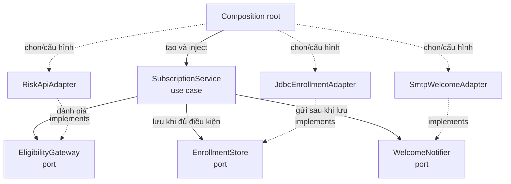
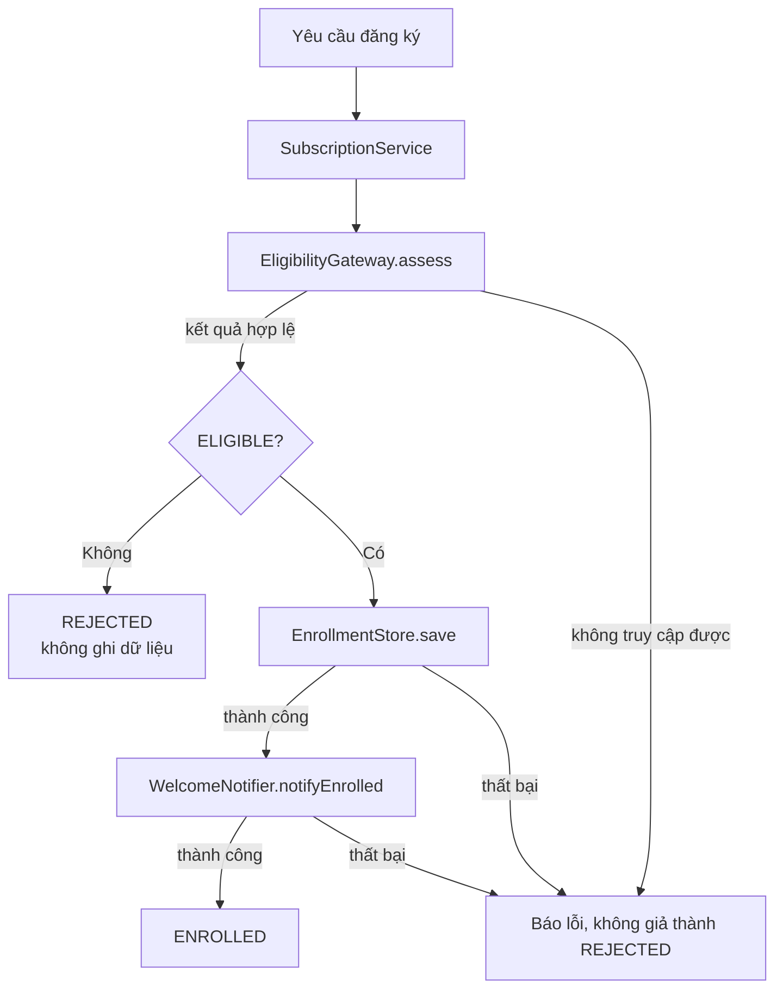

# Giảm phụ thuộc vào triển khai nhưng không loại bỏ quan hệ nghiệp vụ

**Dependency Injection (DI)** thường được giới thiệu qua một ví dụ rất thuyết phục: thay vì để `SubscriptionService` tự tạo `JdbcSubscriptionRepository`, ta truyền một `SubscriptionRepository` vào constructor. Khi cần đổi từ bộ nhớ sang database hoặc dùng fake trong test, mã service có thể không phải thay đổi.

Nhưng từ đó dễ suy diễn sai rằng: “DI làm các thành phần hoàn toàn không còn phụ thuộc vào nhau”. Trên thực tế, **DI giảm sự phụ thuộc không cần thiết vào cách một khả năng được triển khai, chứ không xóa bỏ quan hệ nghiệp vụ khiến các thành phần phải cộng tác**.

Nếu quy tắc đăng ký thuê bao là “chỉ khách hàng đủ điều kiện mới được ghi nhận đăng ký, và chỉ gửi thư chào mừng sau khi lưu thành công”, service vẫn cần biết **đánh giá điều kiện**, **lưu đăng ký** và **gửi thông báo** phải phối hợp như thế nào. Đó là một phụ thuộc có chủ đích vào **hợp đồng và ý nghĩa nghiệp vụ**, không phải lỗi thiết kế chỉ vì service có nhiều dependency.

Trong chương **Đánh đổi thiết kế** của module **DEPENDENCY_INJECTION**, bài này phân biệt *coupling kỹ thuật* và *coupling nghiệp vụ*, chỉ ra giới hạn của Inversion of Control (IoC), thực hành constructor injection cùng composition root bằng Java thuần và kiểm thử các cam kết còn phải tồn tại ngay cả khi thay adapter.

## 1. Hai loại quan hệ phụ thuộc không nên đánh đồng

Hãy xét một dịch vụ đăng ký thuê bao:

```text
Đề nghị đăng ký
    → đánh giá điều kiện
    → nếu đủ điều kiện: lưu đăng ký
    → sau khi lưu thành công: gửi thông báo
```

Có thể nhận ra hai câu hỏi rất khác:

1. **Từng bước được thực hiện bằng công nghệ hay implementation nào?** Ví dụ đánh giá từ một API, lưu bằng JDBC, thông báo qua email.
2. **Tại sao phải thực hiện những bước này, và chúng có quan hệ gì?** Ví dụ không lưu đăng ký khi bị từ chối; không gửi thông báo thành công khi chưa lưu được.

Câu hỏi thứ nhất thuộc **lựa chọn triển khai**. Câu hỏi thứ hai thuộc **quy tắc và luồng nghiệp vụ**.

| Khía cạnh | Phụ thuộc vào triển khai | Quan hệ nghiệp vụ |
| --- | --- | --- |
| Câu hỏi chính | “Làm việc này *bằng cách nào*?” | “*Việc gì* phải xảy ra và theo điều kiện nào?” |
| Ví dụ | `JdbcSubscriptionStore`, thư viện SMTP, HTTP client | Đủ điều kiện mới được lưu; lưu thành công rồi mới thông báo |
| Điều DI thường cải thiện | Cho consumer nhận interface/port và để root chọn adapter | Làm các cộng tác viên cần thiết lộ rõ trong constructor |
| Điều DI **không** tự giải quyết | Adapter đúng cấu hình, resource/lifecycle đúng nếu không thiết kế và test | Thứ tự nghiệp vụ, tính nhất quán, transaction, retry, idempotency |
| Khi đổi phần này | Có thể chỉ sửa adapter hoặc composition root nếu hợp đồng giữ nguyên | Thường cần sửa service/domain policy và test nghiệp vụ |

**Mục tiêu không phải là số quan hệ phụ thuộc bằng không.** Mục tiêu là các quan hệ trở nên **tường minh, có ý nghĩa, ổn định ở đúng tầng và dễ kiểm chứng**.

### 1.1. Ba mức liên kết nên phân biệt

Để phân tích kỹ hơn, có thể tách thành ba mức:

- **Liên kết với implementation cụ thể** (*concrete implementation coupling*): mã nghiệp vụ import `SqlClient`, gọi `new Jdbc...` hoặc trực tiếp xử lý ngoại lệ vendor.
- **Liên kết với hợp đồng** (*contract coupling*): mã nghiệp vụ phụ thuộc vào `EligibilityGateway.assess(...)` và kết quả `ELIGIBLE/INELIGIBLE`.
- **Liên kết ngữ nghĩa và quy trình** (*semantic/workflow coupling*): mã nghiệp vụ đòi hỏi “chỉ lưu sau khi kết quả đủ điều kiện”, và “không gửi thông báo sau khi lưu lỗi”.

DI chủ yếu giúp **đổi liên kết cấp implementation thành liên kết cấp hợp đồng**. Phần liên kết ngữ nghĩa vẫn có thể là bắt buộc để sản phẩm đúng.

Không nên coi “coupling” luôn có nghĩa xấu. Nếu một service xử lý đúng use case, việc nó phụ thuộc vào các cổng cần thiết và quy tắc giữa chúng là **coupling có chủ đích**. Ngược lại, service phải biết driver JDBC hoặc giá trị URL của môi trường chỉ để thực hiện cùng use case thường là coupling có thể giảm.

## 2. Một ví dụ trước/sau: đổi cách tạo, giữ nguyên luật nghiệp vụ

### 2.1. Trước DI: implementation đi thẳng vào service

Một phiên bản gắn chặt vào hạ tầng có thể trông như sau:

```java
// Ví dụ phác thảo, không phải file chạy độc lập.
final class SubscriptionService {
    private final VendorEligibilityClient eligibility =
            new VendorEligibilityClient("https://eligibility.example");
    private final JdbcSubscriptionStore store =
            new JdbcSubscriptionStore("jdbc:...");
    private final SmtpWelcomeSender notifier =
            new SmtpWelcomeSender("smtp.example");

    EnrollmentResult enroll(EnrollmentRequest request) {
        var decision = eligibility.callRemoteApi(request);

        if (decision.isRejected()) {
            return EnrollmentResult.REJECTED;
        }

        store.insertSubscription(request);
        notifier.sendWelcome(request);
        return EnrollmentResult.ENROLLED;
    }
}
```

Lớp này đang cùng lúc quyết định:

- Sử dụng nhà cung cấp đánh giá điều kiện nào;
- Dùng công nghệ lưu trữ nào;
- Dùng nhà cung cấp thông báo nào;
- Cách cấu hình URL/connection;
- Trình tự nghiệp vụ khi đủ hoặc không đủ điều kiện.

Khi chỉ muốn test quy tắc “bị từ chối thì không lưu”, test vẫn có thể bị phụ thuộc mạng hoặc database. Đổi nhà cung cấp có nguy cơ tác động ngay vào lớp nghiệp vụ.

### 2.2. Sau DI: port giữ khả năng, service giữ trình tự

Thay vì tự tạo, service nhận ba hợp đồng:

```java
interface EligibilityGateway {
    Eligibility assess(EnrollmentRequest request);
}

interface EnrollmentStore {
    void save(Enrollment enrollment);
}

interface WelcomeNotifier {
    void notifyEnrolled(Enrollment enrollment);
}
```

Rồi dùng constructor injection:

```java
SubscriptionService(
        EligibilityGateway eligibility,
        EnrollmentStore store,
        WelcomeNotifier notifier) {
    this.eligibility = java.util.Objects.requireNonNull(eligibility);
    this.store = java.util.Objects.requireNonNull(store);
    this.notifier = java.util.Objects.requireNonNull(notifier);
}
```

Lớp nghiệp vụ vẫn thực hiện **đánh giá → lưu nếu hợp lệ → thông báo sau khi lưu**. Sự khác biệt là nó không phải biết **ai** thực hiện mỗi khả năng và **ai** tạo từng adapter.

Đây chính là **Inversion of Control** ở góc nhìn lắp ghép: quyền chọn implementation và thời điểm khởi tạo được chuyển ra ngoài consumer; hành vi nghiệp vụ vẫn thuộc nơi có trách nhiệm quyết định hành vi ấy.

### 2.3. Đồ thị phụ thuộc sau khi chuyển



Các đường từ service đến ba port là **dependency cần thiết của use case**. Đường từ adapter tới port là quan hệ triển khai hợp đồng. Việc thay `RiskApiAdapter` bằng một adapter khác không làm biến mất nhu cầu **đánh giá điều kiện đăng ký**.

*Sơ đồ biểu diễn kiến trúc dự kiến; tên adapter JDBC/SMTP chỉ minh họa. Phần tiếp theo dùng các adapter Java thuần để chạy độc lập.*

## 3. Hợp đồng có ngữ nghĩa là nơi nối kết giữa các lớp

Một port không chỉ là một chữ ký Java. Nó là **cam kết về dữ liệu, kết quả và lỗi**. Ví dụ:

| Port | Giá trị bình thường | Trường hợp không thành công | Điều consumer dựa vào |
| --- | --- | --- | --- |
| `EligibilityGateway.assess(request)` | `ELIGIBLE` hoặc `INELIGIBLE` | `EligibilityUnavailableException` khi không đánh giá được | `INELIGIBLE` là kết luận từ chối thật, không phải lỗi mạng |
| `EnrollmentStore.save(enrollment)` | Trở về bình thường khi thao tác lưu đạt cam kết | Ngoại lệ nếu không lưu được; có thể cần trạng thái không xác định với hạ tầng thật | Nếu phương thức trả thành công, service được phép tiếp tục bước sau |
| `WelcomeNotifier.notifyEnrolled(enrollment)` | Trở về bình thường theo mức bảo đảm gửi của port | Ngoại lệ khi gửi thất bại | Service phải biết thất bại thông báo có ảnh hưởng kết quả toàn use case hay không |

Nếu adapter mới vẫn `implements EligibilityGateway` nhưng **trả `INELIGIBLE` khi API timeout**, các kiểu Java có thể hoàn toàn đúng mà **ý nghĩa nghiệp vụ bị phá vỡ**. Service sẽ từ chối khách hàng thay vì nhận biết hệ thống đánh giá đang gặp sự cố.

Vì vậy, khi nói “thay implementation mà không sửa service”, luôn có điều kiện ngầm:

> **Implementation thay thế phải giữ đúng hợp đồng dữ liệu, lỗi, hành vi và những bảo đảm mà consumer thực sự cần.**

Đây là điểm giao giữa **Dependency Inversion Principle (DIP)**, **Liskov Substitution Principle** và thiết kế hợp đồng phụ thuộc. DI là cách cấp object; DIP nói về hướng phụ thuộc vào abstraction; khả năng thay thế đúng đắn vẫn cần ngữ nghĩa và kiểm thử.

### 3.1. Tránh để interface chỉ làm “mặt nạ” cho API vendor

Một interface như sau có vẻ trừu tượng nhưng thực chất vẫn khóa consumer với JDBC:

```java
interface EnrollmentStore {
    java.sql.ResultSet execute(String sql)
            throws java.sql.SQLException;
}
```

Nếu service phải xây SQL và xử lý `ResultSet`, đổi implementation sang HTTP vẫn phải sửa service. Port theo nhu cầu use case sẽ tốt hơn:

```java
interface EnrollmentStore {
    void save(Enrollment enrollment);
}
```

Ở đây **giảm coupling kỹ thuật** bằng cách không đưa SQL/JDBC qua ranh giới. Nhưng service vẫn phụ thuộc có chủ đích vào ý nghĩa của `save`: nếu lưu thất bại, không được tiếp tục như thể thành công.

## 4. Chương trình Java thuần: implementation thay được, quan hệ nghiệp vụ vẫn còn

Tạo file `BusinessCouplingDemo.java`. Ví dụ chỉ dùng Java SE, không cần DB/HTTP/DI container. Các adapter ghi nhật ký vào một danh sách để người học quan sát thứ tự và kết quả.

```java
import java.util.ArrayList;
import java.util.LinkedHashMap;
import java.util.List;
import java.util.Map;
import java.util.Objects;

public class BusinessCouplingDemo {

    enum Eligibility {
        ELIGIBLE,
        INELIGIBLE
    }

    enum EnrollmentResult {
        ENROLLED,
        REJECTED
    }

    // Dữ liệu đầu vào là immutable value object.
    static final class EnrollmentRequest {
        private final String customerId;
        private final String planCode;

        EnrollmentRequest(String customerId, String planCode) {
            if (customerId == null || customerId.isBlank()
                    || planCode == null || planCode.isBlank()) {
                throw new IllegalArgumentException(
                        "Customer ID and plan code must not be blank");
            }
            this.customerId = customerId;
            this.planCode = planCode;
        }

        String customerId() {
            return customerId;
        }

        String planCode() {
            return planCode;
        }
    }

    static final class Enrollment {
        private final String customerId;
        private final String planCode;

        Enrollment(String customerId, String planCode) {
            this.customerId = Objects.requireNonNull(customerId);
            this.planCode = Objects.requireNonNull(planCode);
        }

        String customerId() {
            return customerId;
        }

        String planCode() {
            return planCode;
        }
    }

    static final class EligibilityUnavailableException
            extends RuntimeException {
        EligibilityUnavailableException(String message) {
            super(message);
        }
    }

    interface EligibilityGateway {
        // INELIGIBLE = đã đánh giá và từ chối.
        // Hạ tầng không đánh giá được => ném lỗi, không trả INELIGIBLE.
        Eligibility assess(EnrollmentRequest request);
    }

    interface EnrollmentStore {
        // Trở về bình thường = lưu thành công theo hợp đồng port.
        void save(Enrollment enrollment);
    }

    interface WelcomeNotifier {
        void notifyEnrolled(Enrollment enrollment);
    }

    // Use case giữ quy tắc nghiệp vụ. Nó không biết adapter cụ thể.
    static final class SubscriptionService {
        private final EligibilityGateway eligibility;
        private final EnrollmentStore store;
        private final WelcomeNotifier notifier;

        SubscriptionService(
                EligibilityGateway eligibility,
                EnrollmentStore store,
                WelcomeNotifier notifier) {
            this.eligibility =
                    Objects.requireNonNull(eligibility, "eligibility");
            this.store = Objects.requireNonNull(store, "store");
            this.notifier = Objects.requireNonNull(notifier, "notifier");
        }

        EnrollmentResult enroll(EnrollmentRequest request) {
            Objects.requireNonNull(request, "request");

            Eligibility result = Objects.requireNonNull(
                    eligibility.assess(request),
                    "EligibilityGateway returned null");

            if (result == Eligibility.INELIGIBLE) {
                return EnrollmentResult.REJECTED;
            }

            // Thứ tự này là QUAN HỆ NGHIỆP VỤ cần giữ.
            Enrollment enrollment = new Enrollment(
                    request.customerId(), request.planCode());

            store.save(enrollment);
            notifier.notifyEnrolled(enrollment);
            return EnrollmentResult.ENROLLED;
        }
    }

    // Adapter giả lập: thay quyết định mà không sửa service.
    static final class FixedEligibilityAdapter
            implements EligibilityGateway {
        private final Eligibility decision;
        private final List<String> events;

        FixedEligibilityAdapter(
                Eligibility decision, List<String> events) {
            this.decision = Objects.requireNonNull(decision);
            this.events = Objects.requireNonNull(events);
        }

        @Override
        public Eligibility assess(EnrollmentRequest request) {
            events.add("assess:" + request.customerId());
            return decision;
        }
    }

    static final class InMemoryEnrollmentStore
            implements EnrollmentStore {
        private final Map<String, Enrollment> data =
                new LinkedHashMap<>();
        private final List<String> events;

        InMemoryEnrollmentStore(List<String> events) {
            this.events = Objects.requireNonNull(events);
        }

        @Override
        public void save(Enrollment enrollment) {
            Objects.requireNonNull(enrollment);
            if (data.putIfAbsent(
                    enrollment.customerId(), enrollment) != null) {
                throw new IllegalStateException(
                        "Duplicate enrollment for customer "
                                + enrollment.customerId());
            }
            events.add("save:" + enrollment.customerId());
        }

        int size() {
            return data.size();
        }
    }

    static final class RecordingWelcomeNotifier
            implements WelcomeNotifier {
        private final List<String> events;

        RecordingWelcomeNotifier(List<String> events) {
            this.events = Objects.requireNonNull(events);
        }

        @Override
        public void notifyEnrolled(Enrollment enrollment) {
            events.add("notify:" + enrollment.customerId());
        }
    }

    public static void main(String[] args) {
        // COMPOSITION ROOT: chọn implementation và inject vào use case.
        List<String> events = new ArrayList<>();
        EligibilityGateway eligibility =
                new FixedEligibilityAdapter(Eligibility.ELIGIBLE, events);
        InMemoryEnrollmentStore store =
                new InMemoryEnrollmentStore(events);
        WelcomeNotifier notifier =
                new RecordingWelcomeNotifier(events);

        SubscriptionService service =
                new SubscriptionService(eligibility, store, notifier);

        EnrollmentResult result = service.enroll(
                new EnrollmentRequest("C-101", "STANDARD"));

        System.out.println("Result: " + result);
        System.out.println("Events: " + events);
        System.out.println("Stored: " + store.size());
    }
}
```

Chạy bằng **JDK 11 trở lên**:

```bash
javac BusinessCouplingDemo.java
java BusinessCouplingDemo
```

Kết quả dự kiến:

```text
Result: ENROLLED
Events: [assess:C-101, save:C-101, notify:C-101]
Stored: 1
```

Chương trình thể hiện ba điều cùng lúc:

- **Adapter có thể thay**: service chỉ nhận `EligibilityGateway`, `EnrollmentStore` và `WelcomeNotifier`.
- **Quy tắc nghiệp vụ không biến mất**: nó vẫn quyết định không lưu khi `INELIGIBLE` và chỉ thông báo sau khi `save` thành công.
- **Composition root là nơi lắp ghép**: `main` chọn adapter, tạo instance và truyền vào constructor. Sau này có thể thay đoạn này bằng cấu hình DI container mà giữ nguyên use case.

### 4.1. Đổi adapter không phải đổi luật đăng ký

Giả sử một adapter khác đánh giá theo điểm tín nhiệm, hoặc lấy thông tin từ API khác. Composition root có thể truyền implementation mới:

```java
// Mô tả khái niệm: adapter thực sẽ có mã và cấu hình riêng.
EligibilityGateway gateway = new ExternalEligibilityAdapter(client);
SubscriptionService service =
        new SubscriptionService(gateway, store, notifier);
```

*Đoạn này không thuộc file chạy độc lập; `ExternalEligibilityAdapter`, `client`, `store` và `notifier` đại diện cho các đối tượng đã được khai báo ở bootstrap.*

Điều kiện để việc thay thế an toàn là `ExternalEligibilityAdapter` giữ đúng hợp đồng, đặc biệt là không dùng `INELIGIBLE` để che lỗi kết nối. Khi hợp đồng ổn định, **logic điều phối nghiệp vụ không cần phụ thuộc nhà cung cấp cụ thể**.

Ngược lại, nếu quy định nghiệp vụ đổi thành “được đăng ký tạm khi không xác minh được điều kiện và sẽ xét duyệt sau”, đó là **thay đổi quy tắc nghiệp vụ**. Cần bổ sung trạng thái như `PENDING_REVIEW`, quyết định nơi lưu và kiểm thử luồng mới. Đổi mỗi binding không đủ và cũng không nên được dùng để che thay đổi này.

### 4.2. Nhìn theo hai trục: thay implementation và thay hành vi

| Thay đổi | Có thể chỉ thay adapter/root? | Cần cân nhắc thay use case? |
| --- | --- | --- |
| Đổi công nghệ lưu từ file sang JDBC nhưng giữ nghĩa `save` | Thường có | Không, nếu hợp đồng và các cam kết giữ nguyên |
| Thay nhà cung cấp gửi thư, giữ nghĩa “đã nhận yêu cầu gửi” | Có thể | Không, nếu mức bảo đảm gửi đúng như hợp đồng cũ |
| Đổi API đánh giá nhưng vẫn trả `ELIGIBLE/INELIGIBLE` đúng nghĩa | Có thể | Không |
| Cho phép đăng ký trước rồi xét duyệt sau | Không đủ | Có, vì trình tự và trạng thái nghiệp vụ đổi |
| Bắt buộc không gửi thư trước khi giao dịch commit | Không đủ nếu luồng hiện tại gửi sớm | Có thể cần transaction/outbox và thay ranh giới xử lý |
| Chuyển xử lý đồng bộ sang hàng đợi bất đồng bộ | Đôi khi thay adapter là chưa đủ | Có thể phải đổi hợp đồng giao nhận, retry và trạng thái |
| Thay đổi “không đủ điều kiện” thành “không có dữ liệu” | Không; nếu đổi nghĩa output sẽ phá hợp đồng | Cần làm rõ ngữ nghĩa và chính sách |

**Lời hứa của DI không phải “mọi thay đổi đều chỉ sửa configuration”.** Lời hứa hữu ích hơn là **thay các chi tiết không liên quan tới nghiệp vụ mà không làm tràn ảnh hưởng vào logic nghiệp vụ**, khi hợp đồng thực sự ổn định.

## 5. Kiểm thử bằng Java thuần: giữ coupling nghiệp vụ, thay coupling kỹ thuật

Nếu một abstraction khiến việc test đơn giản hơn, đó là tín hiệu tốt; nhưng test phải chứng minh **những cam kết quan trọng vẫn đúng**, không chỉ chứng minh rằng constructor nhận đúng kiểu.

Tạo file `BusinessCouplingTest.java` cạnh file demo:

```java
import java.util.ArrayList;
import java.util.List;

public class BusinessCouplingTest {

    private static void check(boolean condition, String message) {
        if (!condition) {
            throw new AssertionError(message);
        }
    }

    static void testEligibleSequence() {
        List<String> events = new ArrayList<>();

        BusinessCouplingDemo.EligibilityGateway gateway = request -> {
            events.add("assess:" + request.customerId());
            return BusinessCouplingDemo.Eligibility.ELIGIBLE;
        };

        BusinessCouplingDemo.EnrollmentStore store = enrollment ->
                events.add("save:" + enrollment.customerId());

        BusinessCouplingDemo.WelcomeNotifier notifier = enrollment ->
                events.add("notify:" + enrollment.customerId());

        var service = new BusinessCouplingDemo.SubscriptionService(
                gateway, store, notifier);

        var result = service.enroll(
                new BusinessCouplingDemo.EnrollmentRequest(
                        "C-201", "STANDARD"));

        check(result == BusinessCouplingDemo.EnrollmentResult.ENROLLED,
                "Eligible customer must be enrolled");
        check(events.equals(List.of(
                "assess:C-201", "save:C-201", "notify:C-201")),
                "Business ordering changed: " + events);
    }

    static void testIneligibleSkipsEffects() {
        List<String> events = new ArrayList<>();

        BusinessCouplingDemo.EligibilityGateway gateway = request -> {
            events.add("assess:" + request.customerId());
            return BusinessCouplingDemo.Eligibility.INELIGIBLE;
        };

        BusinessCouplingDemo.EnrollmentStore store = enrollment ->
                events.add("unexpected-save");

        BusinessCouplingDemo.WelcomeNotifier notifier = enrollment ->
                events.add("unexpected-notify");

        var service = new BusinessCouplingDemo.SubscriptionService(
                gateway, store, notifier);

        var result = service.enroll(
                new BusinessCouplingDemo.EnrollmentRequest(
                        "C-202", "STANDARD"));

        check(result == BusinessCouplingDemo.EnrollmentResult.REJECTED,
                "Ineligible customer must be rejected");
        check(events.equals(List.of("assess:C-202")),
                "Rejected customer must not be saved or notified");
    }

    static void testInfrastructureFailureIsNotRejection() {
        List<String> events = new ArrayList<>();

        BusinessCouplingDemo.EligibilityGateway unavailable = request -> {
            events.add("unavailable:" + request.customerId());
            throw new BusinessCouplingDemo.EligibilityUnavailableException(
                    "Simulated eligibility outage");
        };

        var service = new BusinessCouplingDemo.SubscriptionService(
                unavailable,
                enrollment -> events.add("unexpected-save"),
                enrollment -> events.add("unexpected-notify"));

        boolean failed = false;
        try {
            service.enroll(new BusinessCouplingDemo.EnrollmentRequest(
                    "C-203", "STANDARD"));
        } catch (BusinessCouplingDemo.EligibilityUnavailableException e) {
            failed = true;
        }

        check(failed, "Infrastructure outage must propagate");
        check(events.equals(List.of("unavailable:C-203")),
                "Outage must not cause downstream effects");
    }

    static void testStoreFailurePreventsNotification() {
        List<String> events = new ArrayList<>();

        var service = new BusinessCouplingDemo.SubscriptionService(
                request -> BusinessCouplingDemo.Eligibility.ELIGIBLE,
                enrollment -> {
                    events.add("save-failed");
                    throw new IllegalStateException("Storage unavailable");
                },
                enrollment -> events.add("unexpected-notify"));

        boolean failed = false;
        try {
            service.enroll(new BusinessCouplingDemo.EnrollmentRequest(
                    "C-204", "STANDARD"));
        } catch (IllegalStateException e) {
            failed = true;
        }

        check(failed, "Storage failure must propagate");
        check(events.equals(List.of("save-failed")),
                "Do not notify if save failed");
    }

    static void testNotificationFailureDoesNotRollbackAutomatically() {
        List<String> events = new ArrayList<>();

        var store = new BusinessCouplingDemo.InMemoryEnrollmentStore(events);
        var service = new BusinessCouplingDemo.SubscriptionService(
                request -> BusinessCouplingDemo.Eligibility.ELIGIBLE,
                store,
                enrollment -> {
                    events.add("notify-failed");
                    throw new IllegalStateException("Notification failed");
                });

        boolean failed = false;
        try {
            service.enroll(new BusinessCouplingDemo.EnrollmentRequest(
                    "C-205", "STANDARD"));
        } catch (IllegalStateException e) {
            failed = true;
        }

        check(failed, "Notification failure must be visible");
        check(store.size() == 1,
                "A prior successful save is not auto-rolled back");
        check(events.equals(List.of(
                "save:C-205", "notify-failed")),
                "Unexpected side effects");
    }

    static void testAlternativeAdapterKeepsServiceUnchanged() {
        List<String> trace = new ArrayList<>();

        var store = new BusinessCouplingDemo.InMemoryEnrollmentStore(trace);
        var notifier = new BusinessCouplingDemo.RecordingWelcomeNotifier(
                trace);

        var service = new BusinessCouplingDemo.SubscriptionService(
                new BusinessCouplingDemo.FixedEligibilityAdapter(
                        BusinessCouplingDemo.Eligibility.INELIGIBLE, trace),
                store,
                notifier);

        var result = service.enroll(
                new BusinessCouplingDemo.EnrollmentRequest(
                        "C-206", "STANDARD"));

        check(result == BusinessCouplingDemo.EnrollmentResult.REJECTED,
                "New adapter must preserve rejection semantics");
        check(store.size() == 0, "Rejected request must not be saved");
        check(trace.equals(List.of("assess:C-206")),
                "Unexpected adapter interactions");
    }

    public static void main(String[] args) {
        testEligibleSequence();
        testIneligibleSkipsEffects();
        testInfrastructureFailureIsNotRejection();
        testStoreFailurePreventsNotification();
        testNotificationFailureDoesNotRollbackAutomatically();
        testAlternativeAdapterKeepsServiceUnchanged();
        System.out.println("PASS: contract, business flow and adapter swap");
    }
}
```

Chạy:

```bash
javac BusinessCouplingDemo.java BusinessCouplingTest.java
java BusinessCouplingTest
```

Kết quả dự kiến:

```text
PASS: contract, business flow and adapter swap
```

### 5.1. Các test thực sự bảo vệ điều gì?

| Test | Cam kết được bảo vệ |
| --- | --- |
| `testEligibleSequence` | Đánh giá đủ điều kiện rồi **lưu trước khi thông báo** |
| `testIneligibleSkipsEffects` | Bị từ chối là kết quả bình thường, không được lưu hoặc thông báo |
| `testInfrastructureFailureIsNotRejection` | Không đánh đồng lỗi đánh giá với kết luận từ chối |
| `testStoreFailurePreventsNotification` | Lưu thất bại thì không tiếp tục thông báo |
| `testNotificationFailureDoesNotRollbackAutomatically` | Gửi lỗi sau khi lưu không làm dữ liệu tự rollback |
| `testAlternativeAdapterKeepsServiceUnchanged` | Thay adapter bằng constructor injection mà không sửa service |

Những test này xác minh **quan hệ nghiệp vụ qua các port**, chứ không ràng buộc service vào JDBC, HTTP hay công nghệ gửi thư.

Với adapter thật, vẫn cần **contract test** kiểm tra cách chuyển dữ liệu/lỗi và **integration test** cho hạ tầng. Một fake luôn trả `ELIGIBLE` không thể chứng minh API đánh giá thật xử lý timeout, dữ liệu thiếu và kết quả từ chối đúng.

### 5.2. Đừng kiểm tra thứ tự khi thứ tự không mang ý nghĩa

Mock test quá chi tiết dễ làm mã khó refactor. Không phải mọi thứ tự gọi đều là quy tắc nghiệp vụ. Ví dụ, hai phép đọc độc lập có thể đổi chỗ mà không ảnh hưởng đầu ra; test bắt buộc thứ tự sẽ gây thất bại giả.

Trong ví dụ, **đánh giá trước lưu** và **lưu trước thông báo** là cam kết được nêu rõ, nên kiểm tra thứ tự là phù hợp. Nếu về sau hệ thống chuyển sang gửi thông báo bằng outbox, test cần thay theo **hợp đồng nghiệp vụ mới** thay vì bám cứng vào việc gọi một phương thức `notifyEnrolled` đồng bộ.

## 6. DI không giải quyết tính nhất quán của quy trình nhiều bước

Xét đoạn quan trọng:

```java
store.save(enrollment);
notifier.notifyEnrolled(enrollment);
return EnrollmentResult.ENROLLED;
```

Có ít nhất ba trường hợp:

1. **Lưu và thông báo thành công:** service trả `ENROLLED`.
2. **Lưu thất bại:** thông báo không được gọi.
3. **Lưu thành công, thông báo thất bại:** dữ liệu đăng ký đã tồn tại, nhưng lời gọi service ném ngoại lệ.

Trường hợp 3 thể hiện một **quan hệ nghiệp vụ cần quyết định rõ**, không phải “lỗi của DI”. Một interface khác hoặc container khác không tự làm hai thao tác thành transaction.

Với hệ thống thật, cần xác định:

- `ENROLLED` có nghĩa là **đã lưu** hay **đã lưu và đã gửi thông báo**?
- Thông báo có thể gửi bất đồng bộ không? Có cần cơ chế **outbox**?
- Nếu retry toàn bộ use case, có cần **idempotency key** để tránh tạo trùng?
- Nếu lỗi khi lưu mà không biết thao tác đã commit chưa, trả trạng thái **chưa xác định** hay kiểm tra lại?
- Nếu có nhiều hạ tầng, transaction bao phủ được tới đâu?

Đây là các quyết định thuộc **nghiệp vụ, tính nhất quán và kiến trúc hệ thống**, không thể bị “ẩn” sau một abstraction mà không làm rõ hợp đồng.

### 6.1. Không dùng fake để né quyết định khó

Một fake có thể cho `store.save` luôn thành công và `notifyEnrolled` không bao giờ lỗi. Unit test sẽ xanh, nhưng điều đó không chứng minh hệ thống production sẽ xử lý đúng lỗi I/O, timeout hay nhận yêu cầu trùng.

Cần phân chia:

- **Unit test use case:** kiểm tra quy tắc và cách xử lý các kết quả/lỗi mà port đã định nghĩa.
- **Contract test adapter:** kiểm tra implementation thực thi những quy ước ấy.
- **Wiring test:** kiểm tra root chọn adapter, scope và instance đúng.
- **Integration test:** kiểm tra tác động và lỗi của hạ tầng thật.
- **Test vận hành/khả năng phục hồi:** kiểm tra retry, idempotency và các trường hợp hệ thống không chắc trạng thái.

Không phải bài học DI nào cũng cần dựng toàn bộ pipeline test, nhưng cần biết **mỗi loại test bảo vệ điều gì**.

## 7. Nếu quy tắc nghiệp vụ là cốt lõi, đừng vô tình đẩy hết vào adapter

Có một biến thể đáng suy nghĩ: `EligibilityGateway` trong ví dụ trả trực tiếp kết luận `ELIGIBLE/INELIGIBLE`. Điều này phù hợp nếu việc “đánh giá điều kiện” là một **khả năng được ủy quyền** và hợp đồng ấy được sản phẩm chấp nhận. Nhưng nếu quy tắc “khách hàng nào được thuê bao” là **chính sách domain bắt buộc do ứng dụng sở hữu**, không nên đưa toàn bộ quy tắc ấy vào một adapter hạ tầng chỉ để service trở nên ngắn.

Một kiến trúc khác có thể tách **dữ kiện bên ngoài** khỏi **quyết định domain**:

```java
// Mô hình ý tưởng; các kiểu chưa được định nghĩa trong file chạy.
interface CustomerRiskFacts {
    RiskSnapshot loadRiskFacts(String customerId);
}

final class SubscriptionPolicy {
    boolean mayEnroll(RiskSnapshot risk, Plan plan) {
        // Quy tắc domain do ứng dụng làm chủ.
        return /* điều kiện nghiệp vụ */;
    }
}

final class EnrollmentUseCase {
    private final CustomerRiskFacts riskFacts;
    private final SubscriptionPolicy policy;
    // ...
}
```

*Ký hiệu `RiskSnapshot`, `Plan` và điều kiện trả về cần được định nghĩa theo nghiệp vụ thật; đoạn này là phác thảo kiến trúc, không phải Java hoàn chỉnh để biên dịch.*

Lúc đó:

- Adapter cung cấp **dữ kiện** bằng cách truy cập hệ thống ngoài.
- Domain policy quyết định **có được đăng ký hay không**.
- Use case điều phối **kiểm tra → lưu → thông báo**.

DI vẫn tách việc **tạo và chọn nguồn dữ kiện**, nhưng quan hệ giữa **quy tắc domain và dữ kiện đầu vào** là có chủ đích, không phải coupling cần xóa.

### 7.1. Quy tắc nằm ở đâu mới là câu hỏi quan trọng

| Nếu… | Hướng cân nhắc |
| --- | --- |
| Quy tắc do sản phẩm sở hữu, thường thay đổi theo yêu cầu nghiệp vụ | Giữ trong domain/service/policy dễ kiểm thử |
| Một dịch vụ bên ngoài là nguồn thẩm quyền chính thức quyết định đủ điều kiện | Dùng port biểu diễn kết luận, làm rõ ngữ nghĩa và lỗi |
| Nguồn ngoài chỉ cung cấp số liệu hoặc dữ kiện | Dùng port lấy dữ kiện, để domain policy ra quyết định |
| Quy tắc khác nhau theo cấu hình có chủ đích | Có thể inject strategy/policy phù hợp, nhưng phải công bố biến thể được hỗ trợ |
| Nhiều bước phải giữ cùng một bất biến | Đặt việc điều phối và transaction boundary ở nơi sở hữu bất biến |

Một số coupling tới domain policy là **điều ta muốn giữ**: nó thể hiện đúng mục đích của ứng dụng.

## 8. Abstraction cũng có chi phí

Một interface không miễn phí. Việc thêm port, adapter, cấu hình container và kiểm thử binding có thể tăng:

- Số file, kiểu và điểm cần tra cứu để hiểu một luồng.
- Sự gián tiếp khi debug: từ service qua interface tới adapter và hạ tầng.
- Số binding, qualifier và biến thể cấu hình có thể sai.
- Trách nhiệm quản lý scope/lifecycle khi tài nguyên được dùng chung hoặc tạo theo request.
- Chi phí viết fake, contract test và integration test để bảo vệ đúng nghĩa của abstraction.
- Khả năng “thiết kế quá sớm” cho những implementation không tồn tại và có thể không bao giờ cần.

Ngược lại, **không dùng abstraction ở đúng ranh giới** có thể làm chi phí thay hạ tầng hoặc kiểm thử tăng mạnh.

### 8.1. Bảng đánh đổi thực tế

| Lựa chọn | Ưu điểm | Chi phí/rủi ro | Khi phù hợp |
| --- | --- | --- | --- |
| Dùng trực tiếp lớp cụ thể, nhưng **inject qua constructor** | Ít lớp, dependency vẫn hiện rõ | Consumer biết kiểu cụ thể; đổi implementation khó hơn | Collaborator ổn định, nội bộ, không cần thay thế theo hợp đồng |
| Port theo nhu cầu consumer + adapter cụ thể | Tách hạ tầng, test fake dễ, giới hạn API | Nhiều kiểu và hợp đồng cần duy trì | Ranh giới DB/HTTP/email, nhiều adapter, hợp đồng quan trọng |
| Interface “một-một” cho mọi lớp | Đồng dạng cấu trúc | Nhiều abstraction rỗng, bảo trì tốn kém | Hiếm khi đáng làm nếu không có mục tiêu cụ thể |
| Inject factory/provider | Tạo resource đúng thời điểm/scope | Ownership và cleanup phức tạp hơn | Mỗi tác vụ cần resource mới, lazy hoặc request scope |
| DI container | Tự động hóa wiring/scope theo framework | Cấu hình, scanning, binding và lỗi runtime khó nhìn | Graph lớn, scope phong phú, nhu cầu quản lý nhất quán |
| Manual DI tại composition root | Minh bạch, ít phụ thuộc framework | Bootstrap dài khi graph lớn | Bài học, ứng dụng nhỏ/vừa, hoặc nền cho thiết kế trước container |

Không nên đặt quy tắc “phải có interface cho mỗi class mới là DI”. Ví dụ, constructor vẫn có thể nhận một `Clock` hoặc `PriceCalculator` cụ thể nếu đó là lựa chọn phù hợp. **Dependency injection** là cách cung cấp cộng tác viên; **abstraction** là một quyết định thiết kế khác, dù thường phối hợp với nhau.

### 8.2. Khi nào interface trở nên có ý nghĩa?

Một port thường đáng tạo khi có ít nhất một lý do rõ:

1. Consumer cần một **khả năng ổn định** có thể được thực hiện bằng hạ tầng khác nhau.
2. Hệ thống có **biên module hoặc biên kiến trúc** nên ngăn API vendor đi vào domain.
3. Cần một **test double** độc lập để kiểm thử hành vi mà không gọi hạ tầng thật.
4. Có nhiều implementation hợp lệ ở các môi trường hoặc profile.
5. Cần một API **hẹp hơn implementation** để giảm quyền và kiến thức mà consumer phải mang theo.

Không nhất thiết phải có **hai implementation production** ngay lập tức. Nhưng tạo interface chỉ vì “sau này biết đâu cần” mà không chỉ ra hợp đồng nào ổn định có thể là over-engineering.

## 9. Đừng nhầm các cách che dependency với việc giảm coupling

### 9.1. Service locator không tạo ra tính độc lập nghiệp vụ

```java
final class SubscriptionService {
    EnrollmentResult enroll(EnrollmentRequest request) {
        EligibilityGateway eligibility =
                GlobalContainer.get(EligibilityGateway.class);
        EnrollmentStore store =
                GlobalContainer.get(EnrollmentStore.class);
        // ...
    }
}
```

Đoạn này bỏ tham số constructor nhưng **không loại bỏ dependency**. Nó còn khiến nhu cầu của service bị ẩn và tăng liên kết tới cơ chế truy cập container toàn cục. Những quan hệ nghiệp vụ vẫn tồn tại, còn test/wiring có thể khó hơn.

Constructor injection thể hiện rõ:

```java
SubscriptionService(
        EligibilityGateway eligibility,
        EnrollmentStore store,
        WelcomeNotifier notifier)
```

Đây là thông tin hữu ích cho người đọc, composition root và test. **Constructor dài chưa chắc là lỗi**; nếu nó dài bất thường, hãy phân tích trách nhiệm thực tế, không tự động giấu nó sau container.

### 9.2. Dependency bag không làm số quan hệ thực giảm

```java
// Phác thảo với record (Java 16+), không thuộc file demo Java 11.
record AllDependencies(
        EligibilityGateway eligibility,
        EnrollmentStore store,
        WelcomeNotifier notifier,
        ReportingPort reports,
        BillingPort billing,
        AuditPort audit
) {}
```

Đổi constructor thành `SubscriptionService(AllDependencies deps)` giảm số tham số hiển thị nhưng không chứng minh service chỉ cần ba khả năng cho luồng đăng ký. Nếu service bắt đầu lấy bất kỳ collaborator nào từ `deps`, coupling thực tế có thể tăng.

Parameter object có giá trị khi các dữ liệu/khả năng **thật sự hình thành một khái niệm gắn kết**. Ví dụ `RetrySettings` với số lần thử, delay và timeout. Nó không phải cách mặc định để gom mọi dịch vụ không liên quan.

### 9.3. Interface quá chung che mất ý nghĩa nghiệp vụ

Một abstraction quá rộng như:

```java
interface GenericGateway {
    Object execute(String operation, Map<String, Object> payload);
}
```

có thể khiến cả ba port nghiệp vụ biến thành một phương thức. Khi đó consumer phải biết chuỗi lệnh và schema dữ liệu ẩn, dễ tạo lỗi ở runtime, khó kiểm chứng contract và khó thấy yêu cầu qua constructor.

**Hợp đồng tốt mô tả đúng năng lực consumer cần**, ví dụ `assess`, `save` và `notifyEnrolled`, thay vì một cơ chế gọi động quá tổng quát.

## 10. Tách coupling kỹ thuật mà vẫn giữ đúng thứ tự trách nhiệm

Một dấu hiệu tích cực sau refactor là ta có thể thay adapter nhưng vẫn chỉ ra rõ **ai sở hữu bước quyết định**.



Sơ đồ cho thấy các bước nghiệp vụ vẫn được **ghép với nhau bằng điều kiện**. Adapter không nên tự ý thay đổi thứ tự workflow bằng cách tự gửi thư, tự lưu vào một nơi khác hoặc âm thầm retry toàn bộ use case, trừ khi đó là hợp đồng đã được quyết định ở tầng phù hợp.

Cũng cần phân biệt **kết quả đã lưu và kết quả thông báo**: sơ đồ gom các lỗi vào một nhánh để dễ đọc, nhưng trong hệ thống thật, lỗi tại từng bước có tác động khác nhau và cần chính sách riêng.

### 10.1. Nếu thấy coupling nghiệp vụ, nên làm gì?

Không cần xóa nó bằng mọi giá. Nên:

- Đặt nó tại **use case/application service** hoặc domain policy chịu trách nhiệm.
- Đặt tên các port theo ý nghĩa nghiệp vụ.
- Ghi rõ tiền điều kiện, hậu điều kiện và các trạng thái lỗi.
- Viết test cho những bất biến như “từ chối không lưu” hoặc “lưu lỗi không thông báo”.
- Chỉ tách use case nếu có **lý do thay đổi khác nhau** hoặc trách nhiệm đã quá rộng.
- Cân nhắc event/outbox hoặc orchestration khi workflow phân tán, nhưng mô tả rõ độ nhất quán và retry, không coi “phát sự kiện” là đã hết coupling.

Một event `EnrollmentCreated` vẫn có ngữ nghĩa nghiệp vụ và schema mà publisher/subscriber phải thống nhất. Đổi gọi đồng bộ sang message queue có thể giảm coupling thời gian và vị trí triển khai, nhưng thường **tăng yêu cầu về giao nhận, versioning, idempotency và observability**.

## 11. Phụ thuộc còn có chiều thời gian và vòng đời

DI không chỉ đặt interface giữa các lớp; nó còn tạo **đồ thị object cụ thể** với các thời gian sống khác nhau.

Trong ví dụ `BusinessCouplingDemo`, các adapter giả đều được tạo tại `main` và không sở hữu kết nối phải đóng. Nếu đổi sang adapter JDBC hoặc HTTP client thật:

- Composition root tạo và cấu hình client/pool.
- Adapter dùng tài nguyên theo contract.
- Service chỉ gọi port, không tự đóng tài nguyên mà mình mượn.
- Owner của client/pool đóng khi mọi consumer ngừng sử dụng.
- Session/transaction ngắn hạn có thể được tạo bởi factory đã inject và đóng theo từng thao tác.

### 11.1. Không để service sở hữu nhầm tài nguyên dùng chung

```java
// Mô hình bootstrap: các kiểu là ví dụ về hạ tầng thực.
try (HttpClientHandle sharedClient = openClient()) {
    EligibilityGateway eligibility =
            new ApiEligibilityAdapter(sharedClient);
    WelcomeNotifier notifier =
            new HttpWelcomeNotifier(sharedClient);

    SubscriptionService service =
            new SubscriptionService(eligibility, store, notifier);

    service.enroll(request);
} // Root đóng sharedClient khi service đã sử dụng xong.
```

*`HttpClientHandle`, `openClient`, `ApiEligibilityAdapter`, `HttpWelcomeNotifier`, `store` và `request` là tên minh họa; đoạn này không thuộc file Java chạy ở mục 4.*

Trong một server xử lý nhiều request, root phải đảm bảo việc đóng client xảy ra **sau khi các request/tác vụ liên quan kết thúc**. Nếu một service singleton giữ adapter chỉ hợp lệ theo request, tham chiếu vẫn có thể khác `null` dù resource đã hết vòng đời. **Scope và ownership là một đánh đổi thiết kế độc lập với việc dùng interface.**

### 11.2. Không suy rằng dùng chung qua constructor là thread-safe

Một adapter `InMemoryEnrollmentStore` dùng `LinkedHashMap` thông thường như trong ví dụ **không phù hợp cho ghi đồng thời nếu không có đồng bộ bổ sung**. Composition root có thể inject cùng một instance vào nhiều service, nhưng không nhờ đó mà object trở nên thread-safe.

Khi chọn scope cần xét: trạng thái mutable, số consumer, concurrent access, transaction, cách đóng và tài nguyên đích. DI container có thể quản lý scope, nhưng không tự chứng minh đúng đắn concurrency hoặc idempotency.

## 12. Cách đánh giá một abstraction trước khi tạo thêm interface

Một quyết định tạo port nên có **lợi ích cụ thể lớn hơn chi phí**. Có thể dùng bảng sau trong buổi thiết kế:

| Câu hỏi | Nếu câu trả lời là “Có” | Gợi ý |
| --- | --- | --- |
| Đây có phải ranh giới DB/HTTP/email hoặc vendor API? | Đổi công nghệ là thay đổi có thể xảy ra | Port nghiệp vụ thường hữu ích |
| Consumer chỉ cần một phần nhỏ API của implementation? | Interface cụ thể quá rộng | Tạo port hẹp ở phía consumer |
| Hai implementation phải giữ cùng một ngữ nghĩa kết quả/lỗi? | Có hợp đồng có thể kiểm thử | Viết contract test cho cả hai |
| Cần fake để test quy tắc mà không gọi hạ tầng? | Test hiện bị phụ thuộc môi trường | Constructor injection và port rõ ràng có lợi |
| Implementation chỉ là helper ổn định, không có side effect? | Không có nhu cầu thay thế rõ | Có thể inject lớp cụ thể, tránh interface thừa |
| Quy tắc thuộc về domain do nhóm sở hữu? | Không nên giấu nó trong adapter | Giữ policy/domain behavior tường minh |
| Số dependency đang tăng không giải thích được? | Có thể lẫn nhiều trách nhiệm | Lập ma trận phương thức × dependency trước khi tách |
| Có resource sống ngắn hoặc state dùng chung? | Scope/ownership ảnh hưởng đúng đắn | Thiết kế factory/scope và test vòng đời |

Có thể tiến hành theo một trình tự thực dụng:

1. Viết rõ **mục tiêu use case** và những bất biến không được mất.
2. Liệt kê các **collaborator bắt buộc** để giữ các bất biến đó.
3. Chỉ ra chi tiết nào là **hạ tầng có thể thay thế**, chi tiết nào là **domain policy**.
4. Chọn abstraction cho các ranh giới có lý do rõ.
5. Tổ chức constructor injection và lắp tại composition root.
6. Kiểm thử nghiệp vụ qua port, kiểm thử adapter theo hợp đồng và kiểm thử wiring.
7. Đánh giá scope, ownership và lỗi khi dùng trong môi trường thật.
8. Tránh mở rộng abstraction chỉ để đạt mục tiêu hình thức như “không import lớp cụ thể ở bất kỳ đâu”. Composition root **cần** biết implementation để tạo graph.

## 13. Những ngộ nhận thường gặp

| Ngộ nhận | Điều đúng hơn |
| --- | --- |
| “DI xóa toàn bộ coupling giữa các lớp.” | DI giúp giảm coupling với **cách tạo và implementation**, còn coupling với hợp đồng/nghiệp vụ vẫn tồn tại có chủ đích. |
| “Có interface thì thay implementation nào cũng an toàn.” | Chỉ an toàn nếu cùng giữ **hợp đồng dữ liệu, lỗi và hành vi**. |
| “Không nên để use case biết thứ tự gọi các port.” | Nếu thứ tự là **quy tắc nghiệp vụ**, use case phải biểu diễn và kiểm thử nó. |
| “Constructor có nhiều dependency là chắc chắn sai.” | Cần phân tích độ gắn kết và lý do thay đổi; số lượng chỉ là tín hiệu. |
| “Đưa mọi thứ vào container sẽ tự giải quyết transaction và retry.” | Container không tự đảm bảo tính nhất quán của workflow phân tán. |
| “Dùng event là hết coupling.” | Event đổi loại coupling, thêm schema và yêu cầu delivery/idempotency. |
| “Fake test pass nghĩa là adapter thật đúng.” | Cần contract/integration test cho adapter thực. |
| “Service nhận interface thì có thể dùng chung ở mọi thread.” | Thread safety và scope phải được xác minh riêng. |
| “Càng nhiều interface thì hệ thống càng linh hoạt.” | Interface thừa tăng indirection, cấu hình và chi phí bảo trì. |
| “Chỉ cần làm constructor ngắn bằng dependency bag.” | Coupling vẫn tồn tại, có thể còn bị ẩn khỏi người đọc. |

**Một thiết kế DI tốt không cố làm domain không còn quan hệ. Nó làm các quan hệ đúng đắn trở nên rõ ràng và dồn biến động của hạ tầng về nơi có trách nhiệm xử lý chúng.**

## 14. Bài tập thực hành

**Bài 1 — Phân loại coupling.** Một `OrderService` gọi `new JdbcOrderRepository()`, đồng thời yêu cầu phải trừ tồn kho trước khi xác nhận đơn. Hãy chỉ ra đâu là coupling triển khai và đâu là quy tắc nghiệp vụ. Khi refactor sang constructor injection, điều nào có thể biến mất khỏi service và điều nào cần giữ?

**Bài 2 — Adapter không giữ contract.** Sửa `FixedEligibilityAdapter` để khi mô phỏng lỗi mạng thì trả `INELIGIBLE`. Test nào cần thất bại? Vì sao kiểu trả về vẫn đúng nhưng hệ thống lại từ chối khách hàng sai?

**Bài 3 — Bỏ trình tự nghiệp vụ.** Đổi `SubscriptionService.enroll` để gọi `notifier.notifyEnrolled` **trước** `store.save`. Phép thử nào sẽ phát hiện? Mô tả tình huống lưu thất bại nhưng khách hàng đã nhận thông báo thành công.

**Bài 4 — Một port hay nhiều port?** Một lớp `SubscriptionGateway` có các phương thức `assess`, `save`, `notify` và `listReports`. Lớp đăng ký chỉ cần ba phương thức đầu, lớp báo cáo chỉ cần phương thức cuối. Hãy đề xuất port hẹp theo phía consumer và giải thích vì sao số interface tăng **có thể** làm coupling từng use case giảm.

**Bài 5 — Interface không cần thiết.** Một helper `PercentageFormatter` thuần túy, bất biến, chỉ có một implementation và không phụ thuộc tài nguyên ngoài. Có nhất thiết tạo `PercentageFormatterPort` không? Nêu lợi ích cụ thể cần có trước khi quyết định tạo interface.

**Bài 6 — Đổi chính sách nghiệp vụ.** Sản phẩm muốn cho phép khách hàng chưa được xác minh vẫn đăng ký ở trạng thái `PENDING_REVIEW`. Hãy phác thảo cách đổi kiểu kết quả, trạng thái lưu trữ, thông báo và test. Vì sao chỉ thay binding của `EligibilityGateway` là không đủ?

**Bài 7 — Lỗi sau khi lưu.** Cho `WelcomeNotifier` ném lỗi sau một `save` thành công. Xác định trạng thái đã xảy ra và đề xuất cách xử lý retry/outbox/idempotency cho hệ thống thật. Phân biệt thay đổi nghiệp vụ với việc đơn thuần đổi implementation.

**Bài 8 — Scope và ownership.** Hai adapter nhận cùng một HTTP client dùng chung từ composition root. Nếu một adapter tự đóng client sau một lời gọi, chuyện gì xảy ra với consumer còn lại? Hãy nêu ai nên là owner và cách kiểm thử thứ tự đóng.

**Bài 9 — Thực hành quyết định thiết kế.** Với hệ thống có `CatalogService`, `PricingPolicy`, `RemoteTaxClient` và `Clock`, hãy chọn dependency nào đáng tạo port, dependency nào có thể inject lớp cụ thể. Đánh giá theo biến động hạ tầng, hợp đồng, testability và mức phức tạp thực tế; không chỉ dựa vào số lượng class.

## 15. Ghi nhớ

**Dependency Injection giảm sự phụ thuộc vào implementation và quá trình tạo/lắp ghép, nhưng không loại bỏ nhu cầu các thành phần phải cộng tác để thực hiện nghiệp vụ.** Một use case vẫn phải hiểu kết quả từ các port, áp dụng quy tắc, bảo vệ thứ tự tác dụng phụ và xử lý lỗi theo hợp đồng. Đó là những quan hệ cần thiết, không phải tất cả đều là nợ kỹ thuật.

Constructor injection làm dependency tường minh; **composition root** chọn adapter, scope và quyền sở hữu tài nguyên; **IoC** chuyển quyền tạo/lắp ghép ra ngoài consumer. Trước khi mở rộng sang DI container, Java thuần với fake và contract test đã đủ để chứng minh phần nào có thể thay thế, phần nào phải giữ ổn định về nghĩa và phần nào cần thay đổi khi chính nghiệp vụ phát triển.

**Đích đến của thiết kế không phải “ít coupling nhất bằng mọi giá”, mà là “đúng loại coupling ở đúng nơi, với chi phí trừu tượng hóa phù hợp”.**
