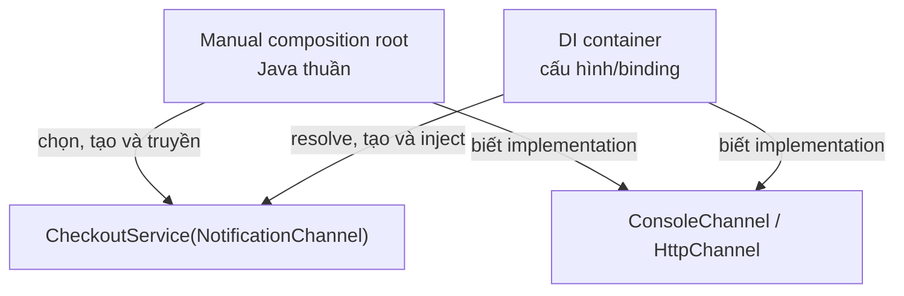
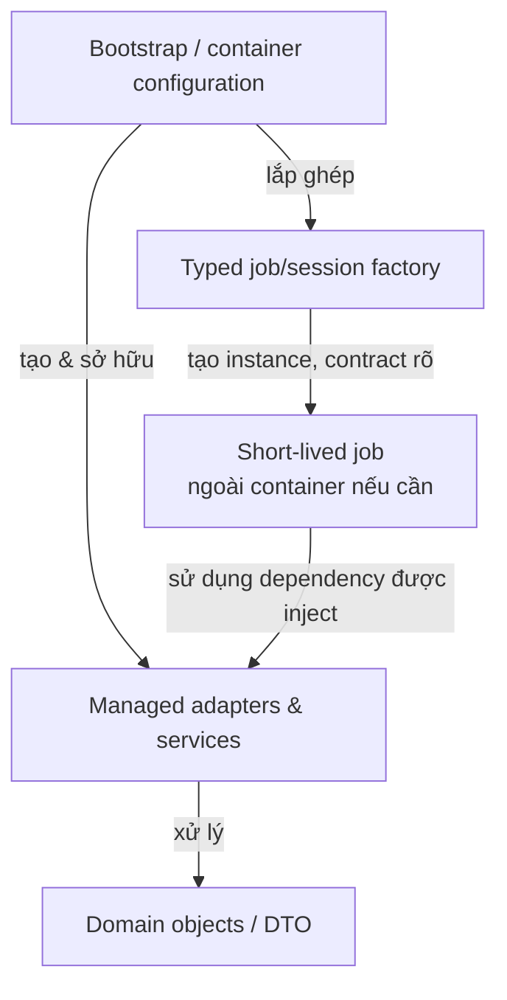

# DI thủ công so với container theo quy mô và năng lực nhóm

> **Chương:** Đánh đổi thiết kế  
> **Bối cảnh:** Dependency Injection (DI) và Inversion of Control (IoC) giúp tách việc sử dụng phụ thuộc khỏi việc tạo, chọn và lắp ghép đối tượng. Bài này so sánh **tự lắp ghép bằng Java thuần** với **để DI container hỗ trợ lắp ghép**, xét cả quy mô object graph, scope/vòng đời, kiểm thử, chi phí vận hành và năng lực của nhóm phát triển.

## 1. Mục tiêu học tập

Sau bài học, bạn có thể:

1. Khẳng định đúng: **DI không đồng nghĩa với DI container**; constructor injection và composition root đều thực hiện được bằng Java thuần.
2. So sánh lợi ích, giới hạn và chi phí ẩn của hai cách theo **độ phức tạp của object graph**, không chỉ theo số dòng code hay số lượng lập trình viên.
3. Xác định các yếu tố về **năng lực nhóm, kinh nghiệm debug, quy ước cấu hình, vận hành và kiểm thử** ảnh hưởng đến quyết định.
4. Triển khai cùng một ứng dụng bằng **manual DI** và hiểu bản cấu hình tương ứng bằng một DI container.
5. Thiết kế **constructor injection, resource ownership, scope và lifecycle** mà không nhầm lẫn trách nhiệm của container với trách nhiệm của ứng dụng.
6. Lập kế hoạch chuyển đổi tăng dần từ DI thủ công sang container khi nhu cầu thực tế xuất hiện, đồng thời tránh Service Locator và lạm dụng annotation.
7. Dùng một khung đánh giá có thể thảo luận trong code review hoặc buổi ra quyết định kiến trúc, thay vì chọn theo trào lưu.

## 2. Đặt đúng câu hỏi: có DI hay không, khác với dùng container hay không

Trong một service:

```java
final class CheckoutService {
    private final NotificationChannel channel;

    CheckoutService(NotificationChannel channel) {
        this.channel = java.util.Objects.requireNonNull(channel);
    }

    void confirm(String orderId) {
        channel.send(orderId, "confirmed");
    }
}
```

`CheckoutService` không tự chọn `ConsoleChannel`, `HttpChannel` hay gọi `new` để xây collaborator. Nó nhận một hợp đồng qua constructor. **Đó đã là Dependency Injection.**

DI container không tạo ra nguyên lý này; nó cung cấp **cơ chế thực thi và quản lý việc lắp ghép**. Hai cách có thể cùng dùng chính constructor trên:

- **DI thủ công (manual DI):** `Main` hoặc một lớp bootstrap tự `new` implementation, truyền dependency và quản lý vòng đời.
- **DI qua container:** ứng dụng đăng ký/khai báo binding, để container tạo, resolve và inject instance theo cấu hình và scope.



**Cả hai đều có thể tuân thủ DI và IoC.** Điều cần lựa chọn là **ai chịu trách nhiệm thực thi công việc wiring, với mức tự động hóa và độ phức tạp nào**, chứ không phải “cách nào đúng nguyên lý hơn” một cách tuyệt đối.

## 3. So sánh nhanh các đánh đổi

| Tiêu chí | DI thủ công | DI container |
| --- | --- | --- |
| **Tính hiển thị của wiring** | Lệnh tạo/truyền nằm trực tiếp trong code, dễ lần theo bằng IDE/debugger. | Wiring có thể phân tán qua cấu hình, annotation và quy tắc của framework; cần công cụ và hiểu biết để truy vết. |
| **Chi phí khởi đầu** | Ít phụ thuộc thư viện, phù hợp chương trình nhỏ. | Cần cấu hình, dependency và học cơ chế container; chi phí thấp hơn nếu dự án đã dùng framework đó. |
| **Object graph lớn** | Bootstrap và các factory có thể dài, nhiều nhánh lặp. | Container giúp resolve/đăng ký nhiều dependency theo quy ước và binding. |
| **Nhiều implementation** | Root chọn tường minh bằng `if`, factory hoặc cấu hình. | Binding, qualifier, profile/conditional config hỗ trợ lựa chọn; cũng có thể phát sinh mơ hồ. |
| **Scope và vòng đời** | Tự quy định nơi tạo, chia sẻ, đóng; thường dựa trên `try-with-resources` và lifecycle manager. | Một số scope/callback hủy có sẵn, nhưng vẫn phải cấu hình và hiểu ownership. |
| **Kiểm thử nghiệp vụ** | Truyền fake trực tiếp, không cần context. | Vẫn nên truyền fake trực tiếp cho unit test; cần thêm wiring/context test. |
| **Phát hiện sai cấu hình** | Phụ thuộc cách viết bootstrap và validation. | Có thể báo lỗi khi khởi tạo context; một số lỗi chỉ xuất hiện lúc resolve lazy/scope. |
| **Startup và footprint** | Ít cơ chế nền, nhưng không tự bảo đảm nhanh hơn mọi ứng dụng. | Có thêm chi phí khởi tạo/metadata/proxy tùy container; phải đo trong môi trường thực. |
| **Tích hợp framework** | Tự tạo cầu nối với web framework, lifecycle, interceptor. | Container tích hợp sẵn hơn với hệ sinh thái framework tương ứng. |
| **Yêu cầu kỹ năng nhóm** | Hiểu Java, constructor và object graph là đủ để bắt đầu. | Cần thêm kiến thức scope, binding, qualifier, proxy, lifecycle và công cụ debug. |

Không nên dựa vào một hàng đơn lẻ để quyết định. Một batch job có nhiều thành phần nhưng không cần request scope có thể rất thuận tiện với DI thủ công. Ngược lại, một ứng dụng web không quá lớn nhưng vốn đã dùng Spring để quản lý HTTP, transaction và security có thể tận dụng container sẵn có mà không cần xây lại cơ chế wiring.

## 4. Manual DI: khi tính tường minh là một lợi thế

### 4.1. Ưu điểm

**Dễ truy vết object graph.** Muốn biết `CheckoutService` nhận channel nào, đọc ngay nơi gọi constructor. IDE có thể đưa ta từ `new CheckoutService(channel)` về nơi `channel` được tạo; không nhất thiết hiểu quy tắc annotation hay container.

**Ít phụ thuộc hạ tầng.** Một chương trình CLI, job đơn lẻ hoặc thư viện Java nhỏ có thể dùng DI mà không thêm framework chỉ để tạo vài đối tượng.

**Kiểm thử nhanh, cô lập.** Test tạo `new CheckoutService(fake)`, không phải khởi động toàn bộ application context. Điều này cũng đúng khi production dùng container; manual DI cho thấy **nguyên tắc test tốt** không phụ thuộc framework.

**Sở hữu tài nguyên dễ nhìn.** `try-with-resources` tại root làm rõ ai tạo, ai sử dụng và ai đóng connection/client/stream. Không phải suy đoán callback hủy của một bean có chạy ở scope đó không.

**Phù hợp năng lực nhóm đang xây nền tảng DI.** Người mới học có thể hiểu constructor injection, composition root, vòng đời và test bằng Java thuần trước khi dùng annotation, qualifier hoặc scoped proxy.

### 4.2. Chi phí và giới hạn

Khi hệ thống lớn dần, root có thể phải quản lý:

- Nhiều đường tạo adapter và service theo môi trường.
- Nhiều implementation có điều kiện lựa chọn khác nhau.
- Factory tạo dependency theo request, transaction, job hoặc tenant.
- Các resource cần khởi tạo và đóng theo thứ tự, kể cả khi một bước khởi tạo thất bại.
- Nhiều entry point: HTTP server, scheduler, consumer của message queue, command line.
- Cấu hình và validation lặp lại giữa các module.

Nếu chỉ chuyển toàn bộ `new` vào một `main` dài hàng trăm dòng, ta vẫn có vấn đề bảo trì. Manual DI cần được tổ chức bằng **factory thuộc bootstrap, module wiring và các scope owner rõ ràng**. Đó là code của chính nhóm, phải thiết kế và kiểm thử như bất kỳ phần mềm nào khác.

**Không nên tự viết một container tổng quát ngoài nhu cầu.** Nếu code bắt đầu có registry `Map<Class<?>, Object>`, reflection để tự tìm constructor, scope động, proxy và annotation tùy biến, nhóm có thể đang xây lại một DI container với chi phí bảo trì cao hơn dự kiến.

## 5. Container DI: khi tiêu chuẩn hóa việc wiring đáng giá

Một container như Spring, Guice hoặc cơ chế DI của framework khác có thể hỗ trợ **khai báo cách xây object graph**, resolve dependency, chọn implementation và một số tính năng scope/lifecycle.

### 5.1. Ưu điểm thường thấy

**Giảm lặp ở wiring.** Khi nhiều service có constructor injection đơn giản, quy tắc bean definition hoặc module binding có thể giảm số lệnh `new` và code cầu nối phải viết.

**Tích hợp hệ sinh thái.** Ứng dụng đã cần HTTP controller, cấu hình, transaction, scheduler và interceptor có thể tận dụng cơ chế khởi tạo/lifecycle nhất quán với framework.

**Mở rộng chính sách scope.** Một số container cung cấp application, request hoặc các scope tùy biến, cùng provider/factory để resolve đối tượng theo ngữ cảnh.

**Quy tắc cấu hình và khởi động thống nhất.** Container có thể phát hiện một số binding thiếu, nhiều candidate hoặc vòng constructor khi xây context, thay vì để code tự lắp ghép từng nơi.

**Điểm mở rộng cho module.** Module có thể đóng góp binding thông qua cấu hình được điều phối tập trung, hữu ích khi nhiều đội phát triển phần mềm lớn.

### 5.2. Chi phí thường bị đánh giá thấp

**Wiring có thể khó nhìn hơn.** Một constructor chỉ thể hiện hợp đồng; để biết instance thật, cần lần theo cấu hình, qualifier, profile, conditional binding hoặc component scanning.

**Debug đòi hỏi kiến thức framework.** Những lỗi như “có nhiều bean cùng kiểu”, bean không được scan, context chưa khởi tạo, scoped proxy dùng ngoài request hoặc gọi method không qua proxy đều cần hiểu cơ chế container.

**Startup và vận hành cần đo.** Tạo context, xử lý metadata, proxy, validation và khởi tạo bean có thể phát sinh chi phí. Mức độ phụ thuộc vào container, cấu hình, ứng dụng và môi trường; không có kết luận chung rằng container “chậm” hoặc manual DI “luôn nhanh”.

**Quyền sở hữu tài nguyên không tự biến mất.** Container quản lý factory chưa chắc quản lý mọi object do factory trả về. Prototype có thể cần caller tự cleanup; task bất đồng bộ có thể sống lâu hơn context; client dùng chung vẫn cần shutdown đúng thứ tự.

**Nguy cơ che giấu dependency.** Nếu service tự gọi `applicationContext.getBean(...)` hoặc resolver tổng quát, thiết kế có thể biến thành **Service Locator**, làm mất tính tường minh dù có container.

**Chi phí tri thức và thay đổi.** Nhóm cần thống nhất phong cách cấu hình, cách dùng scope và quy tắc kiểm thử. Một framework mới có thể tăng thời gian onboarding và chi phí nâng cấp cho dự án vốn rất nhỏ.

> Container **tự động hóa công việc lắp ghép**, không tự động sửa một hợp đồng nghiệp vụ yếu, một dependency cycle bất hợp lý hoặc một singleton chứa dữ liệu riêng của từng người dùng.

## 6. Ví dụ Java thuần: wiring, selection và vòng đời tại root

Để so sánh công bằng, hãy giữ **nghiệp vụ không phụ thuộc framework**. Một ứng dụng xác nhận đơn hàng cần `NotificationChannel`; chế độ `plain` in thông báo, còn `audited` thêm dòng audit. Adapter mô phỏng không gọi mạng thật.

Tạo file `Main.java` với toàn bộ nội dung:

```java
import java.util.Objects;

interface NotificationChannel {
    void send(String orderId, String message);
}

// Adapter giả lập tài nguyên sống theo vòng đời ứng dụng.
final class ConsoleChannel implements NotificationChannel, AutoCloseable {
    private boolean closed;

    @Override
    public void send(String orderId, String message) {
        if (closed) {
            throw new IllegalStateException("Channel already closed");
        }
        System.out.println("SEND " + orderId + ": " + message);
    }

    @Override
    public void close() {
        if (!closed) {
            closed = true;
            System.out.println("CLOSE channel");
        }
    }
}

// Decorator: không sở hữu delegate được root tạo.
final class AuditedChannel implements NotificationChannel {
    private final NotificationChannel delegate;

    AuditedChannel(NotificationChannel delegate) {
        this.delegate = Objects.requireNonNull(delegate, "delegate");
    }

    @Override
    public void send(String orderId, String message) {
        delegate.send(orderId, message);
        System.out.println("AUDIT " + orderId);
    }
}

// Nghiệp vụ chỉ dùng hợp đồng; không chọn implementation.
final class CheckoutService {
    private final NotificationChannel channel;

    CheckoutService(NotificationChannel channel) {
        this.channel = Objects.requireNonNull(channel, "channel");
    }

    String confirm(String orderId) {
        if (orderId == null || orderId.trim().isEmpty()) {
            throw new IllegalArgumentException("orderId is required");
        }
        channel.send(orderId, "confirmed");
        return "CONFIRMED:" + orderId;
    }
}

public class Main {
    public static void main(String[] args) {
        String mode = args.length == 0 ? "plain" : args[0];

        // Composition root sở hữu ConsoleChannel.
        try (ConsoleChannel transport = new ConsoleChannel()) {
            NotificationChannel selected = chooseChannel(mode, transport);
            CheckoutService checkout = new CheckoutService(selected);

            System.out.println(checkout.confirm("ORD-101"));
        } // Chỉ owner đóng transport, kể cả khi có exception.
    }

    private static NotificationChannel chooseChannel(
            String mode, ConsoleChannel transport) {
        if ("plain".equals(mode)) {
            return transport;
        }
        if ("audited".equals(mode)) {
            return new AuditedChannel(transport);
        }
        throw new IllegalArgumentException(
                "Unsupported mode: " + mode);
    }
}
```

Biên dịch, chạy chỉ với JDK:

```bash
javac -encoding UTF-8 Main.java
java Main plain
java Main audited
```

Kết quả của `java Main plain`:

```text
SEND ORD-101: confirmed
CONFIRMED:ORD-101
CLOSE channel
```

Kết quả của `java Main audited`:

```text
SEND ORD-101: confirmed
AUDIT ORD-101
CONFIRMED:ORD-101
CLOSE channel
```

Điểm cần quan sát:

1. `CheckoutService` có constructor nhận `NotificationChannel`. Đây là **DI**, không cần thư viện.
2. `Main` chọn `ConsoleChannel` hoặc `AuditedChannel`, tức giữ quyết định concrete implementation gần ranh giới khởi động.
3. `ConsoleChannel` là **resource do root sở hữu**. `CheckoutService` và decorator chỉ mượn quyền sử dụng, không gọi `close()`.
4. `try-with-resources` dọn resource ở cả đường bình thường và đường lỗi, ví dụ khi chế độ không được hỗ trợ.
5. Khi object graph chỉ gồm một vài lớp, cách lắp ghép thủ công rất dễ theo dõi. Nếu số tầng, scope và lựa chọn tăng mạnh, cần đánh giá chi phí bảo trì bootstrap.

**Giới hạn ví dụ:** Adapter chỉ dùng console và chạy tuần tự. Trong production, một singleton channel có kết nối thật cần hợp đồng thread safety và shutdown rõ ràng. Sự tồn tại của `AutoCloseable` không chứng minh mọi container sẽ tự đóng instance nếu nó không được đăng ký và quản lý đúng cách.

## 7. Cùng service đó với cấu hình container

Ví dụ sau minh họa cách **Spring** thay thế một phần wiring thủ công bằng Java configuration. Đây là đoạn **phụ thuộc Spring Context**; không phải code chạy được với JDK trống. Giả sử `NotificationChannel`, `ConsoleChannel` và `CheckoutService` được định nghĩa như mục 6, cùng package.

Tạo `SpringMain.java` trong một dự án có dependency Spring phù hợp:

```java
import org.springframework.context.annotation.AnnotationConfigApplicationContext;
import org.springframework.context.annotation.Bean;
import org.springframework.context.annotation.Configuration;

public class SpringMain {
    @Configuration(proxyBeanMethods = false)
    static class Wiring {
        @Bean(destroyMethod = "close")
        ConsoleChannel consoleChannel() {
            return new ConsoleChannel();
        }

        @Bean
        CheckoutService checkoutService(ConsoleChannel channel) {
            return new CheckoutService(channel);
        }
    }

    public static void main(String[] args) {
        try (AnnotationConfigApplicationContext context =
                     new AnnotationConfigApplicationContext(Wiring.class)) {
            CheckoutService checkout = context.getBean(CheckoutService.class);
            System.out.println(checkout.confirm("ORD-101"));
        }
    }
}
```

Đoạn `SpringMain` dùng **chế độ tương đương `plain`**. Muốn chọn `audited` theo cấu hình, cần bổ sung binding/`@Qualifier` hoặc factory method có quyết định phù hợp tại bootstrap; không nên thêm lời gọi lookup container vào `CheckoutService`.

So sánh:

| Trách nhiệm | Manual DI ở `Main` | DI container trong `SpringMain` |
| --- | --- | --- |
| Chọn concrete adapter | `new ConsoleChannel()` | `@Bean ConsoleChannel consoleChannel()` |
| Cấp dependency | `new CheckoutService(selected)` | Container cung cấp tham số `ConsoleChannel channel` cho phương thức `@Bean` |
| Giữ service độc lập | Constructor `CheckoutService(NotificationChannel)` | **Cùng constructor đó** |
| Quyết định đóng adapter | `try-with-resources` tại root | Bean có `destroyMethod = "close"`, context quản lý hủy |
| Khởi chạy ứng dụng | Gọi trực tiếp service đã tạo | Lấy service từ context tại bootstrap rồi gọi |

**Sự tương đương quan trọng:** code `CheckoutService` **không đổi** giữa hai cách. Container không yêu cầu nghiệp vụ kế thừa một “base service” đặc biệt chỉ để nhận constructor injection.

### 7.1. Không nên lấy ví dụ nhỏ để kết luận hơn thua về tốc độ

Ví dụ manual có ít class và ít bước khởi động, nên nhìn ngắn và rõ hơn. Trong ứng dụng thật, nếu đã có Spring web/transaction/security, việc đăng ký thêm hai bean có thể là chi phí rất nhỏ. Ngược lại, thêm cả container vào một CLI chỉ có ba service có thể không đáng giá.

Không có kết luận đáng tin từ **một đoạn code mẫu** rằng container luôn chậm hơn, luôn nhanh hơn, hay luôn giảm số dòng code. Hãy đo **thời gian khởi động, tiêu thụ bộ nhớ, độ dễ debug và thời gian thực hiện thay đổi thực tế** trên hệ thống của bạn.

### 7.2. Chú ý việc “được quản lý” không tự lan sang object con

Một phương thức `@Bean` có thể trả `new CheckoutService(channel)` và container quản lý instance được đăng ký. Nhưng nếu `CheckoutService` tự gọi `new SomeTask(...)` bên trong method, task đó **không mặc nhiên** được container quản lý cùng callback hủy/proxy. Những object ngoài phạm vi container vẫn cần owner/scope tường minh.

## 8. Kiểm thử bằng Java thuần: bảo vệ thiết kế trước khi chọn công cụ

Tạo thêm file `CheckoutServiceTest.java` cùng thư mục `Main.java`. Test không cần Spring:

```java
final class RecordingChannel implements NotificationChannel {
    int calls;
    String lastOrderId;
    String lastMessage;

    @Override
    public void send(String orderId, String message) {
        calls++;
        lastOrderId = orderId;
        lastMessage = message;
    }
}

public class CheckoutServiceTest {
    public static void main(String[] args) {
        RecordingChannel fake = new RecordingChannel();
        CheckoutService checkout = new CheckoutService(fake);

        String result = checkout.confirm("ORD-TEST");
        check("CONFIRMED:ORD-TEST".equals(result),
                "Wrong result");
        check(fake.calls == 1,
                "Expected exactly one send");
        check("ORD-TEST".equals(fake.lastOrderId),
                "Wrong order ID");
        check("confirmed".equals(fake.lastMessage),
                "Wrong message");

        boolean invalidRejected = false;
        try {
            checkout.confirm(" ");
        } catch (IllegalArgumentException expected) {
            invalidRejected = true;
        }
        check(invalidRejected, "Blank order ID must be rejected");
        check(fake.calls == 1,
                "Invalid order must not trigger extra send");

        boolean missingDependencyRejected = false;
        try {
            new CheckoutService(null);
        } catch (NullPointerException expected) {
            missingDependencyRejected = true;
        }
        check(missingDependencyRejected,
                "Required dependency must not be null");

        System.out.println("PASS");
    }

    private static void check(boolean condition, String message) {
        if (!condition) {
            throw new AssertionError(message);
        }
    }
}
```

```bash
javac -encoding UTF-8 Main.java CheckoutServiceTest.java
java CheckoutServiceTest
```

Kết quả mong đợi:

```text
PASS
```

**Unit test này cần ở cả hai kiến trúc.** Nó xác nhận service gọi hợp đồng đúng và kiểm dữ liệu đầu vào; nó không kiểm chứng adapter mạng thật hay binding của container.

Nếu production dùng container, cần thêm **integration/wiring test** để xác minh:

- Context khởi tạo thành công với cấu hình môi trường cần hỗ trợ.
- Mỗi consumer nhận đúng implementation/qualifier.
- Scope của dependency đúng: singleton, request, prototype hoặc custom scope theo cam kết.
- Resource được đóng đúng lúc, không đóng khi consumer còn đang làm việc.
- Không có vòng constructor hoặc binding không tồn tại khi khởi động hay resolve lazy.

Nếu manual DI dùng nhiều factory, vẫn cần **wiring/smoke test** cho composition root. Chỉ vì không có container không có nghĩa wiring chắc chắn đúng trong mọi nhánh.

## 9. Quy mô nào thật sự làm DI thủ công khó bảo trì?

Không nên đặt một ngưỡng kiểu “trên 20 service thì dùng container”. Số class chỉ là **dấu hiệu gián tiếp**; hai ứng dụng có cùng số class có thể khác hoàn toàn về độ phức tạp lắp ghép.

Hãy đánh giá các trục cụ thể:

| Trục | Manual DI vẫn dễ quản lý khi… | Container đáng cân nhắc hơn khi… |
| --- | --- | --- |
| **Độ sâu và số nhánh object graph** | Vài module bootstrap rõ, phụ thuộc ổn định. | Nhiều tầng, nhiều điểm tạo và lựa chọn implementation liên quan. |
| **Biến thể môi trường** | Một vài mode rõ ràng, kiểm thử được bằng switch/factory. | Nhiều profile/module, binding phụ thuộc cấu hình phức tạp. |
| **Đa dạng scope** | Chủ yếu application scope và một số `try-with-resources` theo thao tác. | Nhiều request/job/custom scope và cần chính sách resolve đồng bộ với framework. |
| **Lifecycle** | Owner và thứ tự đóng đơn giản, dễ biểu diễn. | Nhiều resource, callback khởi tạo/hủy, tích hợp web scheduler/pool. |
| **Số entry point** | Một `main` hoặc một job độc lập. | HTTP, queue, scheduler, CLI cùng cần wiring và lifecycle nhất quán. |
| **Tích hợp framework** | Thư viện độc lập, code thuần Java là mục tiêu. | Hệ thống đã dựa sâu vào container của web/security/transaction framework. |
| **Tần suất thay đổi** | Thêm dependency hiếm, wiring ít biến động. | Các đội thường xuyên thêm module/binding, dễ phát sinh code lắp ghép trùng lặp. |
| **Khả năng kiểm soát** | Root nhỏ, một nhóm chịu trách nhiệm rõ. | Cần chuẩn hóa module config để nhiều nhóm đóng góp có kiểm soát. |

**Đo complexity theo các điểm quyết định và vòng đời, không chỉ đếm lệnh `new`.** Một root có 80 lệnh tạo thuần nhất có thể vẫn dễ hiểu hơn 15 bean với nhiều proxy, scope và conditional binding khó dự đoán.

### 9.1. Dấu hiệu nên cải thiện manual composition trước khi đổi công cụ

- `main` quá dài nhưng chỉ vì chưa tách factory thuộc bootstrap.
- Các service tự tra cứu env/config thay vì nhận giá trị hoặc adapter đã chọn.
- Một singleton `GlobalRegistry` giữ mọi dependency để các service lấy tùy ý.
- Nhiều code đóng resource bị sao chép và không có owner rõ.
- Test không thể truyền fake vì constructor/service vẫn tự `new` phụ thuộc.

Đây thường là vấn đề **tổ chức design**. Có thể cải thiện bằng constructor injection, module wiring và scope owner **mà chưa cần container**. Đổi sang framework trước khi sửa ranh giới trách nhiệm có thể chỉ chuyển sự phức tạp sang annotation.

### 9.2. Dấu hiệu container đem lại lợi ích rõ

- Ứng dụng đã có container nhưng một phần code còn tự quản lý trùng lặp wiring/lifecycle.
- Nhiều module cần cùng chính sách chọn implementation và scope, với khả năng kiểm tra khi khởi động.
- Tích hợp framework chính thức đòi bean/lifecycle do container quản lý.
- Nhóm có quy ước rõ về constructor injection, qualifier, cấu hình điều kiện và kiểm thử context.
- Chi phí tự viết factory, scope manager hoặc đăng ký thủ công **đã đo được**, không chỉ là cảm giác “nhiều boilerplate”.

## 10. Năng lực nhóm có thể quan trọng hơn quy mô mã nguồn

Một nhóm nhỏ quen Java thuần có thể triển khai DI thủ công minh bạch và ổn định. Một nhóm đã vận hành nhiều dự án Spring có thể làm container wiring nhanh hơn, ít lỗi hơn. Ngược lại, thêm framework không quen vào một dự án gấp có thể tăng rủi ro.

### 10.1. Những năng lực cần có nếu chọn DI thủ công

Nhóm nên thống nhất:

1. **Constructor injection** cho dependency bắt buộc; hạn chế trạng thái chưa hoàn chỉnh sau khởi tạo.
2. **Composition root rõ ràng**: implementation được chọn ở bootstrap, không rải `new HttpClient(...)` trong nghiệp vụ.
3. **Scope và ownership**: ai tạo, ai dùng, ai đóng, ai quản lý tài nguyên trên đường lỗi.
4. **Hợp đồng factory hẹp** khi cần đối tượng mới theo request/job.
5. **Unit test với fake** và smoke test root; tránh phụ thuộc vào global mutable state.
6. **Đường debug rõ** cho cấu hình thiếu, vòng constructor và shutdown.

Nếu thiếu các thói quen này, manual DI cũng dễ thành một tập hợp `new` phân tán và singleton toàn cục khó kiểm soát.

### 10.2. Những năng lực bổ sung nếu chọn container

Ngoài kiến thức nền trên, nhóm cần biết:

- Container đăng ký/tìm bean bằng cách nào; phân biệt component scan, `@Bean`, module binding và factory.
- Phân giải nhiều candidate qua qualifier/name/priority theo framework.
- Scope thực sự có nghĩa gì, bao gồm request, prototype và proxy.
- Vòng đời bean và giới hạn callback hủy, đặc biệt đối tượng ngoài container.
- Lỗi khởi động context, vòng phụ thuộc, lazy/provider và điểm phát sinh lỗi.
- Self-invocation/proxy/interceptor nếu dùng transaction, cache hoặc security.
- Cách viết test không khởi động container khi chỉ kiểm nghiệp vụ và khi nào cần context/integration test.
- Quy trình nâng cấp dependency/framework, cấu hình môi trường và quan sát trong production.

Không cần mọi thành viên thuộc toàn bộ implementation của framework, nhưng phải có **quy ước dùng thống nhất**, tài liệu onboarding và người đủ năng lực chẩn đoán lỗi scope/wiring trong lúc vận hành.

### 10.3. Các câu hỏi dành cho trưởng nhóm

Thay vì hỏi “công nghệ nào phổ biến hơn?”, hãy hỏi:

- Ai sẽ debug lỗi dependency thiếu khi deploy vào môi trường thật?
- Có bao nhiêu người hiểu khác biệt giữa prototype, singleton và request scope?
- Mất bao lâu để một thành viên mới lần theo đường tạo `CheckoutService`?
- Có thể kiểm thử use case mà không dựng cả ứng dụng không?
- Ai chịu trách nhiệm cấu hình, nâng cấp framework, rà soát thay đổi binding?
- Hệ thống cần hỗ trợ lâu dài ở môi trường nào (CLI, server, nhiều plugin, hạn chế runtime)?

Quyết định tốt là quyết định **nhóm có thể duy trì và vận hành**, không phải quyết định có nhiều annotation hoặc ít dòng bootstrap hơn.

## 11. Tổng chi phí sở hữu: nhìn cả vòng đời dự án

Chỉ so “số dòng code wiring” sẽ bỏ sót nhiều chi phí.

Có thể hình dung:

\[
\text{TCO} \approx \text{chi phí khởi đầu} + \text{chi phí thay đổi} + \text{chi phí kiểm thử} + \text{chi phí vận hành} + \text{chi phí đào tạo/nâng cấp}
\]

Đây là **khung đặt câu hỏi**, không phải công thức dự đoán bằng số cố định. Mỗi hạng mục cần đo hoặc đánh giá theo bối cảnh của tổ chức.

| Hạng mục | Cần quan sát thực tế |
| --- | --- |
| Thêm một use case mới | Thay bao nhiêu file, thời gian viết wiring, số nhánh điều kiện mới? |
| Thay implementation | Có cần sửa nghiệp vụ không? Lỗi cấu hình xuất hiện khi nào? |
| Unit test | Có chạy bằng Java thuần với fake nhanh được không? |
| Integration test | Dựng context và tài nguyên mất bao nhiêu công sức? |
| Debug production | Tìm được bean/instance/scope sai từ log và stack trace không? |
| Startup và bộ nhớ | Số liệu đo tại môi trường triển khai mục tiêu là bao nhiêu? |
| Đào tạo và bàn giao | Người mới hiểu composition root và lifecycle sau bao lâu? |
| Nâng cấp | Có phải giải quyết thay đổi API, cấu hình container hoặc transitive dependencies thường xuyên không? |

**Tránh khẳng định định lượng khi chưa đo.** Không có mức tiết kiệm “30%” hoặc “gấp đôi tốc độ” áp dụng chung cho mọi ứng dụng. Một prototype so sánh cùng chức năng, cùng yêu cầu lifecycle và cùng bộ test sẽ đáng tin hơn cảm giác từ code demo.

## 12. Khung quyết định có thể dùng trong buổi review

Hãy chấm từng tiêu chí theo mức **thấp / vừa / cao** dựa trên bằng chứng cụ thể, rồi thảo luận; **không cộng điểm máy móc để ra quyết định tự động**.

| Tiêu chí | Câu hỏi thực chứng | Dấu hiệu nghiêng về |
| --- | --- | --- |
| Graph complexity | Có bao nhiêu module wiring, nhánh binding và factory cần thay đổi thường xuyên? | Đơn giản → thủ công; phức tạp → cân nhắc container. |
| Scope/lifecycle | Có nhiều request/custom scope, resource callback và shutdown phối hợp không? | Ít → thủ công; nhiều và framework hỗ trợ tốt → container. |
| Existing ecosystem | Dự án đã dùng framework có container chưa? | Đã dùng sâu → ưu tiên tận dụng container hiện có. |
| Team capability | Nhóm debug thành thạo công cụ nào? Có guideline và test không? | Ưu tiên công cụ vận hành được ổn định. |
| Runtime constraints | Có yêu cầu startup, footprint, packaging đặc biệt không? | Đo trên môi trường thật; có thể thiên về thiết kế đơn giản hơn. |
| Frequency of change | Binding/implementation thay đổi thường xuyên không? | Nhiều → lợi ích tự động hóa tăng. |
| Failure risk | Lỗi scope/wiring gây hậu quả gì và có được phát hiện sớm không? | Ưu tiên kiến trúc dễ kiểm thử, quan sát và kiểm soát. |

Ví dụ diễn giải:

**Tình huống A — Một công cụ dòng lệnh.** Một entry point, ba đến mười collaborator, hầu hết sống theo một lần chạy, không có request scope. Java thuần với composition root và `try-with-resources` có thể đáp ứng tốt; thêm container chỉ để giảm vài lệnh `new` có thể không đáng.

**Tình huống B — Ứng dụng web đã sử dụng Spring.** Nhiều controller, service, repository, request scope và các cơ chế transaction/security. Nếu team hiểu framework, dùng container sẵn có thường hợp lý hơn tự xây một hệ thống wiring song song.

**Tình huống C — Service không lớn nhưng có plugin/config phức tạp.** Số class ít nhưng các implementation được chọn theo module và môi trường, lifecycle thay đổi liên tục. Cần đánh giá cấu hình container hoặc module binding tường minh, không nên kết luận “nhỏ thì luôn thủ công”.

**Tình huống D — Hệ thống cũ nhiều singleton và Service Locator.** Chưa nên đưa mọi object sang container cùng lúc. Trước hết cần tách hợp đồng, chuyển dependency vào constructor và viết test. Container chỉ có ích sau khi dependency graph đã rõ và không còn dựa quá nhiều vào global state.

## 13. Con đường ở giữa: dùng container mà vẫn giữ composition root rõ ràng

Hai lựa chọn không nhất thiết “tất cả hoặc không gì cả”. Một hệ thống có thể:

- Để container quản lý các bean application-scoped và adapter tích hợp framework.
- Dùng **constructor injection** cho service nghiệp vụ, tránh gọi API container trong method.
- Dùng **factory chuyên biệt** để tạo session/job ngắn hạn với ownership rõ.
- Dùng Java thuần cho value object, DTO và domain model không cần container.
- Cấu hình adapter phức tạp bằng Java config thay vì tạo âm thầm qua component scan.
- Giữ unit test của service không phụ thuộc context; dùng context test cho wiring thực tế.



**Composition root vẫn tồn tại về mặt trách nhiệm**, dù container hỗ trợ thực thi. Nơi cấu hình bean và khởi động ứng dụng là vùng composition root của kiến trúc; đừng biến service thành chỗ tự tra `getBean(...)` cho mỗi request.

### 13.1. Cẩn thận với trường hợp container tạo một bean nhưng sản phẩm của factory không được quản lý

Nếu một bean `JobFactory` có method `create()` gọi `new Job(dependency)`, object `Job` được tạo thông thường không tự trở thành managed bean có đầy đủ callback hủy/proxy. Factory có thể inject đúng dependency vào job, nhưng phải xác định **ai sở hữu job và tài nguyên của job**.

Đây là ví dụ cho thấy lợi ích container không xóa các quyết định về scope và lifecycle mà developer vẫn phải hiểu từ Java thuần.

## 14. Chuyển từ manual DI sang container theo từng bước

Một lộ trình giảm rủi ro:

1. **Ghi nhận hiện trạng:** liệt kê entry point, dependency, implementation và resource đang được tạo ở đâu; vẽ object graph quan trọng.
2. **Tách nghiệp vụ khỏi việc chọn concrete class:** chuyển dependency bắt buộc vào constructor; không bắt đầu bằng annotation quét toàn bộ.
3. **Viết test Java thuần:** dùng fake/spy kiểm hành vi, kiểm case lỗi và null dependency; bảo vệ contract.
4. **Tập trung wiring vào composition root:** dù chưa dùng container, loại bỏ `new HttpClient(...)` và lookup tổng quát rải rác trong service.
5. **Chọn một phần wiring để đưa sang container:** thường là adapter application-scoped hoặc module framework đang quản lý.
6. **Ghi rõ binding và scope:** dùng qualifier/config khi có nhiều implementation, quy định owner resource và shutdown.
7. **Bổ sung wiring test:** tạo context với cấu hình thực; xác minh đúng implementation, lifecycle, scope và lỗi khởi động.
8. **Di chuyển từng entry point:** HTTP/CLI/job theo nhu cầu, không để hai composition root tranh quyền đóng cùng tài nguyên.
9. **Quan sát và đo:** startup, bộ nhớ, số lỗi cấu hình, thời gian phát triển và debug.
10. **Giữ nguyên contract của business service:** nếu container bị thay thế về sau, core vẫn được tạo và test qua constructor injection.

### 14.1. Rollback và tương thích API

Với code đang được module khác sử dụng, đừng vội xóa public constructor hoặc factory API cũ chỉ vì container đã biết cách tạo bean. Một caller bên ngoài vẫn có thể dùng `new LegacyService()`. Nếu cần giữ tương thích, thêm constructor DI mới và một đường bridge có kế hoạch, rồi kiểm thử source/binary/behavioral compatibility phù hợp trước khi loại bỏ API cũ.

Không nên để bridge mặc định chuyển thành `GlobalContainer.get(...)`: nó tạo Service Locator ẩn và khiến caller ngoài framework phụ thuộc thứ tự khởi động. Khi không thể giữ hành vi cũ an toàn (đặc biệt với resource cần đóng), cần xem xét breaking change theo chính sách phát hành thay vì hứa tương thích mà không đảm bảo.

## 15. Những ngộ nhận phổ biến

**“Không có container thì không có DI.”** Sai. Truyền dependency qua constructor ở composition root chính là DI.

**“Dùng container sẽ làm design tự động tốt.”** Sai. Constructor cycle, abstraction kém, state dùng chung không an toàn và scope mismatch vẫn có thể tồn tại.

**“Manual DI luôn phù hợp dự án nhỏ, container luôn phù hợp dự án lớn.”** Quá đơn giản. Chi phí phụ thuộc số nhánh lựa chọn, scope, lifecycle, môi trường tích hợp và năng lực nhóm, không chỉ số class.

**“Container giảm boilerplate nên chắc chắn rẻ hơn.”** Cần tính thêm debug, test context, thời gian đào tạo và nâng cấp framework.

**“Manual DI thì phải đưa toàn bộ lệnh `new` vào một method lớn.”** Không. Có thể chia module wiring/factory trong vùng bootstrap, miễn các quyết định tạo dependency không bị đẩy vào service nghiệp vụ.

**“Bean singleton mặc nhiên thread-safe.”** Sai. Container chia sẻ instance; developer phải thiết kế collaborator và dữ liệu dùng đồng thời an toàn.

**“Container tự đóng mọi object được tạo trong ứng dụng.”** Sai. Hành vi hủy phụ thuộc việc object có được quản lý, scope và contract của framework. Resource do code ngoài tự tạo cần owner riêng.

**“Chỉ cần inject `ApplicationContext` vào service là linh hoạt.”** Đó có thể là Service Locator ẩn, khiến constructor không công bố dependency thật.

**“Chỉ có một lựa chọn cho toàn bộ codebase.”** Không bắt buộc. Container quản lý phần phù hợp; những object thuần Java vẫn có thể được xây bình thường.

## 16. Bài tập thực hành và thảo luận

**Bài 1 — Đúng nguyên lý hay đúng công cụ?** Một CLI tạo `NotificationChannel` rồi inject vào `CheckoutService` bằng constructor. Có phải DI không? Có cần container để chứng minh IoC không?

**Bài 2 — Đánh giá chi phí:** Một ứng dụng có 60 class, một entry point, một chế độ triển khai và phần lớn service không có tài nguyên. Một ứng dụng khác có 18 class nhưng nhiều request scope và job chạy nền. Chỉ dựa vào số class có thể kết luận lựa chọn công cụ không? Nêu ba chỉ số nên thu thập trước.

**Bài 3 — Khả năng nhóm:** Nhóm đã có Spring trong stack nhưng thành viên thường xuyên gặp lỗi bean scope và qualifier. Hãy đề xuất ba cải tiến về guideline/test/onboarding trước khi tăng sử dụng wiring tự động.

**Bài 4 — Lifetime:** Hai service dùng chung một HTTP client. Nếu một service đóng client sau mỗi request, container có tự sửa được không? Nên xác định owner và vị trí shutdown như thế nào?

**Bài 5 — Test:** Viết thêm một smoke test cho `Main` của mục 6: thử mode `unknown`, xác minh việc chọn adapter bị từ chối; giải thích vì sao unit test `CheckoutService` không tự kiểm tra nhánh mode đó.

**Bài 6 — Di chuyển dần:** Một phần ứng dụng dùng manual DI, phần web dùng container. Làm thế nào để tránh cùng một pool được tạo hai lần và hai thành phần đều cho mình quyền đóng pool?

**Bài 7 — Phản biện lựa chọn:** Khi nào yêu cầu startup nhanh hoặc footprint thấp có thể khiến DI thủ công là một ứng viên đáng thử? Vì sao vẫn phải benchmark trong môi trường thật thay vì kết luận từ ví dụ?

**Gợi ý đối chiếu:**

1. Có; chính việc dependency được truyền từ bên ngoài là DI. Container chỉ giúp tự động hóa.
2. Không. Cần xem số nhánh object graph, scope/lifecycle và công sức wiring/debug hiện tại, cùng các ràng buộc vận hành.
3. Chuẩn hóa constructor injection và qualifier, viết context test cho các cấu hình chính, đào tạo scope/proxy/lifecycle và tài liệu cách đọc lỗi khởi động.
4. Không. Service dùng dependency mượn không được tự đóng; root/container lifecycle owner đóng sau khi tất cả consumer ngừng dùng.
5. Test wiring ở root xác minh lựa chọn mode; unit test service chỉ giả định đã có `NotificationChannel` hợp lệ.
6. Chỉ định một composition boundary sở hữu pool; container có thể quản lý pool và cung cấp cho các factory manual thông qua injection, thay vì mỗi bên tự `new` và tự đóng.
7. Manual DI có thể giảm cơ chế nền nhưng kết quả thật còn phụ thuộc cách cấu hình framework, adapter, số bean và runtime. Phải đo startup/footprint trên workload và deployment mục tiêu.

## 17. Kết luận

**DI thủ công và DI container không đối lập về nguyên lý:** cả hai nên giữ lớp nghiệp vụ phụ thuộc vào hợp đồng và nhận collaborator qua constructor, còn việc chọn implementation và xây object graph nằm ở composition root.

Chọn **manual DI** khi tính tường minh, số scope ít và chi phí duy trì wiring nhỏ hơn giá trị tự động hóa. Chọn **container** khi tích hợp framework, object graph/lifecycle phức tạp và năng lực nhóm đủ để cấu hình, debug, kiểm thử một cách tin cậy. Khi chưa chắc, hãy giữ **core Java thuần**, đo các điểm đau thực tế và tiến hóa wiring theo nhu cầu thay vì chọn công cụ trước rồi điều chỉnh thiết kế theo công cụ.
