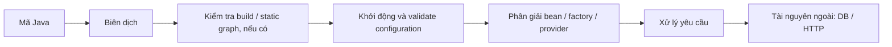
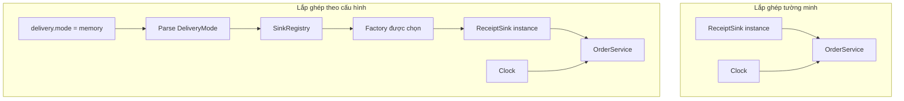

# Khả năng kiểm tra lúc biên dịch so với lỗi cấu hình lúc chạy

Một lý do để dùng **Dependency Injection (DI)** trong Java là làm cho quan hệ giữa các đối tượng trở nên rõ ràng và có thể kiểm tra. Nhưng **kiểm tra ở thời điểm nào** là một đánh đổi thiết kế quan trọng: trình biên dịch có thể phát hiện nhiều lỗi về kiểu và chữ ký constructor, trong khi những quyết định lắp ghép phụ thuộc vào cấu hình, registry, provider hoặc DI container có thể chỉ được xác minh **khi ứng dụng khởi động hoặc lúc dependency được yêu cầu**.

Giả sử `BookingService` cần `ReceiptSink`. Dòng `new BookingService(new EmailReceiptSink(), clock)` có thể được Java kiểm tra ngay khi biên dịch về tính tương thích của kiểu. Trái lại, nếu ứng dụng đọc chuỗi `delivery.mode=email` rồi yêu cầu một container tìm implementation tương ứng, Java compiler thường **không thể chứng minh** rằng môi trường triển khai có đúng một binding phù hợp, rằng factory trả đối tượng hợp lệ, hoặc rằng server gửi email đang hoạt động.

Bài thuộc chương **Đánh đổi thiết kế** của module **DEPENDENCY_INJECTION**. Ta sẽ phân biệt **type safety** với **wiring/configuration validity**, đối chiếu **constructor injection**, **composition root**, **Inversion of Control (IoC)** và DI container; tìm hiểu cách đưa lỗi ra sớm hơn mà không đánh mất tính linh hoạt của cấu hình; sau đó thực hành và kiểm thử bằng **Java thuần**.

## 1. Trình biên dịch kiểm tra điều gì, và điều gì nằm ngoài khả năng của nó?

Java compiler kiểm tra những thông tin mà nó biết từ **mã nguồn và kiểu tĩnh**:

- Một lời gọi constructor có đúng số lượng, kiểu và khả năng truy cập của tham số không?
- Một class có triển khai đúng hợp đồng interface mà nó công bố không?
- Một giá trị tham chiếu với kiểu `ReceiptSink` có được truyền vào nơi yêu cầu `ReceiptSink` không?
- Một lời gọi phương thức có tồn tại trong kiểu được khai báo và nhận đối số phù hợp không?

Ví dụ, với hợp đồng:

```java
interface ReceiptSink {
    void send(String message);
}

final class BookingService {
    private final ReceiptSink sink;

    BookingService(ReceiptSink sink) {
        this.sink = java.util.Objects.requireNonNull(sink, "sink");
    }
}
```

những đoạn sau **cố ý không biên dịch**:

```java
// CÁC DÒNG PHẢN VÍ DỤ, KHÔNG ĐƯA VÀO TỆP THỰC HÀNH:
new BookingService();             // Sai: thiếu tham số bắt buộc.
new BookingService(new Object()); // Sai: Object không phải ReceiptSink.
// sink.send(42);                 // Sai: send(...) cần String.
```

Java từ chối các lời gọi đó trước khi chạy. Đây là lợi ích đáng kể của **constructor injection có kiểu tường minh**: dependency bắt buộc xuất hiện trong chữ ký và caller phải cung cấp đối số có kiểu tương thích.

Tuy nhiên, compiler **không bảo đảm** mọi object sẽ không null. Biểu thức `new BookingService(null)` vẫn có thể biên dịch vì `null` tương thích với kiểu tham chiếu; `Objects.requireNonNull` mới từ chối giá trị ấy **lúc chạy**. Compiler cũng không chứng minh được rằng một `ReceiptSink` sẽ gửi thành công qua mạng, an toàn luồng, có vòng đời đúng hoặc tuân theo mọi bất biến nghiệp vụ.

### 1.1. Hai khái niệm cần tách

| Khái niệm | Câu hỏi thực tế | Ví dụ |
| --- | --- | --- |
| **Type safety** | Đối tượng có kiểu thích hợp và dùng đúng API không? | `ReceiptSink` có phương thức `send(String)` |
| **Wiring validity** | Có đúng instance phù hợp được cấp cho consumer ở môi trường này không? | Cấu hình `EMAIL` tìm thấy đúng một adapter đã đăng ký |
| **Configuration validity** | Giá trị cấu hình có hợp lệ và đầy đủ không? | `delivery.mode` thuộc các lựa chọn được hỗ trợ |
| **Lifecycle validity** | Instance còn sống và được dùng trong scope phù hợp không? | Không đóng client dùng chung trước khi các consumer hoàn tất |
| **Runtime behavior** | Thành phần có hoạt động đúng với tài nguyên ngoài không? | Email gateway thật nhận và xử lý yêu cầu |

Nhiều lỗi ở bốn nhóm cuối chỉ có thể được phát hiện khi biết **cấu hình và trạng thái thực tế**. DI container không làm compiler tự nhiên biết những giá trị cấu hình chỉ xuất hiện sau khi đóng gói hoặc triển khai.

## 2. Các thời điểm có thể phát hiện lỗi trong một ứng dụng DI

Không phải chỉ có hai mức “biên dịch” và “chạy nghiệp vụ”. Có nhiều điểm kiểm tra:



| Lỗi | Điểm phát hiện sớm khả thi | Vì sao |
| --- | --- | --- |
| Constructor thiếu tham số, truyền sai kiểu | **Biên dịch** | Có đủ thông tin kiểu trong source |
| Thiếu binding trong graph được tạo mã tĩnh | **Build/biên dịch**, nếu công cụ hỗ trợ kiểm tra toàn graph | Graph đã biết tại build time |
| Giá trị `delivery.mode=unknown` | **Khởi động** khi parse/validate | Giá trị chỉ được cung cấp từ môi trường |
| Không đăng ký sender cho mode đã chọn | **Khởi động/phân giải** | Registry được tạo từ cấu hình lúc chạy |
| Hai bean cùng hợp lệ ở injection point | **Kiểm tra graph**: build, deployment hoặc khởi động tùy công cụ | Cần áp dụng qualifier/selection policy |
| Factory trả `null` hoặc ném exception | **Khi factory được gọi** | Thân factory có hành vi lúc chạy |
| Provider được gọi lần đầu trong một request | **Có thể muộn đến request đầu tiên** | Dependency được tạo lười (lazy) |
| Kết nối DB thất bại | **Khi kiểm tra kết nối hoặc sử dụng DB** | Trạng thái hệ thống ngoài thay đổi theo thời gian |
| Bean dùng chung bị consumer đóng sớm | **Runtime hoặc test lifecycle** | Tính hợp lệ phụ thuộc vào thứ tự sử dụng và ownership |

**Fail fast** là chiến lược chuyển những lỗi có thể kiểm tra được đến thời điểm sớm nhất hợp lý. Nó không biến lỗi tài nguyên bên ngoài thành lỗi biên dịch. Ví dụ, ứng dụng có thể kiểm tra kết nối DB lúc khởi động, nhưng DB vẫn có thể mất kết nối sau đó.

### 2.1. Đường đi từ DI thủ công tới container

**Lắp ghép thủ công tường minh:**

```java
ReceiptSink sink = new ConsoleReceiptSink();
BookingService service = new BookingService(sink);
```

Compiler biết các kiểu và chữ ký, còn người viết **composition root** quyết định instance nào được cấp. Đoạn này không chứa chọn cấu hình động.

**Registry/factory động:**

```java
ReceiptSink sink = registry.resolve(modeFromConfig);
BookingService service = new BookingService(sink);
```

Compiler biết `resolve(...)` trả `ReceiptSink` và constructor nhận `ReceiptSink`, nhưng **không thể suy ra registry sẽ có một binding cho `modeFromConfig` ở mọi triển khai**. Đây là ranh giới kiểm tra lúc chạy.

**DI container:**

Container có thể nhận những khai báo về kiểu, qualifier, producer, scope hoặc điều kiện đăng ký. Một số công cụ **sinh graph và kiểm tra tại build time**, trong khi các container khác **phân giải ở deployment, startup hoặc khi yêu cầu bean**. Không nên nói “cứ có annotation là mọi lỗi DI đều được kiểm tra ở compile time” hoặc “mọi lỗi DI chỉ có thể phát hiện khi nhận HTTP request”. Điểm phát hiện phụ thuộc **công cụ, phiên bản, chế độ khởi tạo và đặc tính của dependency**.

## 3. Đánh đổi giữa lắp ghép tĩnh và cấu hình linh hoạt

Một hệ thống nhỏ, có một implementation ổn định, thường không cần cơ chế chọn adapter động. Composition root viết tường minh giúp người đọc biết ngay graph sẽ trông như thế nào.

Khi hệ thống triển khai nhiều môi trường, tenant, plugin hoặc adapter có điều kiện, việc có thể **chọn implementation bằng cấu hình** mang lại tính linh hoạt, nhưng kéo theo một loại lỗi mới: **giá trị cấu hình hợp lệ không đồng nghĩa với đăng ký hợp lệ**.

| Phương án | Lợi ích | Chi phí và rủi ro |
| --- | --- | --- |
| Constructor injection và `new` tường minh tại root | Dễ thấy graph, compiler bắt lỗi kiểu/chữ ký, ít cơ chế ẩn | Cần thay code/lắp ghép khi thay biến thể; graph lớn cần tổ chức thành module |
| Factory tự định nghĩa có kiểu | Quy tắc tạo có tên rõ ràng; có thể inject và test độc lập | Có thể thất bại khi gọi; phải quản lý instance, lỗi và ownership |
| Registry chọn theo key/config | Cùng một build hỗ trợ nhiều biến thể, có thể mở rộng | Thiếu/trùng key, sai cấu hình, chọn nhầm adapter |
| DI container cấu hình lúc chạy | Hỗ trợ binding, qualifier, scope, lifecycle và tự động hóa graph | Cần kiểm tra discovery, xung đột bean, điều kiện khởi tạo và lỗi lazy |
| Công cụ DI kiểm tra graph lúc build/compile | Có thể phát hiện thiếu/sai binding sớm với graph xác định được | Ít linh hoạt hơn với graph thay đổi hoàn toàn lúc chạy; không loại bỏ lỗi I/O/config |

Không có lựa chọn nào luôn thắng. **Kiểm tra sớm** giúp giảm lỗi khi triển khai, còn **lựa chọn động** giúp đáp ứng cấu hình mà không sửa source. Mục tiêu là giữ **kiểu và hợp đồng rõ ràng**, rồi bổ sung validation cho phần thông tin chỉ tồn tại lúc chạy.

### 3.1. Một registry có kiểu vẫn có thể cấu hình sai

Giả sử registry dùng `Map<DeliveryMode, Supplier<ReceiptSink>>`. Generics giúp giữ rằng các factory được đăng ký có kiểu trả về phù hợp; Java sẽ không chấp nhận một `Supplier<UnrelatedType>` không tương thích. Nhưng compiler không biết:

- Có bao nhiêu key được đăng ký khi khởi động?
- Hai module có đăng ký cùng key `EMAIL` không?
- File cấu hình của môi trường production chọn key nào?
- Factory có ném exception hay trả `null` không?
- Factory có trả instance đã bị đóng, hoặc một instance sống sai scope không?

Đó là lý do **type-safe registry** và **runtime validation** là các lớp bảo vệ **bổ sung**, không thay thế nhau.

## 4. Ví dụ Java thuần: cùng một consumer, hai cách composition

Ta tạo `OrderService` gửi thông báo biên nhận sau khi xác nhận đơn. Service chỉ cần `ReceiptSink` và `Clock`. Có hai điểm lắp ghép:

1. `composeExplicit(...)`: caller truyền **instance `ReceiptSink` đã chọn**.
2. `composeFromConfiguration(...)`: caller truyền giá trị `delivery.mode` và một registry; composition root parse mode, chọn factory, rồi tạo và cấp instance.

Cả hai cách đều giữ `OrderService` độc lập với registry và nguồn cấu hình.



Lưu chương trình dưới đây thành **`WiringTradeoffExample.java`**. Mã sử dụng JDK 11 trở lên và không cần DI container hay thư viện ngoài:

```java
import java.time.Clock;
import java.time.Instant;
import java.time.ZoneOffset;
import java.util.ArrayList;
import java.util.EnumMap;
import java.util.List;
import java.util.Locale;
import java.util.Map;
import java.util.Objects;
import java.util.function.Supplier;

public final class WiringTradeoffExample {
    private WiringTradeoffExample() {}

    public enum DeliveryMode {
        MEMORY, CONSOLE
    }

    public interface ReceiptSink {
        void send(String message);
    }

    public static final class RecordingReceiptSink implements ReceiptSink {
        private final List<String> messages = new ArrayList<>();

        @Override
        public void send(String message) {
            messages.add(Objects.requireNonNull(message, "message"));
        }

        public List<String> messages() {
            return List.copyOf(messages);
        }
    }

    public static final class ConsoleReceiptSink implements ReceiptSink {
        @Override
        public void send(String message) {
            System.out.println("Console: " + message);
        }
    }

    // Consumer chỉ biết hợp đồng có kiểu, không biết registry.
    public static final class OrderService {
        private final ReceiptSink sink;
        private final Clock clock;

        public OrderService(ReceiptSink sink, Clock clock) {
            this.sink = Objects.requireNonNull(sink, "sink");
            this.clock = Objects.requireNonNull(clock, "clock");
        }

        public String confirm(String orderId) {
            if (orderId == null || orderId.trim().isEmpty()) {
                throw new IllegalArgumentException(
                    "orderId must not be blank");
            }

            String receipt =
                "receipt:" + orderId + "@" + clock.instant();
            sink.send(receipt);
            return receipt;
        }
    }

    // Một registry đơn giản có kiểu: mode -> factory.
    public static final class SinkRegistry {
        private final Map<DeliveryMode, Supplier<? extends ReceiptSink>>
            factories = new EnumMap<>(DeliveryMode.class);

        public void bind(
                DeliveryMode mode,
                Supplier<? extends ReceiptSink> factory) {
            Objects.requireNonNull(mode, "mode");
            Objects.requireNonNull(factory, "factory");

            if (factories.putIfAbsent(mode, factory) != null) {
                throw new IllegalArgumentException(
                    "Duplicate binding for " + mode);
            }
        }

        public ReceiptSink resolve(DeliveryMode mode) {
            Objects.requireNonNull(mode, "mode");
            Supplier<? extends ReceiptSink> factory = factories.get(mode);

            if (factory == null) {
                throw new IllegalStateException(
                    "Missing binding for " + mode);
            }
            return Objects.requireNonNull(
                factory.get(),
                "Factory returned null for " + mode);
        }
    }

    public static final class AppGraph {
        public final OrderService orders;
        public final ReceiptSink sink;
        public final DeliveryMode mode;

        private AppGraph(
                OrderService orders,
                ReceiptSink sink,
                DeliveryMode mode) {
            this.orders = orders;
            this.sink = sink;
            this.mode = mode;
        }
    }

    // Cách A: compiler kiểm tra kiểu tham số của điểm lắp ghép.
    public static OrderService composeExplicit(
            ReceiptSink sink, Clock clock) {
        return new OrderService(sink, clock);
    }

    // Giá trị cấu hình chỉ được biết khi ứng dụng chạy.
    public static DeliveryMode parseMode(String rawValue) {
        if (rawValue == null || rawValue.trim().isEmpty()) {
            throw new IllegalArgumentException(
                "delivery.mode is required");
        }

        String normalized = rawValue.trim().toUpperCase(Locale.ROOT);
        try {
            return DeliveryMode.valueOf(normalized);
        } catch (IllegalArgumentException error) {
            throw new IllegalArgumentException(
                "Unsupported delivery.mode: " + rawValue, error);
        }
    }

    // Cách B: kiểm tra cấu hình rồi mới tìm binding và tạo instance.
    public static AppGraph composeFromConfiguration(
            String rawMode,
            SinkRegistry registry,
            Clock clock) {
        Objects.requireNonNull(registry, "registry");
        Objects.requireNonNull(clock, "clock");

        DeliveryMode mode = parseMode(rawMode);
        ReceiptSink sink = registry.resolve(mode);
        return new AppGraph(new OrderService(sink, clock), sink, mode);
    }

    public static void main(String[] args) {
        Clock clock = Clock.fixed(
            Instant.parse("2026-01-10T10:15:30Z"), ZoneOffset.UTC);

        // A: Truyền sẵn object với kiểu rõ ràng.
        RecordingReceiptSink directSink = new RecordingReceiptSink();
        OrderService direct = composeExplicit(directSink, clock);
        direct.confirm("OD-100");
        System.out.println("Direct: " + directSink.messages());

        // B: Chọn factory theo giá trị cấu hình.
        SinkRegistry registry = new SinkRegistry();
        registry.bind(DeliveryMode.CONSOLE, ConsoleReceiptSink::new);
        registry.bind(DeliveryMode.MEMORY, RecordingReceiptSink::new);

        AppGraph chosen =
            composeFromConfiguration("memory", registry, clock);
        chosen.orders.confirm("OD-200");
        System.out.println("Mode: " + chosen.mode);
        System.out.println(
            "Adapter: " + chosen.sink.getClass().getSimpleName());
        System.out.println("Selected: "
            + ((RecordingReceiptSink) chosen.sink).messages());
    }
}
```

Biên dịch và chạy:

```bash
javac WiringTradeoffExample.java
java WiringTradeoffExample
```

Kết quả dự kiến:

```text
Direct: [receipt:OD-100@2026-01-10T10:15:30Z]
Mode: MEMORY
Adapter: RecordingReceiptSink
Selected: [receipt:OD-200@2026-01-10T10:15:30Z]
```

Trong `main()`, phép ép kiểu sang `RecordingReceiptSink` chỉ phục vụ **quan sát kết quả demo** vì mode đã được đặt tường minh là `memory`. `OrderService` tuyệt đối không cần ép kiểu hoặc biết adapter cụ thể; lớp nghiệp vụ chỉ phụ thuộc `ReceiptSink`. Trong hệ thống thật, tránh để logic nghiệp vụ cast xuống implementation nhằm truy cập hành vi riêng.

### 4.1. Điều compiler thực sự bảo đảm trong ví dụ

Java buộc tham số của `composeExplicit(...)` phải tương thích với `ReceiptSink` và `Clock`. Registry cũng chỉ chấp nhận `Supplier` có kết quả phù hợp với `ReceiptSink`. Nếu đổi tên phương thức `ReceiptSink.send(...)`, những implementation hoặc caller không cập nhật sẽ bị phát hiện lúc biên dịch.

Nhưng cả `composeExplicit(...)` và `composeFromConfiguration(...)` vẫn có thể nhận `null` ở runtime; constructor có `Objects.requireNonNull` để từ chối sớm. Mọi kiểu `ReceiptSink` đều hợp lệ về mặt Java, nhưng **hành vi của implementation** vẫn có thể lỗi hoặc khác contract.

### 4.2. Các điểm lỗi mới khi dùng registry

`composeFromConfiguration(...)` xử lý ba bước **có thể thất bại lúc chạy**:

1. `parseMode(rawMode)`: từ chối mode rỗng hoặc không được hỗ trợ.
2. `registry.resolve(mode)`: từ chối mode hợp lệ nhưng không có binding.
3. `factory.get()`: có thể ném lỗi do khởi tạo hoặc trả `null`; ví dụ phát hiện `null` tại điểm tạo graph.

`SinkRegistry.bind(...)` còn từ chối hai đăng ký có cùng `DeliveryMode` thay vì im lặng ghi đè. Đây là chính sách **fail fast** do composition root/registry cài đặt; **không phải đặc tính tự động của `EnumMap`**.

Nếu không dùng bước kiểm tra, lỗi thiếu binding có thể biểu hiện muộn dưới dạng `NullPointerException` trong nghiệp vụ, gây khó chẩn đoán hơn so với `Missing binding for MEMORY` khi khởi động.

### 4.3. Đăng ký factory không đồng nghĩa đã tạo instance

`registry.bind(MEMORY, RecordingReceiptSink::new)` mới lưu một khả năng tạo. Bản thân việc đăng ký không gọi constructor của `RecordingReceiptSink`; việc tạo xảy ra khi `resolve(MEMORY)` được gọi. Nếu `MEMORY` không được chọn, factory cho nó có thể không được gọi.

Đây là một đánh đổi khác: cấu hình động có thể giảm việc tạo những thành phần không dùng đến, nhưng một lỗi trong factory không được gọi cũng có thể **không được phát hiện lúc khởi động**. Nếu hệ thống cần xác minh tất cả profile/binding, phải có kiểm tra graph riêng cho từng lựa chọn, hoặc công cụ hỗ trợ validation trước khi sử dụng.

## 5. Kiểm thử Java thuần: xác định điểm lỗi một cách có chủ đích

Ta viết bộ kiểm tra độc lập với framework để phân biệt lỗi kiểu không biên dịch được với lỗi cấu hình **chỉ được quan sát khi chạy**. Những ví dụ cố ý sai kiểu ở phần 1 không nằm trong tệp test này, vì không thể đặt mã không biên dịch vào một chương trình mong muốn chạy thành công.

Lưu đoạn mã sau thành **`WiringTradeoffCheck.java`** cùng thư mục với `WiringTradeoffExample.java`:

```java
import java.time.Clock;
import java.time.Instant;
import java.time.ZoneOffset;
import java.util.List;
import java.util.concurrent.atomic.AtomicInteger;

public final class WiringTradeoffCheck {
    private static final Clock FIXED_CLOCK = Clock.fixed(
        Instant.parse("2026-01-10T10:15:30Z"), ZoneOffset.UTC);

    private static void check(boolean condition, String message) {
        if (!condition) {
            throw new AssertionError(message);
        }
    }

    private static void expectFailure(
            Runnable action,
            Class<? extends Throwable> expectedType,
            String messageFragment) {
        try {
            action.run();
        } catch (Throwable error) {
            if (expectedType.isInstance(error)
                    && error.getMessage() != null
                    && error.getMessage().contains(messageFragment)) {
                return;
            }
            throw new AssertionError(
                "Unexpected failure: " + error, error);
        }
        throw new AssertionError(
            "Expected failure containing: " + messageFragment);
    }

    private static void typedCompositionUsesProvidedInstance() {
        WiringTradeoffExample.RecordingReceiptSink sink =
            new WiringTradeoffExample.RecordingReceiptSink();
        WiringTradeoffExample.OrderService service =
            WiringTradeoffExample.composeExplicit(sink, FIXED_CLOCK);
        String result = service.confirm("OD-TYPED");

        check(result.equals(
                "receipt:OD-TYPED@2026-01-10T10:15:30Z"),
              "Service must use injected Clock");
        check(sink.messages().equals(List.of(result)),
              "Service must use the instance provided by caller");
    }

    private static void dynamicConfigurationSelectsOnlyOneFactory() {
        AtomicInteger selectedCalls = new AtomicInteger();
        AtomicInteger unusedCalls = new AtomicInteger();
        WiringTradeoffExample.RecordingReceiptSink memory =
            new WiringTradeoffExample.RecordingReceiptSink();
        WiringTradeoffExample.SinkRegistry registry =
            new WiringTradeoffExample.SinkRegistry();

        registry.bind(WiringTradeoffExample.DeliveryMode.MEMORY, () -> {
            selectedCalls.incrementAndGet();
            return memory;
        });
        registry.bind(WiringTradeoffExample.DeliveryMode.CONSOLE, () -> {
            unusedCalls.incrementAndGet();
            return message -> {};
        });

        check(selectedCalls.get() == 0 && unusedCalls.get() == 0,
              "Binding must not create objects by itself");

        WiringTradeoffExample.AppGraph graph =
            WiringTradeoffExample.composeFromConfiguration(
                "memory", registry, FIXED_CLOCK);
        check(graph.mode == WiringTradeoffExample.DeliveryMode.MEMORY,
              "Wrong mode selected");
        check(graph.sink == memory, "Selected factory must be used");
        check(selectedCalls.get() == 1 && unusedCalls.get() == 0,
              "Only chosen factory should be invoked once");

        graph.orders.confirm("OD-DYNAMIC");
        check(memory.messages().size() == 1,
              "Selected adapter must observe service's call");
    }

    private static void invalidModeFailsBeforeFactoryCreation() {
        AtomicInteger creates = new AtomicInteger();
        WiringTradeoffExample.SinkRegistry registry =
            new WiringTradeoffExample.SinkRegistry();
        registry.bind(WiringTradeoffExample.DeliveryMode.MEMORY, () -> {
            creates.incrementAndGet();
            return message -> {};
        });
        expectFailure(
            () -> WiringTradeoffExample.composeFromConfiguration(
                "unknown", registry, FIXED_CLOCK),
            IllegalArgumentException.class, "Unsupported delivery.mode");
        expectFailure(
            () -> WiringTradeoffExample.composeFromConfiguration(
                " ", registry, FIXED_CLOCK),
            IllegalArgumentException.class, "delivery.mode is required");
        check(creates.get() == 0,
              "Invalid configuration must not allocate an adapter");
    }

    private static void missingBindingFailsAtResolution() {
        WiringTradeoffExample.SinkRegistry registry =
            new WiringTradeoffExample.SinkRegistry();
        expectFailure(
            () -> WiringTradeoffExample.composeFromConfiguration(
                "memory", registry, FIXED_CLOCK),
            IllegalStateException.class, "Missing binding for MEMORY");
    }

    private static void duplicateBindingFailsAtRegistration() {
        WiringTradeoffExample.SinkRegistry registry =
            new WiringTradeoffExample.SinkRegistry();
        registry.bind(
            WiringTradeoffExample.DeliveryMode.MEMORY,
            WiringTradeoffExample.RecordingReceiptSink::new);

        expectFailure(
            () -> registry.bind(
                WiringTradeoffExample.DeliveryMode.MEMORY,
                WiringTradeoffExample.RecordingReceiptSink::new),
            IllegalArgumentException.class, "Duplicate binding for MEMORY");
    }

    private static void nullFactoryResultFailsAtComposition() {
        WiringTradeoffExample.SinkRegistry registry =
            new WiringTradeoffExample.SinkRegistry();
        registry.bind(
            WiringTradeoffExample.DeliveryMode.MEMORY, () -> null);
        expectFailure(
            () -> WiringTradeoffExample.composeFromConfiguration(
                "memory", registry, FIXED_CLOCK),
            NullPointerException.class,
            "Factory returned null for MEMORY");
    }

    private static void providerFailureIsDeferredUntilResolution() {
        AtomicInteger calls = new AtomicInteger();
        WiringTradeoffExample.SinkRegistry registry =
            new WiringTradeoffExample.SinkRegistry();
        registry.bind(WiringTradeoffExample.DeliveryMode.MEMORY, () -> {
            calls.incrementAndGet();
            throw new IllegalStateException("Factory unavailable");
        });
        check(calls.get() == 0, "Registering provider must not invoke it");

        expectFailure(
            () -> WiringTradeoffExample.composeFromConfiguration(
                "memory", registry, FIXED_CLOCK),
            IllegalStateException.class, "Factory unavailable");
        check(calls.get() == 1, "Provider should run at resolution time");
    }

    private static void nullStillCompilesButIsRejectedAtRuntime() {
        expectFailure(
            () -> WiringTradeoffExample.composeExplicit(
                null, FIXED_CLOCK),
            NullPointerException.class, "sink");
    }

    private static void factoryDecidesReuseAcrossGraphs() {
        WiringTradeoffExample.SinkRegistry freshRegistry =
            new WiringTradeoffExample.SinkRegistry();
        freshRegistry.bind(
            WiringTradeoffExample.DeliveryMode.MEMORY,
            WiringTradeoffExample.RecordingReceiptSink::new);

        WiringTradeoffExample.AppGraph first =
            WiringTradeoffExample.composeFromConfiguration(
                "memory", freshRegistry, FIXED_CLOCK);
        WiringTradeoffExample.AppGraph second =
            WiringTradeoffExample.composeFromConfiguration(
                "memory", freshRegistry, FIXED_CLOCK);
        check(first.sink != second.sink,
              "Constructor factory should create distinct instances");

        WiringTradeoffExample.RecordingReceiptSink shared =
            new WiringTradeoffExample.RecordingReceiptSink();
        WiringTradeoffExample.SinkRegistry sharedRegistry =
            new WiringTradeoffExample.SinkRegistry();
        sharedRegistry.bind(
            WiringTradeoffExample.DeliveryMode.MEMORY, () -> shared);

        check(WiringTradeoffExample.composeFromConfiguration(
                "memory", sharedRegistry, FIXED_CLOCK).sink == shared,
              "Factory may return an existing instance");
        check(WiringTradeoffExample.composeFromConfiguration(
                "memory", sharedRegistry, FIXED_CLOCK).sink == shared,
              "Supplier does not inherently mean new instance");
    }

    public static void main(String[] args) {
        typedCompositionUsesProvidedInstance();
        dynamicConfigurationSelectsOnlyOneFactory();
        invalidModeFailsBeforeFactoryCreation();
        missingBindingFailsAtResolution();
        duplicateBindingFailsAtRegistration();
        nullFactoryResultFailsAtComposition();
        providerFailureIsDeferredUntilResolution();
        nullStillCompilesButIsRejectedAtRuntime();
        factoryDecidesReuseAcrossGraphs();
        System.out.println("PASS: 9 compile/runtime DI boundary checks");
    }
}
```

Biên dịch và chạy:

```bash
javac WiringTradeoffExample.java WiringTradeoffCheck.java
java WiringTradeoffCheck
```

Kết quả mong đợi khi mọi điều kiện đạt:

```text
PASS: 9 compile/runtime DI boundary checks
```

Các phép `check(...)` ném `AssertionError` khi vi phạm nên không cần cờ `-ea`. Đây là **test Java thuần**, không khởi động container hoặc kết nối tài nguyên ngoài.

| Phép kiểm | Điều được chứng minh |
| --- | --- |
| `typedCompositionUsesProvidedInstance` | Constructor nhận đúng collaborator đã cấp; nghiệp vụ dùng đồng hồ cố định |
| `dynamicConfigurationSelectsOnlyOneFactory` | Registry không gọi factory khi đăng ký; chỉ factory được chọn được gọi |
| `invalidModeFailsBeforeFactoryCreation` | Mode sai bị từ chối trước khi cấp phát adapter |
| `missingBindingFailsAtResolution` | Mode hợp lệ nhưng không có binding gây lỗi cấu hình |
| `duplicateBindingFailsAtRegistration` | Trùng key bị phát hiện khi đăng ký |
| `nullFactoryResultFailsAtComposition` | Factory có kiểu vẫn có thể trả `null` lúc chạy |
| `providerFailureIsDeferredUntilResolution` | Lỗi bên trong provider chỉ xuất hiện khi provider được gọi |
| `nullStillCompilesButIsRejectedAtRuntime` | Compiler không tự bảo đảm non-null của tham chiếu |
| `factoryDecidesReuseAcrossGraphs` | Tái sử dụng hay tạo mới là chính sách factory, không do `Supplier` tự quyết |

Chú ý: **không có test runtime nào thay thế được việc thử biên dịch một đoạn mã sai kiểu**. Những lỗi cú pháp/kiểu ở mục 1 được compiler xử lý; chín phép kiểm ở đây tập trung vào những hợp đồng mà compiler không thể chứng minh.

## 6. Khi dùng DI container: tránh hai kết luận cực đoan

### 6.1. “Dùng container là mất hết type safety” — sai

Các API container hiện đại vẫn thường dùng **kiểu Java** và kiểm tra tương thích trong những đoạn code đăng ký. Ví dụ, Guice có DSL binding theo `Class<T>`, CDI phân giải bean theo type/qualifier, còn những cơ chế cấu hình khác có thể hỗ trợ validation hoặc annotation processing. Việc gọi method có kiểu sai vẫn có thể không biên dịch.

Ranh giới thực sự là **đồ thị hoàn chỉnh và các điều kiện lựa chọn phụ thuộc runtime** không phải lúc nào cũng được Java compiler nhìn thấy. Một số framework hoặc công cụ sinh code DI có thể kiểm tra nhiều quan hệ binding khi build; những giá trị config, tài nguyên ngoài và tình huống runtime vẫn cần được kiểm tra riêng.

### 6.2. “Container luôn phát hiện lỗi ngay khi khởi động” — cũng sai

Tùy container và cấu hình, lỗi thiếu bean/binding có thể xuất hiện ở giai đoạn deployment, khởi động, tạo injector, lấy bean hoặc lần đầu provider được gọi. Các cơ chế lazy, conditional registration và scope chưa hoạt động có thể dời thời điểm lỗi.

| Tình huống | Việc cần xác minh |
| --- | --- |
| Một injection point có hai bean hợp lệ | Có qualifier hoặc chính sách phân giải tường minh không? |
| Một bean/adapter chỉ tạo khi dùng | Lúc bootstrap có validate được binding và factory không? |
| Profile `dev` khác `prod` | Có kiểm tra cấu hình cho **mọi profile được hỗ trợ** không? |
| Một module tùy chọn | Không đăng ký module có làm thiếu dependency bắt buộc không? |
| Provider trả object theo request | Có đúng request context khi provider được gọi không? |
| Singleton dùng chung client mutable | Có an toàn luồng và chủ sở hữu cleanup đúng không? |

Trong **Jakarta CDI**, kiểu và qualifier là các yếu tố trung tâm của bean resolution; runtime có thể phát hiện phụ thuộc không được thỏa mãn hoặc mơ hồ trong giai đoạn kiểm tra ứng dụng. Trong **Guice**, module/injector và binding cung cấp thông tin cho quá trình phân giải; các provider và object tạo lười vẫn có thể thất bại về sau. Nếu dự án dùng công cụ DI phân tích graph lúc build, hãy tận dụng kiểm tra đó — nhưng vẫn cần kiểm thử cấu hình thực tế và hạ tầng.

### 6.3. Không che lỗi bằng một service locator

Ví dụ bất lợi:

```java
final class HardToInspectService {
    void process(String id) {
        // Pseudocode: phụ thuộc không xuất hiện trong constructor.
        ReceiptSink sink = GlobalRegistry.get(ReceiptSink.class);
        sink.send(id);
    }
}
```

`GlobalRegistry` ở đây chỉ là kiểu giả định. Việc lookup động ở sâu trong nghiệp vụ làm mất đi khả năng đọc graph từ constructor; có thể không thất bại cho đến khi code chạy vào nhánh đó. Nếu chỉ composition root/container adapter thực hiện lookup rồi tiêm `ReceiptSink` có kiểu vào consumer, lỗi được gom về điểm lắp ghép và service dễ unit test hơn.

## 7. Làm sao đưa lỗi cấu hình ra sớm mà vẫn giữ tính linh hoạt?

Một thiết kế kết hợp thường hiệu quả:

1. **Giữ hợp đồng consumer có kiểu**: constructor nhận `ReceiptSink`, `Clock` và các dependency bắt buộc; không nhận registry toàn cục nếu không thực sự cần hành vi chọn động.
2. **Parse cấu hình sang kiểu chuyên biệt**: chuỗi `memory` thành enum; timeout thành `Duration`; không đưa chuỗi mơ hồ sâu vào nghiệp vụ.
3. **Đăng ký theo key/qualifier rõ ràng**: dùng `putIfAbsent` hoặc API phát hiện duplicate; không ghi đè binding âm thầm.
4. **Validate trước khi mở tài nguyên đắt tiền**: kiểm tra mode, key bắt buộc và quan hệ cấu hình trước khi mở client/pool.
5. **Chủ động dựng entry point khi startup nếu hợp lý**: giải quyết dependency cho các luồng quan trọng thay vì chờ request đầu tiên mới phát hiện thiếu.
6. **Kiểm tra cả những profile không được chọn** nếu chúng thuộc phạm vi hỗ trợ: thử cấu hình/graph riêng cho mỗi biến thể quan trọng.
7. **Giữ kiểm thử nghiệp vụ độc lập container**: fake `ReceiptSink` và `Clock.fixed` cho unit test; không cần khởi động framework để kiểm tra đầu vào.
8. **Bổ sung smoke test container cho wiring production**: kiểm tra bean discovery, qualifier, binding, scope và lifecycle.
9. **Bổ sung kiểm thử tích hợp/health check**: database, HTTP và tài nguyên thật cần kiểm tra ngoài compiler và wiring test.

Không nhất thiết phải tạo **mọi resource thật** chỉ để “fail fast”: việc kết nối đến hệ thống ngoài trong bootstrap có thể làm khởi động chậm hoặc phụ thuộc vào tài nguyên tạm thời chưa sẵn sàng. Nên phân biệt **validation tĩnh của cấu hình/graph** với **health check kết nối**, đặt mức nghiêm ngặt phù hợp mục tiêu vận hành.

### 7.1. Đọc tín hiệu từ lỗi thay vì che bằng fallback

Khi một mode **bắt buộc** không có binding, nên báo lỗi có đủ ngữ cảnh như `Missing binding for MEMORY`. Không âm thầm dùng no-op sender chỉ để ứng dụng khởi động. Nếu fallback là yêu cầu nghiệp vụ có chủ đích, phải ghi rõ điều kiện dùng, cách quan sát và giới hạn của nó.

Khi hai binding cùng key, báo trùng thay vì chọn “factory cuối cùng” hoặc “factory đầu tiên”. Khi một provider ném lỗi, giữ được nguyên nhân và thông tin mode/registration để dễ chẩn đoán; không tự thay bằng `null` rồi để service ném `NullPointerException` ở một điểm xa.

## 8. Scope và vòng đời: lỗi mà compiler khó chứng minh

Một chương trình có thể **hoàn toàn đúng kiểu** nhưng quản lý resource sai:

| Thiết kế đúng kiểu Java | Vẫn có thể xảy ra lỗi gì? | Kiểm tra phù hợp |
| --- | --- | --- |
| Singleton giữ một connection gắn với request | Connection hết hạn khi request kết thúc | Scope/lifecycle integration test |
| Hai service nhận cùng `AutoCloseable` client | Service thứ nhất đóng client sớm | Test ownership, shutdown |
| Factory trả một `ReceiptSink` hợp kiểu | Factory trả instance đã đóng hoặc mutable không thread-safe | Test contract/concurrency |
| Provider trả object theo context hiện hành | Context chưa được kích hoạt ở worker | Container/context test |
| Hai instance adapter khác nhau cùng trỏ DB | Dữ liệu không cô lập như suy đoán từ `==` | Integration/transaction test |

Constructor injection không tự tạo scope; nó chỉ cấp tham chiếu. Composition root hoặc container mới quyết định một instance được chia sẻ trong phạm vi nào, ai sở hữu tài nguyên và khi nào gọi `close()`. Các kiểm tra compile-time không thay thế một hợp đồng vòng đời rõ ràng.

### 8.1. Thứ tự phát hiện lỗi không đồng nghĩa với mức độ nghiêm trọng

Lỗi sai kiểu dễ được phát hiện sớm, nhưng không nhất thiết nghiêm trọng hơn lỗi dùng nhầm transaction, rò dữ liệu giữa tenant hoặc mất kết nối trong thanh toán. **Ưu tiên kiểm thử theo rủi ro nghiệp vụ**, không chỉ theo việc lỗi có thể bắt ở build hay ở startup.

Một thay đổi refactor từ DI thủ công sang container cũng cần đảm bảo hành vi cũ được giữ: đúng adapter, đúng thứ tự hiệu ứng, đúng lỗi khi thiếu dependency, đúng scope/ownership, và vẫn có unit test độc lập.

## 9. Ma trận kiểm thử theo loại rủi ro

| Điều cần chứng minh | Công cụ/cấp kiểm tra ưu tiên | Kết luận không nên suy ra |
| --- | --- | --- |
| API và constructor được gọi đúng kiểu | Java compiler | Mọi giá trị đều khác `null` |
| Service xử lý nghiệp vụ đúng | Unit test Java thuần với fake | Binding production đã đúng |
| Chuỗi cấu hình được parse/validate đúng | Unit test parser/configuration | Factory có tồn tại |
| Registry có đủ key, không trùng | Test composition/configuration | Adapter có hoạt động với hệ thống ngoài |
| Bean/binding được chọn đúng trong container | Container smoke/integration test | Tất cả request chạy thành công |
| Scope và callback lifecycle chính xác | Container lifecycle test | Adapter chắc chắn thread-safe |
| DB/HTTP/queue thực sự đáp ứng | Adapter integration test/health check | Không thể bị lỗi về sau |
| Behavior không đổi sau refactor | Regression/contract test | Không còn mọi lỗi tương lai |

Đầu tư vào validation ở nhiều tầng không phải dư thừa nếu mỗi tầng có **mục tiêu và bằng chứng riêng**. Unit test, composition test và adapter integration test nên bổ trợ thay vì chỉ lặp lại cùng một happy path.

## 10. Tình huống tự kiểm tra

Một ứng dụng có `PaymentService(PaymentGateway gateway, Clock clock)`. Có hai implementation `CardGateway` và `BankTransferGateway`. Khi deploy, tệp cấu hình đặt `payment.mode=card`. Một factory trong container có thể tạo gateway theo mode và một số thông số kết nối.

Hãy trả lời:

1. Nếu code gọi `new PaymentService(new Object(), clock)`, lỗi xuất hiện **khi nào**?
2. Nếu `payment.mode=crypto` không được hỗ trợ nhưng code vẫn biên dịch, cần bắt lỗi ở **ranh giới nào**?
3. Nếu có hai binding cùng qualifier `card`, nên báo lỗi hoặc phân giải thế nào để không phụ thuộc thứ tự tìm thấy?
4. Nếu provider chỉ được gọi ở giao dịch đầu tiên và thiếu secret, lý do nào khiến ứng dụng có thể khởi động thành công rồi mới thất bại?
5. Tại sao `@Singleton` hoặc `Scopes.SINGLETON` không tự bảo đảm client an toàn khi nhiều request chạy đồng thời?
6. Test nào có thể chạy bằng `new PaymentService(fakeGateway, fixedClock)` và test nào cần khởi động container?
7. Nếu muốn cùng một artifact triển khai được `card` và `bank`, phần linh hoạt lúc chạy đem lại lợi ích nào và phải đánh đổi bằng kiểm tra nào?

Một hướng giải: Java compiler bắt lỗi truyền `Object` không tương thích với `PaymentGateway`; parser cấu hình từ chối mode không hợp lệ; registry/container phát hiện thiếu hoặc mơ hồ binding; producer/factory có thể thất bại khi được gọi; test scope và integration xác minh client theo đời sống thực tế. Duy trì constructor injection có kiểu cho consumer và đặt chính sách chọn ở composition root/container để cân bằng **kiểm tra sớm** với **linh hoạt triển khai**.

**Ghi nhớ:** **Type safety lúc biên dịch kiểm tra hợp đồng Java, còn tính đúng đắn của lắp ghép động phải được kiểm tra với cấu hình và vòng đời thực tế.** Constructor injection tường minh tạo nhiều cơ hội phát hiện lỗi sớm; factory, registry và DI container mang lại khả năng cấu hình linh hoạt nhưng có thể dời một số lỗi tới khởi động hoặc lần đầu sử dụng. Thiết kế tốt không chọn một cực đoan: dùng **kiểu tường minh, validation sớm, composition root rõ ràng và kiểm thử theo ranh giới** để nhận lợi ích của cả hai.
