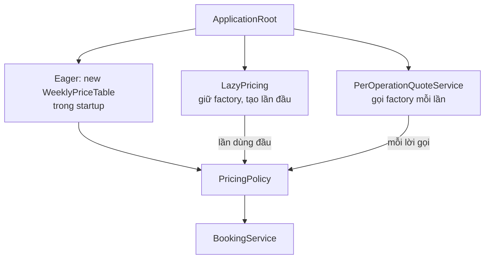
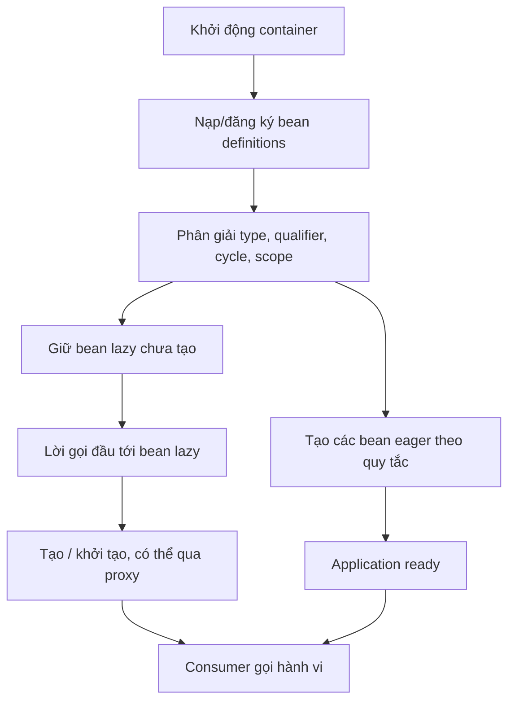
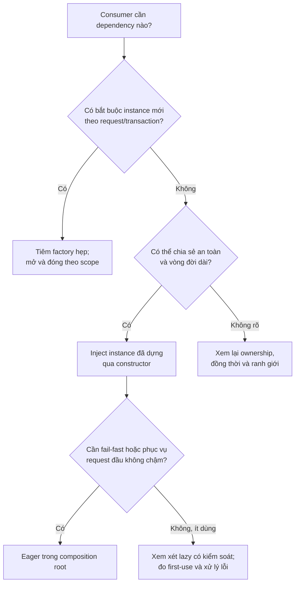

# Chi phí khởi động, bộ nhớ và cơ chế tạo đối tượng

Trong chương **Đánh đổi thiết kế** của module **Dependency Injection (DI)**, một câu hỏi thực tế là: *Khi chuyển việc tạo đối tượng từ các câu lệnh `new` sang composition root hoặc DI container, ứng dụng có khởi động chậm hơn, dùng nhiều bộ nhớ hơn hay tạo quá nhiều instance không?* Câu trả lời phụ thuộc **đồ thị đối tượng được dựng như thế nào, khi nào và với vòng đời gì**, không chỉ phụ thuộc việc có dùng DI hay không.

**Dependency Injection** và **Inversion of Control (IoC)** giúp tách nơi **sử dụng** dependency khỏi nơi **chọn, tạo và lắp ghép** chúng. Với **constructor injection**, một service bộc lộ các dependency bắt buộc ngay trong API khởi tạo. Với **composition root** viết bằng Java thuần, ta kiểm soát rõ từng lần `new`. Khi dùng DI container, registration, resolution, scope và lifecycle được quản lý qua các definition. Cả hai cách đều phải trả chi phí cho những instance thực sự được tạo và những tài nguyên được mở.

Không nên vội kết luận **eager luôn nhanh hơn lazy**, **singleton luôn tiết kiệm hơn prototype**, hoặc **framework DI chắc chắn tốn bộ nhớ hơn manual DI**. Mỗi lựa chọn đổi một loại chi phí lấy một lợi ích: độ trễ khởi động, độ trễ lần sử dụng đầu, bộ nhớ giữ lại, áp lực cấp phát/garbage collection, độ rõ ràng của phụ thuộc, khả năng phát hiện lỗi và độ phức tạp quản lý tài nguyên.

Sau bài học, bạn có thể:

- Phân tích chi phí **khởi động, tạo instance, giữ bộ nhớ, lần sử dụng đầu và shutdown** của một đồ thị DI.
- So sánh **eager initialization**, **lazy initialization** và **tạo theo request/thao tác**.
- Phân biệt **vòng đời của service**, **factory/provider**, **tài nguyên cần đóng** và **dữ liệu theo request**.
- Giải thích sự khác biệt giữa **manual DI** và **container DI** mà không gán một con số hiệu năng thiếu cơ sở cho framework.
- Thiết kế constructor injection, composition root và factory đúng ranh giới bằng Java 11 thuần.
- Đo tác động qua số lượng instance xác định trước khi chuyển sang profiling startup, allocation, heap và latency ở môi trường thực.
- Chọn chiến lược tạo đối tượng theo **SLO và đặc điểm tải**, đồng thời tránh dùng lazy/proxy để che vòng phụ thuộc hoặc thiếu bean bắt buộc.

## 1. "Chi phí DI" gồm những gì?

Một instance không xuất hiện miễn phí. Khi application root hoặc container tạo và nối các object, có một số nhóm chi phí khác nhau:

| Nhóm chi phí | Nguyên nhân thường gặp | Chỉ số quan sát |
| --- | --- | --- |
| **Khởi động** (*startup/cold start*) | Đọc cấu hình, quét/đăng ký definition, xác thực graph, tạo eager singleton, mở pool/client, tải dữ liệu | Thời gian process bắt đầu đến lúc sẵn sàng nhận request; CPU và allocation khi startup |
| **Phân giải phụ thuộc** (*resolution*) | Xác định implementation, qualifier, scope; gọi factory/constructor; tạo proxy nếu cần | Thời gian tạo object, số lần thực hiện resolution, lỗi cấu hình |
| **Bộ nhớ giữ lại** (*retained memory*) | Singleton/cache giữ instance, metadata container, proxy, buffer, thread stack, connection pool | Live heap/retained size, native memory, số thread, pool size |
| **Cấp phát khi xử lý request** | DTO, task, session, factory tạo mới theo lời gọi, wrapper/proxy phát sinh | Allocation rate, GC pressure, p95/p99 latency |
| **Lần sử dụng đầu** (*first-use latency*) | Lazy singleton, lazy connection, tải class/dữ liệu, JIT, thiết lập mạng | Độ trễ request đầu, timeout trên đường gọi đầu tiên |
| **Shutdown** | Drain task, đóng client/pool, flush buffer, hủy bean | Thời gian dừng, số job chưa hoàn tất, tài nguyên còn mở |

Một vài trong số này là **chi phí của nghiệp vụ và hạ tầng**, không phải riêng của container. Chẳng hạn việc mở database pool hoặc đọc một bảng giá hàng nghìn dòng vẫn tốn tài nguyên nếu bạn tự `new` bằng Java thuần. Container có thể thêm bước đọc metadata và phân giải, nhưng cũng có thể giúp giảm lỗi wiring, hỗ trợ scope và tự quản lý lifecycle.

Hãy đặt đúng câu hỏi: **instance nào được tạo, lúc nào, bao nhiêu bản, sống bao lâu, và tạo nó làm công việc gì?** Mục tiêu đo phải nằm ở đường đi thực của người dùng thay vì chỉ đo số lượng annotation.

### 1.1. Phân biệt chi phí tạo và chi phí sử dụng

Một `BookingService` chỉ gán ba tham chiếu vào field có thể được dựng rất rẻ. Nhưng nếu constructor của một adapter gọi mạng, đọc file lớn hoặc xây index, chi phí chủ yếu đến từ **công việc trong constructor/factory**, không phải từ cú pháp constructor injection.

```java
final class BookingService {
    private final PricingPolicy pricing;
    private final BookingRepository repository;

    BookingService(PricingPolicy pricing, BookingRepository repository) {
        this.pricing = java.util.Objects.requireNonNull(pricing);
        this.repository = java.util.Objects.requireNonNull(repository);
    }
}
```

Khối mã này minh họa ý tưởng; các kiểu còn lại được định nghĩa đầy đủ ở ví dụ tự chạy phần 5. Nếu repository đã được tạo sẵn, constructor chỉ lưu tham chiếu. Nếu composition root cần mở database để tạo repository, phải đánh giá thêm chi phí của database.

## 2. Cùng một đồ thị, ba cách quyết định thời điểm tạo

Giả sử ứng dụng thuê xe có `BookingService` sử dụng `PricingPolicy`. Một implementation `WeeklyPriceTable` xây bảng tổng tiền cho tối đa 30 ngày tại lúc khởi tạo. Với chính sách bất biến và không có dữ liệu request, có ba lựa chọn:

**Eager:** tạo bảng giá cùng với đồ thị ứng dụng.

**Lazy:** đưa một wrapper/provider vào service; bảng giá chỉ được tạo khi có request đầu tiên cần tính giá.

**Per-operation:** mỗi lần tính giá tạo một bảng giá mới.



Trong trường hợp bảng giá **bất biến và dùng chung**, eager hoặc lazy thường hợp lý hơn per-operation. Ngược lại, nếu sản phẩm của factory là **session có trạng thái của từng giao dịch**, việc tạo mới theo thao tác có thể là yêu cầu đúng đắn, không phải một tối ưu kém.

### 2.1. Bảng so sánh về chi phí và rủi ro

| Phương án | Trả chi phí tạo lúc nào? | Bộ nhớ giữ lại | Ưu điểm | Đánh đổi |
| --- | --- | --- | --- | --- |
| **Eager dùng chung** | Khi lắp ghép/khởi động | Giữ instance trong runtime | Phát hiện lỗi tạo sớm; ít bất ngờ ở request đầu | Tốn khởi động và bộ nhớ ngay cả khi chức năng ít dùng |
| **Lazy dùng chung** | Ở lần sử dụng đầu | Sau lần đầu sẽ giữ instance | Trì hoãn việc chưa cần; có thể giảm cold start | Request đầu chịu chi phí; lỗi khởi tạo xuất hiện muộn; cần khởi tạo an toàn đa luồng |
| **Factory mỗi thao tác** | Mỗi lần consumer cần sản phẩm | Thường chỉ giữ instance trong thao tác nếu không rò reference | Cô lập state/scope; tài nguyên ngắn hạn dễ xác định chủ sở hữu | Nhiều allocation/cleanup; có thể tốn nếu sản phẩm thực ra dùng chung được |
| **Object pool** | Tạo một số instance, mượn/trả theo nhu cầu | Giữ nhiều instance và tài nguyên | Hạn chế số tài nguyên đắt như DB connection | Tranh chấp, wait/timeout, leak lease, cấu hình capacity; không nên pool mọi object nhỏ |

**Không có công thức "singleton thắng về hiệu năng" cho mọi tình huống.** Singleton mutable không an toàn đồng thời có thể cần lock, gây contention, hoặc làm rò trạng thái giữa request. Một object nhỏ được tạo mới có thể giúp giảm chia sẻ state và đơn giản hóa correctness; JVM có thể tối ưu nhiều allocation ngắn hạn, nhưng không được dựa vào tối ưu giả định khi thiếu đo đạc.

## 3. Eager initialization: trả chi phí trước, tăng khả năng sẵn sàng

Với eager wiring, composition root tạo các dependency bắt buộc trước khi công bố service:

```java
// Minh họa ý tưởng: các class nằm trong ứng dụng đầy đủ.
PricingSettings settings = new PricingSettings(200_000L, 30);
PricingPolicy pricing = new WeeklyPriceTable(settings, stats);
BookingService service =
        new BookingService(pricing, new MemoryBookingRepository());
```

Lợi ích lớn là **fail fast**. Nếu cấu hình thiếu, factory không thể tạo instance, hoặc tài nguyên mở thất bại, ứng dụng có cơ hội từ chối nhận traffic ngay. Với hệ thống cần phục vụ request đầu thật nhanh, việc làm công việc bắt buộc lúc khởi động có thể là quyết định hợp lý.

Nhược điểm nằm ở **cold start**. Nếu có rất nhiều dịch vụ hoặc feature ít được gọi, eager tạo tất cả có thể kéo dài thời gian từ lúc deploy đến khi health/readiness báo sẵn sàng. Khi chạy serverless, autoscaling hoặc rolling deployment, cold start có thể ảnh hưởng trực tiếp đến khả năng tăng công suất và chi phí giữ instance dự phòng.

Phải phân biệt:

- **Construct**: tạo đối tượng và các giá trị trong bộ nhớ.
- **Initialize**: chuẩn bị cache, schema metadata hoặc data index.
- **Connect**: thiết lập kết nối thực tế đến I/O bên ngoài.
- **Ready**: ứng dụng tuyên bố có thể phục vụ luồng nghiệp vụ yêu cầu.

Một class có constructor nhẹ nhưng chỉ kết nối database ở lần query đầu có thể khiến startup nhanh mà **readiness không phản ánh đủ khả năng phục vụ**. Ngược lại, khởi động không nhất thiết phải thực hiện mọi tác vụ chuẩn bị hiếm gặp. Hãy xác định luồng nào cần ready trước và kiểm tra theo cam kết thực tế.

### 3.1. Eager không đồng nghĩa "tạo toàn bộ JVM object graph"

Ứng dụng vẫn tạo DTO, request context, transaction, task và một số adapter theo thao tác. Việc dùng eager cho những dependency **dài hạn và bắt buộc** không có nghĩa tất cả instance phải là singleton. Sơ đồ điển hình:

```text
Khởi động:
  PricingSettings (immutable)
  PricingPolicy (stateless, shared)
  ConnectionPool (long-lived, có chủ sở hữu)
  BookingService (shared, không giữ state của từng request)

Mỗi request:
  BookingCommand
  Transaction/session hoặc connection lease
  Booking result
  Đóng/trả tài nguyên ngắn hạn trước khi request kết thúc
```

Sự khác biệt này giúp tránh việc vì muốn giảm allocation mà đưa một transaction hoặc request-scoped context vào field của singleton.

## 4. Lazy initialization: giảm khởi động, chuyển chi phí sang lần dùng đầu

Lazy có thể thích hợp với một chức năng nặng, ít dùng hoặc không nằm trong đường phục vụ chính lúc khởi động. Chẳng hạn module tạo báo cáo chỉ được gọi vài lần mỗi ngày; xây trước toàn bộ bảng lookup của nó có thể không cần thiết.

Một cách triển khai trong Java thuần là giữ `Supplier<PricingPolicy>` hoặc một factory được cấp từ composition root. **Consumer vẫn nên nhận `PricingPolicy`**, còn lazy wrapper chịu trách nhiệm khi nào tạo implementation:

```java
// Ý tưởng; phần 5 có LazyPricing đầy đủ, xử lý dùng chung đa luồng.
PricingPolicy lazy = new LazyPricing(
        () -> new WeeklyPriceTable(settings, stats));
BookingService bookings = new BookingService(lazy, repository);
```

Đây là cách **giữ logic lazy tại điểm lắp ghép/adapter**, thay vì bắt `BookingService` tự gọi container hoặc giữ hàng loạt factory.

Đánh đổi thực tế:

1. **Lần gọi đầu có thể chậm hơn** vì phải xây object, tải class, khởi tạo cache hoặc kết nối.
2. **Lỗi bị dời muộn**: startup thành công nhưng lần gọi đầu vào chức năng mới phát hiện cấu hình sai.
3. **Khởi tạo đồng thời**: nếu nhiều request cùng đến, phải định nghĩa có được tạo một hay nhiều instance, cách đồng bộ, cách công bố thread-safe và xử lý lỗi.
4. **Bộ nhớ không nhất thiết giảm vĩnh viễn**: sau lần dùng đầu, lazy singleton giữ instance đến khi scope kết thúc.
5. **Phụ thuộc vòng không tự được sửa**: chỉ trì hoãn một cạnh có thể che vấn đề trách nhiệm và chuyển lỗi sang runtime.

### 4.1. Lazy và "tùy chọn" không giống nhau

Một dependency **bắt buộc cho chức năng** vẫn bắt buộc dù được tạo muộn. Nếu `BookingService` cần `PricingPolicy` cho mọi booking, việc lazily tạo policy không có nghĩa hệ thống có thể xử lý booking khi không có chính sách giá. Tùy thuộc yêu cầu vận hành, nên khởi tạo chủ động hoặc thực hiện warm-up/readiness cho dependency đó.

Nếu một module là **tính năng thực sự tùy chọn**, hãy mô hình hóa feature flag và hành vi khi tắt một cách rõ ràng, thay vì để lời gọi đầu tiên ném exception rồi coi đó là xử lý tính năng tùy chọn.

### 4.2. Supplier không có ngữ nghĩa mặc định về cache

`java.util.function.Supplier<T>` chỉ cam kết phương thức `get()` trả một `T` theo hợp đồng của implementation. Nó **không bảo đảm tạo mới**, **không bảo đảm cache** và **không tự bảo đảm thread-safety**. Khi muốn một lazy singleton, phải có wrapper/scope triển khai việc cache. Khi muốn một object mới mỗi lần, phải nêu rõ trong factory contract.

## 5. Ví dụ Java 11 tự chứa: đo số lần tạo thay vì đoán hiệu năng

Ví dụ này **không dùng DI container** và **không giả vờ đo thời gian hay byte heap một cách chính xác**. Ta tạo một `WeeklyPriceTable` bất biến, xây sẵn tổng giá cho các số ngày thuê được phép, rồi dùng `CreationStats` để đếm số bảng giá thực sự được khởi tạo. Số lần tạo là tín hiệu **xác định**, đủ để giải thích eager/lazy/per-operation trước khi dùng profiler.

Ba cách wiring được đưa vào các class độc lập:

- `composeEager(...)`: tạo policy ngay, rồi đưa cho `BookingService`.
- `composeLazy(...)`: truyền `LazyPricing`, chỉ tạo bảng giá khi gọi `quote(...)` đầu tiên.
- `PerOperationQuoteService`: cố ý gọi factory mỗi lần tính giá để cho thấy chi phí lặp lại khi sản phẩm thực ra bất biến.

`WeeklyPriceTable` trong ví dụ có một array nhỏ, **không đại diện cho chi phí database hay bộ nhớ production**. Số lần tạo là điều test khẳng định; **không suy ra microsecond hoặc megabyte** từ số lượng instance.

Lưu toàn bộ mã sau vào `ObjectCreationTradeoffDemo.java` và chạy với **Java 11 trở lên**:

```bash
javac ObjectCreationTradeoffDemo.java
java ObjectCreationTradeoffDemo
```

```java
import java.util.Objects;
import java.util.concurrent.ConcurrentHashMap;
import java.util.concurrent.atomic.AtomicInteger;
import java.util.function.Supplier;

public final class ObjectCreationTradeoffDemo {
    static void check(boolean condition, String message) {
        if (!condition) {
            throw new AssertionError(message);
        }
    }

    // 1. Settings được validate trước khi chọn eager hoặc lazy.
    static final class PricingSettings {
        final long dailyRate;
        final int maxDays;

        PricingSettings(long dailyRate, int maxDays) {
            if (dailyRate <= 0 || maxDays < 1) {
                throw new IllegalArgumentException("Invalid pricing settings");
            }
            this.dailyRate = dailyRate;
            this.maxDays = maxDays;
        }
    }

    static final class CreationStats {
        private final AtomicInteger tablesBuilt = new AtomicInteger();

        void recordTableBuilt() {
            tablesBuilt.incrementAndGet();
        }

        int tablesBuilt() {
            return tablesBuilt.get();
        }
    }

    interface PricingPolicy {
        long quote(int days);
    }

    // 2. Một bảng giá bất biến có thể chia sẻ trong runtime.
    static final class WeeklyPriceTable implements PricingPolicy {
        private final long[] totals;

        WeeklyPriceTable(PricingSettings settings, CreationStats stats) {
            Objects.requireNonNull(settings);
            Objects.requireNonNull(stats);

            long[] computed = new long[settings.maxDays + 1];
            for (int days = 1; days <= settings.maxDays; days++) {
                long gross = Math.multiplyExact(settings.dailyRate, days);
                computed[days] =
                        days >= 7 ? gross - gross / 10 : gross;
            }
            this.totals = computed;
            stats.recordTableBuilt();
        }

        @Override
        public long quote(int days) {
            if (days < 1 || days >= totals.length) {
                throw new IllegalArgumentException("Days out of range");
            }
            return totals[days];
        }
    }

    // 3. Wrapper cache lần khởi tạo đầu.
    // volatile + synchronized đảm bảo chỉ tạo và công bố một instance.
    static final class LazyPricing implements PricingPolicy {
        private final Supplier<? extends PricingPolicy> factory;
        private volatile PricingPolicy delegate;

        LazyPricing(Supplier<? extends PricingPolicy> factory) {
            this.factory = Objects.requireNonNull(factory);
        }

        private PricingPolicy getDelegate() {
            PricingPolicy current = delegate;
            if (current == null) {
                synchronized (this) {
                    current = delegate;
                    if (current == null) {
                        current = Objects.requireNonNull(
                                factory.get(), "factory result");
                        delegate = current;
                    }
                }
            }
            return current;
        }

        @Override
        public long quote(int days) {
            return getDelegate().quote(days);
        }
    }

    // 4. Model và repository tối giản, không cần hạ tầng bên ngoài.
    static final class Booking {
        final String id;
        final long totalPrice;

        Booking(String id, long totalPrice) {
            if (id == null || id.isBlank() || totalPrice <= 0) {
                throw new IllegalArgumentException("Invalid booking");
            }
            this.id = id;
            this.totalPrice = totalPrice;
        }
    }

    interface BookingRepository {
        void save(Booking booking);
        Booking find(String id);
        int count();
    }

    static final class MemoryBookingRepository
            implements BookingRepository {
        private final ConcurrentHashMap<String, Booking> saved =
                new ConcurrentHashMap<>();

        @Override
        public void save(Booking booking) {
            Objects.requireNonNull(booking);
            if (saved.putIfAbsent(booking.id, booking) != null) {
                throw new IllegalArgumentException("Duplicate booking ID");
            }
        }

        @Override
        public Booking find(String id) {
            return saved.get(id);
        }

        @Override
        public int count() {
            return saved.size();
        }
    }

    static final class BookingService {
        private final PricingPolicy pricing;
        private final BookingRepository repository;

        BookingService(PricingPolicy pricing,
                       BookingRepository repository) {
            this.pricing = Objects.requireNonNull(pricing);
            this.repository = Objects.requireNonNull(repository);
        }

        Booking book(String id, int days) {
            Booking booking = new Booking(id, pricing.quote(days));
            repository.save(booking);
            return booking;
        }
    }

    // 5. Chỉ dùng để minh họa trường hợp tạo lại policy mỗi thao tác.
    static final class PerOperationQuoteService {
        private final Supplier<? extends PricingPolicy> factory;

        PerOperationQuoteService(
                Supplier<? extends PricingPolicy> factory) {
            this.factory = Objects.requireNonNull(factory);
        }

        long quote(int days) {
            PricingPolicy pricing = Objects.requireNonNull(
                    factory.get(), "factory result");
            return pricing.quote(days);
        }
    }

    static final class AppGraph {
        final BookingService bookings;
        final MemoryBookingRepository repository;

        AppGraph(BookingService bookings,
                 MemoryBookingRepository repository) {
            this.bookings = Objects.requireNonNull(bookings);
            this.repository = Objects.requireNonNull(repository);
        }
    }

    // 6. Hai composition root có cùng consumer contract.
    static AppGraph composeEager(
            PricingSettings settings, CreationStats stats) {
        PricingPolicy policy = new WeeklyPriceTable(settings, stats);
        MemoryBookingRepository repository =
                new MemoryBookingRepository();
        return new AppGraph(new BookingService(policy, repository), repository);
    }

    static AppGraph composeLazy(
            PricingSettings settings, CreationStats stats) {
        PricingPolicy policy = new LazyPricing(
                () -> new WeeklyPriceTable(settings, stats));
        MemoryBookingRepository repository =
                new MemoryBookingRepository();
        return new AppGraph(new BookingService(policy, repository), repository);
    }

    public static void main(String[] args) {
        PricingSettings settings = new PricingSettings(200_000L, 30);

        // 7. Eager: một bảng giá được tạo lúc composition root chạy.
        CreationStats eagerStats = new CreationStats();
        AppGraph eager = composeEager(settings, eagerStats);
        check(eagerStats.tablesBuilt() == 1,
                "Eager policy must already exist");
        Booking eagerBooking = eager.bookings.book("BK-EAGER", 7);
        check(eagerBooking.totalPrice == 1_260_000L
                && eager.repository.count() == 1,
                "Wrong eager booking");
        check(eagerStats.tablesBuilt() == 1,
                "Eager should reuse the same policy");
        System.out.println("Eager: 1 bang gia da tao tai startup");

        // 8. Lazy: chưa tạo bảng giá trước lời gọi quote đầu tiên.
        CreationStats lazyStats = new CreationStats();
        AppGraph lazy = composeLazy(settings, lazyStats);
        check(lazyStats.tablesBuilt() == 0,
                "Lazy policy should not be initialized at startup");
        Booking first = lazy.bookings.book("BK-LAZY-01", 7);
        Booking second = lazy.bookings.book("BK-LAZY-02", 2);
        check(first.totalPrice == 1_260_000L
                && second.totalPrice == 400_000L
                && lazy.repository.count() == 2,
                "Wrong lazy booking");
        check(lazyStats.tablesBuilt() == 1,
                "Lazy policy should be created exactly once");
        System.out.println("Lazy: 0 truoc su dung, 1 sau su dung");

        // 9. Per-operation: mỗi lần lấy policy, một bảng giá lại được tạo.
        CreationStats perCallStats = new CreationStats();
        PerOperationQuoteService perCall = new PerOperationQuoteService(
                () -> new WeeklyPriceTable(settings, perCallStats));
        check(perCall.quote(7) == 1_260_000L,
                "Wrong first per-call quote");
        check(perCall.quote(2) == 400_000L,
                "Wrong second per-call quote");
        check(perCallStats.tablesBuilt() == 2,
                "Per-operation should build two tables");
        System.out.println("Per-operation: 2 bang gia sau 2 lan goi");

        // 10. Giá trị config sai được phát hiện trước cả lazy setup.
        try {
            new PricingSettings(0L, 30);
            throw new AssertionError("Invalid config should fail");
        } catch (IllegalArgumentException expected) {
            check("Invalid pricing settings".equals(expected.getMessage()),
                    "Unexpected config error");
        }

        // Nhưng lỗi trong lazy factory sẽ bị dời đến lần sử dụng đầu.
        AtomicInteger attempts = new AtomicInteger();
        PricingPolicy brokenLazy = new LazyPricing(() -> {
            attempts.incrementAndGet();
            throw new IllegalStateException("Cannot load pricing");
        });
        check(attempts.get() == 0,
                "Lazy factory must not run during composition");
        try {
            brokenLazy.quote(1);
            throw new AssertionError("Expected first-use failure");
        } catch (IllegalStateException expected) {
            check("Cannot load pricing".equals(expected.getMessage())
                    && attempts.get() == 1,
                    "Unexpected lazy failure");
        }
        System.out.println("Lazy error: loi xuat hien luc su dung");
        System.out.println("Kiem thu Java thuan: PASS");
    }
}
```

Kết quả dự kiến:

```text
Eager: 1 bang gia da tao tai startup
Lazy: 0 truoc su dung, 1 sau su dung
Per-operation: 2 bang gia sau 2 lan goi
Lazy error: loi xuat hien luc su dung
Kiem thu Java thuan: PASS
```

Với đơn giá **200.000 VND/ngày**, 7 ngày có giá gốc **1.400.000 VND** và giảm 10% còn **1.260.000 VND**; 2 ngày không giảm nên có tổng **400.000 VND**.

### 5.1. Đọc kết quả đúng phạm vi

| Kiểm tra | Điều chắc chắn từ chương trình | Điều không thể suy ra |
| --- | --- | --- |
| Eager dựng một bảng giá trước request | Constructor bảng giá đã được gọi một lần | Startup sẽ nhanh/chậm bao nhiêu mili giây |
| Lazy chưa dựng bảng giá khi compose | Chi phí tạo bảng giá được trì hoãn | Lazy sẽ luôn tiết kiệm tổng CPU hoặc memory |
| Lazy hai lượt đặt xe vẫn chỉ dựng một bảng | Wrapper cache instance cho hai lượt dùng liên tiếp | Giá trị latency ở lúc truy cập đồng thời đầu tiên |
| Per-operation dựng hai bảng sau hai lượt | Số lần xây dữ liệu gấp hai trong ví dụ | GC chắc chắn sẽ chạy hai lần |
| Lazy factory lỗi ở lần dùng đầu | Đường lỗi khởi tạo được chuyển đến first-use | Container/framework thực tế sẽ xử lý lỗi tương tự |

`CreationStats` chỉ đếm constructor tạo thành công. Đây **không phải profiler**, không đo native memory, object header, JIT, chi phí class loading hay thread stack. `WeeklyPriceTable` có dữ liệu nhỏ và không mở I/O; **không suy rộng** chi phí của ví dụ thành benchmark cho Spring, CDI, database pool hay HTTP client.

### 5.2. Vì sao constructor injection vẫn ổn với eager và lazy?

`BookingService` chỉ nhận `PricingPolicy` và `BookingRepository`, không cần biết policy được tạo lúc nào. Ở biến thể eager, `PricingPolicy` trỏ đến `WeeklyPriceTable`. Ở biến thể lazy, nó trỏ đến `LazyPricing`. **Hợp đồng service và kiểm thử nghiệp vụ không thay đổi**; quyết định performance nằm ở composition root và wrapper có mục đích rõ.

Nếu một consumer thực sự phải **tạo tài nguyên riêng cho từng giao dịch**, chẳng hạn `BookingSessionFactory.open()`, khi đó inject factory là đúng. Nhưng không nên tiêm `Supplier<PricingPolicy>` vào mọi service chỉ để chúng tự định vị singleton mỗi lần gọi. Cách đó làm lan trách nhiệm tạo đối tượng và dễ tạo thêm allocation không cần thiết.

### 5.3. Ghi chú về khởi tạo đồng thời

`LazyPricing` ở ví dụ dùng `volatile` và một đoạn `synchronized` để **chỉ một thread tạo instance ở lần truy cập đầu**, và công bố instance đã được khởi tạo qua tham chiếu `volatile`. Việc đồng bộ này có chi phí ở nhánh khởi tạo; ở các lần gọi sau, thường chỉ đọc tham chiếu.

Ví dụ không tự triển khai một bài stress test đa luồng. Trong hệ thống thật, cần kiểm tra factory có thể block hay throw không, xử lý exception của lần khởi tạo đầu, tương tác với recursive initialization và những dependency khác. Nếu factory ném lỗi, `delegate` còn `null` nên một lần gọi sau **có thể thử tạo lại**; nếu yêu cầu chỉ thử một lần và cache trạng thái lỗi, cần thiết kế riêng.

Đừng xây cơ chế lazy đồng thời phức tạp chỉ để tiết kiệm một constructor cực nhẹ. Dùng cơ chế scope/lifecycle của framework khi phù hợp và đo mức cải thiện thực sự.

## 6. Bộ nhớ: allocation không đồng nghĩa retained memory

Có ít nhất ba khái niệm nên tách:

1. **Số instance được tạo** (*allocation count*): trong một thời gian, có bao nhiêu object mới.
2. **Lượng cấp phát** (*allocated bytes/rate*): byte được cấp phát khi chương trình chạy.
3. **Bộ nhớ còn giữ lại** (*live/retained memory*): các object vẫn reachable và đồ thị bị giữ bởi chúng.

Một factory tạo nhiều DTO nhỏ có thể làm allocation rate cao nhưng các DTO nhanh chóng không còn reachable. Ngược lại, chỉ một singleton chứa `Map` với hàng triệu entry có thể giữ rất nhiều bộ nhớ lâu dài. **Đếm object không đủ để suy ra byte heap**; object header, alignment, array, field tham chiếu và các object con đều ảnh hưởng footprint.

```text
AppRuntime (sống dài)
   |
   +-- BookingService
   |      |
   |      +-- PricingPolicy (bảng giá bất biến)
   |
   +-- Cache
   |      |
   |      +-- nhiều entry và dữ liệu được giữ lâu
   |
   +-- ExecutorService
          |
          +-- task đang chờ và những object bị task capture
```

**Một instance có thể gián tiếp giữ cả đồ thị**. Đặc biệt, singleton giữ một request context, listener hoặc `CompletableFuture` chưa dọn có thể khiến dữ liệu theo request không được thu hồi. Đây là vấn đề ownership/lifetime, không giải quyết bằng việc chuyển từ `new` sang annotation.

### 6.1. Những chi phí bộ nhớ khác heap Java

Connection pool, thread pool và network client có thể chiếm **socket, native buffer, thread stack hoặc tài nguyên hệ điều hành** bên cạnh heap object. Dùng heap dump không nhất thiết thể hiện đầy đủ native memory hoặc số descriptor đang mở. Nếu tối ưu tài nguyên, cần quan sát các nguồn thích hợp như số thread, số connection hoạt động, direct buffer và giới hạn tài nguyên hệ thống.

### 6.2. Singleton không đồng nghĩa thread-safe

Một `PricingPolicy` bất biến có thể dùng chung an toàn. Một singleton repository với `ArrayList` mutable và không đồng bộ có thể gây race. Hoặc một singleton giữ một JDBC `Connection` duy nhất có thể vi phạm transaction boundary và khả năng dùng đồng thời.

| Đối tượng | Scope thường phù hợp | Đánh đổi cần cân nhắc |
| --- | --- | --- |
| `PricingSettings` bất biến | Một snapshot khi khởi động | Tiết kiệm tạo lại; cần chính sách refresh nếu cấu hình động |
| `WeeklyPriceTable` bất biến | Shared eager hoặc lazy | Trả phí build một lần; giữ bảng giá trong heap |
| `BookingService` không giữ request state | Có thể dùng chung | Các dependency bên trong phải an toàn khi chia sẻ |
| `BookingCommand` / DTO | Theo một yêu cầu | Tạo mới tránh rò trạng thái; allocation thường chấp nhận được |
| Transaction/session/connection lease | Theo thao tác | Tạo/mượn và đóng đúng owner; không giữ trong singleton |
| Connection pool / HTTP client / executor | Theo runtime/module | Khởi động và shutdown tốn chi phí nhưng có thể tái sử dụng tài nguyên |
| Cache lớn | Theo nhu cầu và chính sách | Giảm công việc lặp lại nhưng tăng retained memory và yêu cầu eviction |

**Scope là quyết định về tính đúng đắn trước khi là tối ưu hiệu năng**. Không đổi một transaction thành singleton để giảm số lần tạo, và không ép mọi service thành prototype chỉ vì sợ state bị chia sẻ.

## 7. Cơ chế tạo trong DI container: registration, resolution và proxy

Một DI container có thể dùng annotation scanning, configuration class, module registration, reflection, generated code hoặc kỹ thuật Ahead-of-Time (AOT). Những bước này có thể tạo overhead khác nhau:



Sơ đồ là mô hình tổng quát. **Không phải container nào cũng kiểm tra toàn bộ graph lúc startup** hoặc dùng proxy cho mọi bean. Cách discovery, bean initialization, scope proxy, lifecycle callback và AOT phụ thuộc framework, phiên bản cùng cấu hình.

Một số điểm quan trọng:

- **Đăng ký definition** không đồng nghĩa **tạo instance ngay**.
- **Constructor injection** không mặc định tạo thêm object cho mỗi lần gọi method. Khi singleton đã được dựng, consumer thường giữ một tham chiếu tới instance đó.
- **Proxy/interceptor** có thể thêm một lớp điều phối vào lời gọi, nhưng có thể đổi lại transaction, security, caching hoặc scope routing. Không bỏ chúng chỉ để giảm overhead khi chưa đo và chưa hiểu chức năng.
- **Reflection/code generation** có thể tác động đến startup hoặc đường tạo instance, nhưng phần lớn request thường dành thời gian cho I/O, xử lý nghiệp vụ và tải hệ thống khác. Không suy luận một tỷ lệ phần trăm overhead cố định.
- **AOT/native image** có thể đổi đặc tính startup và bộ nhớ, đồng thời tăng yêu cầu cấu hình build, reflection metadata và tính tương thích. Đây là một lựa chọn triển khai cần đo cho hệ thống cụ thể, không phải mặc định thắng trong mọi bài toán.

### 7.1. Đừng dùng lazy để che bean thiếu hoặc vòng trách nhiệm

Giả sử `PaymentService` và `BookingService` phụ thuộc trực tiếp vào nhau. Chuyển một phía sang lazy provider có thể làm container khởi động, nhưng luồng nghiệp vụ vẫn chứa một vòng trách nhiệm. Cần xem có thiếu `CheckoutCoordinator` hoặc một port/policy chung không.

Tương tự, một dependency bắt buộc chưa đăng ký được lazy hóa có thể đẩy lỗi từ startup sang request đầu. Với chức năng cốt lõi, **fail-fast** và readiness có thể quan trọng hơn vài mili giây tiết kiệm ở startup.

## 8. Factory, provider và pool: tránh tạo nhiều ở sai scope

Factory có ích khi sản phẩm **thật sự phải mới** vì chứa trạng thái theo request, nhận tham số runtime hoặc cần ownership riêng. Provider hữu ích khi cần truy cập đúng scope hoặc trì hoãn tạo. Pool hữu ích khi tài nguyên **đắt và có giới hạn**, chẳng hạn connection database.

| Nhu cầu | Cách đưa dependency vào consumer | Ai quyết định tạo? |
| --- | --- | --- |
| Tính phí với policy bất biến | Inject `PricingPolicy` đã dựng (eager/lazy wrapper) | Composition root/container |
| Tạo một session ghi cho từng checkout | Inject `BookingSessionFactory` có `open()` | Use case chọn lúc mở; factory thực hiện, caller đóng lease |
| Cần client HTTP chia sẻ | Inject adapter `NotificationSender` | Root tạo client, adapter dùng; root/runtime sở hữu close |
| Có nhiều implementation chọn theo dữ liệu request | Inject một selector/factory có hợp đồng rõ | Consumer cấp dữ liệu nghiệp vụ; selector chọn theo rule |
| Mượn connection từ pool | Inject `DataSource`/repository dùng pool | Runtime sở hữu pool; transaction mượn/trả connection |

**Không biến factory thành service locator**:

```java
// Anti-pattern minh họa: caller tự tìm tùy ý từ registry toàn cục.
// Object service = GlobalContainer.get("bookingService");
// Object policy  = GlobalContainer.get("pricingPolicy");
```

Cách này làm phụ thuộc ẩn, khó phân tích graph và có thể đẩy chi phí resolution vào nhiều điểm tùy ý. Tốt hơn, service nhận đúng các port qua constructor; chỉ nơi cần mở session theo thao tác mới nhận factory hẹp.

### 8.1. Vòng đời tài nguyên có thể đảo chiều lợi ích hiệu năng

Tạo `HttpClient`/database pool riêng cho từng request có thể dẫn tới mở quá nhiều kết nối và tài nguyên. Ngược lại, tái sử dụng một **connection** cụ thể như singleton có thể gây lỗi transaction/concurrency. Giải pháp thường là **tái sử dụng pool**, nhưng **mượn logical connection theo transaction**:

```java
// Ví dụ ý tưởng; DataSource do composition root hoặc container tạo.
try (java.sql.Connection connection = dataSource.getConnection()) {
    // Thực hiện thao tác với connection này theo ranh giới transaction.
} // Với pooled DataSource, close thường trả logical connection về pool.
```

`javax.sql.DataSource` không mặc nhiên có phương thức `close()`; việc shutdown pool phụ thuộc implementation cụ thể. **Không để mỗi repository method tự đóng cả pool**. Tương tự, chỉ runtime sở hữu `ExecutorService` mới quyết định `shutdown()` và chờ task, không phải service dùng executor cho một yêu cầu.

## 9. Đo hiệu năng đúng: từ giả thuyết tới số liệu

Một thay đổi eager → lazy hoặc singleton → per-request nên bắt đầu bằng **giả thuyết cụ thể**:

> "Module báo cáo được gọi hiếm, xây index trong startup tốn nhiều allocation. Trì hoãn index có thể giảm thời gian tới readiness nhưng làm tăng latency của request báo cáo đầu tiên."

Sau đó chọn chỉ số đo đúng **đánh đổi**:

| Giả thuyết | Cần đo | Cảnh báo |
| --- | --- | --- |
| Lazy cải thiện cold start | Process start → readiness, CPU/heap startup | Lần request đầu có thể chậm hoặc fail |
| Shared policy giảm allocation | Allocation rate và số lần khởi tạo khi tăng tải | Shared mutable state có thể gây lock/contention |
| Per-request factory cô lập state tốt hơn | Correctness đa luồng, allocation/GC và p95/p99 | Không được bỏ sót cleanup/transaction |
| Container AOT giảm overhead startup | Startup, image size, build time và memory ở môi trường tương đương | Đặc tính và giới hạn hỗ trợ framework thay đổi |
| Giảm bean/proxy làm request nhanh hơn | CPU profile, latency theo endpoint, call stack | Không đánh đổi mất transaction/security interceptor |

### 9.1. Những số liệu cần giữ cùng điều kiện

- Dùng **cùng JVM, tài nguyên máy, cấu hình heap, dataset, profile và số connection** giữa các lần chạy.
- Phân biệt **cold start** với **warm start**; class loading và JIT có thể ảnh hưởng đáng kể. Tránh kết luận từ duy nhất một lần đo.
- Đo **p50/p95/p99**, throughput, error rate và startup với nhiều lượt lặp, không chỉ thời gian trung bình.
- Thu thập **allocated bytes, GC pause/frequency, live heap/retained size**, số thread và pool occupancy khi phù hợp.
- Với microbenchmark Java, cân nhắc công cụ như **JMH** để tránh lỗi dead-code elimination, warm-up và tối ưu JIT; không tự lấy một vòng lặp `System.nanoTime()` rồi công bố con số so sánh tuyệt đối.
- Dùng **JDK Flight Recorder (JFR)**, profiler hoặc công cụ quan sát phù hợp để tìm allocation/hot path. Đối với native memory, heap dump đơn lẻ chưa đủ.
- So sánh cả **correctness và lỗi cấu hình**: một bản lazy startup nhanh nhưng lỗi ở request đầu có thể kém hơn bản eager fail fast.

Ví dụ `CreationStats` ở phần 5 chỉ làm phép kiểm **đếm đối tượng**, phù hợp để dạy cơ chế tạo, **không phải bài benchmark**. Trong workflow STEP 4 của bài học này không thực hiện profiling hoặc benchmark; việc đo được đề xuất như một bước thực hành riêng.

### 9.2. Không tối ưu sai đơn vị đo

Một hàm tính phí thuần chỉ tốn một phép nhân có thể rất nhanh. Nhưng nếu mỗi booking còn thực hiện transaction database hoặc gửi HTTP, việc giảm vài allocation của wrapper có thể không tạo khác biệt đáng kể ở end-to-end latency. Ngược lại, ở một pipeline tính toán hàng triệu lần trên CPU, allocation trong hot loop có thể ảnh hưởng lớn. Vì vậy phải **profile đường đi thực**, không dùng định kiến "framework chậm" hoặc "cứ tạo mới là tốn".

## 10. Quy tắc ra quyết định theo bối cảnh

Một bản thiết kế hợp lý thường bắt đầu từ **tính đúng đắn và scope**, sau đó mới tối ưu bằng dữ liệu.



Quy trình này **không tự động quyết định kiến trúc**. Ví dụ một client HTTP có thể vừa là object chia sẻ, vừa cần kết nối mở lazy, vừa cần health check eager. Cần xét các cam kết như readiness, SLO, tính bền vững, khả năng shutdown và yêu cầu bảo mật.

### 10.1. Các tình huống tham khảo

**API đặt thuê xe độ trễ thấp.** `PricingPolicy` bất biến, dùng trong gần như mọi request: tạo eager ở startup giúp phát hiện lỗi và tránh trễ lần dùng đầu. `BookingCommand` và transaction là đối tượng theo request.

**Ứng dụng nhiều công cụ quản trị, ít dùng.** Module xuất báo cáo có cache nặng: cân nhắc lazy; cần đo first-use và có cách warm-up nếu báo cáo đầu tiên phải đáp ứng SLO.

**Background worker xử lý đơn hàng.** Worker sống lâu, nhưng mỗi job cần session riêng: inject `JobSessionFactory`. Không giữ session của job trước hoặc của request HTTP đã kết thúc.

**Hệ thống serverless với thời gian khởi động chặt.** Cân nhắc lazy/AOT/giảm init không thiết yếu, nhưng phải tính latency của lần gọi đầu, giới hạn bộ nhớ, chi phí warm-up và những dependency bắt buộc để phục vụ request.

**Ứng dụng monolith lớn có nhiều bean.** Đếm và phân tích bean được tạo thực tế, xác định dependency nặng và vòng lifetime. Đừng đổi tất cả thành lazy chỉ vì nhìn thấy nhiều definition; một số cần eager fail-fast và lifecycle rõ.

## 11. Những sai lầm phổ biến

| Sai lầm | Vì sao nguy hiểm | Hướng cải thiện |
| --- | --- | --- |
| Tuyên bố "DI container chậm hơn manual DI N%" khi chưa đo | Bỏ qua I/O, JIT, scope và cấu hình | Đo cùng workload và môi trường |
| Cho mọi bean lazy để tối ưu startup | Lỗi bean bắt buộc xuất hiện ở request đầu; first-use latency tăng | Lazy có chọn lọc, kiểm tra readiness và đường nóng |
| Cho mọi bean singleton để giảm allocation | Có thể giữ state request hoặc tài nguyên ngắn hạn | Chọn scope theo contract và thread-safety |
| Tạo repository/client mới trong mọi lời gọi chỉ vì có factory | Lặp chi phí không cần thiết, mở nhiều tài nguyên | Tái sử dụng adapter/pool có lifecycle đúng |
| Giữ JDBC `Connection` một lần trong singleton | Sai transaction scope và dễ xung đột khi đồng thời | Dùng pool và connection lease theo thao tác |
| Cache mọi object nhưng không có eviction | Retained heap tăng và dữ liệu cũ | Xác định giới hạn, chính sách refresh và đo |
| Dùng `Supplier<T>` rồi mặc định nó cache hoặc luôn tạo mới | Sai instance count và sharing | Ghi rõ contract; dùng wrapper factory/lazy phù hợp |
| Lạm dụng proxy/lazy để che vòng constructor | Vòng trách nhiệm chưa được sửa, lỗi dời muộn | Refactor coordinator/port theo đồ thị |
| Đo một lần bằng `nanoTime()` rồi kết luận | JIT/warm-up/OS gây nhiễu, benchmark thiếu tin cậy | Dùng JMH/JFR và lặp lại đo |
| Đếm số object và gọi đó là footprint bộ nhớ | Không phản ánh retained heap/native memory | Dùng profiler/heap/native metrics phù hợp |
| Không đóng client, pool hoặc executor vì "GC sẽ dọn" | Rò socket/thread/connection và shutdown lỗi | Root/runtime sở hữu và đóng theo API |
| Tối ưu startup nhưng bỏ quên SLO first-use | Người dùng đầu gặp độ trễ lớn hoặc lỗi | Đo cả readiness và request đầu |

## 12. Bài tập tự đánh giá

**Bài 1 — Eager hay lazy?** `PricingPolicy` là bảng giá bất biến, hầu như mọi request đều dùng và API có SLO nghiêm ngặt cho request đầu tiên. Nên ưu tiên kiểu tạo nào?

*Gợi ý:* Eager thường hợp lý nếu chi phí build chấp nhận được: khởi tạo và xác thực trong startup, tránh để request đầu chịu build. Đo thực tế và vẫn giữ chính sách như dependency constructor.

**Bài 2 — Factory theo giao dịch.** Một `CheckoutService` cần session mới cho mỗi lần thanh toán. Có nên giữ một `BookingSession` duy nhất trong singleton để giảm cấp phát?

*Gợi ý:* Không. Scope/transaction đúng quan trọng hơn allocation. Inject factory mở session theo thao tác, dùng `try-with-resources` và để root sở hữu pool.

**Bài 3 — Số lần tạo.** Trong `ObjectCreationTradeoffDemo`, gọi `composeLazy(...)` nhưng không gọi `book(...)`. Giá trị `lazyStats.tablesBuilt()` là bao nhiêu? Sau hai lần gọi `book` là bao nhiêu?

*Gợi ý:* Ban đầu là **0**, sau hai lần gọi là **1** vì `LazyPricing` cache implementation sau lần đầu.

**Bài 4 — Lỗi dời muộn.** Một factory được giữ trong lazy provider nhưng bị cấu hình sai. Tại sao startup có thể báo thành công?

*Gợi ý:* Factory chưa được gọi. Lỗi chỉ phát hiện khi dependency được tạo lần đầu; nếu dependency bắt buộc cho luồng chính, cân nhắc eager validation/warm-up.

**Bài 5 — Allocation và memory.** Hệ thống tạo nhiều DTO theo request nhưng live heap ổn định; một singleton giữ cache không giới hạn làm heap tăng đều. Chi phí nào đáng chú ý hơn?

*Gợi ý:* DTO có thể tạo allocation/GC nhưng không nhất thiết giữ memory lâu. Cache singleton giữ retained heap và cần giới hạn/eviction; hãy đo cả hai.

**Bài 6 — Scope và đồng thời.** Một bean singleton giữ `ArrayList` để ghi booking từ nhiều request. Có thể xem nó thread-safe chỉ vì field `final` không?

*Gợi ý:* Không. `final` chỉ giữ tham chiếu; trạng thái bên trong `ArrayList` vẫn mutable và không an toàn đa luồng theo mặc định.

**Bài 7 — Đánh giá benchmark.** Một người đo `new BookingService(...)` một lần bằng `System.nanoTime()` rồi khẳng định framework DI chậm gấp nhiều lần. Có thể tin được không?

*Gợi ý:* Không. Phải tách chi phí startup/container init, warm-up/JIT, allocation, I/O và workload; dùng phép đo lặp hoặc công cụ phù hợp như JMH.

**Bài 8 — Công dụng của pool.** Vì sao một pool connection có thể hợp lý nhưng pool những object nhỏ, bất biến lại không chắc hiệu quả?

*Gợi ý:* Connection là tài nguyên ngoài đắt và có giới hạn, còn object nhỏ có thể rẻ để JVM cấp phát/thu hồi; pooling object nhỏ tăng quản lý, lock và nguy cơ giữ state.

**Bài 9 — Migrate sang container.** Nếu chuyển `composeEager` sang Spring/CDI, `BookingService` có phải biết annotation của container không?

*Gợi ý:* Không bắt buộc. Consumer vẫn nhận `PricingPolicy` và `BookingRepository` qua constructor; cấu hình container chọn implementation và scope, còn test Java thuần vẫn tự tạo service được.

**Bài 10 — Lazy và cleanup.** Một HTTP client được tạo lười sau request đầu. Ai phải đóng client khi ứng dụng shutdown, nếu client đã được khởi tạo?

*Gợi ý:* Root/runtime hoặc container sở hữu lifecycle theo cách đăng ký; lazy chỉ đổi lúc tạo, không xóa nghĩa vụ shutdown. Phải xử lý cả trường hợp chưa từng tạo và trường hợp đang có task dùng client.

## 13. Checklist trước khi tối ưu cơ chế tạo đối tượng

- Đã định nghĩa rõ **SLO startup/readiness, first-use latency và độ trễ request** chưa?
- Đã xác định thành phần nào **phải có để phục vụ request đầu** và thành phần nào ít được dùng chưa?
- Có tách **chi phí dựng object** khỏi chi phí kết nối I/O, tải dữ liệu và JIT không?
- Mỗi dependency có **scope và ownership đúng** trước khi tối ưu allocation không?
- Những policy/stateless service có thể chia sẻ an toàn không? Những session/transaction nào bắt buộc tạo theo thao tác?
- Nếu dùng lazy, có xác định **thread-safety, caching semantics, lần dùng đầu, failure handling và warm-up** chưa?
- Nếu dùng factory/provider, consumer có **thật sự cần tạo mới** không hay chỉ cần một instance đã lắp ghép?
- Có đánh giá **retained heap, allocation rate, GC, native memory, thread và connection** thay vì chỉ đếm số bean không?
- Container có thể tạo bean eager/lazy theo quy tắc thực tế của framework/phiên bản đang dùng không?
- Có giữ **constructor injection** và composition root rõ ràng, tránh service locator hoặc vòng phụ thuộc bị che bởi proxy không?
- Có kiểm thử **Java thuần** để xác nhận hành vi và số lần tạo, sau đó đo performance bằng công cụ/workload phù hợp không?
- Có đảm bảo shutdown thu hồi tài nguyên dù object được tạo eager, lazy hay theo thao tác không?

**Chi phí khởi động, bộ nhớ và cơ chế tạo đối tượng là những đánh đổi có thể đo và điều chỉnh**, không phải lý do để bỏ DI hoặc dùng mọi bean cùng một scope. **Constructor injection** giúp service rõ dependency, **composition root** quyết định eager/lazy/factory trong Java thuần, còn **DI container** diễn đạt những quyết định đó bằng registration, resolution và lifecycle. Lựa chọn tốt là lựa chọn đáp ứng **tính đúng đắn, SLO và khả năng vận hành** theo số liệu thực, chứ không dựa vào giả định rằng một kỹ thuật tạo đối tượng luôn tối ưu cho mọi hệ thống.
