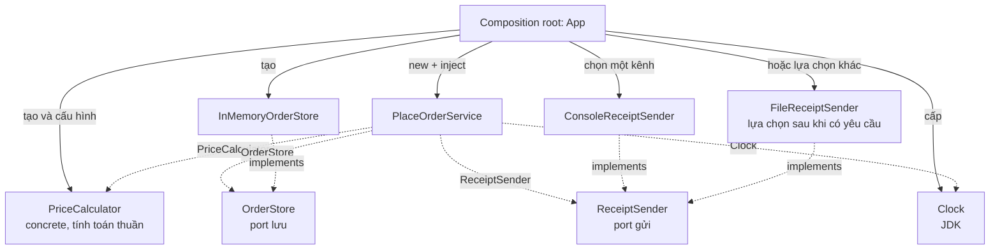

# Cân bằng khả năng mở rộng với tránh khái quát hóa sớm

## 1. Hai cực đoan thường gặp khi thiết kế DI

Một ứng dụng mới chỉ có một nơi gửi thông báo. Người viết có thể chọn một trong hai cực đoan:

- **Đóng cứng mọi thứ:** service tự `new SmtpClient()`, đọc cấu hình và mở kết nối. Khi cần đổi sang nhà cung cấp khác, phải sửa service, kéo theo nhiều test.
- **Khái quát hóa mọi thứ từ ngày đầu:** tạo `NotificationProviderFactoryRegistry`, `AbstractNotificationStrategy`, plugin loader, nhiều lớp adapter, cấu hình scope phức tạp, dù chưa có một nhu cầu thay thế cụ thể.

Cả hai đều làm tăng chi phí thay đổi. Một bên làm tương lai khó mở rộng; bên kia bắt cả đội trả chi phí của một tương lai có thể không bao giờ đến.

Trong chương **Đánh đổi thiết kế** của module **Dependency Injection (DI)**, mục tiêu là chọn **mức trừu tượng hóa vừa đủ ở hiện tại** nhưng giữ những điểm thay đổi có xác suất hoặc tác động đáng kể. Ta dùng **constructor injection**, **composition root**, kiểm thử bằng **Java thuần**, rồi mới cân nhắc DI container. Những lựa chọn ấy phục vụ **Inversion of Control (IoC)**: tách việc *sử dụng dependency* khỏi việc *chọn, tạo và lắp ghép dependency*, chứ không phải tăng số lượng interface bằng mọi giá.

Sau bài học, bạn có thể:

1. Phân biệt **khả năng mở rộng thực sự** với **khái quát hóa dựa trên giả định**.
2. Chọn đúng vị trí cần abstraction, constructor injection, factory, decorator hoặc container.
3. Giữ composition root đủ đơn giản để đọc và kiểm thử, nhưng không trộn hạ tầng vào nghiệp vụ.
4. Thiết kế theo hướng tiến hóa: bắt đầu đơn giản, thêm điểm mở rộng khi có bằng chứng.
5. Xem xét scope, ownership, concurrency và chi phí vận hành khi thêm biến thể triển khai.

## 2. “Mở rộng được” không đồng nghĩa “có nhiều lớp”

**Khả năng mở rộng (extensibility)** là năng lực đáp ứng một thay đổi dự kiến mà không buộc sửa lan rộng những phần không liên quan. Một hệ thống mở rộng tốt thường có:

- Các **hợp đồng có ý nghĩa** ổn định cho nghiệp vụ.
- Những **quyết định dễ thay đổi** được tập trung tại ranh giới thích hợp.
- Test có thể thay cộng tác viên bên ngoài mà không cần dựng toàn bộ hạ tầng.
- Rõ ràng về **scope, ownership và vòng đời** khi thay một hiện thực.

**Khái quát hóa sớm (premature generalization)** xảy ra khi ta tạo một cơ chế tổng quát trước khi hiểu đủ các biến thể thực tế. Dấu hiệu thường là rất nhiều interface chỉ có một implementation, factory chỉ trả về một class, cấu hình tùy chọn không ai dùng, hoặc một “framework nội bộ” phức tạp hơn bài toán ban đầu.

Đừng hiểu nguyên tắc **YAGNI — You Aren't Gonna Need It** là “không được tạo interface cho đến khi có hai implementation”. Có những ranh giới đáng tách ngay từ đầu, chẳng hạn **database, hệ thống thanh toán, email hoặc đồng hồ**: các cộng tác viên ấy có tác dụng bên ngoài, độc lập với luật nghiệp vụ, cần được thay bằng fake khi kiểm thử hoặc có vòng đời riêng.

Ngược lại, không phải mọi lớp thuần tính toán đều cần một interface chỉ vì đang dùng DI.

### 2.1. Phân biệt bốn loại chi phí

| Chi phí | Nếu thiết kế quá cứng | Nếu khái quát hóa quá sớm |
| --- | --- | --- |
| **Thay đổi nghiệp vụ** | Phải sửa nhiều lớp gắn với adapter cụ thể | Phải hiểu nhiều tầng ủy quyền để sửa một quy tắc |
| **Đọc và debug** | Khó tách trách nhiệm, phụ thuộc bị giấu | Khó theo dõi đường gọi qua registry/factory/strategy không cần thiết |
| **Kiểm thử** | Test chạm DB, mạng, thời gian thật | Test phải cấu hình graph lớn dù chỉ kiểm tra một phép tính |
| **Vận hành và vòng đời** | Resource bị tạo/đóng ở nhiều chỗ | Nhiều scope, wrapper và binding khiến ownership khó kiểm soát |

Vì vậy **số dòng code nhỏ nhất** cũng không phải thước đo duy nhất. Cần cân bằng chi phí hiện tại, chi phí thay đổi được dự báo hợp lý và mức độ rủi ro nếu chọn sai.

## 3. Đặt câu hỏi trước khi thêm abstraction

Một abstraction đáng tạo thường trả lời một nhu cầu đã quan sát được:

| Câu hỏi | Bằng chứng nên xem xét | Hướng thiết kế |
| --- | --- | --- |
| Chỗ này là **ranh giới hạ tầng** hay logic thuần? | Gọi DB, HTTP, file, đồng hồ, hệ thống ngoài | Cân nhắc port/interface hoặc API JDK có sẵn như `Clock` |
| Có **ít nhất hai biến thể thực sự** cần thay nhau? | Yêu cầu chọn email/SMS, adapter local/production | Giữ contract chung; chọn hiện thực tại composition root |
| Điểm thay đổi này có **lý do thay đổi độc lập**? | Một chính sách giá đổi không nên sửa vận chuyển | Tách class/cohesive collaborator có trách nhiệm riêng |
| Test cần cô lập **tác dụng bên ngoài**? | Không gọi cổng thanh toán thật, không gửi email | Inject fake qua constructor; đừng tạo hạ tầng trong service |
| Khởi tạo có **quy tắc phức tạp lặp lại**? | Nhiều resource liên quan, cấu hình, kiểm tra hợp lệ | Factory hoặc module composition có ý nghĩa |
| Có yêu cầu chọn **theo từng request**? | Tenant, kênh gửi phụ thuộc dữ liệu runtime | Router/provider theo contract; không nhầm với chọn tại startup |
| Có rủi ro vòng đời? | File stream, transaction, pool, background worker | Thiết kế ownership và scope **trước** khi thêm wrapper |

**Nguyên tắc thực dụng:** abstraction nên mô tả **khả năng hoặc trách nhiệm**, không chỉ mô tả tên class dự kiến được thay. Ví dụ `ReceiptSender` diễn tả “gửi biên nhận”; `IConsoleReceiptSenderFactoryV2` mô tả chi tiết triển khai và có thể vô ích khi chỉ cần một đối tượng.

### 3.1. Tránh lấy “có thể thay trong tương lai” làm bằng chứng duy nhất

Bất kỳ class nào cũng *có thể* được thay một ngày nào đó. Nếu lấy khả năng đó làm lý do để tạo interface cho mọi class, hệ thống sẽ xuất hiện các cặp:

```text
IPriceCalculator -> PriceCalculator
IOrderValidator -> OrderValidator
IOrderMapper -> OrderMapper
IOrderFormatter -> OrderFormatter
... và hàng chục interface một-implementation không có vai trò riêng
```

Những interface này không sai về mặt cú pháp. Vấn đề là **chi phí nhận thức tăng** mà chưa có điểm thay thế, hợp đồng ổn định hoặc nhu cầu kiểm thử tương ứng. Một class thuần, bất biến và có trách nhiệm rõ có thể được inject qua **kiểu cụ thể** mà vẫn là DI.

### 3.2. DIP không buộc mỗi class phải có interface tương ứng

**Dependency Inversion Principle (DIP)** nói về việc để chính sách cấp cao ít phụ thuộc chi tiết cấp thấp, để các bên phụ thuộc vào abstraction phù hợp. Một port cho hệ thống thanh toán là ví dụ điển hình. DIP **không** yêu cầu mọi object có một interface cùng tên chỉ để gắn nhãn “chuẩn SOLID”.

Ví dụ này vẫn sử dụng DI:

```java
final class PriceCalculator {
    long totalCents(long subtotalCents) {
        if (subtotalCents < 0) {
            throw new IllegalArgumentException("subtotal must be non-negative");
        }
        long tax = Math.multiplyExact(subtotalCents, 5) / 100;
        return Math.addExact(subtotalCents, tax);
    }
}

final class OrderService {
    private final PriceCalculator prices;

    OrderService(PriceCalculator prices) {
        this.prices = java.util.Objects.requireNonNull(prices);
    }
}
```

`PriceCalculator` là class cụ thể nhưng được cấp từ ngoài. Nếu đây là chính sách tính giá duy nhất, thuần và ổn định, chưa nhất thiết cần `PriceCalculatorInterface`. Khi có **nhiều thuật toán tính giá hợp lệ** với contract thống nhất, ta có thêm căn cứ để trích xuất `PricingPolicy` hoặc Strategy theo nghiệp vụ.

## 4. Nhận diện trừu tượng hóa sớm qua các anti-pattern

### 4.1. “Interface cho mọi class”

```java
interface IOrderIdFormatter {
    String format(String raw);
}

final class OrderIdFormatter implements IOrderIdFormatter {
    public String format(String raw) {
        return raw.trim();
    }
}
```

Interface trên **chưa chắc có ích** nếu không có nhiều biến thể, không phải ranh giới hệ thống, không cần fake và cũng không có hợp đồng độc lập với implementation. Một class thuần, không trạng thái hoặc một hàm có tên rõ có thể đơn giản hơn.

Nhưng nếu cùng hành vi định dạng có nhiều luật theo thị trường, interface có thể trở thành một điểm mở rộng thật. **Bối cảnh quyết định, không phải số lượng interface.**

### 4.2. Factory chỉ để bọc một lệnh `new`

```java
final class FormatterFactory {
    OrderIdFormatter create() {
        return new OrderIdFormatter();
    }
}
```

Đây là mã Java hợp lệ nhưng factory chưa mang lại lợi ích rõ khi một formatter thuần được tạo đơn giản tại root. Dùng factory có cơ sở hơn khi **cần chọn hiện thực theo dữ liệu hoặc cấu hình**, tạo resource ngắn hạn mỗi thao tác, hay phối hợp nhiều bước khởi tạo có invariant chung.

### 4.3. Registry và service locator che giấu dependency

```java
// Pseudocode minh họa kiểu truy cập cần tránh trong nghiệp vụ.
final class BadOrderService {
    void place(String orderId) {
        ReceiptSender sender = GlobalServices.get(ReceiptSender.class);
        // ...
    }
}
```

`GlobalServices` chưa được định nghĩa nên đoạn trên không biên dịch độc lập. Vấn đề của nó là dependency của `BadOrderService` không hiện trong constructor. Khi test, phải thiết lập trạng thái toàn cục; lỗi thiếu đăng ký có thể chỉ xuất hiện khi chạy một nhánh cụ thể. **Đưa DI container vào nghiệp vụ qua `getBean()` không tự biến thiết kế thành constructor injection.**

### 4.4. “God Dependencies” và builder che số lượng tham số

Một class nhận `Dependencies deps` chứa DB, HTTP client, logger, cache và scheduler có thể trông ngắn gọn nhưng vẫn biết mọi thứ trong hệ thống. Một builder dài cũng không tự làm giảm số trách nhiệm của service. Chỉ dùng **parameter object** nếu các tham số tạo thành **một khái niệm có nghĩa** với invariant riêng, như `RetryOptions(maxAttempts, timeoutMillis)`.

Đừng tối ưu chỉ để constructor có ít tham số. Hãy xem lại **sự gắn kết của hành vi và lý do thay đổi**. Một orchestrator nhận bốn collaborator rõ vai trò có thể hợp lý hơn “manager” nhận một registry có thể truy cập tất cả collaborator.

## 5. Thiết kế vừa đủ: hai ranh giới thật, một class tính toán thuần

Ta xây một ứng dụng đặt hàng tối giản. Yêu cầu hiện tại:

- Tính tổng với một quy tắc thuế mẫu cố định; **chưa** có nhiều chính sách giá.
- Lưu đơn qua một kho lưu (sau này có thể dùng database).
- Gửi biên nhận qua một kênh (hiện tại console, sau đó mới có yêu cầu ghi file).
- Có thể kiểm thử mà không chạm file, console hoặc thời gian thật.

Ta chọn:

1. `PriceCalculator` là **class cụ thể** thuần tính toán. Chưa tạo `PricingStrategyFactory`.
2. `OrderStore` là **port** vì việc lưu là tác dụng bên ngoài, phù hợp thay fake hoặc adapter thật.
3. `ReceiptSender` là **port** vì việc gửi là tác dụng bên ngoài và có khả năng đổi kênh.
4. `Clock` dùng abstraction **đã có trong JDK**, không cần tự thiết kế `TimeProvider`.
5. `PlaceOrderService` chỉ nhận các dependency qua constructor. `orderId`, `subtotalCents` thuộc một thao tác, được truyền vào `place(...)`.



Đồ thị này có **đúng những mối quan hệ phục vụ nhu cầu hiện tại**. Nếu mới chỉ có console, root tạo console. Khi xuất hiện yêu cầu ghi file, ta thêm adapter file và nhánh lựa chọn tại root; `PlaceOrderService` không đổi.

## 6. Ví dụ Java hoàn chỉnh theo hướng tiến hóa

Mã dưới đây minh họa **trạng thái sau khi có yêu cầu thứ hai** (console hoặc file), để nhìn rõ điểm mở rộng. Lúc bắt đầu chỉ có console, bạn có thể bỏ `FileReceiptSender` và nhánh `file` trong root mà không cần đổi business service.

Tạo file **`App.java`** với **JDK 11 trở lên**:

```java
import java.io.BufferedWriter;
import java.io.IOException;
import java.nio.charset.StandardCharsets;
import java.nio.file.Files;
import java.nio.file.Path;
import java.nio.file.StandardOpenOption;
import java.time.Clock;
import java.time.Instant;
import java.util.HashMap;
import java.util.Map;
import java.util.Objects;

// Model dữ liệu; immutable ở mức các trường.
final class Order {
    private final String id;
    private final long subtotalCents;
    private final long totalCents;
    private final Instant createdAt;

    Order(String id, long subtotalCents, long totalCents, Instant createdAt) {
        this.id = Objects.requireNonNull(id, "id");
        this.subtotalCents = subtotalCents;
        this.totalCents = totalCents;
        this.createdAt = Objects.requireNonNull(createdAt, "createdAt");
    }

    String id() { return id; }
    long subtotalCents() { return subtotalCents; }
    long totalCents() { return totalCents; }
    Instant createdAt() { return createdAt; }
}

// Không tạo interface cho một quy tắc thuần hiện chưa có biến thể.
final class PriceCalculator {
    long totalCents(long subtotalCents) {
        if (subtotalCents < 0) {
            throw new IllegalArgumentException("subtotal must be non-negative");
        }
        // Thuế mô phỏng 5%, làm tròn xuống về đơn vị cent.
        long tax = Math.multiplyExact(subtotalCents, 5) / 100;
        return Math.addExact(subtotalCents, tax);
    }
}

// Hai port có tác dụng bên ngoài: lưu và gửi biên nhận.
interface OrderStore {
    void save(Order order);
}

interface ReceiptSender {
    void send(Order order) throws IOException;
}

// Adapter đơn giản phục vụ minh họa.
final class InMemoryOrderStore implements OrderStore {
    private final Map<String, Order> saved = new HashMap<>();

    @Override
    public void save(Order order) {
        saved.put(order.id(), order);
    }

    Order find(String id) {
        return saved.get(id);
    }
}

final class ConsoleReceiptSender implements ReceiptSender {
    @Override
    public void send(Order order) {
        System.out.println(
            "RECEIPT " + order.id() + ": " + order.totalCents() + " cents");
    }
}

// Chỉ xuất hiện khi thật sự có yêu cầu thêm kênh file.
final class FileReceiptSender implements ReceiptSender, AutoCloseable {
    private final BufferedWriter writer;

    FileReceiptSender(Path path) throws IOException {
        writer = Files.newBufferedWriter(
            path,
            StandardCharsets.UTF_8,
            StandardOpenOption.CREATE,
            StandardOpenOption.APPEND
        );
    }

    @Override
    public void send(Order order) throws IOException {
        writer.write(
            "RECEIPT " + order.id() + ": " + order.totalCents() + " cents");
        writer.newLine();
    }

    @Override
    public void close() throws IOException {
        writer.close();
    }
}

// Business service không biết adapter cụ thể và không tự đọc cấu hình.
final class PlaceOrderService {
    private final PriceCalculator prices;
    private final OrderStore orders;
    private final ReceiptSender receipts;
    private final Clock clock;

    PlaceOrderService(
            PriceCalculator prices,
            OrderStore orders,
            ReceiptSender receipts,
            Clock clock) {
        this.prices = Objects.requireNonNull(prices, "prices");
        this.orders = Objects.requireNonNull(orders, "orders");
        this.receipts = Objects.requireNonNull(receipts, "receipts");
        this.clock = Objects.requireNonNull(clock, "clock");
    }

    Order place(String id, long subtotalCents) throws IOException {
        if (id == null || id.isBlank()) {
            throw new IllegalArgumentException("order id must not be blank");
        }
        long total = prices.totalCents(subtotalCents);
        Order order = new Order(id, subtotalCents, total, Instant.now(clock));

        orders.save(order);
        receipts.send(order);
        return order;
    }
}

public final class App {
    public static void main(String[] args) throws IOException {
        // Composition root: tạo graph, chọn adapter theo tham số startup.
        PriceCalculator prices = new PriceCalculator();
        OrderStore store = new InMemoryOrderStore();
        Clock clock = Clock.systemUTC();
        String mode = args.length == 0 ? "console" : args[0];

        if ("console".equals(mode)) {
            run(prices, store, new ConsoleReceiptSender(), clock);
        } else if ("file".equals(mode)) {
            // Root sở hữu FileReceiptSender; service chỉ mượn ReceiptSender.
            try (FileReceiptSender sender =
                     new FileReceiptSender(Path.of("receipts.log"))) {
                run(prices, store, sender, clock);
            }
        } else {
            throw new IllegalArgumentException("Unknown mode: " + mode);
        }
    }

    private static void run(
            PriceCalculator prices,
            OrderStore store,
            ReceiptSender sender,
            Clock clock) throws IOException {
        PlaceOrderService service =
            new PlaceOrderService(prices, store, sender, clock);
        Order order = service.place("O-100", 10_000);
        System.out.println("Created at " + order.createdAt());
    }
}
```

Chạy với Java 11+:

```bash
javac App.java
java App
java App file
```

Ở chế độ console, chương trình in một biên nhận **10.500 cents** (10.000 + thuế mẫu 5%) và thời gian tạo đơn. Ở chế độ file, nó ghi thêm biên nhận vào `receipts.log`, rồi in thời gian ra console. Thời gian thay đổi theo lúc chạy; file dùng chế độ **append**, vì vậy lần chạy sau không xóa dữ liệu cũ.

**Lưu ý giới hạn:**

- `InMemoryOrderStore` dùng `HashMap` chỉ để demo tuần tự; không được mặc định chia sẻ an toàn giữa nhiều luồng.
- Thuế làm tròn xuống ở ví dụ là quy tắc kỹ thuật minh họa, không phải quy định thuế thực tế.
- Bước `save` rồi `send` **không có tính nguyên tử**. Nếu gửi biên nhận thất bại, đơn đã được lưu. Ứng dụng thật cần quyết định rõ retry, outbox, trạng thái gửi hoặc idempotency, không thể dựa vào DI để giải quyết.
- `FileReceiptSender` không được thiết kế cho thao tác `send` và `close` đồng thời; root cần bảo đảm không còn consumer khi đóng.

### 6.1. Mức trừu tượng hóa trong ví dụ là có chủ ý

| Thành phần | Được thiết kế như vậy vì… | Chưa thêm điều gì? |
| --- | --- | --- |
| `PriceCalculator` cụ thể | Một phép tính thuần, không có biến thể hiện tại | `PriceCalculatorFactory` hoặc `TaxStrategyRegistry` |
| `OrderStore` interface | Tách use case khỏi persistence có tác dụng bên ngoài | Query DSL tổng quát, repository base class phức tạp |
| `ReceiptSender` interface | Tách kênh gửi, fake test dễ và xuất hiện biến thể thật | Plugin loader hoặc dynamic routing cho tenant |
| `Clock` của JDK | Cho phép kiểm soát thời gian trong test | Interface `CustomTimeProvider` trùng chức năng |
| `App` composition root | Lắp ghép rõ bằng vài dòng và quản lý file lifecycle | DI container chỉ để tạo bốn object |

Điều đáng chú ý: thêm `FileReceiptSender` **không làm thay đổi chữ ký** `PlaceOrderService`. Chỉ composition root có nhánh lựa chọn mới. Đây là extensibility thực tế mà không cần khung plugin tổng quát.

## 7. Kiểm thử: điểm mở rộng được kiểm chứng bằng hành vi

Một thiết kế “dễ mở rộng” cần được kiểm tra bằng việc **thay adapter mà không sửa use case**. Với constructor injection, ta có thể dùng fake thay vì file thật.

Tạo file **`AppTest.java`** cùng thư mục với `App.java`:

```java
import java.io.IOException;
import java.time.Clock;
import java.time.Instant;
import java.time.ZoneOffset;
import java.util.ArrayList;
import java.util.List;

public final class AppTest {
    public static void main(String[] args) throws IOException {
        testBusinessWithFakePorts();
        testInvalidInputDoesNotTouchPorts();
        testSendFailureIsNotSilentlyHidden();
        System.out.println("PASS");
    }

    static void testBusinessWithFakePorts() throws IOException {
        List<String> calls = new ArrayList<>();
        List<Order> saved = new ArrayList<>();
        List<Order> sent = new ArrayList<>();

        OrderStore store = order -> {
            calls.add("save:" + order.id());
            saved.add(order);
        };
        ReceiptSender sender = order -> {
            calls.add("send:" + order.id());
            sent.add(order);
        };

        Instant fixed = Instant.parse("2025-03-01T00:00:00Z");
        Clock clock = Clock.fixed(fixed, ZoneOffset.UTC);
        PlaceOrderService service = new PlaceOrderService(
            new PriceCalculator(), store, sender, clock);

        Order result = service.place("O-test", 10_000);
        check(result.totalCents() == 10_500, "wrong total");
        check(result.createdAt().equals(fixed), "wrong timestamp");
        check(saved.size() == 1 && saved.get(0) == result,
              "order not saved");
        check(sent.size() == 1 && sent.get(0) == result,
              "receipt not sent");
        check(calls.equals(List.of("save:O-test", "send:O-test")),
              "wrong call order: " + calls);
    }

    static void testInvalidInputDoesNotTouchPorts() throws IOException {
        List<String> calls = new ArrayList<>();
        OrderStore store = order -> calls.add("save");
        ReceiptSender sender = order -> calls.add("send");
        PlaceOrderService service = new PlaceOrderService(
            new PriceCalculator(), store, sender, Clock.systemUTC());

        try {
            service.place(" ", 1_000);
            throw new AssertionError("expected invalid id");
        } catch (IllegalArgumentException expected) {
            // ID rỗng được từ chối trước mọi tác dụng bên ngoài.
        }
        try {
            service.place("O-2", -1);
            throw new AssertionError("expected invalid amount");
        } catch (IllegalArgumentException expected) {
            // Giá trị âm được PriceCalculator từ chối.
        }
        check(calls.isEmpty(), "side effects happened for invalid input");
    }

    static void testSendFailureIsNotSilentlyHidden() {
        List<String> calls = new ArrayList<>();
        OrderStore store = order -> calls.add("save");
        ReceiptSender failing = order -> {
            calls.add("send");
            throw new IOException("simulated transport failure");
        };
        PlaceOrderService service = new PlaceOrderService(
            new PriceCalculator(), store, failing, Clock.systemUTC());

        try {
            service.place("O-fail", 100);
            throw new AssertionError("expected IOException");
        } catch (IOException expected) {
            check("simulated transport failure".equals(expected.getMessage()),
                  "wrong failure cause");
        }
        check(calls.equals(List.of("save", "send")),
              "unexpected failure path: " + calls);
    }

    private static void check(boolean condition, String message) {
        if (!condition) {
            throw new AssertionError(message);
        }
    }
}
```

Biên dịch và chạy:

```bash
javac App.java AppTest.java
java AppTest
```

Kết quả mong đợi:

```text
PASS
```

Các test không dùng mocking framework, file thật, DI container hoặc đồng hồ thật cho test thời gian. **Cùng một constructor** của `PlaceOrderService` được dùng ở runtime và unit test. Ta có test sự phối hợp nghiệp vụ, trong khi test adapter file thực sự có thể được viết riêng với file tạm và cleanup có kiểm soát.

**Đọc kỹ test lỗi:** khi `send` ném `IOException`, sự kiện `save` đã xảy ra trước. Test không coi đó là “thành công”, và cũng không khẳng định đã có rollback. Đây là điểm nhắc rằng khả năng thay implementation không thay thế thiết kế consistency của use case.

## 8. Thiết kế tiến hóa qua ba mốc yêu cầu

Một cách chống khái quát hóa sớm là **ghi nhận điều kiện sẽ kích hoạt việc mở rộng**, thay vì xây trước mọi khả năng.

### Mốc A — Chỉ có console

Nếu ứng dụng còn ở giai đoạn học hoặc prototype nhỏ:

```java
PriceCalculator prices = new PriceCalculator();
OrderStore store = new InMemoryOrderStore();
ReceiptSender sender = new ConsoleReceiptSender();
PlaceOrderService service =
    new PlaceOrderService(prices, store, sender, Clock.systemUTC());
```

Đây là DI thủ công. Các port phản ánh ranh giới có tác dụng bên ngoài, nhưng chưa có factory, profile hay container.

### Mốc B — Có yêu cầu chạy với file ở một môi trường

Chỉ cần thêm `FileReceiptSender` và đưa quyết định chọn kênh vào root như phần 6. Cần xem xét **tạo/đóng file writer**, vì implementation mới mang tài nguyên mà console không có. Về mặt hành vi, `PlaceOrderService` không đổi.

**Điểm cần cảnh giác:** đừng đọc `mode` trong mỗi lần `place` rồi `new FileReceiptSender` cho từng đơn nếu yêu cầu thực là chọn kênh một lần lúc khởi động. Cách đó vừa giấu lựa chọn vừa làm mở/đóng file không cần thiết.

### Mốc C — Sản phẩm cần chọn kênh theo từng tenant

Đến đây, chuỗi `if/else` tại startup **không còn đủ** vì lựa chọn thay đổi theo mỗi lần xử lý. Đây là bằng chứng thực tế để tạo một **router hoặc factory có contract rõ ràng**, chẳng hạn:

```java
// Phác thảo API khi thật sự có nhu cầu multi-tenant.
interface TenantReceiptRouter {
    ReceiptSender senderFor(String tenantId);
}
```

Phải quyết định ai sở hữu các sender trả về, chúng có được cache hay không, có cần đóng, và lúc nào tenant configuration có hiệu lực. Nếu một tenant bị thay provider trong lúc còn request đang gửi, cần cơ chế chuyển đổi an toàn. **Không xây những cơ chế ấy ở mốc A chỉ vì tưởng tượng về multi-tenant.**

Khi có nhiều triển khai phức tạp và việc lắp ghép bị lặp lại, có thể tiếp tục dùng **factory** hoặc chuyển sang **DI container**. Nhưng consumer vẫn nên khai báo dependency bằng constructor; không nhất thiết tự gọi registry hoặc bean context trong nghiệp vụ.

### 8.1. Bảng quyết định khi xuất hiện yêu cầu mới

| Yêu cầu mới | Can thiệp tối thiểu trước | Chỉ mở rộng hơn khi… |
| --- | --- | --- |
| Đổi đường dẫn file tại deploy | Cấu hình ở composition root | Cần reload mà không restart |
| Thêm một sender thứ hai khi startup | Adapter mới + nhánh chọn ở root | Có nhiều adapter, khởi tạo lặp lại |
| Cần hai thuật toán thuế theo thị trường | Xác định contract `TaxPolicy` theo nghiệp vụ | Logic chọn chính sách phức tạp/động |
| Cần ghi metrics quanh sender | Decorator inject cùng `ReceiptSender` | Nhiều lớp bọc cần hệ thống config tự động |
| Tạo một stream mỗi request | Inject factory mở stream, caller sở hữu resource | Có nhiều loại resource hoặc pooling phức tạp |
| Cần hỗ trợ nhiều tenant đồng thời | Router/factory theo tenant | Cần hot reload, cache, lifecycle per tenant |
| Object graph lớn khó lắp ghép | Tách composition root theo module | Framework DI thật sự giảm chi phí bảo trì |

## 9. So sánh lựa chọn thiết kế bằng chi phí thay đổi

Thay vì hỏi “có dùng pattern không?”, hãy hỏi: **Nếu thay đổi đã biết xuất hiện, những nơi nào cần sửa và kiểm thử lại?**

```text
Thiết kế A (đóng cứng):
  OrderService tự new ConsoleReceiptSender
  -> muốn thêm file: sửa OrderService + test nghiệp vụ

Thiết kế B (vừa đủ):
  OrderService nhận ReceiptSender
  -> muốn thêm file: thêm FileReceiptSender + đổi composition root

Thiết kế C (quá sớm):
  Registry -> ProviderResolver -> Factory -> AbstractPlugin -> Sender
  -> ngay cả console: cần cấu hình và hiểu nhiều tầng chưa có nhu cầu
```

**Thiết kế B** có thể tăng một interface và vài dòng wiring so với A, nhưng tạo ranh giới thay đổi quan trọng. C thường không mang lại lợi ích tương ứng khi chỉ có hai kênh cố định theo startup.

Một phép so sánh định tính:

```text
Tổng chi phí kỳ vọng ≈
  chi phí triển khai hiện tại
  + chi phí duy trì và học kiến trúc
  + chi phí thay đổi có khả năng xảy ra
  + rủi ro sai vòng đời/hành vi
```

Đây **không phải công thức định lượng**. Nó là cách nhắc đội ngũ đưa cả “phần phải trả từ hôm nay” lẫn “phần có thể phải trả sau này” vào quyết định. Việc dự báo không chắc chắn; hãy dựa trên yêu cầu cụ thể, lịch sử thay đổi và khả năng refactor có test bảo vệ.

### 9.1. Đừng tối ưu cho mọi tương lai

Khi yêu cầu chưa rõ, thiết kế nên làm cho **refactor về sau rẻ**: tách I/O khỏi luật nghiệp vụ, giữ constructor tường minh, test hành vi quan trọng, tránh static mutable state và biến cấu hình rải rác. Việc đó khác với **triển khai sẵn framework plugin** cho kịch bản chưa được xác nhận.

Một lớp thuần nhỏ có thể được trích xuất interface sau khi yêu cầu thứ hai xuất hiện; Java cho phép đổi kiểu dependency ở root và consumer với phạm vi khá hẹp nếu các trách nhiệm đã được phân chia tốt.

## 10. Giới hạn thực tế: scope, ownership và concurrency

Khả năng thay adapter chỉ bền vững khi **vòng đời dependency được giữ đúng**.

### 10.1. Một implementation mới có thể mang tài nguyên mới

`ConsoleReceiptSender` không sở hữu file phải đóng. `FileReceiptSender` sở hữu `BufferedWriter` và triển khai `AutoCloseable`. Khi chọn file, **composition root** tạo và đóng resource trong `try-with-resources` sau khi service dùng xong.

`PlaceOrderService` nhận `ReceiptSender` chỉ để sử dụng; interface này không có `close()` nên service không tự đóng dependency dùng chung. Nhưng nếu sau này root chọn một HTTP client có connection pool, phải xem hợp đồng đóng thật của client, không tự suy từ type chung.

**Không nên xây một `ClosableEverything` interface chung** chỉ để mọi adapter trông giống nhau nếu consumer không cần quyền đóng. Quyền đóng thường là trách nhiệm của owner, không phải thao tác nghiệp vụ.

### 10.2. Scope của dependency phải bao trùm consumer

Nếu service là singleton sống suốt ứng dụng, không inject trực tiếp một stream thuộc một lần request. Muốn mở stream mới cho từng thao tác, có thể inject một factory có hợp đồng:

```java
interface InputFactory {
    // Mỗi open() trả stream mới; bên gọi sở hữu và phải đóng.
    java.io.InputStream open() throws java.io.IOException;
}

final class ImportService {
    private final InputFactory inputs;

    ImportService(InputFactory inputs) {
        this.inputs = java.util.Objects.requireNonNull(inputs);
    }

    long countBytes() throws java.io.IOException {
        try (java.io.InputStream stream = inputs.open()) {
            long count = 0;
            while (stream.read() != -1) {
                count++;
            }
            return count;
        }
    }
}
```

Ở đây **factory được inject** là dependency ổn định; **stream trả về** là tài nguyên sống ngắn do từng lời gọi sở hữu. Đây là một ví dụ factory có **lý do tồn tại rõ**, không phải factory chỉ để bọc `new` một đối tượng thuần.

### 10.3. Chia sẻ instance cần xét thread safety

Root có thể inject cùng một sender cho nhiều service hoặc nhiều luồng. `final` ở trường constructor chỉ ngăn gán lại tham chiếu, không khiến adapter có mutable state tự thread-safe. `BufferedWriter` trong ví dụ không được thiết kế để ghi đồng thời từ nhiều luồng và đóng khi đang ghi. Nếu dùng chung ở server, cần serialization, queue hoặc implementation có hợp đồng concurrency phù hợp.

**Yêu cầu concurrent throughput thực** là bằng chứng để đầu tư vào các cơ chế đó. Không cần tự xây một concurrent message bus tổng quát từ ngày đầu, nhưng cũng không được coi ví dụ tuần tự là production-ready.

## 11. Khi nào DI container là đánh đổi hợp lý?

DI container giúp đăng ký, tìm, tạo và quản lý object graph, đặc biệt khi có:

- Nhiều module và hàng trăm component cần cấu hình nhất quán.
- Profile, qualifier, conditional binding hoặc những biến thể đã xuất hiện thật.
- Scope/lifecycle bean mà đội ngũ đã hiểu và có nhu cầu tự động hóa.
- Các tích hợp framework (HTTP endpoints, transactions, security, messaging) được dự án sử dụng.

Tuy nhiên, container cũng thêm chi phí: convention/annotation, thứ tự khởi tạo, lỗi missing/ambiguous binding, lifecycle hook và chi phí test context. **Không dùng container chỉ để tránh viết vài dòng `new`** nếu Java thuần đã rõ ràng.

| Lựa chọn | Lợi ích | Chi phí/giới hạn |
| --- | --- | --- |
| **DI thủ công** | Tường minh, dễ debug, unit test nhanh, ít phụ thuộc thư viện | Root dài khi graph lớn; wiring lặp nếu không tổ chức |
| **Factory chuyên dụng** | Gom quy trình tạo có nghĩa, quản lý resource ngắn hạn | Có thêm API và hợp đồng ownership phải duy trì |
| **Module composition** | Chia wiring theo khu vực chức năng nhưng vẫn rõ root | Cần tránh biến thành service locator toàn cục |
| **DI container** | Tự động phân giải graph, scope và nhiều hình thức cấu hình | Thêm lifecycle/annotation/configuration test và quy tắc framework |

**Đừng để quyết định dùng container làm đảo ngược DIP.** Khi dùng Spring hoặc framework khác, một business service vẫn có thể chỉ nhận `OrderStore`, `ReceiptSender` và `Clock` qua constructor. Container nằm ở ranh giới cấu hình; không cần truyền `ApplicationContext` vào mọi service.

## 12. Quy trình thực dụng khi quyết định trừu tượng hóa

Một quy trình review có thể thực hiện trong một buổi thảo luận ngắn:

1. **Viết nhu cầu hiện tại bằng lời.** “Khi deploy ở môi trường B, ghi receipt ra file thay vì console”, không phải “chúng ta cần kiến trúc provider tương lai”.
2. **Khoanh vùng chỗ biến đổi.** Kênh gửi thuộc adapter; luật tính thuế chưa thay.
3. **Chọn hợp đồng nhỏ nhất vẫn có ý nghĩa.** `ReceiptSender.send(Order)` thay vì một API plugin đa năng.
4. **Lắp ghép ở composition root.** Quyết định chọn bean/adapter phải hiện rõ và được kiểm tra khi khởi động.
5. **Viết test bảo toàn hành vi.** Thay fake sender, xác minh save/send/thời gian mà không chạy hạ tầng thật.
6. **Đánh giá scope và resource.** Adapter mới có `close()` không? Root có đóng đúng thời điểm không?
7. **Ghi lại trigger mở rộng tiếp.** Chỉ tạo router khi có lựa chọn theo tenant, chỉ thêm container khi wiring có vấn đề thực.
8. **Refactor khi xuất hiện bằng chứng.** Dọn API không còn dùng; đừng duy trì abstraction tưởng tượng để “phòng xa”.

### 12.1. Một quyết định kiến trúc ngắn có thể ghi thế nào?

```text
Quyết định: ReceiptSender là port do OrderService nhận qua constructor.
Hiện tại: root dùng ConsoleReceiptSender.
Lý do: gửi receipt là I/O có thể thay và test phải cô lập được.
Không làm lúc này: plugin registry, hot reload, routing theo tenant.
Điều kiện xem xét lại: có yêu cầu nhiều kênh trong cùng một tiến trình.
Rủi ro: nếu thêm adapter có tài nguyên, owner phải quản lý close/shutdown.
```

Đây là ví dụ về tài liệu quyết định, không cần thêm tệp vào project cho bài học. Một ghi chú như vậy giúp đồng nghiệp hiểu **vì sao chưa tạo các cơ chế tổng quát**, thay vì nghĩ rằng đội ngũ đã bỏ sót khả năng mở rộng.

## 13. Những sai lầm thường gặp

| Dấu hiệu | Hệ quả | Hướng cân bằng |
| --- | --- | --- |
| “Mỗi class phải có một interface” | Tăng điều hướng và tên không mang thêm ý nghĩa | Đặt interface tại ranh giới thay đổi thật |
| “Chưa có hai implementation thì cấm interface” | Gắn business vào database/network thật | Xét external boundary và nhu cầu kiểm thử |
| Factory chỉ trả về một object thuần | Thêm tầng không cần thiết | `new` trực tiếp ở root khi đã đủ rõ |
| Registry toàn cục được gọi từ service | Dependency ẩn, khó test, lỗi runtime muộn | Constructor injection và root tường minh |
| Builder chứa tất cả service chỉ để giảm tham số | Che class đang làm quá nhiều việc | Tách trách nhiệm cohesive thay vì đổi cú pháp |
| Thêm plugin loader vì “sẽ có nhiều provider” | Cần duy trì hệ thống config/version/lifecycle khi chưa có nhu cầu | Bắt đầu bằng interface nhỏ và wiring thủ công |
| Hard-code adapter ngay trong use case | Mỗi lần thay kênh phải sửa nghiệp vụ | Inject port và chọn adapter ở root |
| Dùng DI container như service locator | Business phụ thuộc trực tiếp framework | Để container tạo graph ở boundary |
| Đổi implementation mà bỏ qua `close()` | Double close/use-after-close hoặc rò resource | Owner rõ, scope phù hợp |
| Dự đoán tất cả biến thể nhưng không test hành vi | API nhiều tầng, logic thực vẫn dễ lỗi | Test một use case thực trước khi thêm extension point |
| Thêm nhiều abstraction khi bug thực là consistency | Không giải quyết side effect đã xảy ra | Thiết kế transaction/idempotency riêng |
| Chuyển điều kiện startup vào mỗi request | Khó tái lập hành vi, tài nguyên tạo liên tục | Phân biệt lựa chọn startup và runtime |

## 14. Bài tập thực hành

**Bài 1 — Interface nào đáng giữ?** Một `UserService` có `EmailClient` gọi API thật, `NameNormalizer` chỉ trim/lowercase và `Clock`. Hãy chọn dependency nào cần abstraction riêng ngay lúc này.

*Gợi ý:* API email là external boundary đáng tách; normalizer thuần có thể giữ class cụ thể. `Clock` đã là abstraction của JDK, không cần interface tự chế.

**Bài 2 — Refactor tăng trưởng từng bước.** Từ `PlaceOrderService` ở mục 6, sản phẩm muốn thêm `SmsReceiptSender` được chọn lúc startup. Những file/lớp nào phải thay? Những phần nào không nên sửa?

*Gợi ý:* thêm implementation của `ReceiptSender` và cấu hình ở root; contract của `PlaceOrderService` và phần tính giá không đổi.

**Bài 3 — Khi nào cần factory?** Một ứng dụng hiện tại luôn dùng một `PriceCalculator` bất biến. Đồng nghiệp đề nghị `PriceCalculatorFactory` có ba tầng kế thừa. Hãy xác định hai điều kiện cụ thể sẽ khiến factory trở nên đáng giá.

*Gợi ý:* tạo nhiều loại calculator theo thông tin runtime có contract rõ, hoặc việc khởi tạo thật sự phức tạp/lặp lại và có invariant. Chỉ “có thể đổi giá sau này” chưa đủ.

**Bài 4 — Builder hay tách class?** Một `AccountManager` cần repository, email sender, fraud gateway, invoice client, audit, scheduler và file writer. Đề xuất cách đánh giá liệu lớp có gánh quá nhiều trách nhiệm trước khi chuyển sang builder.

*Gợi ý:* vẽ ma trận dependency theo phương thức/use case, xác định lý do thay đổi độc lập và scope của resource. Builder có thể làm constructor ngắn mà không giảm coupling.

**Bài 5 — Hai loại thời gian sống.** `ImportService` sống toàn ứng dụng nhưng mỗi lần import cần một `InputStream` mới. Dùng singleton stream, factory hay truyền stream trực tiếp? Ai đóng?

*Gợi ý:* stream nên thuộc thao tác; có thể inject factory với hợp đồng mỗi `open()` trả stream mới do bên gọi sở hữu, hoặc nhận stream từ caller cùng hợp đồng ownership tường minh.

**Bài 6 — Phân tích test.** Dựa trên `AppTest`, một fake `ReceiptSender` ném `IOException` sau khi `OrderStore.save` thành công. Test này chứng minh điều gì và không chứng minh điều gì?

*Gợi ý:* chứng minh thứ tự và truyền lỗi; không chứng minh rollback. Xác định yêu cầu retry/outbox/idempotency trước khi gọi toàn bộ workflow lại.

**Bài 7 — Chi phí thay đổi.** So sánh ba cách: service tự `new`, constructor injection + root, và plugin registry tổng quát. Khi có một kênh console và một yêu cầu file cố định, cách nào dễ giải thích, kiểm thử và vận hành nhất?

*Gợi ý:* cân bằng chi phí hiện tại với thay đổi đã có; tránh đánh giá bằng số class hoặc số dòng duy nhất.

## 15. Checklist khi code review

1. **Chỗ biến đổi đã có bằng chứng chưa?** Yêu cầu sản phẩm, hai adapter thật, external boundary, hay chỉ giả định?
2. **Abstraction có diễn tả một khả năng ổn định?** Hay chỉ sao chép tên của implementation?
3. **Constructor có công khai dependency bắt buộc không?** Có service locator hoặc `new` hạ tầng trong nghiệp vụ?
4. **Có class thuần nào đang bị ép thành interface không cần thiết?** Có thể inject class cụ thể thay vì tạo hệ phân cấp?
5. **Cấu hình lựa chọn nằm đúng nơi chưa?** Composition root chọn tại startup, router/factory chỉ khi cần runtime?
6. **Vòng đời có phù hợp không?** Adapter mới có file, socket, pool hoặc request scope cần quản lý khác?
7. **Test có tập trung vào hành vi?** Dùng fake qua constructor và test lỗi thay vì dựa vào framework?
8. **Có thể mô tả chi phí bảo trì của abstraction mới không?** Ai cấu hình, debug, version và dọn nó?
9. **Thay đổi đã biết làm sửa bao nhiêu chỗ?** Tách được business service khỏi adapter mà không tăng graph vô ích?
10. **Có điều kiện xem xét lại rõ ràng không?** Đội ngũ biết khi nào cần thêm factory, Strategy, decorator hoặc DI container?

## 16. Tổng kết

**Thiết kế DI tốt không cố dự đoán mọi biến thể tương lai.** Nó làm dependency bắt buộc hiện rõ, đặt việc tạo và lắp ghép tại **composition root**, và xây những abstraction **vừa đủ** quanh ranh giới thay đổi có ý nghĩa. Một interface cho cổng I/O có thể rất đáng giá; một interface cho mọi phép tính thuần thường chưa cần.

Hãy bắt đầu bằng **constructor injection và Java thuần**, viết test để bảo vệ hành vi, rồi thêm adapter, factory, Strategy, decorator hoặc DI container **khi yêu cầu thật cung cấp lý do**. Khi mở rộng, luôn xem lại **scope, ownership, thread safety và failure semantics**: khả năng thay implementation không được đánh đổi lấy resource bị đóng sớm, side effect trùng lặp hoặc cấu hình khó kiểm soát.

Mục tiêu không phải có nhiều tầng trừu tượng nhất, mà là **thay đổi đúng chỗ với chi phí và rủi ro hợp lý**—giữ hệ thống đủ đơn giản để hiểu hôm nay và đủ linh hoạt để phát triển khi nhu cầu được xác nhận.
