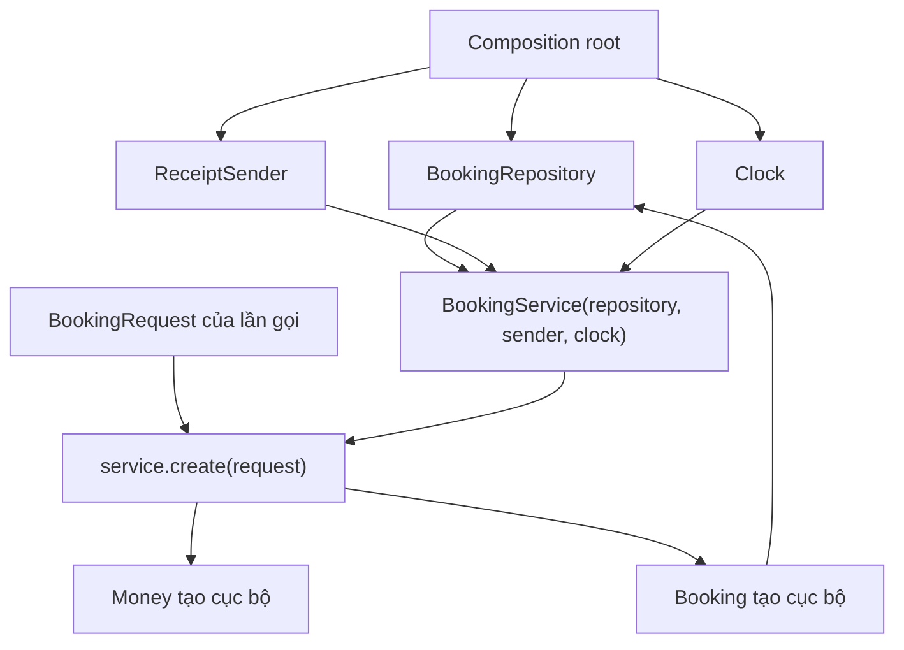

# Không cần tiêm mọi giá trị, đối tượng dữ liệu hoặc thao tác tạo cục bộ

**Dependency Injection (DI)** không có nghĩa mọi lệnh `new` đều sai, mọi tham số đều phải do container cung cấp, hay mỗi lớp dữ liệu đều cần một interface và một factory. Mục tiêu của DI là **tách việc sử dụng cộng tác viên khỏi quyết định tạo và lắp ghép các cộng tác viên đó** khi sự tách biệt tạo ra lợi ích thực tế: dễ thay implementation, kiểm thử, quản lý cấu hình hoặc kiểm soát vòng đời.

Trong một ứng dụng đặt chỗ, `BookingService` có thể cần được inject `BookingRepository` để lưu dữ liệu, `ReceiptSender` để gửi thông báo và `Clock` để kiểm soát nguồn thời gian. Nhưng `BookingRequest` của từng yêu cầu, `Money` tính từ giá tiền, `Booking` mới tạo hoặc `StringBuilder` tạm dùng trong một phương thức **không nhất thiết phải inject**. Những giá trị này thường được truyền theo lời gọi hoặc tạo cục bộ, gần nơi chúng được sử dụng.

Bài thuộc chương **Đánh đổi thiết kế** của nội dung **Dependency Injection và Inversion of Control (IoC)**. Ta sẽ xây dựng tiêu chí phân biệt *phụ thuộc hành vi/hạ tầng* với *giá trị dữ liệu*, xem khi nào `new` là lựa chọn đúng, khi nào nên dùng factory/provider, thực hành constructor injection và composition root bằng Java thuần, rồi đánh giá chi phí của việc áp dụng DI quá mức trước khi chuyển sang DI container.

## 1. DI là phương tiện quản lý phụ thuộc, không phải lệnh cấm `new`

Xét hai tình huống:

```java
// Một cộng tác viên hạ tầng được service tự tạo:
BookingRepository repository = new JdbcBookingRepository(/* cấu hình DB */);

// Một giá trị nghiệp vụ mới được tạo từ dữ liệu vừa nhận:
Money total = Money.ofCents(unitPriceCents).multiply(nights);
```

Ở tình huống đầu, nếu lệnh tạo repository nằm **bên trong `BookingService`**, service sẽ biết chi tiết công nghệ lưu trữ, cấu hình và cách khởi tạo tài nguyên. Đưa quyết định này về **composition root**, rồi truyền `BookingRepository` qua constructor, thường làm ranh giới kiến trúc rõ hơn.

Ở tình huống sau, `Money` là **giá trị** được tính từ tham số của lần xử lý hiện tại. Tạo nó ngay ở nơi thực hiện phép tính thường hợp lý hơn việc yêu cầu composition root khởi tạo sẵn một `Money` cho mọi request. Đối tượng dữ liệu có thể phải được tạo lại hàng nghìn lần với những giá trị khác nhau; bản thân hành động tạo đó không nhất thiết là một phụ thuộc cần thay thế.

Tiêu chí không phải “có dùng `new` hay không”, mà là:

- Thành phần được tạo là **cộng tác viên có hành vi và chính sách riêng**, hay là **giá trị của thao tác hiện tại**?
- Quyết định tạo có phụ thuộc **môi trường, tài nguyên, scope, chiến lược hoặc nguồn không xác định** mà caller nên kiểm soát không?
- Việc tách cách tạo có làm **test và hợp đồng rõ hơn** hay chỉ thêm một lớp trung gian?
- Ai sở hữu object và khi nào cần giải phóng tài nguyên?

**IoC không yêu cầu đảo quyền tạo ra mọi object trong chương trình.** Nó hữu ích nhất ở các biên mà quyền quyết định implementation và vòng đời nên thuộc về nơi lắp ghép.

## 2. Phân loại thứ đang được truyền hoặc tạo

| Loại | Ví dụ | Cách thường phù hợp | Vì sao |
| --- | --- | --- | --- |
| **Cộng tác viên hạ tầng** | `BookingRepository`, `PaymentGateway`, `EmailClient` | Inject qua constructor | Có lựa chọn implementation, cấu hình, side effect hoặc vòng đời riêng |
| **Cộng tác viên hành vi/chính sách** | `TaxPolicy`, `DiscountPolicy`, `FraudChecker` | Inject khi cần thay chính sách hoặc kiểm thử hành vi | Service phụ thuộc một quy tắc có thể thay đổi độc lập |
| **Nguồn không xác định tại runtime** | `Clock`, `IdGenerator`, nguồn random | Inject khi kết quả cần kiểm soát hoặc giả lập | Tránh thời gian/ID ngẫu nhiên khiến test khó lặp lại |
| **Dữ liệu của request** | `bookingId`, `BookingRequest`, `actorId` | Tham số phương thức | Giá trị thay đổi theo từng yêu cầu; không thuộc trạng thái của singleton |
| **Value object/domain object** | `Money`, `Booking`, `DateRange` | Tạo cục bộ hoặc qua constructor/factory method của domain | Mang dữ liệu và bất biến của lần xử lý; không cần container |
| **Đối tượng tạm thuần kỹ thuật** | `StringBuilder`, `ArrayList` trong phương thức | Tạo cục bộ | Rẻ, không có chính sách hạ tầng cần thay thế |
| **Cấu hình ổn định** | Timeout, giới hạn nghiệp vụ, đường dẫn | Parse ở rìa và inject vào thành phần thực sự cần | Phân biệt cấu hình triển khai với input từng request |
| **Đối tượng tạo động phức tạp** | Export session có resource, renderer theo format | Factory/provider có kiểu rõ ràng khi có nhu cầu | Cần chọn biến thể, điều phối tạo hoặc quản lý ownership |

Đây là các **gợi ý lựa chọn**, không phải quy tắc bất biến. Một `Money` có thể được truyền từ caller thay vì tạo trong service nếu nó đã tồn tại. Một `TaxPolicy` cũng có thể là hàm thuần đơn giản được gọi trực tiếp nếu không có nhu cầu hoán đổi. Cần xét **ngữ cảnh và trách nhiệm**, không biến tên class thành tiêu chí duy nhất.

## 3. Hai câu hỏi dễ bị nhầm: “phụ thuộc” và “cần inject”

Mọi phương thức đều **phụ thuộc vào kiểu dữ liệu, thư viện chuẩn hoặc phép tính** theo một nghĩa rộng. Nhưng không phải mọi loại phụ thuộc ấy là **dependency để container cấp**.

```java
final class BookingService {
    private final BookingRepository repository;

    BookingService(BookingRepository repository) {
        this.repository = repository;
    }

    void create(BookingRequest request) {
        Money amount = Money.ofCents(request.unitPriceCents());
        // ...
    }
}
```

`BookingService` có ba quan hệ khác nhau:

1. **Nhận cộng tác viên** `BookingRepository` qua constructor để sử dụng lâu dài.
2. **Nhận input** `BookingRequest` qua phương thức mỗi khi có request.
3. **Tạo một giá trị** `Money` cục bộ từ input.

Chuyển tất cả chúng vào constructor sẽ làm sai ý nghĩa vòng đời: service được tạo một lần nhưng request và số tiền thay đổi mỗi lần gọi. Một constructor dài hàng chục tham số không nhất thiết là thiết kế DI tốt; điều quan trọng là các tham số thể hiện **những thứ thực sự phải có khi khởi tạo đối tượng đó**.



Sơ đồ phân biệt **đường lắp ghép các cộng tác viên ổn định** với **đường dữ liệu đi qua thao tác nghiệp vụ**. `Money` và `Booking` vẫn là các kiểu nghiệp vụ có ý nghĩa, nhưng chúng không cần được tạo ở composition root.

## 4. Anti-pattern: “inject everything”

Thiết kế sau biến dữ liệu request thành phụ thuộc của một service có vòng đời dài:

```java
// Minh họa anti-pattern, không phải class chạy được trong ví dụ phía dưới.
final class OverInjectedBookingService {
    private final BookingRepository repository;
    private final BookingRequest request;
    private final Money total;
    private final Booking draftBooking;

    OverInjectedBookingService(
            BookingRepository repository,
            BookingRequest request,
            Money total,
            Booking draftBooking) {
        this.repository = repository;
        this.request = request;
        this.total = total;
        this.draftBooking = draftBooking;
    }
}
```

Vì sao có vấn đề?

- Service bị **gắn với một request** cụ thể ngay khi tạo. Nếu dùng chung instance cho request sau, dữ liệu có thể bị cũ hoặc sai.
- Caller phải tạo trước cả `Money` và `Booking`, dù những giá trị này thuộc logic tạo booking.
- Constructor phải nhận những giá trị có thể **suy ra từ nhau**; khả năng truyền `request` của booking A cùng `total` của booking B làm xuất hiện trạng thái không nhất quán.
- Composition root bị kéo vào các chi tiết nghiệp vụ thay vì chỉ lắp ghép cộng tác viên.
- Unit test trở nên dài: phải dựng nhiều object chỉ để kiểm tra một hành vi đơn giản.

Hướng sửa không phải xóa mọi constructor. Hãy giữ constructor cho **cộng tác viên cần thiết**, còn input và giá trị tính ra thuộc **phương thức nghiệp vụ hoặc domain object phù hợp**.

## 5. Ví dụ Java thuần: inject đúng chỗ, tạo cục bộ đúng chỗ

Ta xây dựng một ứng dụng đặt chỗ đơn giản:

- `BookingService` nhận `BookingRepository`, `ReceiptSender` và `Clock` qua constructor.
- `BookingRequest` là dữ liệu đầu vào của **mỗi lần gọi**.
- `Money` là value object bất biến, tính tổng bằng phép nhân có kiểm tra tràn số.
- `Booking` được tạo cục bộ từ request, tổng tiền và thời gian.
- Composition root ở `main` chỉ tạo các **cộng tác viên dùng chung**.

Tạo file `SelectiveDiDemo.java` trong một thư mục riêng cho ví dụ:

```java
import java.time.Clock;
import java.time.Instant;
import java.util.HashMap;
import java.util.Map;
import java.util.Objects;

final class BookingRequest {
    private final String bookingId;
    private final long nightlyPriceCents;
    private final int nights;

    BookingRequest(String bookingId, long nightlyPriceCents, int nights) {
        if (bookingId == null || !bookingId.matches("[A-Za-z0-9-]+")) {
            throw new IllegalArgumentException("bookingId khong hop le");
        }
        if (nightlyPriceCents < 0) {
            throw new IllegalArgumentException("Gia khong duoc am");
        }
        if (nights <= 0) {
            throw new IllegalArgumentException("nights phai duong");
        }
        this.bookingId = bookingId;
        this.nightlyPriceCents = nightlyPriceCents;
        this.nights = nights;
    }

    String bookingId() {
        return bookingId;
    }

    long nightlyPriceCents() {
        return nightlyPriceCents;
    }

    int nights() {
        return nights;
    }
}

final class Money {
    private final long cents;

    private Money(long cents) {
        if (cents < 0) {
            throw new IllegalArgumentException("Money phai >= 0");
        }
        this.cents = cents;
    }

    static Money ofCents(long cents) {
        return new Money(cents);
    }

    Money multiply(int quantity) {
        if (quantity <= 0) {
            throw new IllegalArgumentException("quantity phai duong");
        }
        // Tra loi ro rang neu tong khong bieu dien duoc bang long.
        return new Money(Math.multiplyExact(cents, quantity));
    }

    long cents() {
        return cents;
    }
}

final class Booking {
    private final String id;
    private final Money total;
    private final Instant createdAt;

    Booking(String id, Money total, Instant createdAt) {
        if (id == null || !id.matches("[A-Za-z0-9-]+")) {
            throw new IllegalArgumentException("id khong hop le");
        }
        this.id = id;
        this.total = Objects.requireNonNull(total, "total");
        this.createdAt = Objects.requireNonNull(createdAt, "createdAt");
    }

    String id() {
        return id;
    }

    Money total() {
        return total;
    }

    Instant createdAt() {
        return createdAt;
    }
}

interface BookingRepository {
    void save(Booking booking);
    Booking findById(String bookingId);
}

final class InMemoryBookingRepository implements BookingRepository {
    // Vi du chay tuan tu, khong mac dinh an toan nhieu luong.
    private final Map<String, Booking> data = new HashMap<>();

    @Override
    public void save(Booking booking) {
        Objects.requireNonNull(booking, "booking");
        if (data.putIfAbsent(booking.id(), booking) != null) {
            throw new IllegalStateException("Booking ID da ton tai");
        }
    }

    @Override
    public Booking findById(String bookingId) {
        return data.get(bookingId);
    }
}

interface ReceiptSender {
    void send(Booking booking);
}

final class ConsoleReceiptSender implements ReceiptSender {
    @Override
    public void send(Booking booking) {
        System.out.println("RECEIPT " + booking.id()
            + " totalCents=" + booking.total().cents());
    }
}

final class BookingService {
    private final BookingRepository repository;
    private final ReceiptSender sender;
    private final Clock clock;

    BookingService(BookingRepository repository,
                   ReceiptSender sender, Clock clock) {
        this.repository = Objects.requireNonNull(repository, "repository");
        this.sender = Objects.requireNonNull(sender, "sender");
        this.clock = Objects.requireNonNull(clock, "clock");
    }

    Booking create(BookingRequest request) {
        Objects.requireNonNull(request, "request");

        // Gia tri cho lan xu ly nay: khong can inject.
        Money nightlyPrice = Money.ofCents(request.nightlyPriceCents());
        Money total = nightlyPrice.multiply(request.nights());
        Booking booking = new Booking(
            request.bookingId(), total, clock.instant());

        // Cong tac vien hanh vi/ha tang: da duoc inject.
        repository.save(booking);
        sender.send(booking);
        return booking;
    }
}

public class SelectiveDiDemo {
    public static void main(String[] args) {
        // Composition root: lap ghep dependency on dinh mot lan.
        InMemoryBookingRepository repository =
            new InMemoryBookingRepository();
        ReceiptSender sender = new ConsoleReceiptSender();
        Clock clock = Clock.systemUTC();
        BookingService service = new BookingService(repository, sender, clock);

        // Du lieu cua request: truyen qua method, khong inject vao singleton.
        BookingRequest request = new BookingRequest("BK-101", 75000, 2);
        Booking booking = service.create(request);

        System.out.println("CREATED " + booking.id()
            + " totalCents=" + booking.total().cents());
        System.out.println("SAVED "
            + (repository.findById(booking.id()) == booking));
    }
}
```

Biên dịch và chạy với JDK 8 trở lên:

```bash
javac SelectiveDiDemo.java
java SelectiveDiDemo
```

Kết quả:

```text
RECEIPT BK-101 totalCents=150000
CREATED BK-101 totalCents=150000
SAVED true
```

Ở ví dụ này, **cùng một `BookingService`** có thể xử lý booking khác ở lần gọi tiếp theo mà không cần được khởi tạo lại. `BookingRequest`, `Money` và `Booking` đều có dữ liệu cụ thể của từng thao tác. Ngược lại, `BookingRepository` và `ReceiptSender` xác định nơi có side effect nên được cung cấp từ bên ngoài; `Clock` cũng được inject để nguồn thời gian có thể kiểm soát khi test.

### Điểm đáng chú ý trong cách chọn ranh giới

| Chi tiết trong mã | Cách xử lý | Lý do |
| --- | --- | --- |
| `new InMemoryBookingRepository()` | Ở `main` | Chọn implementation tại composition root |
| `new ConsoleReceiptSender()` | Ở `main` | Chọn tác nhân có side effect |
| `Clock.systemUTC()` | Ở `main` | Tách nguồn thời gian thực khỏi nghiệp vụ |
| `new BookingRequest(...)` | Ở phía caller của `create` | Input riêng của một yêu cầu |
| `Money.ofCents(...).multiply(...)` | Trong `create` | Phép tính giá trị cục bộ, không có side effect ngoài |
| `new Booking(...)` | Trong `create` | Tạo đối tượng nghiệp vụ từ dữ liệu đã có |
| `repository.save(...)` và `sender.send(...)` | Trong service qua interface | Tương tác với cộng tác viên đã inject |

Một object được tạo cục bộ không có nghĩa luôn phải mất đi khi method kết thúc. `Booking` được trả cho caller và giữ trong repository; vòng đời thực tế phụ thuộc vào các tham chiếu được lưu. Điều cần phân biệt là **ai chịu trách nhiệm tạo** và **đối tượng được dùng vào mục đích gì**, không chỉ dòng mã `new` xuất hiện ở đâu.

## 6. Kiểm thử: giá trị tạo cục bộ vẫn kiểm thử được

Lập luận “mọi thứ phải inject mới test được” không chính xác. Ta có thể kiểm thử phép tính `Money.multiply` và kết quả `Booking` trực tiếp. Chỉ những cộng tác viên có side effect hoặc nguồn không xác định mới cần fake hay cấu hình kiểm soát.

Tạo file `SelectiveDiDemoTest.java` cùng thư mục với file chính:

```java
import java.time.Clock;
import java.time.Instant;
import java.time.ZoneOffset;

public class SelectiveDiDemoTest {
    static final class RecordingRepository implements BookingRepository {
        Booking saved;
        int saveCount;

        @Override
        public void save(Booking booking) {
            saved = booking;
            saveCount++;
        }

        @Override
        public Booking findById(String id) {
            return saved != null && saved.id().equals(id) ? saved : null;
        }
    }

    static final class RecordingSender implements ReceiptSender {
        Booking sent;
        int sendCount;

        @Override
        public void send(Booking booking) {
            sent = booking;
            sendCount++;
        }
    }

    static final class Fixture {
        final RecordingRepository repository = new RecordingRepository();
        final RecordingSender sender = new RecordingSender();
        final Clock clock = Clock.fixed(
            Instant.parse("2026-01-01T00:00:00Z"), ZoneOffset.UTC);
        final BookingService service =
            new BookingService(repository, sender, clock);
    }

    public static void main(String[] args) {
        testLocalValueCreationWithInjectedCollaborators();
        testSameServiceHandlesDifferentRequests();
        testInvalidInputHasNoSideEffect();
        testOverflowFailsBeforeSaving();
        testRepositoryFailurePreventsSending();
        System.out.println("SelectiveDiDemoTest PASSED");
    }

    static void testLocalValueCreationWithInjectedCollaborators() {
        Fixture f = new Fixture();
        Booking result = f.service.create(
            new BookingRequest("BK-TEST", 12000, 3));

        check(result.total().cents() == 36000, "Sai tong tien");
        check(result.createdAt().equals(f.clock.instant()),
            "Khong su dung clock da inject");
        check(f.repository.saved == result, "Khong luu dung booking");
        check(f.repository.saveCount == 1, "Phai save mot lan");
        check(f.sender.sent == result, "Khong gui dung booking");
        check(f.sender.sendCount == 1, "Phai gui mot lan");
    }

    static void testSameServiceHandlesDifferentRequests() {
        Fixture f = new Fixture();
        Booking first = f.service.create(
            new BookingRequest("BK-A", 500, 2));
        Booking second = f.service.create(
            new BookingRequest("BK-B", 800, 3));

        check(first != second, "Hai request can hai Booking rieng");
        check(first.total() != second.total(),
            "Moi request co value object tong tien rieng");
        check(first.total().cents() == 1000, "Tong booking A sai");
        check(second.total().cents() == 2400, "Tong booking B sai");
        check(f.repository.saveCount == 2, "Phai save hai lan");
        check(f.sender.sendCount == 2, "Phai gui hai lan");
    }

    static void testInvalidInputHasNoSideEffect() {
        Fixture f = new Fixture();
        boolean rejected = false;
        try {
            // BookingRequest tu bao ve bat bien du lieu.
            f.service.create(new BookingRequest("BK-BAD", -1, 2));
        } catch (IllegalArgumentException expected) {
            rejected = true;
        }
        check(rejected, "Gia am phai bi tu choi");
        check(f.repository.saveCount == 0, "Khong luu gia tri sai");
        check(f.sender.sendCount == 0, "Khong gui khi du lieu sai");
    }

    static void testOverflowFailsBeforeSaving() {
        Fixture f = new Fixture();
        boolean rejected = false;
        try {
            f.service.create(
                new BookingRequest("BK-BIG", Long.MAX_VALUE, 2));
        } catch (ArithmeticException expected) {
            rejected = true;
        }
        check(rejected, "Phep nhan tran so phai bao loi");
        check(f.repository.saveCount == 0, "Khong luu khi tinh toan loi");
        check(f.sender.sendCount == 0, "Khong gui khi tinh toan loi");
    }

    static void testRepositoryFailurePreventsSending() {
        BookingRepository failing = new BookingRepository() {
            @Override
            public void save(Booking booking) {
                throw new IllegalStateException("storage failed");
            }

            @Override
            public Booking findById(String id) {
                return null;
            }
        };
        RecordingSender sender = new RecordingSender();
        BookingService service = new BookingService(failing, sender,
            Clock.fixed(Instant.EPOCH, ZoneOffset.UTC));

        boolean failed = false;
        try {
            service.create(new BookingRequest("BK-FAIL", 100, 2));
        } catch (IllegalStateException expected) {
            failed = true;
        }
        check(failed, "Loi repository phai duoc truyen len");
        check(sender.sendCount == 0,
            "Khong gui receipt khi save khong thanh cong");
    }

    static void check(boolean condition, String message) {
        if (!condition) {
            throw new AssertionError(message);
        }
    }
}
```

Chạy:

```bash
javac SelectiveDiDemo.java SelectiveDiDemoTest.java
java SelectiveDiDemoTest
```

Kết quả mong đợi:

```text
SelectiveDiDemoTest PASSED
```

Test đã kiểm tra được giá trị `Money` và `Booking` tạo bằng mã production **mà không cần mock constructor hoặc inject `MoneyFactory`**. Fake chỉ dành cho hai cộng tác viên có side effect; `Clock.fixed` cung cấp thời gian xác định. Mỗi `Fixture` tạo instance mới, tránh để số lần gọi hoặc dữ liệu từ phép thử trước ảnh hưởng đến phép thử sau.

Test còn bộc lộ một giới hạn nghiệp vụ: `repository.save` có thể thành công nhưng `sender.send` thất bại, khiến booking đã lưu mà người dùng chưa nhận biên nhận. Nếu yêu cầu bảo đảm thông báo, cần transaction/outbox, retry hoặc chính sách lỗi thích hợp. **DI không tự cung cấp tính nguyên tử** cho nhiều side effect.

## 7. Vì sao `Clock` nên inject nhưng `Instant` thường được tạo/nhận cục bộ?

So sánh:

```java
// Khó kiểm soát trong test nếu gọi trực tiếp ở nhiều nơi.
Instant createdAt = Instant.now();

// Dùng nguồn thời gian được cung cấp từ ngoài.
Instant createdAt = clock.instant();
```

`Clock` là **nguồn của sự thay đổi**: ở production nó đọc thời gian hệ thống; trong test nó có thể cố định. `Instant` là **giá trị kết quả** ở một thời điểm cụ thể. Vì vậy, inject nguồn thời gian có thể tạo một ranh giới test hữu ích, còn `Instant` của booking thường được tính ra cục bộ hoặc truyền như dữ liệu của thao tác.

Quy tắc tương tự có thể áp dụng với:

| Nguồn/hành vi nên xem xét inject | Giá trị kết quả không nhất thiết inject |
| --- | --- |
| `Clock` | `Instant`, `LocalDate` sau khi tính |
| `IdGenerator` | `String bookingId` hoặc `UUID` đã sinh |
| `ExchangeRateProvider` | Tỉ giá đã xác định cho một phép tính |
| `RandomGenerator` được kiểm soát khi test | Giá trị ngẫu nhiên đã rút ra |
| `CustomerRepository` | `Customer` được tải về hoặc tạo từ input |

Không phải ứng dụng nào cũng cần một abstraction riêng cho random hay ID. Nếu phép ngẫu nhiên không liên quan tới kết quả cần kiểm chứng và không gây side effect khó đoán, tạo thêm interface có thể không mang lợi ích. Hãy inject khi nguồn hoặc chính sách **thực sự phải được kiểm soát**.

## 8. Khi nào `new` trong service là hợp lý?

Một lệnh tạo cục bộ thường hợp lý nếu đối tượng:

- Là **dữ liệu/value object** mang giá trị của phép tính hoặc một request.
- Có constructor/nhà máy tĩnh với **bất biến rõ ràng**, không phải tài nguyên bên ngoài cần đóng.
- Không phụ thuộc môi trường hoặc không phải lựa chọn implementation hạ tầng.
- Không gây side effect mà test cần thay thế.
- Có ownership rõ, thường thuộc thao tác đang chạy hoặc được trả về/lưu có chủ đích.

Ví dụ:

```java
Money subtotal = Money.ofCents(unitPriceCents).multiply(nights);
Booking booking = new Booking(bookingId, subtotal, clock.instant());

StringBuilder message = new StringBuilder();
message.append("Booking ").append(booking.id());
```

Không có lý do thuyết phục để inject `StringBuilderFactory` chỉ nhằm tạo một buffer dùng trong một phương thức đơn giản. Cũng không cần inject mỗi `Money` vào service ở startup: giá trị tiền phụ thuộc vào mỗi request.

Tuy nhiên, `new` có thể trở thành vấn đề nếu nó che một **quyết định cần thay thế hoặc cần quản lý tài nguyên**:

```java
// Thiết kế khó thay thế nếu nằm trong service:
PaymentGateway gateway = new RealPaymentGateway(apiKey);
gateway.charge(amount);
```

Ở đây, `RealPaymentGateway` tương tác với bên ngoài, cần cấu hình, xử lý lỗi và có thể sở hữu tài nguyên. Inject `PaymentGateway` qua constructor thường phù hợp hơn.

## 9. Khi nào factory hoặc provider đáng có?

**Factory** hữu ích khi cần tạo object **theo dữ liệu chỉ có lúc chạy**, đồng thời có quy tắc tạo phức tạp, nhiều biến thể hoặc vòng đời đặc biệt. Ví dụ, mỗi request cần một export session mới tùy định dạng và phải đóng nó:

```java
// Phác thảo API; các class sau không nằm trong demo phần 5.
interface ExportSessionFactory {
    ExportSession open(ExportFormat format, String bookingId);
}

// Service dùng factory đã inject:
try (ExportSession session = factory.open(format, bookingId)) {
    session.write(content);
}
```

Factory có tên rõ theo nghiệp vụ, nhận input động tại method `open` và có thể giữ client/pool được cấp từ composition root. `ExportSession` được tạo theo thao tác, còn caller chịu trách nhiệm đóng theo hợp đồng.

Ngược lại, nếu cần mỗi lần một `Money` mới với một số cents, `Money.ofCents(cents)` **đã là factory method của value object** và thường đủ dùng. Tạo thêm interface `MoneyFactory` rồi inject nó không tự làm thiết kế tốt hơn.

Một `Supplier<T>` hoặc provider có thể thích hợp khi caller cần lấy dependency tại thời điểm sử dụng mà **không có tham số động**, hoặc khi scope/lazy creation cần được quản lý. Nhưng `get()` không cam kết luôn trả instance mới: còn tùy hợp đồng và cách cấu hình. **Provider cũng không tự làm một object trở nên thread-safe**.

| Cần gì? | Lựa chọn thường đơn giản nhất |
| --- | --- |
| Tạo value object từ dữ liệu sẵn có | Constructor/`static of(...)` |
| Dùng cộng tác viên ổn định | Constructor injection trực tiếp |
| Tạo đối tượng động nhiều biến thể theo input | Factory có kiểu rõ ràng |
| Lấy đối tượng theo scope tại thời điểm gọi | Provider/supplier được cấu hình đúng |
| Chọn adapter theo môi trường khi khởi động | Composition root |

Nếu thêm factory chỉ vì “không muốn thấy `new`”, hãy tự hỏi factory có che giấu một **quy tắc cần tách** nào không. Nếu không, nó có thể chỉ chuyển lệnh tạo sang một file khác và làm người đọc phải đi qua nhiều tầng hơn.

## 10. Over-engineering: chi phí của việc inject mọi thứ

Thiết kế quá nhiều abstraction có thể tạo ra các hệ quả:

| Chi phí | Biểu hiện | Hệ quả |
| --- | --- | --- |
| **Nhiều lớp trung gian** | `MoneyFactory`, `MoneyFactoryImpl` chỉ gọi `new Money(...)` | Điểm đọc mã bị phân tán, khó theo luồng dữ liệu |
| **Constructor phình to** | Service nhận cả giá trị request, formatter tạm và object có thể tự tính | Bất biến khởi tạo phức tạp, lẫn lifetime |
| **Test phụ thuộc mock** | Mock mọi phép tính thuần thay vì kiểm tra kết quả | Test xác minh cách gọi chi tiết, dễ vỡ khi refactor |
| **Cấu hình container quá lớn** | Bean/binding cho từng DTO và helper thuần | Tăng chi phí bootstrap và nguy cơ lỗi wiring |
| **Ranh giới không rõ nghĩa** | Một interface cho từng class dù không có vai trò cần thay | Khó tìm khác biệt có ích giữa abstraction và implementation |
| **Lỗi scope** | Object theo request bị inject vào singleton | Có nguy cơ giữ dữ liệu cũ hoặc lẫn request |

**Trừu tượng hóa có chi phí**, ngay cả khi compiler hoặc framework thực hiện được. Chi phí không chỉ là tốc độ runtime mà còn là khả năng đọc mã, số nơi phải chỉnh khi thay đổi và mức độ sai sót có thể xảy ra trong cấu hình.

Một cách đánh giá thực dụng là so sánh hai thay đổi thường gặp:

1. Nếu thay repository bộ nhớ bằng JDBC, có phải sửa logic `BookingService` không? Nếu có, DI cho repository thường đem lại giá trị.
2. Nếu đổi tên trường của `Money` hoặc thay thuật toán nhân thuần, có cần sửa composition root không? Nếu có, có thể đã **đẩy quá nhiều chi tiết cục bộ** ra ngoài.

Mục tiêu là **đặt ranh giới ở nơi dự kiến có biến thiên ý nghĩa**, không phải tối đa hóa số interface.

## 11. Không inject mọi thứ cũng không đồng nghĩa viết code “khó test”

Hãy tách ba nhu cầu kiểm thử:

**Kiểm tra phép tính thuần:** Gọi `Money.ofCents(12000).multiply(3)` rồi assert `36000`. Không cần fake `Money` hay container.

**Kiểm tra phối hợp với cộng tác viên:** Inject `RecordingRepository` và `RecordingSender` để biết service lưu và gửi đúng booking. Không cần thực sự ghi DB/gửi mạng.

**Kiểm tra wiring và adapter thật:** Thực hiện test riêng cho composition root/container (chọn đúng implementation) và integration test repository/gateway với tài nguyên thử nghiệm. Unit test với fake không chứng minh JDBC hay SMTP hoạt động.

Như vậy, **khả năng kiểm thử tốt** đến từ việc chọn đúng các ranh giới gây side effect/không xác định, chứ không phải mock mọi object. Với value object bất biến, kiểm tra kết quả thật thường đáng tin hơn mock vì tránh vô tình chỉ kiểm thử cấu hình mock.

## 12. Scope và ownership: đối tượng cục bộ không phải lúc nào cũng vô hại

`new` cục bộ rất hợp lý đối với value object, nhưng phải thận trọng nếu object vừa tạo là **resource** hoặc giữ state được chia sẻ:

```java
// Mẫu khái niệm: tài nguyên thuộc lời gọi phải có cleanup.
try (java.io.InputStream input = openInputStream()) {
    // Xử lý stream trong phạm vi này.
}
```

Ở ví dụ trên, `openInputStream()` là một hàm minh họa chưa định nghĩa. Nếu method **tự tạo và sở hữu stream**, đóng trong `try-with-resources` là hợp lý. Nếu stream được **mượn từ caller** và API yêu cầu caller đóng, method không được tự ý đóng nó. **Ownership** cần được nói rõ bằng hợp đồng, không thể suy hoàn toàn từ việc có dùng constructor injection hay không.

Tương tự:

- `new ArrayList<>()` trong phương thức thường là trạng thái cục bộ của một thao tác.
- `new HashMap<>()` trong repository dùng chung có thể là trạng thái sống suốt ứng dụng, cần đánh giá concurrency.
- `new Thread(...)` hoặc `new ExecutorService(...)` trong mỗi request có thể tốn kém và rò rỉ nếu không có chính sách dừng; executor dùng chung thường cần owner ở composition root.
- `new Connection(...)` hoặc mở socket trong nghiệp vụ không phải “local value”; đó là hạ tầng có lifecycle, cần quản lý rõ.

Quyết định đúng dựa trên **trạng thái, khả năng chia sẻ, chi phí tạo và quyền sở hữu**, không chỉ nơi xuất hiện chữ `new`.

## 13. Cấu hình ổn định khác dữ liệu của từng yêu cầu

Một trường hợp trung gian là tham số cấu hình như `maxNights`, `timeout` hoặc ngưỡng phí. Không nhất thiết phải tạo interface cho mỗi giá trị cấu hình, nhưng nên **đọc và kiểm tra cấu hình ở rìa ứng dụng** rồi truyền tới đúng thành phần cần dùng.

```java
// Minh họa cấu hình ổn định cho một policy.
final class BookingLimitPolicy {
    private final int maxNights;

    BookingLimitPolicy(int maxNights) {
        if (maxNights <= 0) {
            throw new IllegalArgumentException("maxNights phai duong");
        }
        this.maxNights = maxNights;
    }

    void validate(int nights) {
        if (nights > maxNights) {
            throw new IllegalArgumentException("Qua so dem cho phep");
        }
    }
}
```

Nếu `BookingService` sử dụng `BookingLimitPolicy` trong nhiều phương thức và chính sách cần thay đổi độc lập, inject policy có thể hợp lý. Nếu chỉ một method cần `maxNights` và quy tắc đơn giản, truyền một giá trị cấu hình đã được kiểm tra vào constructor cũng có thể đủ. **Không tự đọc `System.getenv("MAX_NIGHTS")` trong từng lời gọi nghiệp vụ** nếu cấu hình chỉ được xác định khi khởi động.

Trái lại, `BookingRequest.nights()` là dữ liệu nghiệp vụ của từng request; không nên inject nó vào singleton lúc khởi động. Hai biến cùng là `int` nhưng **khác nguồn, ý nghĩa và vòng đời**.

## 14. So sánh hai hướng thiết kế trước khi quyết định

Ví dụ một service xử lý đơn giản có thể được viết theo hai cách:

**Phương án A — Tạo giá trị trong service:**

```java
Money total = Money.ofCents(request.unitPriceCents())
    .multiply(request.nights());
repository.save(new Booking(request.bookingId(), total, clock.instant()));
```

**Phương án B — Inject factory cho việc tạo booking:**

```java
Booking booking = bookingFactory.createFor(request);
repository.save(booking);
```

Phương án A thường tốt nếu phép tính và bất biến của `Booking` đơn giản, rõ và đủ kiểm thử trực tiếp. Phương án B có thể tốt hơn nếu quy tắc khởi tạo gồm nhiều chiến lược, phiên bản schema hoặc tài nguyên đặc thù và cần được thay thế độc lập.

Nếu chọn B, phải phân định trách nhiệm: factory có thể tạo booking hợp lệ nhưng không nên âm thầm gửi email hoặc ghi database chỉ vì được gọi để tạo object, trừ khi hợp đồng định nghĩa rõ những side effect ấy. Nếu factory chỉ bọc phương án A bằng một dòng rồi không có mục tiêu khác, số tầng tăng có thể không xứng đáng.

Một phép kiểm tra hữu ích trong code review: **“Nếu bỏ interface/factory này, điều gì thật sự mất đi?”** Nếu câu trả lời chỉ là “không còn DI ở chỗ ấy”, nên xem lại vì đó không phải lợi ích nghiệp vụ hay kiểm thử độc lập.

## 15. Quy trình chọn lọc DI cho một tính năng mới

1. **Vẽ đường xử lý:** từ input của request đến value object, service và các tương tác hạ tầng.
2. **Phân loại object:** cộng tác viên, dữ liệu input, giá trị suy ra, tài nguyên, cấu hình ổn định hay đối tượng động cần factory.
3. **Đánh dấu điểm có biến thiên:** adapter theo môi trường, nguồn thời gian/ID, chiến lược chính sách, side effect, scope hoặc ownership.
4. **Inject đúng những cộng tác viên cần thiết:** ưu tiên constructor cho phụ thuộc bắt buộc; tạo chúng tại composition root.
5. **Truyền dữ liệu từng request qua method:** không giữ request/tenant/actor cũ trong singleton.
6. **Tạo value object tại nơi hợp lý:** constructor hoặc static factory domain giữ bất biến; không dựng một DI binding cho mỗi giá trị.
7. **Đánh giá factory/provider chỉ khi có nhu cầu tạo động:** nêu rõ loại object, tham số, tạo mới hay dùng lại và người đóng resource.
8. **Kiểm thử theo ranh giới:** test phép tính thật, fake cộng tác viên có side effect, test wiring và integration riêng khi cần.
9. **Rà soát chi phí abstraction:** có bao nhiêu interface, factory và cấu hình chỉ để chuyển một lệnh `new` đơn giản sang nơi khác?
10. **Ghi rõ các đánh đổi:** vì sao một cộng tác viên được inject còn một value object được tạo tại chỗ.

## 16. Bài tập tự luyện

**Bài 1 — Phân loại phụ thuộc.** Trong `PaymentService` có `PaymentGateway`, `Clock`, `Money`, `PaymentRequest`, `UUID` đã sinh và một `StringBuilder` tạo thông báo. Hãy phân loại cái nào nên cân nhắc inject, cái nào là input hoặc giá trị cục bộ. Nêu lý do theo thay thế, test và vòng đời.

**Bài 2 — Gỡ over-injection.** Một `OrderService` nhận cả `OrderRepository`, `OrderDraft`, `OrderTotal` và `OrderReceipt` qua constructor. Hãy thiết kế lại để order draft là input, total/receipt được tạo từ input khi xử lý, còn repository là cộng tác viên được inject.

**Bài 3 — Factory có cần thiết không?** Có `Point.of(x, y)` và một `PointFactory.create(x, y)` chỉ gọi `new Point(x, y)`. Hãy phân tích chi phí và lợi ích. Sau đó bổ sung giả định tạo point cần đọc cấu hình hệ tọa độ theo môi trường: lúc này cần thay đổi ranh giới nào?

**Bài 4 — Test không mock value object.** Mở rộng `SelectiveDiDemoTest` để kiểm tra nhiều trường hợp `Money.multiply` bằng phép tính thật, không thêm `MoneyFactory` hay fake `Money`. Thử input lớn để xác nhận `Math.multiplyExact` báo lỗi trước khi repository được gọi.

**Bài 5 — Thời gian và ID.** Hãy sửa một service đang gọi `Instant.now()` và `UUID.randomUUID()` trong lúc xử lý để có thể kiểm thử thời điểm và ID ổn định. Cân nhắc inject `Clock` và `IdGenerator`, nhưng vẫn tạo hoặc sử dụng `Instant` và ID đã sinh như **giá trị**.

**Bài 6 — Lỗi scope.** Một singleton service inject `BookingRequest` vào constructor rồi dùng nó cho nhiều request. Hãy chỉ ra vì sao loại phụ thuộc này không nên được lắp tại composition root. So sánh với việc inject một `BookingRepository` dùng chung.

**Bài 7 — Tài nguyên cục bộ.** Một method mỗi lần gọi tự tạo executor mới để gửi email rồi không đóng. Đây có thật là “tạo cục bộ vô hại” không? Hãy đề xuất một `NotificationExecutor` hoặc `ExecutorService` dùng chung do composition root sở hữu, hoặc một thiết kế khác có lifecycle rõ.

**Bài 8 — Tranh luận thiết kế.** Một thành viên nhóm muốn tạo interface cho mọi class “để dễ mock”. Hãy chọn một class giá trị bất biến, một service thuần và một gateway gọi mạng; đưa ra tiêu chí để quyết định trường hợp nào cần abstraction hoặc DI, trường hợp nào chỉ nên kiểm tra kết quả thật.

**Điểm cần ghi nhớ:** áp dụng DI có chọn lọc. Hãy **inject cộng tác viên có hành vi, cấu hình, side effect hoặc vòng đời cần kiểm soát**; **truyền dữ liệu request qua lời gọi**; và **tạo giá trị hoặc đối tượng tạm đơn giản ngay nơi sử dụng**. Factory/provider chỉ nên xuất hiện khi có nhu cầu tạo động hoặc quản lý scope thật sự. Cách thiết kế này giữ constructor và composition root gọn, giảm abstraction thừa, bảo vệ ranh giới vòng đời và vẫn cho phép kiểm thử đáng tin bằng Java thuần trước khi dùng DI container.
