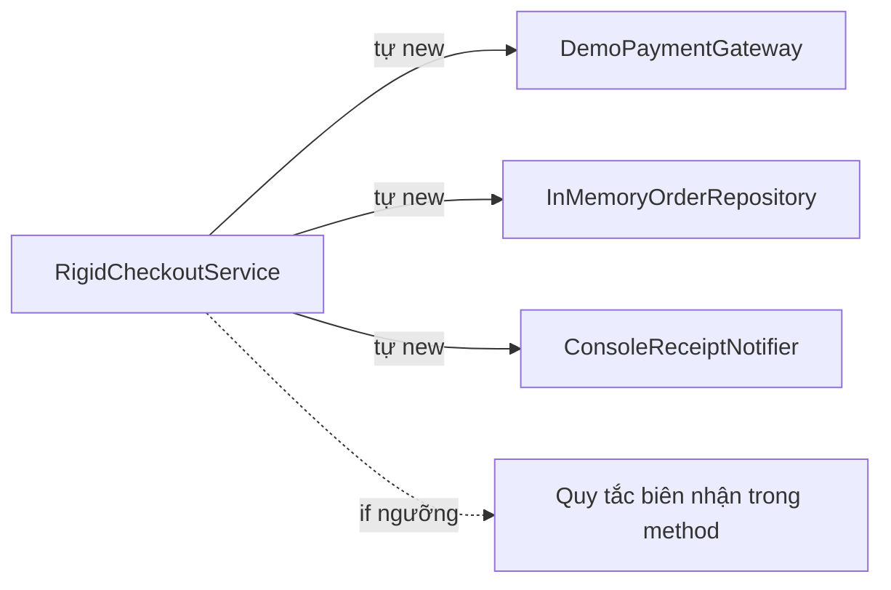
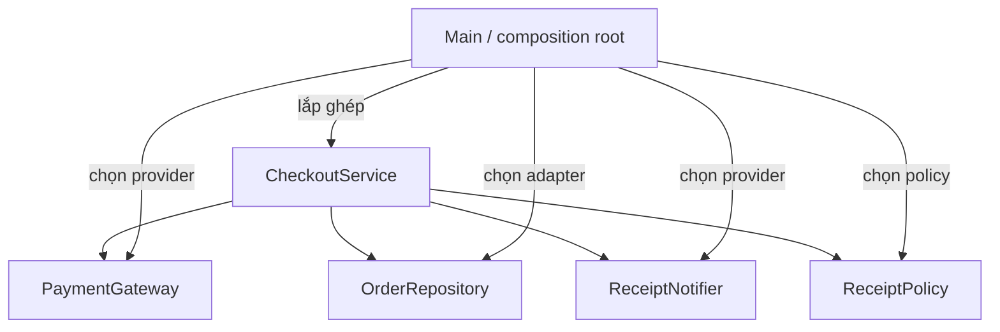
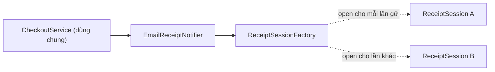

# Đánh giá thiết kế qua tình huống thay đổi và kiểm thử cụ thể

## Mục tiêu học tập

Sau bài này, bạn có thể:

- Đánh giá một thiết kế Dependency Injection (DI) dựa trên **thay đổi có khả năng xảy ra** và **bài kiểm thử có thể viết được**, thay vì chỉ đếm số interface hay annotation.
- Phân tích tác động của việc **đổi implementation**, **đổi quy tắc nghiệp vụ**, **mô phỏng lỗi** và **đổi scope/vòng đời** lên đồ thị đối tượng.
- So sánh việc tạo collaborator trực tiếp bằng `new`, constructor injection, factory có hợp đồng hẹp và abstraction quá tổng quát theo **chi phí thay đổi và độ phức tạp**.
- Xác định các **đường nối kiểm thử (test seam)** để thay dependency thật bằng fake mà không khởi động database, mạng hoặc DI container.
- Dùng một bài toán Java thuần với cả ví dụ chạy và kiểm thử hành vi để đưa ra quyết định thiết kế có căn cứ.
- Lập một **bản ghi quyết định thiết kế ngắn gọn**, nêu giả định, bằng chứng, rủi ro và tình huống cần xem xét lại.

Bài thuộc chương **Đánh đổi thiết kế** của module **Dependency Injection (DI) và Inversion of Control (IoC)**. Toàn bộ module hướng đến tách nơi *sử dụng dependency* khỏi nơi *tạo và lắp ghép*, thực hành constructor injection, composition root, scope/vòng đời và kiểm thử bằng Java thuần trước khi dùng DI container. Ở bài này, ta không xem DI là mục tiêu tự thân. Mục tiêu là **chọn một thiết kế giải quyết được thay đổi thực tế mà không tạo ra độ phức tạp không cần thiết**.

## 1. Một thiết kế “đẹp” chưa chắc là thiết kế phù hợp

Giả sử hai nhóm cùng xây chức năng xác nhận đơn hàng:

- Nhóm A có một class `CheckoutService`, tự `new` repository và notifier bên trong; ít file, ban đầu chạy nhanh.
- Nhóm B dùng constructor injection cho mọi collaborator, thêm interface và composition root; nhiều dòng hơn nhưng có thể thay triển khai mà không sửa nghiệp vụ.
- Nhóm C tạo một `UniversalComponentProvider` cho phép tra cứu mọi class và một hệ thống plugin tổng quát, dù ứng dụng hiện chỉ có hai lựa chọn.

Không thể kết luận A, B hay C thắng **chỉ bằng số file, số constructor parameter hoặc số pattern**. Cần hỏi: ứng dụng có phải đổi nhà cung cấp thông báo không? Có cần giả lập lỗi thanh toán? Có chạy đồng thời? Các dependency có tài nguyên phải đóng? Độ phức tạp của framework/plugin có được nhu cầu tương lai cụ thể biện minh không?

Một nguyên tắc hữu ích:

> Đánh giá thiết kế bằng **chi phí của những thay đổi và phép kiểm thử mà hệ thống thật cần chịu**, sau đó đối chiếu với chi phí tạo và duy trì abstraction.

Điều đó không có nghĩa “thiết kế cho mọi thay đổi có thể tưởng tượng”. Mọi abstraction đều có **giá ban đầu** và **giá duy trì**: thêm khái niệm, contract, nơi cấu hình, kiểm thử wiring và kiến thức cho người bảo trì. Đối với một thay đổi chưa có căn cứ, abstraction có thể làm hệ thống khó hiểu hơn.

### Cần đo những gì?

| Khía cạnh | Câu hỏi kiểm tra | Dấu hiệu tốt |
| --- | --- | --- |
| **Phạm vi thay đổi** | Khi đổi adapter, phải sửa bao nhiêu lớp nghiệp vụ? | Phần lớn thay đổi nằm ở adapter/composition root. |
| **Lan truyền phụ thuộc** | Service có biết class concrete, endpoint hoặc container API không? | Constructor thể hiện đúng năng lực cần dùng. |
| **Khả năng kiểm thử** | Có tạo service với fake trong Java thuần được không? | Không cần dịch vụ ngoài hoặc registry cho unit test. |
| **Tính rõ của luồng** | Từ code có biết khi nào charge, lưu, gửi không? | Thứ tự và điều kiện nghiệp vụ dễ nhìn thấy. |
| **Vòng đời** | Ai tạo, chia sẻ và đóng client/session? | Ownership rõ, không đóng nhầm resource dùng chung. |
| **Chi phí cấu trúc** | Bao nhiêu interface/factory/router chỉ để phục vụ một biến thể giả định? | Abstraction tương xứng với nhu cầu. |
| **Hợp đồng lỗi** | Khi gửi biên nhận lỗi sau thanh toán, hệ thống ra sao? | Lỗi và trạng thái trung gian được công khai, có hướng xử lý. |

Đây là các **tiêu chí định tính**, không phải điểm benchmark chuẩn. Số dòng hoặc số class chỉ là tín hiệu phụ; cần xem những dòng đó có làm rõ hay che giấu ý nghĩa nghiệp vụ.

## 2. Chọn tình huống thay đổi trước khi chọn pattern

Ta dùng bài toán **checkout và biên nhận**. Hệ thống cần:

1. Gọi `PaymentGateway` để thử thanh toán.
2. Nếu thành công, gọi `OrderRepository.markPaid(...)`.
3. Chỉ gửi biên nhận khi `ReceiptPolicy` cho phép.

Ở bản demo, chính sách là: **đơn từ 500.000 VND trở lên** mới gửi biên nhận. Mục đích chỉ để có một quy tắc có thể thay đổi và kiểm thử, không phải một chính sách sản phẩm ngoài đời.

Hãy xét bốn thay đổi:

| Mã | Tình huống có thể xảy ra | Tiêu chí chấp nhận |
| --- | --- | --- |
| **C1 — Đổi provider** | Chuyển notifier demo từ console sang email/queue adapter | Không sửa `CheckoutService`; chỉ thay object tại composition root và kiểm tra adapter mới. |
| **C2 — Đổi policy** | Từ ngưỡng 500.000 VND sang gửi biên nhận cho mọi đơn | Không sửa gateway/repository/notifier; test được chính sách mới độc lập. |
| **C3 — Kiểm thử lỗi** | Gateway từ chối, repository lỗi hoặc notifier lỗi | Mô phỏng được bằng fake trong Java thuần; quan sát đúng thứ tự và tác dụng phụ. |
| **C4 — Đổi vòng đời** | Adapter phải sử dụng một session mạng mới cho từng lần gửi | Có ranh giới tạo/đóng riêng; không buộc service giữ connection của request lâu hơn cần thiết. |

Những tình huống này đủ cụ thể để **thử thiết kế**, nhưng không khẳng định ứng dụng sẽ chắc chắn gặp cả bốn. Một review có chất lượng phải ghi rõ **giả định nào là chắc chắn, giả định nào cần xác thực**.

## 3. Phương án A: consumer tự tạo dependency

Phản ví dụ (dùng tên interface sẽ được định nghĩa ở mục 5):

```java
// Đoạn minh họa không phải một file chạy độc lập.
final class RigidCheckoutService {
    private final PaymentGateway payments = new DemoPaymentGateway();
    private final OrderRepository orders = new InMemoryOrderRepository();
    private final ReceiptNotifier receipts = new ConsoleReceiptNotifier();

    CheckoutResult checkout(OrderRequest order) {
        if (!payments.charge(order)) {
            return CheckoutResult.declined();
        }
        orders.markPaid(order);
        if (order.amountVnd >= 500_000L) {
            receipts.send(order);
        }
        return CheckoutResult.paid(order.amountVnd >= 500_000L);
    }
}
```

Với một bài demo không cần thay provider hoặc kiểm thử đường lỗi, code này khá trực tiếp. Tuy vậy, khi đặt các thay đổi C1–C4 lên bàn, chi phí xuất hiện:

- **C1:** sửa class nghiệp vụ để thay `new ConsoleReceiptNotifier()` hoặc thêm điều kiện hạ tầng vào chính service.
- **C2:** sửa biểu thức `if` trong service; nếu nhiều nơi cùng tính chính sách, có thể phải tìm và đồng bộ nhiều vị trí.
- **C3:** không có constructor cho phép đưa fake vào; rất khó mô phỏng thanh toán bị từ chối một cách cô lập.
- **C4:** khi notifier tự tạo connection/session, việc tạo và đóng tài nguyên bắt đầu trộn vào code checkout.

### Đồ thị bị khóa cứng



Mọi quyết định đều tụ về `RigidCheckoutService`. Việc tạo thêm một DI container ở ngoài **không tự loại bỏ** các lệnh `new` bên trong service. Đây là một thiết kế có thể được chấp nhận cho ví dụ cực nhỏ, nhưng cần ghi nhận chi phí thay đổi/kiểm thử trước khi dùng cho nghiệp vụ đang mở rộng.

## 4. Phương án B: tách đúng các điểm biến thiên

Ở phương án này, ta giữ bốn hợp đồng:

- `PaymentGateway`: thử thanh toán.
- `OrderRepository`: ghi trạng thái.
- `ReceiptNotifier`: gửi biên nhận.
- `ReceiptPolicy`: quyết định một đơn có cần biên nhận hay không.

`CheckoutService` **không biết** implementation nào được sử dụng, cũng không biết chúng được tạo bằng Java thuần hay DI container.



Sơ đồ mô tả **các loại cạnh cần có**, không khẳng định mỗi interface bắt buộc phải có nhiều implementation trong production. Giá trị của chúng ở đây là bốn trách nhiệm có thể đổi hoặc kiểm thử **độc lập theo các kịch bản cụ thể**.

### Tại sao chọn policy riêng?

Nếu chỉ cần đổi `ConsoleReceiptNotifier` sang một notifier khác, ba dependency có thể là đủ. Nhưng C2 yêu cầu **quy tắc gửi biên nhận có thể thay đổi** mà không sửa phần điều phối thanh toán. Bởi vậy `ReceiptPolicy` là một abstraction có căn cứ ở bài toán này.

Nếu trong một ứng dụng thật quy tắc “luôn gửi biên nhận” đã cố định, không có kế hoạch thay đổi và không tái sử dụng ở đâu, một phương thức đơn giản có thể hợp lý hơn. **Không nên nhân bản mọi điều kiện `if` thành interface chỉ vì muốn áp dụng một pattern.**

## 5. Ví dụ Java thuần hoàn chỉnh

Lưu vào **`Main.java`** (JDK 8 trở lên). Các implementation demo chỉ làm việc trong bộ nhớ và console; **không thu tiền, lưu database hay gửi email thật**.

```java
import java.util.HashMap;
import java.util.Map;
import java.util.Objects;

// Dữ liệu của một lần checkout, không phải service của container.
final class OrderRequest {
    final String orderId;
    final String recipient;
    final long amountVnd;

    OrderRequest(String orderId, String recipient, long amountVnd) {
        this.orderId = requiredText(orderId, "orderId");
        this.recipient = requiredText(recipient, "recipient");
        if (amountVnd <= 0) {
            throw new IllegalArgumentException("amountVnd phải dương");
        }
        this.amountVnd = amountVnd;
    }

    private static String requiredText(String value, String field) {
        Objects.requireNonNull(value, field);
        if (value.trim().isEmpty()) {
            throw new IllegalArgumentException(field + " không được rỗng");
        }
        return value;
    }
}

// Hợp đồng nghiệp vụ, không chứa chi tiết tạo implementation.
interface PaymentGateway {
    boolean charge(OrderRequest order);
}

interface OrderRepository {
    void markPaid(OrderRequest order);
}

interface ReceiptNotifier {
    void send(OrderRequest order);
}

interface ReceiptPolicy {
    boolean shouldSend(OrderRequest order);
}

final class AmountThresholdReceiptPolicy implements ReceiptPolicy {
    private final long fromVnd;

    AmountThresholdReceiptPolicy(long fromVnd) {
        if (fromVnd <= 0) {
            throw new IllegalArgumentException("fromVnd phải dương");
        }
        this.fromVnd = fromVnd;
    }

    @Override
    public boolean shouldSend(OrderRequest order) {
        Objects.requireNonNull(order, "order");
        return order.amountVnd >= fromVnd;
    }
}

// Kết quả chỉ mang ý nghĩa trong ví dụ đồng bộ:
// payment và bước gửi biên nhận (nếu cần) đã trả về bình thường.
final class CheckoutResult {
    final boolean paid;
    final boolean receiptSent;
    final String status;

    private CheckoutResult(boolean paid, boolean receiptSent, String status) {
        this.paid = paid;
        this.receiptSent = receiptSent;
        this.status = Objects.requireNonNull(status, "status");
    }

    static CheckoutResult paid(boolean receiptSent) {
        return new CheckoutResult(true, receiptSent, "PAID");
    }

    static CheckoutResult declined() {
        return new CheckoutResult(false, false, "PAYMENT_DECLINED");
    }
}

// Consumer: chỉ sử dụng những dependency đã được inject.
final class CheckoutService {
    private final PaymentGateway payments;
    private final OrderRepository orders;
    private final ReceiptNotifier receipts;
    private final ReceiptPolicy policy;

    CheckoutService(PaymentGateway payments, OrderRepository orders,
                    ReceiptNotifier receipts, ReceiptPolicy policy) {
        this.payments = Objects.requireNonNull(payments, "payments");
        this.orders = Objects.requireNonNull(orders, "orders");
        this.receipts = Objects.requireNonNull(receipts, "receipts");
        this.policy = Objects.requireNonNull(policy, "policy");
    }

    CheckoutResult checkout(OrderRequest order) {
        Objects.requireNonNull(order, "order");
        if (!payments.charge(order)) {
            return CheckoutResult.declined();
        }
        orders.markPaid(order);

        boolean sendReceipt = policy.shouldSend(order);
        if (sendReceipt) {
            receipts.send(order);
        }
        return CheckoutResult.paid(sendReceipt);
    }
}

// Adapter thanh toán giả lập.
final class DemoPaymentGateway implements PaymentGateway {
    @Override
    public boolean charge(OrderRequest order) {
        System.out.println("[DEMO] Charge " + order.amountVnd
                + " VND cho " + order.orderId);
        return true;
    }
}

// Adapter lưu trạng thái trong bộ nhớ.
final class InMemoryOrderRepository implements OrderRepository {
    private final Map<String, Boolean> paid = new HashMap<>();

    @Override
    public void markPaid(OrderRequest order) {
        paid.put(order.orderId, true);
        System.out.println("[DEMO] Mark PAID " + order.orderId);
    }

    boolean isPaid(String orderId) {
        return Boolean.TRUE.equals(paid.get(orderId));
    }
}

// Adapter in thông báo, không gửi email thực.
final class ConsoleReceiptNotifier implements ReceiptNotifier {
    @Override
    public void send(OrderRequest order) {
        System.out.println("[DEMO] Receipt " + order.orderId
                + " -> " + order.recipient);
    }
}

// Composition root: chọn implementation và quy tắc một lần.
public class Main {
    public static void main(String[] args) {
        PaymentGateway payments = new DemoPaymentGateway();
        InMemoryOrderRepository orders = new InMemoryOrderRepository();
        ReceiptNotifier receipts = new ConsoleReceiptNotifier();
        ReceiptPolicy policy = new AmountThresholdReceiptPolicy(500_000L);

        CheckoutService checkout =
                new CheckoutService(payments, orders, receipts, policy);

        OrderRequest low =
                new OrderRequest("DH-LOW", "low@example.com", 120_000L);
        OrderRequest high =
                new OrderRequest("DH-HIGH", "high@example.com", 600_000L);

        CheckoutResult first = checkout.checkout(low);
        CheckoutResult second = checkout.checkout(high);
        System.out.println(first.status + ", receipt=" + first.receiptSent);
        System.out.println(second.status + ", receipt=" + second.receiptSent);
        System.out.println("HIGH persisted=" + orders.isPaid(high.orderId));
    }
}
```

Biên dịch và chạy:

```bash
javac -encoding UTF-8 Main.java
java Main
```

Kết quả dự kiến:

```text
[DEMO] Charge 120000 VND cho DH-LOW
[DEMO] Mark PAID DH-LOW
[DEMO] Charge 600000 VND cho DH-HIGH
[DEMO] Mark PAID DH-HIGH
[DEMO] Receipt DH-HIGH -> high@example.com
PAID, receipt=false
PAID, receipt=true
HIGH persisted=true
```

Khi chạy tuần tự trong ví dụ này, `DH-LOW` không gửi biên nhận và `DH-HIGH` có gửi. `CheckoutService` vẫn là **một instance dùng chung** cho hai yêu cầu; `OrderRequest` là dữ liệu riêng từng lần gọi. Nếu muốn thay cách gửi biên nhận, tạo implementation mới của `ReceiptNotifier` và đưa vào constructor tại `Main`; không sửa `CheckoutService`.

### Đánh giá theo các thay đổi đã đặt ra

- **C1 — Đổi provider:** thay `new ConsoleReceiptNotifier()` bằng một adapter khác tại composition root. Nếu adapter mới cần client cấu hình, đó là trách nhiệm của điểm lắp ghép hoặc một factory hạ tầng.
- **C2 — Đổi policy:** thay `new AmountThresholdReceiptPolicy(...)` bằng policy khác. Logic của `CheckoutService` vẫn gọi `policy.shouldSend(order)`.
- **C3 — Kiểm thử lỗi:** tạo service từ ba fake và một policy fake/lambda, hoàn toàn không cần `Main`, database, SMTP hay container.
- **C4 — Đổi vòng đời:** nếu notifier cần một session mới mỗi lần gửi, có thể thay adapter bằng thành phần sử dụng `ReceiptSessionFactory`; `CheckoutService` vẫn phụ thuộc vào `ReceiptNotifier`.

**Giới hạn nghiệp vụ:** ví dụ cố ý đơn giản. Nếu `orders.markPaid(...)` hoặc `receipts.send(...)` thất bại **sau khi thanh toán thành công**, chương trình có thể để lại tác dụng phụ một phần. Không được suy rằng trả `CheckoutResult.paid(...)` hoặc dùng DI tự bảo đảm transaction, idempotency hay gửi email thành công ngoài hệ thống.

## 6. Kiểm thử tình huống cụ thể, không chỉ kiểm tra “chạy được”

Muốn đánh giá DI có thực sự đem lại khả năng thay thế, hãy xây một **bài kiểm tra có thể chứng minh hoặc bác bỏ quyết định thiết kế**. Ta cần:

1. Đơn dưới ngưỡng: charge và mark paid, **không gửi**.
2. Đơn đúng ngưỡng: charge, mark paid, **có gửi**, đúng thứ tự.
3. Gateway từ chối: **không cập nhật** và **không gửi**.
4. Thay policy bằng policy luôn gửi: **không sửa service**.
5. Notifier ném lỗi sau thanh toán: ghi nhận đây là **lỗi một phần**, không giả vờ rollback tự động.

Lưu **`DesignTradeoffCheck.java`** cạnh `Main.java`:

```java
import java.util.ArrayList;
import java.util.Arrays;
import java.util.List;

public class DesignTradeoffCheck {
    static final class FakePayments implements PaymentGateway {
        final List<String> events;
        boolean approved = true;
        int calls;

        FakePayments(List<String> events) {
            this.events = events;
        }

        @Override
        public boolean charge(OrderRequest order) {
            calls++;
            events.add("charge:" + order.orderId);
            return approved;
        }
    }

    static final class FakeOrders implements OrderRepository {
        final List<String> events;
        int marks;

        FakeOrders(List<String> events) {
            this.events = events;
        }

        @Override
        public void markPaid(OrderRequest order) {
            marks++;
            events.add("paid:" + order.orderId);
        }
    }

    static final class FakeReceipts implements ReceiptNotifier {
        final List<String> events;
        int sends;
        boolean failOnSend;

        FakeReceipts(List<String> events) {
            this.events = events;
        }

        @Override
        public void send(OrderRequest order) {
            sends++;
            events.add("receipt:" + order.orderId);
            if (failOnSend) {
                throw new IllegalStateException("simulated notification error");
            }
        }
    }

    static void expectEvents(List<String> actual, String... expected) {
        if (!actual.equals(Arrays.asList(expected))) {
            throw new AssertionError(
                    "Sai thứ tự: " + actual
                    + ", kỳ vọng " + Arrays.asList(expected));
        }
    }

    public static void main(String[] args) {
        List<String> events = new ArrayList<>();
        FakePayments payments = new FakePayments(events);
        FakeOrders orders = new FakeOrders(events);
        FakeReceipts receipts = new FakeReceipts(events);
        ReceiptPolicy threshold = new AmountThresholdReceiptPolicy(500_000L);
        CheckoutService checkout =
                new CheckoutService(payments, orders, receipts, threshold);

        // Dưới ngưỡng: không gửi biên nhận.
        CheckoutResult low = checkout.checkout(
                new OrderRequest("LOW", "a@example.com", 499_999L));
        if (!low.paid || low.receiptSent || payments.calls != 1
                || orders.marks != 1 || receipts.sends != 0) {
            throw new AssertionError("Sai nhánh dưới ngưỡng");
        }
        expectEvents(events, "charge:LOW", "paid:LOW");

        // Đúng ngưỡng: phải gửi sau khi đã mark paid.
        events.clear();
        CheckoutResult high = checkout.checkout(
                new OrderRequest("HIGH", "b@example.com", 500_000L));
        if (!high.paid || !high.receiptSent || payments.calls != 2
                || orders.marks != 2 || receipts.sends != 1) {
            throw new AssertionError("Sai nhánh đúng ngưỡng");
        }
        expectEvents(events,
                "charge:HIGH", "paid:HIGH", "receipt:HIGH");

        // Gateway từ chối: không được chạm repository hoặc notifier.
        events.clear();
        payments.approved = false;
        CheckoutResult declined = checkout.checkout(
                new OrderRequest("DENIED", "c@example.com", 900_000L));
        if (declined.paid || declined.receiptSent
                || payments.calls != 3 || orders.marks != 2
                || receipts.sends != 1) {
            throw new AssertionError("Sai nhánh từ chối");
        }
        expectEvents(events, "charge:DENIED");

        // Đổi policy bằng fake/lambda, không sửa CheckoutService.
        events.clear();
        payments.approved = true;
        ReceiptPolicy alwaysSend = order -> true;
        CheckoutService changedPolicy =
                new CheckoutService(payments, orders, receipts, alwaysSend);
        CheckoutResult sent = changedPolicy.checkout(
                new OrderRequest("NEW-POLICY", "d@example.com", 1L));
        if (!sent.paid || !sent.receiptSent || receipts.sends != 2) {
            throw new AssertionError("Service không dùng policy đã inject");
        }
        expectEvents(events,
                "charge:NEW-POLICY",
                "paid:NEW-POLICY",
                "receipt:NEW-POLICY");

        // Lỗi gửi biên nhận: payment/repository đã được gọi trước đó.
        events.clear();
        receipts.failOnSend = true;
        try {
            changedPolicy.checkout(
                    new OrderRequest("SEND-ERROR", "e@example.com", 2L));
            throw new AssertionError("Phải báo lỗi notifier");
        } catch (IllegalStateException expected) {
            if (!"simulated notification error".equals(
                    expected.getMessage())) {
                throw expected;
            }
        }
        expectEvents(events,
                "charge:SEND-ERROR",
                "paid:SEND-ERROR",
                "receipt:SEND-ERROR");

        // Không nhận dependency bắt buộc null.
        try {
            new CheckoutService(payments, orders, null, threshold);
            throw new AssertionError("Constructor phải từ chối null");
        } catch (NullPointerException expected) {
            // Đúng: phát hiện cấu hình đối tượng thiếu dependency.
        }

        System.out.println("PASS: thay policy, giả lập lỗi và thứ tự gọi");
    }
}
```

Chạy:

```bash
javac -encoding UTF-8 Main.java DesignTradeoffCheck.java
java DesignTradeoffCheck
```

Bài kiểm tra này không khởi động framework. Nó cho phép **giữ nguyên `CheckoutService`** khi thay policy và thay trạng thái của gateway/notifier giả. `expectEvents(...)` giúp phát hiện trường hợp service gọi biên nhận **trước** khi ghi trạng thái đã thanh toán.

**Cần đọc đúng ý nghĩa test:** xác nhận hành vi với các fake **không chứng minh** một ngân hàng, database hoặc dịch vụ email thật hoạt động đúng. Integration test cần kiểm tra wiring của adapter thật, tính nhất quán của trạng thái và hợp đồng lỗi của hệ thống ngoài.

## 7. Đánh giá các phương án bằng ma trận thay đổi

Sau khi đã có các tình huống và test cụ thể, ta có thể so sánh:

| Tình huống | A: Tự `new` trong service | B: Constructor DI + composition root | C: Provider/locator tổng quát |
| --- | --- | --- | --- |
| **C1 — Đổi notifier** | Sửa service hoặc thêm nhánh cấu hình trong nghiệp vụ | Thay adapter tại root, giữ service | Có thể đổi đăng ký, nhưng service thường phải biết key/API resolve |
| **C2 — Đổi chính sách** | Sửa biểu thức trong method | Thay `ReceiptPolicy`/cấu hình tại root | Nếu policy vẫn nằm trong service, locator **không giải quyết** |
| **C3 — Fake lỗi thanh toán** | Khó thay dependency nếu bị khóa cứng | Truyền `FakePayments` trực tiếp | Thường phải dựng registry/provider giả |
| **C4 — Session mỗi lần gửi** | Logic mở/đóng dễ tràn vào checkout | Adapter/factory hẹp quản lý vòng đời | Có thể làm được nhưng scope và ownership dễ bị che |
| **Chi phí ban đầu** | Ít lớp/ít cấu hình | Vài interface, constructor và root | Nhiều cơ chế, registration và quy tắc |
| **Điểm cần thận trọng** | Coupling và test seam kém | Tránh tạo interface không có ích; quản lý root đủ rõ | Tránh biến provider thành Service Locator hoặc magic registry |

**Kết luận theo giả định C1–C4:** phương án B có ưu thế vì đặt các điểm biến thiên đúng ranh giới. Đây là **kết luận có điều kiện**, không phải định luật “luôn có bốn interface là tốt”. Nếu sản phẩm không có nhu cầu C2, ta có thể bỏ `ReceiptPolicy` và đơn giản hóa; nếu cần tạo session theo thao tác, có thể bổ sung một factory ở adapter thay vì sửa toàn bộ kiến trúc.

### Đừng nhầm “ít dòng sửa” với “ít rủi ro”

Việc thay một dòng cấu hình để trỏ sang email provider mới không bảo đảm thay đổi **an toàn**. Adapter mới có thể có:

- Cách định nghĩa **hoàn thành** khác: gửi đồng bộ, accepted vào queue hay delivered đến người dùng.
- Timeout, retry, tính idempotent và các lỗi mạng khác nhau.
- Yêu cầu cấp/đóng client, session, transaction hoặc kết nối.
- Scope và yêu cầu thread safety khác với console adapter.

Đánh giá thay đổi phải kết hợp **nơi sửa code** với **contract tương thích** và kiểm thử tương ứng. DI giúp giảm coupling, không thay thế kiểm thử hệ thống hoặc thiết kế lỗi nghiệp vụ.

## 8. Phương án C: abstraction quá rộng cũng là một đánh đổi

Giả sử để “linh hoạt tối đa”, nhóm thiết kế:

```java
// Phản ví dụ, API giả định; không dùng cùng Main.java.
interface UniversalProvider {
    <T> T resolve(Class<T> type, String key);
}

final class RegistryCheckoutService {
    private final UniversalProvider provider;

    RegistryCheckoutService(UniversalProvider provider) {
        this.provider = provider;
    }

    void sendReceipt(OrderRequest order) {
        ReceiptNotifier notifier =
                provider.resolve(ReceiptNotifier.class, "primary");
        notifier.send(order);
    }
}
```

Khi đó constructor chỉ thể hiện `UniversalProvider`; requirement thật (`ReceiptNotifier`) lại nằm trong thân phương thức. Nếu đổi tên key `primary` hoặc thay API registry, service bị ảnh hưởng. Hơn nữa, việc `resolve(...)` trả singleton, transient hay object request-scoped có thể không rõ ràng với người đọc.

Một **factory hẹp** khác biệt ở chỗ hợp đồng chỉ cung cấp **một loại khả năng có nghĩa**:

```java
interface ReceiptSession extends AutoCloseable {
    void send(OrderRequest order);
    @Override void close();
}

interface ReceiptSessionFactory {
    ReceiptSession open(String requestId);
}
```

Đây là đoạn API minh họa độc lập với ví dụ chính. Nếu notifier cần session theo thao tác, một adapter có thể inject `ReceiptSessionFactory` rồi mở và đóng trong một lần `send(...)`. Caller không thể sử dụng factory đó để lấy bất kỳ repository/gateway nào. Đó là mức trừu tượng **vừa đủ cho thay đổi C4**.

**Không phải cứ dùng provider hay registry là sai.** Composition root và phần tích hợp framework có thể cần công cụ đăng ký/resolve tổng quát. Vấn đề xuất hiện khi **logic nghiệp vụ** phụ thuộc trực tiếp vào công cụ đó thay vì mô tả rõ những collaborator cần thiết.

## 9. Scope và vòng đời có thể đảo ngược kết luận thiết kế

Hãy thay giả định: email provider mới mở một session mạng mỗi lần gửi. Nếu đặt một `EmailSession` vào constructor của `CheckoutService` được dùng chung lâu dài, có nguy cơ:

- Dùng lại session đã đóng;
- Chia sẻ state request không an toàn giữa nhiều thread;
- Đóng session sau một yêu cầu làm hỏng những yêu cầu tiếp theo.

Thiết kế tốt hơn có thể giữ `CheckoutService` với một `ReceiptNotifier` ổn định, còn notifier dùng factory:



Ví dụ API:

```java
// Chỉ minh họa cấu trúc adapter; cần các class/interface từ đoạn trước.
final class EmailReceiptNotifier implements ReceiptNotifier {
    private final ReceiptSessionFactory sessions;

    EmailReceiptNotifier(ReceiptSessionFactory sessions) {
        this.sessions = java.util.Objects.requireNonNull(sessions, "sessions");
    }

    @Override
    public void send(OrderRequest order) {
        try (ReceiptSession session = sessions.open(order.orderId)) {
            session.send(order);
        }
    }
}
```

Đoạn mở rộng này giả định việc gửi **đồng bộ** và hợp đồng `ReceiptSession.send(...)` hoàn tất sử dụng session trước khi trả về. Nếu dùng API bất đồng bộ, **không được** đóng session ngay sau khi chỉ nhận `CompletionStage`; cần giữ nó đến mốc completion thực sự của công việc.

### Bảng câu hỏi vòng đời

| Đối tượng | Scope gợi ý trong ví dụ | Quy tắc sở hữu |
| --- | --- | --- |
| `CheckoutService` | Dùng lại nếu không giữ state request | Không tự đóng gateway/notifier dùng chung. |
| `PaymentGateway` | Phù hợp scope của client/adapter | Composition root hoặc container quản lý tài nguyên được tạo. |
| `ReceiptPolicy` | Có thể dùng chung khi bất biến | Nếu policy cần cờ runtime, xác định thời điểm đọc và cache. |
| `ReceiptSessionFactory` | Dùng lại để mở phiên theo thao tác | Quản lý client/pool phía dưới theo hợp đồng. |
| `ReceiptSession` | Một lần gửi hoặc handle được thuê từ pool | Bên được giao sở hữu session đóng đúng mốc sử dụng cuối. |
| `OrderRequest` | Dữ liệu của một thao tác | Không giữ ở field mutable của service dùng chung. |

DI container có thể tự động hóa việc tạo, tiêm và quản lý scope, nhưng **không tự biết** một session đã được gọi xong từ phía business nếu thao tác vẫn chạy ở worker khác. Đánh giá trade-off cần xét **cách sử dụng**, không chỉ cấu hình annotation singleton/prototype.

## 10. Khi nào thiết kế đơn giản hơn mới là tốt hơn?

Để không biến bài học DI thành “mọi class phải có interface”, hãy xem một trường hợp khác:

```java
// Value object: mỗi lần tính phí có thể tạo một kết quả mới.
final class Money {
    final long vnd;

    Money(long vnd) {
        if (vnd < 0) {
            throw new IllegalArgumentException("vnd phải >= 0");
        }
        this.vnd = vnd;
    }
}
```

Nếu một phương thức tạo `new Money(total)`, việc này thường **không phải dependency leak**. `Money` là dữ liệu giá trị, không phải một client có cấu hình hoặc tài nguyên sống lâu. Tạo `MoneyFactoryProviderManager` rồi inject nó vào mọi service có thể làm hệ thống khó đọc hơn mà không cải thiện thay đổi C1–C4.

Những trường hợp có thể **không cần abstraction mới**:

- Một phép tính nhỏ, thuần, không có resource và chỉ dùng nội bộ một class.
- Một DTO hoặc value object có constructor rõ.
- Một implementation rất ổn định, không cần fake để kiểm thử theo cách khác.
- Một chức năng đơn giản mà abstraction mới chỉ chuyển vài dòng `new` sang một file khác.

Những trường hợp thường **đáng có hợp đồng rõ**:

- Provider hạ tầng có thể thay theo môi trường hoặc nhà cung cấp.
- Tác dụng phụ cần mô phỏng lỗi một cách quyết định trong unit test.
- Resource có vòng đời khác consumer và cần factory/ownership.
- Quy tắc nghiệp vụ thực sự có các biến thể hoặc thay đổi độc lập.

Lựa chọn phụ thuộc **bối cảnh**, không phải số lượng pattern được áp dụng.

## 11. Quy trình đánh giá qua một thay đổi giả định

Thay vì thảo luận chung rằng “kiến trúc này linh hoạt”, hãy chạy một **change rehearsal** trên giấy hoặc trong một nhánh thử nghiệm:

1. **Viết yêu cầu thành thay đổi cụ thể:** “Đổi notifier sang queue adapter nhưng giữ logic checkout”, thay vì “hệ thống phải mở rộng tốt”.
2. **Nêu ranh giới không được đổi:** `CheckoutService`, chữ ký nghiệp vụ và thứ tự charge → mark → notify cần giữ.
3. **Liệt kê vị trí phải sửa:** adapter, composition root, cấu hình, test contract hay business service?
4. **Dựng test tối thiểu:** fake payment trả false, fake notifier ném lỗi, policy ở ngưỡng; cần bao nhiêu hạ tầng để chạy?
5. **Kiểm tra object graph:** client nào được chia sẻ; request/session nào ngắn hạn; ai đóng tài nguyên?
6. **Xem xét lỗi sau tác dụng phụ:** retry có gây thu tiền hai lần không? Cần idempotency/outbox hay trạng thái trung gian?
7. **Đo độ phức tạp thêm:** có thêm abstraction/nhánh cấu hình nào không phục vụ tình huống đã xác nhận?
8. **Ghi quyết định cùng điều kiện xem xét lại:** ví dụ “giữ policy interface vì đang có hai chính sách”, “chưa thêm plugin registry vì chưa có nhu cầu nạp động”.

### Mẫu bản ghi quyết định ngắn

| Trường | Ví dụ ghi chép |
| --- | --- |
| **Bài toán** | Checkout cần đổi notifier và kiểm thử lỗi gateway mà không sửa nghiệp vụ. |
| **Phương án so sánh** | A: tự tạo dependency; B: constructor DI; C: provider tổng quát. |
| **Tình huống áp dụng** | C1 đổi notifier, C2 đổi policy, C3 mô phỏng lỗi, C4 session theo thao tác. |
| **Lựa chọn** | B: hợp đồng rõ và composition root; factory hẹp chỉ khi C4 xuất hiện. |
| **Lợi ích kỳ vọng** | Fake test chạy Java thuần; thay adapter ở root; ownership rõ. |
| **Chi phí chấp nhận** | Thêm interface, constructor parameters và một vùng lắp ghép cần bảo trì. |
| **Rủi ro còn lại** | Payment đã thành công nhưng notifier lỗi; cần giải pháp trạng thái/idempotency riêng. |
| **Điểm xem xét lại** | Nếu chưa có biến thể policy thực sự, có thể đơn giản hóa; nếu hỗ trợ plugin động mới đánh giá registry. |

Đây không phải biểu mẫu bắt buộc cho mọi commit. Nó hữu ích khi nhóm đang tranh luận một **đánh đổi kiến trúc** và cần căn cứ để quay lại quyết định sau này.

## 12. Những ngộ nhận thường gặp

| Ngộ nhận | Cách hiểu đúng |
| --- | --- |
| “Nhiều interface hơn nghĩa là thiết kế tốt hơn.” | Interface chỉ có giá trị nếu mô tả hợp đồng có ích và giảm chi phí thay đổi/kiểm thử thực tế. |
| “Ít dòng code hơn chắc chắn dễ bảo trì hơn.” | Code ngắn nhưng tự `new` dependency ẩn có thể tốn công khi đổi provider hoặc giả lập lỗi. |
| “DI container bảo đảm tính mở rộng.” | Container chỉ lắp ghép theo thiết kế; trách nhiệm và contract vẫn phải đúng. |
| “Cứ dùng `Map<String, Object>` là hỗ trợ mọi trường hợp.” | Registry tổng quát có thể giấu phụ thuộc, scope và lỗi cấu hình khỏi consumer. |
| “Đổi adapter không sửa service thì không cần test.” | Contract mạng, completion, lỗi và tài nguyên của adapter mới vẫn cần kiểm tra. |
| “Unit test với fake qua là hệ thống thật an toàn.” | Còn phải test wiring, integration và các tác dụng phụ một phần. |
| “Factory luôn tốt hơn tiêm instance.” | Factory phù hợp khi cần tạo/cấp theo thao tác; dependency ổn định thường nên tiêm trực tiếp. |
| “Có DI thì không còn dùng `new`.” | `new` value object, DTO và tại composition root hoàn toàn hợp lệ. |
| “Scope singleton đồng nghĩa thread-safe.” | Scope chia sẻ instance; thread safety là thuộc tính của implementation và cách sử dụng. |
| “Không thể đo đánh đổi thiết kế.” | Có thể dùng các tình huống thay đổi, test và object graph cụ thể, dù không có điểm số phổ quát. |

## 13. Bài tập vận dụng

Một hệ thống đặt vé đang dùng `TicketService` với ba công việc: lưu vé, thu tiền và gửi thông báo. Hiện tại service tự tạo `new EmailSender()`, còn repository được constructor inject.

Nhóm nhận ba yêu cầu mới:

- **Yêu cầu A:** môi trường thử nghiệm không được gửi email thật.
- **Yêu cầu B:** khi payment bị từ chối, không tạo vé và không gửi thông báo.
- **Yêu cầu C:** một nhà cung cấp email mới yêu cầu session riêng cho mỗi lần gửi.

Hãy trả lời:

1. Với yêu cầu A, nên sửa ở **service** hay tạo `TicketNotifier` và thay implementation ở **composition root**? Một unit test cô lập cần fake gì?
2. Với B, cần kiểm tra thứ tự lời gọi nào? Có nên test chỉ giá trị trả về mà bỏ qua các tác dụng phụ không?
3. Với C, nên tiêm trực tiếp **một session** vào service dùng chung hay dùng `TicketNotifier` với factory mở session theo thao tác? Ai được quyền đóng session?
4. Nếu sản phẩm không bao giờ có thêm nhà cung cấp repository, có cần tạo mọi interface tùy tiện không? Bằng chứng nào giúp chọn?
5. Nếu thu tiền đã thành công nhưng lưu vé thất bại, có thể coi DI là giải pháp rollback không?

**Gợi ý đáp án:** (1) Đưa lựa chọn notifier về composition root; fake notifier bảo đảm test không gọi email thật. (2) Kiểm tra `charge` từ chối → không `save`, không `send`, bằng fake trace và bộ đếm. (3) Tiêm notifier ổn định có factory hẹp; adapter mở/đóng phiên theo hợp đồng, service không tự giữ session request. (4) Không nhất thiết; cân nhắc giá trị của seam kiểm thử và mức biến thiên thực tế trước khi thêm abstraction. (5) Không. Cần thiết kế giao dịch, idempotency, bù trừ/outbox hoặc tiến trình phù hợp; DI chỉ giúp tách và lắp ghép collaborator.

**Kết luận:** Đánh đổi thiết kế trong DI không phải lựa chọn giữa “có framework” và “không framework”, hay giữa “ít class” và “nhiều class”. Hãy bắt đầu từ **thay đổi có căn cứ, phép kiểm thử quan sát được và quy tắc scope/vòng đời**, rồi chọn lượng abstraction **vừa đủ** để giảm coupling mà vẫn giữ luồng nghiệp vụ rõ ràng. Khi một thiết kế vượt qua được các tình huống cụ thể bằng Java thuần, việc đưa nó vào DI container sau này chủ yếu là thay cách **tạo và lắp ghép**, không phải sửa lại ý nghĩa dependency của consumer.
