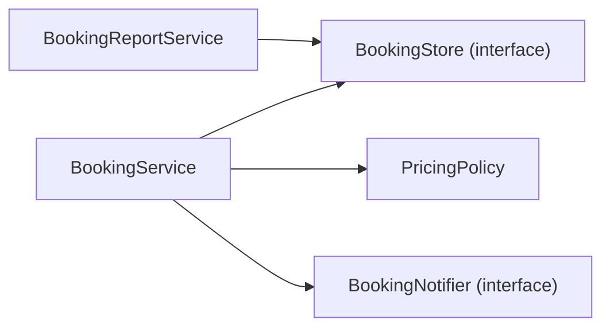
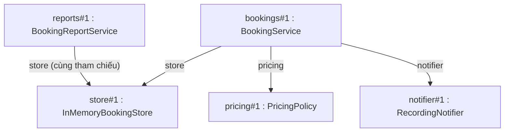
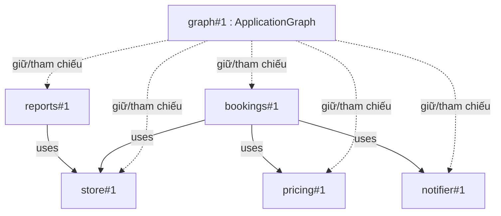

# Vẽ và đối chiếu đồ thị đối tượng với mã lắp ghép

Trong chương **Thực hành** của module **Dependency Injection (DI)**, bạn sẽ chuyển qua lại giữa hai cách mô tả cùng một hệ thống:

1. **Mã lắp ghép** ở *composition root*: các lệnh tạo object, chọn implementation, truyền dependency vào constructor và quyết định vòng đời.
2. **Đồ thị đối tượng** (*object graph*) tại runtime: các **instance cụ thể** và những tham chiếu thực sự nối chúng với nhau.

Mục tiêu của **Dependency Injection** và **Inversion of Control (IoC)** không phải chỉ là thay lệnh `new` bằng container, mà là tách việc **sử dụng dependency** khỏi việc **tạo và lắp ghép dependency**. Một bản vẽ object graph chính xác giúp bạn phát hiện lỗi mà mã nguồn riêng lẻ khó thể hiện: cùng một repository bị tạo hai lần, một tài nguyên ngắn hạn bị giữ trong singleton, hoặc nhiều consumer vô tình dùng chung trạng thái không an toàn.

Bài này dùng **constructor injection, Java thuần và composition root thủ công** để thực hành trước khi mở rộng sang DI container. Bạn có thể biên dịch ví dụ với JDK 17 trở lên, không cần thư viện ngoài.

Sau bài học, bạn sẽ có thể:

- Phân biệt **đồ thị phụ thuộc theo kiểu/class** với **đồ thị instance thực tế**.
- Đọc một composition root, xác định mỗi lệnh `new` tạo object nào và mỗi tham số constructor tạo cạnh tham chiếu nào.
- Đánh dấu đúng **instance được chia sẻ** và **instance riêng biệt**, kể cả khi chúng có cùng class.
- Đối chiếu sơ đồ với code và các assertion kiểm tra **object identity** bằng `==`.
- Nhận diện ranh giới application/request/job, nguồn tạo resource và người chịu trách nhiệm đóng.
- Vẽ lại graph sau khi đổi từ khởi tạo trực tiếp sang factory/provider hoặc DI container.

## 1. Ba thứ rất dễ bị nhầm là cùng một đồ thị

### 1.1. Đồ thị phụ thuộc theo kiểu

Đây là mô hình quan hệ ở mức **class/interface**. Ví dụ:

```java
final class BookingService {
    BookingService(
            BookingStore store,
            PricingPolicy pricing,
            BookingNotifier notifier) {
        // ...
    }
}
```

Từ constructor, ta biết `BookingService` cần các hợp đồng `BookingStore`, `PricingPolicy` và `BookingNotifier`. Nhưng **chưa biết**:

- `BookingStore` là adapter in-memory hay JDBC.
- Bao nhiêu instance `BookingStore` sẽ được tạo.
- Hai service có sử dụng **cùng** repository không.
- Các object được tạo ngay lúc khởi động hay khi có request.

Một đồ thị theo kiểu có thể vẽ:



Đồ thị này mô tả **hợp đồng phụ thuộc**, không khẳng định có một hay hai instance repository. Hai cạnh cùng trỏ vào ô `BookingStore` ở sơ đồ **không chứng minh** hai service dùng chung một object.

### 1.2. Đồ thị instance tại runtime

Ở runtime, mỗi nút là **một object cụ thể**, không chỉ một class. Ví dụ:

```text
bookingService#1 --store--> inMemoryStore#1
reportService#1  --store--> inMemoryStore#1
```

Hai cạnh trên cùng trỏ tới `inMemoryStore#1`: đó là **chia sẻ một instance**. Nếu report service được lắp với `inMemoryStore#2`, hai object repository **khác nhau** dù đều là `InMemoryBookingStore`.

Tên `#1` và `#2` là **nhãn dùng khi vẽ sơ đồ**, không phải ID do JVM tự gán. Trong Java, bạn có thể kiểm tra hai tham chiếu có trỏ tới **chính cùng một object** bằng `a == b`. Đừng dùng `equals()` để xác định object identity: hai object khác nhau vẫn có thể được định nghĩa là *bằng nhau về giá trị*.

### 1.3. Đồ thị tạo và quản lý vòng đời

Một composition root thường:

1. Tạo các dependency ở tầng thấp.
2. Tạo service bằng cách truyền các dependency đó.
3. Trả hoặc đăng ký một hay nhiều entry point phục vụ ứng dụng.
4. Quản lý các resource do nó **sở hữu** khi ứng dụng dừng.

**Thứ tự khởi tạo** là một dòng thời gian, còn **đồ thị object** là trạng thái các tham chiếu sau khi tạo. Chúng liên quan nhưng không đồng nhất. Đặc biệt, factory/provider có thể tạo thêm instance **sau bootstrap**.

| Góc nhìn | Nút là gì? | Cạnh là gì? | Trả lời câu hỏi nào? |
| --- | --- | --- | --- |
| Phụ thuộc theo kiểu | Class hoặc interface | “Loại này cần loại kia” | Consumer khai báo dependency nào? |
| Object graph | Instance có identity riêng | Tham chiếu giữa các instance | Ai đang sử dụng đúng object nào? Có chia sẻ không? |
| Quá trình lắp ghép | Các bước tạo/resolve | Quan hệ trước–sau và truyền tham số | Root tạo gì trước, inject gì sau? |
| Ownership/lifecycle | Owner và resource | Quan hệ sở hữu, mượn và giải phóng | Ai đóng tài nguyên, đóng khi nào? |

Khi vẽ, nên **chú thích ý nghĩa cạnh**: `uses`, `owns`, `creates` hay `calls`. Không dùng một mũi tên duy nhất cho mọi quan hệ rồi suy ra quyền sở hữu từ quan hệ gọi method.

## 2. Đọc constructor để tìm cạnh phụ thuộc

Giả sử có một service:

```java
final class BookingReportService {
    private final BookingStore store;

    BookingReportService(BookingStore store) {
        this.store = java.util.Objects.requireNonNull(store);
    }
}
```

Nếu tại composition root:

```java
BookingStore store = new InMemoryBookingStore();
BookingReportService reportService =
        new BookingReportService(store);
```

ta thực hiện hai việc:

- `new InMemoryBookingStore()` tạo một instance; gắn nhãn `store#1`.
- `new BookingReportService(store)` tạo instance `reportService#1` và truyền **tham chiếu** tới `store#1`, nên thêm cạnh `reportService#1 -> store#1`.

Mã trên là đoạn cấu trúc; các kiểu được định nghĩa đầy đủ ở phần 5. Constructor injection **không sao chép object dependency**. Java truyền *giá trị của tham chiếu*, vì thế hai biến có thể cùng trỏ đến một object.

Nếu viết:

```java
BookingService bookingService = new BookingService(
        new InMemoryBookingStore(), pricing, notifier);
BookingReportService reportService =
        new BookingReportService(new InMemoryBookingStore());
```

thì có **hai lần `new InMemoryBookingStore()`**, nên có hai instance khác nhau. Sơ đồ phải có `store#1` và `store#2`, dù hai chỗ đều viết cùng tên class. Đây là lỗi lắp ghép rất thường gặp khi service ghi dữ liệu vào một repository in-memory nhưng service báo cáo lại đọc một repository rỗng khác.

**Lưu ý:** Không phải cứ có một lệnh `new` là object đó phải sống tới cuối ứng dụng. Một factory có thể dùng `new` mỗi lần được gọi. Vì vậy bản vẽ luôn gắn với **thời điểm** và **scope** đã chọn.

## 3. Bài tập nhìn mã và dự đoán graph trước khi chạy

Hãy xem đoạn lắp ghép:

```java
InMemoryBookingStore store = new InMemoryBookingStore();
PricingPolicy pricing = new PricingPolicy(150_000L);
RecordingNotifier notifier = new RecordingNotifier();

BookingService bookings =
        new BookingService(store, pricing, notifier);
BookingReportService reports =
        new BookingReportService(store);
```

Chưa xem sơ đồ, hãy tự trả lời:

1. Có bao nhiêu instance được tạo trực tiếp trong đoạn mã?
2. Service nào dùng `store`?
3. `bookings` và `reports` giữ cùng một store hay hai store?
4. Có bao nhiêu instance `PricingPolicy`?
5. Mỗi service có cần nhận adapter concrete trong constructor không, hay có thể chỉ biết interface?

<details>
<summary>Gợi ý tự đối chiếu</summary>

Đoạn code chứa **5 lệnh `new`**, tạo lần lượt repository, policy, notifier, booking service và report service. Hai service cùng nhận **biến `store`**, nên chúng cùng tham chiếu một repository. `BookingService` chỉ cần biết port `BookingStore` và `BookingNotifier`; chỉ composition root cần chọn các adapter concrete.

</details>

Sơ đồ object graph tương ứng:



Đây là **đồ thị instance**, không phải chỉ một sơ đồ class. Đường đi từ cả `bookings#1` và `reports#1` hội tụ tại đúng **một nút** `store#1`.

## 4. Thêm composition root vào bản vẽ có ý nghĩa gì?

Một cách lắp ghép dễ đọc là đặt toàn bộ wiring tại một ranh giới duy nhất:

```text
ApplicationGraph.assemble()
    ├── new InMemoryBookingStore()         -> store#1
    ├── new PricingPolicy(150_000L)       -> pricing#1
    ├── new RecordingNotifier()          -> notifier#1
    ├── new BookingService(store#1, pricing#1, notifier#1)
    │                                    -> bookings#1
    └── new BookingReportService(store#1) -> reports#1
```

Ứng dụng có thể giữ tất cả object trong một `ApplicationGraph`, nhưng có hai loại cạnh khác nhau cần phân biệt:

- `ApplicationGraph` **giữ tham chiếu và có thể chịu trách nhiệm vòng đời** của các resource do nó tạo.
- `BookingService` và `BookingReportService` **dùng** các dependency được inject, không mặc nhiên sở hữu việc đóng chúng.



Các cạnh nét đứt từ root biểu diễn **tham chiếu root giữ tới các instance**. Cạnh liền từ service biểu diễn **dependency mà service dùng**. Sơ đồ không tự nói resource nào thực sự cần `close()`; điều đó do hợp đồng owner và lifecycle quyết định.

## 5. Ví dụ hoàn chỉnh Java 17: vẽ rồi kiểm chứng bằng identity

Mã sau mô phỏng việc ghi booking và xem số lượng booking đã lưu. `BookingService` cần một repository, một chính sách giá và một port gửi xác nhận. `BookingReportService` chỉ cần repository. Root inject **cùng một** repository cho hai service.

Tệp `ObjectGraphPracticeDemo.java`:

```java
import java.util.ArrayList;
import java.util.List;
import java.util.Objects;

public class ObjectGraphPracticeDemo {
    record Booking(String id, int days, long totalVnd) { }

    interface BookingStore {
        void save(Booking booking);
        int count();
    }

    interface BookingNotifier {
        void confirmed(Booking booking);
    }

    static final class InMemoryBookingStore implements BookingStore {
        private final List<Booking> bookings = new ArrayList<>();

        @Override
        public void save(Booking booking) {
            bookings.add(Objects.requireNonNull(booking));
        }

        @Override
        public int count() {
            return bookings.size();
        }

        List<Booking> snapshot() {
            return List.copyOf(bookings);
        }
    }

    static final class RecordingNotifier implements BookingNotifier {
        private final List<String> sent = new ArrayList<>();

        @Override
        public void confirmed(Booking booking) {
            sent.add(booking.id());
        }

        List<String> sentIds() {
            return List.copyOf(sent);
        }
    }

    static final class PricingPolicy {
        private final long dailyRateVnd;

        PricingPolicy(long dailyRateVnd) {
            if (dailyRateVnd <= 0) {
                throw new IllegalArgumentException("Invalid daily rate");
            }
            this.dailyRateVnd = dailyRateVnd;
        }

        long totalFor(int days) {
            if (days < 1 || days > 30) {
                throw new IllegalArgumentException("Days must be 1..30");
            }
            return Math.multiplyExact(dailyRateVnd, days);
        }
    }

    static final class BookingService {
        private final BookingStore store;
        private final PricingPolicy pricing;
        private final BookingNotifier notifier;

        BookingService(
                BookingStore store,
                PricingPolicy pricing,
                BookingNotifier notifier) {
            this.store = Objects.requireNonNull(store, "store");
            this.pricing = Objects.requireNonNull(pricing, "pricing");
            this.notifier = Objects.requireNonNull(notifier, "notifier");
        }

        Booking book(String id, int days) {
            if (id == null || id.isBlank()) {
                throw new IllegalArgumentException("Missing booking ID");
            }
            Booking booking = new Booking(id, days, pricing.totalFor(days));
            store.save(booking);
            notifier.confirmed(booking);
            return booking;
        }
    }

    static final class BookingReportService {
        private final BookingStore store;

        BookingReportService(BookingStore store) {
            this.store = Objects.requireNonNull(store, "store");
        }

        int count() {
            return store.count();
        }
    }

    // Composition root của ứng dụng Java thuần.
    static final class ApplicationGraph {
        final InMemoryBookingStore store;
        final PricingPolicy pricing;
        final RecordingNotifier notifier;
        final BookingService bookings;
        final BookingReportService reports;

        private ApplicationGraph(
                InMemoryBookingStore store,
                PricingPolicy pricing,
                RecordingNotifier notifier,
                BookingService bookings,
                BookingReportService reports) {
            this.store = store;
            this.pricing = pricing;
            this.notifier = notifier;
            this.bookings = bookings;
            this.reports = reports;
        }

        static ApplicationGraph assemble() {
            // Tạo mỗi dependency dùng chung đúng một lần.
            InMemoryBookingStore store = new InMemoryBookingStore();
            PricingPolicy pricing = new PricingPolicy(150_000L);
            RecordingNotifier notifier = new RecordingNotifier();

            // Cấp THAM CHIẾU vào các constructor.
            BookingService bookings =
                    new BookingService(store, pricing, notifier);
            BookingReportService reports =
                    new BookingReportService(store);

            return new ApplicationGraph(
                    store, pricing, notifier, bookings, reports);
        }
    }

    static void check(boolean condition, String message) {
        if (!condition) {
            throw new AssertionError(message);
        }
    }

    // Test 1: kiểm tra identity và kết quả của graph đúng.
    static void testOneSharedStore() {
        ApplicationGraph graph = ApplicationGraph.assemble();

        // == đo identity, không phải giá trị.
        check(graph.bookings.store == graph.reports.store,
                "Two services must share one store");
        check(graph.bookings.store == graph.store,
                "Root must point to the injected store");
        check(graph.bookings.pricing == graph.pricing,
                "Root and service must share the pricing policy");
        check(graph.bookings.notifier == graph.notifier,
                "Root and service must share the notifier");

        Booking result = graph.bookings.book("B-01", 3);
        check(result.equals(new Booking("B-01", 3, 450_000L)),
                "Wrong booking result");
        check(graph.reports.count() == 1,
                "Report service cannot see the saved booking");
        check(graph.store.snapshot().equals(List.of(result)),
                "Unexpected stored data");
        check(graph.notifier.sentIds().equals(List.of("B-01")),
                "Expected one confirmation");
    }

    // Test 2: hai composition roots tạo hai graph độc lập.
    static void testTwoIndependentGraphs() {
        ApplicationGraph left = ApplicationGraph.assemble();
        ApplicationGraph right = ApplicationGraph.assemble();

        check(left != right, "Graphs must be different objects");
        check(left.store != right.store,
                "Stores from different graphs must not be shared");

        left.bookings.book("LEFT", 1);
        check(left.reports.count() == 1,
                "Left report must see the booking");
        check(right.reports.count() == 0,
                "Right graph must not see left graph data");
    }

    // Test 3: unit test trực tiếp SUT, không cần container.
    static void testManualConstructorInjection() {
        InMemoryBookingStore fakeStore = new InMemoryBookingStore();
        List<String> notifications = new ArrayList<>();

        BookingService sut = new BookingService(
                fakeStore,
                new PricingPolicy(10_000L),
                booking -> notifications.add(booking.id()));

        Booking booking = sut.book("B-TEST", 2);
        check(booking.totalVnd() == 20_000L,
                "Wrong price in isolated test");
        check(fakeStore.count() == 1,
                "Fake repository did not receive booking");
        check(notifications.equals(List.of("B-TEST")),
                "Notifier fake did not receive booking");
    }

    // Test 4: tái hiện lỗi wiring bằng hai instance repository.
    static void testDuplicateStoreIsObservable() {
        InMemoryBookingStore writeStore = new InMemoryBookingStore();
        InMemoryBookingStore readStore = new InMemoryBookingStore();

        BookingService bookings = new BookingService(
                writeStore, new PricingPolicy(150_000L),
                booking -> { });
        BookingReportService reports = new BookingReportService(readStore);

        bookings.book("WRONG-WIRING", 1);

        // Dấu hiệu lỗi: nơi ghi có 1 booking nhưng nơi đọc thấy 0.
        check(writeStore != readStore, "Expected separate stores here");
        check(writeStore.count() == 1 && reports.count() == 0,
                "The duplicate-store problem was not reproduced");
    }

    public static void main(String[] args) {
        testOneSharedStore();
        testTwoIndependentGraphs();
        testManualConstructorInjection();
        testDuplicateStoreIsObservable();
        System.out.println("PASS: 4 object graph checks");
    }
}
```

Biên dịch và chạy:

```bash
javac ObjectGraphPracticeDemo.java
java ObjectGraphPracticeDemo
```

Kết quả dự kiến:

```text
PASS: 4 object graph checks
```

**Cách kiểm tra:** Chương trình chạy bốn bài kiểm tra bằng assertion Java thuần, không cần JUnit hoặc DI container. Nếu một assertion sai, chương trình ném `AssertionError` và không in dòng `PASS`.

### Tại sao test 4 lại chủ động tạo graph sai?

Để **nhìn thấy đúng nguyên nhân của lỗi wiring**. `testDuplicateStoreIsObservable` tạo **hai repository khác nhau**, rồi kiểm chứng một repository có dữ liệu trong khi repository kia không có. Bài kiểm tra này **không khẳng định cách lắp đó đúng**; nó tái hiện dấu hiệu cần phát hiện khi so sơ đồ với mã. Trong graph ứng dụng hợp lệ, cả service ghi và service đọc phải được inject **cùng instance** nếu dữ liệu in-memory của chúng cần được chia sẻ.

### Những điều có thể xác minh trực tiếp từ mã

| Bằng chứng | Kết luận |
| --- | --- |
| Một lệnh `new InMemoryBookingStore()` trong `assemble()` | Root tạo một repository instance tại lần assemble này |
| Cùng biến `store` được truyền cho hai constructor | `BookingService` và `BookingReportService` dùng chung repository |
| `graph.bookings.store == graph.reports.store` | Kiểm chứng bằng identity đúng như sơ đồ |
| Gọi `assemble()` lần thứ hai | Tạo một graph mới với repository mới |
| `left.store != right.store` | Hai graph tạo riêng không chia sẻ repository trong ví dụ |
| `new BookingService(fakeStore, ...)` trong unit test | SUT có thể được tạo trực tiếp bằng Java thuần |
| Hai lệnh `new InMemoryBookingStore()` trong test sai | Gây ra hai nút `store#1` và `store#2` trong object graph |

## 6. Đối chiếu từng dòng mã với từng nút và cạnh

Quay lại `ApplicationGraph.assemble()`. Quy tắc vẽ là **đọc từ trên xuống**:

| Dòng lắp ghép | Nút mới | Cạnh mới sau khi tạo | Có chia sẻ instance không? |
| --- | --- | --- | --- |
| `new InMemoryBookingStore()` | `store#1` | Chưa có cạnh giữa service | Chưa xác định, vì chưa có consumer |
| `new PricingPolicy(150_000L)` | `pricing#1` | Chưa có cạnh giữa service | Chưa |
| `new RecordingNotifier()` | `notifier#1` | Chưa có cạnh giữa service | Chưa |
| `new BookingService(store, pricing, notifier)` | `bookings#1` | `bookings#1 -> store#1 / pricing#1 / notifier#1` | Nhận lại các instance đã tạo |
| `new BookingReportService(store)` | `reports#1` | `reports#1 -> store#1` | **Cùng store#1** với bookings |
| `new ApplicationGraph(...)` | `graph#1` | Root giữ tham chiếu đến năm object | Root không tự tạo bản sao dependency |

Mỗi lời gọi `new` trong bảng tạo một object của kiểu được gọi; một constructor có thể còn tự tạo object khác trong thân hàm, nhưng ví dụ này **không** làm vậy. Khi áp dụng vào code thật, hãy kiểm tra cả factory, constructor và bước init nếu chúng có thể tạo thêm dependency.

**Số đếm:** `assemble()` tạo **sáu instance trực tiếp** nếu tính cả `ApplicationGraph`: store, pricing, notifier, booking service, report service và graph. Khi `book(...)` chạy, một instance `Booking` mới được tạo; đây là **dữ liệu của lần gọi**, không phải component được cấp từ container.

Điều này giải thích vì sao bản vẽ object graph **có thể thay đổi theo thời điểm**: ở T0 trước khi nhận booking chưa có `Booking("B-01", ...)`; ở T1 sau khi lưu, repository còn giữ tham chiếu tới đối tượng booking đó trong danh sách.

## 7. Vẽ graph đúng ở những thời điểm khác nhau

Hãy chọn thời điểm rõ ràng:

<text>
**T0 — Ngay sau bootstrap:** Có `graph#1`, `bookings#1`, `reports#1`, `store#1`, `pricing#1` và `notifier#1`. Repository chưa chứa booking.
</text>

<text>
**T1 — Sau `book("B-01", 3)`:** Có thêm object `Booking#1` với ID `B-01` và giá 450.000 VND. Repository giữ nó trong list; notifier giữ chuỗi ID trong list. Hai service vẫn dùng cùng store.
</text>

<text>
**T2 — Khi gọi `ApplicationGraph.assemble()` lần nữa:** Có một graph mới `graph#2` với các instance `store#2`, `pricing#2`, `notifier#2`, `bookings#2` và `reports#2`. Nó **không tự chia sẻ** dữ liệu với graph#1.
</text>

Trong Java, nhiều object “nhỏ” như `String` có thể được intern hoặc chia sẻ theo cơ chế riêng; trong bài thực hành này, ta chỉ theo dõi **instance quan trọng cho wiring** và các đối tượng được tạo rõ ràng. Không cần mô tả mọi object tạm thời, internal array hoặc frame trên call stack để phân tích DI.

## 8. Đối chiếu đồ thị khi có factory/provider

Composition root không phải lúc nào cũng dựng toàn bộ instance ở startup. Xét một factory tạo session theo từng job:

```java
interface ExportSession extends AutoCloseable {
    void write(String line);
    @Override void close();
}

interface ExportSessionFactory {
    // Hợp đồng: mỗi open() trả một session caller phải đóng.
    ExportSession open();
}

final class ExportJobRunner {
    private final ExportSessionFactory sessions;

    ExportJobRunner(ExportSessionFactory sessions) {
        this.sessions = java.util.Objects.requireNonNull(sessions);
    }

    void run(String line) {
        try (ExportSession session = sessions.open()) {
            session.write(line);
        }
    }
}
```

Ở **T0 sau bootstrap**:

```text
runner#1 -> sessionFactory#1
```

Ở **T1 khi job A gọi `open()`**:

```text
runner#1 -> sessionFactory#1
run(A)    -> session#A (caller sở hữu, đang mở)
```

Ở **T2 sau khi job A hoàn tất**:

```text
runner#1 -> sessionFactory#1
session#A đã close theo hợp đồng
```

Một job B có thể nhận `session#B` mới nếu factory thực hiện đúng hợp đồng đó. Không nên vẽ `runner#1` giữ lâu dài `session#A` chỉ vì runner có field chứa **factory**.

Lưu ý: tên `Factory`, `Supplier` hay `Provider` **không tự bảo đảm** mỗi lần gọi tạo một instance mới. Cần biết hợp đồng thực tế của implementation: trả instance độc lập, singleton, scoped proxy hay lease của pool. Nếu factory trả một connection của pool, `close()` trên lease thường có nghĩa là **trả lease**, không nhất thiết phá hủy kết nối vật lý.

## 9. Đánh dấu scope và ownership ngay trên sơ đồ

Trong bài thực hành, hãy dùng chú thích cạnh hoặc một bảng đi kèm để phân biệt:

| Thành phần | Scope đề xuất trong ví dụ | Có state mutable không? | Owner và cleanup |
| --- | --- | --- | --- |
| `PricingPolicy` | Application | Không, chỉ có `final long` | Root tạo; không cần đóng |
| `BookingService` | Có thể dùng chung khi dependency thread-safe | Không lưu request state trong field | Root/container quản lý reference |
| `BookingReportService` | Có thể dùng chung | Không lưu request state trong field | Root/container quản lý reference |
| `InMemoryBookingStore` | Application trong bản demo | **Có `ArrayList` mutable** | Root tạo; demo không có tài nguyên ngoài cần close |
| `RecordingNotifier` | Application trong bản demo | **Có `ArrayList` mutable** | Root tạo; demo không cần close |
| `Booking` value | Mỗi lời gọi book | Record có các giá trị bất biến của ví dụ | Repository giữ tham chiếu sau khi lưu |
| `ExportSession` | Mỗi job ở ví dụ factory | Tùy triển khai | Caller của `open()` đóng theo hợp đồng |

**Quan trọng:** Một field `final` không biến object được tham chiếu thành immutable hoặc thread-safe. `InMemoryBookingStore` dùng `ArrayList` nên ví dụ chỉ chạy tuần tự. Nếu graph thực dùng chung repository qua nhiều HTTP request, cần adapter hạ tầng hoặc cơ chế đồng bộ phù hợp.

Không nên suy từ **cạnh sử dụng** sang **quyền sở hữu**: `BookingService` nhận một `BookingStore` không có nghĩa nó được phép đóng connection pool bên dưới. Với tài nguyên thực, root/container có thể sở hữu pool, còn repository mượn pool và lấy connection theo transaction.

### Mở rộng cho request scope

Nếu có một `RequestContext` giữ ID request hoặc người dùng hiện tại, hãy chọn một trong hai cách:

- **Truyền như dữ liệu phương thức** nếu service chỉ cần một vài giá trị trong lúc xử lý.
- **Tạo scope theo request** hoặc inject provider đúng scope nếu nhiều collaborator thực sự cần chung một context có lifecycle rõ.

Không inject một `RequestContext` được tạo cho request đầu tiên vào singleton service rồi dùng lại mãi. Sơ đồ có thể vẽ được nhưng runtime sẽ rò state hoặc sử dụng dữ liệu cũ.

## 10. Phát hiện lỗi wiring từ sơ đồ

### 10.1. Lỗi tạo trùng singleton mong muốn

```java
BookingService bookings = new BookingService(
        new InMemoryBookingStore(), pricing, notifier);
BookingReportService reports =
        new BookingReportService(new InMemoryBookingStore());
```

Trên sơ đồ phải có `store#1` và `store#2`. Nếu yêu cầu là hai service cùng đọc/ghi một kho in-memory, đây là lỗi lắp ghép. Cách sửa là tạo repository **một lần ở root** rồi truyền cùng biến cho hai constructor.

### 10.2. Lỗi chia sẻ nhầm state ngắn hạn

```text
singletonBookingService#1 -> requestContext#1
request#2 -> singletonBookingService#1 -> requestContext#1 (cũ)
```

Đây là dấu hiệu *captive dependency / scope mismatch*. Không nên vẽ `requestContext#1` như một ứng viên chia sẻ lâu dài chỉ vì container có thể inject được ở startup. Đổi ranh giới scope, truyền request data qua tham số hoặc sử dụng factory/provider đúng hợp đồng.

### 10.3. Lỗi vòng phụ thuộc

```text
A#1 -> B#1 -> A#1
```

Vòng giữa hai instance có thể được tạo qua setter/lazy, nhưng không chứng minh rằng trách nhiệm đã được tách đúng. Nếu cả hai constructor bắt buộc instance hoàn chỉnh của nhau, composition root Java thuần sẽ không thể tạo trực tiếp. Hãy xem có thể chuyển dữ liệu qua tham số, tách collaborator chung hoặc tạo orchestrator để phá vòng không.

### 10.4. Lỗi dùng service locator

```java
final class BadBookingService {
    void book() {
        BookingStore store =
                GlobalContainer.get(BookingStore.class);
        // ...
    }
}
```

Constructor không lộ ra `BookingStore`, nên **đồ thị kiểu chỉ đọc constructor bị thiếu cạnh**. Cần kiểm tra cả runtime lookup hoặc tốt hơn, refactor thành constructor injection để dependency hiện rõ. `GlobalContainer` ở đoạn trên chỉ là phản mẫu minh họa.

### 10.5. Lỗi vòng đời và đóng tài nguyên

Nếu `ApplicationGraph` giữ HTTP client và hai service dùng chung client, hãy ghi chú:

```text
graph#1 --owns--> httpClient#1
serviceA#1 --borrows--> httpClient#1
serviceB#1 --borrows--> httpClient#1
```

Chỉ **owner** đóng client khi không còn request/job sử dụng. Nếu cả hai service đều gọi `close()`, graph có thể có lỗi dùng resource đã đóng hoặc đóng lặp. **Graph về tham chiếu** không tự quyết định ai đóng; hợp đồng ownership cần được biểu diễn thêm.

## 11. Quy trình thực hành với một module thật

Bạn có thể áp dụng chuỗi thao tác sau mà chưa cần đọc code DI container:

1. **Chọn một entry point**, chẳng hạn main, CLI command hoặc HTTP handler; xác định use case cần dựng.
2. **Liệt kê constructor dependency** của các lớp liên quan, nhưng chưa kết luận về instance sharing.
3. **Tìm composition root** — đoạn code thực sự gọi `new`, factory hoặc đăng ký container; theo dõi đường đi từ root tới entry point.
4. **Đặt nhãn instance theo từng lần tạo**: `repository#1`, `client#1`, `bookingService#1`. Không gộp hai nút chỉ vì cùng class.
5. **Nối cạnh theo tham số constructor và field giữ tham chiếu**; phân biệt cạnh runtime call với cạnh lưu giữ.
6. **Đánh dấu sharing**: nơi hai tham số được truyền cùng một biến hoặc một binding singleton.
7. **Đánh dấu scope/lifecycle/owner** của tài nguyên, nhất là request/job connection, pool, executor và session.
8. **Chạy kiểm chứng bằng Java thuần**: test identity với `==`, behavior với fake/spy, và kiểm tra dữ liệu không bị rò qua graph khác.
9. **Đối chiếu với sơ đồ**: nếu code tạo thêm instance hoặc factory resolve lazy, cập nhật graph đúng thời điểm tương ứng.
10. **Chỉ sau đó chuyển sang container** nếu cần; mapping binding/scope phải tạo ra graph phù hợp với thiết kế.

Một sơ đồ đúng không chỉ “đẹp”; nó phải **trả lời được câu hỏi thực tế**: “Hai service đang dùng cùng database pool hay hai pool?”, “Một job có session riêng không?”, “Ai đóng connection?”, “Vì sao ghi xong mà query không thấy dữ liệu?”.

## 12. Kiểm tra khi chuyển từ Java thuần sang DI container

Một DI container thực hiện việc đăng ký và phân giải graph thay cho một phần mã `new` thủ công. Tuy nhiên, **sơ đồ mục tiêu không nên đổi một cách vô tình**.

| Composition root thủ công | Ý tưởng tương ứng trong container | Điều phải xác minh |
| --- | --- | --- |
| `new InMemoryBookingStore()` một lần và dùng chung | Đăng ký store với scope dùng chung | Hai consumer resolve cùng instance ở scope dự kiến |
| `new BookingService(store, ...)` | Binding service và constructor injection | Container chọn đúng port implementation |
| `new BookingReportService(store)` | Binding report service | Report nhận **cùng** store nếu đó là yêu cầu |
| `new PricingPolicy(150_000L)` | Bean/value config | Giá trị cấu hình đúng, được validate |
| `new RequestHandler(...)` cho từng request | Scope request hoặc handler do framework tạo | Context không rò giữa request |
| `factory.open()` khi job bắt đầu | Factory/provider bean | Instance được cấp và đóng theo hợp đồng |
| Root tự quản lý resource | Lifecycle callback của container (nếu có) | Không double-close hoặc bỏ quên resource ngoài container |

**Không suy ra mọi binding là singleton.** Một số container có scope mặc định khác nhau; một binding prototype/transient có thể tạo instance mới mỗi lần resolve. Đồng thời, **inject một prototype vào constructor singleton một lần không tự làm prototype mới được tạo ở mỗi method call**.

Nếu container có proxy, lazy injection hoặc scoped lookup, bản vẽ cần tách **proxy instance** và **target instance theo scope** khi những chi tiết này ảnh hưởng kết quả. Việc container có thể start thành công không chứng minh app đã có đúng object identity hay lifecycle.

## 13. Các bài tập mở rộng

### Bài 1 — Vẽ ngược từ code

Không nhìn sơ đồ ở phần 3, đọc `ApplicationGraph.assemble()` và vẽ đủ **6 instance trực tiếp**. Ghi chính xác cạnh `bookings#1 -> store#1`, `reports#1 -> store#1` và các cạnh còn lại. Phân biệt cạnh root giữ tham chiếu với cạnh service sử dụng.

**Tiêu chí đạt:** Có một repository duy nhất trong graph và cả hai service cùng nối đến nó.

### Bài 2 — Tạo lỗi có chủ đích

Sửa `ApplicationGraph.assemble()` để `BookingReportService` nhận một `new InMemoryBookingStore()` khác. Dự đoán test `testOneSharedStore()` sẽ thất bại ở assertion nào trước. Chạy lại, ghi nhận biểu hiện rồi khôi phục wiring đúng.

**Tiêu chí đạt:** Giải thích bằng **hai instance khác nhau**, không kết luận mơ hồ rằng “repository không hoạt động”.

### Bài 3 — Vẽ hai composition roots

Gọi `ApplicationGraph.assemble()` hai lần. Vẽ `graph#1` và `graph#2`, mỗi graph chứa các service và store riêng. Dùng `==` / `!=` để xác minh không có chia sẻ giữa hai graph, nhưng có chia sẻ store bên trong mỗi graph.

**Tiêu chí đạt:** Giải thích vì sao `left.store != right.store` không mâu thuẫn với `left.bookings.store == left.reports.store`.

### Bài 4 — Bổ sung một consumer

Tạo `BookingAuditService` nhận `BookingStore` qua constructor để báo cáo tổng số booking. Lắp nó vào root với **store đang có**, không tự tạo store mới. Vẽ cạnh mới và thêm assertion để xác minh số lượng booking giống báo cáo.

**Tiêu chí đạt:** Thêm một consumer nhưng **không tăng số repository instance**.

### Bài 5 — Factory và session theo job

Lập sơ đồ tại T0, T1 và T2 khi `ExportJobRunner` dùng `ExportSessionFactory`. Cho hai job chạy tuần tự, giả sử `open()` tạo session độc lập. Ghi rõ owner của mỗi session, ai gọi `close()` và vì sao runner không giữ session trong field.

**Tiêu chí đạt:** Phân biệt factory sống dài với session sống ngắn; không suy ra `Supplier/Factory` luôn tạo mới khi chưa có hợp đồng.

### Bài 6 — Phát hiện scope mismatch

Giả sử `BookingService` dùng chung cho toàn ứng dụng nhưng được inject một `RequestContext` tạo theo request đầu tiên. Vẽ graph qua hai request, chỉ ra node gây rò dữ liệu và đề xuất sửa bằng tham số phương thức hoặc factory/provider đúng scope.

**Tiêu chí đạt:** Không chuyển mọi dependency về singleton chỉ để root dễ lắp.

### Bài 7 — So sánh type graph và instance graph

Với hai service đều cần `BookingStore`, hãy vẽ:

- Một đồ thị class/interface.
- Một object graph **đúng** khi repository dùng chung.
- Một object graph **sai** khi hai repository bị tạo riêng.

**Tiêu chí đạt:** Giải thích vì sao **cùng một type graph** có thể tương ứng với nhiều **runtime object graph**.

### Bài 8 — Hướng tới container

Giả định bạn thay `ApplicationGraph.assemble()` bằng cấu hình container. Thiết kế các binding và scope cần thiết để đảm bảo `BookingService` và `BookingReportService` chia sẻ một repository trong phạm vi ứng dụng. Mô tả kiểm thử integration cần có để xác minh identity và cleanup.

**Tiêu chí đạt:** Không chỉ nói “đăng ký singleton”, mà còn chứng minh consumer thực sự nhận đúng instance của binding đó.

## 14. Câu hỏi tự kiểm tra

1. Vì sao sơ đồ class không thể hiện chắc chắn số lượng instance repository?
2. Khác biệt giữa hai tham chiếu `a == b` và `a.equals(b)` trong bài vẽ object graph là gì?
3. Một lệnh `new BookingService(store, ...)` có sao chép repository hay chỉ nhận tham chiếu?
4. Trong `ApplicationGraph.assemble()` có bao nhiêu lệnh `new` trực tiếp, tính cả root?
5. Vì sao hai service dùng hai repository in-memory giống class có thể quan sát dữ liệu khác nhau?
6. Sau khi `book` chạy, có instance giá trị nào xuất hiện mà lúc bootstrap chưa có?
7. Lý do cần phân biệt cạnh `uses` với cạnh `owns` là gì?
8. Nếu một factory được inject vào singleton, session nó tạo có mặc nhiên thành singleton không?
9. Một DI container khởi động thành công có chứng minh đúng instance sharing và resource cleanup không?
10. Kiểm thử Java thuần nào giúp xác nhận graph đúng mà không phải chạy web server?

**Kết luận:** Vẽ object graph chính xác nghĩa là theo dõi **instance cụ thể, tham chiếu cụ thể, thời điểm tạo và scope cụ thể** — không chỉ vẽ mũi tên giữa tên class. Hãy đọc composition root, gắn nhãn mỗi lần tạo object, vẽ cạnh theo tham số được truyền, kiểm tra sharing bằng identity và quan sát hành vi với fake. Khi thành thạo bằng Java thuần, bạn có thể đánh giá một DI container dựa trên câu hỏi quan trọng nhất: **nó có lắp đúng object graph mà thiết kế yêu cầu hay không?**
