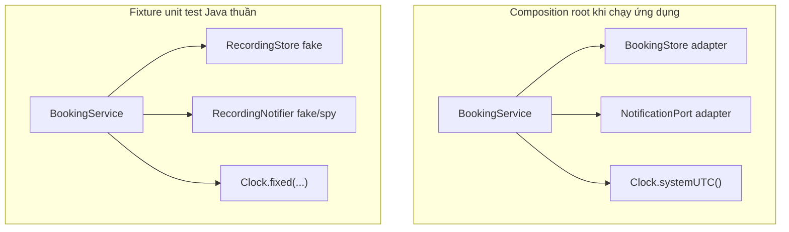

# Thiết kế unit test bằng fake mà không khởi động framework

## 1. Mục tiêu thực hành: kiểm tra nghiệp vụ, không kiểm tra cách container khởi động

Trong **Dependency Injection (DI)**, một service nhận các cộng tác viên từ bên ngoài thay vì tự tạo chúng. Điều này tạo cơ hội rất thực tế: **kiểm thử service bằng các implementation nhỏ do bài test kiểm soát**, không cần khởi động Spring, không cần kết nối database và không cần gửi thông báo thật.

Bài này nằm trong chương **Thực hành** của module **DEPENDENCY_INJECTION**. Module học **Dependency Injection và Inversion of Control (IoC)** để tách việc sử dụng dependency khỏi quá trình tạo và lắp ghép object; thực hành **constructor injection, composition root, scope/vòng đời** và kiểm thử bằng **Java thuần** trước khi mở rộng sang DI container.

Tình huống xuyên suốt: khi xác nhận đặt chỗ, `BookingService` cần:

1. Nhờ `BookingStore` ghi nhận chuyển trạng thái từ **chưa xác nhận** sang **đã xác nhận**.
2. Chỉ khi trạng thái thật sự thay đổi, nhờ `NotificationPort` gửi một thông báo.
3. Lấy thời gian từ `Clock` để tạo dữ liệu gửi đi.
4. Sử dụng `bookingId`, `recipient` và `requestId` **của lần gọi hiện tại**, không lưu chúng vào các field dùng chung.

Ta sẽ viết **fake store** có bộ nhớ và quy tắc đơn giản, **recording notifier** ghi nhận lời gọi, rồi tự chạy test bằng phương thức `main` và `AssertionError`. Không sử dụng JUnit, Mockito, Spring hay DI container.

### Kết quả cần đạt

Sau bài học, bạn có thể:

- Chỉ ra **ranh giới nào cần inject** để service kiểm thử độc lập.
- Thiết kế fake theo **hợp đồng mà consumer sử dụng**, không theo chi tiết của database hoặc SDK.
- Viết các ca **Given–When–Then**: thành công, lặp lại, dữ liệu sai, booking không tồn tại, nhiều request và lỗi phụ thuộc.
- Kiểm tra **kết quả, trạng thái và tương tác** mà không tạo test phụ thuộc class implementation.
- Biết **khi nào fake chưa đủ** và cần contract test, integration test hoặc kiểm thử wiring/container.

> **Thông điệp chính:** Unit test chạy không cần framework là kết quả của một **ranh giới dependency được thiết kế rõ**. Không cần loại bỏ framework khỏi toàn bộ dự án; chỉ cần bảo đảm use case có thể được khởi tạo và quan sát thông qua các hợp đồng cần thiết.

## 2. Tại sao một số service rất khó unit test?

Một service ban đầu có thể viết thế này:

```java
// Phản ví dụ: minh họa coupling, không thuộc chương trình chạy ở mục 6.
final class BookingService {
    private final JdbcBookingStore store = new JdbcBookingStore();
    private final RealNotificationClient client =
            new RealNotificationClient();

    boolean confirm(String bookingId, String recipient) {
        if (store.confirmIfPending(bookingId)) {
            client.send(recipient, "Đặt chỗ đã xác nhận");
            return true;
        }
        return false;
    }
}
```

Một test muốn gọi `confirm` sẽ đồng thời phụ thuộc:

- Cấu hình và kết nối mà `JdbcBookingStore` yêu cầu;
- Tài khoản hoặc server của `RealNotificationClient`;
- Độ trễ mạng và tình trạng dịch vụ ngoài;
- Khả năng reset dữ liệu giữa các lần chạy test;
- Hành vi của implementation thật mà bài test không thể kiểm soát hoàn toàn.

Nếu service thay vì gọi `new` lại gọi `ApplicationContext.getBean(...)` trong method, ta chỉ đổi dạng phụ thuộc ẩn: test vẫn cần một container hoặc fake container phức tạp để chạy ca sử dụng đơn giản.

### Tách đúng chỗ, không chỉ “mock mọi thứ”

Mã nghiệp vụ cần **hành vi** “xác nhận nếu đang chờ” và “gửi thông báo”, không cần biết JDBC hay SMTP. Từ đó tách hai hợp đồng:

```java
interface BookingStore {
    boolean confirmIfPending(String bookingId);
}

interface NotificationPort {
    void send(ConfirmationMessage message);
}
```

Service nhận hai port cùng `Clock` qua constructor. Trong runtime, composition root truyền các adapter thật. Trong unit test, ta truyền fake/recorder.

**Sự thay thế nằm ở cùng một điểm injection.** Không sửa `BookingService` theo kiểu “nếu test thì dùng fake, nếu production thì dùng JDBC”; điều đó sẽ trộn code test vào nghiệp vụ.

## 3. Bản hợp đồng tối thiểu trước khi viết fake

Một fake tốt phải bám theo **ngữ nghĩa mà service được phép dựa vào**. Đối với bài học này:

| Thành phần | Hợp đồng mà consumer cần | Điều không thuộc hợp đồng |
| --- | --- | --- |
| `BookingStore.confirmIfPending(id)` | Trả `true` nếu booking tồn tại và chuyển từ PENDING sang CONFIRMED; trả `false` nếu đã CONFIRMED; ném `NoSuchElementException` nếu không tồn tại. | Có dùng SQL, bảng nào, cache nào hoặc truy vấn bao nhiêu lần. |
| `NotificationPort.send(message)` | Nhận đúng thông tin thông báo; có thể ném runtime exception khi việc gửi không thành công. | SMTP, HTTP, JSON hay queue cụ thể. |
| `Clock` | Cấp thời điểm khi service cần; test có thể dùng thời gian cố định. | Đồng hồ hệ điều hành phải chạy đúng trong unit test. |
| `BookingCommand` | Chứa `bookingId`, `recipient` và `requestId` hợp lệ của một lời gọi. | Không tự tra container hoặc tạo database. |
| `BookingService.confirm(command)` | Gọi store trước; nếu trả `true` thì tạo message và gửi; nếu `false` thì không gửi; nếu store ném lỗi thì không gửi. | Không tự bảo đảm giao dịch giữa store và dịch vụ gửi ngoài. |

Với ví dụ này, trạng thái PENDING và CONFIRMED được **đơn giản hóa** thành boolean trong fake. Với ứng dụng thật, có thể có CANCELLED, EXPIRED và nhiều điều kiện phức tạp hơn; khi đó cần điều chỉnh hợp đồng và test.

**Điểm quan trọng của `boolean`:** trả `true` nghĩa là **có chuyển trạng thái trong lần gọi đó**, không phải “booking hiện đang được xác nhận”. Nếu fake trả `true` cho mọi lần gọi, service có thể gửi thông báo lặp. Fake không chỉ cần biên dịch được mà còn phải đúng ý nghĩa này.

### Không để test giả định nhiều hơn hợp đồng

Nếu port không bảo đảm thứ tự của danh sách kết quả, đừng viết assertion phụ thuộc thứ tự. Nếu hợp đồng chỉ đòi hỏi một lần gửi, test nên kiểm tra số lượt gửi và dữ liệu cần thiết; không cần kiểm tra tên phương thức private, cấu trúc collection hay dòng log nội bộ của adapter.

## 4. Lập ma trận test trước khi viết mã

Một bộ unit test tốt bắt đầu từ **nhánh nghiệp vụ có thể quan sát**, không bắt đầu từ việc chọn framework mocking.

| Ca | Given (chuẩn bị) | When (hành động) | Then (kỳ vọng) |
| --- | --- | --- | --- |
| **1. Xác nhận lần đầu** | Booking `B-101` đang chờ. | Gọi `confirm(commandA)`. | Trả `true`, store ghi nhận, notifier nhận đúng message và thời gian. |
| **2. Xác nhận lặp** | Booking `B-101` được xử lý hai lần. | Gọi `confirm` hai lần. | Lần thứ hai trả `false`, notifier chỉ được gọi **một lần**. |
| **3. Không tồn tại** | Store không có `B-404`. | Gọi `confirm(command404)`. | Ném `NoSuchElementException`, không gọi notifier. |
| **4. Đầu vào sai** | Command bị thiếu ID hoặc service nhận `null`. | Tạo command/gọi service. | Từ chối sớm, không tương tác với store/notifier. |
| **5. Hai yêu cầu khác dữ liệu** | Có `B-101` và `B-202`. | Xác nhận theo hai command. | Đúng ID–recipient–requestId, không trộn dữ liệu. |
| **6. Notifier thất bại** | Store xác nhận được; fake notifier được cấu hình ném lỗi. | Gọi `confirm`. | Lỗi được chuyển tới caller; store **đã có thể thay đổi**. |
| **7. Thiếu dependency bắt buộc** | Truyền `null` vào constructor. | Tạo `BookingService`. | Fail-fast bằng `NullPointerException`. |

Bảng trên chỉ mô tả **hợp đồng của ví dụ**. Nó giúp biết phải xây loại fake nào và cần ghi nhận những gì. Test số 6 đặc biệt quan trọng: nó phân biệt “DI giúp thay dependency” với “DI tự tạo transaction cho mọi side effect” — điều thứ hai **không đúng**.

## 5. Object graph nhỏ trong test và production

Cùng một consumer có thể nhận hai tập implementation khác nhau:



**Service không cần biết** mình nhận tập nào. Trong cả hai trường hợp, constructor chỉ yêu cầu ba cộng tác viên:

```java
BookingService(BookingStore store, NotificationPort notifier, Clock clock)
```

Từ đây có hai lợi ích rõ ràng:

- **Tốc độ và tính xác định:** unit test không phải khởi động ứng dụng hay gọi hạ tầng ngoài.
- **Kiểm soát tình huống lỗi:** fake có thể chủ động mô phỏng “booking không tồn tại”, “đã xác nhận”, “sender ném exception”, thay vì chờ network thật gặp lỗi.

### Phân biệt fake, stub và spy

- **Fake:** triển khai đơn giản có hành vi thật ở quy mô nhỏ, chẳng hạn map chứa trạng thái PENDING/CONFIRMED.
- **Stub:** trả dữ liệu đã định trước chỉ để hướng consumer vào một nhánh.
- **Spy/recording fake:** ghi nhận lời gọi để test kiểm tra tham số, số lần và thứ tự.
- **Mock:** đối tượng được cấu hình các expectation; thường do một thư viện mocking sinh ra.

Một test double có thể kết hợp nhiều vai trò: `RecordingStore` vừa là **fake lưu trạng thái**, vừa ghi các lượt `confirmIfPending`. Không bắt buộc dùng thư viện mock để có unit test tốt.

## 6. Chương trình Java thuần hoàn chỉnh: service có thể chạy độc lập container

Lưu đoạn mã sau vào **`Main.java`**. Ví dụ chạy với **JDK 11 trở lên**; không cần Spring, JUnit, Mockito hoặc thư viện ngoài.

```java
import java.time.Clock;
import java.time.Instant;
import java.time.ZoneOffset;
import java.util.HashMap;
import java.util.Map;
import java.util.NoSuchElementException;
import java.util.Objects;

public class Main {
    private static String required(String value, String name) {
        if (value == null || value.isBlank()) {
            throw new IllegalArgumentException(name + " không hợp lệ");
        }
        return value;
    }

    // Dữ liệu một yêu cầu; không phải dependency của service dùng chung.
    static final class BookingCommand {
        final String bookingId;
        final String recipient;
        final String requestId;

        BookingCommand(String bookingId, String recipient, String requestId) {
            this.bookingId = required(bookingId, "bookingId");
            this.recipient = required(recipient, "recipient");
            this.requestId = required(requestId, "requestId");
        }
    }

    static final class ConfirmationMessage {
        final String bookingId;
        final String recipient;
        final String requestId;
        final Instant confirmedAt;

        ConfirmationMessage(
                String bookingId,
                String recipient,
                String requestId,
                Instant confirmedAt) {
            this.bookingId = Objects.requireNonNull(bookingId);
            this.recipient = Objects.requireNonNull(recipient);
            this.requestId = Objects.requireNonNull(requestId);
            this.confirmedAt = Objects.requireNonNull(confirmedAt);
        }
    }

    // Port do use case cần, không phơi SQL, HTTP hoặc container.
    interface BookingStore {
        boolean confirmIfPending(String bookingId);
    }

    interface NotificationPort {
        void send(ConfirmationMessage message);
    }

    static final class BookingService {
        private final BookingStore store;
        private final NotificationPort notifier;
        private final Clock clock;

        BookingService(
                BookingStore store,
                NotificationPort notifier,
                Clock clock) {
            this.store = Objects.requireNonNull(store, "store");
            this.notifier = Objects.requireNonNull(notifier, "notifier");
            this.clock = Objects.requireNonNull(clock, "clock");
        }

        boolean confirm(BookingCommand command) {
            Objects.requireNonNull(command, "command");

            boolean changed = store.confirmIfPending(command.bookingId);
            if (!changed) {
                return false;
            }

            ConfirmationMessage message = new ConfirmationMessage(
                    command.bookingId,
                    command.recipient,
                    command.requestId,
                    Instant.now(clock));
            notifier.send(message);
            return true;
        }
    }

    // Adapter demo. Không cần database, chỉ dùng cho thực hành tuần tự.
    static final class InMemoryBookingStore implements BookingStore {
        private final Map<String, Boolean> confirmed = new HashMap<>();

        void addPending(String bookingId) {
            confirmed.put(required(bookingId, "bookingId"), false);
        }

        @Override
        public boolean confirmIfPending(String bookingId) {
            Boolean old = confirmed.get(bookingId);
            if (old == null) {
                throw new NoSuchElementException(
                        "Không tìm thấy booking: " + bookingId);
            }
            if (old) {
                return false;
            }
            confirmed.put(bookingId, true);
            return true;
        }

        boolean isConfirmed(String bookingId) {
            return Boolean.TRUE.equals(confirmed.get(bookingId));
        }
    }

    static final class ConsoleNotificationAdapter
            implements NotificationPort {
        @Override
        public void send(ConfirmationMessage message) {
            System.out.println(
                    "Gửi xác nhận " + message.bookingId
                    + " tới " + message.recipient
                    + " (request=" + message.requestId
                    + ", at=" + message.confirmedAt + ")");
        }
    }

    public static void main(String[] args) {
        // COMPOSITION ROOT: tạo adapter và inject dependency.
        InMemoryBookingStore store = new InMemoryBookingStore();
        store.addPending("B-101");

        NotificationPort notifier = new ConsoleNotificationAdapter();
        Clock clock = Clock.fixed(
                Instant.parse("2026-01-02T03:04:05Z"), ZoneOffset.UTC);

        BookingService service = new BookingService(store, notifier, clock);
        BookingCommand command = new BookingCommand(
                "B-101", "a@example.com", "REQ-A");

        boolean first = service.confirm(command);
        boolean repeated = service.confirm(command);

        System.out.println("Xác nhận lần đầu? " + first);
        System.out.println("Xác nhận lặp? " + repeated);
        System.out.println("Store đã xác nhận? " + store.isConfirmed("B-101"));
    }
}
```

Biên dịch và chạy:

```bash
javac -encoding UTF-8 Main.java
java Main
```

Kết quả **dự kiến**:

```text
Gửi xác nhận B-101 tới a@example.com (request=REQ-A, at=2026-01-02T03:04:05Z)
Xác nhận lần đầu? true
Xác nhận lặp? false
Store đã xác nhận? true
```

Chương trình này không có annotation và cũng không gọi container API. Nhưng nó vẫn là **Dependency Injection**: `Main.main()` **tạo và kết nối** dependency, còn `BookingService` **sử dụng** dependency thông qua interface.

**Giới hạn:** `HashMap` trong adapter demo không an toàn cho cập nhật đồng thời; dữ liệu không được lưu bền vững; ví dụ không kiểm tra quyền của người gửi hoặc tính hợp lệ thực tế của email. Trong sản phẩm, adapter phải đáp ứng hợp đồng lưu trữ và yêu cầu đồng thời đúng với môi trường chạy.

## 7. Tạo fake và chạy một bộ unit test không dùng framework

Thêm class sau **sau dấu `}` kết thúc class `Main`** vào cùng tệp `Main.java` ở mục 6. Chỉ có một class `public` là `Main`; `BookingServiceTest` là class package-private nên vẫn chạy được bằng lệnh `java BookingServiceTest`.

Các fake chủ động mô phỏng behavior và ghi lại event. Để mỗi test độc lập, ta tạo một **`Fixture` mới** cho từng kịch bản.

```java
class BookingServiceTest {
    private static final java.time.Instant FIXED =
            java.time.Instant.parse("2026-01-02T03:04:05Z");

    // Fake: có trạng thái PENDING/CONFIRMED và ghi lời gọi.
    static final class RecordingStore implements Main.BookingStore {
        final java.util.List<String> events;
        final java.util.Map<String, Boolean> confirmed =
                new java.util.HashMap<>();

        RecordingStore(java.util.List<String> events) {
            this.events = events;
        }

        void addPending(String bookingId) {
            confirmed.put(bookingId, false);
        }

        boolean isConfirmed(String bookingId) {
            return Boolean.TRUE.equals(confirmed.get(bookingId));
        }

        @Override
        public boolean confirmIfPending(String bookingId) {
            events.add("store:" + bookingId);

            Boolean old = confirmed.get(bookingId);
            if (old == null) {
                throw new java.util.NoSuchElementException(
                        "Booking không tồn tại: " + bookingId);
            }
            if (old) {
                return false;
            }

            confirmed.put(bookingId, true);
            return true;
        }
    }

    // Recording fake: ghi message và có thể mô phỏng lỗi gửi.
    static final class RecordingNotifier implements Main.NotificationPort {
        final java.util.List<String> events;
        final java.util.List<Main.ConfirmationMessage> messages =
                new java.util.ArrayList<>();
        boolean fail;

        RecordingNotifier(java.util.List<String> events) {
            this.events = events;
        }

        @Override
        public void send(Main.ConfirmationMessage message) {
            events.add("send:" + message.bookingId);
            messages.add(message);

            if (fail) {
                throw new IllegalStateException("Giả lập lỗi notifier");
            }
        }
    }

    // Mỗi scenario bắt đầu với một graph nhỏ, tách biệt.
    static final class Fixture {
        final java.util.List<String> events = new java.util.ArrayList<>();
        final RecordingStore store = new RecordingStore(events);
        final RecordingNotifier notifier = new RecordingNotifier(events);
        final Main.BookingService service = new Main.BookingService(
                store,
                notifier,
                java.time.Clock.fixed(FIXED, java.time.ZoneOffset.UTC));
    }

    private static Main.BookingCommand command(
            String bookingId, String recipient, String requestId) {
        return new Main.BookingCommand(bookingId, recipient, requestId);
    }

    private static void check(boolean condition, String description) {
        if (!condition) {
            throw new AssertionError(description);
        }
    }

    private static void equal(
            Object expected, Object actual, String description) {
        if (!java.util.Objects.equals(expected, actual)) {
            throw new AssertionError(
                    description + " | expected=" + expected
                    + ", actual=" + actual);
        }
    }

    private static void expectThrows(
            Class<? extends Throwable> expected,
            Runnable action,
            String description) {
        try {
            action.run();
        } catch (Throwable caught) {
            if (expected.isInstance(caught)) {
                return;
            }
            throw new AssertionError(
                    description + ": sai loại exception", caught);
        }
        throw new AssertionError(
                description + ": không ném " + expected.getSimpleName());
    }

    private static void testFirstConfirmation() {
        Fixture f = new Fixture();
        f.store.addPending("B-101");

        boolean changed = f.service.confirm(
                command("B-101", "alice@example.com", "REQ-A"));

        check(changed, "Lần xác nhận đầu phải trả true");
        check(f.store.isConfirmed("B-101"), "Store chưa xác nhận");
        equal(java.util.List.of("store:B-101", "send:B-101"),
                f.events, "Sai thứ tự/tương tác");
        equal(1, f.notifier.messages.size(), "Phải gửi một thông báo");

        Main.ConfirmationMessage sent = f.notifier.messages.get(0);
        equal("B-101", sent.bookingId, "Sai ID");
        equal("alice@example.com", sent.recipient, "Sai recipient");
        equal("REQ-A", sent.requestId, "Sai requestId");
        equal(FIXED, sent.confirmedAt, "Sai thời gian gửi");
    }

    private static void testRepeatedConfirmation() {
        Fixture f = new Fixture();
        f.store.addPending("B-101");
        Main.BookingCommand command =
                command("B-101", "alice@example.com", "REQ-A");

        check(f.service.confirm(command), "Lần đầu phải thành công");
        check(!f.service.confirm(command), "Lần lặp phải trả false");

        equal(1, f.notifier.messages.size(),
                "Xác nhận lặp không được gửi thêm");
        equal(java.util.List.of(
                "store:B-101", "send:B-101", "store:B-101"),
                f.events, "Sai chuỗi tương tác khi gọi lặp");
    }

    private static void testMissingBooking() {
        Fixture f = new Fixture();

        expectThrows(java.util.NoSuchElementException.class,
                () -> f.service.confirm(
                        command("B-404", "a@example.com", "REQ-X")),
                "Booking không tồn tại");

        equal(java.util.List.of("store:B-404"),
                f.events, "Không được gửi khi store báo lỗi");
        equal(0, f.notifier.messages.size(),
                "Không được có thông báo cho ID không tồn tại");
    }

    private static void testInvalidInput() {
        Fixture f = new Fixture();

        expectThrows(IllegalArgumentException.class,
                () -> new Main.BookingCommand(
                        "  ", "a@example.com", "REQ-X"),
                "Booking ID trắng");
        expectThrows(IllegalArgumentException.class,
                () -> new Main.BookingCommand(
                        "B-101", "", "REQ-X"),
                "Recipient rỗng");
        expectThrows(NullPointerException.class,
                () -> f.service.confirm(null),
                "Command null");

        check(f.events.isEmpty(),
                "Đầu vào không hợp lệ không được gọi collaborator");
    }

    private static void testTwoIndependentRequests() {
        Fixture f = new Fixture();
        f.store.addPending("B-101");
        f.store.addPending("B-202");

        check(f.service.confirm(
                command("B-101", "a@example.com", "REQ-A")),
                "Request A chưa được xử lý");
        check(f.service.confirm(
                command("B-202", "b@example.com", "REQ-B")),
                "Request B chưa được xử lý");

        equal(2, f.notifier.messages.size(),
                "Phải gửi riêng cho hai booking");

        Main.ConfirmationMessage a = f.notifier.messages.get(0);
        Main.ConfirmationMessage b = f.notifier.messages.get(1);

        equal("B-101", a.bookingId, "A: sai booking");
        equal("a@example.com", a.recipient, "A: sai recipient");
        equal("REQ-A", a.requestId, "A: sai request");
        equal("B-202", b.bookingId, "B: sai booking");
        equal("b@example.com", b.recipient, "B: sai recipient");
        equal("REQ-B", b.requestId, "B: sai request");
    }

    private static void testNotifierFailure() {
        Fixture f = new Fixture();
        f.store.addPending("B-101");
        f.notifier.fail = true;

        expectThrows(IllegalStateException.class,
                () -> f.service.confirm(
                        command("B-101", "a@example.com", "REQ-A")),
                "Lỗi notifier cần truyền tới caller");

        check(f.store.isConfirmed("B-101"),
                "Store có thể đã thay đổi trước khi notifier lỗi");
        equal(1, f.notifier.messages.size(),
                "Fake phải ghi một lần cố gắng gửi");

        // Không tự động gửi lại sau khi store đã xác nhận.
        check(!f.service.confirm(
                command("B-101", "a@example.com", "REQ-RETRY")),
                "Lần sau phải thấy trạng thái đã xác nhận");
        equal(java.util.List.of(
                "store:B-101", "send:B-101", "store:B-101"),
                f.events, "Sai hệ quả sau khi notifier lỗi");
    }

    private static void testRequiredDependencies() {
        Fixture f = new Fixture();
        expectThrows(NullPointerException.class,
                () -> new Main.BookingService(
                        null, f.notifier,
                        java.time.Clock.systemUTC()),
                "Thiếu store");
        expectThrows(NullPointerException.class,
                () -> new Main.BookingService(
                        f.store, null,
                        java.time.Clock.systemUTC()),
                "Thiếu notifier");
        expectThrows(NullPointerException.class,
                () -> new Main.BookingService(
                        f.store, f.notifier, null),
                "Thiếu clock");
    }

    public static void main(String[] args) {
        testFirstConfirmation();
        testRepeatedConfirmation();
        testMissingBooking();
        testInvalidInput();
        testTwoIndependentRequests();
        testNotifierFailure();
        testRequiredDependencies();

        System.out.println("PASS: 7 unit-test scenarios không cần framework");
    }
}
```

Chạy bộ test bằng Java thuần:

```bash
javac -encoding UTF-8 Main.java
java BookingServiceTest
```

Kết quả **dự kiến**:

```text
PASS: 7 unit-test scenarios không cần framework
```

Đây là ví dụ tự chạy được về mặt thiết kế; nội dung bài không tuyên bố đã thực thi bộ test ở môi trường của người học. Khi chạy tại máy của bạn, bất kỳ `AssertionError` hoặc exception không mong đợi nào sẽ khiến chương trình thất bại thay vì in dòng `PASS`.

## 8. Đọc một unit test theo Given–When–Then

Xét `testFirstConfirmation()`:

```java
Fixture f = new Fixture();
f.store.addPending("B-101");   // Given: booking đang chờ.

boolean changed = f.service.confirm(
        command("B-101", "alice@example.com", "REQ-A")); // When.

check(changed, "Lần xác nhận đầu phải trả true"); // Then.
equal(1, f.notifier.messages.size(), "Phải gửi một thông báo");
```

**Given** tạo một **object graph nhỏ** với fake: `BookingService -> RecordingStore, RecordingNotifier, Clock.fixed`. Không có container nào thực hiện wiring; fixture gọi constructor trực tiếp.

**When** chỉ thực hiện hành động nghiệp vụ mà test đang quan tâm. Dữ liệu của lần gọi được truyền trong `BookingCommand`, không ghi vào field `currentRecipient` trên service.

**Then** quan sát **kết quả được trả về**, **trạng thái liên quan** và **lời gọi tới cổng thông báo**. Không truy cập field private của service hoặc kiểm tra class name của implementation.

### Vì sao cần kiểm tra cả kết quả lẫn tương tác?

Nếu chỉ kiểm tra `changed == true`, một implementation lỗi có thể trả đúng giá trị nhưng không gửi thông báo. Nếu chỉ kiểm tra notifier được gọi, service có thể gửi dù store không thay đổi hoặc gửi nhiều lần. Kết hợp các assertion **có giá trị nghiệp vụ** giúp phát hiện những sai khác đó.

Nhưng đừng biến mỗi unit test thành một bản sao chi tiết của thuật toán: kiểm tra số lần gọi helper private hoặc thứ tự của các phép tính nội bộ thường làm test giòn. Chỉ kiểm tra thứ tự **khi đó là một điều kiện của hợp đồng**, ví dụ “store phải xác nhận thành công trước khi gửi”.

## 9. Thiết kế fixture nhỏ, độc lập và dễ đọc

Một fixture nên tạo đủ dependency cho **một ca test**, không tái sử dụng trạng thái của ca trước:

```java
Fixture f = new Fixture();
f.store.addPending("B-101");
```

Trong mã test ở mục 7, mỗi lần `new Fixture()` tạo:

- Một danh sách `events` mới;
- Một `RecordingStore` mới;
- Một `RecordingNotifier` mới;
- Một `BookingService` nhận các đối tượng ấy;
- Một `Clock.fixed(...)` để thời gian không thay đổi ngoài ý muốn.

Điều này tránh lỗi **test order dependency**: nếu test số 2 cần test số 1 chạy trước để seed dữ liệu, bộ test khó bảo trì và có thể thất bại khi đổi thứ tự.

### Không dùng singleton fake toàn cục tùy tiện

Phản ví dụ:

```java
// Dễ làm các test phụ thuộc lẫn nhau.
static final RecordingStore SHARED_STORE = new RecordingStore(...);
```

Một fake sống suốt cả suite có thể giữ những ID từ scenario trước. Khi đó test lặp có thể trả `false` không vì logic đúng mà vì dữ liệu đã bị ô nhiễm. Với unit test, ưu tiên **một graph mới cho mỗi test**, trừ khi việc chia sẻ fixture đã được kiểm soát chặt.

### Không cần cấu hình startup phức tạp trong test

Nếu fixture phải tạo application context, đọc biến môi trường, đăng ký bean theo profile hoặc mở database chỉ để gọi một method, có thể ranh giới cần test chưa được tách đủ rõ. Tuy vậy, **không phải cứ thấy framework là thiết kế sai**; integration test có lý do riêng để khởi động context thật.

## 10. Fake phải có hành vi có ý nghĩa, không được “nói dối” về hợp đồng

Một fake thường được cài rất ngắn, nhưng quá đơn giản có thể khiến test vượt qua dù implementation production sai.

Phản ví dụ:

```java
// Fake sai ngữ nghĩa nếu confirmIfPending phải trả true chỉ lần đầu.
final class AlwaysSuccessfulStore implements BookingStore {
    @Override
    public boolean confirmIfPending(String id) {
        return true;
    }
}
```

Nếu service gọi xác nhận lặp, fake này luôn báo có thay đổi và khiến notifier gửi lặp. Nó có thể phù hợp như **stub có chủ đích** để kiểm tra đúng một nhánh, nhưng **không** phải fake thay thế đầy đủ cho `BookingStore` đã có hợp đồng PENDING/CONFIRMED.

### Kiểm thử hợp đồng cho fake và adapter thật

Khi một fake được sử dụng ở nhiều nơi như implementation hợp lệ của port, nên chạy **cùng một bộ contract test** trên fake và các adapter production phù hợp:

```text
BookingStoreContract
   ├── InMemoryFakeStore
   ├── JdbcBookingStore
   └── FileBookingStore
```

Các scenario hợp đồng có thể gồm:

1. Booking PENDING xác nhận lần đầu trả `true`.
2. Booking CONFIRMED xác nhận lặp trả `false`.
3. Booking thiếu ID trả đúng loại lỗi đã thỏa thuận.
4. Đầu vào không hợp lệ không làm thay đổi state.
5. Quy tắc nhất quán/atomicity được kiểm tra ở mức mà port yêu cầu.

**Unit test consumer bằng fake và contract test adapter giải quyết hai câu hỏi khác nhau**: consumer có dùng port đúng không, và implementation có thực hiện port đúng không. Nếu fake khác adapter thật về semantics, unit test có thể đem lại niềm tin sai.

Đối với JDBC, dùng `new JdbcBookingStore()` nhiều lần **không tự bảo đảm dữ liệu test sạch**, vì các instance có thể dùng chung database. Contract test của adapter thật cần fixture sở hữu database/schema/transaction và dọn dẹp đúng cách.

## 11. Kiểm tra exception mà không nuốt lỗi

Để thử một đường lỗi, ta cần phân biệt:

- Lỗi **đúng hợp đồng**: ví dụ `NoSuchElementException` khi booking không tồn tại.
- Lỗi **không mong đợi**: ví dụ `NullPointerException` do bug trong fake hoặc service.
- Lỗi **sau một side effect**: notifier ném lỗi khi store đã thay đổi.

Hàm `expectThrows(...)` trong test ở mục 7 kiểm tra **đúng loại exception mong đợi**, đồng thời báo thất bại nếu không có exception hoặc sai loại. Không nên viết:

```java
try {
    service.confirm(command);
} catch (Exception ignored) {
    // Bắt tất cả rồi bỏ qua -> test có thể PASS vì lý do sai.
}
```

Với ca notifier thất bại, test cố ý xác minh:

```java
check(f.store.isConfirmed("B-101"),
        "Store có thể đã thay đổi trước khi notifier lỗi");
```

Điều này **không** có nghĩa hệ thống production nên chấp nhận mất thông báo. Nó chứng minh một đặc tính hiện tại của thuật toán: store được gọi trước notifier. Nếu cần giao thông báo đáng tin cậy, cần thiết kế cơ chế như **transactional outbox, retry có kiểm soát, idempotency key** hoặc trạng thái gửi riêng. DI không tự làm hai hệ thống ngoài trở thành một giao dịch nguyên tử.

### Có nên ép fake ném lỗi từ mọi method?

Không cần. Hãy mô phỏng **những trường hợp lỗi mà hành vi consumer phải xử lý**. Fake với quá nhiều chế độ, flag và nhánh tự nó có thể trở thành một hệ thống khó kiểm chứng. Khi fake ngày càng phức tạp, cân nhắc dùng những stub nhỏ theo từng test hoặc giới hạn bộ hợp đồng đã cam kết.

## 12. Khi nào cần kiểm tra thứ tự gọi?

Ở ca xác nhận đặt chỗ, thứ tự `store -> notifier` có ý nghĩa: không được gửi thông báo khi store từ chối chuyển trạng thái.

Danh sách `events` cho phép kiểm tra:

```text
store:B-101
send:B-101
```

Khi xác nhận lặp:

```text
store:B-101
send:B-101
store:B-101
```

Không có dòng `send` ở lần thứ hai.

Tuy nhiên, không phải thứ tự nào cũng là hợp đồng. Nếu hai phép đọc độc lập có thể gọi theo hai thứ tự mà vẫn đúng nghiệp vụ, test không nên buộc thứ tự chỉ vì implementation hiện tại viết theo thứ tự đó.

Một câu hỏi trước mỗi assertion về interaction:

> “Nếu developer refactor nội bộ nhưng vẫn giữ đúng hành vi mà caller thấy, test này có nên thất bại không?”

Nếu câu trả lời là **không**, assertion đang có thể kiểm tra quá sâu vào implementation thay vì hợp đồng.

## 13. Scope và concurrency: bài test tuần tự chưa đủ cho dependency dùng chung

Trong unit test, mỗi `Fixture` có store/notifier riêng. Đây là lựa chọn tốt để cô lập test, nhưng production có thể dùng **một instance** `BookingService` hoặc repository cho nhiều request.

Nếu nhiều thread gọi cùng `InMemoryBookingStore` dùng `HashMap`, test ở mục 7 **không chứng minh thread safety**. Constructor injection và `private final` chỉ giúp tham chiếu dependency rõ ràng/không gán lại; chúng không biến `HashMap` thành một cấu trúc đồng thời an toàn.

Khi hệ thống yêu cầu nhiều request chạy đồng thời:

- Xác định object nào được chia sẻ trong **object graph**.
- Nêu rõ hợp đồng **atomicity** và **thread safety** của store/notifier.
- Dùng transaction/constraint ở database hoặc cấu trúc đồng thời thích hợp cho implementation.
- Kiểm thử đồng thời, nhưng không xem một lần test PASS là bằng chứng cho mọi interleaving.
- Phân biệt nhiều instance service với nhiều nguồn dữ liệu: hai adapter khác nhau vẫn có thể cùng ghi một database.

Ví dụ, thay `HashMap` bằng `ConcurrentHashMap` **chưa chắc đủ** nếu thuật toán vẫn là “đọc trạng thái -> kiểm tra -> ghi” bằng nhiều thao tác tách rời. Phải bảo vệ **cả quyết định xác nhận lần đầu**, không chỉ từng lệnh collection.

## 14. Bất đồng bộ và vòng đời của test double

Với `CompletableFuture`, `ExecutorService` hoặc message queue, lời gọi có thể hoàn tất **sau khi test method đã trả về**. Nếu assert ngay, ta có thể kiểm tra quá sớm:

```java
// Chỉ là phác họa async; không ghép vào Main.java ở mục 6.
CompletableFuture<Void> future = CompletableFuture.runAsync(
        () -> notifier.send(message), executor);

// Cần chờ trạng thái mà hợp đồng test yêu cầu.
future.join();
```

Trong test thực tế:

1. Chờ tác vụ hoàn tất bằng `Future.get(...)`/`join()`, latch hoặc cơ chế đồng bộ phù hợp; đặt timeout khi cần tránh chờ vô hạn.
2. Không dùng `Thread.sleep(...)` tùy tiện để đoán lúc tác vụ hoàn tất.
3. Ghi nhận exception từ task và xác minh theo hợp đồng.
4. Không chia sẻ `ArrayList` recorder giữa nhiều thread nếu không đồng bộ.
5. Đóng executor, client, file hoặc resource do fixture tạo, kể cả khi assertion thất bại.

**Ownership:** nếu test fixture tự mở resource thì fixture chịu trách nhiệm đóng. Nếu service chỉ **mượn** executor hoặc HTTP client được inject, không tự gọi `shutdown()`/`close()` trong mỗi use case. Đối với test resource thật, có thể dùng `try-with-resources` hoặc teardown có bảo đảm.

**Context:** dữ liệu `requestId` trong `BookingCommand` thuộc từng lời gọi. DI không tự chuyển `ThreadLocal`, security context hoặc request scope sang worker khác. Nếu tác vụ cần dữ liệu nào, truyền rõ giá trị phù hợp; không để fake đọc một trạng thái global thay đổi theo request.

## 15. Ranh giới chính xác giữa unit test, contract test và integration test

Không khởi động framework là **lựa chọn đúng cho unit test nghiệp vụ** trong bài. Nhưng ta cũng cần biết những vấn đề mà test này **không thể xác minh**.

| Điều cần chứng minh | Test phù hợp | Vì sao? |
| --- | --- | --- |
| Service gửi thông báo đúng dữ liệu khi store trả `true`. | **Unit test** với recording fake. | Kiểm tra logic điều phối qua port. |
| Service không gửi khi store trả `false` hoặc ném lỗi. | **Unit test** với fake/stub. | Dễ tạo nhánh kiểm soát được. |
| Fake và JDBC adapter cùng tuân ngữ nghĩa `confirmIfPending`. | **Contract test** chạy cùng suite. | Kiểm tra khả năng thay thế implementation. |
| JDBC adapter có dùng transaction và chuyển lỗi SQL đúng. | **Integration test** với database phù hợp. | Cần hạ tầng và mapping thật. |
| Spring phát hiện bean và chọn đúng implementation theo profile. | **Wiring/context test**. | Unit test trực tiếp không chạy container. |
| Transaction/security advice trên proxy có hiệu lực. | **Integration test** qua proxy thật. | `new BookingService(fake)` không gọi interceptor. |
| Scope/lifecycle đóng resource đúng lúc. | **Lifecycle/integration test**. | Tùy framework, scope và adapter thực tế. |
| Dữ liệu không trộn giữa nhiều request đồng thời. | **Concurrency test** kèm lập luận contract. | Unit test tuần tự không phủ concurrency. |

Không nên biến mọi test thành `@SpringBootTest` chỉ vì ứng dụng dùng Spring. Ngược lại, không nên lấy PASS của bộ test Java thuần làm bằng chứng container đã đăng ký bean đúng, database đã sẵn sàng hoặc giao dịch có hiệu lực.

### Khi DI container xuất hiện, thay đổi điều gì?

`BookingService` vẫn chỉ cần `BookingStore`, `NotificationPort` và `Clock`. Container có thể tạo adapter thật và cấp cho constructor theo cấu hình. **Test đơn vị không cần thay đổi** nếu ranh giới hợp đồng vẫn đúng.

Một lưu ý: một số container inject **proxy** cho lazy, transaction hoặc request scope. Unit test bằng fake trực tiếp không chạy các cơ chế đó. Hãy kiểm tra chúng ở tầng integration **khi hành vi proxy là một phần yêu cầu**.

## 16. Những sai lầm thường gặp khi viết unit test bằng fake

| Sai lầm | Vì sao khiến test kém tin cậy? | Cách cải thiện |
| --- | --- | --- |
| Dùng `new JdbcBookingStore()` ngay trong service. | Unit test bị kéo theo database/cấu hình. | Inject `BookingStore` qua constructor. |
| Service gọi `ApplicationContext.getBean(...)`. | Test phải mô phỏng container thay vì collaborator. | Dùng typed dependency/selector, chọn implementation ở composition root. |
| Fake luôn trả `true` cho mọi lần xác nhận. | Che lỗi gửi thông báo trùng. | Viết fake theo hợp đồng state hoặc dùng stub hẹp có chủ đích. |
| Dùng một fake toàn cục cho cả suite. | Dữ liệu của test trước ảnh hưởng test sau. | Tạo `Fixture` mới cho từng scenario. |
| Phụ thuộc `System.currentTimeMillis()` trong assertion. | Test bất ổn theo thời gian chạy. | Inject `Clock.fixed(...)`. |
| Chỉ assert giá trị trả về, không xem tác dụng phụ. | Logic gửi thông báo có thể sai dù return đúng. | Kiểm tra kết quả và interaction quan trọng. |
| Kiểm tra mọi lệnh gọi helper/private method. | Refactor không đổi nghiệp vụ vẫn làm test thất bại. | Bám vào hợp đồng có thể quan sát. |
| Bắt mọi exception rồi bỏ qua. | Test PASS vì một lỗi không liên quan. | Kiểm tra đúng loại lỗi, hậu điều kiện và lời gọi. |
| Fake sử dụng chung `ArrayList` khi test đa luồng. | Recorder tự có race condition. | Dùng collection đồng thời/đồng bộ thích hợp và chờ task hoàn tất. |
| Dùng `Thread.sleep(100)` để chờ async task. | Dễ flaky khi máy chậm hoặc tải cao. | Sử dụng `Future`, latch hoặc điều kiện hoàn tất có timeout. |
| Nghĩ fake chứng minh adapter production đúng. | Fake không dùng SQL, network, transaction thực. | Contract test và integration test riêng. |
| Nghĩ constructor injection tự giải quyết lỗi notifier sau store. | Hai side effect vẫn có thể không nguyên tử. | Thiết kế outbox/retry/idempotency đúng nhu cầu. |
| Test phải khởi động container chỉ để truyền fake. | Làm chậm và lẫn ranh giới unit/wiring. | Dùng `new BookingService(fakeStore, fakeNotifier, fixedClock)`. |
| “Không cần framework” đồng nghĩa “không cần test framework bao giờ”. | Mất kiểm tra registration, proxy và lifecycle. | Phân tầng test theo điều cần chứng minh. |

## 17. Quy trình thực hành từ đầu đến cuối

Nếu bạn tự làm bài này mà chưa nhìn code mẫu, hãy theo thứ tự:

1. **Viết hợp đồng ca sử dụng bằng lời:** xác nhận lần đầu gửi, xác nhận lặp không gửi, booking không tồn tại báo lỗi.
2. **Định nghĩa port** `BookingStore` và `NotificationPort`. Chỉ đưa vào method mà `BookingService` thực sự cần.
3. **Viết `BookingService` bằng constructor injection**, không có `new` hạ tầng bên trong.
4. **Tạo `BookingCommand` bất biến**, chứa dữ liệu của từng lần gọi.
5. **Tạo fake store** với cấu trúc dữ liệu nhỏ và state đúng hợp đồng.
6. **Tạo recorder notifier** để ghi message nhận được và mô phỏng lỗi gửi.
7. **Inject `Clock.fixed(...)`** nhằm kiểm tra thời điểm mà không phụ thuộc đồng hồ hệ thống.
8. **Tạo một fixture mới cho mỗi scenario**, seed dữ liệu trong Given.
9. **Viết các test Then** bao gồm return value, message, số lần gửi và đường lỗi.
10. **Chạy trực tiếp bằng `javac`/`java`**, quan sát nếu một assertion thất bại.
11. **Thay adapter ở composition root** mà không sửa `BookingService`.
12. **Bổ sung contract/integration test** khi triển khai JDBC, email API hoặc DI container thật.

### Checklist tự đánh giá

- [ ] Unit test tạo được service bằng constructor mà **không cần application context**.
- [ ] Fake lưu được ít nhất hai trạng thái và giữ đúng ý nghĩa của `confirmIfPending`.
- [ ] Mỗi test có dữ liệu độc lập, không dựa vào thứ tự chạy suite.
- [ ] Dùng clock cố định thay vì đọc thời gian thực trong assertion.
- [ ] Có test xác nhận lần đầu, xác nhận lặp, không tồn tại và đầu vào sai.
- [ ] Có test hai request với dữ liệu không bị trộn.
- [ ] Có test notifier ném exception và xác minh state sau lỗi.
- [ ] Assertion chỉ kiểm tra hành vi quan trọng, không buộc chi tiết implementation.
- [ ] Phân biệt rõ điều đã chứng minh bằng unit test với điều cần integration test.

## 18. Bài tập mở rộng

### Bài 1 — Viết test trước khi hoàn thiện service

Xóa phần thân `BookingService.confirm(...)` (giữ chữ ký) rồi thử viết `testFirstConfirmation()` trước. Từ test, suy ra service cần gọi collaborator nào và cần trả giá trị gì. Hoàn thiện method để test qua mà không thêm tên class cụ thể vào service.

### Bài 2 — Bắt lỗi gửi trùng

Sửa `RecordingStore.confirmIfPending(...)` thành implementation sai: luôn trả `true` nếu ID tồn tại. Chạy `testRepeatedConfirmation()`. Test nào bắt lỗi và vì sao? Từ đó viết lại hợp đồng rõ ràng về ý nghĩa `true`.

### Bài 3 — Thêm kênh gửi thông báo

Giả sử command có `Channel.EMAIL` hoặc `Channel.SMS`. Hãy dùng một selector có kiểu rõ được inject qua constructor, còn `channel` nằm trong command. Viết test xác minh chọn đúng fake strategy và từ chối kênh chưa cấu hình mà không gọi store/sender sai.

### Bài 4 — Từ fake sang JDBC

Thiết kế một `JdbcBookingStore` đáp ứng cùng hợp đồng PENDING/CONFIRMED. Hãy liệt kê các scenario contract test có thể tái sử dụng từ fake, và những integration test riêng cần database như unique constraint, transaction và ánh xạ exception.

### Bài 5 — Khi notifier bị lỗi

Hiện tại store đã chuyển sang CONFIRMED trước khi notifier ném lỗi. Nếu nghiệp vụ đòi hỏi thông báo phải được thử lại một cách đáng tin cậy, hãy phác thảo một outbox hoặc trạng thái gửi riêng. Fake nào cần thêm để kiểm tra việc ghi thông báo chờ gửi? Đừng giả định gửi email và ghi database cùng một transaction chỉ vì chúng cùng nằm trong service.

### Bài 6 — Nhiều luồng dùng chung store

Dùng một service và store trong nhiều `ExecutorService` task, cùng xác nhận một ID. Hợp đồng đòi hỏi điều gì để chỉ một lời gọi trả `true`? Tại sao `HashMap` của ví dụ chưa đủ và cần bảo vệ toàn bộ thao tác “kiểm tra rồi đổi trạng thái” bằng cách nào?

### Bài 7 — Kiểm thử container ở đúng tầng

Nếu sau này chuyển từ DI thủ công sang Spring, hãy đề xuất một wiring test chỉ kiểm tra: container khởi tạo được `BookingService`, chọn đúng `BookingStore` cho production, và đóng resource đúng scope. Tại sao không nên bỏ các unit test Java thuần khi thêm wiring test?

### Gợi ý tự đối chiếu

- **Bài 1:** service chỉ cần ba dependency từ constructor, trả `true` sau khi store đổi trạng thái và notifier nhận message; không tạo adapter trong method.
- **Bài 2:** test xác nhận lặp thất bại vì notifier bị gọi lần hai; đây là sai lệch **hợp đồng store** chứ không phải lỗi DI.
- **Bài 3:** selector là collaborator ổn định, `Channel` là dữ liệu request; test bằng fake strategies và không đưa tên bean từ người dùng vào container lookup.
- **Bài 4:** dùng cùng scenario về trạng thái, kết quả và lỗi; adapter JDBC cần thêm test tích hợp cơ sở dữ liệu thật và fixture dọn dữ liệu.
- **Bài 5:** có thể ghi record outbox trong cùng transaction với thay đổi trạng thái rồi worker gửi lại có idempotency; lựa chọn chi tiết phụ thuộc yêu cầu nghiệp vụ.
- **Bài 6:** cần một thao tác nguyên tử/transaction giữ hợp đồng xác nhận lần đầu; có thể là cập nhật có điều kiện ở database hoặc cấu trúc đồng thời phù hợp trong một JVM.
- **Bài 7:** wiring test xác minh container/configuration, còn unit test bảo vệ nghiệp vụ nhanh và độc lập; hai tầng cung cấp bằng chứng khác nhau.

**Ghi nhớ:** unit test không cần framework khi **service chỉ phụ thuộc hợp đồng có thể thay thế** và **dữ liệu của mỗi lần gọi được truyền rõ ràng**. Fake giúp kiểm soát trạng thái và tình huống lỗi; recorder giúp quan sát side effect; `Clock.fixed(...)` giúp test có kết quả xác định. Hãy giữ fake đúng contract, tạo fixture độc lập và kiểm tra những hành vi mà caller thật sự quan tâm. Khi cần xác minh database, container, proxy, scope hay lifecycle thật, bổ sung contract/integration test ở tầng tương ứng — không làm mất lợi ích của những unit test Java thuần.
