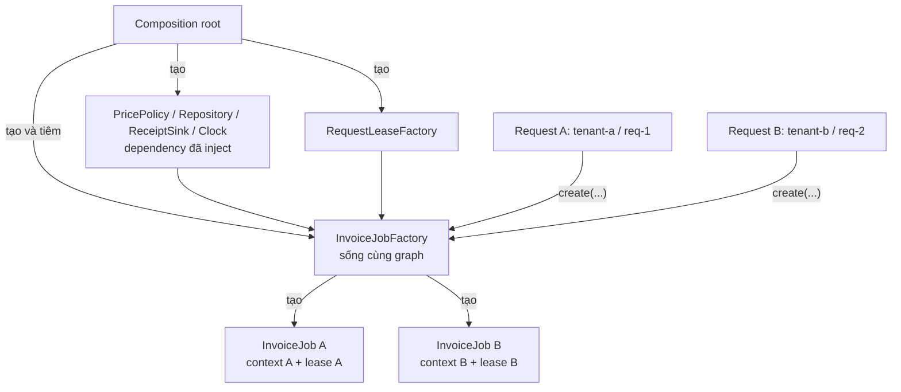

# Tạo factory kết hợp phụ thuộc cố định với dữ liệu lúc chạy

Một application service thường được lắp ghép từ những dependency đã biết **khi ứng dụng khởi động**: repository, chính sách tính giá, đồng hồ, logger hoặc client kết nối hệ thống ngoài. Tuy nhiên, có những đối tượng chỉ tạo được **khi một yêu cầu thực sự đến** vì chúng cần thêm mã tenant, mã request, thông số công việc hoặc dữ liệu người dùng của chính lượt xử lý đó.

Nếu đưa tất cả những giá trị theo request vào constructor của một singleton, ta không biết chúng thuộc request nào. Nếu để lớp nghiệp vụ tự tìm dependency trong container và tự đọc cấu hình, ta làm mất lợi ích của **Dependency Injection (DI)**. Một giải pháp là **factory được inject các dependency cố định**, còn phương thức `create(...)` của factory nhận **dữ liệu lúc chạy** để tạo một đối tượng có vòng đời phù hợp.

Bài thực hành thuộc chương **Thực hành** của module **DEPENDENCY_INJECTION**. Ta sử dụng **Java thuần** để áp dụng constructor injection, composition root, quản lý scope/vòng đời và kiểm thử mà chưa cần DI container. Trọng tâm là xác định **cái gì được quyết định khi lắp graph**, **cái gì chỉ được biết khi có request**, và **ai quản lý đối tượng được tạo**.

## 1. Kết quả cần đạt

Sau bài học, bạn có thể:

- Phân biệt **dependency cố định của factory** với **tham số chỉ biết lúc chạy**.
- Thiết kế interface factory có phương thức `create(...)` đủ hẹp, không biến factory thành một service locator.
- Tạo object theo request/task từ các dependency dùng chung đã được constructor-inject và một đối tượng ngữ cảnh bất biến.
- Giải thích tại sao tiêm thẳng request context vào singleton dễ tạo **captive dependency**, và vì sao factory có thể giúp tách lifetime.
- Xác định ai sở hữu, sử dụng và gọi `close()` cho resource được tạo theo lượt xử lý.
- Kiểm thử factory với hai request khác nhau, cùng dependency dùng chung, validate dữ liệu trước khi mở resource và ngăn dùng object sau khi đóng.
- Quyết định lúc nào **không cần factory** mà chỉ nên truyền dữ liệu qua phương thức của service.

## 2. Hai loại thông tin cần gặp nhau khi tạo đối tượng

Giả sử hệ thống lập hóa đơn cho nhiều tenant. Một tiến trình Java có thể dùng chung các thành phần sau:

| Phụ thuộc cố định | Vì sao thường được lắp từ trước? | Ví dụ |
| --- | --- | --- |
| `PricePolicy` | Chính sách tính đơn giá cho phiên bản ứng dụng | `FixedPricePolicy` |
| `InvoiceRepository` | Hợp đồng lưu hóa đơn, adapter được chọn theo môi trường | In-memory hoặc JDBC |
| `ReceiptSink` | Cách yêu cầu gửi biên nhận | Adapter console, queue hoặc email |
| `Clock` | Nguồn thời gian được kiểm soát và thay thế khi test | `Clock.systemUTC()` |
| `RequestLeaseFactory` | Cách cấp và quản lý tài nguyên theo một lượt xử lý | Factory mở unit of work |

Nhưng khi nhận request, ứng dụng mới biết:

| Dữ liệu lúc chạy | Tại sao không được cố định ở root? |
| --- | --- |
| `tenantId` | Mỗi request có thể thuộc tenant khác |
| `requestId` | Dùng để phân biệt từng lần xử lý |
| Mã hóa đơn, mã sản phẩm, số lượng | Đây là dữ liệu nghiệp vụ của lệnh hiện tại, không phải cấu hình startup |

Một factory phù hợp kết hợp **hai nguồn**:

```text
                        COMPOSITION ROOT
      PricePolicy / InvoiceRepository / ReceiptSink
                  Clock / LeaseFactory
                           |
                     inject qua constructor
                           v
                     InvoiceJobFactory
                           ^
                           | create(tenantId, requestId)
                     REQUEST ĐANG ĐẾN
                           |
                           v
                    InvoiceJob mới
       (dependency cố định + context riêng + lease riêng)
                           |
                      placeInvoice(...)
                           |
                         close()
```

**Điểm mấu chốt:** composition root không cần biết request nào sẽ đến; factory không cần tự truy cập container toàn cục; và đối tượng theo request không phải tự tạo các adapter hạ tầng.

### 2.1. “Cố định” là trong phạm vi nào?

Trong bài này, **cố định** nghĩa là các dependency đã được chọn và đưa vào factory **khi lắp object graph**. Nó không nhất thiết có nghĩa một singleton toàn JVM:

- Root của một application có thể dùng một factory lâu dài.
- Root của một batch job có thể dùng một factory riêng cho batch đó.
- Một dependency trong factory có thể là proxy/provider, nếu hợp đồng quy định cách resolve theo scope.
- Khi cấu hình thay đổi, ứng dụng có thể tạo **graph/factory mới** có kiểm soát thay vì sửa tham chiếu của factory cũ.

Không nên suy rằng cứ trường `final` thì dependency tự động thread-safe, hoặc “factory dùng chung” đồng nghĩa mọi object do nó tạo cũng dùng chung.

## 3. Mẫu factory kết hợp hai nguồn dữ liệu

Một chữ ký đơn giản:

```java
interface InvoiceJobFactory {
    InvoiceJob create(String tenantId, String requestId);
}
```

Implementation có thể nhận các dependency cố định bằng constructor:

```java
// Mã cấu trúc minh họa; các lớp được khai báo đầy đủ ở mục 7.
final class DefaultInvoiceJobFactory implements InvoiceJobFactory {
    private final PricePolicy pricing;
    private final InvoiceRepository repository;
    private final ReceiptSink receipts;

    DefaultInvoiceJobFactory(
            PricePolicy pricing,
            InvoiceRepository repository,
            ReceiptSink receipts) {
        this.pricing = java.util.Objects.requireNonNull(pricing);
        this.repository = java.util.Objects.requireNonNull(repository);
        this.receipts = java.util.Objects.requireNonNull(receipts);
    }

    @Override
    public InvoiceJob create(String tenantId, String requestId) {
        RequestContext context = new RequestContext(tenantId, requestId);
        return new InvoiceJob(context, pricing, repository, receipts);
    }
}
```

Trong mô hình này, constructor của factory là **điểm nhận dependency đã được lắp ghép**. Phương thức `create` nhận **tham số biến đổi theo mỗi request**. Đối tượng `InvoiceJob` được tạo bằng cả hai nhóm dữ liệu.

Đây thường được gọi là ý tưởng **assisted injection**: một phần dependency được giải quyết bởi DI/composition, còn một phần tham số phải do code gọi factory cung cấp lúc chạy. Không nhất thiết phải dùng annotation hoặc tiện ích tên “AssistedInject” để áp dụng ý tưởng này trong Java thuần.

### 3.1. Factory không phải nơi thực thi nghiệp vụ thay cho object mới

Một factory đúng trọng tâm chủ yếu:

1. Nhận và kiểm tra tham số cần để tạo object.
2. Lấy hoặc mở resource theo hợp đồng, nếu cần.
3. Gắn dependency cố định với context lúc chạy.
4. Trả lại đối tượng hợp lệ và làm rõ ai quản lý vòng đời của nó.

Một factory chứa toàn bộ thuật toán tính tiền, phân quyền, gửi email, chạy retry và ghi transaction của từng đơn có thể đã **trộn trách nhiệm**. Việc dùng tên `Factory` không tự bảo đảm SRP hoặc DI tốt.

### 3.2. Constructor của đối tượng được tạo nhận những gì?

Có thể chọn:

```java
InvoiceJob(
        RequestContext context,
        PricePolicy pricing,
        InvoiceRepository repository,
        ReceiptSink receipts)
```

Trong đó:

- `RequestContext` mô tả **giá trị bất biến của lượt xử lý**.
- `PricePolicy`, `InvoiceRepository`, `ReceiptSink` là **các khả năng dùng trong quá trình xử lý**.

Thay vì nhận nhiều chuỗi không rõ ý nghĩa, một `RequestContext` có tên và validation giúp code biết đâu là mã tenant, đâu là mã request. Nhưng đừng biến nó thành một **bag chứa toàn bộ thông tin người dùng và secret** rồi tiêm vào mọi nơi; chỉ giữ các dữ liệu thực sự cần.

## 4. Phản ví dụ: các cách lắp ghép dễ sai

### 4.1. Gắn dữ liệu request đầu tiên vào service dùng chung

```java
// Mã phác họa lỗi lifetime.
final class SharedInvoiceService {
    private final RequestContext firstRequest;
    private final InvoiceRepository repository;

    SharedInvoiceService(
            RequestContext firstRequest,
            InvoiceRepository repository) {
        this.firstRequest = firstRequest;
        this.repository = repository;
    }

    void handleNextInvoice(...) {
        // Vẫn ghi dưới tenant/request của lần tạo ban đầu!
    }
}
```

Nếu service sống dài hơn request, đây là **captive dependency** khi context/resource chỉ hợp lệ theo request, hoặc ít nhất là lỗi **giữ dữ liệu sai lượt xử lý**. DI bằng constructor không tự khắc phục sai lệch lifetime này.

### 4.2. Để object theo request tự tìm dependency qua container

```java
// Mã phác họa: Container là API giả định.
final class InvoiceJob {
    InvoiceJob(String tenantId, String requestId) {
        this.repository = GlobalContainer.get(InvoiceRepository.class);
        this.receipts = GlobalContainer.get(ReceiptSink.class);
    }
}
```

Đó là một dạng **service locator**: constructor không thể hiện đầy đủ những dependency bắt buộc, test phải kiểm soát registry toàn cục, và scope của repository/sender có thể khó nhìn. Factory nên được **cấp dependency tường minh** từ root.

### 4.3. Factory tự đọc cấu hình mỗi lần tạo

```java
// Mã phác họa: lỗi phân tán quyết định wiring.
InvoiceJob create(String tenantId, String requestId) {
    String mode = System.getenv("REPOSITORY_MODE");
    InvoiceRepository repo = "jdbc".equals(mode)
            ? new JdbcInvoiceRepository(...)
            : new InMemoryInvoiceRepository();
    return new InvoiceJob(tenantId, requestId, repo);
}
```

Nếu mode là **cấu hình của bản chạy ứng dụng**, root nên đọc, validate và chọn adapter ở giai đoạn composition, sau đó truyền adapter/factory thích hợp vào `InvoiceJobFactory`. Không nên âm thầm rơi về in-memory nếu cấu hình production bị gõ sai.

**Ngoại lệ hợp lý:** factory có thể chủ động tạo một resource **mới theo task** nếu đó là trách nhiệm của nó, ví dụ mở unit of work từ một pool dùng chung. Điều cần phân biệt là **tạo resource per-request** với **tự quyết định công nghệ triển khai**.

### 4.4. Lưu context thay đổi được vào trường của singleton factory

```java
// Mã phác họa lỗi đồng thời và rò dữ liệu request.
final class UnsafeFactory {
    private String currentTenant;

    void setTenant(String tenantId) {
        currentTenant = tenantId;
    }

    InvoiceJob create() {
        return new InvoiceJob(currentTenant, ...);
    }
}
```

Khi hai request xen kẽ `setTenant` và `create`, factory có thể sinh job của request A với tenant B. Thay vì giữ một **current tenant** mutable trong object dùng chung, truyền tenant vào chính lời gọi `create(tenantId, requestId)`.

## 5. Khi nào dùng factory, khi nào chỉ truyền tham số vào method?

Không phải cứ có dữ liệu request là cần factory.

| Tình huống | Thiết kế thường đủ | Lý do |
| --- | --- | --- |
| Service stateless xử lý một lệnh đồng bộ rồi trả kết quả | `service.handle(request)` | Không cần object mới có state/lifecycle riêng |
| Mỗi tác vụ cần một đối tượng mang ngữ cảnh bất biến qua **nhiều bước** | `factory.create(context)` → object per-task | Mọi bước có chung danh tính, chính sách và trạng thái |
| Mỗi tác vụ cần một transaction/session phải đóng | Factory mở resource, caller quản lý object `AutoCloseable` | Vòng đời và quyền sở hữu rõ |
| Cần tạo nhiều biến thể theo một mode startup | Root chọn implementation, inject factory phù hợp | Tách lựa chọn công nghệ khỏi dữ liệu request |
| Cần chọn chiến lược theo từng đơn hàng | Policy/selector nhận dữ liệu nghiệp vụ | Không chuyển luật domain thành điều kiện bootstrap |
| Chỉ tạo value object nhỏ không có resource hay dependency | Constructor hoặc static factory đơn giản | Không cần DI container hoặc factory toàn ứng dụng |

**Quy tắc thực dụng:** nếu object mới chỉ là wrapper cho một lần gọi, không có trạng thái hay lifetime đáng quản lý, hãy xem liệu `process(command, context)` trên service stateless có đơn giản hơn không. Factory phát huy giá trị khi **quá trình tạo đối tượng thực sự kết hợp những dependency cố định với thông tin runtime hoặc tài nguyên có vòng đời riêng**.

## 6. Thiết kế bài thực hành: lập hóa đơn theo tenant và request

Ta sẽ viết một chương trình Java thuần có các vai trò:

| Thành phần | Trách nhiệm | Lifetime trong ví dụ |
| --- | --- | --- |
| `PricePolicy` | Cung cấp đơn giá theo SKU | Dùng chung trong graph |
| `InvoiceRepository` | Lưu hóa đơn mới và tra cứu theo tenant | Dùng chung trong graph |
| `ReceiptSink` | Nhận yêu cầu biên nhận | Dùng chung trong graph |
| `Clock` | Cung cấp thời gian tạo hóa đơn | Dùng chung trong graph |
| `RequestLeaseFactory` | Cấp lease cho mỗi lượt xử lý | Dùng chung trong graph |
| `RequestContext` | Mã tenant và mã request | Một lượt xử lý |
| `InvoiceJobFactory` | Kết hợp dependency dùng chung với context runtime | Dùng chung trong graph |
| `InvoiceJob` | Xử lý **một** hóa đơn trong một lượt, sở hữu lease | Một lượt xử lý |



Sơ đồ cho thấy **một factory được tái sử dụng** nhưng **hai object per-request khác nhau**. Dữ liệu context không được lưu thành trường mutable trong factory; mỗi `create(...)` tạo một context mới và một lease mới.

**Giới hạn chủ đích của mô hình:** `InvoiceRepository` dùng `LinkedHashMap` trong bộ nhớ, không phải database hoặc transaction thật. `RequestLease` chỉ mô phỏng lifetime, không mở socket/connection thực. Chương trình chạy **tuần tự một thread**. Các điều kiện về concurrency, bảo mật tenant và độ bền dữ liệu phải được kiểm thử riêng khi thay adapter thực.

## 7. Chương trình `Main.java` hoàn chỉnh

Toàn bộ mã dưới đây chạy với **JDK 11 trở lên**, chỉ dùng thư viện chuẩn Java. Lưu nguyên khối thành **`Main.java`**:

```java
import java.time.Clock;
import java.time.Instant;
import java.time.ZoneOffset;
import java.util.ArrayList;
import java.util.LinkedHashMap;
import java.util.List;
import java.util.Map;
import java.util.Objects;
import java.util.Optional;

public class Main {
    // DATA LÚC CHẠY: snapshot bất biến theo một request.
    static final class RequestContext {
        final String tenantId;
        final String requestId;

        RequestContext(String tenantId, String requestId) {
            this.tenantId = requireText(tenantId, "tenantId");
            this.requestId = requireText(requestId, "requestId");
        }
    }

    static String requireText(String value, String name) {
        if (value == null || value.isBlank()) {
            throw new IllegalArgumentException(name + " is required");
        }
        return value;
    }

    // Dữ liệu kết quả của ca sử dụng.
    static final class Invoice {
        final String tenantId;
        final String requestId;
        final String invoiceId;
        final long totalCents;
        final Instant createdAt;

        Invoice(
                RequestContext context,
                String invoiceId,
                long totalCents,
                Instant createdAt) {
            Objects.requireNonNull(context, "context");
            this.tenantId = context.tenantId;
            this.requestId = context.requestId;
            this.invoiceId = requireText(invoiceId, "invoiceId");
            if (totalCents < 0) {
                throw new IllegalArgumentException("negative total");
            }
            this.totalCents = totalCents;
            this.createdAt =
                    Objects.requireNonNull(createdAt, "createdAt");
        }
    }

    // PHỤ THUỘC CỐ ĐỊNH: các hợp đồng dùng trong công việc.
    interface PricePolicy {
        long unitPriceCents(String sku);
    }

    static final class FixedPricePolicy implements PricePolicy {
        private final long unitPrice;

        FixedPricePolicy(long unitPrice) {
            if (unitPrice < 0) {
                throw new IllegalArgumentException("negative unit price");
            }
            this.unitPrice = unitPrice;
        }

        @Override
        public long unitPriceCents(String sku) {
            requireText(sku, "sku");
            return unitPrice;
        }
    }

    interface InvoiceRepository {
        void saveNew(Invoice invoice);
        Optional<Invoice> find(String tenantId, String invoiceId);
    }

    // Fake: dữ liệu tách theo tenant; không có transaction thật.
    static final class InMemoryInvoiceRepository
            implements InvoiceRepository {
        private final Map<String, Map<String, Invoice>> byTenant =
                new LinkedHashMap<>();

        @Override
        public void saveNew(Invoice invoice) {
            Objects.requireNonNull(invoice, "invoice");
            Map<String, Invoice> invoices = byTenant.computeIfAbsent(
                    invoice.tenantId, key -> new LinkedHashMap<>());
            if (invoices.putIfAbsent(invoice.invoiceId, invoice) != null) {
                throw new IllegalArgumentException(
                        "duplicate invoice for tenant");
            }
        }

        @Override
        public Optional<Invoice> find(String tenantId, String invoiceId) {
            Map<String, Invoice> invoices = byTenant.get(tenantId);
            return invoices == null
                    ? Optional.empty()
                    : Optional.ofNullable(invoices.get(invoiceId));
        }
    }

    interface ReceiptSink {
        void requestReceipt(Invoice invoice);
    }

    // Spy: chỉ ghi nhận yêu cầu, KHÔNG gửi biên nhận thật.
    static final class RecordingReceiptSink implements ReceiptSink {
        final List<String> requests = new ArrayList<>();

        @Override
        public void requestReceipt(Invoice invoice) {
            requests.add(invoice.tenantId + "/" + invoice.invoiceId);
        }
    }

    // Resource thuộc MỘT request: mô phỏng lease.
    interface RequestLease extends AutoCloseable {
        void ensureActive();

        @Override
        void close();
    }

    interface RequestLeaseFactory {
        // Caller nhận ownership và phải close lease.
        RequestLease open(RequestContext context);
    }

    static final class TrackingLeaseFactory
            implements RequestLeaseFactory {
        int opened;
        int closed;

        @Override
        public RequestLease open(RequestContext context) {
            Objects.requireNonNull(context, "context");
            opened++;
            return new RequestLease() {
                private boolean isClosed;

                @Override
                public void ensureActive() {
                    if (isClosed) {
                        throw new IllegalStateException(
                                "request lease is closed");
                    }
                }

                @Override
                public void close() {
                    if (!isClosed) {
                        isClosed = true;
                        closed++;
                    }
                }
            };
        }
    }

    // ĐỐI TƯỢNG PER-REQUEST: giữ context + lease riêng.
    static final class InvoiceJob implements AutoCloseable {
        private final RequestContext context;
        private final PricePolicy pricing;
        private final InvoiceRepository repository;
        private final ReceiptSink receipts;
        private final Clock clock;
        private final RequestLease lease;
        private boolean processed;
        private boolean isClosed;

        InvoiceJob(
                RequestContext context,
                PricePolicy pricing,
                InvoiceRepository repository,
                ReceiptSink receipts,
                Clock clock,
                RequestLease lease) {
            this.context = Objects.requireNonNull(context, "context");
            this.pricing = Objects.requireNonNull(pricing, "pricing");
            this.repository =
                    Objects.requireNonNull(repository, "repository");
            this.receipts = Objects.requireNonNull(receipts, "receipts");
            this.clock = Objects.requireNonNull(clock, "clock");
            this.lease = Objects.requireNonNull(lease, "lease");
        }

        Invoice place(
                String invoiceId, String sku, int quantity) {
            if (isClosed) {
                throw new IllegalStateException("invoice job is closed");
            }
            lease.ensureActive();
            if (processed) {
                throw new IllegalStateException(
                        "invoice job already processed");
            }

            requireText(invoiceId, "invoiceId");
            requireText(sku, "sku");
            if (quantity <= 0) {
                throw new IllegalArgumentException(
                        "quantity must be positive");
            }
            long unitPrice = pricing.unitPriceCents(sku);
            if (unitPrice < 0) {
                throw new IllegalStateException(
                        "price policy violated its contract");
            }
            long total = Math.multiplyExact(unitPrice, quantity);
            Invoice invoice = new Invoice(
                    context, invoiceId, total, clock.instant());

            // Sau hiệu ứng ghi đầu tiên, không được gọi place lần nữa.
            repository.saveNew(invoice);
            processed = true;
            receipts.requestReceipt(invoice);
            return invoice;
        }

        @Override
        public void close() {
            if (!isClosed) {
                isClosed = true;
                lease.close();
            }
        }
    }

    // FACTORY: chỉ giữ dependency dùng chung, không giữ currentTenant.
    static final class InvoiceJobFactory {
        private final PricePolicy pricing;
        private final InvoiceRepository repository;
        private final ReceiptSink receipts;
        private final Clock clock;
        private final RequestLeaseFactory leases;

        InvoiceJobFactory(
                PricePolicy pricing,
                InvoiceRepository repository,
                ReceiptSink receipts,
                Clock clock,
                RequestLeaseFactory leases) {
            this.pricing = Objects.requireNonNull(pricing, "pricing");
            this.repository =
                    Objects.requireNonNull(repository, "repository");
            this.receipts = Objects.requireNonNull(receipts, "receipts");
            this.clock = Objects.requireNonNull(clock, "clock");
            this.leases = Objects.requireNonNull(leases, "leases");
        }

        InvoiceJob create(String tenantId, String requestId) {
            // Xác thực dữ liệu runtime TRƯỚC khi mở resource.
            RequestContext context =
                    new RequestContext(tenantId, requestId);

            RequestLease lease = Objects.requireNonNull(
                    leases.open(context), "lease factory returned null");
            try {
                // Chuyển ownership của lease cho InvoiceJob.
                return new InvoiceJob(
                        context, pricing, repository,
                        receipts, clock, lease);
            } catch (RuntimeException | Error failure) {
                // Nếu tạo job lỗi, chưa có caller để close lease.
                try {
                    lease.close();
                } catch (RuntimeException cleanupFailure) {
                    failure.addSuppressed(cleanupFailure);
                }
                throw failure;
            }
        }
    }

    // Graph dùng chung, được lắp ghép tại một điểm.
    static final class Application {
        final InvoiceJobFactory jobs;
        final InMemoryInvoiceRepository repository;
        final RecordingReceiptSink receipts;
        final TrackingLeaseFactory leases;

        Application(
                InvoiceJobFactory jobs,
                InMemoryInvoiceRepository repository,
                RecordingReceiptSink receipts,
                TrackingLeaseFactory leases) {
            this.jobs = Objects.requireNonNull(jobs, "jobs");
            this.repository =
                    Objects.requireNonNull(repository, "repository");
            this.receipts = Objects.requireNonNull(receipts, "receipts");
            this.leases = Objects.requireNonNull(leases, "leases");
        }
    }

    // COMPOSITION ROOT: chọn dependency cố định đúng một lần.
    static Application compose() {
        PricePolicy prices = new FixedPricePolicy(2_500);
        InMemoryInvoiceRepository repository =
                new InMemoryInvoiceRepository();
        RecordingReceiptSink receipts =
                new RecordingReceiptSink();
        TrackingLeaseFactory leases =
                new TrackingLeaseFactory();
        Clock clock = Clock.fixed(
                Instant.parse("2026-01-01T00:00:00Z"),
                ZoneOffset.UTC);

        InvoiceJobFactory jobs = new InvoiceJobFactory(
                prices, repository, receipts, clock, leases);
        return new Application(jobs, repository, receipts, leases);
    }

    static void checkInvalidContext(
            Application app, int previousOpens) {
        boolean rejected = false;
        try {
            app.jobs.create("", "REQ-INVALID");
        } catch (IllegalArgumentException expected) {
            rejected = true;
        }
        if (!rejected || app.leases.opened != previousOpens) {
            throw new AssertionError(
                    "invalid context opened a request resource");
        }
    }

    public static void main(String[] args) {
        Application app = compose();

        // Hai request dùng CHUNG factory và dependency cố định.
        InvoiceJob first = app.jobs.create("tenant-a", "req-1");
        Invoice invoiceA;
        try (first) {
            invoiceA = first.place("INV-1", "BOOK", 2);
        }

        Invoice invoiceB;
        try (InvoiceJob second =
                app.jobs.create("tenant-b", "req-2")) {
            invoiceB = second.place("INV-1", "BOOK", 3);
        }

        // Cùng invoice ID nhưng ở hai tenant khác nhau.
        if (invoiceA.totalCents != 5_000
                || invoiceB.totalCents != 7_500
                || !invoiceA.requestId.equals("req-1")
                || !invoiceB.requestId.equals("req-2")
                || app.repository.find("tenant-a", "INV-1").isEmpty()
                || app.repository.find("tenant-b", "INV-1").isEmpty()
                || !app.receipts.requests.equals(
                        List.of("tenant-a/INV-1", "tenant-b/INV-1"))) {
            throw new AssertionError("request contexts were mixed");
        }
        if (!invoiceA.createdAt.equals(
                Instant.parse("2026-01-01T00:00:00Z"))) {
            throw new AssertionError("Clock was not injected");
        }

        // Dùng object sau khi đóng phải bị từ chối.
        boolean closedRejected = false;
        try {
            first.place("INV-2", "BOOK", 1);
        } catch (IllegalStateException expected) {
            closedRejected = true;
        }
        if (!closedRejected) {
            throw new AssertionError("closed job accepted new work");
        }

        checkInvalidContext(app, 2);
        if (app.leases.opened != 2 || app.leases.closed != 2) {
            throw new AssertionError("request lease was leaked");
        }

        System.out.println(
                "Tenant A total: " + invoiceA.totalCents + " cents");
        System.out.println(
                "Tenant B total: " + invoiceB.totalCents + " cents");
        System.out.println("Leases opened/closed: "
                + app.leases.opened + "/" + app.leases.closed);
        System.out.println("Plain Java verification: PASS");
    }
}
```

Biên dịch và chạy:

```bash
javac -encoding UTF-8 Main.java
java Main
```

Kết quả dự kiến:

```text
Tenant A total: 5000 cents
Tenant B total: 7500 cents
Leases opened/closed: 2/2
Plain Java verification: PASS
```

### 7.1. Vì sao đây là một factory kết hợp hai loại thông tin?

`compose()` tạo `FixedPricePolicy`, `InMemoryInvoiceRepository`, `RecordingReceiptSink`, `Clock` và `TrackingLeaseFactory` một lần cho object graph. Tất cả được truyền vào constructor của `InvoiceJobFactory`. Factory **không đọc biến môi trường khi có request** và **không tự chọn hạ tầng**.

Khi gọi `jobs.create("tenant-a", "req-1")`, factory tạo `RequestContext` có dữ liệu của request A, mở lease A và tạo `InvoiceJob A`. Lời gọi với tenant B tạo một context, lease và job riêng. Cả hai job dùng chung các collaborator đã được xác định trong root.

Vì `InvoiceJob` giữ context riêng, mỗi lần gọi `place(...)` không phải nhận lại `tenantId`, `requestId`, và job có thể kiểm soát số lần sử dụng lẫn thời điểm đóng resource.

### 7.2. Các trạng thái nào được chia sẻ?

- **Được chia sẻ:** `PricePolicy`, repository, receipt sink, clock và lease factory **theo thiết kế của graph**.
- **Không được chia sẻ giữa hai lượt xử lý:** `RequestContext`, `RequestLease`, `InvoiceJob`, cờ `processed` và `isClosed` của job.
- **Dữ liệu của nhiều tenant** có thể cùng nằm trong một repository hạ tầng nhưng được phân vùng theo tenant; trong ví dụ, `Map<String, Map<String, Invoice>>` giúp ta nhìn thấy sự phân vùng.

Đây **không phải cơ chế phân quyền bảo mật**. Một caller có quyền truy cập repository trong bộ nhớ vẫn có thể truyền bất kỳ tenant ID nào để truy vấn; ứng dụng production cần **xác thực, phân quyền và cách ly tenant ở các ranh giới thích hợp**, chứ không chỉ dùng key là `tenantId`.

### 7.3. Ai chịu trách nhiệm đóng lease?

`RequestLeaseFactory.open(...)` **cấp resource và chuyển quyền quản lý kết quả** cho factory. Khi `InvoiceJob` được tạo thành công, quyền đóng lease được chuyển tiếp cho **job/caller sở hữu job**. Vì vậy caller dùng:

```java
try (InvoiceJob job = jobs.create(tenantId, requestId)) {
    job.place(invoiceId, sku, quantity);
}
```

Ra khỏi khối `try-with-resources`, Java gọi `InvoiceJob.close()`, và job đóng lease của mình. Khi dữ liệu context không hợp lệ, factory **chưa mở lease**. Nếu constructor của job thất bại **sau khi lease được cấp**, factory cố gắng đóng lease trong nhánh `catch` để tránh resource không có owner.

**Giới hạn:** nếu `RequestLeaseFactory.open(...)` tự mở một phần resource rồi ném exception **trước khi trả handle**, chính implementation factory mở resource cần thu dọn phần dở dang ấy. Factory phía ngoài không thể đóng một handle nó chưa từng nhận.

### 7.4. Vì sao cờ `processed` được đặt trước khi yêu cầu gửi biên nhận?

`InvoiceJob.place(...)` lưu hóa đơn, đánh dấu job đã xử lý rồi mới yêu cầu biên nhận. Nếu `ReceiptSink` ném exception, hóa đơn có thể **đã được lưu**, nên không được giả định rằng gọi lại `place(...)` an toàn. `processed` ngăn retry mù quáng trên cùng job, nhưng **không giải quyết tính nhất quán xuyên hệ thống**.

Trong production có thể cần transactional outbox, idempotency key, trạng thái chờ gửi hoặc cơ chế bù trừ. Bài này tập trung vào DI, factory và lifetime; **không** chứng minh transaction hoặc giao dịch phân tán đúng.

### 7.5. Vì sao không chạy đa luồng với các adapter demo?

`LinkedHashMap`, `ArrayList` và bộ đếm `int` trong các adapter minh họa **không thread-safe**. Factory được thiết kế không giữ context mutable, nhưng **các dependency dùng chung vẫn phải có tính an toàn đồng thời theo hợp đồng** nếu ứng dụng xử lý nhiều request song song.

Thay repository bằng adapter an toàn hơn hoặc thay cấu trúc dữ liệu phù hợp khi cần; riêng việc dùng factory không bảo đảm khả năng xử lý đồng thời.

## 8. Các bài kiểm thử nên bổ sung

Chương trình đã có những kiểm tra bằng `AssertionError`. Khi xây dựng thành unit test với JUnit hoặc một framework khác, hãy phân loại như sau:

| Trường hợp | Điều cần xác minh | Vai trò double |
| --- | --- | --- |
| Tạo job với tenant A và B | Hai context khác nhau, không bị ghi đè | Fake repository |
| Hai job cùng một invoice ID ở tenant khác nhau | Kết quả được phân vùng như contract yêu cầu | Fake repository |
| Chỉ có một dependency fixed cho cả hai job | Factory tái sử dụng dependency đã inject | Fake/spy kiểm tra wiring |
| `tenantId` rỗng | Báo lỗi **trước** khi mở lease | Tracking lease factory |
| `create` hợp lệ | Mỗi job mở đúng một lease | Spy/tracking factory |
| Ra khỏi `try-with-resources` | Lease tương ứng được close | Spy/tracking factory |
| Gọi `place` sau `close` | Báo lỗi, không ghi thêm dữ liệu | Fake repository |
| Giá âm từ policy | Consumer từ chối kết quả vi phạm contract | Stub trả giá âm |
| Lỗi lưu hóa đơn | Không yêu cầu gửi biên nhận | Stub lỗi repository + spy sender |
| Lỗi gửi sau khi lưu | Không giả định dữ liệu được rollback | Fake repository + stub lỗi sender |
| Adapter database thật | Kiểm tra ràng buộc tenant, transaction, cleanup, concurrency | Integration/contract test |

### 8.1. Test factory bằng dependency giả

Đặc điểm tốt của `InvoiceJobFactory` là constructor nhận các interface/giá trị; test có thể cung cấp:

```java
// Mã minh họa dùng các lớp lồng của Main.java ở mục 7.
Main.PricePolicy stubPrice = sku -> 100;
Main.InMemoryInvoiceRepository fake =
        new Main.InMemoryInvoiceRepository();
Main.RecordingReceiptSink spy =
        new Main.RecordingReceiptSink();
Main.TrackingLeaseFactory leases =
        new Main.TrackingLeaseFactory();

Main.InvoiceJobFactory factory = new Main.InvoiceJobFactory(
        stubPrice,
        fake,
        spy,
        java.time.Clock.fixed(
                java.time.Instant.parse("2026-01-01T00:00:00Z"),
                java.time.ZoneOffset.UTC),
        leases);

try (Main.InvoiceJob job = factory.create("tenant-x", "req-x")) {
    Main.Invoice invoice = job.place("I-X", "SKU-X", 2);
    if (invoice.totalCents != 200) {
        throw new AssertionError("unexpected total");
    }
}
if (leases.opened != 1 || leases.closed != 1) {
    throw new AssertionError("lease lifecycle is wrong");
}
```

Đoạn kiểm tra này không cần tạo `Application` hoặc gọi composition root production. Nó xác minh **factory làm đúng việc kết hợp dependency và context**, nhưng không chứng minh adapter database hoặc notification thật hoạt động.

### 8.2. Kiểm tra thất bại sau khi mở resource

Với factory phức tạp, hãy tạo một test double cho `RequestLeaseFactory` và một cách có chủ đích khiến bước tạo object sau đó thất bại (ví dụ constructor thực có thêm bước validation/initialization có thể ném lỗi). Test cần xác minh rằng factory thu dọn lease vừa mở, không để resource sống ngoài quyền quản lý.

Trong chương trình chính, constructor `InvoiceJob` chỉ kiểm tra các dependency đã được validate ở constructor factory, nên nhánh cleanup lỗi sau `open` hiếm khi xảy ra. Nó vẫn thể hiện **quy tắc ownership** cần giữ khi đối tượng tạo có khởi tạo phức tạp hơn. Không nên cố gây lỗi production bằng cách cố tình làm hỏng null checking để “đạt coverage”.

### 8.3. Phân biệt test factory và test use case

- **Test factory:** focus vào đúng dependency được ghép, context runtime được chuyển đầy đủ và resource được sở hữu/đóng đúng.
- **Test use case:** focus vào quy tắc tính toán, validation, hành vi khi repository/sender thất bại.
- **Wiring test:** root chọn implementation cho mode triển khai đúng chưa?
- **Integration test:** adapter thật có giữ contract, quản lý transaction/concurrency và cleanup không?

Không nên viết một test khởi động toàn hệ thống cho từng trường hợp tính tiền đơn giản, nhưng cũng không nên cho rằng tất cả bài kiểm thử với fake đều thay thế được integration test.

## 9. Những biến thể thiết kế thường gặp

### 9.1. Factory là interface khi có nhu cầu thay thế

Khi caller cần phụ thuộc abstraction, có thể khai báo:

```java
interface InvoiceJobs {
    InvoiceJob create(String tenantId, String requestId);
}

final class DefaultInvoiceJobs implements InvoiceJobs {
    // Các collaborator được inject ở constructor.
    // create(...) kết hợp chúng với dữ liệu runtime.
}
```

Nhưng nếu hiện tại chỉ có một factory đơn giản, không có nhu cầu thay đổi và code vẫn dễ kiểm thử, tiêm class factory cụ thể **không phải lỗi tự động**. Một interface có ích khi nó bảo vệ ranh giới ổn định, chứ không phải chỉ để mọi class đều có interface tên tương tự.

### 9.2. Factory tạo cả object graph ngắn hạn

Đôi khi một request có nhiều đối tượng phối hợp:

```text
RequestGraphFactory
  -> tạo UnitOfWork theo request
  -> tạo RequestContext
  -> tạo CommandHandler(context, unitOfWork, sharedPolicy)
  -> tạo ResponseAssembler
  -> trả RequestGraph (AutoCloseable)
```

Khi đó factory thực hiện **composition root cục bộ theo request**. Root toàn ứng dụng vẫn lắp các dependency sống lâu; request factory được root tiêm factory resource và những shared services cần thiết.

Không nên để request factory tự truy cập container toàn cục mỗi lần tạo. Nếu framework đã có request scope, cần hiểu cơ chế ấy trước khi tự xây thêm một tầng factory có thể trùng chức năng.

### 9.3. Kết hợp factory với provider

Một provider có thể là collaborator được inject:

```java
interface UnitOfWorkFactory {
    UnitOfWork open();
}
```

Factory tạo job có thể dùng provider này để mở resource đúng lúc, nhưng phải biết:

- `open()` trả **instance mới** hay một instance trong scope hiện tại?
- Ai có nghĩa vụ `close()`?
- Nếu called ngoài request scope thì có hợp lệ không?
- Provider có thread-safe không?

**Tiêm provider không tự sửa captive dependency** nếu code gọi provider một lần rồi giữ resource request-scoped trong field của một singleton.

### 9.4. Assisted injection với DI container

Một số DI framework có tính năng giúp tự tạo implementation từ **dependency đã đăng ký** cùng **tham số runtime**. Các annotation và API của cơ chế này khác nhau theo thư viện; không nên giả định một annotation tên chung có sẵn trong mọi container.

Hãy hiểu contract Java thuần trước:

```text
Root đăng ký PricePolicy, Repository, ReceiptSink, Clock
         |
         v
Inject InvoiceJobFactory
         |
Caller cung cấp tenantId, requestId
         |
         v
Factory tạo InvoiceJob có đúng scope và ownership
```

Container có thể giảm mã wiring, nhưng vẫn cần quyết định **context đến từ đâu**, **lifetime của job**, **ai close lease**, **cách xử lý lỗi** và **liệu chia sẻ collaborator có an toàn không**.

## 10. Factory không thay thế cấu hình lắp ghép

Một factory có thể được inject một instance của `InvoiceRepository`, nhưng **ai chọn repository đó?**

Chính **composition root** (hoặc configuration module của DI container) chọn adapter theo cấu hình đã kiểm tra:

```java
// Mã phác họa: chọn adapter cho MỘT bản chạy ứng dụng.
InvoiceRepository repository;
switch (settings.storageMode()) {
    case IN_MEMORY:
        repository = new InMemoryInvoiceRepository();
        break;
    case DATABASE:
        repository = new JdbcInvoiceRepository(dataSource);
        break;
    default:
        throw new IllegalArgumentException("unknown storage mode");
}

InvoiceJobFactory jobs = new InvoiceJobFactory(
        pricing, repository, receiptSink, clock, leaseFactory);
```

Ví dụ phác họa trên không biên dịch độc lập; nó dùng các implementation/cấu hình giả định. Điểm quan trọng là **factory không phải tự quyết định theo biến môi trường mỗi lần có request**.

Đừng trộn ba câu hỏi:

1. **Chọn implementation nào?** Quyết định bởi cấu hình/điểm lắp ghép.
2. **Khi nào tạo một instance mới?** Do scope/lifetime và factory quyết định.
3. **Với dữ liệu của request nào?** Do caller cung cấp khi gọi `create(...)`.

Giải quyết ba câu hỏi ở ba ranh giới phù hợp giúp dễ giải thích và kiểm thử object graph.

## 11. Scope, ownership và tác dụng phụ khi factory tạo resource

Một đối tượng được factory trả về có thể chỉ là **value object** không cần đóng, hoặc là một **resource-owning object** cần `AutoCloseable`. Không có quy tắc rằng **mọi** factory đều phải trả `AutoCloseable`.

Khi đối tượng cần resource:

| Bước | Trách nhiệm | Câu hỏi cần rõ |
| --- | --- | --- |
| Trước `open` | Kiểm tra context | Dữ liệu sai có bị từ chối trước khi cấp phát không? |
| `open` resource | Factory/resource provider | Nếu mở dở dang thất bại, ai cleanup? |
| Tạo object | Factory kết hợp fixed + runtime | Nếu constructor lỗi, handle đã mở được đóng chưa? |
| Trả object | Chuyển ownership | Ai phải gọi `close()` và trong phạm vi nào? |
| Xử lý | Object per-request | Có giữ trạng thái sang request khác, hoặc retry không an toàn không? |
| Kết thúc | Caller/handler | Có đóng cả khi exception hoặc cancellation không? |
| Shutdown ứng dụng | Root/host | Có đợi các job kết thúc trước khi đóng shared dependency không? |

**Đóng lease khác với đóng shared resource.** Nếu factory nhận một connection pool dùng chung rồi mở một connection mượn cho request, caller có thể cần đóng **connection lease** để trả về pool. Root/host mới là chủ sở hữu pool và đóng pool khi application shutdown. Hành vi của `close()` phải theo contract của thư viện cụ thể.

### 11.1. Tránh tác dụng phụ trong constructor khi có thể

Với một listener, scheduler hoặc server, tạo object và bắt đầu nhận việc nên thường là **hai ranh giới khác nhau**. Một factory tạo job có thể phải mở lease ngay, vì đó là một phần hợp đồng `create()`; nhưng nó cần làm việc ấy **có chủ đích**, có cleanup và không vô tình đăng ký consumer chạy nền khi graph chưa sẵn sàng.

Nếu object trả về có phương thức `start()`, hãy quyết định:

- Factory chỉ tạo và caller quyết định thời điểm start?
- Hay `createStarted()` là API rõ ràng chuyển quyền sở hữu object đã kích hoạt?
- Nếu start lỗi giữa chừng, ai thu dọn resource đã mở?

Không có câu trả lời chung cho mọi loại resource; tính nhất quán của hợp đồng và cleanup mới là trọng tâm.

## 12. Các anti-pattern cần tránh

| Dấu hiệu | Hậu quả | Hướng sửa |
| --- | --- | --- |
| Factory singleton có field `currentTenant` mutable | Request chồng nhau có thể dùng nhầm tenant | Truyền context vào `create(...)` |
| Factory đọc env rồi tự chọn JDBC/console mỗi request | Quyết định cấu hình phân tán, khó kiểm thử | Root chọn adapter, inject vào factory |
| Object mới gọi global container lấy dependency | Dependency ẩn, scope khó theo dõi | Factory nhận fixed deps ở constructor và tiêm tường minh |
| Root cố tạo mọi object theo request ngay lúc startup | Chưa có requestId/tenantId, lifetime sai | Factory tạo khi có runtime input |
| Service dùng chung giữ object per-request đã đóng | Captive dependency, use-after-close | Đúng scope, factory/provider hoặc method parameter |
| `create()` mở lease nhưng caller không đóng | Rò connection/session, cạn pool | `AutoCloseable` + ownership rõ |
| Factory đóng shared pool sau mỗi job | Các request khác mất resource dùng chung | Phân biệt owner của lease và pool |
| Factory trả cùng một job mutable cho nhiều request | State/cờ processed lẫn nhau | Trả instance mới theo mỗi request |
| Đổi implementation theo `instanceof` trong use case | Consumer biết chi tiết adapter | Hợp đồng chung, lựa chọn tại root |
| Test factory nhưng bỏ qua adapter thật | Không phát hiện transaction, bảo mật, concurrency | Contract/integration test tương ứng |
| Tạo factory dù chỉ cần truyền một số vào method | Thêm object/lifecycle không có giá trị | Ưu tiên service stateless đơn giản nếu đủ |
| Catch mọi lỗi rồi chọn fake/no-op | Có thể mất dữ liệu hoặc tác dụng phụ quan trọng | Fail fast; fallback phải được phép rõ |

## 13. Bài tập mở rộng

### Bài A — factory nhận thêm tham số runtime

Thêm `correlationId` vào `RequestContext`. Đảm bảo mã này được truyền qua `InvoiceJobFactory.create(...)` và có thể dùng để gắn log/trace mà **không lưu vào một field `currentCorrelationId` của factory**.

**Gợi ý:** thêm một trường `final` vào context, validate đầu vào, rồi cập nhật chữ ký factory. Nếu yêu cầu nhiều tham số có liên quan, cân nhắc cho `create(RequestContext)` để caller truyền một value object đã hợp lệ.

### Bài B — một job gồm nhiều bước

Giả sử sau khi tạo job, caller gọi `validateItems(...)`, `calculateTotals()` và `persist()` trong cùng một transaction. Hãy chọn nơi giữ state của ba bước và ranh giới `close()`.

**Gợi ý:** state thuộc job có lifetime riêng, không thuộc factory dùng chung; cùng một lease/transaction được giữ trong job và đóng khi kết thúc. Quy định trạng thái để không gọi `persist` hai lần hoặc xử lý sau close.

### Bài C — adapter hạ tầng thật

Thay `InMemoryInvoiceRepository` bằng một adapter JDBC và `TrackingLeaseFactory` bằng provider mở unit of work thực. Ai đóng connection pool? Ai trả connection mượn? Factory có phải biết SQL không?

**Gợi ý:** root/host quản lý pool; request/job quản lý lease/transaction. Repository adapter biết SQL; factory chỉ cần các interface và hợp đồng mở resource, không đưa câu SQL vào `create()`.

### Bài D — lỗi tạo job sau khi mở lease

Thiết kế một thành phần khởi tạo sau `open(...)` có thể thất bại. Hãy mô tả phép thử cần quan sát để khẳng định lease không bị rò khi `create(...)` ném lỗi.

**Gợi ý:** tạo test double theo dõi `open/close` và cấu hình bước khởi tạo ném exception; kiểm tra số lease đã đóng bằng số lease đã mở và lỗi gốc vẫn được bảo toàn.

### Bài E — nhiều request đồng thời

Đặt hai request chạy song song bằng executor. Những class nào trong ví dụ **chưa** an toàn đồng thời và phải thay đổi? Có thể dùng `currentTenant` trong factory không?

**Gợi ý:** `LinkedHashMap`, `ArrayList` và biến đếm `int` không thread-safe; cần thay bằng adapter/concurrency policy phù hợp. Factory không giữ tenant mutable. Cần cả quy tắc unique ID và transaction/isolation của database thật.

## 14. Tự kiểm tra

**Tình huống 1.** `InvoiceJobFactory` được tạo một lần trong application root với repository và clock. Mỗi request gọi `create(tenantId, requestId)`. Factory này có bắt buộc tạo mới repository cho từng request không?

**Gợi ý:** Không. Factory có thể dùng chung repository nếu hợp đồng cho phép; mỗi job chỉ cần context/lease riêng. Scope của repository và job là hai quyết định khác nhau.

**Tình huống 2.** Một singleton service nhận `RequestContext` trong constructor và giữ suốt quá trình chạy ứng dụng. Tại sao có rủi ro?

**Gợi ý:** Nó có thể giữ dữ liệu của request đầu tiên và dùng lại cho request sau, hoặc giữ resource hết hạn. Cần truyền context đúng lúc, tạo object per-request hoặc dùng phương thức nhận request.

**Tình huống 3.** Factory đã được inject nhưng mỗi lần `create` lại gọi `System.getenv("DB_MODE")` và chọn một repository khác nhau. Đã tách đúng nơi lựa chọn triển khai chưa?

**Gợi ý:** Chưa nếu mode là cấu hình của application. Root nên parse/validate và chọn adapter, sau đó inject vào factory; factory chỉ kết hợp với tham số runtime.

**Tình huống 4.** Caller tạo job chứa connection lease, gọi xử lý rồi bỏ qua `close()` vì Java có garbage collector. Có đúng không?

**Gợi ý:** Không. Garbage collector không thay thế hợp đồng cleanup tài nguyên bên ngoài. Dùng `try-with-resources` hoặc lifecycle management có bảo đảm tương đương.

**Tình huống 5.** Một application service chỉ cần tính `fee = unitPrice * quantity` cho mỗi lời gọi, không giữ state hay resource. Có nhất thiết phải tạo `FeeCalculationFactory` rồi `FeeCalculationJob` cho từng request?

**Gợi ý:** Không. Một service stateless nhận policy qua constructor và nhận dữ liệu qua method có thể đơn giản hơn.

**Tình huống 6.** Factory mở lease sau đó constructor đối tượng mới ném lỗi. Ai phải đóng lease?

**Gợi ý:** Trước khi giao ownership thành công cho caller, factory vẫn chịu trách nhiệm cleanup lease đã nhận. Nếu chính `open()` thất bại trước khi trả handle, implementation mở resource phải cleanup phần khởi tạo dở dang.

**Tình huống 7.** Factory tạo được hai job cho hai tenant, nhưng repository chỉ dùng khóa invoice ID và không kiểm tra tenant. Factory đã giải quyết hoàn toàn cách ly dữ liệu chưa?

**Gợi ý:** Chưa. Context per-request không thay thế partition key, authorization và constraint ở adapter/database. Cần kiểm thử dữ liệu và bảo mật tenant.

**Tình huống 8.** Root dùng chung một `ReceiptSink` có `ArrayList` mutable không đồng bộ cho nhiều request chạy song song. Factory không chứa state mutable. Hệ thống đã thread-safe chưa?

**Gợi ý:** Chưa. Các collaborator dùng chung phải an toàn đồng thời theo hợp đồng; chỉ có factory không giữ context mutable là chưa đủ.

**Tình huống 9.** Sau khi repository lưu hóa đơn thành công, `ReceiptSink` ném lỗi. Có thể gọi lại `place(...)` vô điều kiện để “thử lại” không?

**Gợi ý:** Không. Ghi hóa đơn đã là side effect; retry có thể gây trùng hoặc làm sai trạng thái. Cần idempotency/transactional outbox/chính sách lỗi phù hợp.

## 15. Quy trình áp dụng trong dự án

1. **Vẽ object graph hiện tại.** Ghi thành phần nào được root tạo, thành phần nào chỉ được tạo khi có request.
2. **Phân loại dữ liệu.** Đánh dấu dependency cố định (client, port, policy, clock) và runtime data (tenant, request ID, transaction ID).
3. **Xác định có thực sự cần object per-request.** Nếu chỉ là một lần gọi stateless, cân nhắc method parameter thay factory.
4. **Định nghĩa factory hẹp.** `create(...)` chỉ yêu cầu dữ liệu runtime cần để tạo object; không nhận cả container hoặc global configuration bag.
5. **Constructor-inject fixed dependencies vào factory.** Composition root chọn implementation và scope phù hợp.
6. **Dùng context typed/immutable.** Validate trước khi mở resource, tránh lưu biến `currentRequest` mutable trong singleton.
7. **Quy định ownership.** Ai mở/đóng lease, nếu `create` thất bại thì ai cleanup, khi shutdown root đóng những shared resource nào?
8. **Kiểm thử tách biệt.** Test factory, test use case, test wiring, test adapter thật; bổ sung tình huống đồng thời và lỗi nếu rủi ro yêu cầu.
9. **Đánh giá contract và trạng thái.** Một object per-request có thể được gọi mấy lần? Sau close còn hợp lệ không? Có side effect nào cần idempotency?
10. **Chỉ sau đó mới đưa vào DI container nếu phù hợp.** Container có thể tự động hóa phần fixed dependency nhưng không thay được quyết định runtime input/lifecycle.

## 16. Ghi nhớ

- **Factory là điểm gặp nhau của dependency cố định và dữ liệu lúc chạy.** Dependency hạ tầng/chính sách được inject vào factory; tenant, request và tham số task đi vào `create(...)`.
- **Composition root chọn implementation**, còn factory được inject những lựa chọn ấy để tạo object per-request; factory không cần tra cứu container toàn cục.
- **Mỗi object được tạo có thể mang context và vòng đời riêng** ngay cả khi các dependency mà nó sử dụng được chia sẻ.
- **Không giữ current request mutable trong singleton factory.** Đưa dữ liệu runtime qua tham số rõ ràng và dùng value object bất biến khi thích hợp.
- **Factory có thể chuyển quyền sở hữu resource** cho đối tượng được tạo/caller; cần close đúng lúc, kể cả khi có exception.
- **Factory không tự bảo đảm thread-safety, transaction, bảo mật tenant hay retry an toàn.** Những việc đó cần hợp đồng và kiểm thử riêng.
- **Không phải mọi request đều cần một factory.** Nếu service stateless xử lý gọn trong một lời gọi, method parameter có thể là thiết kế đơn giản hơn.
- **Java thuần đã đủ để thực hành ý tưởng assisted injection**, trước khi dùng API hỗ trợ của DI container.

Khi quyết định tạo một factory mới, hãy hỏi: **“Những dependency nào đã có từ lúc lắp graph, dữ liệu nào chỉ biết khi request đến, đối tượng mới cần sống bao lâu, và ai đóng tài nguyên của nó?”** Trả lời được bốn câu hỏi này giúp áp dụng DI đúng phạm vi mà không thêm factory chỉ vì hình thức.
