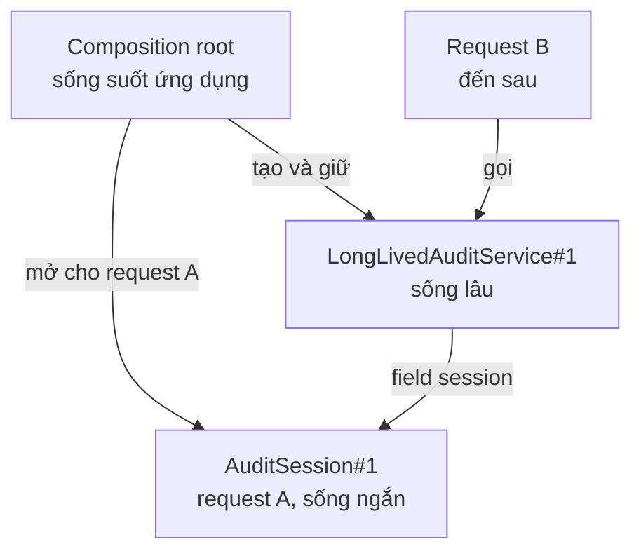
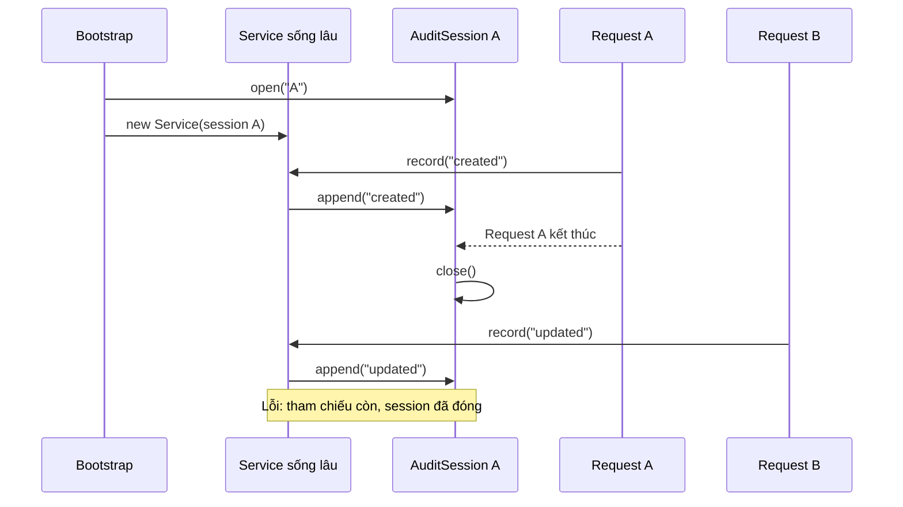
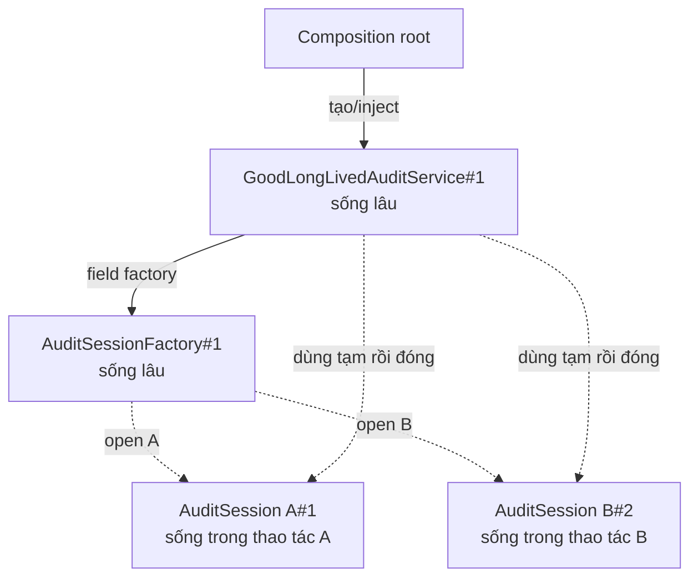
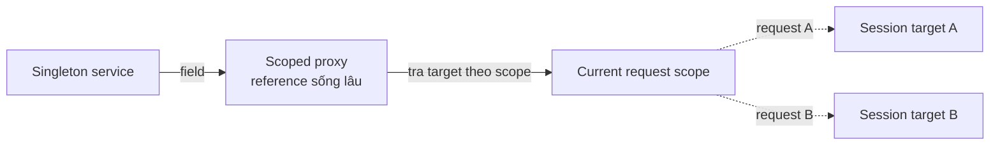

# Phát hiện và sửa lỗi phụ thuộc sống ngắn bị giữ bởi đối tượng sống lâu

Một lỗi **Dependency Injection (DI)** khó nhận ra là mã đã dùng constructor injection đúng cách, không có `new` trong lớp nghiệp vụ, nhưng ứng dụng vẫn dùng một tài nguyên **sai vòng đời**. Chẳng hạn, service sống suốt ứng dụng giữ một `RequestSession` chỉ hợp lệ trong một request. Request kết thúc và đóng session; service vẫn còn tham chiếu, nên request sau có thể gặp lỗi “session đã đóng”, đọc nhầm ngữ cảnh của người trước hoặc truy cập trạng thái đã hết hiệu lực.

Hiện tượng này thường gọi là **captive dependency**: một đối tượng có **vòng đời dài hơn** giữ một dependency có **vòng đời ngắn hơn**, khiến dependency bị sử dụng ngoài phạm vi hợp lệ của nó. Đây là một vấn đề về **scope, ownership và cách lắp ghép đồ thị**, không được giải quyết chỉ bằng việc đưa interface vào constructor.

Bài học thuộc chương **Thực hành** của module **DEPENDENCY_INJECTION**. Ta sẽ học cách phát hiện lỗi, tái hiện có kiểm soát, sửa bằng **factory injection** hoặc **method injection**, xác minh vòng đời bằng Java thuần trước khi chuyển sang DI container.

## 1. Mục tiêu thực hành

Sau bài này, bạn có thể:

- Nhận ra dấu hiệu một singleton hoặc service sống lâu đang giữ session/context/transaction sống ngắn.
- Vẽ được **đồ thị đối tượng** và **timeline** cho thấy thời điểm resource đã đóng nhưng consumer vẫn còn tham chiếu.
- Phân biệt **vòng đời của tham chiếu** với **vòng đời hợp lệ của tài nguyên** bên trong.
- Sửa bằng cách truyền **factory/provider có hợp đồng scope rõ ràng**, hoặc truyền session tạm thời theo từng thao tác.
- Xác định ai **tạo**, ai **mượn**, ai **đóng** resource, tránh đóng sớm hoặc đóng nhiều lần.
- Kiểm thử bằng fake/spy, identity `==`, trace `open → append → close` và executor trì hoãn.
- Nhận diện những giới hạn tương tự trong DI container, request scope, proxy và tác vụ bất đồng bộ.

## 2. Lỗi xuất hiện như thế nào?

Giả sử một ứng dụng cần ghi audit cho mỗi request. `AuditSession` giữ ngữ cảnh của request và một tài nguyên có thể đóng.

Quy ước nghiệp vụ và kỹ thuật:

- Mỗi request cần **một audit session thuộc đúng request đó**.
- Session chỉ hợp lệ từ lúc request mở scope cho tới khi scope kết thúc.
- Hai request **không dùng chung cùng session**.
- Có thể dùng chung một service điều phối nếu service không giữ state request.
- Khi request hoặc thao tác lỗi, session vẫn phải được đóng.

Một đoạn lắp ghép sai:

```java
// Sai: tạo session request tại bootstrap rồi inject vào singleton.
AuditSession firstRequestSession = sessionFactory.open("request-A");

LongLivedAuditService service =
        new LongLivedAuditService(firstRequestSession);

// Request A kết thúc và đóng session.
firstRequestSession.close();

// Service vẫn giữ tham chiếu tới session A.
service.record("request-B-work"); // Sai scope: có thể ném lỗi.
```

Đoạn mã trên là phác thảo; các tên kiểu chạy độc lập được định nghĩa ở mục 4.

Điều đáng chú ý: `LongLivedAuditService` **được inject qua constructor**, nhưng lắp ghép vẫn sai vì **đối tượng được inject quá ngắn hạn so với consumer**.

### 2.1. Đồ thị tham chiếu sai



Trong sơ đồ, cạnh `Service → Session` vẫn tồn tại cả khi session đã được đóng. **Garbage collector không tự xóa tham chiếu đó**, còn kiểm tra `session != null` vẫn có thể trả `true`.

### 2.2. Timeline của lỗi



Có hai biến thể rủi ro:

1. **Session đã đóng:** request sau gọi vào session cũ và gặp lỗi.
2. **Session chưa đóng:** request sau vẫn có thể ghi vào **ngữ cảnh của request trước**, gây lẫn dữ liệu, tenant, audit identity hoặc transaction. Việc trì hoãn đóng không phải cách sửa.

**Điểm gốc của lỗi là phạm vi sử dụng không khớp với phạm vi hợp lệ**, không đơn thuần là thiếu lời gọi `close()`.

## 3. Phân biệt thời gian sống, scope và ownership

| Khái niệm | Câu hỏi | Ví dụ |
| --- | --- | --- |
| **Lifetime** | Instance hợp lệ từ khi nào đến khi nào? | Audit session chỉ trong một request |
| **Scope** | Những consumer/lần gọi nào được chia sẻ cùng instance? | Hai bước của một request dùng chung session |
| **Ownership** | Ai chịu trách nhiệm đóng resource? | Handler mở session thì handler đóng |
| **Borrowing** | Ai chỉ nhận resource để sử dụng tạm? | Service nhận session qua method, không đóng |
| **Identity** | Có phải cùng một object không? | `sessionA == sessionB` là `false` |

Một nguyên tắc thực hành:

> Một consumer chỉ nên **giữ** dependency trong suốt vòng đời của mình khi dependency được bảo đảm **hợp lệ ít nhất lâu bằng khoảng thời gian nó có thể được consumer sử dụng**.

Đây là quy tắc về **tính hợp lệ khi sử dụng**, không chỉ độ dài thời gian object còn tồn tại trên heap. Một client có thể còn được tham chiếu sau khi đóng hoặc sau khi token/transaction của nó hết hạn.

Không phải mọi quan hệ “singleton gọi dependency request-scoped” đều sai. Một singleton có thể giữ **factory** sống dài hoặc **proxy** biết lấy target đúng scope; trong trường hợp đó nó **không giữ trực tiếp một request session cố định**. Cần kiểm chứng hành vi thật, không suy từ tên scope.

## 4. Ví dụ Java thuần: tái hiện lỗi và sửa bằng factory

Ta sẽ dùng **Java 11 trở lên**, không thư viện ngoài. Ví dụ dùng audit session giả ghi sự kiện vào `List`, không truy cập database hay HTTP. Các phép thử chạy **tuần tự và xác định**, nên danh sách sự kiện thông thường là đủ. Khi dùng đa luồng thật, cần thiết kế lại tracker và adapter phù hợp với concurrency.

Tạo file `CaptiveDependencyDemo.java`:

```java
import java.util.ArrayList;
import java.util.List;
import java.util.Objects;

public class CaptiveDependencyDemo {

    // Port để ghi audit trong một scope ngắn.
    interface AuditSession extends AutoCloseable {
        void append(String action);

        @Override
        void close();
    }

    // Port tạo session; hợp đồng: mỗi open() thành công
    // trả một session MỚI thuộc request được chỉ định.
    interface AuditSessionFactory {
        AuditSession open(String requestId);
    }

    // Adapter giả lập, lưu trạng thái sống/đóng để phục vụ test.
    static final class RecordingAuditSession implements AuditSession {
        final String requestId;
        final int sequence;
        private final List<String> events;
        boolean closed;
        int closeCalls;

        RecordingAuditSession(
                String requestId, int sequence, List<String> events) {
            this.requestId = Objects.requireNonNull(requestId);
            this.sequence = sequence;
            this.events = Objects.requireNonNull(events);
        }

        @Override
        public void append(String action) {
            if (closed) {
                throw new IllegalStateException(
                        "Audit session already closed: " + requestId);
            }
            if (action == null || action.isBlank()) {
                throw new IllegalArgumentException("Invalid action");
            }

            events.add(
                    "append:" + requestId + ":" + sequence + ":" + action);

            // Mô phỏng một lỗi trong lúc ghi audit.
            if ("FAIL".equals(action)) {
                throw new IllegalStateException(
                        "Simulated audit write failure");
            }
        }

        @Override
        public void close() {
            closeCalls++;
            if (!closed) {
                closed = true;
                events.add("close:" + requestId + ":" + sequence);
            }
        }
    }

    // Factory có thể quan sát. Chỉ dùng tuần tự trong bài này.
    static final class TrackingAuditSessionFactory
            implements AuditSessionFactory {

        private final List<String> events;
        private final List<RecordingAuditSession> opened =
                new ArrayList<>();

        TrackingAuditSessionFactory(List<String> events) {
            this.events = Objects.requireNonNull(events);
        }

        @Override
        public AuditSession open(String requestId) {
            if (requestId == null || requestId.isBlank()) {
                throw new IllegalArgumentException(
                        "Request ID must not be blank");
            }

            int sequence = opened.size() + 1;
            RecordingAuditSession session =
                    new RecordingAuditSession(requestId, sequence, events);

            opened.add(session);
            events.add("open:" + requestId + ":" + sequence);
            return session;
        }

        int openCount() {
            return opened.size();
        }

        List<RecordingAuditSession> openedSnapshot() {
            return List.copyOf(opened);
        }
    }

    // THIẾT KẾ SAI: service sống lâu giữ session sống ngắn.
    static final class BadLongLivedAuditService {
        private final AuditSession capturedSession;

        BadLongLivedAuditService(AuditSession capturedSession) {
            this.capturedSession =
                    Objects.requireNonNull(capturedSession);
        }

        void record(String action) {
            capturedSession.append(action);
        }
    }

    // CÁCH SỬA A: service sống lâu giữ FACTORY sống lâu.
    // Mỗi thao tác tạo và đóng session của riêng nó.
    static final class GoodLongLivedAuditService {
        private final AuditSessionFactory factory;

        GoodLongLivedAuditService(AuditSessionFactory factory) {
            this.factory = Objects.requireNonNull(factory);
        }

        void recordForRequest(String requestId, String action) {
            if (action == null || action.isBlank()) {
                throw new IllegalArgumentException("Invalid action");
            }

            // Service sở hữu session ĐƯỢC TẠO BỞI LỜI GỌI NÀY.
            try (AuditSession session = factory.open(requestId)) {
                session.append(action);
            }
        }
    }

    // CÁCH SỬA B: service chỉ mượn session trong một lời gọi.
    // Service không giữ nó trong field, cũng không đóng nó.
    static final class ScopedAuditService {
        void record(AuditSession session, String action) {
            Objects.requireNonNull(session, "session").append(action);
        }
    }

    // Handler mở và đóng scope, truyền session tạm cho service.
    static final class RequestHandler {
        private final AuditSessionFactory factory;
        private final ScopedAuditService service;

        RequestHandler(
                AuditSessionFactory factory,
                ScopedAuditService service) {
            this.factory = Objects.requireNonNull(factory);
            this.service = Objects.requireNonNull(service);
        }

        void handle(String requestId, String action) {
            // Handler là OWNER của session.
            try (AuditSession session = factory.open(requestId)) {
                service.record(session, action);
            }
        }
    }

    public static void main(String[] args) {
        // 1. Tái hiện captive dependency.
        List<String> badEvents = new ArrayList<>();
        TrackingAuditSessionFactory badFactory =
                new TrackingAuditSessionFactory(badEvents);

        AuditSession requestA = badFactory.open("A");
        BadLongLivedAuditService bad =
                new BadLongLivedAuditService(requestA);

        try (AuditSession scope = requestA) {
            bad.record("created");
        } // Request A kết thúc, session A được đóng.

        boolean failed = false;
        try {
            bad.record("B-work");
        } catch (IllegalStateException expected) {
            failed = true;
        }

        if (!failed) {
            throw new AssertionError("Expected captive dependency failure");
        }

        System.out.println("BAD: " + badEvents);

        // 2. Sửa bằng factory injection.
        List<String> goodEvents = new ArrayList<>();
        TrackingAuditSessionFactory goodFactory =
                new TrackingAuditSessionFactory(goodEvents);

        GoodLongLivedAuditService good =
                new GoodLongLivedAuditService(goodFactory);

        good.recordForRequest("A", "created");
        good.recordForRequest("B", "updated");

        if (goodFactory.openCount() != 2
                || goodFactory.openedSnapshot().get(0)
                        == goodFactory.openedSnapshot().get(1)) {
            throw new AssertionError("Expected separate request sessions");
        }

        System.out.println("FIXED: " + goodEvents);
    }
}
```

Biên dịch và chạy:

```bash
javac CaptiveDependencyDemo.java
java CaptiveDependencyDemo
```

Kết quả dự kiến:

```text
BAD: [open:A:1, append:A:1:created, close:A:1]
FIXED: [open:A:1, append:A:1:created, close:A:1, open:B:2, append:B:2:updated, close:B:2]
```

**Vì sao ở nhánh BAD không có `append:B...`?** Lời gọi `bad.record("B-work")` ném ngoại lệ trước khi ghi sự kiện vì session A đã đóng. Trong code demo, lỗi được bắt để chương trình tiếp tục minh họa cách sửa; ở ứng dụng thật, việc request B thất bại như vậy là một bug.

### 4.1. Nhận ra bug từ constructor

```java
BadLongLivedAuditService(AuditSession capturedSession) {
    this.capturedSession = capturedSession;
}
```

Constructor nhận một **session đã tạo sẵn**, rồi lưu nó vào field suốt vòng đời service. Nếu service được tạo ở application scope nhưng session được cấp từ request scope, thời gian sống **không tương thích**.

Trình biên dịch không biết ràng buộc “session chỉ sống trong request”. Interface `AuditSession` không tự mang thông tin về scope, nên chương trình vẫn biên dịch thành công.

### 4.2. Sửa bằng cách đổi *thứ được inject*, không chỉ chuyển lời gọi `new`

```java
GoodLongLivedAuditService(AuditSessionFactory factory) {
    this.factory = Objects.requireNonNull(factory);
}
```

Service giữ một **factory hợp lệ trong suốt vòng đời của service**. Mỗi lần xử lý, nó gọi:

```java
try (AuditSession session = factory.open(requestId)) {
    session.append(action);
}
```

Ở đây, service sử dụng một dependency sống ngắn, **nhưng không giữ nó sau khi thao tác kết thúc**. Điều này phù hợp vì contract của `AuditSessionFactory.open` là tạo **session mới** theo từng lời gọi.

Điểm quan trọng: **chỉ đổi kiểu constructor thành factory không đủ** nếu factory thực tế vẫn luôn trả về cùng một session request cũ. Cần kiểm thử cả **hợp đồng tạo mới** và **quyền đóng**.

### 4.3. Hai đồ thị đối tượng sau khi sửa



Cạnh `Service → Factory` là **tham chiếu field lâu dài**. Các cạnh đến session được vẽ nét đứt để nhấn mạnh **quan hệ sử dụng tạm thời trong lời gọi**, không có field `session` nào được giữ lâu trong service.

## 5. Cách sửa khác: method injection với owner ở request handler

Không phải lúc nào service cũng nên tự mở một session cho mỗi phương thức. Nếu **nhiều bước trong cùng request phải dùng chung một transaction hoặc audit session**, tạo một session mới ở mỗi lời gọi có thể phá vỡ yêu cầu.

Khi đó, hãy để ranh giới request tạo session, rồi **truyền session vào mỗi bước cần dùng**.

```java
// Tóm tắt hai lớp đã có trong ví dụ chạy độc lập.
static final class ScopedAuditService {
    void record(AuditSession session, String action) {
        Objects.requireNonNull(session).append(action);
    }
}

static final class RequestHandler {
    private final AuditSessionFactory factory;
    private final ScopedAuditService service;

    void handle(String requestId, String action) {
        try (AuditSession session = factory.open(requestId)) {
            service.record(session, action);
            // Có thể truyền cùng session cho các bước khác
            // thuộc cùng request nếu hợp đồng cho phép.
        }
    }
}
```

*Đoạn trên là bản tóm tắt, lược bỏ constructor của `RequestHandler`; định nghĩa hoàn chỉnh nằm trong `CaptiveDependencyDemo.java`.*

**Hai cơ chế sửa có ownership khác nhau:**

| Thiết kế | Bên mở session | Bên dùng session | Bên đóng session |
| --- | --- | --- | --- |
| `GoodLongLivedAuditService.recordForRequest` | Chính phương thức service qua factory | Service trong cùng lời gọi | Service qua `try-with-resources` |
| `RequestHandler.handle` + `ScopedAuditService.record` | Handler theo request | Scoped service mượn qua tham số | Handler qua `try-with-resources` |

Nếu service **chỉ mượn**, nó không tự đóng tài nguyên đang được handler quản lý. Nếu handler **sở hữu**, nó không truyền session sang một tác vụ có thể sống lâu hơn request mà không mở rộng scope hoặc thay đổi thiết kế.

**Lưu ý:** method injection phù hợp với dependency có quan hệ rõ ràng với một thao tác. Không nên truyền một container tổng quát vào từng phương thức để tùy ý lấy dependency, vì như vậy biến DI thành **service locator**.

## 6. Bài kiểm thử: chứng minh bug và chứng minh cách sửa

Tạo file `CaptiveDependencyTest.java` trong cùng thư mục với demo. Bài test dùng fake của ví dụ chính, không kết nối mạng hay database.

Các kiểm tra được thực hiện:

1. Session bị giữ quá lâu ném lỗi khi dùng sau khi request kết thúc.
2. Nếu quên đóng session, request B còn có thể bị ghi dưới **định danh A**.
3. Factory tạo **hai instance khác nhau** cho hai request và đóng mỗi instance đúng một lần.
4. Nếu ghi audit ném lỗi, `try-with-resources` vẫn đóng session.
5. Handler là owner và service mượn session mà không đóng sớm.
6. Executor trì hoãn tái hiện lỗi async capture, rồi kiểm tra cách sửa.

```java
import java.util.ArrayList;
import java.util.List;
import java.util.concurrent.Executor;

public class CaptiveDependencyTest {

    private static void check(boolean ok, String message) {
        if (!ok) {
            throw new AssertionError(message);
        }
    }

    static void testOldSessionIsClosedButStillCaptured() {
        List<String> events = new ArrayList<>();
        var factory =
                new CaptiveDependencyDemo.TrackingAuditSessionFactory(
                        events);

        CaptiveDependencyDemo.AuditSession shortLived =
                factory.open("A");
        var bad = new CaptiveDependencyDemo.BadLongLivedAuditService(
                shortLived);

        try (CaptiveDependencyDemo.AuditSession scope = shortLived) {
            bad.record("first");
        }

        boolean failed = false;
        try {
            bad.record("second-request");
        } catch (IllegalStateException expected) {
            failed = true;
        }

        check(failed, "Captured closed session must reject later use");
        check(events.equals(List.of(
                        "open:A:1",
                        "append:A:1:first",
                        "close:A:1")),
                "Unexpected OLD trace: " + events);
    }

    static void testOldSessionCanMisattributeDataWhenNotClosed() {
        List<String> events = new ArrayList<>();
        var factory =
                new CaptiveDependencyDemo.TrackingAuditSessionFactory(
                        events);

        CaptiveDependencyDemo.AuditSession captured =
                factory.open("A");
        var bad = new CaptiveDependencyDemo.BadLongLivedAuditService(
                captured);

        // Giả sử request A kết thúc nhưng resource chưa bị đóng.
        // Tác vụ B vẫn ghi vào session đã gắn requestId A.
        bad.record("B-work");

        check(events.equals(List.of(
                        "open:A:1",
                        "append:A:1:B-work")),
                "Expected request B data to be misattributed to A");

        captured.close();
    }

    static void testFactoryCreatesAndClosesSeparateSessions() {
        List<String> events = new ArrayList<>();
        var factory =
                new CaptiveDependencyDemo.TrackingAuditSessionFactory(
                        events);

        var service =
                new CaptiveDependencyDemo.GoodLongLivedAuditService(
                        factory);

        service.recordForRequest("A", "created");
        service.recordForRequest("B", "updated");

        var sessions = factory.openedSnapshot();
        check(factory.openCount() == 2 && sessions.size() == 2,
                "Expected exactly two sessions");
        check(sessions.get(0) != sessions.get(1),
                "Requests must not share an AuditSession");
        check("A".equals(sessions.get(0).requestId)
                        && "B".equals(sessions.get(1).requestId),
                "Session context must match each request");
        check(sessions.get(0).closed && sessions.get(1).closed,
                "Both scopes must close");
        check(sessions.get(0).closeCalls == 1
                        && sessions.get(1).closeCalls == 1,
                "Each scope must close exactly once");

        check(events.equals(List.of(
                        "open:A:1",
                        "append:A:1:created",
                        "close:A:1",
                        "open:B:2",
                        "append:B:2:updated",
                        "close:B:2")),
                "Unexpected FIXED trace: " + events);
    }

    static void testExceptionDoesNotLeakSession() {
        List<String> events = new ArrayList<>();
        var factory =
                new CaptiveDependencyDemo.TrackingAuditSessionFactory(
                        events);
        var service =
                new CaptiveDependencyDemo.GoodLongLivedAuditService(
                        factory);

        boolean failed = false;
        try {
            service.recordForRequest("A", "FAIL");
        } catch (IllegalStateException expected) {
            failed = true;
        }

        check(failed, "Expected simulated write error");
        check(factory.openCount() == 1, "Expected one opened scope");
        var session = factory.openedSnapshot().get(0);
        check(session.closed && session.closeCalls == 1,
                "Failure path must close session once");

        check(events.equals(List.of(
                        "open:A:1",
                        "append:A:1:FAIL",
                        "close:A:1")),
                "Wrong cleanup order: " + events);
    }

    static void testHandlerOwnsBorrowedSession() {
        List<String> events = new ArrayList<>();
        var factory =
                new CaptiveDependencyDemo.TrackingAuditSessionFactory(
                        events);

        var borrowed =
                new CaptiveDependencyDemo.ScopedAuditService();
        var handler = new CaptiveDependencyDemo.RequestHandler(
                factory, borrowed);

        handler.handle("H", "one");

        var session = factory.openedSnapshot().get(0);
        check(session.closed && session.closeCalls == 1,
                "Handler must close its session once");

        check(events.equals(List.of(
                        "open:H:1",
                        "append:H:1:one",
                        "close:H:1")),
                "Borrowed service must not close session early");
    }

    static void testAsyncCapturedSessionFailsAfterRequest() {
        List<String> events = new ArrayList<>();
        var factory =
                new CaptiveDependencyDemo.TrackingAuditSessionFactory(
                        events);
        var borrowed =
                new CaptiveDependencyDemo.ScopedAuditService();

        List<Runnable> pending = new ArrayList<>();
        Executor paused = pending::add;

        // SAI: lambda giữ tham chiếu tới session của request.
        try (CaptiveDependencyDemo.AuditSession session =
                factory.open("ASYNC-A")) {
            paused.execute(() -> borrowed.record(session, "late"));
        }

        check(pending.size() == 1, "Expected one queued task");

        boolean failed = false;
        try {
            pending.remove(0).run();
        } catch (IllegalStateException expected) {
            failed = true;
        }
        check(failed, "Async task must see closed captured session");
        check(events.equals(List.of(
                        "open:ASYNC-A:1",
                        "close:ASYNC-A:1")),
                "Unexpected captured-task timeline");
    }

    static void testAsyncTaskOpensItsOwnScope() {
        List<String> events = new ArrayList<>();
        var factory =
                new CaptiveDependencyDemo.TrackingAuditSessionFactory(
                        events);
        var service =
                new CaptiveDependencyDemo.GoodLongLivedAuditService(
                        factory);

        List<Runnable> pending = new ArrayList<>();
        Executor paused = pending::add;

        // ĐÚNG: truyền snapshot bất biến, tạo session khi task chạy.
        String idSnapshot = "ASYNC-B";
        paused.execute(() ->
                service.recordForRequest(idSnapshot, "late"));

        check(factory.openCount() == 0,
                "No resource should be opened before task starts");

        pending.remove(0).run();

        check(events.equals(List.of(
                        "open:ASYNC-B:1",
                        "append:ASYNC-B:1:late",
                        "close:ASYNC-B:1")),
                "Task must create and close its own scope");
    }

    public static void main(String[] args) {
        testOldSessionIsClosedButStillCaptured();
        testOldSessionCanMisattributeDataWhenNotClosed();
        testFactoryCreatesAndClosesSeparateSessions();
        testExceptionDoesNotLeakSession();
        testHandlerOwnsBorrowedSession();
        testAsyncCapturedSessionFailsAfterRequest();
        testAsyncTaskOpensItsOwnScope();

        System.out.println("PASS: captive dependency and scoped fixes");
    }
}
```

Biên dịch và chạy:

```bash
javac CaptiveDependencyDemo.java CaptiveDependencyTest.java
java CaptiveDependencyTest
```

Kết quả dự kiến:

```text
PASS: captive dependency and scoped fixes
```

Bài test cố ý tạo bug trong những case bắt đầu bằng `testOld...` và `testAsyncCaptured...`. **Test vẫn thành công khi nó chứng minh lỗi được phát hiện theo kỳ vọng**, không phải vì cách lắp ghép sai đã trở thành thiết kế hợp lệ.

### 6.1. Vì sao phải kiểm tra identity?

Một hợp đồng **mỗi request một session mới** cần kiểm tra:

```java
sessions.get(0) != sessions.get(1)
```

`!=` so sánh **danh tính tham chiếu**. Hai session khác nhau có thể chứa dữ liệu giống nhau hoặc có `equals()` trả `true` theo nội dung; điều đó không biến chúng thành cùng instance.

Ngược lại, nếu hai bước trong **cùng một request** cần dùng chung session, kiểm tra thích hợp là hai bước nhận `==` cùng một instance **trong scope đó**. Không có quy tắc “mọi dependency luôn phải khác instance”; cần bắt đầu từ hợp đồng scope.

### 6.2. Vì sao cần đếm số lần đóng và xem trace?

Chỉ kiểm tra `session.closed == true` không biết session đóng **trước hay sau khi dùng**. Chỉ kiểm tra `closeCalls == 1` cũng không tự bảo đảm thao tác ghi đã diễn ra đúng.

Trong ví dụ, chuỗi:

```text
open:A:1
append:A:1:created
close:A:1
```

chứng minh **mở → sử dụng → đóng** theo thứ tự mong muốn.

Trong `RecordingAuditSession.close()`, lời gọi `close` lần thứ hai không ghi thêm event, nhưng **`closeCalls` vẫn tăng**. Nhờ vậy test phát hiện việc nhiều owner cùng đóng một session, kể cả khi implementation cho phép gọi đóng lặp không ném lỗi.

### 6.3. Vì sao test bất đồng bộ dùng executor trì hoãn?

Dùng `Thread.sleep(100)` để hy vọng task chạy sau khi request đóng là **test không xác định**. Một máy nhanh hoặc chậm hơn có thể cho kết quả khác.

`Executor paused = pending::add` chỉ ghi lại `Runnable` mà chưa chạy. Test quyết định chính xác:

1. Request mở session.
2. Task được đưa vào queue.
3. Request kết thúc, session đóng.
4. Test gọi `Runnable.run()`.
5. Task cố dùng session cũ và nhận lỗi.

Cách sửa là **không chuyển tài nguyên request-scoped sang một task vượt scope**. Task chỉ mang theo `idSnapshot` bất biến và gọi factory để mở **session mới** tại thời điểm thực thi.

Đoạn test này chứng minh **vòng đời và thời điểm** mà không khẳng định thực sự có chạy đa luồng. Với sản phẩm thật, vẫn cần kiểm thử thêm executor, cancellation và đồng bộ của các adapter.

## 7. Sửa sai trong composition root

**Composition root** nên lắp những dependency sống lâu ở thời điểm bootstrap, rồi tạo các scope ngắn khi cần.

Một cấu hình xấu:

```java
// SAI: bootstrap giữ session của request A trong service singleton.
AuditSession sessionA = factory.open("A");
BadLongLivedAuditService singleton =
        new BadLongLivedAuditService(sessionA);
```

Cấu hình sửa theo factory injection:

```java
// ĐÚNG: factory và service sống lâu; session sống ngắn được mở khi xử lý.
AuditSessionFactory factory =
        new TrackingAuditSessionFactory(events);
GoodLongLivedAuditService singleton =
        new GoodLongLivedAuditService(factory);

singleton.recordForRequest("A", "created");
singleton.recordForRequest("B", "updated");
```

Cấu hình sửa theo request handler:

```java
// ĐÚNG: root lắp factory/handler/service; handler quản lý scope.
AuditSessionFactory factory =
        new TrackingAuditSessionFactory(events);
ScopedAuditService business = new ScopedAuditService();
RequestHandler handler = new RequestHandler(factory, business);

handler.handle("A", "created");
handler.handle("B", "updated");
```

*Ba đoạn này dùng các kiểu lồng nhau của `CaptiveDependencyDemo`; khi đặt bên ngoài lớp đó, thêm tiền tố `CaptiveDependencyDemo.` hoặc tách thành các lớp/package riêng. `events` là danh sách đã tạo ở bootstrap.*

Không cần một DI container để có scope hợp lý: **vị trí và thời điểm gọi `open`, cùng nơi giữ reference và nơi gọi `close`, quyết định vòng đời thực tế**.

### 7.1. Hai cách sửa không đồng nhất về transaction boundary

Nếu mỗi lời gọi `recordForRequest` tạo session mới, hai bước nghiệp vụ gọi lần lượt sẽ có **hai session**. Nếu hai bước bắt buộc thuộc cùng một transaction, cách làm này có thể sai.

Ví dụ:

```text
Request A:
  ghi audit bước 1
  cập nhật dữ liệu bước 2
  ghi audit bước 3
  commit chung
```

Nếu cả ba bước phải dùng cùng transaction, nên có một **scope owner ở cấp operation/request** tạo transaction/session và truyền nó cho các cộng tác viên liên quan. Consumer mượn resource trong phạm vi thao tác; owner quyết định commit/rollback/close.

Factory injection hữu ích khi mỗi thao tác **thực sự độc lập**. Method injection hoặc một unit-of-work rõ ràng hữu ích khi nhiều bước **phải chia sẻ cùng scope**.

## 8. Những dấu hiệu captive dependency trong code review

| Dấu hiệu | Vì sao nguy hiểm | Cách kiểm tra |
| --- | --- | --- |
| Service singleton có field `RequestContext` | Có thể giữ ngữ cảnh request cũ | Truy ngược nơi tạo field và thời điểm kết thúc scope |
| Constructor của singleton nhận `Connection`/`Session` dùng một lần | Connection có thể được đóng hoặc hết transaction | So lifetime của owner và consumer |
| Một cache tĩnh lưu session hoặc transaction | Giữ resource ngoài scope, rò state giữa request | Kiểm tra nơi thêm/xóa và ownership |
| Factory trả đúng một session đã cache | “Factory” chỉ là tên, vẫn captive | Test `open("A") != open("B")` nếu hợp đồng yêu cầu |
| Handler submit lambda capture `requestSession` | Task có thể chạy khi request đã kết thúc | Test bằng executor trì hoãn |
| Service tự gọi `close()` trên client dùng chung | Đóng tài nguyên khi consumer khác còn dùng | Xác định owner và trace đóng |
| Singleton giữ adapter có request ID mutable trong field | Trộn dữ liệu giữa người dùng/tác vụ | Kiểm tra immutable input/scope và thread safety |
| Proxy được inject vào singleton | Không nhất thiết sai; target có thể chọn theo request | Kiểm tra target resolution, scope còn hoạt động và contract |
| Test chỉ có một request | Không nhìn ra lỗi khi chuyển từ A sang B | Test hai request liên tiếp, có cả phiên đóng |
| Test khởi tạo singleton từ fake sống vô hạn | Ẩn ràng buộc vòng đời ở production | Viết wiring/lifecycle test với fake có `close()` |

Khi review, đừng chỉ tìm từ khóa `@Singleton` hoặc `@RequestScoped`. Với DI thủ công, một biến cục bộ trong `main` được truyền vào service và tái sử dụng có thể **về thực chất là singleton**, dù không có annotation nào.

### 8.1. Các câu hỏi nhanh để truy vết bug

Với mỗi dependency đáng nghi, hỏi:

1. **Ai tạo object này?** Root, request handler, factory hay một thư viện bên ngoài?
2. **Nó hợp lệ tới khi nào?** Hết request, hết transaction, hết operation hay tới shutdown?
3. **Ai giữ tham chiếu?** Field của singleton, collection dùng chung, closure của task hay biến cục bộ?
4. **Ai đóng và khi nào?** Có thể bị đóng khi caller khác đang dùng không?
5. **Có tham chiếu hoặc tác vụ nào sống dài hơn owner không?**
6. **Có trộn dữ liệu của hai request/tenant/user không?**
7. **Có dùng proxy/provider làm trung gian không?** Nếu có, trung gian chọn target nào và xử lý trường hợp không có scope ra sao?
8. **Test hiện tại có chạy ít nhất hai scope khác nhau và tình huống thất bại không?**

Khi trả lời được các câu hỏi, mới quyết định sửa ở **composition root, factory, handler hay ranh giới bất đồng bộ**.

## 9. Không phải cứ thêm provider là sửa xong

Một factory hoặc provider chỉ giải quyết captive dependency nếu **bản thân nó tuân thủ hợp đồng về scope**.

Ví dụ lỗi tinh vi:

```java
// SAI: factory giả chỉ trả về một session đã tạo trước đó.
AuditSession alreadyOpened = someFactory.open("A");

AuditSessionFactory badFactory = requestId -> alreadyOpened;

GoodLongLivedAuditService service =
        new GoodLongLivedAuditService(badFactory);

// Dù constructor nhận factory, cả hai lần gọi vẫn dùng session A.
service.recordForRequest("A", "first");
service.recordForRequest("B", "second");
```

*Đây là ví dụ rút gọn; các biến `someFactory` và lớp liên quan cần được tạo trong ngữ cảnh ứng dụng. Trong ví dụ thực, lời gọi thứ hai sẽ thất bại vì phiên A đã bị đóng trong lần đầu.*

Cần làm rõ:

- `open(requestId)` có **tạo instance mới** hay trả cache?
- Nếu cache, **cache thuộc scope nào**?
- Session đã đóng có thể bị trả lại không?
- Nếu factory mở một phần resource rồi ném lỗi, **ai dọn phần đã mở**?
- Nếu trả một object qua proxy, **target** có đổi theo request không?
- Consumer sở hữu hay chỉ mượn object được trả?

Đừng suy ra hành vi chỉ từ chữ “Factory”, “Provider” hoặc “Singleton”. Các tên này không tự bảo đảm vòng đời.

### 9.1. Factory là long-lived, sản phẩm của factory là short-lived

Trong cách sửa A, `TrackingAuditSessionFactory` có thể sống suốt ứng dụng trong ví dụ, nhưng những `RecordingAuditSession` do nó tạo chỉ sống trong từng lời gọi `recordForRequest`.

Điều này **không mâu thuẫn**. Một singleton factory có thể an toàn khi tạo nhiều session độc lập nếu implementation của factory hỗ trợ truy cập đồng thời khi ứng dụng cần. Trong ví dụ, factory lưu `ArrayList` để quan sát nên **chỉ thiết kế cho các phép thử tuần tự**. Đem factory ghi danh sách này vào server đa luồng mà không thêm đồng bộ sẽ tạo một lỗi khác.

## 10. DI container, scoped proxy và trường hợp không có request scope

Một số DI container có thể inject một **proxy** sống lâu vào singleton; mỗi lần gọi proxy sẽ chuyển tới **target** thuộc request hiện tại. Điều đó có thể là thiết kế hợp lệ nếu framework hỗ trợ và lời gọi luôn diễn ra trong scope thích hợp.

Sơ đồ khái niệm:



Tuy nhiên, có những giới hạn quan trọng:

- `singleton.proxy == singleton.proxy` không chứng minh hai request dùng cùng **target**.
- Nếu gọi proxy khi **không có request scope đang hoạt động**, framework có thể báo lỗi.
- Nếu tác vụ bất đồng bộ chạy sau khi scope kết thúc, proxy có thể không tìm được target hợp lệ.
- Cơ chế truyền context sang luồng khác, lazy resolution và cleanup tùy DI container; không được giả định tự động hoạt động trong mọi API.
- Nếu proxy giữ sai target hoặc target không được đóng đúng scope, bug vẫn tồn tại.

Bài học sử dụng Java thuần vì **nguyên tắc phân biệt lifetime/ownership phải được hiểu trước**. Khi dùng container, hãy kiểm tra đúng tài liệu và cơ chế scope của framework cụ thể thay vì chỉ nhìn annotation.

## 11. Bất đồng bộ làm lỗi khó thấy hơn

Một request thường có trình tự:

```text
request begin
  → open session
  → xử lý
  → close session
request end
```

Khi thêm task:

```text
request begin
  → open session
  → submit task capture session
  → close session
request end
...
task bắt đầu và dùng session đã đóng
```

**Dependency sống ngắn bị giữ bởi đối tượng sống lâu** không chỉ xuất hiện trong field. Một `Runnable`, `CompletableFuture` hoặc callback được lưu để chạy sau cũng có thể giữ tham chiếu **vượt quá scope**.

### 11.1. Đừng giữ mutable request context trong callback

Một cách sửa thông dụng:

1. Sao chép **dữ liệu tối thiểu, bất biến, cần thiết** từ request (ví dụ ID hoặc một command DTO immutable).
2. Truyền dữ liệu ấy sang task, **không chuyển session/transaction đã mở**.
3. Task dùng factory hợp lệ để mở resource trong scope của **chính task**.
4. Task xử lý, sau đó đóng resource trong `try-with-resources`.
5. Tách riêng chính sách lỗi, retry, idempotency và giới hạn số task theo yêu cầu sản phẩm.

Không nên mặc định `ThreadLocal` hay request context của HTTP server tự được chuyển sang executor. Thread pool tái sử dụng thread; context có thể không tồn tại hoặc là context cũ nếu ứng dụng quản lý sai.

### 11.2. Cancellation cần được thiết kế riêng

`CompletableFuture.cancel(...)` không bảo đảm mọi tác vụ bên trong đã ngừng ngay và mọi resource đã được đóng. Nếu tác vụ có I/O, phải có chính sách timeout, hủy hợp tác (*cooperative cancellation*) và cleanup ở nơi thật sự sở hữu resource.

Trong phép thử của bài, executor trì hoãn giúp **chứng minh được** use-after-close mà không cần dựa vào timing. Với hệ thống thật còn cần kiểm tra đường lỗi, shutdown và các thao tác đang chạy đồng thời.

## 12. Khi lỗi gắn với database transaction hoặc EntityManager

Những trường hợp thường dễ mắc captive dependency:

- Inject một **database connection** của một transaction vào singleton rồi tái sử dụng qua request khác.
- Giữ **EntityManager/session** cụ thể trong service sống lâu, sau khi transaction gốc kết thúc.
- Cache một **request-scoped repository** có transaction context bên trong vào biến static.
- Mở transaction tại handler rồi submit một task giữ nguyên transaction/session sang thread khác.

Không phải mọi repository object đều short-lived. Một adapter repository **stateless**, được thiết kế để dùng chung một connection pool thread-safe, có thể sống dài. Cần phân biệt:

| Đối tượng | Phạm vi thường gặp | Điều phải xác minh |
| --- | --- | --- |
| `DataSource` hoặc pool quản lý kết nối | Ứng dụng | Thread safety, owner, shutdown |
| Repository stateless dùng pool | Có thể là application scope | Không giữ connection/transaction request trong field |
| Connection mượn từ pool | Một operation/transaction | Đóng hoặc trả về pool đúng lúc |
| EntityManager/session cụ thể | Transaction/request tùy framework | Không truy cập sau khi đóng, không chia sẻ sai thread |
| Transaction context | Một transaction | Commit/rollback và tài nguyên thuộc đúng scope |
| Factory tạo session | Có thể sống lâu | Sản phẩm tạo đúng scope, cleanup khi lỗi |

Các scope trên **không phải luật áp dụng đồng loạt** cho mọi framework. Ví dụ, một proxy quản lý `EntityManager` có thể được inject ở scope dài nhưng chuyển lời gọi đến entity manager thích hợp theo transaction hiện tại. Phải xem cơ chế container cụ thể và kiểm chứng luồng thực thi.

## 13. Cách thực hành sửa một bug có sẵn trong dự án

Nếu nhận được bug “request đầu tiên chạy, request thứ hai báo session closed”, có thể đi theo trình tự:

1. **Thu thập triệu chứng**: request nào mở session, request nào dùng nó, thời điểm đóng và loại lỗi. Không log secret hoặc dữ liệu nhạy cảm không cần thiết.
2. **Xác định nơi giữ tham chiếu**: constructor field, singleton, cache, closure của task hay service locator.
3. **Vẽ graph và timeline**: đánh dấu instance nào sống dài, instance nào được tạo/đóng theo request.
4. **Viết test tái hiện hai request**: đóng request A rồi gọi request B; kiểm tra use-after-close hoặc sai request ID.
5. **Xác định owner mong muốn**: task tự sở hữu resource mới, hay request handler sở hữu resource cho nhiều bước?
6. **Thay cạnh dependency sai**: inject factory/provider sống đủ lâu hoặc truyền dependency ngắn hạn qua phương thức trong scope hợp lệ.
7. **Kiểm chứng contract factory**: tạo đúng số instance, đúng identity, đúng request và không trả resource đã đóng.
8. **Kiểm chứng cleanup khi lỗi**: ép thao tác ghi/lưu ném lỗi, xác minh `close` trong phạm vi phù hợp.
9. **Kiểm chứng async/concurrency** nếu ứng dụng có task chạy sau hoặc nhiều request song song.
10. **Kiểm tra lại composition root/container**: không còn binding nào lén tạo session tại bootstrap rồi tái sử dụng; các profile thật và test dùng wiring thích hợp.

### Bảng bằng chứng trước/sau khi sửa

| Tiêu chí | Trước | Sau |
| --- | --- | --- |
| Field của service sống lâu | Giữ `AuditSession A` | Giữ `AuditSessionFactory` hoặc không giữ session |
| Request B ghi audit | Dùng A hoặc ném lỗi | Dùng session B |
| Identity giữa request A/B | Cùng session nếu bị capture | Khác session theo hợp đồng |
| Thời điểm mở | Bootstrap/request A | Khi scope A hoặc B bắt đầu |
| Thời điểm đóng | Có thể trước khi B dùng | Sau khi từng scope dùng xong |
| Lỗi ghi | Có nguy cơ rò hoặc sai owner | Đóng bằng `try-with-resources` |
| Khả năng unit test | Dễ phụ thuộc vào session cũ | Dễ fake factory hoặc session theo scope |

Mục tiêu là sửa **quan hệ lifetime**, chứ không chỉ thêm `if (!closed)` hay tăng tuổi thọ session vô hạn.

## 14. Những cách sửa sai thường gặp

### 14.1. Không đóng session nữa

Bỏ `close()` có thể khiến lỗi “already closed” biến mất tạm thời, nhưng lại tạo **rò rỉ tài nguyên** và lẫn ngữ cảnh giữa các request. Với transaction, cách này còn có thể giữ khóa hoặc trạng thái không nhất quán.

### 14.2. Mỗi lần lỗi thì tạo lại session ngay trong singleton

Một cách chữa cháy như “nếu đã đóng thì `new Session()`” trong service có thể làm service biết chi tiết hạ tầng, race khi nhiều request đồng thời và thay đổi session giữa chừng mà không có owner rõ.

Nếu cần tạo theo thao tác, hãy inject **factory có hợp đồng** rồi quản lý session trong scope rõ ràng.

### 14.3. Dùng singleton giả để chứa context hiện tại

Một singleton có field mutable `currentRequestId` hoặc `currentTransaction` bị cập nhật theo mỗi request có thể gây race và dữ liệu lẫn nhau, ngay cả khi nó không chứa session đã đóng. Không nên thay captive dependency bằng **global mutable state**.

### 14.4. Đóng cả ở handler lẫn service

Hai nơi cùng nhận mình là owner sẽ dẫn đến đóng lặp hoặc đóng sớm. Phải chọn **một owner** theo hợp đồng: service sở hữu resource do nó mở, hoặc handler sở hữu resource mà nó truyền cho service mượn.

### 14.5. Dùng provider nhưng provider cache sai scope

Một provider trả cùng một session mãi mãi không sửa được lỗi. Kiểm thử cần khẳng định sản phẩm của `open` theo scope, không chỉ kiểm tra constructor đã nhận một interface tên `Factory`.

### 14.6. Chỉ chạy một request trong test

Một request thành công thường không đủ phát hiện captive dependency. Hãy kiểm thử **A → đóng A → B**, một trường hợp **không đóng A nhưng B ghi nhầm context**, và đường lỗi/async.

## 15. Bài tập thực hành

**Bài 1 — Tái hiện:** chạy `CaptiveDependencyDemo`, mô tả vì sao dòng `bad.record("B-work")` ném ngoại lệ. Kiểm tra field nào khiến service vẫn giữ session A.

**Bài 2 — Không đóng nhưng vẫn sai:** trong `testOldSessionCanMisattributeDataWhenNotClosed`, đổi `"B-work"` thành `"payment-approved"`. Vì sao log dưới request A vẫn sai dù không có exception?

**Bài 3 — Sửa factory:** thay `GoodLongLivedAuditService` bằng một phiên bản tự tạo `new RecordingAuditSession` trong method. Phân tích tại sao cách này làm service phụ thuộc implementation/định dạng trace và ownership khó quản lý hơn so với inject `AuditSessionFactory`.

**Bài 4 — Hai bước chung một scope:** dùng `RequestHandler` mở một session, rồi gọi `ScopedAuditService.record` hai lần. Xác minh chỉ có **một open và một close**, cùng request ID, đúng thứ tự. Vì sao dùng `GoodLongLivedAuditService.recordForRequest` hai lần không cho kết quả tương đương về identity?

**Bài 5 — Factory sai contract:** viết `AuditSessionFactory` trả cùng một `RecordingAuditSession` cho hai lần `open`. Kiểm thử hai request. Khi nào bị đóng trùng? Khi nào request B bị gắn nhầm ID?

**Bài 6 — Lỗi ghi:** cho `RecordingAuditSession.append("FAIL")` ném ngoại lệ. Đảm bảo `closeCalls == 1` và sự kiện `close` xuất hiện sau `append` trong trace.

**Bài 7 — Async:** đổi test `testAsyncTaskOpensItsOwnScope` để tác vụ giữ session đã mở sẵn. Dùng executor trì hoãn để minh họa resource bị đóng trước khi task chạy. Sau đó chỉ giữ `idSnapshot` và mở session bên trong task.

**Bài 8 — Scope container:** giả sử một singleton được inject một request-scoped proxy. Giải thích vì sao so sánh `==` trên proxy không đủ kiểm chứng identity target. Đề xuất test trên hai request có scope hợp lệ để xác minh target không bị chia sẻ ngoài ý muốn.

**Bài 9 — Review production:** trong một web service, repository singleton có field `Connection connection` được lấy từ pool khi khởi động. Đánh giá rủi ro và đề xuất dùng DataSource/pool sống dài cùng việc lấy/trả connection theo transaction. Nêu nơi đóng pool lúc shutdown.

## 16. Checklist trước khi kết luận đã sửa xong

- [ ] Service sống lâu không còn giữ **trực tiếp** session/context ngắn hạn ngoài contract.
- [ ] Có thể chỉ ra owner tạo và đóng từng resource.
- [ ] Các request khác nhau có instance/session đúng identity theo thiết kế.
- [ ] Session không còn bị sử dụng sau khi đóng.
- [ ] Lỗi trong thao tác vẫn dẫn đến cleanup thích hợp.
- [ ] Nếu nhiều bước cần chung transaction, scope của chúng được giữ nguyên.
- [ ] Factory/provider không âm thầm cache session sai scope.
- [ ] Không đưa mutable request context vào singleton để thay thế.
- [ ] Tác vụ bất đồng bộ không giữ session của scope đã kết thúc.
- [ ] Test sử dụng ít nhất hai request và một đường lỗi.
- [ ] Thread safety của factory/resource dùng chung được đánh giá khi có concurrency.
- [ ] Nếu dùng DI container/proxy, đã kiểm tra target scope và hành vi khi không có request context.

Danh sách này dùng để review và kiểm thử **một bug cụ thể**, không bắt buộc thêm một interface hoặc factory mới cho mọi đối tượng nhỏ không giữ tài nguyên.

## 17. Ghi nhớ

**Cốt lõi của captive dependency là một tham chiếu sống lâu giữ dependency chỉ hợp lệ trong scope ngắn hơn.** Constructor injection không tự giải quyết việc này; nó chỉ giúp ta nhìn rõ object nào đang được cấp ở đâu.

Hai cách sửa phổ biến là **inject factory/provider sống đủ lâu rồi tạo–đóng resource theo từng thao tác**, hoặc **để request/operation scope sở hữu resource và truyền tạm vào service qua method injection**. Chọn cách nào dựa trên yêu cầu chia sẻ transaction, ownership và thời gian sống của tác vụ.

Composition root quyết định cách lắp ghép, còn Java thuần với fake ghi nhận `open → use → close`, kiểm tra identity và executor trì hoãn đủ để chứng minh bug và xác minh cách sửa. Khi dùng DI container, scope và proxy có thể tự động hóa việc chọn target nhưng **không thay thế trách nhiệm hiểu vòng đời, tránh lẫn ngữ cảnh và đóng tài nguyên đúng nơi**.
