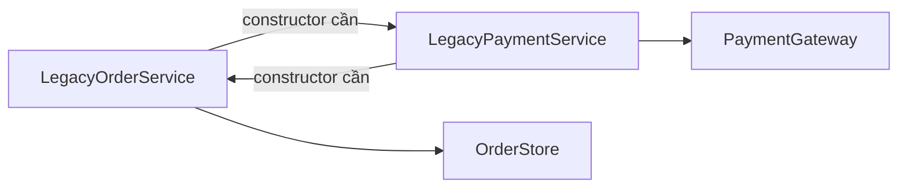
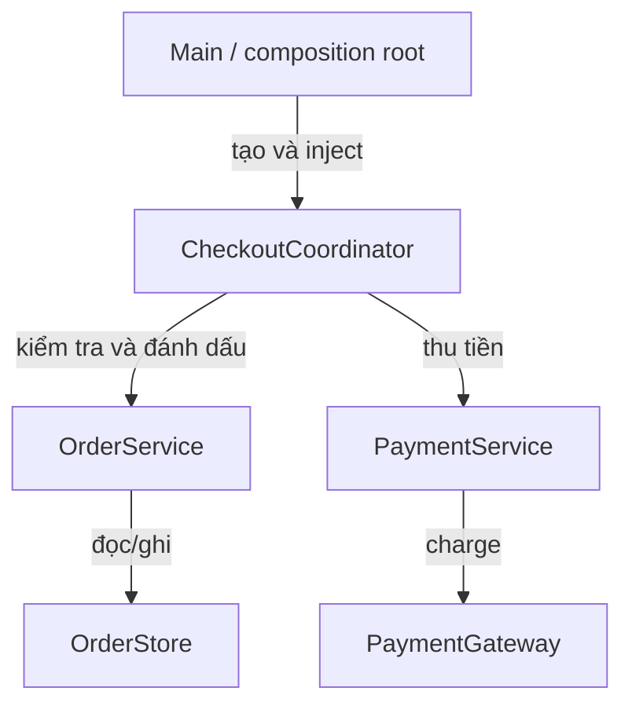

# Refactor phụ thuộc vòng bằng cách tách trách nhiệm

> **Chương:** Thực hành  
> **Ngữ cảnh:** Dependency Injection (DI) và Inversion of Control (IoC) nhằm tách việc sử dụng dependency khỏi việc tạo và lắp ghép chúng. Bài thực hành sử dụng **constructor injection**, **composition root** và **kiểm thử bằng Java thuần** để sửa một vòng phụ thuộc giữa các service trước khi nghĩ đến DI container.

## 1. Mục tiêu và sản phẩm cần hoàn thành

Sau bài này, bạn có thể:

1. Vẽ và giải thích vòng constructor `OrderService → PaymentService → OrderService`.
2. Phân biệt **vấn đề khởi tạo** với **nguyên nhân thiết kế**: hai service đang làm thay trách nhiệm điều phối của một use case.
3. Xác định trách nhiệm riêng của thành phần quản lý đơn hàng, thanh toán và điều phối checkout.
4. Refactor object graph thành các hướng phụ thuộc **không tạo vòng constructor**.
5. Lắp ghép các implementation tại **composition root** bằng constructor injection, không dùng container hoặc Service Locator.
6. Kiểm thử cả đường thành công, từ chối thanh toán, dữ liệu sai, đơn hàng không tồn tại, yêu cầu lặp và lỗi cập nhật đơn hàng.
7. Nêu rõ phần nào đã được cải thiện nhờ DI, phần nào vẫn cần giải pháp riêng về transaction, idempotency, scope và concurrency trong hệ thống thật.

**Sản phẩm thực hành:** Một chương trình `Main.java` chạy được bằng JDK, một file `CheckoutCoordinatorTest.java` với fake dependency, sơ đồ dependency trước/sau và bản giải thích ngắn về ranh giới trách nhiệm.

## 2. Tình huống: xác nhận đơn hàng và thu tiền

Một ứng dụng nhỏ xử lý việc thanh toán đơn hàng:

- Chỉ cho phép checkout khi đơn hàng **tồn tại** và **chưa được đánh dấu đã thanh toán**.
- Gọi cổng thanh toán để thử thu một số tiền hợp lệ.
- Nếu cổng thanh toán từ chối, không đánh dấu đơn hàng đã thanh toán.
- Nếu cổng thanh toán chấp nhận, đánh dấu đơn hàng đã thanh toán.
- Những dependency về lưu trữ và thanh toán được cấp từ bên ngoài; service không tự kết nối database hay tạo HTTP client.

Ban đầu một nhóm phát triển chia code thành `OrderService` và `PaymentService` nhưng để chúng **biết và gọi ngược lẫn nhau**. Mục tiêu thực hành là làm rõ rằng “hai service cần hợp tác” **không đồng nghĩa** “hai service phải giữ tham chiếu trực tiếp đến nhau”.

### 2.1. Tiêu chí chấp nhận trước khi sửa

| Mã tiêu chí | Hành vi mong muốn |
| --- | --- |
| AC-01 | Lắp ghép toàn bộ ứng dụng bằng constructor injection; không cần truyền `null` hay gọi setter để phá vòng. |
| AC-02 | `OrderService` không phụ thuộc `PaymentService`; `PaymentService` không phụ thuộc `OrderService`. |
| AC-03 | Payment được chấp nhận: charge một lần, mark paid một lần, trả kết quả thành công. |
| AC-04 | Payment bị từ chối: charge một lần, không mark paid, trả kết quả thất bại. |
| AC-05 | Đơn không tồn tại, đã thanh toán, ID rỗng hoặc số tiền không hợp lệ: từ chối trước khi gọi gateway. |
| AC-06 | Hai loại dependency hạ tầng có thể thay bằng fake trong test Java thuần. |
| AC-07 | Composition root quyết định các implementation cụ thể và quản lý vòng đời chúng nếu có tài nguyên cần đóng. |

**Giới hạn bài tập:** Demo sử dụng bộ nhớ và gateway giả lập. Các tiêu chí trên **không chứng minh** rằng checkout đã an toàn trước lỗi mạng, nhiều request đồng thời hoặc thanh toán phân tán; những vấn đề đó được thảo luận riêng ở cuối bài.

## 3. Bản thiết kế lỗi: phụ thuộc vòng giữa hai service

Ví dụ mã trước refactor (giả sử `OrderStore` và `PaymentGateway` là những hợp đồng hạ tầng):

```java
import java.util.Objects;

// PHẢN VÍ DỤ: hai service cần nhau ngay trong constructor.
final class LegacyOrderService {
    private final OrderStore store;
    private final LegacyPaymentService payments;

    LegacyOrderService(
            OrderStore store, LegacyPaymentService payments) {
        this.store = Objects.requireNonNull(store);
        this.payments = Objects.requireNonNull(payments);
    }

    boolean checkout(String orderId, int amountInCents) {
        // Order service lại giao điều phối checkout cho payment service.
        return payments.chargeAndComplete(orderId, amountInCents);
    }

    void markPaid(String orderId) {
        store.markPaid(orderId);
    }
}

final class LegacyPaymentService {
    private final PaymentGateway gateway;
    private final LegacyOrderService orders;

    LegacyPaymentService(
            PaymentGateway gateway, LegacyOrderService orders) {
        this.gateway = Objects.requireNonNull(gateway);
        this.orders = Objects.requireNonNull(orders);
    }

    boolean chargeAndComplete(String orderId, int amountInCents) {
        if (!gateway.charge(orderId, amountInCents)) {
            return false;
        }
        // Payment service gọi ngược OrderService để đổi trạng thái đơn.
        orders.markPaid(orderId);
        return true;
    }
}
```

**Lưu ý:** Đây là đoạn mã mô tả thiết kế lỗi, không phải file chạy độc lập. Các interface `OrderStore` và `PaymentGateway` sẽ được khai báo đầy đủ trong ví dụ sau refactor.



### 3.1. Vòng constructor làm việc lắp ghép bị bế tắc thế nào?

Muốn tạo `LegacyOrderService` đúng hợp đồng, phải có `LegacyPaymentService` **trước**. Muốn tạo `LegacyPaymentService`, phải có `LegacyOrderService` **trước**. Không có thứ tự `new` tuyến tính nào khởi tạo hợp lệ cả hai với các constructor bắt buộc này.

**Đây không phải lỗi cú pháp Java.** Hai class có thể được biên dịch nếu các kiểu liên quan tồn tại. Lỗi xuất hiện khi cố lắp object graph bằng constructor, và một DI container cũng có thể từ chối vòng constructor khi khởi tạo bean.

Không nên “giải quyết” bằng cách:

- Truyền `null` cho một constructor rồi vá bằng setter sau.
- Thay tất cả dependency bằng một `ServiceLocator.resolve(...)` trong thân method.
- Dùng `Supplier<LegacyOrderService>` hoặc proxy chỉ để trì hoãn vòng, nhưng giữ nguyên logic gọi ngược.
- Chuyển một phía thành field injection để code có thể khởi tạo đối tượng chưa hoàn chỉnh.

Những cách này có thể **thay thời điểm xuất hiện lỗi**, nhưng không trả lời câu hỏi thiết kế quan trọng: *Ai chịu trách nhiệm điều phối việc thu tiền và đổi trạng thái đơn hàng?*

### 3.2. Không nhầm ba loại quan hệ

| Loại quan hệ | Trong bài toán này | Ý nghĩa |
| --- | --- | --- |
| **Phụ thuộc kiểu** | `LegacyOrderService` khai báo `LegacyPaymentService`, và ngược lại. | Hai class biết và sử dụng kiểu của nhau. |
| **Phụ thuộc constructor** | Constructor mỗi class yêu cầu instance class kia. | Không có điểm bắt đầu khởi tạo chỉ bằng các constructor bắt buộc. |
| **Vòng gọi hành vi** | Một service gọi service kia, rồi gọi ngược lại. | Có thể dẫn đến lặp vô hạn nếu không có điểm dừng; trong mã ví dụ, vòng constructor là vấn đề trực tiếp. |

Một vòng tham chiếu runtime trong mô hình dữ liệu như `Node.parent/children` có thể hợp lệ; nhưng vòng constructor giữa các service ở đây là dấu hiệu cần đánh giá **trách nhiệm của use case**, không phải chỉ ép container chấp nhận nó.

## 4. Phân tích trách nhiệm: ai làm việc gì?

Trước khi sửa code, hãy viết lại **quy tắc nghiệp vụ** và phân loại từng thao tác.

| Thao tác | Thành phần nên chịu trách nhiệm | Lý do |
| --- | --- | --- |
| Kiểm tra đơn có tồn tại và chưa thanh toán | `OrderService` | Đây là quy tắc liên quan trạng thái đơn hàng. |
| Thử thu tiền qua cổng thanh toán | `PaymentService` | Đây là cộng tác với payment gateway. |
| Quyết định gọi thanh toán **trước hay sau** việc cập nhật đơn | `CheckoutCoordinator` | Đây là luồng điều phối của use case checkout. |
| Đọc và cập nhật dữ liệu đơn hàng | `OrderStore` adapter | Đây là chi tiết lưu trữ. |
| Gọi API thanh toán cụ thể | `PaymentGateway` adapter | Đây là chi tiết hạ tầng thanh toán. |
| Chọn concrete class và lắp object graph | `Main` (composition root) | Đây là trách nhiệm cấu hình/khởi động. |

Điểm thay đổi quan trọng: **CheckoutCoordinator** là thành phần cấp use case điều phối hai service. Nó cần biết cả `OrderService` lẫn `PaymentService`; nhưng hai service **không cần biết nhau**.



Graph mới không có đường dependency quay về coordinator hay quay giữa hai service. Nó có hướng **từ điều phối xuống các thành phần có trách nhiệm hẹp**.

### 4.1. Vì sao không đặt hết logic vào `OrderService`?

Có thể một ứng dụng đơn giản chọn `OrderService` làm application service điều phối. Tuy nhiên, trong ví dụ trước, `OrderService` và `PaymentService` vừa tự làm nghiệp vụ của mình vừa gọi lẫn nhau. Tách một `CheckoutCoordinator` giúp minh họa rõ **nơi chứa luồng công việc liên quan nhiều service**.

**Đừng tạo coordinator chỉ vì tên gọi.** Trong code thực tế, cần cân đối ranh giới module, trách nhiệm và cách đặt tên. Mục tiêu cốt lõi là có **một hướng điều phối tường minh**, tránh để hai service bắt buộc giữ tham chiếu ngược lẫn nhau.

## 5. Các bước refactor từng phần

Thực hiện theo trình tự để tránh thay đổi cấu trúc và hành vi cùng lúc:

**Bước 1 — Ghi nhận hành vi cần giữ.** Viết test hoặc ít nhất liệt kê kết quả cho payment thành công/thất bại, dữ liệu sai và đơn đã thanh toán. Trong mã legacy có thể chưa có validation; hãy ghi rõ phần hành vi mới được bổ sung thay vì lặng lẽ coi là giữ nguyên.

**Bước 2 — Trích hợp đồng hạ tầng.** Xác định `OrderStore` và `PaymentGateway` là những dependency thực sự. Interface chỉ công bố các thao tác cần dùng; không tạo abstraction tổng quát kiểu `get(Class<T>)`.

**Bước 3 — Thu hẹp `OrderService`.** Cho service quản lý quy tắc trạng thái đơn; bỏ tham chiếu `LegacyPaymentService` và phương thức đang ủy quyền điều phối checkout sang payment.

**Bước 4 — Thu hẹp `PaymentService`.** Cho service chỉ gọi `PaymentGateway`; bỏ tham chiếu ngược `LegacyOrderService`. Phương thức `charge(...)` trả kết quả của gateway thay vì tự cập nhật đơn.

**Bước 5 — Thêm `CheckoutCoordinator`.** Constructor nhận `OrderService` và `PaymentService`, còn phương thức `checkout(...)` xác định thứ tự gọi.

**Bước 6 — Lắp ghép tại composition root.** Tạo `OrderStore` và `PaymentGateway` cụ thể, tạo hai service, rồi tạo coordinator. Không có service nào gọi `new` để tự tạo dependency hạ tầng.

**Bước 7 — Kiểm thử các nhánh.** Dùng fake và stub để xem coordinator gọi gateway, cập nhật kho đơn hay từ chối yêu cầu như thế nào. Test không cần DI container hoặc mạng.

**Bước 8 — Rà soát giới hạn.** Sau khi code chạy đúng, kiểm tra transaction, retry/idempotency, xử lý đồng thời, scope và quyền sở hữu tài nguyên trước khi đưa vào production.

## 6. Mã Java sau refactor: chương trình độc lập

Tạo file `Main.java` với toàn bộ nội dung sau. Mã dùng Java 8+ và **không yêu cầu framework hay thư viện ngoài**.

```java
import java.util.Arrays;
import java.util.Collection;
import java.util.HashSet;
import java.util.Objects;
import java.util.Set;

// Hợp đồng lưu trữ: không gắn service với database cụ thể.
interface OrderStore {
    boolean exists(String orderId);
    boolean isPaid(String orderId);
    void markPaid(String orderId);
}

// Hợp đồng thanh toán: trả true khi gateway chấp nhận.
interface PaymentGateway {
    boolean charge(String orderId, int amountInCents);
}

// Adapter demo: chỉ lưu trạng thái trong bộ nhớ.
final class InMemoryOrderStore implements OrderStore {
    private final Set<String> knownOrders = new HashSet<>();
    private final Set<String> paidOrders = new HashSet<>();

    InMemoryOrderStore(Collection<String> orderIds) {
        knownOrders.addAll(Objects.requireNonNull(orderIds, "orderIds"));
    }

    @Override
    public boolean exists(String orderId) {
        return knownOrders.contains(orderId);
    }

    @Override
    public boolean isPaid(String orderId) {
        return paidOrders.contains(orderId);
    }

    @Override
    public void markPaid(String orderId) {
        if (!exists(orderId)) {
            throw new IllegalArgumentException(
                    "Order not found: " + orderId);
        }
        paidOrders.add(orderId);
    }
}

// Adapter demo: không chuyển tiền thật.
final class DemoPaymentGateway implements PaymentGateway {
    @Override
    public boolean charge(String orderId, int amountInCents) {
        System.out.println(
                "CHARGE " + orderId + ": " + amountInCents);
        return true;
    }
}

// Quản lý quy tắc liên quan trạng thái đơn hàng.
final class OrderService {
    private final OrderStore store;

    OrderService(OrderStore store) {
        this.store = Objects.requireNonNull(store, "store");
    }

    void requirePayable(String orderId) {
        if (!store.exists(orderId)) {
            throw new IllegalArgumentException(
                    "Order not found: " + orderId);
        }
        if (store.isPaid(orderId)) {
            throw new IllegalStateException(
                    "Order already paid: " + orderId);
        }
    }

    void markPaid(String orderId) {
        store.markPaid(orderId);
    }
}

// Chỉ cộng tác với payment gateway, không biết OrderService.
final class PaymentService {
    private final PaymentGateway gateway;

    PaymentService(PaymentGateway gateway) {
        this.gateway = Objects.requireNonNull(gateway, "gateway");
    }

    boolean charge(String orderId, int amountInCents) {
        return gateway.charge(orderId, amountInCents);
    }
}

// Điều phối use case; không tự tạo repository/gateway.
final class CheckoutCoordinator {
    private final OrderService orders;
    private final PaymentService payments;

    CheckoutCoordinator(OrderService orders, PaymentService payments) {
        this.orders = Objects.requireNonNull(orders, "orders");
        this.payments = Objects.requireNonNull(payments, "payments");
    }

    boolean checkout(String orderId, int amountInCents) {
        if (orderId == null || orderId.trim().isEmpty()) {
            throw new IllegalArgumentException("orderId is required");
        }
        if (amountInCents <= 0) {
            throw new IllegalArgumentException(
                    "amountInCents must be positive");
        }

        orders.requirePayable(orderId);

        if (!payments.charge(orderId, amountInCents)) {
            return false;
        }

        orders.markPaid(orderId);
        return true;
    }
}

public class Main {
    public static void main(String[] args) {
        // Composition root: chọn concrete adapter và lắp ghép đồ thị.
        OrderStore store = new InMemoryOrderStore(
                Arrays.asList("ORD-101", "ORD-102"));
        PaymentGateway gateway = new DemoPaymentGateway();

        OrderService orders = new OrderService(store);
        PaymentService payments = new PaymentService(gateway);
        CheckoutCoordinator checkout =
                new CheckoutCoordinator(orders, payments);

        boolean accepted = checkout.checkout("ORD-101", 125_000);
        System.out.println("accepted=" + accepted);
        System.out.println("paid=" + store.isPaid("ORD-101"));
    }
}
```

Biên dịch và chạy:

```bash
javac -encoding UTF-8 Main.java
java Main
```

Kết quả mong đợi:

```text
CHARGE ORD-101: 125000
accepted=true
paid=true
```

**Điều đã thay đổi về object graph:**

- `OrderService` chỉ nhận `OrderStore`.
- `PaymentService` chỉ nhận `PaymentGateway`.
- `CheckoutCoordinator` nhận hai service đã được xây xong.
- `Main` biết các concrete class và chịu trách nhiệm lắp ghép.
- Không còn vòng constructor bắt buộc và không cần các đối tượng “nửa khởi tạo”.

### 6.1. Điều gì *chưa* được giải quyết?

Ở `InMemoryOrderStore`, `HashSet` không hỗ trợ truy cập ghi đồng thời an toàn khi chia sẻ cùng instance. Ví dụ là bản mô phỏng **tuần tự**. Đồng thời, việc kiểm `isPaid` rồi gọi gateway **không phải một thao tác nguyên tử**, nên hai request có thể cùng vượt qua kiểm tra và cả hai đều charge.

Hơn nữa, nếu gateway đã thu tiền nhưng `markPaid` bị lỗi, hệ thống sẽ ở trạng thái **đã thu tiền nhưng chưa cập nhật đơn**. Trong hệ thống thật, cần chính sách idempotency, transaction phù hợp, cơ chế retry an toàn, đối soát và/hoặc compensation. **Xóa dependency cycle không tự mang lại tính nhất quán giao dịch.**

## 7. Bài kiểm thử: dùng fake để quan sát trách nhiệm

Giữ `Main.java` ở mục 6; tạo file `CheckoutCoordinatorTest.java` trong **cùng thư mục**.

Test dùng:

- `FakeOrderStore` có thể ghi nhận lần cập nhật, báo đơn tồn tại/đã thanh toán hoặc mô phỏng lỗi lưu trữ.
- `StubPaymentGateway` có thể chấp nhận hoặc từ chối thanh toán và ghi số lần được gọi.
- `CheckoutCoordinator` thật được tạo với hai service thật nhưng hạ tầng giả.

```java
import java.util.Arrays;
import java.util.HashSet;
import java.util.Set;

final class FakeOrderStore implements OrderStore {
    private final Set<String> knownOrders;
    private final Set<String> paidOrders = new HashSet<>();

    int markCalls;
    boolean failOnMark;

    FakeOrderStore(String... orderIds) {
        knownOrders = new HashSet<>(Arrays.asList(orderIds));
    }

    @Override
    public boolean exists(String orderId) {
        return knownOrders.contains(orderId);
    }

    @Override
    public boolean isPaid(String orderId) {
        return paidOrders.contains(orderId);
    }

    @Override
    public void markPaid(String orderId) {
        if (failOnMark) {
            throw new IllegalStateException("Simulated storage failure");
        }
        if (!exists(orderId)) {
            throw new IllegalArgumentException("Unknown order");
        }
        markCalls++;
        paidOrders.add(orderId);
    }
}

final class StubPaymentGateway implements PaymentGateway {
    final boolean approved;
    int chargeCalls;
    String lastOrderId;
    int lastAmount;

    StubPaymentGateway(boolean approved) {
        this.approved = approved;
    }

    @Override
    public boolean charge(String orderId, int amountInCents) {
        chargeCalls++;
        lastOrderId = orderId;
        lastAmount = amountInCents;
        return approved;
    }
}

public class CheckoutCoordinatorTest {
    public static void main(String[] args) {
        testSuccessfulPayment();
        testPaymentDeclined();
        testValidation();
        testUnknownOrder();
        testRepeatedCheckoutIsRejected();
        testStorageFailsAfterPayment();
        System.out.println("PASS");
    }

    private static CheckoutCoordinator build(
            FakeOrderStore store, StubPaymentGateway gateway) {
        return new CheckoutCoordinator(
                new OrderService(store),
                new PaymentService(gateway));
    }

    private static void testSuccessfulPayment() {
        FakeOrderStore store = new FakeOrderStore("ORD-A");
        StubPaymentGateway gateway = new StubPaymentGateway(true);
        CheckoutCoordinator checkout = build(store, gateway);

        check(checkout.checkout("ORD-A", 500),
                "Approved payment must succeed");
        check(gateway.chargeCalls == 1, "Charge must happen once");
        check("ORD-A".equals(gateway.lastOrderId),
                "Wrong payment order");
        check(gateway.lastAmount == 500, "Wrong amount");
        check(store.markCalls == 1, "Order must be marked once");
        check(store.isPaid("ORD-A"), "Order must be paid");
    }

    private static void testPaymentDeclined() {
        FakeOrderStore store = new FakeOrderStore("ORD-B");
        StubPaymentGateway gateway = new StubPaymentGateway(false);
        CheckoutCoordinator checkout = build(store, gateway);

        check(!checkout.checkout("ORD-B", 700),
                "Declined payment must return false");
        check(gateway.chargeCalls == 1, "Gateway must be called once");
        check(store.markCalls == 0,
                "Declined payment must not mark order paid");
        check(!store.isPaid("ORD-B"), "Order must remain unpaid");
    }

    private static void testValidation() {
        FakeOrderStore store = new FakeOrderStore("ORD-C");
        StubPaymentGateway gateway = new StubPaymentGateway(true);
        CheckoutCoordinator checkout = build(store, gateway);

        expectIllegalArgument(() -> checkout.checkout(" ", 100));
        expectIllegalArgument(() -> checkout.checkout("ORD-C", 0));
        expectIllegalArgument(() -> checkout.checkout(null, 100));
        expectIllegalArgument(() -> checkout.checkout("ORD-C", -10));

        check(gateway.chargeCalls == 0,
                "Invalid input must not reach gateway");
        check(store.markCalls == 0,
                "Invalid input must not update store");
    }

    private static void testUnknownOrder() {
        FakeOrderStore store = new FakeOrderStore("ORD-D");
        StubPaymentGateway gateway = new StubPaymentGateway(true);
        CheckoutCoordinator checkout = build(store, gateway);

        expectIllegalArgument(
                () -> checkout.checkout("MISSING", 100));
        check(gateway.chargeCalls == 0,
                "Unknown order must not be charged");
        check(store.markCalls == 0,
                "Unknown order must not be updated");
    }

    private static void testRepeatedCheckoutIsRejected() {
        FakeOrderStore store = new FakeOrderStore("ORD-E");
        StubPaymentGateway gateway = new StubPaymentGateway(true);
        CheckoutCoordinator checkout = build(store, gateway);

        check(checkout.checkout("ORD-E", 100),
                "First payment should succeed");

        boolean rejected = false;
        try {
            checkout.checkout("ORD-E", 100);
        } catch (IllegalStateException expected) {
            rejected = true;
        }

        check(rejected, "Already paid order must be rejected");
        check(gateway.chargeCalls == 1,
                "Sequential repeat must not charge twice");
        check(store.markCalls == 1,
                "Sequential repeat must not mark twice");
    }

    private static void testStorageFailsAfterPayment() {
        FakeOrderStore store = new FakeOrderStore("ORD-F");
        store.failOnMark = true;
        StubPaymentGateway gateway = new StubPaymentGateway(true);
        CheckoutCoordinator checkout = build(store, gateway);

        boolean failed = false;
        try {
            checkout.checkout("ORD-F", 200);
        } catch (IllegalStateException expected) {
            failed = true;
        }

        check(failed, "Storage failure must be observed");
        check(gateway.chargeCalls == 1,
                "Payment may have succeeded before storage failure");
        check(store.markCalls == 0, "Storage update failed");
        check(!store.isPaid("ORD-F"),
                "Order state is not yet consistent with payment");
    }

    private static void expectIllegalArgument(Runnable work) {
        boolean rejected = false;
        try {
            work.run();
        } catch (IllegalArgumentException expected) {
            rejected = true;
        }
        check(rejected, "Expected IllegalArgumentException");
    }

    private static void check(boolean condition, String message) {
        if (!condition) {
            throw new AssertionError(message);
        }
    }
}
```

Biên dịch và chạy:

```bash
javac -encoding UTF-8 Main.java CheckoutCoordinatorTest.java
java CheckoutCoordinatorTest
```

Kết quả mong đợi:

```text
PASS
```

### 7.1. Những bất biến được test bảo vệ

| Kiểm thử | Điều được chứng minh trong phạm vi ví dụ |
| --- | --- |
| `testSuccessfulPayment` | Use case gọi gateway đúng order/amount, thành công rồi mới đánh dấu đơn. |
| `testPaymentDeclined` | Khi charge bị từ chối, không cập nhật đơn. |
| `testValidation` | Dữ liệu không hợp lệ bị từ chối **trước** khi gây side effect. |
| `testUnknownOrder` | Đơn không tồn tại không được chuyển đến gateway. |
| `testRepeatedCheckoutIsRejected` | Một lần checkout **lặp tuần tự** trên cùng state được từ chối mà không charge thêm. |
| `testStorageFailsAfterPayment` | Thất bại ở bước cuối được quan sát; test **không che giấu** nguy cơ đã thu tiền nhưng chưa cập nhật trạng thái. |

Không test nào ở đây chứng minh gateway thật có idempotency, DB thật thực hiện transaction nguyên tử hay xử lý đồng thời an toàn. Những yêu cầu đó phải được nêu riêng trong kiến trúc sản phẩm và kiểm thử tích hợp.

### 7.2. Test này kiểm trách nhiệm, không chỉ “biên dịch được”

Compiler Java có thể xác nhận `CheckoutCoordinator` nhận đúng kiểu `OrderService` và `PaymentService`. Nó **không thể khẳng định** rằng thanh toán bị từ chối thì đơn không được đánh dấu paid, hoặc thứ tự gọi phù hợp nghiệp vụ. Fake dependency cho phép ta quan sát các quy tắc đó mà không cần truy cập dịch vụ ngoài.

Thêm DI container vào test này không giúp ích nhiều cho các quy tắc nghiệp vụ; test chỉ cần tạo object graph nhỏ bằng Java thuần. Nếu ứng dụng production sử dụng container, hãy bổ sung **wiring test** riêng để xác minh binding, scope và lifecycle.

## 8. Kiểm tra thiết kế sau refactor

Đừng chỉ dừng ở việc chương trình chạy được. Hãy kiểm tra ba loại thay đổi:

### 8.1. Phụ thuộc tĩnh và object graph

Trước:

```text
LegacyOrderService <--> LegacyPaymentService
       |                       |
   OrderStore             PaymentGateway
```

Sau:

```text
             CheckoutCoordinator
               /           \
       OrderService      PaymentService
           |                  |
       OrderStore         PaymentGateway
```

Với chiều dependency **từ trên xuống**, không còn đường quay lại giữa hai service. Có thể liệt kê thứ tự xây hợp lệ:

1. `OrderStore` và `PaymentGateway`.
2. `OrderService(store)` và `PaymentService(gateway)`.
3. `CheckoutCoordinator(orders, payments)`.

Đây chính là thứ tự composition root thực hiện; không cần setter injection hoặc provider để vượt qua vòng khởi tạo.

### 8.2. Cohesion: mỗi service có trách nhiệm hẹp hơn

`OrderService` xử lý trạng thái đơn. `PaymentService` biểu diễn tương tác thanh toán. `CheckoutCoordinator` xử lý **thứ tự hợp tác** để hoàn tất checkout.

Sự tách này có thể giúp các thay đổi tương lai có vị trí rõ:

- Thêm kiểm tra trạng thái đơn trước checkout: `OrderService` hoặc policy liên quan đơn.
- Thay gateway thật bằng gateway demo: composition root, không sửa coordinator.
- Bổ sung quyết định khi gateway từ chối: `CheckoutCoordinator`.
- Bổ sung retry kỹ thuật có giới hạn: adapter/payment policy, nhưng phải cân nhắc idempotency.

### 8.3. Testability: dependency nào cần fake?

`OrderService` có thể được test bằng `FakeOrderStore`. `PaymentService` có thể được test bằng `StubPaymentGateway`. `CheckoutCoordinator` dùng hai service thật nhưng test qua adapter fake. Nếu sau này contract có thêm yêu cầu, có thể fake thẳng interface ứng dụng tương ứng khi điều đó giảm độ phức tạp test.

Việc fake nằm dưới ranh giới hạ tầng giúp test không bị phụ thuộc kết nối mạng, credentials hoặc database. Tuy nhiên, **đừng tạo interface chỉ để có thể mock mọi class**; chọn abstraction theo ranh giới thay đổi và trách nhiệm thực.

## 9. Những sửa chữa bề mặt không nên coi là đã giải quyết

### 9.1. Đổi constructor injection thành setter injection

Chuyển `LegacyOrderService` thành constructor không tham số rồi gọi `setPaymentService` có thể cho phép tạo hai object trước khi nối. Nhưng object chưa sẵn sàng sử dụng trong khoảng giữa các lệnh setter. Một callback, thread khác hoặc method gọi sớm có thể thấy dependency `null`; về mặt thiết kế, service vẫn biết lẫn nhau.

**Kết luận:** Setter injection phù hợp dependency tùy chọn được thiết kế có chủ đích, không phải giải pháp mặc định cho vòng dependency bắt buộc.

### 9.2. Đưa cả container vào service

Một `LegacyOrderService` gọi `container.getBean(PaymentService.class)` ở lúc chạy có thể giấu vòng constructor khỏi container, nhưng biến dependency thành **Service Locator**. Service giờ gắn với cơ chế tra cứu, test khó cô lập hơn và vòng gọi logic vẫn có thể còn.

**Kết luận:** Đừng đổi vòng constructor thành lookup runtime nếu mục tiêu là tách trách nhiệm.

### 9.3. Tiêm `Supplier<T>` để trì hoãn tạo

`Supplier<PaymentService>` hoặc lazy proxy có thể thay **thời điểm resolve** dependency. Đây là kỹ thuật hợp lệ cho nhu cầu lazy/scope cụ thể, nhưng vòng `OrderService ↔ PaymentService` vẫn tồn tại nếu hai service tiếp tục yêu cầu nhau về mặt nghiệp vụ. Kể cả khi khởi tạo thành công, luồng gọi không có điểm dừng có thể gây `StackOverflowError`.

**Kết luận:** Khi có dependency cycle, ưu tiên xem xét **hướng phụ thuộc và ranh giới use case** trước khi chọn cơ chế lazy.

### 9.4. Chỉ thêm interface để “cắt vòng”

Nếu `OrderService` phụ thuộc `PaymentPort`, còn implementation `PaymentAdapter` lại phụ thuộc `OrderService`, đồ thị concrete instance vẫn có thể có vòng:

```text
OrderService --> PaymentPort
                   ^ implements
            PaymentAdapter --> OrderService
```

**Kết luận:** Interface giúp đặt boundary, nhưng chỉ đổi kiểu tham số không loại bỏ sự phụ thuộc ngược trong thực tế.

### 9.5. Dùng event nhưng không xét vòng hành vi

Một hệ thống có thể phát `PaymentCompleted` rồi để handler cập nhật order, thay vì gọi service trực tiếp. Đây là phương án kiến trúc khác, nhưng nếu hai handler phát sự kiện liên tục kích hoạt nhau, **vòng hành vi** vẫn còn. Event còn mang ràng buộc delivery, retry, ordering, duplicate handling và eventual consistency.

**Kết luận:** Chỉ nên dùng event khi hợp đồng bất đồng bộ, tính nhất quán và độ phức tạp mới là điều dự án thực sự cần.

## 10. Scope và resource ownership sau khi tách vòng

Refactor một chiều giúp lắp ghép rõ, nhưng **scope/lifecycle vẫn phải được thiết kế**.

| Thành phần | Phạm vi điển hình | Chủ sở hữu/điều cần chú ý |
| --- | --- | --- |
| `CheckoutCoordinator` stateless | Có thể chia sẻ application scope nếu các collaborator an toàn | Không lưu `currentOrderId` hay dữ liệu người dùng của request trong field singleton. |
| `OrderService`, `PaymentService` stateless | Có thể chia sẻ tùy hợp đồng | Không tự đóng gateway/store được inject nếu chúng thuộc root/container. |
| `PaymentGateway` client hoặc HTTP pool | Có thể dùng chung nếu API cho phép | Composition root/container/lifecycle owner quyết định shutdown. |
| `OrderStore`/connection pool | Thường dùng chung phần pool, không chia sẻ một transaction tùy tiện | Mỗi request/unit of work quản lý connection/transaction lease đúng scope. |
| Transaction/session theo checkout | Ngắn hạn, theo đơn vị công việc | Phải kết thúc/đóng dù nghiệp vụ ném exception. |

Trong ví dụ `InMemoryOrderStore` chỉ là bộ nhớ dùng thử; ở production cần tránh giữ state per-user hoặc session request-scoped trong singleton. Hãy inject factory/provider được định kiểu nếu cần mở session theo thao tác, công bố rõ caller hay scope manager chịu trách nhiệm đóng.

### 10.1. Nếu có tài nguyên cần đóng

Composition root trong Java thuần có thể dùng `try-with-resources`:

```java
// Minh họa ý tưởng với adapter giả định triển khai AutoCloseable.
try (ManagedOrderStore store = new ManagedOrderStore();
     ManagedPaymentGateway gateway = new ManagedPaymentGateway()) {
    OrderService orders = new OrderService(store);
    PaymentService payments = new PaymentService(gateway);
    CheckoutCoordinator checkout = new CheckoutCoordinator(orders, payments);
    // Thực hiện công việc khi cả hai resource vẫn mở.
}
```

`ManagedOrderStore` và `ManagedPaymentGateway` ở đây là tên ví dụ, không phải class trong `Main.java`. Với nhiều resource, `try-with-resources` đóng theo thứ tự **ngược với thứ tự khai báo**, kể cả khi một thao tác ném exception.

Consumer chỉ **mượn** store/gateway; chúng không tự gọi `close()` trên dependency dùng chung sau mỗi lần checkout. Nếu có task async, owner phải đợi/cancel task theo chính sách trước khi đóng resource mà task đang dùng.

## 11. Khi triển khai thật: bảo đảm idempotency, đồng thời và nhất quán

Một refactor DI tốt làm **quan hệ cộng tác tường minh**, nhưng không biến một chuỗi thao tác phân tán thành giao dịch nguyên tử.

### 11.1. Kiểm tra trước rồi charge có race condition

Hai request cùng checkout một đơn có thể xảy ra:

```text
Request A                      Request B
---------------------------    ----------------------------
isPaid == false
                               isPaid == false
gateway.charge(...)
                               gateway.charge(...)
markPaid(...)
                               markPaid(...)
```

Test `testRepeatedCheckoutIsRejected` chỉ kiểm trường hợp **lặp tuần tự**, không bảo vệ trường hợp hai request chạy đồng thời. Production có thể cần idempotency key, ràng buộc unique, cơ chế giữ/trạng thái đơn, transaction hoặc chiến lược serialize công việc theo order ID, tùy domain và hạ tầng.

### 11.2. Gateway đồng ý không bảo đảm store cập nhật được

Sau `charge` thành công, `markPaid` có thể ném exception do database lỗi. Test ở mục 7 **cố ý phơi bày** trạng thái này. Không nên tự động retry `charge` mà không kiểm tra giao dịch trước đó, vì có thể thu tiền hai lần.

Một hệ thống thực tế cần xác định rõ:

- Trạng thái checkout trung gian (ví dụ pending/processing) và cách lưu.
- Idempotency key cho một yêu cầu thanh toán theo contract của gateway.
- Retry an toàn và khả năng truy vấn lại kết quả charge.
- Cơ chế đối soát/compensation nếu cập nhật order thất bại.
- Logging/trace và xử lý dữ liệu nhạy cảm phù hợp.
- Độ nhất quán được chấp nhận giữa payment provider và database.

Đây là các **quyết định nghiệp vụ và kiến trúc giao dịch**, không nên gán trách nhiệm cho DI container.

### 11.3. Vì sao phải xác thực quyền theo ngữ cảnh tin cậy?

Mã ví dụ giả định caller có quyền xử lý order ID đã cấp. Trong hệ thống nhiều user/tenant, không thể chỉ kiểm `OrderStore.exists(orderId)` rồi cho phép charge. Cần kiểm người dùng/tenant đã được xác thực có quyền trên đơn đó **tại ranh giới phù hợp**. Một coordinator application-scoped không được giữ `currentUserId` trong field mutable; dữ liệu request phải được truyền trong ngữ cảnh đúng scope.

## 12. Gợi ý làm bài theo từng mốc

Nếu tự làm lại thay vì sao chép đáp án, bạn có thể chia thành bốn mốc:

| Mốc | Công việc | Dấu hiệu hoàn thành |
| --- | --- | --- |
| **M1 — Chẩn đoán** | Vẽ graph legacy và đánh dấu hai cạnh constructor tạo vòng. | Giải thích được vì sao không thể lắp ghép bằng constructor thuần. |
| **M2 — Tách trách nhiệm** | Xóa tham chiếu hai chiều, đưa thứ tự gọi vào `CheckoutCoordinator`. | Graph một chiều, mọi constructor chỉ cần dependency được tạo trước. |
| **M3 — Chạy chương trình** | Tạo adapter mô phỏng và wiring ở `Main`. | `java Main` in đúng kết quả; không cần container. |
| **M4 — Kiểm thử** | Dùng fake cho gateway/store, kiểm đường thành công, lỗi và request lặp. | `java CheckoutCoordinatorTest` in `PASS`; không gọi mạng. |

### 12.1. Câu hỏi code review

1. Có class nào vừa giữ dependency hạ tầng vừa điều phối một quy trình đa service không?
2. Có đối tượng nào phải được tạo ở trạng thái thiếu dependency rồi sửa bằng setter?
3. Có cạnh ngược nào chỉ tồn tại vì service thứ hai cần yêu cầu service thứ nhất làm một bước tiếp theo?
4. Coordinator đang chỉ điều phối, hay đang sao chép logic domain/store/payment không cần thiết?
5. Unit test có quan sát được **không gọi gateway** khi dữ liệu sai không?
6. Có nhánh thất bại sau khi charge đã thành công nhưng trước lúc lưu kết quả không?
7. Có dependency nào đang bị đóng bởi consumer, dù composition root mới là owner?
8. Có dữ liệu người dùng/request bị giữ trong service dùng chung không?

## 13. Bài tập nâng cao

**Bài A — Tách vòng ba service.** `InventoryService` cần `ShippingService` để tạo shipment, `ShippingService` cần `BillingService` để xác nhận phí, còn `BillingService` cần `InventoryService` để cập nhật tồn kho. Hãy vẽ vòng `Inventory → Shipping → Billing → Inventory` và đề xuất một coordinator cùng ba interface có trách nhiệm rõ ràng.

**Bài B — Đừng dùng setter để thoát vòng.** Viết đoạn phản ví dụ tạo hai object bằng constructor rỗng rồi `setOther(...)`. Nêu ít nhất hai trạng thái lỗi có thể xảy ra nếu một callback hoặc thread dùng object trước khi hai setter được gọi.

**Bài C — Kiểm thử lỗi gateway.** Bổ sung `StubPaymentGateway` có khả năng ném `IllegalStateException`. Kiểm tra exception được quan sát, `markPaid` không được gọi và state không bị thay đổi. Điều này khác với gateway **trả `false`** như thế nào?

**Bài D — Bảo vệ gọi lặp đồng thời.** Hai request dùng cùng order ID. Đề xuất idempotency key, cách lưu trạng thái pending và cơ chế không charge hai lần. Xác định điểm nào cần transaction/local lock, điểm nào cần hỗ trợ của payment provider; đừng coi `synchronized` trong một JVM là đủ cho nhiều instance service.

**Bài E — Kiểm thử ownership.** Giả sử `PaymentGateway` thực tế là HTTP client có `close()`. Hãy thiết kế `RecordingGateway` đếm close, dùng `try-with-resources` ở root và kiểm: xử lý nhiều checkout không đóng client; root kết thúc thì đóng đúng theo contract.

**Bài F — Đánh giá abstraction.** Nếu `OrderService` luôn nhận một `InMemoryOrderStore` duy nhất trong ứng dụng nhỏ, có bắt buộc tạo interface `OrderStore` không? Nêu tình huống giữ concrete type trong constructor vẫn là DI và khi nào trừu tượng hóa có ích.

**Gợi ý đối chiếu:**

1. A: Coordinator nắm quy trình; inventory, shipping, billing mỗi phần xử lý nhiệm vụ riêng qua contract và không gọi ngược để tiếp tục quy trình.
2. B: Có thể thấy dependency `null`, state chưa khởi tạo hoàn chỉnh, thứ tự gọi trở thành điều kiện ẩn.
3. C: `false` là kết quả từ chối có thể được xử lý bình thường; exception có thể là lỗi vận hành cần chiến lược retry/quan sát riêng. Cả hai không được đánh dấu đơn đã thanh toán trong demo.
4. D: Phải phối hợp khóa/trạng thái ở storage bền vững, idempotency ở gateway và xử lý nhiều tiến trình; tránh chỉ tin một cờ trong singleton.
5. E: Owner đóng resource sau khi mọi consumer hoàn tất; service không đóng dependency được inject.
6. F: Không bắt buộc interface cho mọi class; concrete injection vẫn là DI. Interface đáng dùng khi cần boundary thay đổi, adapter khác hoặc giảm coupling với hạ tầng.

## 14. Ghi nhớ

**Vòng phụ thuộc giữa các service thường là tín hiệu ranh giới trách nhiệm chưa rõ.** Đừng chỉ tìm cách làm container khởi tạo qua vòng bằng setter, lazy provider hoặc Service Locator. Hãy xem lại **ai nắm quy trình**, tách luồng điều phối vào một thành phần thích hợp và giữ từng service phụ thuộc vào những hợp đồng hẹp của riêng nó.

Sau refactor, `CheckoutCoordinator → OrderService → OrderStore` và `CheckoutCoordinator → PaymentService → PaymentGateway` hình thành những đường dependency rõ ràng, có thể lắp ghép tại **composition root** bằng **constructor injection** và kiểm thử bằng **Java thuần**. Thiết kế một chiều giải quyết vấn đề coupling và construction cycle; các vấn đề idempotency, giao dịch, đồng thời, scope và ownership vẫn cần được xử lý theo hợp đồng thực tế của hệ thống.
